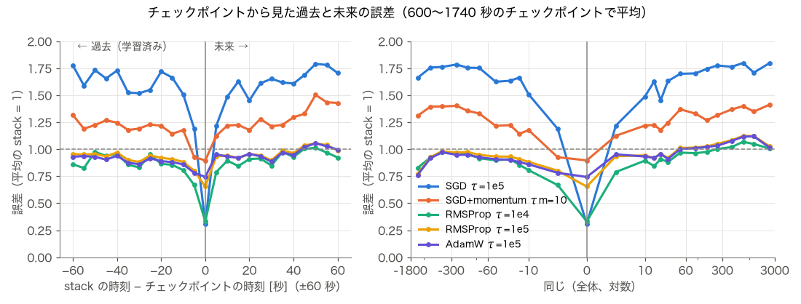
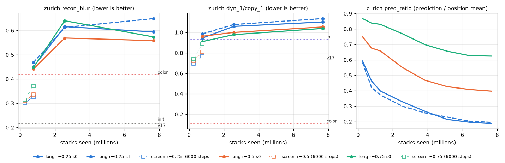

# vision: 単一ストリームから PC-ALM で VAE のエンコーダを学ぶ

計画は [PLAN.md](PLAN.md)、V0 の実装の仕様は [plans/v0-foundation.md](plans/v0-foundation.md)。V0〜V8 のまとめは [results/v0-v8.md](results/v0-v8.md)。V0〜V10 の結果を、学習の経過の図・描き戻した画像・注釈つきで読める 1 枚のページにまとめたものが [report.html](report.html)（ブラウザで開く）。V11〜V15（optimizer の研究）と V16（同じモデルを普通の深層学習で学んだ結果）は、図と表で読める [report-optim.html](report-optim.html) にまとめた。V17（1 本のストリームを 480 万 stack まで見せた結果と、連続する stack をまとめる学び方の検証）は [report-long.html](report-long.html) にまとめた。V18・V18b（BP と i.i.d. なミニバッチで JEPA を学んだ結果）と、JEPA の計画の全体と今後の進め方は、図と表で読める [report-jepa.html](report-jepa.html) にまとめた。`exp/video`（M0〜M18）の続きで、番号を V0 から振り直した。`exp/video` のコードは tag `video-final`（mujou 7a8b72e）にある。

## 実行方法

```bash
# 手元で 1 本
uv run python -m exp.vision.main +experiment=v0/base --out runs/x
# fleet（std-00〜03、mini-00 は試しだけ）
just fleet submit --batch <b> +experiment=v0/base --sweep optim.tau=1e5,1e6 --seeds 0
# posthoc（run の後、GPU のあるホストで。MUJOU_EXP_DATA はデータの置き場所）
MUJOU_EXP_DATA=/data/geson/mujou-exp/.fleet/data python -m exp.vision.eval <run_dir>
# bench（B = 1 の速さと GPU メモリ）
python -m exp.vision.bench --device cuda --frames 100
# optimizer ごとの bench（ViT-S だけ、勾配の計測つき）
python -m exp.vision.bench --device cuda --frames 100 --models vit_s optim=muon measure.grad_stats=true
# 勾配の計測（measure.grad_stats=true の run の grad.jsonl）の集計
python -m exp.vision.grad_table <run_dir> [...]
# OGD（V13）: sgd・rmsprop・adamw の一歩を、ogd_every 秒ごとに保持した直近 ogd_n 個の勾配に直交させる
just fleet submit --batch <b> +experiment=v0/base optim=rmsprop optim.tau=1e4 optim.ogd_n=16 optim.ogd_every=1 --seeds 0
# 幅と μP（V14）: ヘッドの次元は 64、デコーダも幅 / 256 倍
just fleet submit --batch <b> +experiment=v0/base optim=rmsprop model.width=512 model.scale_decoder=true model.param=mup --seeds 0
# coord check（幅 128〜1024、SP と μP、RMSProp τ = 1e4、最初の 100 フレーム）。GPU のホストで
just fleet x std-00 -- env MUJOU_EXP_DATA=/data/geson/mujou-exp/.fleet/data CUDA_VISIBLE_DEVICES=0 python -m exp.vision.coord_check --device cuda
```

## V0: 土台の確認（2026-11-18）

snapshot `f0d3cbe8bc0d`（mujou 3d26a3c、PR Geson-anko/mujou#123 のブランチ）。

### bench（$B$ = 1、100 フレーム、単位/秒。リアルタイムは 10）

| | ViT-S | ViT-M | ViT-L | ResNet-S | ResNet-M | ResNet-L |
| -- | -- | -- | -- | -- | -- | -- |
| エンコーダのパラメータ | 6.83M | 9.99M | 16.31M | 5.91M | 9.44M | 16.50M |
| 4090（std-00） | 6.38 | 6.24 | 6.16 | 6.35 | 6.31 | 6.14 |
| 5070 Ti（mini-00） | 5.52 | 5.47 | 5.44 | 5.49 | 5.49 | 5.64 |
| GPU メモリ（4090、MB） | 121 | 155 | 221 | 115 | 155 | 231 |

速さはモデルの大きさによらずほぼ同じで、1 フレーム 50 ステップ × 9 ノードの、ステップごとのオーバーヘッドで決まっているとみられる（未確認）。リアルタイムには届かない。1800 秒の run は 4090 で約 48 分。

### 試しの run（mini-00、v0/base、SGD $\tau$ = 1e5、120 秒、seed 0）

`v0-base-5804bbe3-s0`。120 秒のあいだ値はすべて有限。loss は 110814 → −38725、ln σ は −0.85 → −1.81 と下がった。

| t（秒） | stack_mse | recon_blur（4 seed の平均 ± sd） | dyn_1/copy_1 |
| -- | -- | -- | -- |
| 0 | 6.707 | 0.2849 ± 0.0041 | 0.880 |
| 60 | 1.115 | 0.2568 ± 0.0015 | 0.874 |
| 120 | 2.036 | 0.2538 ± 0.0052 | 0.875 |
| 画素の PCA（$D$ = 256） | | 0.0615 ± 0.0027 | 0.897 |

目視（`posthoc/00120.0.png`）: システムのデコーダは、120 秒の時点でどの窓にもほぼ同じ画像（空と暗い地面）を出し、まだ $z$ を使っていない。`stack_mse` が 1 を上回るのはこのため。

## V1: 出発点の設定は安定して学べるか（回す前に決めたこと、2026-11-18）

**問い**: v0/base（ViT-S、8 枚、64×64、SGD）で、1800 秒のあいだ発散せず、初期化時より下がる $\tau$ はあるか。あれば、その中で最も小さい $\tau$（最も大きい学習率）を以降の出発点にする。

**腕**: SGD の $\tau \in \{10^4, 10^5, 10^6, 10^7\}$、seed 0、1800 秒、std-00・02・03 の 4090（std-01 は GPU が見えないので外す）。posthoc は 0・60・300・600・1200・1800 秒の checkpoint。

**判定**（val、1800 秒と 0 秒の比べ）

- 安定: stream の全行が有限
- 学べた: 次の 3 つをすべて満たす
  - `stack_mse` が 0 秒より小さい
  - `recon_blur` の差が、2 点の標準誤差を合わせたものの 2 倍より大きい（$\Delta > 2\sqrt{(s_0^2 + s_1^2)/4}$、$s$ は 4 seed の sd）
  - `dyn_1/copy_1` が 0 秒より小さい
- 目視: システムのデコーダが窓ごとに違う画像を出しているかを書く（判定には入れない）

**予想**: $10^4$ は発散する（合成データで発散した）。$10^5$ は安定して学べる。$10^6$ は学べるが遅い。$10^7$ はほとんど動かず `recon_blur` で外れる。

**反証**: どの $\tau$ も「学べた」を満たさなければ、次は学習則より前の段（目的の式の重み、デコーダの形、`learn_interval`）を疑う。

## V1: 結果（2026-11-18）

batch `v1-tau`、snapshot `0b8a21ad1fde`。fleet が 4 本とも std-00 に置いたので、同じ GPU に 3 本が並び、1 本は約 3.7 単位/秒・約 80 分かかった（結果には影響しない。速さは V0 の bench の値で読む）。

### 判定

0 秒の行は 4 本で同じ（同じ初期値）: `stack_mse` 6.707、`recon_blur` 0.2820 ± 0.0006、`dyn_1/copy_1` 0.8798。

| $\tau$ | run | 安定 | `stack_mse`（1800 秒） | `recon_blur`（1800 秒） | 差 / 閾値 | `dyn_1/copy_1`（1800 秒） | 学べた |
| -- | -- | -- | -- | -- | -- | -- | -- |
| 1e4 | `v0-base-db27fa3b-s0` | ×（2 秒で非有限） | — | — | — | — | × |
| 1e5 | `v0-base-b53efc4f-s0` | ○ | 1.518 | 0.2175 ± 0.0027 | 0.0646 / 0.0028 | 0.7957 | ○ |
| 1e6 | `v0-base-13f529cf-s0` | ○ | 1.492 | 0.2402 ± 0.0032 | 0.0418 / 0.0032 | 0.8694 | ○ |
| 1e7 | `v0-base-0df71d0e-s0` | ○ | 0.954 | 0.2517 ± 0.0029 | 0.0303 / 0.0030 | 0.8806 | ×（`dyn_1/copy_1`） |
| 画素の PCA | | | | 0.0624 ± 0.0039 | | 0.8971 | |

規則の上では、学べた $\tau$ のうち最も小さいのは $10^5$ で、これが以降の出発点になる。予想は 1e4・1e5・1e6 が当たり、1e7 は外れた（`recon_blur` は下がり、`dyn_1/copy_1` で外れた）。

### 1e5 の経過（val）

| t（秒） | 0 | 60 | 300 | 600 | 1200 | 1800 |
| -- | -- | -- | -- | -- | -- | -- |
| `stack_mse` | 6.707 | 1.367 | 1.758 | 1.417 | 1.120 | 1.518 |
| `recon_blur` | 0.2820 | 0.2555 | 0.2416 | 0.2372 | 0.2213 | 0.2175 |
| `dyn_1/copy_1` | 0.880 | 0.874 | 0.870 | 0.865 | 0.836 | 0.796 |
| `copy_1` | 0.205 | 0.132 | 0.089 | 0.068 | 0.033 | 0.021 |
| 実効ランク | 80.6 | 43.8 | 28.1 | 23.8 | 12.7 | 10.2 |

### 目視と、判定に入れていない問題

- **システムのデコーダは $z$ を使っていない**。1e5 と 1e6 の 1800 秒（`posthoc/01800.0.png`）では、val の 10 窓のどれにも同じ画像を出す。その画像は Zurich ではなく、学習のストリームのその時刻の場面（水辺と木々）に見える。デコーダが、いま流れている場面の平均を自分のパラメータで追い、入力を描き戻していないと読める（未確認）。`stack_mse` が 1800 秒でも 1 を上回る（平均の stack より悪い）こととも合う
- 3 条件が下がったのは、主に符号の側の変化による。後から学ぶデコーダの `recon_blur` は 0.282 → 0.218 と下がったが、画素の PCA（0.062）には遠い
- 符号の実効ランクは 80.6 → 10.2 と縮み、`copy_1` も 0.205 → 0.021 と小さくなった。`dyn_1/copy_1` の低下は、符号がゆっくり動くようになったことと区別できていない

「初期化時より下がる」を 3 つとも満たしても、システムのデコーダは入力を描き戻していない。この基準だけでは、VAE が学べたかどうかを分けられない。

## V2〜V5: 決めた軸を出発点から 1 本ずつ動かす（回す前に決めたこと、2026-11-18）

ユーザーの指示（2026-11-18）: SGD だけでは何とも言えないので、計画で決めた軸を最後まで回す。

**出発点**: v0/base（ViT-S、8 枚、64×64、SGD $\tau = 10^5$、1800 秒、seed 0）。各軸はここから 1 つだけ動かす。どれも 1 seed の絞り込みで、軸の中の順位は参考とする。

| 軸 | 腕 | 本数 |
| -- | -- | -- |
| V2 モデル | ViT-M、ViT-L、ResNet-S、ResNet-M、ResNet-L（ViT-S は V1 の $\tau = 10^5$ の run） | 5 |
| V3 momentum | `sgd_momentum`、$\tau = 10^5$、$\tau_m \in \{0.1, 1, 10\}$ 秒 | 3 |
| V4 stack の枚数 | $n \in \{4, 8, 16\}$。$n = 16$ は既定の評価の窓（clips 256）が Zurich に収まらないので、3 本とも `measure.clips=128` にそろえる | 3 |
| V5 適応的な optimizer | RMSProp（$\tau_v$ = 30 秒）と AdamW（$\tau_m$ = 1 秒、$\tau_v$ = 30 秒、weight decay 0.01）、$\tau \in \{10^2, 10^3, 10^4\}$（1 フレームに 1 回学ぶので、要素ごとの一歩は約 $0.1/\tau$、つまり 1e-3・1e-4・1e-5） | 6 |

V2 で $\tau = 10^5$ が発散したモデルは、$\tau = 10^6$ で 1 本回し直す（事前に決めた手当て）。

**判定**（val、1800 秒と 0 秒の比べ。V1 の 3 条件に 1 つ足す）

- 安定: stream の全行が有限
- 学べた: 次の 4 つをすべて満たす
  - `stack_mse` が 0 秒より小さい
  - **`stack_mse` < 1**（新しく足す。システムのデコーダが学習の平均の stack より良い。V1 では 3 条件を満たしても、デコーダが窓によらず同じ画像を出していた）
  - `recon_blur` の差が、2 点の標準誤差を合わせたものの 2 倍より大きい
  - `dyn_1/copy_1` が 0 秒より小さい
- 診断（判定には入れない）: 直前 64 秒の学習のストリームの `recent_stack_mse`（同じ窓の初期化時の値と並べる）、システムのデコーダの出力の窓をまたいだばらつき `dec_spread`（val と直前の区間）、画像
- 軸の中の比べ: 学べた腕のうち 1800 秒の `recon_blur` を並べる。差が 2 点の標準誤差を合わせたものの 2 倍より小さいものは区別しない

V1 の 4 本も、足した診断の評価をかけ直す。

**予想**

- V2: どのモデルも `stack_mse` < 1 を満たさない（V1 のデコーダの問題は、エンコーダの大きさでは変わらない）。ResNet と ViT の差は区別できない
- V3: $\tau_m$ によらず V1 と区別できない
- V4: $n = 4$ の `recon_blur` が最も小さい
- V5: 少なくとも 1 本が `stack_mse` < 1 を満たし、SGD より `recon_blur` が小さい

**反証**: どの腕も `stack_mse` < 1 を満たさなければ、学習の設定ではなく、目的の式かストリームの非定常（デコーダがいまの場面を追う）を疑う。診断の `recent_stack_mse` と `dec_spread` で、そのどちらかを切り分ける。

## V2〜V5: 結果（2026-11-18）

batch `v2-model`・`v3-mom`・`v4-frames`・`v5-adapt`、snapshot `e605244269fa`（mujou 3d26a3c）。std-00〜03 に 4〜5 本ずつ置いた。1 台に posthoc と並んだので、1 本 108〜154 分かかった。V1 の 3 本にも、足した診断の posthoc をかけ直した。表は `uv run python -m exp.vision.tables runs/v1-tau runs/v2-model runs/v3-mom runs/v4-frames runs/v5-adapt` で出る。

### 判定

0 秒の行は、ViT-S・8 枚の run で V1 と同じ（`stack_mse` 6.707、`recon_blur` 0.2820 ± 0.0006、`dyn_1/copy_1` 0.880）。ほかの腕は自分の 0 秒と比べる。`dec_spread` は val の 10 窓をまたいだシステムのデコーダの出力のばらつき、`recent_stack_mse` は直前 64 秒の学習のストリームでの値（0 秒は約 6.0）。

| 軸 | 腕 | run | 安定 | `stack_mse` | `recon_blur` | `dyn_1/copy_1` | `dec_spread` | `recent_stack_mse` | 学べた |
| -- | -- | -- | -- | -- | -- | -- | -- | -- | -- |
| 出発点 | ViT-S（V1、$\tau = 10^5$） | `b53efc4f` | ○ | 1.518 | 0.2175 ± 0.0027 | 0.796 | 0.000 | 1.519 | ×（< 1） |
| V2 | ViT-M | `11558c6e` | ○ | 1.454 | 0.2075 ± 0.0020 | 0.776 | 0.000 | 1.509 | ×（< 1） |
| V2 | ViT-L | `708b0734` | ○ | 1.524 | 0.2195 ± 0.0034 | 0.729 | 0.000 | 1.597 | ×（< 1） |
| V2 | ResNet-S | `55cac856` | ×（2 秒） | — | — | — | — | — | × |
| V2 | ResNet-S、$\tau = 10^6$ | `b141533f` | ○ | 1.569 | 0.4518 ± 0.0342 | 0.849 → 0.945 | 0.004 | 1.617 | ×（< 1、dyn） |
| V2 | ResNet-M | `7be1356d` | ○ | 1.410 | 0.4794 ± 0.0285 | 0.810 → 0.976 | 0.000 | 1.468 | ×（< 1、dyn） |
| V2 | ResNet-L | `3ebb9431` | ×（5 秒） | — | — | — | — | — | × |
| V2 | ResNet-L、$\tau = 10^6$ | `1f33e6a3` | ○ | 1.348 | 0.4039 ± 0.0199 | 0.743 → 0.939 | 0.000 | 1.388 | ×（< 1、dyn） |
| V3 | $\tau_m$ = 0.1 秒 | `91caada9` | ○ | 1.476 | 0.2214 ± 0.0077 | 0.754 | 0.000 | 1.532 | ×（< 1） |
| V3 | $\tau_m$ = 1 秒 | `21dd4b43` | ○ | 1.383 | 0.2101 ± 0.0095 | 0.768 | 0.000 | 1.448 | ×（< 1） |
| V3 | $\tau_m$ = 10 秒 | `56381ae8` | ○ | 1.028 | 0.3191 ± 0.0058（0 秒より悪い） | 0.470 | 0.364 | 1.020 | ×（< 1、blur） |
| V4 | $n$ = 4 | `068e2adf` | ○ | 1.586 | 0.1747 ± 0.0025 | 0.877 → 0.811 | 0.001 | 1.680 | ×（< 1） |
| V4 | $n$ = 8 | `2980d7e2` | ○ | 1.493 | 0.2173 ± 0.0029 | 0.873 → 0.787 | 0.000 | 1.519 | ×（< 1） |
| V4 | $n$ = 16 | `f2c9a74d` | ○ | 1.028 | 0.2713 ± 0.0034（0 秒 0.3535） | 0.903 → 0.834 | 0.000 | 1.109 | ×（< 1） |
| V5 | RMSProp $\tau = 10^2$ | `d2b8821d` | ×（57 秒） | — | — | — | — | — | × |
| V5 | RMSProp $\tau = 10^3$ | `32201807` | ○ | 1.435 | 0.2045 ± 0.0061 | 0.523 | 0.000 | 1.482 | ×（< 1） |
| V5 | **RMSProp $\tau = 10^4$** | `22a7fda6` | ○ | **0.640** | 0.2312 ± 0.0031 | 0.729 | 0.284 | 0.635 | **○** |
| V5 | AdamW $\tau = 10^2$ | `e77b7a41` | ○ | 1.434 | 0.2931 ± 0.0072（0 秒より悪い） | 0.155 | 0.000 | 1.487 | ×（< 1、blur） |
| V5 | AdamW $\tau = 10^3$ | `c3f8e24a` | ○ | 1.342 | 0.2045 ± 0.0009 | 0.272 | 0.001 | 1.413 | ×（< 1） |
| V5 | AdamW $\tau = 10^4$ | `d0a03b18` | ○ | 1.004 | 0.2754 ± 0.0045 | 0.376 | 0.184 | 0.872 | ×（< 1） |

run は `v0-base-<id>-s0`。V4 の $n$ = 8 は V1 の 1e5 と同じ設定（評価の窓だけ clips 128）で、`recon_blur` は 0.2173 と 0.2175 で一致した。

予想との比べ

- V2: どのモデルも `stack_mse` < 1 を満たさない、は当たった。ResNet と ViT は区別できない、は外れた。ResNet は S・L が $\tau = 10^5$ で数秒で発散し、3 つとも `recon_blur` が 0.40〜0.48 と ViT（0.21〜0.22）より大きく、`dyn_1/copy_1` は 0 秒より上がった
- V3: $\tau_m$ = 0.1・1 秒は V1 と区別できない、は当たった。10 秒は外れた（`recon_blur` が 0 秒より悪い）
- V4: $n$ = 4 の `recon_blur` が最も小さい、は当たった（0.175 < 0.217 < 0.271）
- V5: 少なくとも 1 本が `stack_mse` < 1 を満たす、は当たった（RMSProp $10^4$）。SGD より `recon_blur` が小さい、は外れた（0.231 対 0.218）

### 目視（1800 秒、`posthoc/01800.0.png` と `-recent.png`）

- **RMSProp $\tau = 10^4$**: システムのデコーダが、val の窓ごとに違う画像を出す。左に木の暗い塊がある最初の 3 窓と、空と建物が並ぶ残りの窓で、明暗の配置が変わる。細部は無く、ぼやけた明暗の配置だけ。直前 64 秒でも、屋内の暗い窓と屋外の窓で出力が変わる。`stack_mse` は 600 秒から下がり始め、1.120（600 秒）→ 0.758（1200 秒）→ 0.640（1800 秒）と、まだ下がっている
- **ResNet-M**: システムのデコーダが、どの窓にも学習のストリームの場面（水辺と木々）をくっきり描く。V1 の ViT-S より鮮明に、いまの場面を自分のパラメータで覚えている
- **momentum $\tau_m$ = 10 秒・AdamW $\tau = 10^4$**: 窓ごとに出力が変わるが、形が崩れた明暗の塊（momentum）か、最初の 3 窓だけが違う（AdamW）
- ほかの腕: V1 と同じく、どの窓にも同じ画像を出す

### 読み

- **`dec_spread` ≈ 0 の腕では、システムのデコーダが $z$ を使っていない**。止めた checkpoint では、直前 64 秒の学習のストリームでも `recent_stack_mse` が 1.4〜1.6 になる
- **ただし、走っている最中のデコーダの誤差は小さい**。最後の 60 秒の stream の `sq` / $P$ は、ほとんどの腕で 0.025 前後で、val の平均の stack の誤差 / $P$（0.0696）で割ると約 0.37 になる（学習のストリームの平均の stack で割ったものではないので目安）。止めた重みでは 64 秒前の場面を描けず、走りながらなら描ける。デコーダは $z$ ではなく自分のパラメータで、数秒〜数十秒の時間で、いまの場面を追っていると読める。（この節の最初の版では、`recent_stack_mse` を根拠に「いまの場面を覚えているだけ」を否定していた。直前 64 秒の窓は場面をいくつもまたぐので、この診断では否定できない。訂正する）
- **KL はつぶれていない**。学習の最後の 60 秒の KL は、どの腕でも 300〜700 nat ある。後から学ぶデコーダは $z$ から 0.20〜0.23 まで描き戻せるので、符号には入力の情報がある
- **KL と再構成の釣り合いが腕ごとに違う**。係数 $\beta$ は置いておらず、学ぶ $\sigma$ が釣り合いを決める（$\sigma$ を 1 にした $\beta$-VAE の $\beta = 2\sigma^2$ と同じ）。1800 秒の $\sigma^2$ は、SGD の腕で 0.006〜0.011、RMSProp $10^4$ で 0.054、AdamW で 0.030〜0.057 と、最大で 9 倍違う。どの腕でも、stream の誤差 / $P$（0.025〜0.054）とずれており、$\sigma$ は最尤の値まで来ていない。$z$ を使い始めた RMSProp $10^4$ は、$\sigma^2$ が大きい側（KL が相対的に強く、デコーダの再構成の勾配が小さい側）にある。optimizer の効果と釣り合いの効果は、いまの腕では分けられない
- **適応的な optimizer の大きい $\tau$ でだけ、デコーダが $z$ を使い始めた**（RMSProp $10^4$、AdamW $10^4$ の一部）。要素ごとに一歩を揃えるので、勾配の小さい $z$ の経路の重みも動く、という読みと合う（未確認）
- **符号の実効ランクの崩れ**: AdamW $10^2$ は 1.2、RMSProp・AdamW $10^3$ は 3.5 まで縮み、`dyn_1/copy_1` が 0.16〜0.52 まで下がった。符号がほとんど動かず、線形の動力学が当てやすくなっただけで、`recon_blur` は下がらないか少ししか下がらない。`dyn_1/copy_1` の低下を、そのまま良い符号と読んではいけない

V2〜V5 の判定で学べたのは RMSProp $\tau = 10^4$ の 1 本だけで、1 seed。次は V6 で、seed を足して確かめ、$\tau$ を上へ広げる。

## V6: RMSProp $\tau = 10^4$ は seed によらず学べるか（回す前に決めたこと、2026-11-18）

**問い**: V5 で唯一学べた RMSProp $\tau = 10^4$ は、seed を変えても学べるか。$\tau$ を 1 桁上げるとどうなるか。

**腕**（v0/base から optimizer だけ変える、1800 秒、std-00〜03 に 1 本ずつ）

| 腕 | seed |
| -- | -- |
| RMSProp $\tau = 10^4$ | 1、2 |
| RMSProp $\tau = 10^5$ | 0 |
| AdamW $\tau = 10^5$ | 0 |

**判定**: V2〜V5 と同じ（4 条件、診断は判定に入れない）。

**予想**

- RMSProp $10^4$ は seed 1・2 とも学べる
- RMSProp $10^5$ は安定するが、1800 秒では `stack_mse` が 1 を下回らない（$10^4$ でも 1 を切ったのは 600〜1200 秒の間）
- AdamW $10^5$ は窓ごとに違う画像を出し始める（`dec_spread` > 0.1）が、`stack_mse` < 1 は満たさない

**反証**: seed 1・2 のどちらかが `stack_mse` < 1 を満たさなければ、V5 の結果は seed の偶然とみなし、適応的な optimizer で学べるとは言わない。

## V6: 結果（2026-11-18）

batch `v6-rms`、snapshot `358f87399dfb`。1 台に 1 本ずつ置き、1 本 50〜51 分で終わった。4 本とも発散しなかった。

| 腕 | run | `stack_mse`（0 → 1800 秒） | `recon_blur` | 差 / 閾値 | `dyn_1/copy_1` | `dec_spread` | 1800 秒の $\sigma^2$ | 学べた |
| -- | -- | -- | -- | -- | -- | -- | -- | -- |
| RMSProp $10^4$、seed 0（V5） | `22a7fda6-s0` | 6.707 → 0.640 | 0.2312 ± 0.0031 | 0.0508 / 0.0032 | 0.880 → 0.729 | 0.284 | 0.054 | ○ |
| RMSProp $10^4$、seed 1 | `06c0f687-s1` | 7.704 → 0.673 | 0.2239 ± 0.0019 | 0.0607 / 0.0031 | 0.878 → 0.735 | 0.242 | 0.054 | ○ |
| RMSProp $10^4$、seed 2 | `06c0f687-s2` | 6.958 → 0.676 | 0.2332 ± 0.0020 | 0.0527 / 0.0054 | 0.877 → 0.726 | 0.245 | 0.054 | ○ |
| RMSProp $10^5$ | `3b9a274d-s0` | 6.707 → 0.708 | 0.2382 ± 0.0041 | 0.0438 / 0.0042 | 0.880 → 0.881 | 0.308 | 0.073 | ×（`dyn_1/copy_1`） |
| AdamW $10^5$ | `8a3f253a-s0` | 6.707 → 0.685 | 0.2331 ± 0.0044 | 0.0489 / 0.0044 | 0.880 → 0.875 | 0.307 | 0.073 | ○ |

run は `v0-base-<id>`。seed を変えると初期値が変わるので、0 秒の行も seed ごとに違う。

予想との比べ

- RMSProp $10^4$ は seed 1・2 とも学べる、は当たった。3 つの seed の `stack_mse` は 0.640〜0.676、`dec_spread` は 0.24〜0.28 とそろった。V5 の結果は seed の偶然ではない
- RMSProp $10^5$ は `stack_mse` が 1 を下回らない、は外れた（0.708）。`dyn_1/copy_1` が下がらず、「学べた」には入らない
- AdamW $10^5$ は `stack_mse` < 1 を満たさない、は外れた（0.685 で、4 条件を満たした。`dyn_1/copy_1` の下がりは 0.880 → 0.875 とわずか）

$\tau = 10^5$ の 2 本では、$\sigma^2$ が 1800 秒でも初期値（0.0743）からほとんど動いていない。V1〜V6 で `stack_mse` が 0.75 を下回った 5 本（RMSProp $10^4$ の 3 本、RMSProp・AdamW $10^5$）は、どれも 1800 秒の $\sigma^2$ が 0.054〜0.073 だった。ただし、$\sigma^2$ が 0.029 の SGD $10^7$（V1）と momentum $\tau_m$ = 10 秒（V3）でも、`dec_spread` は 0.1 を超えた（0.125、0.364）。$\sigma^2$ だけでは決まらない。釣り合いの効果と optimizer の効果は、V7 で分ける。

## V7: KL と再構成の釣り合い（$\sigma$ の固定）（回す前に決めたこと、2026-11-18）

**問い**: V2〜V5 では、学ぶ $\sigma$ が KL と再構成の釣り合いを決めていた。1800 秒の $\sigma^2$ は腕ごとに最大 9 倍違い、optimizer の効果と分けられなかった。$\sigma$ を固定して釣り合いをそろえたとき、システムのデコーダは $z$ を使うか。それは optimizer によるか。

**変更**: `model.learn_sigma=false` で $\ln\sigma$ を学ばず、$\sigma^2$ を `model.sigma0_sq` に固定する（テストで、$\ln\sigma$ が動かず、ほかのパラメータは固定した $\sigma$ での −ELBO の BP の勾配で学ぶことを確かめた）。$\sigma$ を 1 にした $\beta$-VAE の $\beta = 2\sigma^2$ にあたる。

**腕**（v0/base から、1800 秒、seed 0）

| | $\sigma^2$ = 0.01 | $\sigma^2$ = 0.03 | $\sigma^2$ = 0.1 |
| -- | -- | -- | -- |
| SGD $\tau = 10^5$ | 1 本 | 1 本 | 1 本 |
| RMSProp $\tau = 10^4$ | 1 本 | 1 本 | 1 本 |

- 0.01: SGD の腕が 1800 秒で学んでいた $\sigma^2$（0.006〜0.011）
- 0.03: 走りながらの誤差 / 画素（約 0.025）に近い値。最尤の $\sigma^2$ の目安
- 0.1: 平均の stack のまわりの分散（$\sigma_0^2$ = 0.0743）より上。RMSProp $10^4$ の 0.054 より大きい

SGD では、$\sigma^2$ を大きくすると再構成の勾配が $1/\sigma^2$ で小さくなり、再構成の側の実効の学習率も下がる（KL の側は変わらない）。RMSProp は要素ごとに一歩をそろえるので、$\sigma$ の効果は、主にエンコーダの出力で KL と再構成の勾配が釣り合う位置を通して出る。

**判定**: V2〜V5 と同じ 4 条件。あわせて `dec_spread` と、走りながらの誤差（stream の `sq` / $P$）を並べる。

**予想**

- SGD: $\sigma^2$ = 0.01 は V1 と同じく学べない。0.1 では `dec_spread` > 0.1 になる（デコーダが重みで場面を追う力が弱まり、$z$ を使い始める）
- RMSProp: 0.03 と 0.1 は学べる。0.01 は学べない
- どちらの optimizer でも、$\sigma^2$ が大きいほど `dec_spread` が大きい

**反証と次の手**

- SGD の 0.1 が学べたら、V5 の「RMSProp で学べた」は、主に釣り合いの効果とみなす
- RMSProp の 0.01 でも学べたら、釣り合いではなく optimizer の効果とみなす
- どの腕も `dec_spread` ≈ 0 なら、釣り合いでは説明できない。そのときは、デコーダが重みで場面を追う速さ（デコーダだけ $\tau$ を大きくする）を疑う

## V7: 結果（2026-11-18）

batch `v7-sigma`、snapshot `b6a97b1`（mujou 3d26a3c）。6 本のうち 4 本が終わり、2 本が発散した。

| optimizer | 固定した $\sigma^2$ | run | 安定 | `stack_mse`（1800 秒） | `recon_blur` | `dyn_1/copy_1` | `dec_spread` | 学べた |
| -- | -- | -- | -- | -- | -- | -- | -- | -- |
| SGD $10^5$ | 0.01 | `087311d1` | ×（1 秒で非有限） | — | — | — | — | × |
| SGD $10^5$ | 0.03 | `70567fe8` | ×（2 秒で非有限） | — | — | — | — | × |
| SGD $10^5$ | 0.1 | `794cf7df` | ○ | 1.413 | 0.2305 ± 0.0027 | 0.859 | 0.001 | ×（< 1） |
| RMSProp $10^4$ | 0.01 | `8a3d6f22` | ○ | 0.664 | 0.2313 ± 0.0047 | 0.756 | 0.289 | ○ |
| RMSProp $10^4$ | 0.03 | `c680cf0e` | ○ | 0.654 | 0.2318 ± 0.0044 | 0.739 | 0.279 | ○ |
| RMSProp $10^4$ | 0.1 | `598cc9e6` | ○ | 0.678 | 0.2275 ± 0.0038 | 0.726 | 0.236 | ○ |

run は `v0-base-<id>-s0`。0 秒の行は V1 と同じ。

予想との比べ

- SGD の 0.01 は学べない、は当たった。ただし予想していたのは V1 と同じ「学べない」で、発散は予想していなかった。0.03 も発散した。$\sigma$ を学ぶ run では $\sigma^2$ が 0.0743 から少しずつ下がるが、固定すると最初から再構成の勾配が $0.0743/\sigma^2$ 倍になり、$\tau = 10^5$ では大きすぎた
- SGD の 0.1 で `dec_spread` > 0.1 になる、は外れた（0.001）。どの窓にも同じ画像を出す
- RMSProp の 0.03 と 0.1 が学べる、は当たった。0.01 は学べない、は外れた（0.664 で学べた）
- $\sigma^2$ が大きいほど `dec_spread` が大きい、は外れた。RMSProp の 3 本は 0.236〜0.289 で、むしろ 0.1 が最も小さい

**判定**: 事前に決めた反証の規則で、RMSProp の 0.01 でも学べたので、V5 の「RMSProp で学べた」は**釣り合いではなく optimizer の効果**とみなす。RMSProp では、$\sigma^2$ を 10 倍変えても `stack_mse`（0.654〜0.678）、`recon_blur`（0.228〜0.232）、`dec_spread` はほとんど変わらない。SGD は、$\sigma^2$ を V1 の 10 倍（0.1）にしても、デコーダが $z$ を使わない。

**補足（2026-11-19、資料を作る中で気づいたこと）**: SGD の $\sigma^2$ は 1 秒ごとに大きく揺れる（V1 の $\tau = 10^5$ では、600 秒以降も 0.003〜0.11）。V2〜V5 の読みに書いた「1800 秒の $\sigma^2$」（SGD の腕で 0.006〜0.011）は 1800 秒ちょうどの 1 点の値で、最後の 60 秒の平均は、$\tau = 10^5$〜$10^6$ の SGD（V1〜V4）で 0.025〜0.029 だった。RMSProp $10^4$ は 0.054 で、ほとんど揺れない。V7 は 0.01・0.03・0.1 をすべて試したので、この判定は変わらない。

## V8: 学習のストリームそのもので評価し直す（回す前に決めたこと、2026-11-19）

ユーザーの指摘（2026-11-19）: ストリームから学ぶとは学び続けることなので、学習に使ったデータ全体で評価する。過去の損失が大きければ忘れている。未来の損失が小さければ汎化している。今の損失は、ある程度学ぶまで意味を持たない。

**評価**（`python -m exp.vision.stream_eval <run_dir>`、`posthoc_stream/`）

- 学習のストリーム（Amsterdam の先頭から）の 5 秒ごとの stack と、run の後の 3000 秒（Amsterdam の続き）の 10 秒ごとの stack で、システムのデコーダの誤差を測る。平均の stack を 1 とする
- チェックポイントを 60 秒ごと（31 個）にし、各チェックポイントで過去（見た時期で 4 つ）と未来（来る時期で 4 つ）の誤差を出す
- 忘却: 過去の誤差から、その stack を学んだときの誤差（`stream.jsonl` の `sq`、学ぶ前の誤差。近似）を引く
- `recon_blur` と `dyn_1/copy_1`: 学習区間を 10 秒ずつに分け、奇数番目で当てはめ、偶数番目（span）、run の後（after）、Zurich で測る。0・60・300・600・1200・1800 秒のチェックポイントだけ

**run**: V1〜V7 の、発散しなかった設定 26 本を、`measure.ckpt_every=60` で回し直す（学習は同じ設定。V4 の 8 枚は V1 の $\tau = 10^5$ と同じなので省く）。batch は `v8-tau`・`v8-model`・`v8-mom`・`v8-frames`・`v8-adapt`・`v8-rms`・`v8-sigma`。

**判定**（1800 秒と 0 秒の比べ。すべて満たせば「学べた」）

1. span（学習区間の全体。1800 秒ではすべて過去）の誤差が 0 秒より小さく、1 より小さい
2. after（run の後の Amsterdam）の誤差が 0 秒より小さい
3. span の `recon_blur` が、0 秒より、標準誤差を合わせたものの 2 倍を超えて小さい
4. span の `dyn_1/copy_1` が 0 秒より小さい

Zurich の値と、見た時期ごとの忘却は、判定に入れずに並べる。

**予想**

- SGD の run（V1〜V4、V7 の SGD）は、1 で外れる。今（直前 10 秒）の誤差は小さいが、5 分以上前の誤差は学んだときより大きい（忘却が大きい）
- V2〜V7 で Zurich で学べた run（RMSProp $10^4$ の 6 本、AdamW $10^5$）は、4 条件を満たす。忘却は SGD より小さい
- after の誤差は、学べた run で 1 を下回る

**反証**: 学べた run でも 5 分以上前の忘却が SGD と変わらなければ、「RMSProp は $z$ を通して覚えている」という読みは成り立たない。

## V8: 結果（2026-11-19）

batch `v8-tau`・`v8-model`・`v8-mom`・`v8-frames`・`v8-adapt`・`v8-rms`・`v8-sigma`、snapshot `2ee162ca33aa`（mujou 3d26a3c）。26 本とも発散せず、評価まで終わった。1 台に 6〜7 本を同時に置き、1 本 2.5〜3 時間かかった。

チェックポイントの間隔は学習を変えない。V7 の RMSProp・$\sigma^2$ = 0.03 の run（チェックポイント 6 個）と、同じ設定を V8 で回し直した run（60 秒ごと）では、1800 秒の評価の値が完全に一致した。

### 判定

| batch | 腕 | run | span 0 → 1800 | after 0 → 1800 | 今（学習中） | 忘却 10–60 / 60–300 / 300– 秒 | `recon_blur` span（差 / 閾値） | `dyn_1/copy_1` span | rank | 学べた |
| -- | -- | -- | -- | -- | -- | -- | -- | -- | -- | -- |
| `v8-tau` | SGD $10^{6}$ | `0b563aac-s0` | 6.587 → 1.748 | 7.060 → 1.676 | 0.42（0.18） | 1.47 / 1.43 / 1.37 | 0.451（0.067 / 0.007） | 0.994 → 1.010 | 27.5 | ×（span_lt1, dyn_down） |
| `v8-tau` | SGD $10^{5}$ | `ba9d09f2-s0` | 6.587 → 1.675 | 7.060 → 1.602 | 0.53（0.17） | 1.43 / 1.36 / 1.33 | 0.428（0.090 / 0.006） | 0.994 → 0.910 | 9.1 | ×（span_lt1） |
| `v8-tau` | SGD $10^{7}$ | `beccd61d-s0` | 6.587 → 1.154 | 7.060 → 1.142 | 0.30（0.26） | 0.79 / 0.74 / 0.52 | 0.447（0.070 / 0.005） | 0.994 → 1.009 | 33.8 | ×（span_lt1, dyn_down） |
| `v8-model` | SGD $10^{6}$、ResNet-S | `17a1aa1e-s0` | 6.551 → 1.844 | 7.006 → 1.772 | 0.42（0.17） | 1.56 / 1.55 / 1.49 | 0.580（0.231 / 0.008） | 0.922 → 1.091 | 14.9 | ×（span_lt1, dyn_down） |
| `v8-model` | SGD $10^{5}$、ViT-L | `1dc764f3-s0` | 6.495 → 1.827 | 6.965 → 1.756 | 0.42（0.18） | 1.57 / 1.52 / 1.48 | 0.397（0.120 / 0.004） | 0.995 → 0.805 | 6.2 | ×（span_lt1） |
| `v8-model` | SGD $10^{6}$、ResNet-L | `70dc1ca5-s0` | 6.472 → 1.589 | 6.923 → 1.512 | 0.40（0.16） | 1.28 / 1.26 / 1.24 | 0.580（0.441 / 0.007） | 0.769 → 1.115 | 8.7 | ×（span_lt1, dyn_down） |
| `v8-model` | SGD $10^{5}$、ViT-M | `83fdc0d0-s0` | 6.510 → 1.717 | 6.963 → 1.641 | 0.40（0.18） | 1.42 / 1.40 / 1.37 | 0.405（0.108 / 0.007） | 0.997 → 0.874 | 7.5 | ×（span_lt1） |
| `v8-model` | SGD $10^{5}$、ResNet-M | `f0a25307-s0` | 6.514 → 1.679 | 6.966 → 1.601 | 0.39（0.18） | 1.40 / 1.37 / 1.34 | 0.573（0.321 / 0.013） | 0.874 → 1.091 | 3.0 | ×（span_lt1, dyn_down） |
| `v8-mom` | SGD+mom $10^{5}$、$\tau_m$ = 10 秒 | `5384f9c6-s0` | 6.587 → 1.057 | 7.060 → 1.072 | 0.64（0.68） | 0.18 / 0.20 / 0.03 | 0.489（0.029 / 0.009） | 0.994 → 0.499 | 2.7 | ×（span_lt1） |
| `v8-mom` | SGD+mom $10^{5}$、$\tau_m$ = 0.1 秒 | `6c9f4e0c-s0` | 6.587 → 1.741 | 7.060 → 1.669 | 0.41（0.14） | 1.46 / 1.44 / 1.42 | 0.417（0.101 / 0.008） | 0.994 → 0.821 | 7.4 | ×（span_lt1） |
| `v8-mom` | SGD+mom $10^{5}$、$\tau_m$ = 1 秒 | `d88c1a7e-s0` | 6.587 → 1.637 | 7.060 → 1.559 | 0.41（0.26） | 1.08 / 1.01 / 1.04 | 0.410（0.108 / 0.007） | 0.994 → 0.871 | 8.1 | ×（span_lt1） |
| `v8-frames` | SGD $10^{5}$、16 枚 | `e1d882d4-s0` | 7.326 → 1.332 | 7.889 → 1.251 | 0.52（0.21） | 0.83 / 0.90 / 0.98 | 0.545（0.059 / 0.008） | 1.015 → 0.985 | 11.1 | ×（span_lt1） |
| `v8-frames` | SGD $10^{5}$、4 枚 | `eeb0acea-s0` | 6.174 → 1.914 | 6.636 → 1.847 | 0.42（0.15） | 1.66 / 1.64 / 1.58 | 0.330（0.106 / 0.005） | 0.972 → 0.874 | 8.9 | ×（span_lt1） |
| `v8-adapt` | RMSProp $10^{4}$ | `142ba038-s0` | 6.587 → 0.708 | 7.060 → 0.722 | 0.27（0.18） | 0.28 / 0.35 / 0.24 | 0.449（0.069 / 0.006） | 0.994 → 0.835 | 23.6 | ○ |
| `v8-adapt` | AdamW $10^{4}$ | `1e8c5cd4-s0` | 6.587 → 1.082 | 7.060 → 1.097 | 0.34（0.31） | 0.36 / 0.50 / 0.33 | 0.480（0.038 / 0.007） | 0.994 → 0.392 | 6.2 | ×（span_lt1） |
| `v8-adapt` | AdamW $10^{2}$ | `3134d88d-s0` | 6.587 → 1.690 | 7.060 → 1.618 | 0.43（0.24） | 1.14 / 1.14 / 1.17 | 0.416（0.101 / 0.012） | 0.994 → 0.171 | 1.2 | ×（span_lt1） |
| `v8-adapt` | RMSProp $10^{3}$ | `d1c13c4c-s0` | 6.587 → 1.679 | 7.060 → 1.605 | 0.41（0.16） | 1.41 / 1.37 / 1.32 | 0.367（0.151 / 0.008） | 0.994 → 0.562 | 3.5 | ×（span_lt1） |
| `v8-adapt` | AdamW $10^{3}$ | `d1e4c8c2-s0` | 6.587 → 1.571 | 7.060 → 1.495 | 0.43（0.28） | 1.04 / 0.98 / 1.00 | 0.358（0.160 / 0.007） | 0.994 → 0.296 | 3.4 | ×（span_lt1） |
| `v8-rms` | RMSProp $10^{4}$、seed 1 | `142ba038-s1` | 7.611 → 0.736 | 8.163 → 0.752 | 0.29（0.19） | 0.25 / 0.39 / 0.24 | 0.439（0.075 / 0.007） | 0.989 → 0.839 | 23.8 | ○ |
| `v8-rms` | RMSProp $10^{4}$、seed 2 | `142ba038-s2` | 6.821 → 0.778 | 7.325 → 0.808 | 0.27（0.18） | 0.29 / 0.46 / 0.29 | 0.447（0.067 / 0.009） | 0.993 → 0.828 | 23.1 | ○ |
| `v8-rms` | RMSProp $10^{5}$ | `27b254cc-s0` | 6.587 → 0.784 | 7.060 → 0.803 | 0.44（0.41） | 0.09 / 0.21 / -0.62 | 0.436（0.082 / 0.007） | 0.994 → 1.005 | 25.3 | ×（dyn_down） |
| `v8-rms` | AdamW $10^{5}$ | `edf05c88-s0` | 6.587 → 0.760 | 7.060 → 0.775 | 0.48（0.48） | 0.01 / 0.11 / -0.74 | 0.428（0.090 / 0.006） | 0.994 → 0.988 | 19.5 | ○ |
| `v8-sigma` | SGD $10^{5}$、$\sigma^2$ = 0.1 | `1e29d313-s0` | 6.587 → 1.660 | 7.060 → 1.585 | 0.41（0.16） | 1.42 / 1.35 / 1.31 | 0.454（0.064 / 0.006） | 0.994 → 0.993 | 20.0 | ×（span_lt1） |
| `v8-sigma` | RMSProp $10^{4}$、$\sigma^2$ = 0.03 | `72a3fbfb-s0` | 6.587 → 0.725 | 7.060 → 0.739 | 0.27（0.17） | 0.26 / 0.39 / 0.26 | 0.448（0.069 / 0.005） | 0.994 → 0.854 | 24.3 | ○ |
| `v8-sigma` | RMSProp $10^{4}$、$\sigma^2$ = 0.1 | `af1f022c-s0` | 6.587 → 0.750 | 7.060 → 0.763 | 0.26（0.19） | 0.31 / 0.39 / 0.27 | 0.444（0.074 / 0.007） | 0.994 → 0.839 | 25.2 | ○ |
| `v8-sigma` | RMSProp $10^{4}$、$\sigma^2$ = 0.01 | `d2f68082-s0` | 6.587 → 0.728 | 7.060 → 0.736 | 0.29（0.17） | 0.29 / 0.38 / 0.26 | 0.446（0.072 / 0.010） | 0.994 → 0.867 | 24.8 | ○ |

run は `v0-base-<id>`。値はどれも、平均の stack を出したときの誤差を 1 とする。

- span・after: 学習区間（0〜1800 秒）と、その後の Amsterdam（1800〜4800 秒）の誤差
- 今（学習中）: 1800 秒の直前 10 秒の stack の誤差（stack は 2 つ）。括弧の中は、その stack が流れたときの学習中の誤差
- 忘却: 見た時期ごとに、1800 秒の誤差から、流れたときの学習中の誤差を引いたもの
- 0 秒の値は、seed 0 の run どうしで同じ（6.587、7.060）

**予想との比べ**

- SGD の run は条件 1 で外れる、は当たった。SGD の 14 本は、どれも span が 1 を上回った（1.06〜1.91）
- SGD は、今の誤差は小さいが、5 分以上前の誤差は学んだときより大きい、も当たった。ただし、忘れるまでの時間は 5 分ではなく、数秒だった（次の節）
- RMSProp $10^4$ の 6 本と AdamW $10^5$ は 4 条件を満たし、忘却は SGD より小さい、は当たった。300 秒以上前の忘却は、RMSProp $10^4$ の 6 本で 0.24〜0.29、SGD $10^5$ で 1.33 だった。SGD の 14 本にも、忘却の小さい run が 2 本ある（momentum $\tau_m$ = 10 秒の 0.03、SGD $10^7$ の 0.52）。どちらも学ぶのが遅い run で、span は 1 を下回らない（1.06、1.15）
- after は、学べた run で 1 を下回る、も当たった（0.722〜0.808）

RMSProp $10^5$ は、V6 と同じく `dyn_1/copy_1` だけが下がらなかった（0.994 → 1.005）。反証の条件（学べた run の忘却が SGD と変わらない）には当たらない。学べた run は、Zurich で判定した V2〜V7 と同じ 7 本になった。

### チェックポイントから見た相対時刻ごとの誤差（判定には入れない）



stack の時刻からチェックポイントの時刻を引いたもの（相対時刻）ごとに、誤差を平均した。負は過去（学習済み）、正は未来である。600〜1740 秒の 20 個のチェックポイントで平均した（`results/v8/figs.py`）。

| run | −1800〜−300 | −300〜−60 | −60〜−15 | −10 | −5 | 0 | +5 | +10 | +15〜+60 | +60〜+300 | +300〜+3000 |
| -- | -- | -- | -- | -- | -- | -- | -- | -- | -- | -- | -- |
| SGD $10^5$ | 1.72 | 1.77 | 1.64 | 1.51 | 1.19 | 0.31 | 1.22 | 1.49 | 1.66 | 1.74 | 1.76 |
| SGD+momentum $\tau_m$ = 10 秒 | 1.37 | 1.37 | 1.23 | 1.18 | 0.93 | 0.90 | 1.12 | 1.22 | 1.32 | 1.30 | 1.38 |
| RMSProp $10^4$ | 0.91 | 0.95 | 0.89 | 0.81 | 0.67 | 0.33 | 0.79 | 0.89 | 0.94 | 0.98 | 1.00 |
| RMSProp $10^5$ | 0.90 | 0.96 | 0.93 | 0.88 | 0.80 | 0.65 | 0.94 | 0.94 | 0.98 | 1.03 | 1.04 |
| AdamW $10^5$ | 0.89 | 0.94 | 0.91 | 0.86 | 0.78 | 0.74 | 0.95 | 0.93 | 0.97 | 1.02 | 1.03 |

1. **相対時刻 0 の誤差は、学習中の誤差とほぼ同じ。** 相対時刻 0 は、チェックポイントの瞬間に流れていた stack である。SGD は 0.31、RMSProp $10^4$ は 0.33 で、同じ時期の学習中の誤差（0.31、0.35）とほぼ同じだった。止めたモデルで測る誤差と学習中の誤差は、測り方が違う（学習中は潜在の活動が直前のフレームの誤差で引き寄せられている）。しかし違いは小さいので、表の「忘却」はそのまま忘却として読める
2. **SGD は数秒で忘れる。** 5 秒離れると 1.19、10 秒で 1.51 になり、それより遠くでは 1.6〜1.8 になる。過去と未来がほぼ対称で、過去の方が良いということがない。SGD の重みにあるのは今の場面だけで、学んだものは残っていない。1800 秒のシステムのデコーダは、どの入力にもその時点の運河の場面を出す（下の図の 2 段目）
3. **RMSProp $10^4$ も今の場面を重みで追うが、その下に残るものがある。** 相対時刻 0 で 0.33 まで下がり、離れても 0.8〜1.0 にとどまる。60 秒より前（0.91〜0.95）と 60 秒より先（0.98〜1.00）の差は小さい。学んだものの多くは、見た場面に限らず、まだ見ていない場面にも効く
4. **RMSProp $10^5$ と AdamW $10^5$ は、今の場面を追う力が弱く、そのぶん忘れにくい。** 相対時刻 0 の下がりは小さい（0.65、0.74）。判定の表で 300 秒以上前の忘却が負になるのは、学習の初めの stack を、流れたとき（まだ学べていなかった時期）より今の方がよく描けるからである
5. **同じ stack を、見た直後と後で比べても、同じことが分かる。** stack を見た直後のチェックポイントと、それより後のチェックポイントの誤差の差を、経過時間ごとに平均した。RMSProp $10^4$ は、2 分後に +0.11、10〜20 分後に −0.28、20〜30 分後に −0.55 だった。長い目で見ると、前に見たものもよく描けるようになる。SGD は、2 分以後ずっと +0.18〜+0.35 だった。60 秒ごとのチェックポイントでは、SGD は見た直後のチェックポイントまでにすでに忘れている。そのため、この差は数秒で起きる忘却を含まない

| RMSProp $10^4$（1800 秒、span） | SGD $10^5$（1800 秒、span） |
| -- | -- |
|  |  |

各図の 1 段目は本物の最後の 1 枚、2 段目はシステムのデコーダ、3 段目は後から学んだデコーダ（seed 0）。学習区間から等間隔に 10 個選んだ。

### 学習の経過


- SGD は、300 秒までに約 1.7 まで下がって止まる。その後はチェックポイントごとに 1.3〜2.7 と大きく揺れる。出力がそのときの場面で決まるからである
- RMSProp $10^4$ は、最初の 60 秒で 2 を下回り、その後も下がり続ける。ときどき跳ね上がる（1140 秒、1500 秒）
- RMSProp $10^5$ と AdamW $10^5$ は、滑らかにゆっくり下がり、900 秒ごろに RMSProp $10^4$ に並ぶ
- 学べた run は、1800 秒でもまだ下がっている。RMSProp $10^4$ は、1500 秒の 0.85 から 1800 秒の 0.71 まで下がった
- span と after は、どの run でも、どのチェックポイントでもほぼ同じ。学習区間だけに合わせた覚え方はしていない

### probe

- span の `recon_blur` は、SGD（0.33〜0.58）と RMSProp $10^4$（0.44〜0.45）で大きな差がない。SGD の $z$ にも入力の情報はあり、後から学んだデコーダは、どちらの $z$ からも場面を描ける（上の図の 3 段目）。差は、$z$ の中身ではなく、システムのデコーダが $z$ を使うかどうかにある
- RMSProp $10^4$ の `recon_blur` は 600 秒で最も小さく（0.429）、1800 秒ではやや戻る（0.449）
- `dyn_1/copy_1` は、$z$ がほとんど動かない run（rank が 6.2 以下の AdamW $10^2$〜$10^4$、RMSProp $10^3$、momentum 10 秒）で大きく下がる。V2〜V5 と同じく、単独では使えない
- 学習区間での `recon_blur` と `dyn_1/copy_1` は、Zurich の値（V2〜V7）より大きい。当てはめに使う組の数（1800 組）と、データの違いによる。比べるのは、同じ評価の中のチェックポイントどうしと run どうしに限る

### 判定のまとめ

学習のストリームで評価し直しても、V2〜V7 の結論は変わらない。学べるのは RMSProp $10^4$（3 つの seed、3 つの $\sigma^2$）と AdamW $10^5$ で、SGD は、どの設定でも学べない。新しく分かったのは、SGD が学べない仕組みである。SGD は、デコーダの重みを数秒ごとに書き換えて今の場面だけを描く。学んだものは数秒で消える。RMSProp と AdamW は、今の場面を追いながらも、見た場面にもまだ見ていない場面にも効くものを重みに残す。学べた run は 1800 秒でもまだ下がっている。そこで run を長くして、どこまで下がるかを見る（V9）。

## V9: run を長くする（回す前に決めたこと、2026-11-19）

**問い**: V8 で学べた run は、1800 秒でもまだ誤差が下がっていた。学び続けると、どこまで下がるか。別の動画（都市）を学んだ後も、Amsterdam で学んだものは残るか。

**run**: v0/base から、6000 秒、チェックポイント 60 秒ごと（101 個）、seed 0。batch `v9-long`。

| 腕 | 理由 |
| -- | -- |
| RMSProp $\tau = 10^4$ | V8 で学べた。今の場面を重みで強く追う |
| AdamW $\tau = 10^5$ | V8 で学べた。今の場面を追う力が弱く、忘れにくい |
| SGD $\tau = 10^5$ | 対照。学べない設定が長く回すと変わるかを見る |

ストリームは動画を名前順につないだもので、Amsterdam（0〜4912 秒）の次の動画に入る。6000 秒の run は、次の動画の最初の約 1090 秒も学ぶ。評価は V8 と同じ `stream_eval` で、学習区間は 0〜6000 秒、after は 6000〜9000 秒（次の動画の続き）になる。probe は V8 の 6 点と、最後の 6000 秒で取る（`d55084e`）。

**判定**（6000 秒と 0 秒の比べ。V8 と同じ 4 条件）

1. span の誤差が 0 秒より小さく、1 より小さい
2. after の誤差が 0 秒より小さい
3. span の `recon_blur` が、0 秒より、標準誤差を合わせたものの 2 倍を超えて小さい
4. span の `dyn_1/copy_1` が 0 秒より小さい

あわせて、行列から次の 3 つを出す（判定には入れない）。

- A: Amsterdam の最初の 1800 秒の誤差を、1800 秒・4860 秒（次の動画に入る直前）・6000 秒のチェックポイントで比べる
- B: 次の動画の最初の 1090 秒の誤差を、4860 秒（まだ見ていない）と 6000 秒（学んだ後）で比べる
- C: 相対時刻ごとの誤差（V8 と同じ。600〜5940 秒のチェックポイントで平均）

**予想**

- RMSProp と AdamW は 4 条件を満たす。span の誤差は 0.6 を下回る
- A: RMSProp と AdamW では、4860 秒の誤差が 1800 秒より小さい（同じ都市の中では、学び続けるほど前のものもよく描ける）。6000 秒での上がりは 0.1 未満
- B: 4860 秒の誤差は、同じチェックポイントでの Amsterdam の誤差より大きく、6000 秒では下がる
- SGD は、6000 秒でも span が 1 を上回る

**反証と次の手**

- A で、6000 秒の Amsterdam の誤差が 1800 秒の値を上回ったら、学んだものは別の都市を学ぶと消える（破滅的忘却）。そのときは、忘却を抑える仕組みを次の問いにする
- RMSProp と AdamW の span が 4800 秒までに下がらなくなったら（最後の 1200 秒の下がりが 0.02 未満）、モデルの大きさや optimizer の設定が上限を決めているとみなし、モデルを大きくする（ViT-M・L）

## V9: 結果（2026-11-19）

batch `v9-long`、snapshot `6c8b60a4d870`（mujou 3d26a3c）。3 本とも 6000 秒まで発散しなかった。学習は 1 本 2.6 時間、評価は 0.4〜0.5 時間。AdamW の run は、workflow の担当エージェントが途中で止まったため、評価を別に回した（同じ手順）。

### 判定（6000 秒と 0 秒の比べ）

| 腕 | run | span 0 → 6000 | after 0 → 6000 | 今（学習中） | 忘却 10–60 / 60–300 / 300– 秒 | `recon_blur` span（差 / 閾値） | `dyn_1/copy_1` span | rank | 学べた |
| -- | -- | -- | -- | -- | -- | -- | -- | -- | -- |
| SGD $10^5$ | `e6572532-s0` | 6.497 → 1.816 | 5.017 → 1.298 | 0.53（0.22） | 0.78 / 0.78 / 1.53 | 0.320（0.107 / 0.008） | 0.887 → 0.546 | 6.9 | ×（span_lt1） |
| RMSProp $10^4$ | `39f691a8-s0` | 6.497 → 0.520 | 5.017 → 0.475 | 0.30（0.20） | 0.08 / 0.10 / 0.16 | 0.339（0.088 / 0.006） | 0.887 → 0.750 | 41.4 | ○ |
| AdamW $10^5$ | `cde03409-s0` | 6.497 → 0.472 | 5.017 → 0.436 | 0.29（0.28） | 0.00 / 0.01 / −0.29 | 0.323（0.104 / 0.005） | 0.887 → 0.867 | 26.0 | ○ |

run は `v0-base-<id>`。span は学習区間 0〜6000 秒、after は 6000〜9000 秒（次の動画の続き）なので、0 秒の値も V8 と違う。表は `uv run python -m exp.vision.tables --stream runs/v9-long` で出る。

**予想との比べ**

- RMSProp と AdamW が 4 条件を満たし、span が 0.6 を下回るという予想は当たった（0.520、0.472）
- SGD は 6000 秒でも span が 1 を上回るという予想は当たった（1.816）。60 秒以降のどのチェックポイントでも 1 を下回らない（最小は 3240 秒の 1.19）
- どちらも頭打ちの条件（最後の 1200 秒の span の下がりが 0.02 未満）に当たらない。4800 → 6000 秒で、RMSProp は 0.656 → 0.520、AdamW は 0.507 → 0.472。AdamW は下がり方が小さくなってきている

### A・B: 別の都市を学んだ後も残るか（判定には入れない）

区間ごとの誤差（区間の stack で、誤差の和 ÷ 平均の stack の誤差の和）。括弧の中は、そのチェックポイントまでの 5 個（直前 300 秒）の平均で、チェックポイントごとの揺れを均してある。Amsterdam は 0〜4912 秒で、そこから次の動画に入る。`exp/vision/results/v9/figs.py` で出る。

| 腕 | 区間 | 1800 秒 | 3000 秒 | 4860 秒 | 6000 秒 |
| -- | -- | -- | -- | -- | -- |
| SGD $10^5$ | Amsterdam 0〜1800 秒 | 1.645（1.555） | 1.958（1.708） | 1.386（1.597） | 1.922（2.051） |
| | 次の動画 4912〜6000 秒 | 1.706（1.457） | 1.532（1.511） | 1.475（1.704） | 1.273（1.572） |
| RMSProp $10^4$ | Amsterdam 0〜1800 秒 | 0.695（0.769） | 0.739（0.681） | 0.673（0.625） | 0.539（0.568） |
| | Amsterdam 1800〜4912 秒 | 0.738（0.822） | 0.750（0.694） | 0.692（0.641） | 0.542（0.582） |
| | 次の動画 4912〜6000 秒 | 0.679（0.722） | 0.633（0.637） | 0.745（0.666） | 0.450（0.475） |
| AdamW $10^5$ | Amsterdam 0〜1800 秒 | 0.747（0.742） | 0.632（0.607） | 0.499（0.506） | 0.481（0.487） |
| | Amsterdam 1800〜4912 秒 | 0.794（0.789） | 0.652（0.622） | 0.493（0.505） | 0.487（0.495） |
| | 次の動画 4912〜6000 秒 | 0.772（0.718） | 0.581（0.578） | 0.507（0.503） | 0.426（0.430） |


- **A は予想どおり。** RMSProp と AdamW では、Amsterdam の最初の 1800 秒の誤差が、4860 秒で 1800 秒より小さい（0.695 → 0.673、0.747 → 0.499）。次の動画を学んだ後の 6000 秒でも上がらず、さらに下がった（0.539、0.481）。反証の条件（6000 秒の値が 1800 秒の値を上回る）には当てはまらない。別の都市を約 1090 秒学んでも、Amsterdam で学んだものは消えていない
- **B も予想どおり。** 次の動画の誤差は、まだ見ていない 4860 秒では同じチェックポイントの Amsterdam より大きく（RMSProp 0.745 対 0.673〜0.692、AdamW 0.507 対 0.493〜0.499）、学んだ後の 6000 秒では下がった（0.450、0.426）。ただし差は小さい。まだ見ていない都市でも、学んだ都市とあまり変わらない誤差で描ける
- 図では、RMSProp と AdamW の 4 つの区間の誤差が、次の動画に入った後もそろって下がり続けている。SGD は、どの区間も 1.2〜2.8 の間で揺れ続ける

### C: 相対時刻ごとの誤差（判定には入れない）

600〜5940 秒のチェックポイントで平均した（V8 の表と同じ方法）。

| 腕 | −6000〜−300 | −300〜−60 | −10 | −5 | 0 | +5 | +10 | +60〜+300 | +300〜 |
| -- | -- | -- | -- | -- | -- | -- | -- | -- | -- |
| SGD $10^5$ | 1.78 | 1.63 | 1.33 | 1.09 | 0.33 | 1.20 | 1.46 | 1.62 | 1.64 |
| RMSProp $10^4$ | 0.62 | 0.68 | 0.56 | 0.51 | 0.33 | 0.60 | 0.66 | 0.71 | 0.81 |
| AdamW $10^5$ | 0.53 | 0.62 | 0.53 | 0.53 | 0.53 | 0.62 | 0.63 | 0.65 | 0.81 |

- SGD は V8 と同じく、今の stack だけを描ける（0.33）。5 秒離れると 1 を超える
- RMSProp は、今の場面を追う谷（0.33）を保ったまま、谷の外が V8 の 0.8〜1.0 から 0.5〜0.8 まで下がった
- AdamW には谷がない（−10〜0 秒が 0.53 で同じ）。今の場面を重みで追わず、過去（0.53）も近い未来（0.62〜0.65）も同じように描く

### σ²

最後の 60 秒の平均は、SGD 0.032、RMSProp 0.028、AdamW 0.068。RMSProp の $\sigma^2$ は、1800 秒の 0.054 から下がり続けた。

### まとめ

学び続けると、RMSProp も AdamW も誤差が下がり続け、6000 秒で span は 0.52 と 0.47 になった。別の動画に入っても、前に学んだ Amsterdam の誤差は上がらず、さらに下がった。この長さでは破滅的忘却は見えない。1800 秒の時点では RMSProp $10^4$ が最も小さかったが、6000 秒では AdamW $10^5$ の方が小さい（どちらも 1 seed）。AdamW は今の場面を重みで追わず、過去の stack も近い未来の stack も、同じ程度の誤差で描く（相対時刻 −6000〜0 秒で 0.53、+5〜+300 秒で 0.62〜0.65）。

## V10: モデルの種類と大きさ（回す前に決めたこと、2026-11-19）

**問い**: V8 で学べた最良の設定（RMSProp $\tau = 10^4$）で、エンコーダの種類（ViT・ResNet）と大きさ（S・M・L）を変えると、学び方は変わるか。V2 は SGD で比べたので、どのモデルも学べず、違いを読めなかった。

**run**: v0/base から `optim=rmsprop optim.tau=1e4` にし、`model` だけを変える。1800 秒、チェックポイント 60 秒ごと、seed 0・1・2。batch `v10-model`。評価は V8 と同じ `stream_eval`。

| | S | M | L |
| -- | -- | -- | -- |
| ViT | V8 の run を使う（`v8-adapt` の `142ba038-s0`、`v8-rms` の `142ba038-s1`・`s2`） | 3 本 | 3 本 |
| ResNet | 3 本 | 3 本 | 3 本 |
| エンコーダのパラメータ（V0） | ViT 6.83M、ResNet 5.91M | ViT 9.99M、ResNet 9.44M | ViT 16.31M、ResNet 16.50M |

ViT-S は V8 の 3 本と同じ設定である（チェックポイントの間隔が学習を変えないことは V8 で確かめた）。新しい run は 5 腕 × 3 seed の 15 本。デコーダはどの腕でも同じ（2 ノード）。std-00〜02 では V9 の run と同じ GPU に並ぶが、並んでも遅くなるだけで、結果は変わらない。

**事前に決めた手当て**: $\tau = 10^4$ で発散した腕は、その腕だけ $\tau = 10^5$ で 3 seed を回し直す（V2 と同じ考え方）。

**判定**

- run ごと: V8 と同じ 4 条件（span が 0 秒より小さく 1 より小さい、after が 0 秒より小さい、span の `recon_blur` の差が閾値より大きい、span の `dyn_1/copy_1` が 0 秒より小さい）
- 腕ごと: 3 seed がすべて 4 条件を満たせば「学べた」
- 腕の比べ: 1800 秒の span、after、span の `recon_blur`、300 秒以上前の忘却を、3 seed で並べる。2 つの腕は、3 seed の値の範囲（最小〜最大）が重ならないときだけ「違う」とする。ViT-S の 3 seed の span は 0.708〜0.778（幅 0.07）

**予想**

- ViT-M・L は学べる。span は ViT-S と区別できない（いまの限界はエンコーダの大きさにはない）
- ResNet は $\tau = 10^4$ で発散しない（RMSProp は要素ごとの一歩を約 $10^{-5}$ にそろえるので、SGD $\tau = 10^5$ で数秒で発散した S・L も安定する）。学べるが、span の `recon_blur` は ViT より大きい（V2・V8 の SGD と同じ向き）
- 同じ種類の中で、S・M・L の span は区別できない

**反証と次の手**

- ViT の M か L の span が ViT-S より小さく、区別できたら、エンコーダの大きさが限界を決めている。次は大きいモデルで run を長くする
- ResNet のどれかの span が ViT-S より小さく、区別できたら、以降の出発点を ResNet にする
- どの腕も ViT-S と区別できなければ、出発点は ViT-S のままにする（速さはモデルによらないので、ほかに決め手がない）。そのときは、限界がエンコーダの外（デコーダの形、run の長さ）にあるとみなす

## V10: 結果（2026-11-19）

batch `v10-model`、snapshot `dc63758aee6b`（mujou 3d26a3c）。15 本とも 1800 秒まで発散しなかったので、$\tau = 10^5$ での回し直しはしていない。学習は 1 本 1.9〜5.3 時間（同じ GPU に 3〜6 本が並んだため、速さは比べられない）、評価は 0.7〜0.8 時間。std-03 の fleet の表示は古い snapshot を示していたが、評価は `code/latest`（`dc63758aee6b`）で回したことを確かめた。

### 判定（1800 秒と 0 秒の比べ）

| 腕 | run | span 0 → 1800 | after 0 → 1800 | 今（学習中） | 忘却 10–60 / 60–300 / 300– 秒 | `recon_blur` span（差 / 閾値） | `dyn_1/copy_1` span | rank | 学べた |
| -- | -- | -- | -- | -- | -- | -- | -- | -- | -- |
| ViT-S | `142ba038-s0`（V8） | 6.587 → 0.708 | 7.060 → 0.722 | 0.27（0.18） | 0.28 / 0.35 / 0.24 | 0.4491（0.0686 / 0.0061） | 0.994 → 0.835 | 23.6 | ○ |
| | `142ba038-s1`（V8） | 7.611 → 0.736 | 8.163 → 0.752 | 0.29（0.19） | 0.25 / 0.39 / 0.24 | 0.4389（0.0748 / 0.0075） | 0.989 → 0.839 | 23.8 | ○ |
| | `142ba038-s2`（V8） | 6.821 → 0.778 | 7.325 → 0.808 | 0.27（0.18） | 0.29 / 0.46 / 0.29 | 0.4470（0.0673 / 0.0095） | 0.993 → 0.828 | 23.1 | ○ |
| ViT-M | `4a3e0888-s0` | 6.510 → 0.733 | 6.963 → 0.757 | 0.28（0.18） | 0.27 / 0.37 / 0.27 | 0.4429（0.0701 / 0.0067） | 0.997 → 0.793 | 22.3 | ○ |
| | `4a3e0888-s1` | 7.536 → 0.740 | 8.101 → 0.757 | 0.28（0.18） | 0.28 / 0.38 / 0.25 | 0.4540（0.0603 / 0.0057） | 0.990 → 0.802 | 21.7 | ○ |
| | `4a3e0888-s2` | 6.808 → 0.817 | 7.301 → 0.832 | 0.30（0.18） | 0.37 / 0.47 / 0.34 | 0.4507（0.0627 / 0.0058） | 0.994 → 0.786 | 21.3 | ○ |
| ViT-L | `201c6eb4-s0` | 6.495 → 0.927 | 6.965 → 0.966 | 0.33（0.19） | 0.46 / 0.61 / 0.46 | 0.4617（0.0551 / 0.0036） | 0.995 → 0.755 | 19.7 | ○ |
| | `201c6eb4-s1` | 7.723 → 0.820 | 8.302 → 0.841 | 0.30（0.19） | 0.37 / 0.50 / 0.32 | 0.4695（0.0471 / 0.0073） | 0.988 → 0.776 | 21.4 | ○ |
| | `201c6eb4-s2` | 6.856 → 0.792 | 7.326 → 0.787 | 0.31（0.18） | 0.33 / 0.42 / 0.32 | 0.4451（0.0616 / 0.0100） | 0.992 → 0.798 | 20.2 | ○ |
| ResNet-S | `5c3150b2-s0` | 6.551 → 1.475 | 7.006 → 1.491 | 0.38（0.20） | 1.04 / 1.17 / 0.99 | 0.6594（0.1520 / 0.0082） | 0.922 → 1.109 | 21.7 | ×（span_lt1, dyn_down） |
| | `5c3150b2-s1` | 7.610 → 1.511 | 8.192 → 1.448 | 0.38（0.20） | 1.19 / 1.10 / 1.00 | 0.6792（0.0808 / 0.0097） | 0.961 → 1.104 | 30.6 | ×（span_lt1, dyn_down） |
| | `5c3150b2-s2` | 6.746 → 1.329 | 7.221 → 1.304 | 0.42（0.19） | 0.89 / 0.97 / 0.84 | 0.6300（0.1753 / 0.0096） | 0.937 → 1.085 | 14.2 | ×（span_lt1, dyn_down） |
| ResNet-M | `38dd4598-s0` | 6.514 → 1.476 | 6.966 → 1.436 | 0.40（0.20） | 1.13 / 1.08 / 1.01 | 0.6508（0.2431 / 0.0113） | 0.874 → 1.060 | 4.0 | ×（span_lt1, dyn_down） |
| | `38dd4598-s1` | 7.541 → 1.658 | 8.101 → 1.602 | 0.40（0.19） | 1.26 / 1.31 / 1.16 | 0.6526（0.2338 / 0.0141） | 0.903 → 1.190 | 5.3 | ×（span_lt1, dyn_down） |
| | `38dd4598-s2` | 6.736 → 1.421 | 7.200 → 1.356 | 0.40（0.20） | 1.06 / 1.01 / 0.95 | 0.6181（0.2664 / 0.0069） | 0.898 → 0.953 | 3.6 | ×（span_lt1, dyn_down） |
| ResNet-L | `65b937cf-s0` | 6.472 → 1.638 | 6.923 → 1.568 | 0.40（0.20） | 1.28 / 1.27 / 1.17 | 0.6768（0.3440 / 0.0094） | 0.769 → 1.055 | 4.8 | ×（span_lt1, dyn_down） |
| | `65b937cf-s1` | 7.531 → 1.547 | 8.082 → 1.489 | 0.39（0.19） | 1.16 / 1.17 / 1.06 | 0.6481（0.3391 / 0.0143） | 0.812 → 1.013 | 3.2 | ×（span_lt1, dyn_down） |
| | `65b937cf-s2` | 6.728 → 1.653 | 7.221 → 1.564 | 0.40（0.20） | 1.34 / 1.29 / 1.18 | 0.6427（0.3972 / 0.0095） | 0.787 → 1.052 | 1.9 | ×（span_lt1, dyn_down） |

run は `v0-base-<id>`。表は `uv run python -m exp.vision.tables --stream runs/v10-model runs/v8-adapt runs/v8-rms` で出る（ViT-S の行は V8 の表と同じ）。

- **腕ごと**: ViT-S・M・L は 3 seed とも 4 条件を満たし、学べた。ResNet-S・M・L は 3 seed とも学べなかった。span が 1 を下回らず、`dyn_1/copy_1` が 0 秒のときより上がった。after の下がりと `recon_blur` の差の条件は満たした
- **腕の比べ**（3 seed の範囲、最小〜最大）

| 腕 | span | after | `recon_blur` span | 忘却 300– 秒 |
| -- | -- | -- | -- | -- |
| ViT-S | 0.708〜0.778 | 0.722〜0.808 | 0.4389〜0.4491 | 0.24〜0.29 |
| ViT-M | 0.733〜0.817 | 0.757〜0.832 | 0.4429〜0.4540 | 0.25〜0.34 |
| ViT-L | 0.792〜0.927 | 0.787〜0.966 | 0.4451〜0.4695 | 0.32〜0.46 |
| ResNet-S | 1.329〜1.511 | 1.304〜1.491 | 0.6300〜0.6792 | 0.84〜1.00 |
| ResNet-M | 1.421〜1.658 | 1.356〜1.602 | 0.6181〜0.6526 | 0.95〜1.16 |
| ResNet-L | 1.547〜1.653 | 1.489〜1.568 | 0.6427〜0.6768 | 1.06〜1.18 |

  - ViT-M は、4 つの値のどれでも ViT-S と範囲が重なるため、区別できない
  - ViT-L は、span（0.792〜0.927）と 300 秒以上前の忘却（0.32〜0.46）で ViT-S と範囲が重ならず、ViT-S より**悪い**。after と `recon_blur` は範囲が重なる
  - ResNet の 3 腕は、4 つの値のすべてで ViT の 3 腕より悪く、範囲は重ならない
  - ResNet の中では、span で S（1.329〜1.511）と L（1.547〜1.653）の範囲が重ならず、L の方が悪い。S と M、M と L は範囲が重なる

**予想との比べ**

- ViT-M・L は学べる: 当たった
- ViT-M・L の span は ViT-S と区別できない: M は当たり、L は外れた。ただし L は ViT-S より悪い向きで、反証の条件（ViT-S より小さい）には当たらない
- ResNet は $\tau = 10^4$ で発散しない: 当たった
- ResNet は学べる: 外れた
- ResNet の `recon_blur` は ViT より大きい: 当たった（0.618〜0.679 対 0.439〜0.470）
- 同じ種類の中で S・M・L の span は区別できない: 外れた。ViT でも ResNet でも、L が S より悪い（S と M は区別できない）

### span の経過（判定には入れない）

`exp/vision/results/v10/figs.py` で出る。1800 秒の値は 1 つのチェックポイントの値で、揺れが大きい（ViT-S は 1500 秒で 1.00〜1.04、1800 秒で 0.71〜0.78）。そこで、1500 秒より後の 5 個のチェックポイントの平均と、各 run の span が最も小さかった時刻も並べる。

| 腕 | span（1500〜1800 秒の平均、seed 0 / 1 / 2） | 最も小さい span（時刻） |
| -- | -- | -- |
| ViT-S | 0.783 / 0.794 / 0.853 | 0.708（1800）/ 0.736（1800）/ 0.778（1800） |
| ViT-M | 0.778 / 0.782 / 0.844 | 0.733（1800）/ 0.740（1800）/ 0.812（1620） |
| ViT-L | 0.949 / 0.833 / 0.906 | 0.922（1740）/ 0.779（1620）/ 0.792（1800） |
| ResNet-S | 1.389 / 1.521 / 1.459 | 1.126（1440）/ 1.062（480）/ 1.158（480） |
| ResNet-M | 1.614 / 1.552 / 1.453 | 1.261（480）/ 1.246（360）/ 1.292（360） |
| ResNet-L | 1.644 / 1.593 / 1.673 | 1.245（1560）/ 1.230（360）/ 1.323（1560） |


- ViT はどの大きさも 1800 秒まで下がり続けている。ViT-L は 1000 秒ごろから S・M より高い値で推移するが、5 個の平均では ViT-S と範囲が重なる（0.833〜0.949 対 0.783〜0.853）。ViT-L が悪いという判定は、1 つのチェックポイントでは成り立つが、差は小さい
- ResNet は 300〜500 秒までに下がった後、それ以上は下がらない。最も小さい span は 1.06〜1.32 で、9 本のうち 6 本は 360〜480 秒に出た。1800 秒には 1.3〜1.7 に上がっている。発散ではない。V8 の SGD の run と同じく、1 より上で止まる
- span が上がる時刻と下がる時刻は、ViT と ResNet のすべての run でそろっている。直前に流れた場面によって、どの run の誤差も同じように上下する
- ResNet-M・L の rank は 1.9〜5.3 で、ViT（19.7〜23.8）より小さい。$z$ で使われている次元が少ない

### まとめ

RMSProp $\tau = 10^4$ で学べるのは ViT だけだった。ResNet は発散しないが、span は 1 を下回らず、$z$ の時間の動き（`dyn_1/copy_1`）も学べない。大きさを上げても良くならず、L はどちらの種類でも S より悪かった。ViT-S を上回る腕はないので、事前に決めたとおり、出発点は ViT-S のままにする。いまの限界はエンコーダの大きさの外（デコーダの形、run の長さ）にあるとみなす。

ResNet の結果は「$\tau = 10^4$ で学べない」であり、「ResNet では学べない」とまでは言えない。学習率は安定性だけで選ぶ方針なので、発散しない $\tau = 10^4$ の結果をこの比べの答えとする。

## V11〜V14: ストリームで学べる optimizer を探す（計画、2026-11-19）

ユーザーと決めた計画と実装の仕様は [plans/optim-study.md](plans/optim-study.md)。目的は、ストリームの設定で学べる最適な optimizer を、mujou のフレームワークに合う形（ノードの中で閉じる、時間の形で書ける、遅すぎない）で見つけること。順位は、V8 の 4 条件を満たしたうえでの 1800 秒の span で決める。ViT-S の 3 seed の span は 0.708〜0.778（V10）なので、1 seed の絞り込みでは、差が 0.07 より小さい腕は区別しない。

## V11: optimizer の総当たり（回す前に決めたこと、2026-11-19）

**問い**: PyTorch にある基本の optimizer のうち、ステップ数を更新式に含まないものを、時間の形にしてストリームで学ぶと、どれが学べるか。V5〜V9 の読み「要素ごとに一歩の大きさを揃えると、デコーダが $z$ を使い始める」は成り立つか。

**run**: v0/base（ViT-S）から optimizer だけを変える。1800 秒、`measure.ckpt_every=60`、`measure.grad_stats=true`、seed 0。batch `v11-zoo`。

| 系統 | 腕 | $\tau$ | 本数 |
| -- | -- | -- | -- |
| 正規化なし | `nesterov`（$\tau_m$ = 1 秒） | 1e4、1e5、1e6 | 3 |
| 要素ごとの正規化 | `rmsprop_centered`（$\tau_v$ = 30 秒） | 1e3、1e4、1e5 | 3 |
| 要素ごとの正規化 | `adadelta`（$\tau_v$ = 30 秒、`eps` 1e-6） | 0.1、1、10（1 フレームの学習率 1、0.1、0.01） | 3 |
| 符号 | `rprop` | 1e3、1e4、1e5（1 フレームの一歩の上限 1e-4、1e-5、1e-6） | 3 |
| 行列の単位 | `muon`（$\tau_m$ = 1 秒、行列以外は AdamW） | 1e3、1e4、1e5 | 3 |
| 基準（計測つきで回し直す） | `sgd` 1e5、`rmsprop` 1e4、`adamw` 1e5（V8 と同じ設定） | | 3 |

基準の 3 本は、勾配の計測が学習を変えないことの確かめも兼ねる。V8 の同じ設定の run と、`stream.jsonl` の `sq` が一致するはず。

各 optimizer の 1 フレームの計算時間を bench（$B$ = 1、100 フレーム、std の 4090）で測り、RMSProp と並べる。

**判定**: run ごとに V8 の 4 条件。腕は、3 つの $\tau$ のうち 1 つでも 4 条件を満たせば「学べた」とする。学べた腕は、最も小さい span で並べる。

**予想**

- `nesterov` は、どの $\tau$ でも span が 1 を下回らない（正規化のない SGD 系なので、SGD・momentum と同じ）
- `rmsprop_centered` は $\tau = 10^4$ で学べ、span は RMSProp と区別できない
- `adadelta` と `rprop` は、少なくとも 1 つの $\tau$ で学べる（要素ごとに一歩を揃える）。`rprop` は、ストリームで勾配の符号がよく反転するので、一歩が下限へ縮み、RMSProp より遅い
- `muon` は学べる。行列ごとに一歩の大きさを揃えれば、勾配の小さい $z$ の経路の行列も動く
- 勾配の計測: SGD の基準の run で、デコーダのノードの直前の勾配との cos（age 0.1 秒）は 0.5 を超え、age 100 秒では 0.1 を下回る。$\rho_{0.1}$（0.1 秒ごとの直近 16 個に射影した後に残る割合）は 0.5 を下回る

**反証**

- `adadelta`・`rprop` がどちらも学べなければ、「要素ごとに一歩を揃える」だけでは足りない。RMSProp・AdamW に固有の何か（2 次モーメントの時定数、一歩の大きさ）を疑う
- `muon` が学べず、`adadelta`・`rprop` が学べたら、揃える単位は行列ではなく要素であることが効いている

## V12: デコーダの速さ（回す前に決めたこと、2026-11-19）

**問い**: SGD のデコーダは、$z$ ではなく自分の重みで、いまの場面を追っている（V8）。デコーダを遅くして重みで追えなくすると、デコーダは $z$ を使い始めるか。

**run**: デコーダのノード（`dec1`・`dec2`・`out`）の $\tau$ だけを `optim.dec_scale` 倍にする。1800 秒、`measure.ckpt_every=60`、`measure.grad_stats=true`、seed 0。batch `v12-dec`。

| 基準 | `dec_scale` | 本数 |
| -- | -- | -- |
| `sgd` $\tau = 10^5$ | 0.1、10、100 | 3 |
| `rmsprop` $\tau = 10^4$ | 0.1、10、100 | 3 |

`dec_scale` = 1 は V11 の基準の run を使う。

**判定**: run ごとに V8 の 4 条件。あわせて、V2〜V5 の診断の `dec_spread`（システムのデコーダの出力の、窓をまたいだばらつき）と、相対時刻ごとの誤差（今と 10〜60 秒前の差。重みで場面を追う度合い）を並べる。

**予想**

- 「重みで場面を追うことが $z$ を使う妨げになっている」が正しければ、SGD の `dec_scale` = 100 で `dec_spread` が 0 を上回り、span が 1 を下回る。`dec_scale` = 0.1 は、場面をさらに強く追い、span は悪くなる（発散もありうる）
- RMSProp の `dec_scale` = 10 は学べるが、1800 秒の span は基準より大きい（遅い）。0.1 は基準より悪い

**反証**: SGD の `dec_scale` = 10・100 で `dec_spread` が 0 のままなら、SGD でデコーダが $z$ を使わない理由は、重みで場面を追うことではない。

## V14: 幅と μP（回す前に決めたこと、2026-11-19）

**問い**: モデルの幅を変えると、適切な学習率は変わるか。μP（Tensor Programs V）にすると、幅によらず同じ学習率が最適になるか（muTransfer）。

**run**: v0/base から `optim=rmsprop`（$\tau_v$ = 30 秒）にし、幅と学習率と parametrization を変える。幅はヘッドの次元 64 を保ち、デコーダのチャネルも同じ倍率にする。基準の幅は 256 で、幅 256 の μP は SP と同じ run。1800 秒、`measure.ckpt_every=60`、seed 0。batch `v14-width`。

| | 幅 128 | 幅 256 | 幅 512 | 幅 1024 |
| -- | -- | -- | -- | -- |
| SP | $\tau$ 5 点 | $\tau$ 5 点 | $\tau$ 5 点 | $\tau$ 5 点 |
| μP | $\tau$ 5 点 | （SP と同じ） | $\tau$ 5 点 | $\tau$ 5 点 |

$\tau \in \{10^3, 3 \cdot 10^3, 10^4, 3 \cdot 10^4, 10^5\}$。35 本。投入の前に coord check（plans/optim-study.md）を行い、μP で各ノードの出力の RMS の変化が幅によらないことを確かめる。確かめられなければ投入しない。

**判定**: run ごとに V8 の 4 条件。幅と parametrization ごとに、4 条件を満たす $\tau$ のうち span が最も小さいものを最適とする。muTransfer が成り立つとは、μP の最適の $\tau$ が 4 つの幅で同じ点か隣の点（$\sqrt{10}$ 倍以内）にあり、SP の最適の $\tau$ はそれより大きく幅とともにずれること。

**予想**

- SP: 幅が広いほど最適の $\tau$ が大きい（学習率が小さい）。幅 1024 では $\tau = 10^3$ が発散する
- μP: 最適の $\tau$ は幅によらず同じ点か隣の点にある。最適の点の span は、幅が広いほど小さいか同じ

**反証**: μP でも最適の $\tau$ が SP と同じだけずれたら、μP の実装か、PC-ALM の緩和（エネルギーは幅について和を取る）が転移を壊している。幅ごとに、各ノードの勾配が BP の勾配と一致するかを確かめ直す。

### V14: coord check（投入前、2026-11-19）

std-00 で coord check（`python -m exp.vision.coord_check`）を回した。rmsprop、$\tau = 10^4$、幅 128・256・512・1024、0・10・50・100 フレーム。

- SP: 各ノードの出力の変化（delta）は、幅とともに大きくなった。50 フレームの enc4 では、幅 128 から 1024 で 3.8 倍
- μP: 隠れ層のノードすべてと enc4 は、幅によらなかった（50・100 フレームで log-log の傾きの絶対値が 0.15 以下）。out の傾きは −0.45（10 フレーム）、−0.33（50 フレーム）、−0.25（100 フレーム）で、決めておいた基準（50・100 フレームで |傾き| ≤ 0.3）を 50 フレームの 1 か所で外れた
- out の delta（50 フレーム、幅 128 / 256 / 512 / 1024）: SP 0.349 / 0.372 / 0.456 / 0.536、μP 0.504 / 0.373 / 0.315 / 0.247

基準は後から緩め、V14 はこのまま投入する。μP では、出力の変化は $O(1)$ の $\Delta W\, x$ の項と、$1/k$ で消える $W\, \Delta x$ の項の和になる。幅が狭いほど後者が残るので、変化は大きく見える。out の傾きの絶対値はフレームとともに小さくなり、符号も SP と逆である。muTransfer（最適の $\tau$ が幅によらないこと）が成り立つかは、V14 の判定そのもので確かめる。

## V13: 勾配の直交化（回す前に決めたこと、2026-11-20）

**問い**: 各ノードで、直近に保持した勾配と（前処理の計量で）直交する向きにだけ動かすと、忘れにくくなるか。それで 1800 秒の span は小さくなるか。

**V11 の勾配の計測**（基準の 3 本、300〜1800 秒の平均）。隠れ層の欄は enc1〜enc4・dec1・dec2 の 6 ノードの範囲。`out` は readout の Conv と $\ln\sigma$ を持つノード。cos は、直前（0.1 秒前）と、約 1・10・100 秒前の勾配とのもの。$\rho_s$ は、$s$ 秒ごとに保持した直近 16 本の張る空間に射影した後に残る割合（ユークリッドの射影）。

| | 直前 | 1 秒前 | 10 秒前 | 100 秒前 | $\rho_{0.1}$ | $\rho_1$ | $\rho_{10}$ |
| -- | -- | -- | -- | -- | -- | -- | -- |
| SGD $10^5$、隠れ層 | −0.38〜−0.27 | 0.13〜0.21 | −0.01〜0.02 | −0.03〜0.00 | 0.36〜0.52 | 0.66〜0.92 | 0.77〜0.99 |
| SGD $10^5$、`out` | −0.13 | 0.27 | −0.01 | −0.03 | 0.32 | 0.60 | 0.72 |
| RMSProp $10^4$、隠れ層 | −0.10〜0.12 | 0.02〜0.08 | −0.03〜−0.01 | −0.02〜0.00 | 0.38〜0.57 | 0.67〜0.92 | 0.73〜0.97 |
| RMSProp $10^4$、`out` | 0.92 | 0.79 | 0.65 | 0.63 | 0.09 | 0.21 | 0.24 |
| AdamW $10^5$、隠れ層 | 0.87〜0.93 | 0.45〜0.58 | −0.07〜−0.03 | 0.01〜0.03 | 0.20〜0.38 | 0.48〜0.71 | 0.62〜0.84 |
| AdamW $10^5$、`out` | 0.99 | 0.85 | 0.55 | 0.49 | 0.09 | 0.22 | 0.28 |

- 隠れ層の勾配は、10 秒離れるとほぼ無相関になる。SGD では、直前の勾配と負の相関がある（1 フレームごとに振動している）。V11 の予想「SGD のデコーダで、直前の勾配との cos が 0.5 を超える」は外れた
- 16 本で覆う時間は、$s$ = 0.1 で 1.6 秒、1 で 16 秒、10 で 160 秒。V8 では、RMSProp $10^4$ の誤差は、見た瞬間の 0.33 から、10 秒前の stack で 0.81 まで戻っていた。忘れるのは数秒〜数十秒のうちなので、$s$ = 1 と 10 がこの時間の規模に当たる
- RMSProp・AdamW の OGD は前処理の計量で射影するので、$\rho_s$ は一歩がどれだけ残るかの目安にとどまる。AdamW の $d = \hat m$ は直近約 1 秒の勾配の平均なので、残る割合は $\rho_s$ よりさらに小さいはず
- RMSProp・AdamW の `out` の勾配は、100 秒離れても同じ向きを保つ（cos 0.5〜0.6）。射影はこの向きを消すので、`out` の一歩は $s$ = 10 でも 4 分の 1 ほどに縮む

**run**: V11 の基準の 3 本（`sgd` $10^5$、`rmsprop` $10^4$、`adamw` $10^5$。V8 と同じ設定）に、`optim.ogd_n=16` と `optim.ogd_every` ∈ {0.1, 1, 10} を掛ける。9 本。1800 秒、`measure.ckpt_every=60`、`measure.grad_stats=true`、seed 0。batch `v13-ogd`。OGD なしは、V11 の基準の run（V8 とビット単位で同じ）を使う。

**判定**: run ごとに V8 の 4 条件。OGD の効果は、同じ base の OGD なしと、span、忘却（10–60 / 60–300 / 300– 秒）、今（相対時刻 0 の誤差）を比べて読む。差が 0.07 より小さいものは区別しない。OGD なしの値（V8）:

| base | span | 忘却 10–60 / 60–300 / 300– 秒 | 今 |
| -- | -- | -- | -- |
| SGD $10^5$ | 1.675 | 1.43 / 1.36 / 1.33 | 0.53 |
| RMSProp $10^4$ | 0.708 | 0.28 / 0.35 / 0.24 | 0.27 |
| AdamW $10^5$ | 0.760 | 0.01 / 0.11 / −0.74 | 0.48 |

**予想**

- $s$ = 0.1 は一歩を大きく削る（隠れ層で $\rho$ 0.2〜0.6、`out` で 0.1 以下）。学ぶのが遅くなり、RMSProp と AdamW の span は OGD なしより 0.07 以上大きい。AdamW の $s$ = 0.1 は学べない（span が 1 を下回らない）
- RMSProp の $s$ = 1 と 10 は、10〜60 秒の忘却を 0.07 以上小さくする。ただし、今の場面を追う力も弱まり（今の誤差が上がる）、span は OGD なしと区別できない
- AdamW は、OGD なしでもほとんど忘れていないので、$s$ = 1・10 でも忘却は変わらず、遅くなるだけ
- SGD は、どの $s$ でも span が 1 を下回らない。SGD が学べないのはデコーダが $z$ を使わないためで（V8）、勾配どうしの干渉のためではない

**支持と反証**

- 支持: RMSProp か AdamW で、4 条件を満たし、span が OGD なしより 0.07 以上小さい $s$ がある。そのときは OGD を mujou に足す候補にする
- 反証: RMSProp の $s$ = 1・10 のどちらでも、10〜60 秒の忘却が 0.07 以上下がらなければ、数十秒のうちに忘れるのは、直近の勾配の張る空間を通した干渉のためではない

## V11: 結果（2026-11-20）

batch `v11-zoo`、snapshot `6ecef901c9dc`（mujou 3d26a3c）。18 本のうち、nesterov $10^4$ と adadelta 0.1 は 1 分以内に発散した。発散の途中で非有限の勾配が出て、勾配の計測が例外を出したため、記録上は failed になっている（`8f1a979` で、例外ではなく NaN を返すように直した）。rprop $10^3$ は GPU のメモリ不足で 596 秒に止まり、600 秒のチェックポイントから再開して完走した。

基準の 3 本（SGD・RMSProp・AdamW）の `sq` は、V8 の同じ設定の run と、1800 秒の全点でビット単位で一致した。勾配の計測は学習を変えない。

### 判定

| 系統 | 腕 | run | span 0 → 1800 | after 0 → 1800 | 今（学習中） | 忘却 10–60 / 60–300 / 300– 秒 | `recon_blur` span（差 / 閾値） | `dyn_1/copy_1` span | 学べた |
| -- | -- | -- | -- | -- | -- | -- | -- | -- | -- |
| 正規化なし | nesterov $10^4$ | `6b8e41ec-s0` | 発散（56 秒） | | | | | | × |
| 正規化なし | nesterov $10^5$ | `4394ab36-s0` | 6.587 → 1.638 | 7.060 → 1.568 | 0.41（0.25） | 1.16 / 1.12 / −1.86 | 0.418（0.098 / 0.006） | 0.994 → 0.900 | ×（span_lt1） |
| 正規化なし | nesterov $10^6$ | `2bcdc458-s0` | 6.587 → 1.547 | 7.060 → 1.519 | 0.40（0.28） | 1.02 / 0.99 / 0.91 | 0.406（0.110 / 0.005） | 0.994 → 0.933 | ×（span_lt1） |
| 要素ごと | rmsprop_centered $10^3$ | `69758ee3-s0` | 6.587 → 1.676 | 7.060 → 1.595 | 0.40（0.16） | 1.41 / 1.36 / 1.32 | 0.357（0.159 / 0.007） | 0.994 → 0.445 | ×（span_lt1） |
| 要素ごと | rmsprop_centered $10^4$ | `451c6328-s0` | 6.587 → 0.715 | 7.060 → 0.723 | 0.27（0.17） | 0.28 / 0.37 / 0.26 | 0.449（0.067 / 0.004） | 0.994 → 0.842 | ○ |
| 要素ごと | rmsprop_centered $10^5$ | `3c719594-s0` | 6.587 → 0.748 | 7.060 → 0.769 | 0.42（0.38） | 0.10 / 0.20 / −0.31 | 0.438（0.079 / 0.005） | 0.994 → 1.004 | ×（dyn_down） |
| 要素ごと | adadelta 0.1 | `d773c4bc-s0` | 発散（52 秒） | | | | | | × |
| 要素ごと | adadelta 1 | `33efda5d-s0` | 6.587 → 1.692 | 7.060 → 1.609 | 0.39（0.15） | 1.44 / 1.39 / 1.33 | 0.401（0.115 / 0.004） | 0.994 → 0.587 | ×（span_lt1） |
| 要素ごと | adadelta 10 | `081dc7e8-s0` | 6.587 → 1.671 | 7.060 → 1.593 | 0.40（0.16） | 1.40 / 1.34 / 1.27 | 0.395（0.121 / 0.006） | 0.994 → 0.778 | ×（span_lt1） |
| 符号 | rprop $10^3$ | `919580fa-s0` | 6.587 → 1.683 | 7.060 → 1.617 | 0.45（0.20） | 1.28 / 1.25 / 1.19 | 0.366（0.152 / 0.006） | 0.994 → 0.700 | ×（span_lt1） |
| 符号 | rprop $10^4$ | `334283f8-s0` | 6.587 → 1.228 | 7.060 → 1.240 | 0.39（0.35） | 0.40 / 0.56 / 0.34 | 0.404（0.112 / 0.007） | 0.994 → 0.757 | ×（span_lt1） |
| 符号 | rprop $10^5$ | `9f3c0684-s0` | 6.587 → 1.082 | 7.060 → 1.074 | 0.59（0.77） | 0.10 / 0.10 / −1.17 | 0.454（0.062 / 0.004） | 0.994 → 1.014 | ×（span_lt1, dyn_down） |
| 行列ごと | muon $10^3$ | `103ad69e-s0` | 6.587 → 0.971 | 7.060 → 0.961 | 0.34（0.22） | 0.39 / 0.52 / 0.37 | 0.513（0.004 / 0.005） | 0.994 → 0.930 | ×（recon_blur_down） |
| 行列ごと | muon $10^4$ | `ffc42691-s0` | 6.587 → 0.649 | 7.060 → 0.648 | 0.38（0.43） | −0.05 / 0.04 / −1.10 | 0.471（0.045 / 0.004） | 0.994 → 1.004 | ×（dyn_down） |
| 行列ごと | muon $10^5$ | `027d0efa-s0` | 6.587 → 3.551 | 7.060 → 3.805 | 5.09（5.14） | −0.07 / −0.20 / −1.35 | 0.508（0.008 / 0.007） | 0.994 → 0.990 | ×（span_lt1） |
| 基準 | SGD $10^5$ | `43ddd19d-s0` | 6.587 → 1.675 | 7.060 → 1.602 | 0.53（0.17） | 1.43 / 1.36 / 1.33 | 0.430（0.087 / 0.005） | 0.994 → 0.910 | ×（span_lt1） |
| 基準 | RMSProp $10^4$ | `64ae5ffa-s0` | 6.587 → 0.708 | 7.060 → 0.722 | 0.27（0.18） | 0.28 / 0.35 / 0.24 | 0.451（0.065 / 0.004） | 0.994 → 0.835 | ○ |
| 基準 | AdamW $10^5$ | `acef3b0a-s0` | 6.587 → 0.760 | 7.060 → 0.775 | 0.48（0.48） | 0.01 / 0.11 / −0.74 | 0.426（0.090 / 0.005） | 0.994 → 0.988 | ○ |

run は `v0-base-<id>`。列の意味は V8 の判定の表と同じ。値は `python -m exp.vision.tables --stream runs/v11-zoo` から。

1800 秒時点のシステムでは、学べた run でも、デコーダは入力によらずほぼ同じ平均的な画像を出し、明るさや空の色が少し変わるだけだった（V8 と同じ）。muon $10^4$ も同じで、細かい格子状の模様が乗る。

**4 条件を満たした腕**: RMSProp $10^4$（0.708）、rmsprop_centered $10^4$（0.715）、AdamW $10^5$（0.760）。3 本の span の差は 0.07 より小さく、区別しない。新しい 5 種のうち、4 条件を満たしたのは rmsprop_centered だけだった。

**span が最も小さいのは muon $10^4$（0.649）だった。** ただし `dyn_1/copy_1` が下がらず（0.994 → 1.004）、条件 4 で外れた。RMSProp $10^4$ との差（0.059）も 0.07 より小さい。今の誤差（0.38）は学習中の誤差（0.43）とほぼ同じで、忘却は 0 前後である。RMSProp $10^5$・AdamW $10^5$（V8）と同じく、今の場面を追う力が弱いぶん忘れにくい、遅い側の学び方をしている。

**adadelta は SGD と見分けがつかない。** 1 と 10 の span（1.692、1.671）、忘却（1.3〜1.4）、今の誤差（0.39〜0.40）は、SGD $10^5$（1.675、1.33〜1.43、0.53）とほぼ同じだった。adadelta も RMSProp と同じく $\sqrt{\hat v}$ で割るが、さらに過去の一歩の大きさ $\sqrt{\hat u}$ を掛ける。

**rprop は、学べた $\tau$ がない。** $10^4$ は span 1.228、$10^5$ は 1.082 で、どちらも 1 を下回らない。$10^5$ は遅すぎ、今の誤差が 0.59 に残る。

**予想との比べ**

- nesterov は、どの $\tau$ でも span が 1 を下回らない、は当たった（$10^4$ は発散、$10^5$・$10^6$ は 1.638・1.547）
- rmsprop_centered は $10^4$ で学べ、RMSProp と区別できない、は当たった（0.715 と 0.708）
- adadelta と rprop は少なくとも 1 つの $\tau$ で学べる、は外れた
- muon は学べる、は外れた。$10^4$ の span は全腕で最も小さいが、条件 4 で外れた
- 勾配の計測: SGD のデコーダの直前の勾配との cos が 0.5 を超える、は外れた（dec1 −0.27、dec2 −0.33。負の相関で、1 フレームごとに振動している）。100 秒では 0.1 を下回る、は当たった（0.00 前後）。$\rho_{0.1}$ が 0.5 を下回る、は dec2（0.38）で当たり、dec1（0.52）で外れた

**反証の判定**: adadelta も rprop も、どの $\tau$ でも学べなかった。決めておいた規則により、「要素ごとに一歩を揃える」だけでは足りない。何が足りないかは、V12（デコーダの速さ）の結果と合わせて読む。

## V12: 結果（2026-11-20）

batch `v12-dec`、snapshot `6ecef901c9dc`。SGD の `dec_scale` = 0.1 は 29 秒で発散した。ほかの 5 本は完走した。`dec_scale` = 1 は V11 の基準の run。

| base | `dec_scale` | run | span 0 → 1800 | after 0 → 1800 | 今（学習中） | 忘却 10–60 / 60–300 / 300– 秒 | `recon_blur` span（差 / 閾値） | `dyn_1/copy_1` span | 学べた |
| -- | -- | -- | -- | -- | -- | -- | -- | -- | -- |
| SGD $10^5$ | 0.1 | `84cd9eb2-s0` | 発散（29 秒） | | | | | | × |
| SGD $10^5$ | 1 | `43ddd19d-s0` | 6.587 → 1.675 | 7.060 → 1.602 | 0.53（0.17） | 1.43 / 1.36 / 1.33 | 0.430（0.087 / 0.005） | 0.994 → 0.910 | ×（span_lt1） |
| SGD $10^5$ | 10 | `aaf9fe5a-s0` | 6.587 → 1.876 | 7.060 → 1.809 | 0.45（0.17） | 1.63 / 1.59 / 1.51 | 0.401（0.115 / 0.008） | 0.994 → 0.685 | ×（span_lt1） |
| SGD $10^5$ | 100 | `dcbe054c-s0` | 6.587 → 0.703 | 7.060 → 0.709 | 0.27（0.20） | 0.22 / 0.34 / 0.29 | 0.460（0.056 / 0.005） | 0.994 → 0.520 | ○ |
| RMSProp $10^4$ | 0.1 | `81b2550d-s0` | 6.587 → 1.681 | 7.060 → 1.607 | 0.40（0.17） | 1.41 / 1.37 / 1.32 | 0.435（0.081 / 0.007） | 0.994 → 0.958 | ×（span_lt1） |
| RMSProp $10^4$ | 1 | `64ae5ffa-s0` | 6.587 → 0.708 | 7.060 → 0.722 | 0.27（0.18） | 0.28 / 0.35 / 0.24 | 0.451（0.065 / 0.004） | 0.994 → 0.835 | ○ |
| RMSProp $10^4$ | 10 | `51c9ad08-s0` | 6.587 → 0.732 | 7.060 → 0.750 | 0.36（0.32） | 0.14 / 0.27 / −0.46 | 0.416（0.100 / 0.005） | 0.994 → 0.799 | ○ |
| RMSProp $10^4$ | 100 | `03e7f19e-s0` | 6.587 → 2.790 | 7.060 → 2.997 | 3.90（3.83） | 0.10 / −0.01 / −1.08 | 0.391（0.125 / 0.004） | 0.994 → 0.667 | ×（span_lt1） |

**SGD は、デコーダを 100 倍遅くすると学べた。** span 0.703 は RMSProp $10^4$（0.708）と区別できず、`dyn_1/copy_1`（0.520）は RMSProp（0.835）より下がった。300 秒以上前の忘却も 1.33 から 0.29 に下がり、RMSProp（0.24）と同じ程度になった。デコーダの出す画像も、RMSProp $10^4$ と同じ程度に入力で変わる。V8 では、モデル全体の $\tau$ を $10^7$ にした SGD は学べなかった（span 1.154）。エンコーダは $10^5$ のまま、デコーダだけを $10^7$ にしたことが、学べた理由になっている。

**10 倍では、かえって悪くなった。** SGD の `dec_scale` = 10 の span（1.876）と忘却（1.5〜1.6）は、`dec_scale` = 1 より大きい。

**RMSProp は、デコーダを速くすると SGD と同じになった。** `dec_scale` = 0.1 の span（1.681）・忘却（1.3〜1.4）・今の誤差（0.40）は、SGD $10^5$ とほぼ同じだった。10 倍遅くしても学べ（0.732）、100 倍では遅すぎて学べなかった（2.790。今の誤差も 3.90 に残る）。

**予想との比べ**

- SGD の `dec_scale` = 100 で span が 1 を下回る、は当たった。`dec_spread` の代わりに、デコーダが $z$ を使うかを `z_use` で直接測った（下の節）。`dec_scale` = 100 のデコーダは $z$ を使い、10 のデコーダは使わない
- SGD の `dec_scale` = 0.1 は悪くなる（発散もありうる）、は当たった（発散）
- RMSProp の `dec_scale` = 10 は学べるが span は大きい、は半分当たった。学べたが、span の差（0.024）は区別できない
- RMSProp の `dec_scale` = 0.1 は基準より悪い、は当たった

**読み**: 学べるかどうかは、optimizer の種類より、デコーダの重みがどれだけ速く動くかで決まっている。デコーダが速いと（SGD、RMSProp の 0.1、adadelta）、デコーダは自分の重みで今の場面を追い、数秒で忘れる。デコーダを十分に遅くすれば、SGD でも RMSProp と同じ程度に学べる。

これを、勾配の計測の 1 フレームの相対的な一歩 $\lVert\Delta\theta\rVert/\lVert\theta\rVert$（ノードごと、300〜1800 秒の平均）で確かめた。$T_{\mathrm{dec}}$ は、dec2 がその速さで 1 ラジアン回るのにかかる時間 $0.1\,\text{秒} / (\lVert\Delta\theta\rVert/\lVert\theta\rVert)$。「$z$ の差」は次の節の `z_use` の値（900 秒離れた $z$ − 正しい $z$）。

| run | enc2 | dec2 | out | dec2 / enc2 | $T_{\mathrm{dec}}$ | $z$ の差 | 学べた |
| -- | -- | -- | -- | -- | -- | -- | -- |
| adadelta 1 | 5.4e-4 | 6.6e-3 | 1.0e-2 | 12 | 15 秒 | −0.002 | × |
| SGD $10^5$ | 1.3e-4 | 5.7e-3 | 1.1e-2 | 44 | 18 秒 | −0.001 | × |
| adadelta 10 | 1.2e-3 | 1.7e-3 | 1.6e-3 | 1.4 | 59 秒 | 0.000 | × |
| RMSProp、`dec_scale` 0.1 | 2.7e-4 | 1.6e-3 | 2.2e-3 | 5.9 | 63 秒 | −0.003 | × |
| rmsprop_centered $10^3$ | 2.5e-3 | 1.6e-3 | 2.2e-3 | 0.65 | 63 秒 | −0.001 | × |
| nesterov $10^5$ | 4.3e-5 | 1.6e-3 | 4.0e-3 | 38 | 63 秒 | +0.001 | × |
| SGD、`dec_scale` 10 | 1.5e-4 | 1.4e-3 | 3.8e-3 | 9.6 | 71 秒 | +0.002 | × |
| rprop $10^3$ | 4.9e-4 | 8.2e-4 | 1.2e-3 | 1.7 | 120 秒 | −0.001 | × |
| nesterov $10^6$ | 1.3e-5 | 4.3e-4 | 1.5e-3 | 34 | 230 秒 | +0.081 | × |
| muon $10^3$ | 3.4e-4 | 3.5e-4 | 5.4e-4 | 1.0 | 290 秒 | +0.596 | ×（span 0.971） |
| SGD、`dec_scale` 100 | 2.7e-4 | 1.9e-4 | 3.1e-4 | 0.70 | 530 秒 | +0.802 | ○ |
| RMSProp $10^4$ | 2.9e-4 | 1.7e-4 | 2.2e-4 | 0.56 | 590 秒 | +0.724 | ○ |
| rmsprop_centered $10^4$ | 3.0e-4 | 1.7e-4 | 2.2e-4 | 0.56 | 590 秒 | +0.768 | ○ |
| rprop $10^4$ | 1.3e-4 | 1.1e-4 | 2.0e-4 | 0.86 | 910 秒 | +0.345 | × |
| muon $10^4$ | 3.4e-5 | 3.4e-5 | 5.5e-5 | 1.0 | 2900 秒 | +0.694 | 条件 4 だけ × |
| RMSProp、`dec_scale` 10 | 3.0e-4 | 1.7e-5 | 2.4e-5 | 0.06 | 5900 秒 | +0.855 | ○ |
| rmsprop_centered $10^5$ | 3.1e-5 | 1.7e-5 | 2.6e-5 | 0.56 | 5900 秒 | +0.772 | 条件 4 だけ × |
| AdamW $10^5$ | 2.1e-5 | 1.3e-5 | 2.1e-5 | 0.62 | 7700 秒 | +0.732 | ○ |
| RMSProp、`dec_scale` 100 | 3.0e-4 | 1.8e-6 | 2.6e-6 | 0.01 | 56000 秒 | +0.388 | ×（遅すぎる） |

- $T_{\mathrm{dec}}$ が 120 秒以下の 8 本では、デコーダは $z$ をまったく読まない（差 ±0.003）。optimizer の種類にも、dec2/enc2 の比にもよらない。rmsprop_centered $10^3$ は比が 0.65 でも、adadelta 10 は 1.4 でも、$z$ を読まない
- $T_{\mathrm{dec}}$ が 230〜290 秒の 2 本は、$z$ を読み始めている（+0.08、+0.60）。500 秒以上では、すべての run が $z$ を読む（+0.25〜+0.86）
- $z$ を読んでも、学べるとは限らない。rprop $10^4$（span 1.228）と RMSProp の `dec_scale` 100（2.790）は、学ぶのが遅すぎる
- 初めは dec2/enc2 の比（学べた run で 0.6〜1.0、SGD 系で 6〜44）で分かれると読んだが、Fable の指摘を受けて、上の表に rmsprop_centered $10^3$ などを足して確かめ、退けた。分けているのは、デコーダの速さの絶対値である
- SGD では勾配の大きさがそのまま一歩になるので、勾配の大きいデコーダ（とくに出力に近い dec2・out）が速く動く。RMSProp・AdamW・muon は要素ごとか行列ごとに一歩を揃えるので、$\tau$ で決まる速さで、どのノードもほぼ揃って動く

V5〜V9 の読み「要素ごとに一歩を揃えると、デコーダが $z$ を使い始める」は、次のように読み替えられる。デコーダの重みが場面の変わる時間（数十秒〜数分）より速く動くと、デコーダは $z$ を読まず、重みで今の場面を追う。RMSProp $10^4$ が学べるのは、デコーダの速さ（$T_{\mathrm{dec}}$ 約 600 秒）がこの境目より遅いからで、要素ごとの正規化そのもののためではない。

（追記、V15 の後）1 フレームの一歩から測った $T_{\mathrm{dec}}$ は、一歩がフレームごとに打ち消し合う分を数えないので、optimizer をまたいでは比べられない。V15 の結果で、チェックポイントから測った 60 秒の正味の変位で読み直した。

### デコーダは $z$ を使っているか（`z_use`、2026-11-20）

span < 1 は、システムが平均の stack より良く描くことを示すだけで、デコーダが $z$ を読んでいることまでは示さない（Codex の指摘）。そこで `python -m exp.vision.z_use` を作った（`9b0aea1`）。span と同じ stack（学習区間を 5 秒ごと）で、各 stack を次の 3 つの $z$ から描き、平均の stack を 1 とする誤差を出す。

- 正しい $z$（`stream_eval` の span と同じ値）
- 学習区間の半分（900 秒）離れた stack の $z$（別の場面）
- 全 stack の $z$ の平均

デコーダが $z$ を読まなければ、3 つは同じになる。1800 秒のチェックポイントの値:

| run | span（正しい $z$） | 900 秒離れた $z$ | 平均の $z$ | 差（離れた $z$ − 正しい $z$） |
| -- | -- | -- | -- | -- |
| SGD $10^5$ | 1.675 | 1.675 | 1.675 | −0.001 |
| SGD、`dec_scale` 10 | 1.876 | 1.878 | 1.879 | +0.002 |
| nesterov $10^5$ | 1.638 | 1.639 | 1.639 | +0.001 |
| nesterov $10^6$ | 1.547 | 1.628 | 1.630 | +0.081 |
| adadelta 1 | 1.692 | 1.691 | 1.691 | −0.002 |
| adadelta 10 | 1.671 | 1.671 | 1.671 | 0.000 |
| rmsprop_centered $10^3$ | 1.676 | 1.676 | 1.675 | −0.001 |
| RMSProp、`dec_scale` 0.1 | 1.681 | 1.679 | 1.679 | −0.003 |
| rprop $10^3$ | 1.683 | 1.681 | 1.681 | −0.001 |
| rprop $10^4$ | 1.228 | 1.573 | 1.568 | +0.345 |
| rprop $10^5$ | 1.082 | 1.335 | 1.269 | +0.253 |
| muon $10^3$ | 0.971 | 1.567 | 1.495 | +0.596 |
| muon $10^5$ | 3.551 | 3.568 | 3.563 | +0.016 |
| RMSProp、`dec_scale` 100 | 2.790 | 3.178 | 3.023 | +0.388 |
| SGD、`dec_scale` 100 | 0.703 | 1.504 | 1.236 | +0.802 |
| RMSProp $10^4$ | 0.708 | 1.432 | 1.188 | +0.724 |
| RMSProp、`dec_scale` 10 | 0.732 | 1.587 | 1.227 | +0.855 |
| rmsprop_centered $10^4$ | 0.715 | 1.482 | 1.206 | +0.768 |
| rmsprop_centered $10^5$ | 0.748 | 1.520 | 1.200 | +0.772 |
| AdamW $10^5$ | 0.760 | 1.492 | 1.179 | +0.732 |
| muon $10^4$ | 0.649 | 1.343 | 1.096 | +0.694 |

- 学べなかった SGD 系の 7 本（SGD、SGD の `dec_scale` 10、nesterov $10^5$、adadelta 2 本、rmsprop_centered $10^3$、RMSProp の `dec_scale` 0.1）と rprop $10^3$ では、$z$ を入れ替えても誤差が ±0.003 しか変わらない。デコーダは $z$ をまったく読まず、自分の重みに持つ今の場面を出している。span が 1 を上回るのはそのためである
- span < 1 の 6 本と muon $10^4$ では、900 秒離れた $z$ にすると誤差が 0.69〜0.86 増える。デコーダは $z$ を読んでいる
- rprop $10^4$・$10^5$、muon $10^3$、RMSProp の `dec_scale` 100 は、$z$ を読み始めている（+0.25〜+0.60）が、span は 1 を下回らない（muon $10^3$ は 0.971）。学ぶのが遅い
- SGD の `dec_scale` 100 は、$z$ を読む度合い（+0.802）も RMSProp $10^4$（+0.724）と同じ程度である。V12 の予想（デコーダを遅くすると $z$ を使い始める）は、$z$ を使うかを直接測っても当たった

**留保**（Codex の指摘）

- `dec_scale` は、`out` ノードの $\ln\sigma$ の $\tau$ も同じ倍率で変える。再構成と KL の釣り合いが変わるので、デコーダの重みの速さだけの効果とは言い切れない
- デコーダの一歩の大きさは学習の後半（300〜1800 秒）に観測した量で、原因か結果かは分けていない。$z$ を読むかは最初の数十秒で決まっているかもしれない。$z$ を読まないデコーダは今の場面を重みで追うので、勾配が大きく、SGD では一歩も大きくなる。一方、SGD の dec2 の勾配のノルムは `dec_scale` 1・10・100 で $6.7$・$13.4$・$17.3 \times 10^4$（300〜1800 秒の平均）と増えており、一歩が小さくなったのは勾配ではなく $\tau$ による。因果を切るには、同じチェックポイントから $\sigma$ を共通に固定し、デコーダの $\tau$ だけを変えて短く分岐する

## V15: デコーダとエンコーダの速さの格子（回す前に決めたこと、2026-11-20）

**背景**: V12 と `z_use` で、デコーダが $z$ を読むかは、デコーダの重みが動く速さの絶対値で分かれた（dec2 が 1 ラジアン回る時間 $T_{\mathrm{dec}}$ が 120 秒以下なら読まない、500 秒以上なら読む）。ただし、これは optimizer ごとに観測した速さで、速さを独立変数にした実験ではない。OGD（V13）は、ストリームにタスクという区切りがないので、この研究から外す（ユーザーの判断、2026-11-20）。

**問い**

1. デコーダの速さ $T_{\mathrm{dec}}$ を直接決めると、$z$ を読むかは $T_{\mathrm{dec}}$ だけで決まるか。エンコーダの速さ $T_{\mathrm{enc}}$ や、比 $T_{\mathrm{enc}}/T_{\mathrm{dec}}$ にはよらないか
2. 学べる範囲（4 条件）は $(T_{\mathrm{enc}}, T_{\mathrm{dec}})$ のどこにあるか
3. 速さを秒で決める optimizer は、RMSProp より良く学べるか

**optimizer**: `optim=angular`（`exp/lib/angular.py`、`d0c668e`）。行列（2 次元以上のパラメータ）は、勾配の移動平均 $\hat m$（$\tau_m$ = 1 秒）の向きに、自分のノルムの $\delta/\tau$ だけ動く: $\Delta\theta = -(\delta/\tau)\,\lVert\theta\rVert\,\hat m/\lVert\hat m\rVert$。相対的な一歩が $\delta/\tau$ に固定されるので、$\tau$ は行列が約 1 ラジアン回る秒数で、勾配や損失のスケールによらない。行列でないもの（bias、正規化の gain と offset）は RMSProp（$10\,\tau$、$\tau_v$ = 30 秒）で動かす。$\tau$ = 1000 秒で、V8 の RMSProp $10^4$ と同じになる。$\ln\sigma$ は RMSProp $10^4$ に固定する（`dec_scale` で変えない。V12 の留保の、$\sigma$ の交絡を除くため）。エンコーダは $\tau = T_{\mathrm{enc}}$、デコーダ（dec1・dec2・out）は $\tau \cdot$ `dec_scale` $= T_{\mathrm{dec}}$。

Fable の評価では、この規則に理論の裏付けがあるのは、正規化の前に置かれた重み（スケールを変えても出力が変わらない）だけで、それ以外にはヒューリスティックの面がある。ここでは、まず速さを決める道具として使う。

**smoke**（mini-00、30 秒、$T_{\mathrm{enc}}$ = 300 秒、$T_{\mathrm{dec}}$ = 1000 秒、batch `v15-smoke`）: 完走し、`sq` は下がった（5.1 fps）。勾配の計測でノード全体の相対的な一歩から測った 1 ラジアンの時間は、enc1〜enc4 で 440〜520 秒、dec1・out で約 1100 秒、dec2 で約 1950 秒だった。設定した $\tau$ の 1.5〜2 倍になるのは、ノードのノルムに、遅く動く行列でないパラメータ（正規化の gain など）が入るためである。V12 の境目（120〜500 秒）はノード全体で測った値なので、比べるときは測った値を使う。格子は、この換算を入れても境目を挟む。

**run**: v0/base（ViT-S）、1800 秒、`measure.ckpt_every=60`、`measure.grad_stats=true`、seed 0。batch `v15-speed`。

- 格子: $T_{\mathrm{enc}} \in \{100, 300, 1000, 3000\}$ 秒 × $T_{\mathrm{dec}} \in \{30, 100, 300, 1000, 3000, 10000\}$ 秒。24 本
- seed を足す（batch `v15-seeds`）: SGD $10^5$ の `dec_scale` 100 と muon $10^4$ に seed 1・2。4 本。RMSProp $10^4$ の 3 seed は V8 にある（0.708、0.736、0.778）

**判定**: run ごとに V8 の 4 条件と `z_use`（900 秒離れた $z$ − 正しい $z$。0.2 を超えれば「$z$ を読む」、0.05 未満なら「読まない」）。勾配の計測から、実際の dec2・enc2 の相対的な一歩が $\delta/\tau$ になっているかも確かめる。

**予想**

- $T_{\mathrm{dec}} \le 100$ 秒の 8 本は、どの $T_{\mathrm{enc}}$ でも $z$ を読まない（`z_use` < 0.05）。対角の $T_{\mathrm{enc}} = T_{\mathrm{dec}} = 100$ 秒も読まない
- $T_{\mathrm{dec}} \ge 1000$ 秒で $T_{\mathrm{enc}} \le 1000$ 秒の 9 本は、$z$ を読む（> 0.2）
- 4 条件を満たす点は、$T_{\mathrm{dec}}$ が 300〜3000 秒の帯にある。AdamW $10^5$（$T_{\mathrm{enc}}$ 約 4800 秒）が学べたので、$T_{\mathrm{enc}} = 3000$ 秒でも学べる
- 最も小さい span は、RMSProp $10^4$（0.708）と区別できない（差 0.07 未満）

**反証**

- $T_{\mathrm{dec}} \le 100$ 秒で $z$ を読む点（> 0.2）があれば、「デコーダの速さの絶対値で決まる」は成り立たない
- $T_{\mathrm{dec}} \ge 1000$ 秒、$T_{\mathrm{enc}} \le 1000$ 秒で $z$ を読まない点があれば、速さが遅いだけでは足りない（RMSProp の要素ごとの正規化に、速さ以外の効き目がある）
- span が 0.638 以下（RMSProp $10^4$ より 0.07 以上小さい）の点があれば、`angular` を mujou に足す候補にする

## V13: 結果（2026-11-20）

batch `v13-ogd`、snapshot `9208b67e7c51`（mujou 3d26a3c）。9 本とも完走した。「$z$ の差」は `z_use` の値（900 秒離れた $z$ − 正しい $z$）。

| base | $s$ | run | span 0 → 1800 | after 0 → 1800 | 今（学習中） | 忘却 10–60 / 60–300 / 300– 秒 | `recon_blur` span（差 / 閾値） | `dyn_1/copy_1` span | $z$ の差 | 学べた |
| -- | -- | -- | -- | -- | -- | -- | -- | -- | -- | -- |
| SGD $10^5$ | 0.1 | `7566c52f-s0` | 6.587 → 1.491 | 7.060 → 1.450 | 0.40（0.20） | 1.00 / 1.21 / 1.12 | 0.442（0.076 / 0.008） | 0.994 → 0.836 | +0.045 | ×（span_lt1） |
| SGD $10^5$ | 1 | `61f6482f-s0` | 6.587 → 1.655 | 7.060 → 1.576 | 0.42（0.17） | 1.35 / 1.32 / 1.31 | 0.411（0.106 / 0.005） | 0.994 → 0.864 | −0.001 | ×（span_lt1） |
| SGD $10^5$ | 10 | `90238e06-s0` | 6.587 → 1.689 | 7.060 → 1.610 | 0.41（0.16） | 1.42 / 1.38 / 1.35 | 0.419（0.098 / 0.006） | 0.994 → 0.821 | −0.001 | ×（span_lt1） |
| RMSProp $10^4$ | 0.1 | `63c9b576-s0` | 6.587 → 3.623 | 7.060 → 3.896 | 5.05（4.98） | 0.13 / 0.15 / −0.26 | 0.441（0.077 / 0.007） | 0.994 → 0.921 | +0.380 | ×（span_lt1） |
| RMSProp $10^4$ | 1 | `808b8327-s0` | 6.587 → 3.378 | 7.060 → 3.635 | 4.71（4.62） | 0.14 / 0.15 / −0.26 | 0.438（0.080 / 0.005） | 0.994 → 0.888 | +0.446 | ×（span_lt1） |
| RMSProp $10^4$ | 10 | `4f39cfd0-s0` | 6.587 → 2.987 | 7.060 → 3.210 | 4.12（4.02） | 0.18 / 0.20 / −0.22 | 0.444（0.074 / 0.007） | 0.994 → 0.779 | +0.514 | ×（span_lt1） |
| AdamW $10^5$ | 0.1 | `9517d007-s0` | 6.587 → 4.860 | 7.060 → 5.207 | 6.76（6.77） | −0.01 / −0.11 / −0.70 | 0.510（0.007 / 0.007） | 0.994 → 0.992 | +0.008 | ×（span_lt1） |
| AdamW $10^5$ | 1 | `03190e93-s0` | 6.587 → 4.556 | 7.060 → 4.892 | 6.43（6.40） | 0.04 / −0.02 / −0.42 | 0.495（0.023 / 0.008） | 0.994 → 1.018 | +0.025 | ×（span_lt1, dyn_down） |
| AdamW $10^5$ | 10 | `9885210d-s0` | 6.587 → 4.261 | 7.060 → 4.561 | 5.94（5.90） | 0.08 / 0.02 / −0.33 | 0.467（0.051 / 0.006） | 0.994 → 1.014 | +0.088 | ×（span_lt1, dyn_down） |

**OGD を入れると、どの base も学べなかった。** RMSProp と AdamW では、今の場面の誤差すら 4〜7 に残り、1800 秒かけても平均の stack より悪い。OGD は直近の勾配の張る空間を射影で除くが、ストリームでは直近の勾配こそ今下るべき向きなので、一歩がほとんど消える（とくに、勾配が同じ向きを保つ `out`）。SGD は OGD なし（1.675）と同じ程度に学べないままだった。

**予想との比べ**

- $s$ = 0.1 は RMSProp と AdamW を遅くし、AdamW は学べない、は当たった。ただし、遅くなる程度は予想よりずっと大きく、どの $s$ でも学べなかった
- RMSProp の $s$ = 1・10 は 10〜60 秒の忘却を 0.07 以上小さくする、は数字の上では当たった（0.28 → 0.14・0.18）。しかし、今の誤差が 4〜5 で、覚えるべきものをほとんど学んでいないので、忘れにくくなったとは読めない
- RMSProp の span は OGD なしと区別できない、は外れた（3.0〜3.4）
- SGD はどの $s$ でも span が 1 を下回らない、は当たった

**判定**: 支持の条件（4 条件を満たし、span が OGD なしより 0.07 以上小さい $s$）を満たす run はない。OGD は mujou に足さない。ユーザーの判断（2026-11-20）により、OGD はこの研究から外す。

## V14: 結果（2026-11-20）

batch `v14-width`、snapshot `6ecef901c9dc`（mujou 3d26a3c）。35 本とも完走した。幅 512 の μP $\tau = 10^5$ と幅 256 の $\tau = 3 \cdot 10^3$ は、初回の `stream_eval` が失敗し、回し直して評価した。span 0 秒の値は、幅と parametrization ごとに初期化が違うので異なる。

| 幅 | parametrization | $\tau$ | run | span 0 → 1800 | after 0 → 1800 | 今（学習中） | 忘却 10–60 / 60–300 / 300– 秒 | `recon_blur` span（差 / 閾値） | `dyn_1/copy_1` span | $z$ の差 | 学べた |
| -- | -- | -- | -- | -- | -- | -- | -- | -- | -- | -- | -- |
| 128 | SP | $10^3$ | `779d78b6-s0` | 7.624 → 1.674 | 8.176 → 1.598 | 0.40（0.18） | 1.39 / 1.34 / 1.29 | 0.413（0.103 / 0.006） | 0.995 → 0.690 | +0.000 | ×（span_lt1） |
| 128 | SP | $3 \cdot 10^3$ | `28e8ae2a-s0` | 7.624 → 1.683 | 8.176 → 1.612 | 0.39（0.18） | 1.36 / 1.36 / 1.23 | 0.407（0.109 / 0.005） | 0.995 → 0.522 | +0.028 | ×（span_lt1） |
| 128 | SP | $10^4$ | `4a50d9d1-s0` | 7.624 → 0.710 | 8.176 → 0.729 | 0.27（0.21） | 0.23 / 0.33 / 0.06 | 0.438（0.080 / 0.004） | 0.995 → 0.923 | +0.772 | ○ |
| 128 | SP | $3 \cdot 10^4$ | `065107b2-s0` | 7.624 → 0.737 | 8.176 → 0.754 | 0.34（0.29） | 0.18 / 0.29 / −0.44 | 0.454（0.062 / 0.004） | 0.995 → 0.997 | +0.761 | ×（dyn_down） |
| 128 | SP | $10^5$ | `89ff7325-s0` | 7.624 → 0.989 | 8.176 → 1.008 | 0.74（0.74） | 0.09 / 0.10 / −1.71 | 0.457（0.060 / 0.004） | 0.995 → 1.006 | +0.563 | ×（dyn_down） |
| 128 | μP | $10^3$ | `194f7ca0-s0` | 10.285 → 1.659 | 11.047 → 1.587 | 0.40（0.17） | 1.38 / 1.34 / 1.28 | 0.353（0.161 / 0.004） | 0.996 → 0.484 | −0.001 | ×（span_lt1） |
| 128 | μP | $3 \cdot 10^3$ | `2ff0d2bd-s0` | 10.285 → 1.647 | 11.047 → 1.580 | 0.40（0.19） | 1.32 / 1.32 / 1.23 | 0.388（0.125 / 0.004） | 0.996 → 0.439 | −0.006 | ×（span_lt1） |
| 128 | μP | $10^4$ | `5abe57c7-s0` | 10.285 → 0.769 | 11.047 → 0.778 | 0.31（0.20） | 0.31 / 0.41 / 0.20 | 0.439（0.074 / 0.003） | 0.996 → 0.856 | +0.687 | ○ |
| 128 | μP | $3 \cdot 10^4$ | `1d297fdf-s0` | 10.285 → 0.717 | 11.047 → 0.738 | 0.30（0.25） | 0.19 / 0.30 / −0.23 | 0.434（0.079 / 0.005） | 0.996 → 0.964 | +0.784 | ○ |
| 128 | μP | $10^5$ | `77d70a4b-s0` | 10.285 → 0.928 | 11.047 → 0.953 | 0.53（0.48） | 0.16 / 0.27 / −1.17 | 0.444（0.069 / 0.004） | 0.996 → 1.006 | +0.633 | ×（dyn_down） |
| 256 | SP = μP | $10^3$ | `65c470de-s0` | 6.587 → 1.679 | 7.060 → 1.605 | 0.41（0.16） | 1.41 / 1.37 / 1.32 | 0.362（0.154 / 0.006） | 0.994 → 0.562 | +0.000 | ×（span_lt1） |
| 256 | SP = μP | $3 \cdot 10^3$ | `fce57682-s0` | 6.587 → 1.685 | 7.060 → 1.626 | 0.40（0.17） | 1.28 / 1.39 / 1.30 | 0.391（0.127 / 0.005） | 0.994 → 0.396 | +0.013 | ×（span_lt1） |
| 256 | SP = μP | $10^4$ | `c206e3e0-s0` | 6.587 → 0.708 | 7.060 → 0.722 | 0.27（0.18） | 0.28 / 0.35 / 0.24 | 0.449（0.069 / 0.006） | 0.994 → 0.835 | +0.724 | ○ |
| 256 | SP = μP | $3 \cdot 10^4$ | `f20100bc-s0` | 6.587 → 0.635 | 7.060 → 0.655 | 0.30（0.24） | 0.14 / 0.24 / −0.08 | 0.437（0.080 / 0.002） | 0.994 → 0.973 | +0.889 | ○ |
| 256 | SP = μP | $10^5$ | `ab012c0a-s0` | 6.587 → 0.784 | 7.060 → 0.803 | 0.44（0.41） | 0.09 / 0.21 / −0.62 | 0.436（0.082 / 0.007） | 0.994 → 1.005 | +0.744 | ×（dyn_down） |
| 512 | SP | $10^3$ | `b84c1b41-s0` | 8.995 → 1.661 | 9.683 → 1.582 | 0.39（0.14） | 1.45 / 1.38 / 1.33 | 0.367（0.147 / 0.007） | 0.994 → 0.287 | +0.000 | ×（span_lt1） |
| 512 | SP | $3 \cdot 10^3$ | `2f3dba05-s0` | 8.995 → 1.698 | 9.683 → 1.618 | 0.40（0.15） | 1.47 / 1.41 / 1.36 | 0.383（0.131 / 0.007） | 0.994 → 0.469 | +0.000 | ×（span_lt1） |
| 512 | SP | $10^4$ | `a7a5ebe4-s0` | 8.995 → 1.217 | 9.683 → 1.211 | 0.34（0.17） | 0.78 / 0.92 / 0.83 | 0.440（0.073 / 0.007） | 0.994 → 0.778 | +0.352 | ×（span_lt1） |
| 512 | SP | $3 \cdot 10^4$ | `9571fe51-s0` | 8.995 → 0.623 | 9.683 → 0.637 | 0.25（0.18） | 0.17 / 0.28 / 0.15 | 0.444（0.070 / 0.009） | 0.994 → 0.932 | +0.894 | ○ |
| 512 | SP | $10^5$ | `dbff2cc5-s0` | 8.995 → 0.598 | 9.683 → 0.609 | 0.29（0.25） | 0.08 / 0.17 / −0.18 | 0.438（0.076 / 0.006） | 0.994 → 0.998 | +0.975 | ×（dyn_down） |
| 512 | μP | $10^3$ | `a09857be-s0` | 7.366 → 1.699 | 7.916 → 1.622 | 0.41（0.16） | 1.47 / 1.42 / 1.38 | 0.394（0.126 / 0.009） | 0.991 → 0.386 | −0.000 | ×（span_lt1） |
| 512 | μP | $3 \cdot 10^3$ | `c4738452-s0` | 7.366 → 1.683 | 7.916 → 1.606 | 0.39（0.15） | 1.41 / 1.40 / 1.33 | 0.399（0.121 / 0.009） | 0.991 → 0.650 | −0.004 | ×（span_lt1） |
| 512 | μP | $10^4$ | `ca41177b-s0` | 7.366 → 0.715 | 7.916 → 0.737 | 0.29（0.17） | 0.30 / 0.42 / 0.30 | 0.440（0.080 / 0.009） | 0.991 → 0.793 | +0.755 | ○ |
| 512 | μP | $3 \cdot 10^4$ | `15741728-s0` | 7.366 → 0.593 | 7.916 → 0.607 | 0.25（0.20） | 0.12 / 0.22 / 0.02 | 0.439（0.081 / 0.009） | 0.991 → 0.971 | +0.923 | ○ |
| 512 | μP | $10^5$ | `f50950b2-s0` | 7.366 → 0.629 | 7.916 → 0.640 | 0.31（0.29） | 0.07 / 0.14 / −0.42 | 0.439（0.080 / 0.007） | 0.991 → 1.000 | +0.908 | ×（dyn_down） |
| 1024 | SP | $10^3$ | `bbd9ff6c-s0` | 8.305 → 1.639 | 8.922 → 1.564 | 0.41（0.14） | 1.42 / 1.35 / 1.31 | 0.363（0.143 / 0.009） | 0.999 → 0.332 | −0.000 | ×（span_lt1） |
| 1024 | SP | $3 \cdot 10^3$ | `b1596c1f-s0` | 8.305 → 1.688 | 8.922 → 1.610 | 0.39（0.13） | 1.48 / 1.42 / 1.37 | 0.375（0.131 / 0.007） | 0.999 → 0.631 | +0.001 | ×（span_lt1） |
| 1024 | SP | $10^4$ | `b671d601-s0` | 8.305 → 1.587 | 8.922 → 1.547 | 0.43（0.16） | 1.18 / 1.31 / 1.25 | 0.397（0.109 / 0.006） | 0.999 → 0.923 | +0.039 | ×（span_lt1） |
| 1024 | SP | $3 \cdot 10^4$ | `4357ab07-s0` | 8.305 → 0.926 | 8.922 → 0.950 | 0.33（0.17） | 0.43 / 0.60 / 0.54 | 0.441（0.064 / 0.006） | 0.999 → 0.829 | +0.633 | ○ |
| 1024 | SP | $10^5$ | `f0a2421a-s0` | 8.305 → 0.597 | 8.922 → 0.611 | 0.26（0.20） | 0.13 / 0.23 / 0.07 | 0.434（0.073 / 0.005） | 0.999 → 0.972 | +0.972 | ○ |
| 1024 | μP | $10^3$ | `9cd5d793-s0` | 6.137 → 1.702 | 6.583 → 1.622 | 0.40（0.13） | 1.50 / 1.44 / 1.39 | 0.405（0.117 / 0.008） | 0.996 → 0.358 | −0.001 | ×（span_lt1） |
| 1024 | μP | $3 \cdot 10^3$ | `e6a19353-s0` | 6.137 → 1.718 | 6.583 → 1.638 | 0.42（0.15） | 1.42 / 1.42 / 1.39 | 0.412（0.110 / 0.004） | 0.996 → 0.627 | −0.028 | ×（span_lt1） |
| 1024 | μP | $10^4$ | `43404ecc-s0` | 6.137 → 0.917 | 6.583 → 0.920 | 0.35（0.17） | 0.46 / 0.58 / 0.54 | 0.431（0.091 / 0.004） | 0.996 → 0.818 | +0.585 | ○ |
| 1024 | μP | $3 \cdot 10^4$ | `7ca14000-s0` | 6.137 → 0.633 | 6.583 → 0.650 | 0.27（0.18） | 0.17 / 0.28 / 0.13 | 0.431（0.091 / 0.005） | 0.996 → 0.939 | +0.892 | ○ |
| 1024 | μP | $10^5$ | `b2006f0a-s0` | 6.137 → 0.587 | 6.583 → 0.604 | 0.29（0.26） | 0.04 / 0.14 / −0.27 | 0.432（0.090 / 0.004） | 0.996 → 0.984 | +1.021 | ○ |

**最適の $\tau$**（4 条件を満たすもののうち span が最小。括弧は、それと 0.07 以内で区別できない $\tau$）

| | 幅 128 | 幅 256 | 幅 512 | 幅 1024 |
| -- | -- | -- | -- | -- |
| SP | $10^4$（0.710） | $3 \cdot 10^4$（0.635） | $3 \cdot 10^4$（0.623） | $10^5$（0.597） |
| μP | $3 \cdot 10^4$（0.717。$10^4$ の 0.769 も） | $3 \cdot 10^4$（0.635） | $3 \cdot 10^4$（0.593） | $10^5$（0.587。$3 \cdot 10^4$ の 0.633 も） |

**muTransfer は成り立った（1 seed）。** μP の最適の $\tau$ は、4 つの幅で $3 \cdot 10^4$ か隣の $10^5$ にあり、幅 1024 でも $3 \cdot 10^4$ は最適と区別できない。SP の最適は、幅 128 の $10^4$ から幅 1024 の $10^5$ まで 10 倍ずれた。同じ $\tau = 10^4$ でも、SP は幅 512・1024 で学べない（1.217、1.587）が、μP は学べる（0.715、0.917）。

**幅を広げると、span は小さくなる。** 最適の点の span は、μP で 0.717 → 0.635 → 0.593 → 0.587、SP で 0.710 → 0.635 → 0.623 → 0.597。幅 1024 の μP $10^5$（0.587）が V11〜V14 のすべての run で最も小さい。

**幅 256（ViT-S）では、RMSProp $3 \cdot 10^4$ が $10^4$ より小さい span で学べた**（0.635 と 0.708、差 0.073）。V8 は $10^4$ と $10^5$ しか試していなかった。差は区別の閾値をわずかに超えるだけで、1 seed である。

$\tau = 10^5$ は、幅 1024 を除いて条件 4（`dyn_1/copy_1` が下がる）で外れた。span は小さくても、動きを読む力が育つ前の、遅い学び方である（V8 の RMSProp $10^5$ と同じ）。$\tau \le 3 \cdot 10^3$ は、どの幅でもデコーダが $z$ を読まない（$z$ の差 ±0.03）。

**予想との比べ**

- SP は、幅が広いほど最適の $\tau$ が大きい、は当たった
- SP の幅 1024 で $\tau = 10^3$ が発散する、は外れた（span 1.639 で、ほかの幅の $10^3$ と同じく $z$ を読まないだけ）
- μP の最適の $\tau$ は幅によらず同じ点か隣の点にある、は当たった
- μP の最適の点の span は、幅が広いほど小さいか同じ、は当たった
- 判定の文言「SP の最適の $\tau$ は μP より大きい」は、幅 128 で SP（$10^4$）が μP（$3 \cdot 10^4$）より小さく、そのままでは成り立たない。μP は基準の幅 256 で SP と一致するように作ってあり、狭い幅では SP の学習率のほうが小さい。そのため、SP の最適は幅 256 より狭い側では μP より小さく、広い側では大きくなる。決めておいた文言のほうが誤っていた。muTransfer の判定の中身（μP の最適は動かず、SP の最適は動く）は満たしている。

## V15: 結果（2026-11-20）

batch `v15-speed`（24 本）と `v15-seeds`（4 本）、snapshot `50bcf201597f`（mujou 3d26a3c）。28 本とも完走した。

### 格子

各セルは「span（1800 秒）/ $z$ の差 / 判定」。$T_{\mathrm{enc}}$・$T_{\mathrm{dec}}$ は設定した $\tau$（秒）。

| $T_{\mathrm{enc}}$ ＼ $T_{\mathrm{dec}}$ | 30 | 100 | 300 | 1000 | 3000 | 10000 |
| -- | -- | -- | -- | -- | -- | -- |
| 100 | 1.619 / +0.000 / × | 1.625 / +0.000 / × | 1.585 / −0.001 / × | 0.827 / +0.655 / ○ | 0.715 / +0.801 / ×（recon_blur） | 0.873 / +0.692 / ○ |
| 300 | 1.642 / +0.001 / × | 1.624 / +0.002 / × | 1.644 / −0.002 / × | 0.881 / +0.686 / ○ | 0.851 / +0.740 / ○ | 1.067 / +0.572 / × |
| 1000 | 1.622 / −0.000 / × | 1.577 / +0.003 / × | 1.013 / +0.449 / × | 0.802 / +0.692 / ○ | 0.822 / +0.674 / ○ | 1.042 / +0.513 / × |
| 3000 | 1.669 / +0.000 / × | 1.213 / +0.225 / × | 0.887 / +0.550 / ×（dyn） | 0.859 / +0.594 / ×（dyn） | 0.908 / +0.499 / ×（dyn） | 1.094 / +0.369 / × |

run の id と全列は `python -m exp.vision.tables --stream runs/v15-speed` から。格子の位置と run の対応（行は $T_{\mathrm{enc}}$ = 100・300・1000・3000、列は $T_{\mathrm{dec}}$ の小さい順）:

| $T_{\mathrm{enc}}$ | 30 | 100 | 300 | 1000 | 3000 | 10000 |
| -- | -- | -- | -- | -- | -- | -- |
| 100 | `ef795f67` | `cbb013cd` | `496b0308` | `a7b1c7fe` | `f3ae6e3d` | `8554e185` |
| 300 | `2608ae72` | `a5aa38d3` | `5a45baf7` | `471acc94` | `d7192c1a` | `20868b6e` |
| 1000 | `135775df` | `b310462c` | `1a474fa0` | `0a32295e` | `b2acf681` | `60b6cca2` |
| 3000 | `26ec2a38` | `7b4c9639` | `a774c4a1` | `3dc704da` | `29d4cd37` | `222b2511` |

勾配の計測から測ったノード全体の 1 フレームの相対的な一歩（300〜1800 秒の平均）を 1 ラジアンの時間に直すと、enc2 は設定の 1.6 倍（159・500・1660・4970 秒）、dec2 は 1.1〜1.95 倍（34・178・576・1944・5850・19490 秒）だった。行列は設定どおり $\delta/\tau$ で動き（テストで確かめてある）、ずれは、ノードに含まれる行列以外のパラメータによる（smoke と同じ）。

### seed

| 腕 | seed 0 | seed 1 | seed 2 | 学べた |
| -- | -- | -- | -- | -- |
| SGD $10^5$、`dec_scale` 100 | 0.703（+0.802） | 0.771（+0.873） | 0.664（+0.760） | 3 本とも ○ |
| muon $10^4$ | 0.649（+0.694） | 0.701（+0.676） | 0.678（+0.717） | 3 本とも ×（dyn_down） |

括弧は $z$ の差。seed 1・2 は `v15-seeds` の `4819962c`（SGD）と `2b7448a2`（muon）。SGD の `dec_scale` 100 は、seed によらず学べる（平均 0.713、RMSProp $10^4$ の 3 seed の平均 0.741 と区別できない）。muon $10^4$ は、3 seed とも span は小さいが、`dyn_1/copy_1` が下がらない（1.004〜1.009）。

### 1 フレームの一歩ではなく、60 秒の変位で読む

格子の $T_{\mathrm{enc}}$ = 300・$T_{\mathrm{dec}}$ = 300 秒（`5a45baf7`）は、1 フレームの一歩から測った速さ（enc2 500 秒、dec2 576 秒）が RMSProp $10^4$（同じ測り方で 340 秒、603 秒。V12 の表の 590 秒は、一歩を 2 桁に丸めた 1.7e-4 から求めた値）とほぼ同じなのに、$z$ をまったく読まなかった（−0.002、span 1.644）。V12 の読み「1 フレームの一歩から測った $T_{\mathrm{dec}}$ が 500 秒以上なら $z$ を読む」は、optimizer をまたぐと成り立たない。

そこで、チェックポイント（60 秒ごと）から、重みが 60 秒で実際にどれだけ動いたか（正味の変位）を測った。モジュール（エンコーダ全体・デコーダ全体）の行列について $\lVert\theta(t+60) - \theta(t)\rVert / \lVert\theta(t)\rVert$ を、300〜1800 秒で平均した値である（以下、60 秒の変位）。

| run | エンコーダ | デコーダ | span | $z$ の差 |
| -- | -- | -- | -- | -- |
| RMSProp $10^4$ | 0.019 | 0.013 | 0.708 | +0.724 |
| angular 300 / 300 | 0.041 | 0.041 | 1.644 | −0.002 |
| angular 1000 / 1000 | 0.011 | 0.011 | 0.802 | +0.692 |
| angular 1000 / 300 | 0.012 | 0.041 | 1.013 | +0.449 |
| angular 300 / 1000 | 0.032 | 0.011 | 0.881 | +0.686 |
| SGD $10^5$ | 0.034 | 0.096 | 1.675 | −0.001 |
| SGD、`dec_scale` 100 | 0.046 | 0.0046 | 0.703 | +0.802 |
| AdamW $10^5$ | 0.0047 | 0.0027 | 0.760 | +0.732 |
| RMSProp $3 \cdot 10^4$（V14、幅 256） | 0.0079 | 0.0053 | 0.635 | +0.889 |

1 フレームの速さが同じでも、angular のデコーダは 60 秒で RMSProp の約 3 倍動く。angular は勾配の移動平均（$\tau_m$ = 1 秒）の向きに進むので、続くフレームの一歩がほぼ同じ向きに積み重なる。RMSProp の一歩は生の勾配の向きで、隠れ層の勾配はフレームごとにほぼ無相関（V13 の表、直前との cos −0.10〜0.12）なので、打ち消し合う。

V11・V12・V15 の完走した 49 本を、デコーダの 60 秒の変位で並べると、次のように分かれた。

| デコーダの 60 秒の変位 | 本数 | $z$ を読んだ（差 > 0.2） | 例外 |
| -- | -- | -- | -- |
| 0.014 未満 | 27 | 26 | muon $10^5$（+0.016）。エンコーダもほぼ動かず（0.0009）、何も学べていない（今の誤差 5.09） |
| 0.02〜0.05 | 7 | 3 | エンコーダが遅い angular 1000 / 300（+0.449）・3000 / 300（+0.550）と、muon $10^3$（+0.596）は読む。SGD の `dec_scale` 10・nesterov $10^6$（+0.081）・angular 100 / 300・300 / 300 は読まない |
| 0.06 以上 | 15 | 1 | angular 3000 / 100（+0.225、境目をわずかに超える） |

optimizer の種類（SGD 系、要素ごとの正規化、符号、行列ごと、angular）によらず、デコーダの重みが 60 秒で 1.4% 未満しか動かなければデコーダは $z$ を読み、6% 以上動けば読まない。その間では、エンコーダが遅いほど読みやすい。

### 学べる範囲

4 条件を満たしたのは、格子で 6 点: $(T_{\mathrm{enc}}, T_{\mathrm{dec}})$ = (100, 1000)、(100, 10000)、(300, 1000)、(300, 3000)、(1000, 1000)、(1000, 3000)。外れ方は 3 通りある。

- デコーダが速い（$T_{\mathrm{dec}} \le 300$ 秒の大半）: $z$ を読まず、span が 1 を下回らない
- エンコーダが遅い（$T_{\mathrm{enc}}$ = 3000 秒の全点）: span は 0.86〜0.91 まで下がるが、`dyn_1/copy_1` が下がらない。エンコーダの 60 秒の変位は 0.004〜0.005 で、同じく条件 4 で外れた RMSProp $10^5$・rmsprop_centered $10^5$・muon $10^4$（0.004〜0.008）と同じ程度である。AdamW $10^5$（0.0047）は 0.994 → 0.988 で、わずかに下がって通った
- デコーダが遅すぎる（$T_{\mathrm{dec}}$ = 10000 秒。60 秒の変位 0.0015 前後）: $z$ は読むが、1800 秒では span が 1 を下回らない（$T_{\mathrm{enc}}$ = 100 を除く）

span が最も小さいのは (100, 3000) の 0.715 だが、`recon_blur` の条件で外れた（ぼかした入力でも誤差が下がらない）。4 条件を満たす点で最小は (1000, 1000) の 0.802 である。

### 予想との比べ

- $T_{\mathrm{dec}} \le 100$ 秒の 8 本は $z$ を読まない、は 7 本で当たり、(3000, 100) で外れた（+0.225）
- $T_{\mathrm{dec}} \ge 1000$ 秒・$T_{\mathrm{enc}} \le 1000$ 秒の 9 本は $z$ を読む、は当たった（+0.51〜+0.80）
- 4 条件を満たす点は $T_{\mathrm{dec}}$ が 300〜3000 秒の帯にある、は半分当たった。満たした 6 点は $T_{\mathrm{dec}}$ = 1000〜10000 秒で、300 秒の点はどれも満たさなかった
- $T_{\mathrm{enc}}$ = 3000 秒でも学べる、は外れた（4 点とも条件 4）
- 最も小さい span は RMSProp $10^4$ と区別できない、は外れた。4 条件を満たす点の最小（0.802）は、RMSProp $10^4$（0.708）より 0.094 大きい

### 反証の判定

- $T_{\mathrm{dec}} \le 100$ 秒で $z$ を読む点がある（(3000, 100) の +0.225）。決めておいた規則により、「$z$ を読むかはデコーダの速さの絶対値だけで決まる」は成り立たない。60 秒の変位で並べても、0.02〜0.05 の帯ではエンコーダの速さが効く。ただし、両端（0.014 未満と 0.06 以上）では、デコーダの変位だけでほぼ決まる
- $T_{\mathrm{dec}} \ge 1000$ 秒・$T_{\mathrm{enc}} \le 1000$ 秒で $z$ を読まない点はない。「RMSProp の要素ごとの正規化に、速さ以外の効き目がある」は支持されない。1 フレームの一歩で比べると RMSProp の方が学べるように見えたのは、一歩が打ち消し合う分を数えていなかったためである
- span が 0.638 以下の点はない。`angular` は mujou に足さない

### まとめ（V11〜V15）

- 学べるかどうかを分けているのは、optimizer の種類ではなく、デコーダの重みが場面の変わる時間（数十秒）のうちに正味でどれだけ動くかである。60 秒で 1% 程度まで遅くすれば、SGD でも 3 seed で RMSProp と同じ程度に学べる
- RMSProp・AdamW が 1 つの $\tau$ で学べるのは、要素ごとに一歩を揃えるので、エンコーダとデコーダの変位がこの範囲に入るからだと読める。SGD は勾配の大きいデコーダだけが速く動くので、デコーダだけを遅くする必要がある
- 速さを直接決める `angular` は、RMSProp より良くならなかった。勾配の移動平均の向きに進むと、同じ $\tau$ でも正味の変位が大きくなる
- これまでの最小の span は、幅 256 で RMSProp $3 \cdot 10^4$ の 0.635、全体で幅 1024 の μP RMSProp $10^5$ の 0.587（どちらも 1 seed）

## V16: 同じモデルを、ストリームでなく普通の VAE として学ぶ（回す前に決めたこと、2026-11-20）

**背景**: V11〜V15 で最も span が小さかったのは、幅 1024・μP・RMSProp $\tau = 10^5$ の run（V14 の `b2006f0a-s0`、span 0.587、`recon_blur` 0.432）である。この値が、モデルそのものの限界なのか、ストリームと PC-ALM で学ぶことによる限界なのかは分かっていない。μP は今後も使う（ユーザーの判断、2026-11-20）。

**問い**

1. 同じモデルを、ランダムに選んだ stack のミニバッチで、BP と AdamW で学ぶと、span・after・`recon_blur`・描き戻した画像はどこまで良くなるか
2. ストリームの run が見たのと同じ 1800 秒ぶんの stack だけで学んだ場合と、学習用の動画すべてで学んだ場合で、どう違うか

**学び方**（`exp/vision/iid.py`）: モデルと初期値は `b2006f0a-s0` の `config.yaml` のまま（ViT-S、幅 1024、μP、`scale_decoder`、seed 0）。目的の式もストリームの run と同じ ELBO（学習する $\ln\sigma$、$y = (x+u)/256$、$z$ はサンプル）で、BP で微分する。

- optimizer: AdamW（$\beta$ = 0.9・0.999、weight decay 0）。μP の規則で、隠れ層と出力の行列の学習率を幅 / 256 で割る（`mup_lr`）
- 学習率: 最初の 1000 step で 0 から線形に上げ、60000 step で cosine で 0 まで下げる。勾配の clip はしない
- batch: 100 stack。1 step 約 0.08 秒（4090）
- stack の選び方: 一様に、重複を許して選ぶ
  - `span`: ストリームの run の 1800 秒（18000 stack）。after は学習に使っていない場面になる
  - `all`: 学習用の動画すべて（Zurich を除く 479350 フレーム）。after も学習のデータに含まれる
- checkpoint の時刻: 見た stack の数 × 0.1 秒とする（1 step = 10 秒）。$t$ = 1800 秒は、ストリームの run が 1800 秒で見るのと同じ 18000 stack を見たところ（180 step で、学習率はまだ上がっている途中）。最後は 600000 秒（60000 step）
- 評価: ストリームの run と同じ `stream_eval` と `z_use`

**run**: `span`・`all` × 学習率 $\{10^{-4}, 3 \cdot 10^{-4}, 10^{-3}\}$、seed 0。6 本。出力は `runs/v16-iid/iid-<data>-lr<lr>-s0/`。

```bash
# std-0X の 4090 で（環境は fleet の run と同じ）
export OMP_NUM_THREADS=1 CUBLAS_WORKSPACE_CONFIG=:4096:8 MUJOU_EXP_DATA=/data/geson/mujou-exp/.fleet/data
python -m exp.vision.iid --config <b2006f0a-s0 の config.yaml> --data all --lr 3e-4 --steps 60000 --out <run_dir>
python -m exp.vision.stream_eval <run_dir> && python -m exp.vision.z_use <run_dir>
```

**判定**: 学習率は、data ごとに最後の checkpoint の span が最小のものを選ぶ。それを `b2006f0a-s0` の 1800 秒と比べる。span の差が 0.07 未満なら区別しない（V11〜V15 と同じ）。画像（`posthoc_stream/<t>-span.png`）も目で比べる。

**予想**

- `all` の最小の span は 0.35 以下で、ストリームの 0.587 よりはっきり小さい
- `all` の `recon_blur`（span）は 0.30 以下で、ストリームの 0.432 より小さい
- `span` は、span が `all` より小さく、after が span より 0.1 以上大きい（同じ 1800 秒を何百回も見るので、覚えてしまう）
- どの run もデコーダは $z$ を読む（`z_use` の差 > 0.2）
- $t$ = 1800 秒（同じ 18000 stack）では、ストリームの run と区別できない。学習率が上がりきっていないので、参考にとどめる

## V16: 結果（2026-11-21）

batch `v16-iid`、snapshot `0177ba16f95c`（mujou 3d26a3c）。6 本とも完走した。学習は 1 本 73〜87 分（4090、60000 step）。

### 最後の checkpoint の値

最後の checkpoint（60000 step、$t$ = 600000 秒、600 万 stack）の値。比べる相手は `b2006f0a-s0` の 1800 秒（1.8 万 stack）。`recon_blur` は span の値で、4 seed の sd から求めた閾値は 0.003〜0.008。

| run | span | after | `recon_blur` | `dyn_1/copy_1` | $z$ の差 |
| -- | -- | -- | -- | -- | -- |
| ストリーム（`b2006f0a-s0`、1800 秒） | 0.587 | 0.604 | 0.432 | 0.984 | +1.021 |
| `all`、$10^{-4}$ | 0.183 | 0.171 | 0.382 | 1.081 | +1.651 |
| `all`、$3 \cdot 10^{-4}$ | **0.164** | 0.153 | 0.401 | 1.097 | +1.687 |
| `all`、$10^{-3}$ | 0.176 | 0.165 | 0.398 | 0.993 | +1.663 |
| `span`、$10^{-4}$ | 0.093 | 0.412 | 0.362 | 1.021 | +1.831 |
| `span`、$3 \cdot 10^{-4}$ | 0.076 | 0.394 | 0.350 | 1.009 | +1.864 |
| `span`、$10^{-3}$ | **0.074** | 0.374 | 0.371 | 1.002 | +1.869 |

判定の規則で選ぶ学習率は、`all` が $3 \cdot 10^{-4}$、`span` が $10^{-3}$（太字）。どちらも、同じ data のほかの学習率との差は 0.07 未満で、区別できない。

学習中の二乗誤差（`train.jsonl` の `sq`、最後の 100 step の平均）は、`all` が 883〜990、`span` が 438〜552。ストリームの run の 1700〜1800 秒の平均（学ぶ前に測った誤差）は 3064 だった。

### 見た stack の数と span

| $t$（秒） | 見た stack | `all` $3 \cdot 10^{-4}$ の span / after | `span` $10^{-3}$ の span / after |
| -- | -- | -- | -- |
| 1800 | 1.8 万 | 0.607 / 0.609 | 0.509 / 0.517 |
| 6000 | 6 万 | 0.381 / 0.369 | 0.388 / 0.398 |
| 18000 | 18 万 | 1.982 / 2.190 | 0.482 / 0.484 |
| 60000 | 60 万 | 0.224 / 0.210 | 0.162 / 0.300 |
| 180000 | 180 万 | 0.187 / 0.174 | 0.101 / 0.320 |
| 600000 | 600 万 | 0.164 / 0.153 | 0.074 / 0.374 |

- 18000 秒の `all` $3 \cdot 10^{-4}$ の 1.982 は、一時的に誤差が大きく上がった時点に当たったもの。学習中の `sq` は 1800 step で 1695、1900 step で 4240 に上がり、2500 step で 2063 に戻った。$10^{-3}$ でも同じころに誤差が上がり（18000 秒の span 0.922）、$10^{-4}$ では上がらなかった
- 1800 秒（ストリームの run と同じ 1.8 万 stack）の span は、学習率 $10^{-4}$・$3 \cdot 10^{-4}$・$10^{-3}$ の順に、`all` で 1.420・0.607・0.491、`span` で 1.410・0.617・0.509。ストリームの 0.587 と同じ程度である。この時点で、普通の学習はまだ 180 step しか進んでおらず、学習率も上がりきっていない
- 6000 秒（6 万 stack、600 step）で、すでにストリームの run の 1800 秒より小さい（0.38〜0.43）
- `span` の after は、60000 秒より後は増え続けた（0.300 → 0.374）。span は下がり続けたので、同じ 1800 秒の内容を覚えていったと読める

### 画像

`posthoc_stream/<t>-span.png` と `-after.png` の 3 段は、上から、元のフレーム、モデル自身のデコーダが描き戻したもの、評価のために後から当てはめたデコーダ（`recon_blur` を測るもの）が描いたもの。

- ストリームの run（1800 秒）: 自身のデコーダの段は、どの場面もほぼ同じ灰色のぼやけで、緑や紫のむらが乗る。場面は見分けられない。span・after とも同じ
- `all` $3 \cdot 10^{-4}$（600000 秒）: 自身のデコーダの段で、場面が見分けられる。川と空、街路樹、道路、建物の輪郭と明るさの配置が合っている。人や看板などの細かいものはぼやけて消える。after（学習に使ったが、評価の場面としては span の後）でも同じ程度に描ける
- `span` $3 \cdot 10^{-4}$（600000 秒）: span の画像では、人・木・トラックまで形が分かり、`all` よりはっきりしている。after の画像は、色の合った断片が並び、別の場面の一部が混ざる。学習に使った 1800 秒を覚えていて、使っていない場面には当てはまらない
- `all` $10^{-3}$ の 1800 秒（1.8 万 stack）: 自身のデコーダの段は、ストリームの run と同じく灰色のぼやけで、場面は見分けられない
- 後から当てはめたデコーダの段は、どの run でも同じ程度のぼやけで、run による違いがほとんど見えない。`recon_blur` の差が小さい（0.03〜0.08）ことと合っている

### 予想との比べ

- `all` の span は 0.35 以下で、ストリームよりはっきり小さい: 当たった（0.164、差 0.423）
- `all` の `recon_blur` は 0.30 以下: 外れた。0.401 で、ストリームの 0.432 より閾値（0.006）を超えて小さいが、差は 0.031 にとどまる
- `span` は span が `all` より小さく、after が span より 0.1 以上大きい: 当たった（span 0.074、after 0.374）
- どの run もデコーダは $z$ を読む: 当たった（+1.65〜+1.87。ストリームは +1.021）
- 1800 秒ではストリームの run と区別できない: `all` は当たり（0.607、差 0.020）、`span` は外れた（0.509、差 0.078 で、普通の学習の方がわずかに小さい）。参考にとどめる

### 読み

- **ストリームでなく普通の深層学習で学べば、同じモデルでも span は 0.164 まで下がり、描き戻した画像で場面が見分けられる。** ストリームの run の 0.587 は、このモデルの限界ではない
- 同じ 1.8 万 stack しか見ていない時点では、普通の学習もストリームの run と同じ程度（span 0.49〜0.61、画像も同じ灰色のぼやけ）だった。差の大部分は、見た stack の数（600 万と 1.8 万）による。ストリームを 1800 秒より長く続けたとき、普通の学習の値にどこまで近づくかは、まだ確かめていない
- `recon_blur` は、どの run でもあまり下がらなかった（0.35〜0.40）。自身のデコーダの画像と span は大きく良くなったので、`recon_blur` は、後から当てはめるデコーダの側で、それ以上下がらなくなっていると考えられる。その場合、`recon_blur` は $z$ の情報量の比較には使えるが、描き戻しのきれいさは表さない。当てはめの step を増やして確かめてはいない
- $z$ の時間の予測（`dyn_1/copy_1`）は、普通の学習でもストリームの run（0.984）より良くならなかった（0.99〜1.10）

## V17: ストリームを 600 万 stack まで続ける（回す前に決めたこと、2026-11-21）

計画は [plans/long-stream.md](plans/long-stream.md)。

**問い**: V16 では、同じモデルを普通の深層学習で 600 万 stack 学ぶと、描き戻した画像で場面を見分けられるまで良くなった。ストリームの run は 1.8 万 stack しか見ていない。PC-ALM の単一ストリームでも、600 万 stack（全動画を約 12.5 周）見せれば、そこまで良くなるか。

**学び方**: B = 1 の単一ストリームで 600 万 stack を見せると 2〜4 週間かかる。そこで、単一ストリームの連続する 100 stack を 1 回の batch にして学ぶ（`data.streams=100 data.layout=chunk`、`exp.lib.tours.stacks.StackedTourFrames`）。run の $k$ フレーム目に、単一ストリームの $100k$〜$100k+99$ 番目の stack を並べて見せる。B = 1 の run で、10 秒（100 stack）ごとに勾配を平均して 1 回だけ学ぶのと同じになる。ほかの違いは、PC-ALM の推論の状態（$r$・$\lambda$）を、0.1 秒前ではなく 10 秒前の stack から引き継ぐことだけである。各ノードの推論は 1 回の更新で固定点に着く（`exp/vision/pc.py`）ので、この違いはほぼ効かない。

- 1 回の更新が動画の 10 秒を表すので、optimizer の時定数は B = 1 の 100 分の 1 にする（$\tau_v$ = 0.3 秒）。$\tau$ は、100 個の勾配がほぼ同じ向きなら $10^5/100 = 10^3$（線形）、無相関なら $10^5/10 = 10^4$（平方根）で B = 1 の $10^5$ に当たる。どちらかは勾配の相関で決まるので、$\{10^3, 3 \cdot 10^3, 10^4\}$ を回して、B = 1 と比べて選ぶ
- 評価は、run を、それが歩く単一ストリームの run として読む（`eval.stream_view`）。run の時刻 $t$ は、単一ストリームの時刻 $100t$ に当たる（以下「動画の時刻」）。全動画を何周もするので、span は動画の 0〜6000 秒に固定する（`stream_eval --span 6000`、`z_use --span 6000`）。after は 6000〜9000 秒で、2 周目以降はどちらも学習に使った場面になる。年齢で分けた群（`now`・`past_*`・`next_*`）は 1 周目（動画の時刻 47935 秒）までしか意味がないので、判定に使わない
- 一度も学習に使わない場面は Zurich だけなので、`summary.jsonl` に `zurich`（Zurich の val の窓の最初の stack での、span と同じ誤差の比。平均の stack は span のもの）を足した

**run**（seed 0、snapshot は投入時に記録する）。モデルは V14 の `b2006f0a-s0` と同じ（ViT-S・幅 1024・μP・`scale_decoder`・RMSProp）。

| batch | 設定 | 長さ | checkpoint |
| -- | -- | -- | -- |
| `v17-b1` | B = 1、$\tau = 10^5$、$\tau_v$ = 30 秒 | 6000 秒 | 60 秒ごと |
| `v17-chunk` | `data.streams=100 data.layout=chunk`、$\tau \in \{10^3, 3 \cdot 10^3, 10^4\}$、$\tau_v$ = 0.3 秒 | 6000 秒（動画の 600000 秒、600 万 stack） | 動画の時刻で 0、60、300〜6000 秒（300 秒ごと）、12000、18000、30000、48000、60000、96000、120000、180000〜600000 秒（60000 秒ごと） |

```bash
C="+experiment=v0/base model.width=1024 model.scale_decoder=true model.param=mup optim=rmsprop"
just fleet submit --batch v17-b1 $C optim.tau=1e5 measure.duration=6000 measure.ckpt_every=60 --seeds 0 --res 4090
just fleet submit --batch v17-chunk $C data.streams=100 data.layout=chunk optim.tau_v=0.3 measure.duration=6000 \
  'measure.ckpt_times=[0,0.6,3,6,...,60,120,180,300,480,600,960,1200,1800,2400,3000,3600,4200,4800,5400,6000]' \
  --sweep optim.tau=1e3,3e3,1e4 --seeds 0 --res 4090
python -m exp.vision.stream_eval <run_dir> --span 6000 --probe-at 0,1800,6000,18000,60000,180000,600000
python -m exp.vision.z_use <run_dir> --span 6000 --at 0,1800,6000,18000,60000,180000,600000
```

`v17-chunk` の run の、動画の時刻 6000 秒までの部分は、同じ設定で 6000 秒だけ回す検証の run と同じ計算になる。そこで、検証と本番を分けずに 3 本を最後まで回す。下の規則で選んだ $\tau$ の run を本番として読む。

**検証の判定**（`v17-chunk` の 3 本を、それぞれ `v17-b1` と比べる。span はどれも動画の 0〜6000 秒）

- 差 $d(t)$ = chunk の span − B = 1 の span。$t$ は動画の時刻 600、1200、…、6000 秒（10 点）
- 合格: $|d(1800)| < 0.07$、$|d(6000)| < 0.07$、6000 秒の $z$ の差（`z_use` の `span_shifted − span`）> 0.2
- 合格したもののうち、10 点の $|d|$ の平均が最小の $\tau$ を本番とする。合格がなければ、平均が最小のものを本番として読むが、「B = 1 の再現にはなっていない」と書く

**本番の予想**（選んだ $\tau$ の run）

1. 検証では、$\tau = 10^3$（線形）が合格し、B = 1 に最も近い（連続する 10 秒の場面は似ていて、勾配はほぼ同じ向きなので）
2. span は 1 周目（動画の時刻 48000 秒）の後も下がり続ける。600000 秒の span は 0.40 以下で、`v17-b1` の 6000 秒の値より 0.07 以上小さい。描き戻した画像で場面を見分けられる（目で判定する）
3. `zurich` も下がる。600000 秒の値は、6000 秒の値より 0.07 以上小さい
4. 忘れない: 48000 秒以降の checkpoint で、span が、それまでの最小の値を 0.07 以上上回ることはない
5. 1800 秒以降の probe の checkpoint で、$z$ の差は 0.2 を上回る。発散しない

**反証**: 600000 秒の span が 0.50 を上回ったら、単一ストリームの PC-ALM は、600 万 stack を見ても大きくは良くならない（モデルの限界ではないことは V16 で分かっている）。

**止める規則**: 動画の時刻 180000 秒（run の 1800 秒）の checkpoint で、60000 秒からの span の下がりが 0.02 未満なら、頭打ちとみなし、その run を止める。発散したら止める。止めるかどうかは、メインのエージェントが判断する。

### V17 の追加の調査（回す前に決めたこと、2026-11-21）

検証では 3 本とも合格しなかった（$d(1800)$ は $\tau = 10^3$ で +0.186、$d(6000)$ は +0.070）。chunk は序盤に B = 1 より遅れ、6000 秒にかけて追いつく。本番の 3 本が走っている約 33 時間のあいだに、空いている GPU で、この遅れの性質を調べる。本番の 3 本が使う std-00〜02 の 4090 には載せない。

| batch | 設定 | 長さ | 置き場所 | 問い |
| -- | -- | -- | -- | -- |
| `v17-b1-long` | `v17-b1` と同じ、seed 1 | 48000 秒（約 1 周） | std-03 の 4090 | chunk は 1 周の長さで B = 1 に追いつくか。0〜6000 秒は seed の揺れも測る |
| `v17-b1-seeds` | `v17-b1` と同じ、seed 2、3 | 6000 秒 | 4060 | B = 1 の seed による揺れ |
| `v17-chunk-x` | `v17-chunk` と同じ、$\tau \in \{100, 300\}$（seed 0）と $\tau = 10^3$（seed 1） | run の 60 秒（動画の 6000 秒） | std-03 の 4090 | $\tau$ を $10^3$ より小さくすると遅れが縮むか。chunk の seed による揺れ |
| `v17-c10` | `data.streams=10 data.layout=chunk`、$\tau_v$ = 3 秒、$\tau \in \{3 \cdot 10^3, 10^4\}$ | run の 600 秒（動画の 6000 秒） | mini-00 | 遅れは連続する stack の数 $c$ とともに大きくなるか（$c$ = 1、10、100 の 3 点） |

checkpoint は、どれも動画の時刻で 0、60、300〜6000 秒（300 秒ごと）。`v17-b1-long` は 12000、18000、30000、48000 秒も足す。評価は `stream_eval --span 6000` と `z_use --span 6000`。

**予想**

1. B = 1 の seed による揺れ: 600〜6000 秒の各点で、4 本（seed 0〜3）の span の幅（最大 − 最小）は 0.10 未満。1800 秒での chunk の遅れ（+0.186）は、この幅より大きい（遅れは本物）
2. $\tau$ を小さくすると、序盤の遅れは縮む: $d(1800)$ は $\tau = 300$ で +0.186 より小さい。$\tau = 100$ でも発散しない。B = 1 は 10 秒に 100 回、そのときの勾配で歩く。chunk は 10 秒の平均の勾配で 1 回だけ歩く。勾配の向きが速く変わる序盤は、chunk のほうが進まないので、一歩を大きくすると近づく、と考える
3. 遅れは $c$ とともに大きくなる: $c = 10$（線形の $\tau = 10^4$）の $d(1800)$ は 0 と +0.186 のあいだにある
4. 1 周の長さでは追いつく: `v17-chunk` の $\tau = 10^3$ と `v17-b1-long` の差は、18000、30000、48000 秒で $|d| < 0.07$。これが外れたら、本番の結果は「B = 1 の 600 万 stack」ではなく、「10 秒ごとに平均の勾配で学ぶ単一ストリーム」の結果として読む

```bash
C="+experiment=v0/base model.width=1024 model.scale_decoder=true model.param=mup optim=rmsprop"
just fleet submit --batch v17-b1-long $C optim.tau=1e5 measure.duration=48000 'measure.ckpt_times=[0,60,300,...,6000,12000,18000,30000,48000]' --seeds 1 --res 4090 --host std-03
just fleet submit --batch v17-b1-seeds $C optim.tau=1e5 measure.duration=6000 'measure.ckpt_times=[0,60,300,...,6000]' --seeds 2,3 --res 4060
just fleet submit --batch v17-chunk-x $C data.streams=100 data.layout=chunk optim.tau_v=0.3 measure.duration=60 'measure.ckpt_times=[0,0.6,3,...,60]' --sweep optim.tau=100,300 --seeds 0 --res 4090 --host std-03 --gpu-mem 18
just fleet submit --batch v17-chunk-x （同じ）optim.tau=1e3 --seeds 1
just fleet submit --batch v17-c10 $C data.streams=10 data.layout=chunk optim.tau_v=3 measure.duration=600 'measure.ckpt_times=[0,6,30,...,600]' --sweep optim.tau=3e3,1e4 --seeds 0 --res 5070ti --gpu-mem 4
```

run（snapshot `e605244269fa`）: `v17-b1-long` は `v0-base-7cdd64bd-s1`、`v17-b1-seeds` は `v0-base-8ad53307-s2`・`-s3`、`v17-chunk-x` は $\tau = 100$ が `v0-base-3c77cbb1-s0`・300 が `v0-base-a9b990fa-s0`・$10^3$（seed 1）が `v0-base-3bce6481-s1`、`v17-c10` は $3 \cdot 10^3$ が `v0-base-dbc83e8e-s0`・$10^4$ が `v0-base-b0bf3edc-s0`。

$\tau = 100$ と $10^3$（seed 1）は、はじめ std-03 の 4090 で、`v17-b1-long` と GPU を分け合って回した。そこで 3 回、`CUDA error: an illegal memory access was encountered`（mujou の `codec.wait_for_clones` の中、SIGABRT）で落ちた（`v0-base-0e58f973-s0` は run の 9.9 秒と 2 回目、`v0-base-38d84981-s1` は 57.2 秒）。発散ではない。GPU を 1 本で使う std-00〜02 の本番の 3 本は落ちていない。そのため mini-00 に移して回し直した（上の id）。

**追加の 2 本**（途中で決めたこと、2026-11-21 20:30）。`v17-c10` の $\tau = 10^4$（線形）は、0〜6000 秒で B = 1 とほぼ同じだった（$|d|$ の平均 0.014）。$c = 100$ の遅れは、$\tau$ を $10^3$ より小さくしても縮まなかった（$\tau = 300$ で $d(1800)$ = +0.333、$\tau = 100$ で +0.563）。そこで、空いた GPU で次の 2 本を回す。

| batch | 設定 | 長さ | 置き場所 | 問い |
| -- | -- | -- | -- | -- |
| `v17-c10-long` | `v17-c10` の $\tau = 10^4$ と同じ | run の 12000 秒（動画の 120000 秒、約 2.5 周） | mini-00 | B = 1 の代わりに長く延ばした曲線。$c = 100$ の遅れは長い目で消えるか |
| `v17-c30` | `data.streams=30 data.layout=chunk`、$\tau = 10^5/30$、$\tau_v$ = 1 秒 | run の 200 秒（動画の 6000 秒） | 4060 | $c$ の段のあいだの点 |

5. $c = 30$ の $d(1800)$ は、$c = 10$（+0.004）と $c = 100$（+0.186）のあいだにある
6. `v17-c10-long` は、18000〜48000 秒で `v17-b1-long` と $|d| < 0.07$。`v17-chunk` の $\tau = 10^3$ と `v17-c10-long` の差は、18000 秒以降のどの checkpoint でも $|d| < 0.07$（$c = 100$ の遅れは序盤だけ）

run（snapshot `e605244269fa`）: `v17-c10-long` は `v0-base-966b62e1-s0`（checkpoint は run の 0、6、30〜600 秒（30 秒ごと）、1200、1800、3000、4800、6000、9600、12000 秒）、`v17-c30` は `v0-base-85c3657f-s0`（$\tau$ = 3333、checkpoint は run の 0、2、10〜200 秒（10 秒ごと））。

## V17: 結果（2026-11-22）

数字は `uv run python -m exp.vision.results.v17.judge`（本番の判定）と `uv run python -m exp.vision.results.v17.extra`（追加の調査）で作った。時刻はどれも単一ストリームの時刻（動画の時刻）、span は動画の 0〜6000 秒の場面。

**止めた時点**: 本番の 3 本は、ユーザーの判断で、run の約 5056 秒で止めた（2026-11-22）。評価に使える最後の checkpoint は run の 4800 秒（動画の 480000 秒、480 万 stack）。以下の本番の判定は、600000 秒ではなく、この 480000 秒の値で行った。V16 の値とは場面の範囲が違って直接は比べられないので、これ以上延ばす理由が薄い、という判断である。

### 検証: B = 1 と比べて $\tau$ を選ぶ

| | 1800 秒の span | 6000 秒の span | $d(1800)$ | $d(6000)$ | 10 点の $\lvert d \rvert$ の平均 | 6000 秒の $z$ の差 | 合格 |
| -- | -- | -- | -- | -- | -- | -- | -- |
| `v17-b1`（B = 1） | 0.588 | 0.431 | | | | +1.194 | |
| $\tau = 10^3$ | 0.773 | 0.501 | +0.186 | +0.070 | **0.136** | +1.014 | × |
| $\tau = 3 \cdot 10^3$ | 0.800 | 0.509 | +0.212 | +0.078 | 0.167 | +1.007 | × |
| $\tau = 10^4$ | 1.488 | 0.628 | +0.901 | +0.197 | 0.628 | +0.882 | × |

3 本とも合格しなかった。規則どおり、平均が最小の $\tau = 10^3$ を本番として読む。**本番は B = 1 の再現にはなっていない**: 3 本とも序盤に B = 1 より遅れ、6000 秒にかけて差が縮む。

### 本番: 480 万 stack までの span

| $\tau$ | 6000 | 18000 | 48000（約 1 周） | 60000 | 120000 | 180000 | 300000 | 420000 | 480000 |
| -- | -- | -- | -- | -- | -- | -- | -- | -- | -- |
| $10^3$（本番） | 0.501 | 0.443 | 0.357 | 0.325 | 0.278 | 0.276 | 0.231 | 0.224 | **0.211** |
| $3 \cdot 10^3$ | 0.509 | 0.434 | 0.373 | 0.332 | 0.294 | 0.274 | 0.244 | 0.235 | 0.226 |
| $10^4$ | 0.628 | 0.464 | 0.422 | 0.384 | 0.316 | 0.297 | 0.272 | 0.264 | 0.252 |

480000 秒の $\tau = 10^3$ の値: after 0.201、zurich 0.177（6000 秒は 0.547）、$z$ の差 +1.605、`recon_blur`（span）0.235、`dyn_1/copy_1`（span）0.729。止める規則（60000 → 180000 秒の下がり）は、$10^3$ で 0.325 → 0.276、$3 \cdot 10^3$ で 0.332 → 0.274、$10^4$ で 0.384 → 0.297 で、3 本とも続けた。

描き戻した画像（`posthoc_stream/04800.0-span.png`、名前は run の秒）: 自身のデコーダの段で場面を見分けられる。空と地面の境、運河と対岸の建物の帯、木と道路、夜空と屋根の影、通りに立つ人の影が描ける。窓・線路・人の輪郭は溶ける。V16 の `all`（600 万 stack）の画像のほうが、人や木の幹の形がはっきりしている（場面の範囲が違うので参考）。V14 の 1800 秒（どの場面も同じ灰色のぼやけ）と比べると、はっきり進んだ。

### 本番の予想の判定（$\tau = 10^3$、480000 秒）

| 予想 | 判定 | 根拠 |
| -- | -- | -- |
| 1. $\tau = 10^3$ が合格し、B = 1 に最も近い | 外れ | 最も近いのは $10^3$ だが、合格しなかった（$d(1800)$ = +0.186） |
| 2. span は 1 周目の後も下がり続け、0.40 以下・B = 1 の 6000 秒より 0.07 以上小さい。場面を見分けられる | 当たり | 0.211（B = 1 の 6000 秒は 0.431）。画像で場面を見分けられる |
| 3. zurich も 0.07 以上下がる | 当たり | 0.547 → 0.177 |
| 4. 48000 秒以降、span が最小値を 0.07 以上上回らない | 当たり | 10 点で一度も上回らない（最大の上がり 0.000） |
| 5. 1800 秒以降の $z$ の差は 0.2 を上回り、発散しない | 当たり | 最小 +0.805（1800 秒）、480000 秒で +1.605 |
| 反証: 600000 秒の span > 0.50 | 起きなかった | 480000 秒で 0.211 |

### 追加の調査

**B = 1 の seed による揺れ**（`v17-b1` s0、`v17-b1-long` s1、`v17-b1-seeds` s2・s3）: 600〜6000 秒の各点で、4 本の span の幅は最大 0.025（1800 秒で 0.017）。B = 1 の曲線の凸凹（4200 秒で上がり、4800 秒で下がる）は 4 本ともそろっていて、seed ではなく場面から来ている。V11〜V16 の閾値 0.07 は、ストリームの run の seed の揺れよりかなり大きい。

**連続する stack の数 $c$ と $\tau$**（$d$ は B = 1 の seed 0 との差）

| 腕 | $d(1800)$ | $d(6000)$ | 10 点の $\lvert d \rvert$ の平均 | 6000 秒の $z$ の差 |
| -- | -- | -- | -- | -- |
| $c = 10$、$\tau = 10^4$（線形） | +0.004 | −0.006 | **0.014** | +1.127 |
| $c = 10$、$\tau = 3 \cdot 10^3$ | +0.024 | −0.023 | 0.034 | +1.114 |
| $c = 30$、$\tau = 3333$（線形） | +0.066 | +0.014 | 0.045 | +1.028 |
| $c = 100$、$\tau = 100$ | +0.563 | +0.268 | 0.501 | +0.687 |
| $c = 100$、$\tau = 300$ | +0.333 | +0.177 | 0.269 | +0.944 |
| $c = 100$、$\tau = 10^3$（seed 0） | +0.186 | +0.070 | 0.136 | +1.014 |
| $c = 100$、$\tau = 10^3$（seed 1） | +0.170 | +0.075 | 0.130 | +0.976 |
| $c = 100$、$\tau = 3 \cdot 10^3$ | +0.212 | +0.078 | 0.167 | +1.007 |
| $c = 100$、$\tau = 10^4$ | +0.901 | +0.197 | 0.628 | +0.882 |

**1 周の長さ**（span、カッコ内は zurich）

| 動画の時刻 | B = 1（seed 1） | $c = 10$、$\tau = 10^4$ | $c = 100$、$\tau = 10^3$（本番） |
| -- | -- | -- | -- |
| 6000 | 0.432（0.424） | 0.425（0.426） | 0.501（0.547） |
| 18000 | 0.348（0.319） | 0.346（0.319） | 0.443（0.407） |
| 30000 | 0.296（0.257） | 0.297（0.261） | 0.417（0.398） |
| 48000 | 0.302（0.261） | 0.294（0.261） | 0.357（0.329） |
| 60000 | | 0.268（0.229） | 0.325（0.288） |
| 96000 | | 0.259（0.219） | 0.295（0.249） |
| 120000 | | 0.241（0.205） | 0.278（0.245） |

| 予想 | 判定 | 根拠 |
| -- | -- | -- |
| 1. B = 1 の seed の幅は 0.10 未満で、chunk の遅れ（+0.186）はそれより大きい | 当たり | 幅は最大 0.025 |
| 2. $\tau$ を小さくすると序盤の遅れが縮む | 外れ | $d(1800)$ は $\tau$ = 300 で +0.333、100 で +0.563 と、$10^3$ の +0.186 より大きい。発散はしない |
| 3. $c = 10$ の $d(1800)$ は 0 と +0.186 のあいだ | 当たり | +0.004 |
| 4. 18000〜48000 秒で、本番は B = 1 と $\lvert d \rvert$ < 0.07 | 外れ | +0.096、+0.121、+0.055 |
| 5. $c = 30$ の $d(1800)$ は $c = 10$ と $c = 100$ のあいだ | 当たり | +0.066 |
| 6. $c = 10$ は 1 周まで B = 1 と 0.07 以内。本番は 18000 秒以降 $c = 10$ と 0.07 以内 | 前半は当たり、後半は外れ | $c = 10$ − B = 1 は −0.001、+0.001、−0.008。本番 − $c = 10$ は 18000〜48000 秒で +0.062〜+0.119、60000 秒以降は +0.036〜+0.057 |

### 読み

- **単一ストリームの PC-ALM も、長く見せれば良くなる。** 本番は 480 万 stack で span 0.211 まで下がり、一度も学習に使わない Zurich でも 0.177 まで下がった。1 周（48000 秒）を過ぎても下がり続け、忘れて悪くなる様子はない。デコーダは $z$ を使い続けた（$z$ の差 +1.6）。V14 の 1800 秒の 0.587 は、見た量が少なかったことが大きい
- **連続する 100 stack を 1 batch にする学び方（$c = 100$）は、B = 1 より遅い。** 1 周目のあいだ 0.06〜0.12 遅れ、2 周目以降も約 0.04 遅れる。一歩を大きくしても（$\tau$ を小さくしても）縮まないので、10 秒ぶんの勾配を平均して 1 歩にすること自体が遅れの元と読める。本番の値は、B = 1 なら届く値より悪い側にある
- **$c = 10$ なら、時定数を線形に縮めるだけで B = 1 をほぼ再現する**（1 周まで差 0.01 以内）。長い単一ストリームを安く回すなら、$c = 10$ を使う。速さは、`v17-c10-long` が 1 秒あたり 23 stack（mini-00 の 5070 Ti に 1 本、2.31 frame/s）、`v17-b1-long` が 5.2 stack（4090、5.24 frame/s）だった。同じ GPU では測っていない
- 本番の 3 本のうち、480000 秒の span は $\tau = 10^3$ が最小（0.211）。$\tau = 3 \cdot 10^3$（0.226）との差は 0.07 未満で区別しない

### 途中で起きたこと

- std-03 の 4090 で、B = 100 の run が 3 回 `CUDA error: an illegal memory access was encountered` で落ちた（mujou の `codec.wait_for_clones` の中、SIGABRT）。どれも `v17-b1-long` と同じ GPU を分け合っていたときで、同じ設定を mini-00 で回すと完走した。GPU を 1 本で使う std-00〜02 の本番は落ちていない。原因（std-03 の GPU か、同居か）は切り分けていない
- 本番に止める要求を出してから止まるまで約 1.6 時間かかり、そのあいだ run の時刻は 4 秒しか進まなかった

## V18: BP と i.i.d. なミニバッチで JEPA を学べるか（回す前に決めたこと、2026-11-23）

計画は [plans/jepa.md](plans/jepa.md)。モジュール・マスク・損失・評価の細部と、目的の式の自明な解の導出は、そこの「V18」の節にある。

**背景**: V17 で VAE の検証を終え、検証する対象を JEPA に移す。M17 の JEPA は、BP と i.i.d. なミニバッチで学べることを確かめないまま、単一ストリームで崩壊への対処に追われ、学べない原因を分けられなかった。そこで V16 と同じ順序で、まず普通の深層学習で学べるかを確かめる。評価には M17 と V16 の反省を入れる。

- M17 の再構成の基準は、tubelet ごとの平均の色だけの符号でも満たせた（同じデコーダを通すと、学習前の ViT と幅 0.021 の中で並んだ）
- V16 の `recon_blur` は、後から学ぶデコーダを当てはめる組の数（1800）で頭打ちになっていた。同じ学習前のモデルで、V17 の 6000 組では zurich の値が 0.502 から 0.404 に下がった

**問い**

1. V14〜V17 と同じ ViT-S（幅 1024、μP、early fusion）を、LeJEPA の形の JEPA で、BP と AdamW で学ぶ。崩壊せずに、学習前の ViT とパッチごとの平均の色を超える符号になるか
2. マスク率（隠すトークンの割合）で何が変わるか。ただし、マスク率と隠したブロックの形は交絡している。2 成分のマスク（1×1 の孤立したセルを含む）の割合は、$k$ = 4 で 56%（632 個中 352 個）、8 で 10%（436 個中 44 個）、12 で 0% である。$r$ の効果には「隠したブロックがまとまっているか」の効果が混ざるので、V18 ではこの 2 つを分けて読まない
3. 目的の式の導出が予言する崩壊（stack の中のトークンがすべて同じになる解。下の「導出」）は、小さい $\lambda$ で起きるか

**学び方**（`exp/vision/jepa_iid.py`）

- **エンコーダ**: V16 と同じ config（`b2006f0a-s0`、ViT-S・幅 1024・μP・patch 16・seed 0）の ViT から、VAE の head を除いたもの。stack の 8 枚 × 3 チャネルを 24 チャネルにまとめ（early fusion）、4×4 = 16 トークンにする。ブロックの初期値は V16 の VAE と同じ
- **表現**: 各トークンを 64 次元に線形に写し（射影）、並べた $z \in \mathbb{R}^{1024}$
- **予測器**: 幅 256・4 段の transformer。文脈側のトークンと、隠した位置に置く mask token（位置の符号つき）から、隠した位置の $z_p$ を当てる
- **マスク**: 隠す位置はちょうど $k$ 個にする。4×4 の格子をトーラス（端をつないだもの）とみて、矩形 1〜2 個の和集合でちょうど $k$ 個を覆うものから、一様に 1 つ選ぶ（$k$ = 4・8・12 で 632・436・232 通り）。族がトーラスの平行移動で閉じているので、各位置が隠れる確率はちょうど $k/16$ になる。early fusion なので、8 枚すべてで同じ位置が隠れる。文脈側では、見えるトークンだけをエンコーダに通す（隠したトークンを落とす）。標的側では、全トークンを同じエンコーダに通す
- **損失**: $(1 - \lambda) L_{\mathrm{pred}} + \lambda S$。$L_{\mathrm{pred}}$ は隠した位置の座標あたりの二乗誤差。$S$ は batch の 128 個の $z$ の SIGReg（`exp/lib/sigreg.py` の Epps–Pulley、1024 本の方向を step ごとに引き直す、バッファなし）。EMA も stop-gradient も使わない
- **optimizer**: AdamW（$\beta$ = 0.9・0.999、weight decay 0）、μP の学習率の規則（エンコーダは VAE と同じ。射影と予測器の入口は output の役割で 1/4）。最初の 1000 step で線形に上げ、cosine で 0 まで下げる。clip しない
- **データ**: batch は 128 stack。学習用の動画すべて（Zurich を除く）から、一様に、重複を許して選ぶ（V16 の `all`）
- **checkpoint の時刻**: 見た stack の数 × 0.1 秒（V16 と同じ）。6000 step は 76.8 万 stack で、$t$ = 76800 秒

**run**（seed 0、6000 step、batch `v18-jepa`、18 本）: 学習率 $\{10^{-4}, 10^{-3}\}$ × $\lambda$ $\{0.005, 0.05, 0.5\}$ × マスク率 $r$ $\{0.25, 0.5, 0.75\}$（$k$ = 4・8・12）。checkpoint は step 0、1000、2000、4000、6000、probe は 2000 と 6000（step 0 は 18 本で同じなので、物差しの `init` として 1 回だけ評価する）。出力は `runs/v18-jepa/jepa-r<r>-lam<λ>-lr<lr>-s0/`。snapshot と mujou のコミットは投入時に記録する。run は host の `code/<snap>`（snapshot）から走らせる。`jepa.json` の `provenance` に、その `CODE.json`（snapshot と mujou のコミット）・host・コマンド行が自動で残る。

```bash
# std-0X の GPU に 1 本ずつ（環境は V16 と同じ）
export OMP_NUM_THREADS=1 CUBLAS_WORKSPACE_CONFIG=:4096:8 MUJOU_EXP_DATA=/data/geson/mujou-exp/.fleet/data
python -m exp.vision.jepa_iid --config <V16 と同じ config.yaml> --mask-ratio 0.5 --lam 0.05 --lr 1e-3 --steps 6000 --batch 128 --out <run_dir>
python -m exp.vision.jepa_eval <run_dir> --span 6000
# 物差し（1 回だけ）
python -m exp.vision.jepa_eval --yardsticks --config <同上> --v16 <ckpt> --v17 <ckpt> --span 6000 --out runs/v18-jepa/yardsticks
# 長い run（60000 step）の評価。probe の step を規則 4 にそろえる
python -m exp.vision.jepa_eval <run_dir> --span 6000 --probe-steps 6000,20000,60000
```

`--span` の既定は 6000 秒（`jepa_eval.SPAN`）なので、省いても V16 の config の 1800 秒には戻らない。`posthoc_jepa/config.json` の `span` で確かめられる。

**評価**（`exp/vision/jepa_eval.py`。判定は Zurich の val の 1024 窓で、最後の checkpoint の値で行う）

- `recon_blur` と `dyn_1/copy_1`: V17 と同じ probe（`stream_eval --span 6000` と同じ当てはめ。学習のストリームの 0〜6000 秒の奇数番目の 10 秒の区間の約 6000 組で、後から学ぶデコーダを 4 seed 当てはめる）。JEPA の符号は標的側の $z$
- 崩壊を見る量
  - `sigreg_heldin`: 学習のデータから引いた 128 stack の $S$（16 batch の平均）。$z \sim N(0, I)$ なら 1.05、定数なら 52.3
  - `rank`: zurich の $z$ の実効ランク
  - `token_r2`: 同じ stack の 1 つのトークン $z_p$ から別のトークン $z_q$ を線形回帰（ridge、当てはめの組の stack で求め、zurich で評価）したときの $R^2$ を、$p \ne q$ の 240 組で平均したもの。導出の解（stack の中で一定）は、位置ごとの可逆な線形写像 $A_p$ を掛けた $z_{n,p} = A_p h(x_n)$ の族をなす。`token_r2` は、どの $A_p$ でも 1 になる、基底によらない量である。位置どうしが独立なら 0
  - `participation`: zurich の $z$ の共分散の participation ratio $r_2$（導出の超過の式の $r_2$）。並べるだけにする
  - `rho_in`: 位置ごとの平均を引いたトークンのばらつきのうち、stack の中のばらつき（stack の平均トークンからのずれ）の割合。stack の中で一定なら 0、位置どうしが無相関なら 15/16。基底に依存し、導出の解を位置ごとの直交行列で回した版は 0.93 になって、独立なガウス（0.94）と区別できない。そこで判定には使わず、恒等の版の診断として並べるだけにする
  - `sigreg_zurich`（zurich の 1024 窓の $S$）と `z_var`（座標ごとの分散）は並べるだけにする。zurich は 1 本の動画なので、健全な符号でも $N(0, I)$ の値には届かない
- マスク予測: zurich の `pred_ratio` = 予測器の $L_{\mathrm{pred}}$ / 隠した位置を位置ごとの $z_p$ の平均で当てたときの値（固定したマスク、各 stack に 8 個）。この平均は学習のストリームで求めるので、ドメインのずれの分だけ分母が大きくなり、`pred_ratio` は良く見える。読みの幅を見るため、zurich 自身の calib の窓の平均で当てた `pred_ratio_calib` も並べる
- **物差し**（同じ probe に通す）
  - `init`: 学習前の JEPA（step 0）
  - `init256`: `init` の $z$ を PCA で 256 次元（VAE の $\mu$ と同じ）に落としたもの。並べるだけ（下の「次元の偏り」）
  - `color`: パッチごと・チャネルごとの画素の平均（384 次元）。M17 の `tube` にあたる
  - `pca`: 画素の PCA（1024 成分）。上側の参照で、並べるだけ
  - `v16`: V16 の `all`・学習率 $3 \cdot 10^{-4}$ の最後の checkpoint の VAE の $\mu$
  - `v17`: V17 の本番（$\tau = 10^3$）の 480000 秒の VAE の $\mu$

**次元の偏り**: 後から学ぶデコーダと ridge の線形動力学に入る次元は、VAE の $\mu$ が 256、`init`・JEPA・`pca` が 1024、`color` が 384 である。入力は標準化されるが、デコーダの容量と動力学の自由度は次元とともに増える。そのため VAE は `init` を下回りにくく、下の物差しの有効性の規則では、組が「使えない」と判定されやすい（保守的な方向）。run と `init` の比較は、同じ 1024 次元なので公平である。`init` と `init256` の差で、この偏りの大きさを見る。

**閾値**: V17 の B = 1 の 4 seed（`v17-b1`・`v17-b1-long`・`v17-b1-seeds`）の、1800 秒と 6000 秒の zurich での幅（最大 − 最小）から決める。幅は `recon_blur` で最大 0.0062、`dyn_1/copy_1` で最大 0.0139 だった。切り上げて、$\delta_r$ = 0.01、$\delta_d$ = 0.02 とする。`recon_blur` では、比べる 2 つのデコーダの 4 seed の標準誤差を合わせたものの 2 倍（V1 の規則、$2\sqrt{(s_a^2 + s_b^2)/4}$）の方が大きければ、そちらを使う。

**崩壊**（最後の checkpoint で、次のどれか 1 つでも当てはまれば崩壊とする）

- K1（定数への崩壊）: `sigreg_heldin` ≥ 26.7。$z \sim N(0, I)$ の 1.05 と定数の 52.3 の中点で、どちらも評価が同じ方向・同じ $N$ で計算した値を使う
- K2（次元の崩壊）: zurich の `rank` が、`color` と `init` の小さい方より小さい。stack の中で一定の解（実効ランク約 50）は、`color` の実効ランクがそれより小さいと K2 を通るので、K3 で捕まえる
- K3（stack の中で一定）: zurich の `token_r2` が $\theta_3 = (1 + \max(\texttt{token\_r2}(\texttt{color}), \texttt{token\_r2}(\texttt{init}))) / 2$ 以上。K1 と同じく、下側の物差しの大きい方と、自明な解の値（1）の中点である。この量は導出の族（どの $A_p$ でも）を捕まえるが、位置ごとの内容を一部だけ捨てた符号は捕まえない。それは probe（`recon_blur`）で見る（下の「導出」）

損失が有限でなくなって止まった run（発散）も、崩壊と同じく不合格とする。

**物差しの有効性**: M17 では、合否を分けない基準（どの run も学習前の ViT も満たす、または満たせない基準）が判定に混ざっていた。そこで、指標 $m$（`recon_blur` か `dyn_1/copy_1`）と下側の物差し $Y$（`init` か `color`）の組は、V16 か V17 の $\mu$ の少なくとも一方が $m(Y) - \delta_m$ を下回るときだけ、判定に使う。学べたと分かっている VAE が下回れない組は、学べたかどうかを分けないので、並べるだけにする。ある指標で使える組が 1 つもなければ、評価が壊れているとみなし、判定をせずに評価を調べる。

予想では、(`dyn_1/copy_1`, `color`) の組が使えなくなる。隣り合う stack は 8 枚のうち 7 枚を共有する。平均の色の符号では、その 7 枚ぶんの座標が並べ替わるだけなので、線形の動力学で写し取れる（M17 の `tube` で 0.169）。学習した非線形の符号は、この構造を持たない（V17 の $\mu$ で 0.768）。

**判定**（run ごと、6000 step）: 崩壊せず、使える組のすべてで $m(\mathrm{run}) < m(Y) - \delta_m$ を満たせば合格とする。`recon_blur` と `dyn_1/copy_1` の両方で、使える組が少なくとも 1 つずつ必要である。

**長い run に進む規則**

1. マスク率ごとに、合格した run のうち、zurich の `recon_blur` が最小のものを選ぶ。同じマスク率に、その値から $\delta_r$ 以内の合格した run がほかにあれば、それらの中で `dyn_1/copy_1` が最小のものにする。合格した run がないマスク率は回さない
2. 選んだ設定（最大 3 つ）を、60000 step・seed 0 で回す
3. その中から同じ規則（`recon_blur` が最小、$\delta_r$ 以内なら `dyn_1/copy_1` が最小）で 1 つ選び、seed 1 の 60000 step を足す。長い run は最大 4 本で、4090 に 1 本ずつ置く
4. checkpoint は step 0、2000、6000、10000、20000、30000、40000、50000、60000。probe は 6000、20000、60000
5. 長い run の判定（60000 step）: 上の合格の条件を満たし、zurich の `recon_blur` が、同じ run の 6000 step の値より $\delta_r$ を超えて小さいこと。3 で選んだ設定の seed 0 と 1 がどちらも満たせば、その設定を V18 の基準として V19 に進む。seed 0 だけが満たしたら、結果を書いてユーザーに諮る
6. 選んだ点が掃引の端（$\lambda$ = 0.5 など）にあっても、掃引は広げない。端であることを書く

**導出**（[plans/jepa.md](plans/jepa.md) の「自明な解の導出」）: $N$ = 128、$D$ = 1024 の batch の SIGReg は、$z \sim N(0, I)$ で 1.05、定数で $0.409 N$ = 52.3 になる。健全な解の予測の損失を $\ell_H$（座標あたり、0〜1 程度）とする。

- 定数の解と、位置だけで決まる解（stack 単位では定数）は、$\lambda > \ell_H / (\ell_H + 51.3)$ で排除される。$\lambda \ge 0.05$ なら排除されるが、$\lambda$ = 0.005 では $\ell_H > 0.26$ のとき排除されない
- stack の中で一定の解（どのトークンも同じ 64 次元 $h(x)$、$h \sim N(0, I_{64})$）は、$S$ の超過が約 0.5 しかない。$h$ を見える部分から推定できる量にすれば、$L_{\mathrm{pred}} \approx 0$ になる。排除されるのは $\lambda > \ell_H / (\ell_H + 0.5)$ のときだけである。$\lambda \in \{0.005, 0.05\}$ では排除されず、$\lambda$ = 0.5 でも $\ell_H > 0.5$ なら排除されない。超過は $N$ に比例する（$N$ = 1024 で 3.46）
- この解は、位置ごとの可逆な線形写像 $A_p$ を掛けた $z_{n,p} = A_p h(x_n)$ でも同じ損失になる（予測器は $A_q A_p^{-1}$ で写せる。$A_p$ が直交なら $\Sigma$ のスペクトルも同じ）。K3 を、この族全体で 1 になる `token_r2` で測るのはそのためである
- 一般に、$N$ = 128 の batch の SIGReg は、$r_2$ を $N$ 程度まで下げることをほとんど罰しない。「トークンごとに違う線形の読み出しで、どの見える部分からも推定できる約 128 次元の大域的な潜在を表す」符号の超過は約 $0.241 \cdot 128 \cdot (1/128 - 1/1024) \approx 0.21$ で、$L_{\mathrm{pred}} \approx 0$ と両立する（`token_r2` ≈ 1、`rho_in` ≈ 15/16）。どこまで位置ごとの内容を残したかは、SIGReg の値ではなく probe（`recon_blur`）でしか分からない
- これらは目的の式の大域的な最小どうしの値の比較で、学習の動きの議論ではない。1 標本あたりの勾配の重みの比は $\lambda B / (1 - \lambda)$（$\lambda$ = 0.005 で約 0.64）なので、どちらに向かって動くかは導出だけでは決まらない

**予想**

物差し（zurich、6000 組の当てはめ）

1. `init` の `recon_blur` は 0.38〜0.42、`dyn_1/copy_1` は 0.90〜0.95（同じ ViT の VAE の初期値は 0.404・0.924）
2. `color` の `recon_blur` は、`init` との差が 0.03 以内。`dyn_1/copy_1` は 0.10〜0.20 で、V16・V17 の $\mu$ のどちらも下回れない（判定に使わない組になる）
3. `v17` の評価し直しは、0.2136・0.768 を $\delta$ の中で再現する。`v16` の `recon_blur` は 0.20〜0.28（1800 組の当てはめの 0.400 より下がる）、`dyn_1/copy_1` は 0.85〜1.0
4. `pca` の `recon_blur` は 0.10 以下
5. `token_r2` は、`color` が 0.4〜0.8（場面全体の明るさと色を、どのパッチも持つ）、`init` が 0.3〜0.8（注意が近いトークンを混ぜる）。どちらも 0.9 未満で、$\theta_3$ は 0.95 未満になる。どちらかが 0.9 以上なら、K3 は導出の族と健全な符号をほとんど分けないので、その事実を書いたうえで K3 を判定に使う。`init256` の `recon_blur` は `init` より大きく、その差は 0.05 未満

run（6000 step）

6. 発散する run はない
7. $\lambda$ = 0.005 は、6 本とも崩壊する（K3。zurich の `token_r2` が $\theta_3$ 以上）。学習の `pred` は 0.05 未満、zurich の `pred_ratio` は 0.3 未満（自明な解に近いので、予測は当たる）
8. $\lambda$ = 0.05 は、同じ (学習率, $r$) の $\lambda$ = 0.5 より `token_r2` が大きい（6 組すべて）。6 本のうち 3 本以上が K3 で崩壊する
9. $\lambda$ = 0.5 は、6 本とも崩壊しない。そのうち 3 本以上が合格する。zurich の `recon_blur` は 0.28〜0.36、`dyn_1/copy_1` は 0.80〜0.90、`pred_ratio` は 0.4〜0.9 で、$r$ が大きいほど大きい
10. $\lambda$ = 0.5 では、学習率 $10^{-3}$ が $10^{-4}$ より、`recon_blur` で $\delta_r$ を超えて小さい（3 つの $r$ のうち 2 つ以上）。6000 step は V16 の 8 分の 1 の stack しか見ないので、小さい学習率では進みきらない
11. 規則 3 で選ばれるのは、$r$ = 0.5・$\lambda$ = 0.5・学習率 $10^{-3}$
12. 合格した run の `recon_blur` は、V17 の $\mu$（0.214）より大きい。JEPA は画素の再構成で学ばないので、画素の細部を持たない。`dyn_1/copy_1` も、V17 の 0.768 より大きい

長い run

13. 選んだ設定は 60000 step で崩壊せず、合格する。zurich の `recon_blur` は、6000 step より $\delta_r$ を超えて下がり、0.24〜0.30 になる。seed 0 と 1 の差は 0.02 未満

**反証**: どの設定も合格しなければ、V19 に進まない。崩れ方で、次に調べることを分ける。

- $\lambda$ = 0.5 でも K3 で崩壊したら、導出（$N$ = 128 の batch の SIGReg は、$r_2$ を $N$ 程度まで下げることをほとんど罰しない）を第一の説明とする。理論から出る次の軸は標本数 $N$（batch の大きさ）で、変えるかどうかはユーザーが決める。K3 に当たらなくても、$r_2$ を下げた符号（大域的な潜在だけを持つ符号）は `token_r2` が高めになり、`recon_blur` が物差しを下回らない形で現れる。そのときも同じ説明を第一に置く
- 崩壊せずに物差しを超えなければ、表現か評価を疑う（予測器の入出力、`color` の経路、後から学ぶデコーダ）
- 予想 7 が外れて、$\lambda$ = 0.005 が崩壊しなければ、導出の前提（$h$ をどの見える部分からも推定できる）は、6000 step の学習では成り立たないと読む

### 試しの run（2026-11-23）

snapshot `0737fa003f0f`（mujou 5aa3773）、mini-00（RTX 5070 Ti）、`MUJOU_EXP_DATA=/data/geson/mujou-exp/.fleet/data`（data_version `ad6e56b5995e`）。予想や判定の規則は変えていない。出力は NAS の `runs/v18-trial/`（試しの run）と `runs/v18-baselines/`（物差し）、ckpt を除いて `./runs/` に置いた。

**学習**（$r$ = 0.5、$\lambda$ = 0.05、学習率 $10^{-3}$、batch 128、200 step。warmup が 1000 step なので学習率は 2e-4 までしか上がっていない）

- 速さ: 0.058 秒 / step（17 step/s、40〜200 step の平均。最初の 20 step は起動で 3.9 秒）。200 step は約 14 秒
- GPU メモリ: `max_memory_allocated` が 2.0 GB、`max_memory_reserved` が 2.1 GB。V16（batch 100）の 9 GB より小さい。トークンが 16 個で、見える文脈が少ないため
- 見積もり: 6000 step は約 6 分、60000 step は約 58 分（mini-00）。4090 はこの 1.2〜1.5 倍速い見込み（V16 の B=1 で 4090 が mini-00 の約 1.25 倍）。18 本の掃引は、mini-00 で 1 本ずつなら約 1.8 時間、5 台の GPU に分ければ 30 分を切る。4060（8 GB）には載る（ピーク 2.1 GB、$r$ = 0.25 でも文脈が増えるだけで 3 GB 以下の見込み。実測はしていない）
- 損失: 20 step 平均の $L_{\mathrm{pred}}$ は 0.54 → 0.29 → 0.65 → 0.58 → 0.53、`sigreg` は 55.1（20 step）→ 31.3 → 11.8 → 7.5（140 step）→ 6.5（200 step）、`z_var` は 0.03 → 0.65、`grad_norm` は 17 → 5。NaN も発散もなし。$L_{\mathrm{pred}}$ が上がるのは、$z$ の分散が 0.03 から 0.65 に広がり、予測の標的の尺度が大きくなったため
- checkpoint は 1 つ 241 MB（step 0 と 200）。`ckpt/02560.0.pt`（200 step = 2.56 万 stack × 0.1 秒）

**評価の CLI**: `jepa_eval <run_dir> --span 6000 --probe-steps 200` が通り、`posthoc_jepa/` に `jepa.jsonl`、`probes.jsonl`、`02560.0-{span,zurich}.png` を出した（所要 7 分、物差しと同時に同じ GPU で）。step 200 の値（zurich）: `recon_blur` 0.239、`dyn_1/copy_1` 0.642、`rank` 28.6、`sigreg_heldin` 7.0、`token_r2` 0.216、`pred_ratio` 0.84（`pred_ratio_calib` 0.83）、`participation` 14.3。200 step ではまだ学習の途中で、判定には使わない。

**物差し**（`jepa_eval --yardsticks --span 6000`、所要 22.7 分、V16 は `all`・$3 \cdot 10^{-4}$ の 600000 秒、V17 は `v17-chunk` の $\tau = 10^3$（`v0-base-49b81800-s0`）の 4800 秒）。zurich の値。

| 物差し | `recon_blur` | sd | `dyn_1/copy_1` | `rank` | `token_r2` | `sigreg_heldin` |
| -- | -- | -- | -- | -- | -- | -- |
| `init` | 0.2232 | 0.0032 | 0.931 | 119.3 | 0.039 | 66.4 |
| `init256` | 0.2819 | 0.0015 | 0.903 | 58.5 | | 40.1 |
| `color` | 0.4171 | 0.0086 | 0.109 | 12.5 | -0.093 | 66.6 |
| `pca` | 0.1612 | 0.0082 | 0.469 | 52.4 | | 50.5 |
| `v16` | 0.2432 | 0.0037 | 0.938 | 148.8 | | 3.3 |
| `v17` | 0.2160 | 0.0052 | 0.768 | 116.1 | | 14.5 |

- 予想との比べ: 1 は `recon_blur` が外れた（`init` 0.223、予想 0.38〜0.42。`dyn_1/copy_1` 0.931 は当たり）。2 は `color` の `recon_blur` が `init` と 0.19 違って外れ、`dyn_1/copy_1` 0.109 は 0.10〜0.20 で当たり。3 は `v17` が 0.2160・0.768 で再現（V17 の 0.2136・0.768 と $\delta_r$ の中）、`v16` は 0.243 で 0.20〜0.28 に入り、`dyn_1/copy_1` 0.938 も当たり。4 は `pca` 0.161 で 0.10 以下を外れた。5 は `token_r2` が `color` -0.093、`init` 0.039 で、予想の 0.4〜0.8 と 0.3〜0.8 を外れた（どちらも 0.9 未満なので $\theta_3$ は 0.95 未満で、K3 は導出の族と健全な符号を分けられる）。`init256` の `recon_blur` は `init` より 0.059 大きく、予想の 0.05 未満を外れた
- **物差しの有効性**: $\delta_r$ = 0.01、$\delta_d$ = 0.02 で、V16・V17 の少なくとも一方が $m(Y) - \delta_m$ を下回る組は次の 2 つだけである。
  - (`recon_blur`, `color`): 使える（0.417 - 0.01 に対し 0.243、0.216）
  - (`dyn_1/copy_1`, `init`): 使える（0.931 - 0.02 に対し `v17` 0.768）
  - (`recon_blur`, `init`): 使えない（0.213 に対し 0.243、0.216 で、どちらも下回れない）
  - (`dyn_1/copy_1`, `color`): 使えない（`color` が 0.109 で、V16・V17 のどちらも下回れない。予想どおり）
  - どちらの指標にも使える組が 1 つずつあるので、評価は壊れていない。ただし `recon_blur` の判定は `color` との比較だけで決まり、`init` を上回れなくても合格する
- 読み: 学習前の ViT の $z$（1024 次元の線形の射影）は、6000 組のデコーダで 0.223 まで描き戻せる。これは V17 の $\mu$（0.216）と区別しにくく、V16 の $\mu$（0.243）より小さい。1800 組で 0.40 だった V16 の VAE の初期値は、組の数を 6000 にしたことに加えて、次元が 256 から 1024 になったことでも下がっている（`init256` は 0.282）。次元の偏りは、`recon_blur` で 0.059 ほどある。JEPA が `init` を上回ったかは `recon_blur` の判定の規則では見ないので、結果を読むときは `init` との差も並べて見る
- 試しの run の 200 step の `recon_blur`（0.239）は `init`（0.223）より大きく、`color`（0.417）より小さい。`rank` は 28.6 まで下がっていて（`init` は 119）、200 step の時点では学習前より痩せている。学習が進んだときの動きは、18 本の掃引で見る

## V18: 掃引の結果（2026-11-23）

snapshot `6fcf06cf0b5e`（`f96da4f` と、この README の作業中の変更）、mujou `5aa3773`、data_version は試しの run と同じ。std-00〜03 の 4090・4060 と mini-00 の 9 枚の GPU に 1 本ずつ置き、18 本すべてが 6000 step まで走った（約 42 分）。出力は NAS の `runs/v18-screen/v18-lr<lr>-lam<λ>-r<r>-s0/`（事前登録に書いた `runs/v18-jepa/jepa-r…` から名前だけ変えた）で、ckpt を除いて `./runs/` に置いた。物差しは試しの run で求めた `runs/v18-baselines/`。集計は `uv run python -m exp.vision.results.v18.judge`（[results/v18/judge.py](results/v18/judge.py)）で、事前登録の規則をそのまま当てはめた。

**規則に入る量**（物差しから決まる）

- 使える組は (`recon_blur`, `color`) と (`dyn_1/copy_1`, `init`) の 2 つ（試しの run の節のとおり）。`recon_blur` の閾値は、標準誤差の規則を入れても全 run で $\delta_r$ = 0.01 のまま（2 つの sd を合わせた値の 2 倍が 0.01 を超える run はない）
- K1 の線は 26.69（`sigreg_heldin` の 1.046 と 52.34 の中点）、K2 の床は 12.5（`color` の `rank`）、$\theta_3$ = (1 + 0.039) / 2 = 0.520

**run ごとの値**（zurich、step 6000。K の列の × が崩壊、`−init` は `init` の `recon_blur` 0.223 との差）

| $r$ | 学習率 | $\lambda$ | K1 | K2 | K3 | `recon_blur` | −init | `dyn_1/copy_1` | `rank` | `token_r2` | `sigreg_heldin` | `pred_ratio` | 学習の `pred` | 判定 |
| -- | -- | -- | -- | -- | -- | -- | -- | -- | -- | -- | -- | -- | -- | -- |
| 0.25 | 1e-4 | 0.005 | · | × | × | 0.586 | +0.363 | 1.006 | 5.3 | 0.832 | 6.78 | 0.019 | 0.016 | 崩壊 |
| 0.25 | 1e-4 | 0.05 | · | · | · | 0.528 | +0.305 | 1.006 | 12.8 | 0.455 | 3.29 | 0.068 | 0.076 | 不合格 |
| 0.25 | 1e-4 | 0.5 | · | · | · | **0.326** | +0.103 | **0.767** | 87.7 | 0.032 | 1.45 | 0.464 | 0.477 | **合格** |
| 0.25 | 1e-3 | 0.005 | · | × | × | 0.644 | +0.421 | 0.985 | 4.3 | 0.568 | 7.22 | 0.011 | 0.010 | 崩壊 |
| 0.25 | 1e-3 | 0.05 | · | · | · | 0.688 | +0.465 | 1.060 | 19.4 | 0.373 | 2.39 | 0.057 | 0.061 | 不合格 |
| 0.25 | 1e-3 | 0.5 | · | · | · | 0.678 | +0.455 | 0.968 | 73.0 | 0.075 | 1.51 | 0.625 | 0.663 | 不合格 |
| 0.5 | 1e-4 | 0.005 | · | × | × | 0.648 | +0.425 | 1.050 | 3.3 | 0.881 | 10.60 | 0.047 | 0.038 | 崩壊 |
| 0.5 | 1e-4 | 0.05 | · | × | × | 0.520 | +0.296 | 1.044 | 11.6 | 0.621 | 4.05 | 0.133 | 0.138 | 崩壊 |
| 0.5 | 1e-4 | 0.5 | · | · | · | **0.336** | +0.113 | **0.808** | 93.3 | 0.014 | 1.39 | 0.674 | 0.673 | **合格** |
| 0.5 | 1e-3 | 0.005 | · | × | × | 0.692 | +0.469 | 1.012 | 2.1 | 0.837 | 13.14 | 0.046 | 0.036 | 崩壊 |
| 0.5 | 1e-3 | 0.05 | · | · | · | 0.624 | +0.401 | 1.067 | 13.7 | 0.499 | 2.98 | 0.121 | 0.123 | 不合格 |
| 0.5 | 1e-3 | 0.5 | · | · | · | 0.726 | +0.502 | 0.957 | 66.4 | 0.049 | 1.56 | 0.826 | 0.800 | 不合格 |
| 0.75 | 1e-4 | 0.005 | · | × | × | 0.660 | +0.437 | 1.039 | 2.3 | 0.920 | 19.23 | 0.223 | 0.058 | 崩壊 |
| 0.75 | 1e-4 | 0.05 | · | × | × | 0.439 | +0.216 | 0.997 | 11.0 | 0.656 | 4.65 | 0.280 | 0.242 | 崩壊 |
| 0.75 | 1e-4 | 0.5 | · | · | · | **0.371** | +0.148 | **0.887** | 101.0 | 0.007 | 1.35 | 0.806 | 0.805 | **合格** |
| 0.75 | 1e-3 | 0.005 | · | × | × | 0.790 | +0.567 | 1.036 | 1.9 | 0.829 | 23.58 | 0.198 | 0.054 | 崩壊 |
| 0.75 | 1e-3 | 0.05 | · | · | × | 0.588 | +0.365 | 1.069 | 14.5 | 0.578 | 3.55 | 0.282 | 0.239 | 崩壊 |
| 0.75 | 1e-3 | 0.5 | · | · | · | 0.724 | +0.501 | 0.926 | 71.0 | 0.037 | 1.50 | 0.926 | 0.910 | 不合格 |

発散した run はない。`pred_ratio_calib` は `pred_ratio` と 0.05 以内で、並びは変わらない。崩壊していない不合格の 6 本は、どれも `recon_blur` で `color`（0.417）を、`dyn_1/copy_1` で `init`（0.931）を下回れなかった。

**マスク率ごと**（崩壊していない run の中の値）

| $r$ | $k$ | 崩壊 | 合格 | 最小の `recon_blur` | 最小の `dyn_1/copy_1` | `pred_ratio` の平均 |
| -- | -- | -- | -- | -- | -- | -- |
| 0.25 | 4 | 2 / 6 | 1 / 6 | 0.326 | 0.767 | 0.303 |
| 0.5 | 8 | 3 / 6 | 1 / 6 | 0.336 | 0.808 | 0.541 |
| 0.75 | 12 | 4 / 6 | 1 / 6 | 0.371 | 0.887 | 0.866 |

- 崩壊は $r$ が大きいほど多い（$\lambda$ = 0.05 で、$r$ = 0.25 は 0 本、0.5 は 1 本、0.75 は 2 本）。隠す位置が多いと、見えるトークンが少なく、stack の大域的な量を当てる解の方へ寄りやすい
- 合格した 3 本（どれも学習率 $10^{-4}$・$\lambda$ = 0.5）では、$r$ が小さいほど `recon_blur` と `dyn_1/copy_1` が小さい。ただし `recon_blur` の $r$ = 0.25 と 0.5 の差は 0.009 で $\delta_r$ の中、`dyn_1/copy_1` の差は 0.040 で $\delta_d$ を超える
- 問い 2 のとおり、$r$ の効果には隠したブロックの形（$k$ = 4 の 56% は 2 成分）の効果が混ざっていて、分けて読まない

**画像との突き合わせ**（`posthoc_jepa/76800.0-zurich.png` と物差しの `*-zurich.png` を目で見た）

- `init`: 建物の縁・階段・木の暗い塊が、場所を保って出ている。`color`: 空と地面の色の配置は合うが、物の形はない
- 合格した $r$ = 0.25 と 0.5: 色と大まかな配置は合い、暗い物の塊が `color` より局所的に出る。ただし `init` より形が崩れていて（階段・建物の縁が見えない）、数値の `init` との差（+0.10〜0.11）と合う。$r$ = 0.75 はさらにぼやける
- 学習率 $10^{-3}$・$\lambda$ = 0.5（0.726）: 全体に色がにじみ、一部は色味がずれる（湖畔のコマが緑がかる）。`color` より悪いという数値と合う
- $\lambda$ = 0.005（崩壊）: 各コマがほぼ一様な色の広がりで、場面全体の明るさと色合いだけが残る。stack の中で一定の解（`token_r2` 0.83〜0.92）の見た目と合う
- 数値と見た目が食い違う所は見つからなかった。ただし、合格の根拠である「`color` を下回る」は、画像では「平均の色より少し形が出る」程度の差である

**学習の中の動き**（`train.jsonl` と step 2000 の probe）

- $\lambda$ = 0.005 では、導出の解へ向かう動きが直接見えた。学習率 $10^{-4}$・$r$ = 0.5 の学習の `rho_in` は、step 100 の 0.77 から step 1000 で 0.035 に落ち（stack の中で一定の解の恒等の版は 0）、その後 0.31 まで戻った（`token_r2` は 0.88 のまま）。位置ごとの写像 $A_p$ が恒等から離れただけで、導出の族の中にある
- **18 本すべてで、zurich の `recon_blur` は step 2000 から 6000 にかけて悪くなった**（合格の 3 本も 0.301 → 0.326、0.310 → 0.336、0.314 → 0.371）。学習率 $10^{-3}$・$\lambda$ = 0.5 では 0.48〜0.52 → 0.68〜0.73 と大きく悪くなった。学習の損失（$L_{\mathrm{pred}}$ と $S$）は同じ間に下がっている
- 学習率 $10^{-3}$・$\lambda$ = 0.5 は、学習の `pred` も $10^{-4}$ より大きい（0.66〜0.91 と 0.48〜0.81）。$S$ はどちらも 1.4〜1.6 で同程度

**予想との比べ**（予想 1〜5 は試しの run の節で比べた）

- 6（発散なし）: 当たり
- 7（$\lambda$ = 0.005 は 6 本とも K3）: 当たり（`token_r2` 0.57〜0.92、6 本とも K2 にも当たる）。`pred_ratio` < 0.3 も 6 本とも当たり。学習の `pred` < 0.05 は 4 本で当たり、$r$ = 0.75 の 2 本（0.058、0.054）で外れた
- 8（$\lambda$ = 0.05 の `token_r2` が $\lambda$ = 0.5 より大きい、3 本以上が K3）: 当たり（6 組すべてで大きく、K3 はちょうど 3 本）
- 9（$\lambda$ = 0.5 は崩壊なし、3 本以上合格、値の範囲、`pred_ratio` が $r$ とともに増える）: 崩壊なし・3 本合格・`pred_ratio` の並びは当たり。`recon_blur` 0.28〜0.36 は 2 本だけ（0.326、0.336）、`dyn_1/copy_1` 0.80〜0.90 も 2 本だけ（0.808、0.887）、`pred_ratio` 0.4〜0.9 は 5 本（0.926 が外れ）
- 10（$\lambda$ = 0.5 で学習率 $10^{-3}$ が $10^{-4}$ より良い）: 外れ。逆に、3 つの $r$ すべてで $10^{-3}$ が 0.35〜0.39 悪い
- 11（規則 3 で $r$ = 0.5・$\lambda$ = 0.5・学習率 $10^{-3}$）: 外れ。選ばれたのは $r$ = 0.25・$\lambda$ = 0.5・学習率 $10^{-4}$
- 12（合格した run は `recon_blur`・`dyn_1/copy_1` とも V17 の $\mu$ より大きい）: `recon_blur` は当たり（0.326〜0.371 > 0.216）。`dyn_1/copy_1` は $r$ = 0.5・0.75 で当たり、$r$ = 0.25 は 0.7673 で 0.768 をわずかに下回って字面では外れ（差 0.001 は $\delta_d$ の中で、区別できない）

**問いへの答え**

1. 学べたのは $\lambda$ = 0.5・学習率 $10^{-4}$ の 3 本で、崩壊せず、`color` を `recon_blur` で、`init` を `dyn_1/copy_1` で上回った。ただし `recon_blur` では、3 本とも `init` より 0.10〜0.15 悪い（判定の規則は (`recon_blur`, `init`) を使わないので、合格は変わらない）。JEPA の学習は、画素を描き戻せる情報を学習前の ViT より減らし、その分、線形の動力学で次を当てやすい符号を作った（`dyn_1/copy_1` 0.767 は V17 の $\mu$ と並ぶ）
2. 小さいマスク率ほど崩壊しにくく、合格した run の中でも `dyn_1/copy_1` が良い。ブロックの形と交絡している
3. 起きた。$\lambda$ = 0.005 は 6 本とも、$\lambda$ = 0.05 は 3 本が、導出の族（`token_r2` が高い）に入った

**長い run に進む規則の適用**

1. マスク率ごとの合格は 1 本ずつなので、そのまま選ぶ: $r$ = 0.25・0.5・0.75 の、学習率 $10^{-4}$・$\lambda$ = 0.5
2. この 3 つを 60000 step・seed 0 で回す（`v18-long-lr1e-4-lam0.5-r0.25-s0`、`-r0.5-s0`、`-r0.75-s0`）
3. 3 つの中で `recon_blur` が最小は $r$ = 0.25（0.3263）。$r$ = 0.5（0.3357）は差 0.0093 で $\delta_r$ の中なので、`dyn_1/copy_1` で比べ、$r$ = 0.25（0.767 < 0.808）を選ぶ。`v18-long-lr1e-4-lam0.5-r0.25-s1` を足して 4 本にする
4. 規則 6: 選んだ点は、$\lambda$ では掃引の上端（0.5）、学習率では下端（$10^{-4}$）にある。どちらの軸でも端で、掃引は広げない

**規則について気づいたこと**（規則は変えず、上の結果は規則どおり）

- 合格は「`color` より描き戻せて、`init` より動力学で当てやすい」を意味し、問い 1 の「学習前の ViT を超える符号」を `recon_blur` では満たしていない。(`recon_blur`, `init`) を使わないことは事前に決めた（V16・V17 の $\mu$ が `init` を下回れないため）ので、規則の誤りではないが、合格を「学習前より良い符号」と読まない
- 長い run の判定（規則 5）は、60000 step の `recon_blur` が 6000 step より $\delta_r$ を超えて下がることを求める。掃引では 18 本すべてで step 2000 から 6000 に悪くなっていて、予想 13 は外れる見込みが高い。規則は変えずに回す

## V18: 結果（2026-11-23）

この節は V18 の結論である。上の「掃引の結果」（6000 step の 18 本）を短くまとめ、そのあと長い run（60000 step の 4 本）の判定と経過を書く。数字は `uv run python -m exp.vision.results.v18.judge --json exp/vision/results/v18/judge.json` で作った。図は `uv run --no-project --with matplotlib python exp/vision/results/v18/figs.py exp/vision/results/v18` で作った。

### 言葉の意味

| 言葉 | 意味 |
| -- | -- |
| 見た stack の数 | step × batch（128）。60000 step は 768 万 stack。V16 の 60000 step（batch 100）は 600 万 stack |
| 短い run | 掃引の 18 本。6000 step で、学習率は 6000 step で 0 まで下がる |
| 長い run | 60000 step。学習率は 60000 step で 0 まで下がる。そのため、長い run の 6000 step の学習率はほぼ最大（$0.98 \cdot 10^{-4}$）で、短い run の 6000 step（学習率 0）とは別の点である |
| 合格 | 崩壊せず（K1〜K3 に当たらない）、`recon_blur` で `color` を、`dyn_1/copy_1` で `init` を、閾値を超えて下回ること（物差しの有効性の規則で使える組がこの 2 つだったため） |
| 規則 5 | 長い run の判定。60000 step で合格し、かつ zurich の `recon_blur` が同じ run の 6000 step より閾値を超えて下がること |
| span | 学習のストリームの 0〜6000 秒のうち、デコーダの当てはめに使わなかった区間（学習と同じ分布）。zurich は学習に使っていない動画 |

### 長い run の実行

- snapshot `e29a8ae3684c`（`f96da4f` と、この README の作業中の変更）、mujou `5aa3773`、data_version は掃引と同じ
- 規則 1〜3 で選んだ 4 本: 学習率 $10^{-4}$・$\lambda$ = 0.5 で、$r$ = 0.25・0.5・0.75 の seed 0 と、$r$ = 0.25 の seed 1
- std-00〜03 の 4090 に 1 本ずつ置いた。4 本とも 60000 step まで走り、失敗も投げ直しもない。学習は 2172〜2657 秒（約 36〜44 分）で、続けて同じ GPU で `jepa_eval --span 6000 --probe-steps 6000,20000,60000` を走らせた
- 出力は NAS の `runs/v18-long/v18-long-lr1e-4-lam0.5-r<r>-s<seed>/`。ckpt を除いて `./runs/v18-long/` に置いた

### 結果 1: 掃引（6000 step）の要約

詳しくは上の「掃引の結果」にある。

- 合格は 3 本で、どれも学習率 $10^{-4}$・$\lambda$ = 0.5（$r$ = 0.25・0.5・0.75 に 1 本ずつ）。zurich の `recon_blur` は 0.326〜0.371、`dyn_1/copy_1` は 0.767〜0.887
- 崩壊は 9 本。$\lambda$ = 0.005 の 6 本と $\lambda$ = 0.05 の 3 本が K3（stack の中で一定の解の族）に当たった。これは導出の予言どおりである
- 合格した 3 本も、`recon_blur` は学習前の `init`（0.223）より 0.10〜0.15 悪い
- 18 本すべてで、zurich の `recon_blur` は step 2000 から 6000 にかけて悪くなった

### 結果 2: 長い run の判定（規則 5）

zurich の値。δ は比べる 2 つの checkpoint の閾値（0.01 と、4 seed の標準誤差の規則の大きい方）。

| run | 崩壊 | `recon_blur` 6000 | 20000 | 60000 | 60000 − 6000 | δ | `dyn_1/copy_1` 6000 | 20000 | 60000 | 合格 | 規則 5 |
| -- | -- | -- | -- | -- | -- | -- | -- | -- | -- | -- | -- |
| $r$ = 0.25、seed 0 | なし | 0.450 | 0.616 | 0.594 | +0.144 | 0.014 | 0.945 | 1.058 | 1.101 | × | × |
| $r$ = 0.25、seed 1 | なし | 0.468 | 0.613 | 0.649 | +0.181 | 0.020 | 0.985 | 1.076 | 1.134 | × | × |
| $r$ = 0.5、seed 0 | なし | 0.441 | 0.569 | 0.558 | +0.117 | 0.010 | 0.962 | 0.999 | 1.052 | × | × |
| $r$ = 0.75、seed 0 | なし | 0.448 | 0.640 | 0.574 | +0.126 | 0.013 | 0.910 | 0.977 | 1.038 | × | × |
| 物差し `color` | | 0.417 | | | | | 0.109 | | | | |
| 物差し `init` | | 0.223 | | | | | 0.931 | | | | |

- 4 本とも崩壊しない。60000 step で、`sigreg_heldin` は 1.18〜1.24（K1 の線 26.7）、`rank` は 116〜146（K2 の床 12.5）、`token_r2` は 0.02〜0.05（K3 の線 0.52）
- 4 本とも合格しない。60000 step の `recon_blur`（0.558〜0.649）は `color`（0.417）より大きい。`dyn_1/copy_1`（1.04〜1.13）は `init`（0.931）より大きく、1 も超える。つまり、学習した線形の動力学は前の符号をそのまま写す予測より悪い
- 4 本とも、`recon_blur` は 6000 step から 60000 step にかけて**上がった**（+0.12〜+0.18）。規則 5 は下がることを求めるので、4 本とも満たさない
- 規則 3 で選んだ設定（$r$ = 0.25）は、seed 0 と 1 のどちらも規則 5 を満たさない。**V19 に進む条件は成り立たない**

### 結果 3: 長い run の経過（見た stack の数ごと）



図の左は zurich の `recon_blur`、中は `dyn_1/copy_1`、右は `pred_ratio`（予測器の誤差 ÷ 位置ごとの平均で当てた誤差、1 より小さいほど予測が当たる）。横軸は見た stack の数。白抜きの四角は短い run の step 2000 と 6000 である。

次の表は $r$ = 0.25・seed 0 の経過である。ほかの 3 本も同じ形で、全部の表は `judge` の出力にある。

| step | 見た stack | 学習率 | 学習の `pred` | 学習の $S$ | `pred_ratio` | `sigreg_heldin` | `token_r2` | zurich `recon_blur` | span `recon_blur` | zurich `dyn_1/copy_1` | `rank` |
| -- | -- | -- | -- | -- | -- | -- | -- | -- | -- | -- | -- |
| 2000 | 25.6 万 | $1.0 \cdot 10^{-4}$ | 0.611 | 1.65 | 0.593 | 1.70 | 0.033 | | | | |
| 6000 | 76.8 万 | $0.98 \cdot 10^{-4}$ | 0.468 | 1.47 | 0.464 | 1.45 | 0.036 | 0.450 | 0.422 | 0.945 | 92.7 |
| 20000 | 256 万 | $0.77 \cdot 10^{-4}$ | 0.315 | 1.29 | 0.328 | 1.28 | 0.042 | 0.616 | 0.546 | 1.058 | 139.5 |
| 40000 | 512 万 | $0.26 \cdot 10^{-4}$ | 0.215 | 1.21 | 0.214 | 1.23 | 0.052 | | | | |
| 60000 | 768 万 | 0 | 0.184 | 1.18 | 0.187 | 1.19 | 0.051 | 0.594 | 0.529 | 1.101 | 146.0 |

ここから分かることを順に書く。

1. **JEPA の目的は最後まで下がり続けた。** 学習の `pred` は 0.61 から 0.18 に、SIGReg の値 $S$ は 1.65 から 1.18 に下がった（$z \sim N(0, I)$ なら 1.05）。zurich の `pred_ratio` も 0.59 から 0.19 に下がり、学習と zurich の値はほぼ同じである。予測器は隠した位置の $z$ を位置ごとの平均の 5 分の 1 の誤差で当てている
2. **一方で、probe の値は悪くなった。** zurich の `recon_blur` は 76.8 万 stack の 0.450 から 256 万 stack の 0.616 に上がり、768 万 stack でも 0.594 にとどまった。学習率が下がる後半に、4 本中 3 本でわずかに戻ったが、6000 step の値には届かない
3. **悪化は Zurich だけのことではない。** 学習と同じ分布の span でも、`recon_blur` は 0.422 から 0.529 に上がった。ドメインのずれでは説明できない
4. **同じ見た stack の数でも、学習率の予定で値が違う。** 76.8 万 stack の `recon_blur` は短い run（学習率 0 まで下げた）で 0.326、長い run（学習率がほぼ最大）で 0.450 だった。短い run の step 2000（25.6 万 stack、学習率 $0.9 \cdot 10^{-4}$）は 0.301 である。学習率を下げると値はよくなるが、全体としては、学習が進むほど悪くなる
5. **形の崩壊は起きていない。** `token_r2` は 0.03〜0.05 で、学習前（0.039）と変わらない。トークンどうしが冗長になる解（導出の族）には入っていない。`rank` は 93 から 146 に増えた
6. **符号は時間方向に滑らか。** zurich の `copy_1`（隣の stack の $z$ の差の 2 乗 ÷ $z$ の分散）は 60000 step で 0.039〜0.067 で、V16 の $\mu$（0.076）より小さい。それでも、学習した線形の動力学はコピーより当たらない（`dyn_1/copy_1` > 1）。隣どうしの小さな差は線形には予測できない

### 結果 4: 物差し・V16 の VAE との比べ

zurich の値。V16 と V17 は同じ評価（6000 組の当てはめ）に通し直した値。

| 符号 | 見た stack | `recon_blur` | `dyn_1/copy_1` | `rank` |
| -- | -- | -- | -- | -- |
| `pca`（画素の PCA、上側の参照） | | 0.161 | 0.469 | 52.4 |
| `v17`（VAE、ストリーム） | 480 万 | 0.216 | 0.768 | 116.1 |
| `init`（学習前の ViT） | 0 | 0.223 | 0.931 | 119.3 |
| `v16`（VAE、`all`・$3 \cdot 10^{-4}$） | 600 万 | 0.243 | 0.938 | 148.8 |
| 短い run の最良（$r$ = 0.25、step 6000） | 76.8 万 | 0.326 | 0.767 | 87.7 |
| `color`（パッチごとの平均の色） | | 0.417 | 0.109 | 12.5 |
| 長い run の最良（$r$ = 0.5、step 60000） | 768 万 | 0.558 | 1.052 | 116.1 |
| 長い run の最悪（$r$ = 0.25・seed 1、step 60000） | 768 万 | 0.649 | 1.134 | 135.0 |

- V16 の VAE は、ほぼ同じ数の stack（600 万）を i.i.d. な batch で学んで、`recon_blur` 0.243 になった。同じ数の stack を学んだ JEPA の z は 0.56〜0.65 で、2 倍以上悪い
- 長い run の z は、描き戻しで学習前の ViT（`init`）にもパッチごとの平均の色（`color`）にも劣る。`dyn_1/copy_1` でも `init` を下回れない
- 合格の基準を満たしたのは、短い run の 6000 step だけだった。長く学ぶと満たさなくなった

### 結果 5: 画像の目視

`posthoc_jepa/<t>-zurich.png` と `<t>-span.png`（上段が本物の最後のフレーム、下段が後から学ぶデコーダの描き戻し）を、物差しの絵と並べて見た。

- 60000 step（$r$ = 0.25・seed 0 と $r$ = 0.75）: 空の青と地面の明るさの上下の配置は出る。ただし、木・建物・人の暗い塊が本物と違う場所にまだらに散らばる。どのコマも「よくある街の景色」の模様に近く、そのコマに固有の配置が出ない
- 6000 step（長い run）: 60000 step より滑らかで、本物の配置に少し近い。数値（0.450 と 0.594）の差と合う
- `color`: ぼやけているが、暗い塊（例えば 1 コマ目の左の木）の場所は本物と合う。長い run の絵は、この点で `color` に負ける。数値の並びと合う
- `init`: 建物の縁・木・階段の暗い部分が場所を保って出る。どの JEPA の絵よりもよい
- span の 60000 step: 近くの地面だけのコマ（1 コマ目）が、建物のある街の景色として描かれた。学習と同じ分布でも、そのコマの内容が z から読み出せていない
- 数値と見た目が食い違う所はなかった

### 結果 6: マスク率についての読み

- **JEPA の課題の難しさは、マスク率で明確に変わる。** 60000 step の `pred_ratio` は $r$ = 0.25 で 0.19、0.5 で 0.40、0.75 で 0.62 だった。隠す位置が多いほど、予測は当たりにくい
- **probe の値はマスク率では分けられない。** 60000 step の `recon_blur` は $r$ = 0.5 が 0.558、0.75 が 0.574、0.25 が 0.594（seed 1 は 0.649）で、短い run とは並びが逆になった。しかし $r$ = 0.25 の seed の差（0.055）が、$r$ どうしの差（0.016〜0.036）より大きい。`dyn_1/copy_1` も同じで、seed の差 0.033 に対し、$r$ どうしの差は 0.014〜0.063 である。長い run で $r$ の効果は読めない
- **どのマスク率でも、長く学ぶと悪くなる。** $r$ = 0.75 で見えるトークンが 4 個でも、$r$ = 0.25 で 12 個でも、形は同じだった。マスク率を変えても、結果 3 の悪化は避けられない
- **崩壊とマスク率**: 掃引では、$r$ が大きいほど崩壊しやすかった（$\lambda$ = 0.05 で 0 本・1 本・2 本）。$\lambda$ = 0.5 では、$r$ = 0.75 の 60000 step でも `token_r2` は 0.017 で、崩壊の兆しはない
- ここでも、$r$ の効果には隠したブロックの形（$k$ = 4 の 56% が 2 成分）が混ざっている。分けて読まない

### 予想との比べ

予想 1〜12 は上の「試しの run」と「掃引の結果」で比べた。

- 13（長い run は崩壊せず合格し、`recon_blur` が 6000 step より $\delta_r$ を超えて下がり 0.24〜0.30 になる。seed の差は 0.02 未満）
  - 崩壊しない: 当たり
  - 合格する: 外れ（4 本とも `color` も `init` も下回れない）
  - `recon_blur` が下がる: 外れ。逆に 0.12〜0.18 上がった
  - 0.24〜0.30: 外れ（0.558〜0.649）
  - seed の差 0.02 未満: 外れ（0.055）

### 反証の判定

事前に書いた反証の規則のうち、当てはまるのは「崩壊せずに物差しを超えなければ、表現か評価を疑う」である。$\lambda$ = 0.5 は K3 で崩壊していないので、1 つ目の規則（導出を第一の説明とする）の条件には当たらない。ただし、1 つ目の規則の後半（K3 に当たらなくても、$r_2$ を下げた符号は `recon_blur` が物差しを下回らない形で現れる）は、形としては当てはまる。この点は下の「言えないこと」に書く。

**言えること**

1. この実装・この評価で、BP と i.i.d. なミニバッチで、LeJEPA の形の目的（$\lambda$ = 0.5、学習率 $10^{-4}$、$N$ = 128）は安定に最適化できる。768 万 stack まで発散も崩壊もなく、予測の誤差と SIGReg の値は下がり続けた
2. しかし、その最適化は標的側の z（射影の後の 1024 次元）を probe でよい符号にしない。学習が進むほど、z から画素を描き戻す力と、線形の動力学で次を当てる力は落ちる。768 万 stack で、z は学習前の ViT にも、パッチごとの平均の色にも負ける
3. 3 つのマスク率のどれでも、2 つの seed のどちらでも、同じことが起きた。マスク率や seed の偶然ではない
4. 短い run の合格は、学習の初め（25.6 万〜76.8 万 stack）に、まだ学習前の情報が残っていたことを映していた可能性が高い。V18 の「JEPA の上限の目安」（V16 にあたるもの）は得られなかった

**言えないこと**

1. **「JEPA はこのデータで学べない」とは言えない。** 評価したのは、SIGReg と予測の損失がかかる射影の後の z（トークンあたり 64 次元）だけである。LeJEPA は SIGReg を射影の後にかけ、評価は射影の前のエンコーダの出力（ここではトークンあたり 1024 次元）で行う。損失を直接かける層は損失に要らない情報を捨てやすいことが知られている（射影の後の層ほど下流の課題で劣る、Bordes ら 2022 の guillotine regularization）。`init` の z は、学習前のトークンをランダムに射影したものなので画素の情報が残っている。学習した射影は予測できる成分だけを残しているのかもしれない。エンコーダの中に情報が残っているかは、まだ測っていない
2. **導出の説明（$N$ = 128 の SIGReg は $r_2$ を $N$ 程度まで下げることをほとんど罰しない）が当たっているかは分からない。** `sigreg_heldin` の 1.05 からの超過（0.13〜0.19）を、ガウスの共分散の偏りだけによるとみて導出の式で読むと、$r_2$ はおよそ 140〜190 になる。これは「$r_2$ を $N$ 程度まで下げた」符号と矛盾しない。ただし、超過がガウスでないことによる可能性もあり、この読みは目安にすぎない。`token_r2` は低いので、導出の族そのもの（どのトークンも同じ大域的な量を持つ符号）ではない
3. **学習の設定（$\lambda$・学習率）を変えれば結果が変わる可能性は否定できない。** 長い run は 1 つの設定だけで、その設定は $\lambda$ では掃引の上端、学習率では下端にある（規則 6 で広げない）。$\lambda$ をもっと大きくした場合や、もっと小さな学習率は試していない
4. **後から学ぶデコーダの限界とは区別できていない。** デコーダ（6000 組、2000 step）は、`init`・VAE・`color` では値を区別できている。ただし、ガウスに近づけた高い次元の符号にも同じだけ効くかは確かめていない

### 次に疑うもの

上から順に、手間が小さく、切り分けの力が大きいもの。どれもまだ実行していない。

1. **評価として、射影の前のトークン $h$ を probe にかける。** NAS にある長い run の ckpt（step 6000・20000・60000）と `init` で、16 × 1024 次元の $h$（または、その位置ごとの平均）を同じデコーダと動力学に通す。$h$ で `recon_blur` が下がれば、情報は射影で捨てられているだけで、エンコーダは学べている。$h$ でも悪くなれば、エンコーダ自身が情報を失っている。評価を変えるだけで、学習は回し直さない
2. 1 で $h$ も悪かった場合は、表現の設計を疑う。予測の標的は z そのもので、stop-gradient がない。エンコーダは予測しにくい細部を z から捨てるほど予測の損失を下げられる。それを止めるのは SIGReg だけで、$N$ = 128 では弱い（導出）。理論から出る次の軸は標本数 $N$（batch の大きさ）で、事前に書いたとおり、変えるかどうかはユーザーが決める
3. 実装は最後に疑う。`pred_ratio` が 0.19 まで下がったので、標的と予測の位置の対応は合っていると考える。z の評価の経路は物差し（`init`・`color`・V16・V17）で確かめた。疑う場合は、`jepa_eval` の JEPA の符号が標的側の z（16 トークン全部を通したもの）であること、トークンの並び（行優先）が probe の全体で同じであることを、テストで確かめる
4. 学習の設定では、$\lambda$ の上側（例えば 0.8）と、より小さい学習率が候補になる。ただし、短い run では学習率 $10^{-3}$ がもっと悪かった。1 を測る前には広げない

### V19 に進めるか

**進めない。** 事前に決めた規則 5 を、選んだ設定の seed 0 と 1 のどちらも満たさなかった。計画（各段の判定が外れたら次の段に進まず原因を調べる）に従い、V19（ストリーム）には進まない。V18 は「i.i.d. なミニバッチでも、射影の後の z は、学習が進むほど probe で悪くなる」という結果で止める。次は「次に疑うもの」の 1（射影の前の $h$ の probe）を先に行い、その結果を見てユーザーと進め方を決める。

### 診断（回す前に決めたこと、2026-11-23）

学習は回し直さない。NAS にある V18 の checkpoint に評価を足し、不合格の原因を 3 つの問いで切り分ける。予想と読み方は、結果を見てから変えない。コードは `exp/vision/jepa_diag.py`（コマンドは `tokens`・`sigreg`・`imagenette` の 3 つ）。Imagenette の線形 probe は `exp/video/diag/imagenette.py` から `exp/lib/metrics.py` の `probe_accuracy` に移した（手順は同じ）。

**問い**

1. 射影の前の表現 $h$（エンコーダの最後の LayerNorm の出力。16 トークン × 1024 次元で、射影 $P$ の入力）は、$z$ より probe でよいか。LeJEPA は射影の前の backbone を評価する。$h$ は 2 通りに読む。`h_flat` は平らにした 16384 次元、`h_mean` はトークンの平均の 1024 次元である。どちらも $z$ と同じ後から学ぶデコーダと線形の動力学（`StreamEvaluator.probes`、6000 組）に通す
2. Imagenette の線形 probe（M17 の A と同じ手順。ridge の one-hot 回帰で、penalty は train の最後の 5 分の 1 で選ぶ。val の 3925 枚の正解率で、偶然は 10%）で、学習前・V18 の各 checkpoint・V16 と V17 の VAE の $\mu$・`color` を比べる。V18 の表現は `h_mean` と $z$
3. zurich の `sigreg_zurich`（長い run の 60000 step で 21〜32。`sigreg_heldin` は 1.2）は、Zurich の分布のずれによるのか、評価の標本の相関（val の 1024 窓は、Zurich の中ほど約 22 分に平均 1.3 秒おきに並ぶ）による偏りなのか

**問い 1 のやり方**（`jepa_diag tokens`）

- 長い run の 4 本で、step 0（学習前）・6000・20000・60000 の checkpoint を評価する。表現は `z`・`h_mean`・`h_flat` の 3 つ。`z` も同じ評価器で測り直し、`posthoc_jepa` の値を再現するか確かめる（テストでは、同じ checkpoint の `jepa_eval` の値と一致する）
- `h_flat` の重さ（導出）: 線形の動力学は float64 の $D \times D$ 行列（$D$ = 16384 で 1 つ 2.15 GB）を、`select_alpha` で同時に 4 つまで（$C_{00}$・$C_{01}$・LU 分解・$A$）、`errors` の白色化でさらに 2 つ持つ。符号（当てはめの 6000 組 × 2 で 0.79 GB ほか）と、デコーダの最初の層 `Linear(16384, 8192)` と Adam の状態（約 2.1 GB）を足すと、ピークは約 13 GB の見込みである（実測していない）。計算は、LU 分解が $\frac23 D^3$、$D$ 本の右辺の解が $2D^3$ で、ridge の 10 個の値で約 $1.2 \times 10^{14}$ flop。4090 の float64（約 1.3 TFLOPS）で 1 checkpoint あたり 2〜5 分になる。4090（24 GB）には載るので、`h_flat` はそのまま評価する。4060（8 GB）には載らない。4090 でもメモリが足りなければ、その事実を書く。そのうえで、動力学を双対の形 $A^\top = X_0^\top (X_0 X_0^\top + \alpha I)^{-1} X_1$（中心化した当てはめの符号 $X_0, X_1$ は $n \times D$、$n \approx 6000 < D$。push-through の恒等式で、同じ $A$ になる）で $n \times n$ の解に書き直す
- 次元の偏り: デコーダの容量と動力学の自由度は次元とともに増える（「次元の偏り」）。そのため、`h_flat`（16384）は同じ `h_flat` の step どうし（学習前を含む）でだけ比べ、`z` との比較は参考にとどめる。`h_mean` は `z` と同じ 1024 次元なので、`z` と公平に比べられる

**問い 2 のやり方**（`jepa_diag imagenette`）

- データは M17 の `prep` の出力（128 px、std-01 の `/data/geson/mujou-exp/.fleet/imagenette/u8/{train,val}.pt`、train 9469 枚、val 3925 枚）。2 × 2 の画素の平均で 64 px に縮め（`shrink`、四捨五入して u8）、同じ画像を 8 枚並べた stack（`still_stacks`）にして early fusion に通す
- この入力の扱いが妥当な理由: early fusion のパッチ埋め込みは 24 チャネル（8 枚 × 3）の線形写像なので、同じ画像を 8 枚並べると、重みを 8 枚分足した 1 枚の画像の埋め込み $(\sum_f W_f) x$ になる。WT の stack は 0.8 秒の 8 枚で、隣のフレームどうしはよく似ている（M17 の画素の相関は 0.1 秒で 0.89）。止まった stack は、学習の分布の「動きのない端」にあたる。最後の 1 枚だけに画像を置いて残りを 0 にする案は、学習のどの stack とも違うので採らない。画像の内容（物が中央にある写真）は WT と違う。そのため、正解率の絶対値は M17 の A（128 px、64 トークン、学習前 40.7%）と比べず、同じ入力の符号どうしで比べる
- 符号: `color`（パッチごとの平均の色、384 次元）、`v16`・`v17`（物差しと同じ checkpoint、256 次元）、長い run の 4 本の全 checkpoint（step 0〜60000 の 9 個）の `h_mean` と `z`
- 閾値: val の 3925 枚の正解率の差の標準誤差は、最大で $\sqrt{2 \cdot 0.25 / 3925}$ = 1.13 ポイント（$p$ = 0.5、独立とみた上限）。その 2 倍を切り上げて $\delta_a$ = 2.3 ポイントとする

**問い 3 のやり方**（`jepa_diag sigreg`）

- Zurich（38996 フレーム、10 fps で 65 分）の全体に、1 秒（10 フレーム）おきに stack を置く（3899 個）。その先頭の $Pn$ 個を、同じ標本のまま 2 通りの $n$ 個の組に分ける（`partition`、$P = \lfloor 3899 / n \rfloor$）。`consec` は隣り合う $n$ 個（1 秒おき）、`spaced` は $P$ 個おき（$n$ = 128 で 30 秒おき、$n$ = 1024 で 3 秒おき）である。どちらも同じ標本を 1 回ずつ使うので、周辺の分布は同じで、組の中の相関だけが違う。$S$ は評価と同じ 1024 本の方向で、組ごとの平均をとる
- $n$ = 128 は学習の batch と同じで、`sigreg_heldin`（学習の動画から i.i.d. に引いた 128 stack の 16 batch）とそのまま比べられる。$n$ = 1024 は val と同じ大きさで、held-in の 8 batch をつないだ 1024 個（2 組）とも並べる。Zurich の中では、$n$ = 128 の 30 秒おきが最大の間隔である。M17 の白色化した相関は、学習前の平らなトークンでは 25.6 秒で 0.0013 で、$1/(n-1)$ = 0.0079 を下回った。一方、pool した $z$ では 0.064 で下回らなかった。V18 の $z$ がどちらに近いかは分からない。そこで、間隔をあけた組に残る相関も、次の式で見積もる
- 式との照合: Fable さんの $E\,S = S_0 + \frac1N \sum_{i \ne j} G(\rho_{ij})$ を、平均 $m$・分散 $s^2$ が 0・1 でない射影に広げた式（`exp.lib.sigreg.expected_epps_pulley`。同じ 17 点の台形則で、ガウス過程の $E\,S$ を閉じた形で出す。$m$ = 0、$s^2$ = 1 では Fable さんの式になり、モンテカルロとも合う）を使う。方向ごとに、グリッドの射影の平均・分散・自己共分散 $c(l)$（FFT で求める）を入れて、`pred`（相関を入れた値）と `pred_iid`（相関を 0 にした値）を出す。`pred - pred_iid` が相関による偏りの予測、`pred_iid - S_0` がガウスの 2 次までで見た分布のずれの予測、実測と `pred` の差は高次（ガウスでない形）と見積もりの誤差である
- 長い run の 4 本で、全 checkpoint を評価する

**予想**（判定は 60000 step、4 本）

問い 1

1. `init`（step 0）の zurich の `recon_blur` は、`h_flat` が 0.15〜0.22（`z` の 0.223 は `h_flat` の線形写像なので、それ以下）、`h_mean` が 0.30〜0.42（位置の配置を捨てる）
2. 60000 step の `h_mean` は、同じ step の `z` より $\delta_r$ を超えて小さい（4 本とも）
3. `h_flat` も 6000 step から 60000 step にかけて悪くなる。ただし、その上がり幅は `z` の上がり幅（+0.12〜+0.18）の半分未満である（3 本以上）。損失の勾配が $h$ に直接かかるのは、標的側の射影 $P$（1024 → 64）と、文脈側の予測器の入口（1024 → 256）の行空間の成分だけで、トークンあたり 1024 次元のうち最大 320 次元である。残りの成分は学習前の特徴に近く残るとみる

問い 2

4. `init` の `h_mean` と `z` は 25〜40%、`color` は 20〜35%、`v16`・`v17` は 25〜40%
5. 60000 step の `h_mean` と `init` の `h_mean` の差は −3〜+8 ポイント（M17 のマスクした view は、拡張なしで +7〜+15 だった。V18 は WT で学ぶので、Imagenette への移りはそれより小さいとみる）。学習した step では、`z` は `h_mean` より低い

問い 3

6. 相関が主因である。$n$ = 128 で、`consec` − `spaced` は `spaced` − `heldin` より大きい（4 本とも）
7. `consec` − `spaced` の実測は、式の予測 $(\texttt{pred} - \texttt{pred\_iid})_{\mathrm{consec}} - (\texttt{pred} - \texttt{pred\_iid})_{\mathrm{spaced}}$ と ±30% で合う
8. $n$ = 1024 の `consec` は、val の `sigreg_zurich` と ±30% で合う（同じ相関の組み方）

**読み方**

問い 1（`recon_blur` の閾値は V18 と同じ $\delta_r$、比べる 2 つの 4 seed の標準誤差の規則を含む。`dyn_1/copy_1` は $\delta_d$ = 0.02）

- 情報は射影で捨てられ、エンコーダは保っている: `h_flat` の `recon_blur` が 6000 step から 60000 step で $\delta_r$ を超えて上がらない（3 本以上）。かつ `h_mean` が同じ step の `z` より $\delta_r$ を超えて小さい。このとき、V18 の評価の位置（$z$）が LeJEPA の評価の位置と違ったことが不合格の主因の候補になる。V18 の判定を $h$ でやり直すかは、ユーザーが決める
- エンコーダ自身が失う: `h_flat` も $\delta_r$ を超えて上がる（3 本以上）。このときは、目的の式の設計（予測の標的が stop-gradient のない $z$、$N$ = 128 の SIGReg の弱さ）を第一の説明とする
- どちらでもない（4 本が割れる）: 割れたことを書き、判定しない
- `h_flat` の学習前（step 0）との比較と `dyn_1/copy_1` は並べるだけにする

問い 2（$\delta_a$ = 2.3 ポイント）

- 意味の情報を学んだ: `h_mean` が `init` より $\delta_a$ を超えて高い
- 学習とともに失った: 60000 step の `h_mean` が 6000 step より $\delta_a$ を超えて低い
- 問い 1 と組み合わせる。WT の `recon_blur` が悪くなるのに Imagenette の probe が上がるなら、JEPA は画素の情報を捨てて意味の情報に寄せている。このとき、画素の描き戻しを主にした V18 の合格の基準が、JEPA の学んだものを測っていないことになる。基準を変えるかはユーザーが決める。両方が悪くなるなら、表現そのものが悪くなっている

問い 3（$n$ = 128、60000 step）

- $A$ = `consec` − `spaced`（同じ標本で、相関の分）、$B$ = `spaced` − `heldin`（同じ $n$ で、Zurich と学習の分布の差。`spaced` に残る相関の分は、その組の `pred` − `pred_iid` で見積もる）
- $A > B$ なら相関が主因、$B > A$ なら分布のずれが主因とする。$A$ が式の予測と ±30% で合えば、Fable さんの式で相関の偏りを説明できる。合わなければ、ガウスでない形か $c(l)$ の見積もりの誤差による。どちらによるかは、実測と `pred` の差から読む
- 分布のずれが主因なら、$z$ は Zurich で学習の分布から外れている。問い 1 の probe の悪化と同じ向きの証拠として読む。相関が主因なら、`sigreg_zurich` は評価の組み方による値で、表現の診断に使えない。そのことを書き、V19 以降の評価では間隔をあけた組の値に替える

**実行**（std-00〜03 の 4090。Imagenette は std-01 にしかないので、`imagenette` は std-01 で走らせる。出力は NAS の run の下の `posthoc_diag/` と `runs/v18-diag/imagenette/` で、`./runs/` には ckpt を除いて置く）

```bash
export OMP_NUM_THREADS=1 CUBLAS_WORKSPACE_CONFIG=:4096:8 MUJOU_EXP_DATA=/data/geson/mujou-exp/.fleet/data
R=/nas/geson/mujou-exp/runs/v18-long
# 問い 1 と 3（run ごとに 1 枚の 4090）
python -m exp.vision.jepa_diag tokens $R/v18-long-lr1e-4-lam0.5-r0.25-s0 --steps 0,6000,20000,60000
python -m exp.vision.jepa_diag sigreg $R/v18-long-lr1e-4-lam0.5-r0.25-s0
# 問い 2（std-01）
python -m exp.vision.jepa_diag imagenette --data /data/geson/mujou-exp/.fleet/imagenette/u8 \
    --out /nas/geson/mujou-exp/runs/v18-diag/imagenette --runs $R/v18-long-* \
    --v16 /nas/geson/mujou-exp/runs/v16-iid/iid-all-lr3e-4-s0/ckpt/600000.0.pt \
    --v17 /nas/geson/mujou-exp/runs/v17-chunk/v0-base-49b81800-s0/ckpt/04800.0.pt
```

出力: `tokens` は `posthoc_diag/tokens.jsonl`（checkpoint・符号・group ごとの行）と、`<t>-<符号>-{zurich,span}.png`。`sigreg` は `posthoc_diag/sigreg.jsonl` で、checkpoint ごとに `consec`・`spaced`（$n$ = 128・1024）・`val`・`heldin`（128・1024）の行がある。列は `sigreg`・`sigreg_sd`・`pred`・`pred_iid`・`rho`（隣の組の相関、方向の平均）・`spacing`（フレーム）。`imagenette` は `imagenette.jsonl`（符号ごとの `acc`）。どれも設定と provenance を `*.json` に残す。画像（`h_flat` と `z` の描き戻し）は、数値と並べて目で見る。

### 診断の結果（2026-11-23）

学習は回し直さず、NAS の checkpoint に `jepa_diag` の 3 つのコマンドをかけた。上の予想と読み方は変えていない。

**実行**

- snapshot `1d2d1dc9e565`（`df48592` と作業中の変更）、mujou `5aa3773`。`just fleet x` で std-00〜03 の 4090 を 1 枚ずつ使った。スクリプトは NAS の `runs/v18-diag/jobs-*.sh`
- 問い 1 と 3 は長い run の 4 本に加えて、短い run の合格 3 本（$\lambda$ = 0.5）と崩壊の代表 2 本（$\lambda$ = 0.005・0.05、$r$ = 0.25）にもかけた。崩壊の 2 本は std-01 と std-02 に振り直した。そのときに `tokens` の評価をいったん止め、`sigreg` だけを手で起動し直した
- `h_flat` は 4090 に載り、メモリ不足は出なかった（ピークは実測していない）。双対の形への書き直しは要らなかった
- 出力は NAS の各 run の `posthoc_diag/` と `runs/v18-diag/imagenette/`。ckpt を除いて `./runs/v18-diag/` に写した。目視用の画像は `./runs/v18-diag/img/` にある（$r$ = 0.5・seed 0 の step 0・6000・60000 の、`h_flat`・`h_mean`・`z` の zurich）

以下、`recon_blur` は zurich の値、dyn は zurich の `dyn_1/copy_1` である。

#### 問い 1: 射影の前の表現 $h$ の probe

長い run（step 0 / 6000 / 20000 / 60000）

| run | 表現 | `recon_blur` | dyn |
| -- | -- | -- | -- |
| $r$ = 0.25、seed 0 | `z` | 0.222 / 0.450 / 0.616 / 0.594 | 0.931 / 0.945 / 1.058 / 1.101 |
| | `h_mean` | 0.643 / 0.648 / 0.700 / 0.661 | 0.355 / 0.810 / 0.918 / 0.956 |
| | `h_flat` | 0.109 / 0.273 / 0.352 / 0.323 | 0.782 / 0.964 / 1.169 / 1.309 |
| $r$ = 0.25、seed 1 | `z` | 0.226 / 0.468 / 0.613 / 0.649 | 0.935 / 0.985 / 1.076 / 1.134 |
| | `h_mean` | 0.650 / 0.682 / 0.748 / 0.736 | 0.350 / 0.801 / 0.972 / 0.972 |
| | `h_flat` | 0.106 / 0.261 / 0.350 / 0.317 | 0.777 / 0.973 / 1.135 / 1.205 |
| $r$ = 0.5、seed 0 | `z` | 0.222 / 0.441 / 0.569 / 0.558 | 0.931 / 0.962 / 0.999 / 1.052 |
| | `h_mean` | 0.643 / 0.677 / 0.766 / 0.782 | 0.355 / 0.917 / 0.920 / 0.929 |
| | `h_flat` | 0.109 / 0.269 / 0.298 / 0.273 | 0.782 / 0.967 / 1.013 / 1.087 |
| $r$ = 0.75、seed 0 | `z` | 0.222 / 0.448 / 0.640 / 0.573 | 0.931 / 0.910 / 0.977 / 1.038 |
| | `h_mean` | 0.643 / 0.691 / 0.802 / 0.795 | 0.355 / 0.817 / 0.918 / 0.960 |
| | `h_flat` | 0.109 / 0.269 / 0.314 / 0.294 | 0.782 / 0.871 / 0.970 / 1.067 |

短い run（step 0 / 2000 / 6000）

| run | 表現 | `recon_blur` | dyn |
| -- | -- | -- | -- |
| 合格、$r$ = 0.25 | `z` | 0.222 / 0.301 / 0.326 | 0.931 / 0.695 / 0.767 |
| | `h_mean` | 0.643 / 0.630 / 0.615 | 0.355 / 0.475 / 0.604 |
| | `h_flat` | 0.109 / 0.159 / 0.188 | 0.782 / 0.741 / 0.821 |
| 合格、$r$ = 0.5 | `z` | 0.222 / 0.310 / 0.330 | 0.931 / 0.725 / 0.808 |
| | `h_mean` | 0.643 / 0.620 / 0.635 | 0.355 / 0.501 / 0.637 |
| | `h_flat` | 0.109 / 0.167 / 0.196 | 0.782 / 0.741 / 0.802 |
| 合格、$r$ = 0.75 | `z` | 0.222 / 0.314 / 0.365 | 0.931 / 0.739 / 0.887 |
| | `h_mean` | 0.643 / 0.620 / 0.654 | 0.355 / 0.509 / 0.713 |
| | `h_flat` | 0.109 / 0.174 / 0.213 | 0.782 / 0.741 / 0.810 |
| 崩壊、$\lambda$ = 0.005 | `z` | 0.222 / 0.479 / 0.586 | 0.931 / 0.972 / 1.006 |
| | `h_mean` | 0.643 / 0.461 / 0.455 | 0.355 / 0.645 / 0.693 |
| | `h_flat` | 0.109 / 0.115 / 0.135 | 0.782 / 0.900 / 0.974 |
| 崩壊、$\lambda$ = 0.05 | `z` | 0.222 / 0.419 / 0.531 | 0.931 / 0.927 / 1.006 |
| | `h_mean` | 0.643 / 0.554 / 0.520 | 0.355 / 0.597 / 0.724 |
| | `h_flat` | 0.109 / 0.124 / 0.135 | 0.782 / 0.949 / 1.039 |

1. **評価の経路は再現した。** `z` の step 0 は 0.222 / 0.931 で、`posthoc_jepa` の `init`（0.223 / 0.931）と合う。短い run の `z` も掃引の値と 0.006 以内で合う（step 2000 は 0.301・0.310・0.314 で一致。step 6000 は 0.326 で一致、0.336 に対し 0.330、0.371 に対し 0.365）
2. **`h_flat` も学習で悪くなるが、悪くなるのは主に最初の 6000 step である。** 4 本の `h_flat` は学習前の 0.106〜0.109 から、6000 step で 0.261〜0.273、20000 step で 0.298〜0.352 になった。20000 step から 60000 step では、4 本とも 0.020〜0.033 下がった（60000 step で 0.273〜0.323）。60000 step の値は学習前より 0.16〜0.21 大きい。span でも同じ形だった（学習前 0.116〜0.121、60000 step 0.267〜0.310）
3. **6000 step から 60000 step の上がり幅は、`h_flat` が `z` より小さい。** `h_flat` は +0.050・+0.056・+0.004・+0.025（$r$ = 0.25 の seed 0・1、0.5、0.75 の順）、`z` は +0.144・+0.181・+0.117・+0.126 で、`h_flat` の上がり幅は `z` の 3〜35% である
4. **`h_mean` は学習前から描き戻せない。** 学習前の 0.643〜0.650 は `color`（0.417）より大きく、合格した短い run と長い run の学習した checkpoint でも 0.615〜0.802 にとどまる。60000 step では、4 本とも `z` より 0.07〜0.22 大きい。`h_mean` はトークンの平均なので位置の配置を捨てるうえ、`rank` も 14.6（`z` は 119.3）と小さい。ただし、崩壊した run の `h_flat` は `rank` 11.2 でも 0.135 を出すので、`rank` の小ささだけでは説明できない。原因は測っていない。描き戻しでは、`h_mean` は `z` と比べる物差しにならなかった
5. **dyn の比が 1 を超えたのは、予測の誤差が増えたからではない。** 隣の stack の間で表現の変化が小さくなり、学習した線形の動力学のコピーに対する上積みが消えた。`z`（$r$ = 0.5）の `dyn_1` は 0.186 から 0.044 に、`copy_1` は 0.199 から 0.042 に下がった。白色化した `copyw_1` は、4 本とも 0.669〜0.674 から 0.079〜0.145 に下がった。`h_flat` の dyn も 0.78 から 1.07〜1.31 に上がったが、`copy_1` は 0.213〜0.216 から 0.034〜0.085 に下がっている。比べる stack は 8 フレームのうち 7 フレームを共有するので、これが示すのは、そのラグでの滑らかさである
6. **崩壊は射影の後で起き、`h_flat` は描き戻せる情報をほぼ保つ。** 崩壊した 2 本では、6000 step で `z` が 0.222 から 0.586・0.531 に悪くなった。一方、`h_flat` は 0.109 から 0.135 にしか悪くならなかった（`rank` は 161.5 から 11.2・28.5 に下がった）。`h_mean` は逆に 0.455・0.520 によくなった。dyn は `h_flat` でも 0.78 から 0.97・1.04 に上がった
7. 短い run の合格 3 本でも、`h_flat` は step 2000 から 6000 にかけて 0.159〜0.174 から 0.188〜0.213 に悪くなった

**読み方の規則での判定**

- 閾値は $\max(0.01, \sqrt{s_a^2 + s_b^2})$ で、4 本の `h_flat` の 6000 step と 60000 step の組では 0.012・0.010・0.010・0.012 である
- `h_flat` が 6000 step から 60000 step で閾値を超えて上がったのは 3 本（$r$ = 0.25 の seed 0・1 と $r$ = 0.75）。$r$ = 0.5 は +0.004 で超えない
- 「情報は射影で捨てられ、エンコーダは保っている」は満たさない。前半（`h_flat` が上がらない、3 本以上）も、後半（`h_mean` が `z` より小さい）も成り立たない
- 「エンコーダ自身が失う」（3 本以上）に、ちょうど 3 本で当たる。規則に従い、目的の式の設計を第一の説明とする
- ただし、`h_flat` の悪化の大半は 0 から 6000 step で起き、後半はわずかに戻る。規則が比べる 6000 step から 60000 step は、この経過の後ろの部分にあたる
- `h_flat`（16384 次元）と `z`（1024 次元）の値の比較は、次元の偏りがあるので参考にとどめる

#### 問い 2: Imagenette の線形 probe

val の正解率（%）。物差しは `color` 38.5、`v16` 38.4、`v17` 40.2。

| run | 表現 | 0 | 2000 | 6000 | 10000 | 20000 | 30000 | 40000 | 50000 | 60000 |
| -- | -- | -- | -- | -- | -- | -- | -- | -- | -- | -- |
| $r$ = 0.25、seed 0 | `h_mean` | 40.6 | 44.6 | 44.3 | 41.6 | 43.5 | 44.6 | 45.6 | 46.3 | 46.2 |
| | `z` | 39.7 | 43.0 | 41.8 | 39.5 | 40.4 | 41.0 | 41.0 | 41.4 | 41.5 |
| $r$ = 0.25、seed 1 | `h_mean` | 40.2 | 44.1 | 44.6 | 44.4 | 45.3 | 45.4 | 45.9 | 46.5 | 46.4 |
| | `z` | 39.8 | 42.0 | 41.7 | 41.6 | 42.4 | 42.9 | 42.3 | 42.6 | 43.0 |
| $r$ = 0.5、seed 0 | `h_mean` | 40.6 | 44.9 | 45.5 | 43.1 | 45.7 | 43.4 | 45.7 | 45.9 | 45.6 |
| | `z` | 39.7 | 42.9 | 42.1 | 42.4 | 43.6 | 42.9 | 43.8 | 43.5 | 43.4 |
| $r$ = 0.75、seed 0 | `h_mean` | 40.6 | 44.7 | 44.3 | 44.8 | 43.8 | 44.1 | 43.7 | 44.7 | 44.7 |
| | `z` | 39.7 | 42.9 | 43.2 | 42.5 | 41.2 | 43.3 | 43.4 | 43.8 | 43.8 |

1. 学習前の ViT（`h_mean` 40.2〜40.6、`z` 39.7〜39.8）と、`color`・`v16`・`v17` は、すべて 38.4〜40.6 の 2.2 ポイントに収まる。$\delta_a$（2.3）の中で、区別できない
2. 60000 step の `h_mean` は 44.7〜46.4 で、学習前より 4.1〜6.2 ポイント高い（4 本とも $\delta_a$ を超える）。上がりの大半は最初の 2000 step で起きた（+3.9〜+4.3）
3. 60000 step の `h_mean` は 6000 step より 0.1〜1.9 ポイント高く、学習とともに失ってはいない
4. `z` は 60000 step で 41.5〜43.8（学習前より +1.8〜+4.1）。学習した checkpoint の 32 点のすべてで、`z` は `h_mean` より低い
5. 読み方の規則の言葉では、`h_mean` は「意味の情報を学んだ」に当たり、問い 1 と合わせると「画素の情報を捨てて意味の情報に寄せている」に当たる。ただし、Codex さんの指摘を受けて、この読みは弱める。言えるのは静止した Imagenette のクラスが `h_mean` から 4.1〜6.2 ポイント読みやすくなったことまでで、WT の局所の情報を意味と引き換えに捨てた証拠にはならない。M17 の拡張つきの view（40.7% → 78.5%、入力が違うので絶対値は比べない）と比べても、上がり幅は小さい。そのため、この結果は合格の基準を変える根拠にならないとみる（変えるかはユーザーが決める）

#### 問い 3: Zurich の SIGReg の値

60000 step、$n$ = 128。$A$ = `consec` − `spaced`、$B$ = `spaced` − `heldin`。$A$ の予測は $(\texttt{pred} - \texttt{pred\_iid})_{\mathrm{consec}} - (\texttt{pred} - \texttt{pred\_iid})_{\mathrm{spaced}}$。

| run | `heldin` | `spaced` | `consec` | $A$ | $B$ | $A$ の予測 | 実測 ÷ 予測 |
| -- | -- | -- | -- | -- | -- | -- | -- |
| $r$ = 0.25、seed 0 | 1.19 | 1.92 | 6.04 | 4.12 | 0.73 | 3.52 | 1.17 |
| $r$ = 0.25、seed 1 | 1.18 | 1.93 | 6.41 | 4.48 | 0.75 | 3.75 | 1.20 |
| $r$ = 0.5、seed 0 | 1.24 | 2.45 | 8.46 | 6.01 | 1.21 | 5.05 | 1.19 |
| $r$ = 0.75、seed 0 | 1.22 | 2.41 | 7.48 | 5.08 | 1.19 | 4.28 | 1.19 |

60000 step、$n$ = 1024。`consec` は 3 組の平均と標準偏差。

| run | `heldin` | `spaced` | `consec` | val（`sigreg_zurich`） | val の `pred_iid` | `consec` ÷ val |
| -- | -- | -- | -- | -- | -- | -- |
| $r$ = 0.25、seed 0 | 2.15 | 8.48 | 12.73 ± 5.49 | 21.11 | 20.70 | 0.60 |
| $r$ = 0.25、seed 1 | 2.13 | 9.14 | 13.51 ± 5.07 | 21.54 | 21.57 | 0.63 |
| $r$ = 0.5、seed 0 | 2.47 | 13.06 | 19.01 ± 8.87 | 32.27 | 31.02 | 0.59 |
| $r$ = 0.75、seed 0 | 2.50 | 12.84 | 17.37 ± 7.47 | 32.29 | 31.17 | 0.54 |

1. **$n$ = 128 では、相関が主因である。** $A$ は $B$ の 4.3〜6.0 倍で、4 本とも $A > B$
2. **Fable さんの式で、相関の分の 84〜85% を予測できた。** $A$ の実測は予測の 1.17〜1.20 倍である。`consec` の実測は `pred` より 0.58〜0.92 大きく、`spaced` の実測は `pred` と 0.05 以内で合う。超えた分は `consec` の 30 組の標準誤差（0.62〜1.02）と同じ程度で、ガウスでない形によるのか、$c(l)$ の見積もりの誤差によるのかは分けられない
3. **$B$ は 2 次までの分布のずれでほぼ説明できる。** `spaced` と `heldin` の `pred_iid` の差は 0.75〜1.26 で、$B$（0.73〜1.21）と近い。`spaced` に残る隣の組の相関は 0.027〜0.047 で、その組の `pred` − `pred_iid` は −0.04〜−0.02 とほぼ 0 である
4. **$n$ = 1024 の `consec` は val の値の 0.54〜0.63 倍しかない。** val は `consec` の 3 組の平均より、その標準偏差の 1.5〜2.0 倍大きい。val の `pred_iid` は実測と 4% 以内で合うので、val の大きな値はその 1024 窓の方向ごとの平均と分散で説明できる。ただし、これは窓の周辺の分布で値を説明できることを示すだけで、長い相関による揺らぎか、場面による分布の変化かは分けられない（Codex さんの指摘）
5. **$n$ = 1024 の `spaced` の `pred` は壊れた。** 60000 step では、4 本のうち 3 本で $10^4$〜$10^{15}$ に発散し、$r$ = 0.5 も 15.9 で実測（13.1）から外れた。実測と `pred_iid` は 8.5〜13.2 で合う。`spaced` の $n$ = 1024 は 3 秒おきで、自己共分散のラグが 3899 個のうち約 3000 に達する。`autocov` が $1/(G - l)$ で正規化するため、長いラグの推定が壊れたとみる。まだ直していない
6. 読み方の規則に従い、`sigreg_zurich`（val）は評価の組み方による値で、表現の診断に使えないとする。V19 以降の評価では、間隔をあけた組（`spaced`、$n$ = 128）の値に替える

#### 予想との比べ

1. 外れ。学習前の `h_flat` は 0.106〜0.109 で、予想の 0.15〜0.22 より小さい（`z` の 0.222 以下という点は合う）。`h_mean` は 0.643〜0.650 で、予想の 0.30〜0.42 より大きい
2. 外れ。60000 step の `h_mean` は 4 本とも `z` より大きい
3. 当たり。`h_flat` は 3 本で閾値を超えて上がり、上がり幅は 4 本とも `z` の半分未満（3〜35%）だった。ただし、予想の根拠（勾配が直接かかるのは最大 320 次元なので、残りは保たれる）は弱かった。上流の重みは共有されているので、残りの成分も動く（Codex さんの指摘）
4. 一部外れ。`init` の `z`（39.7〜39.8%）と `v16`（38.4%）は 25〜40% に入った。`h_mean`（40.2〜40.6%）と `v17`（40.2%）はわずかに超え、`color`（38.5%）は 20〜35% を超えた
5. 当たり。`h_mean` の差は +4.1〜+6.2 ポイントで、学習した step では `z` が `h_mean` より低い
6. 当たり。4 本とも $A > B$
7. 当たり。$A$ の実測は予測の 1.17〜1.20 倍
8. 外れ。$n$ = 1024 の `consec` は val の 0.54〜0.63 倍

#### 画像の目視

`./runs/v18-diag/img/` の zurich の描き戻し（$r$ = 0.5・seed 0。上段が本物の最後のフレーム、下段が描き戻し）を見た。

- `h_flat` の step 0: 1 コマ目の左の木、2 コマ目の教会の塔、4 コマ目の階段の斜めの線、6 コマ目の人、7 コマ目の左上の赤い日よけの暗い部分が、本物と同じ場所に出る。どの絵よりもよい
- `h_flat` の step 6000 と 60000: ぼけが増え、階段の線は薄くなる。それでも、1 コマ目の左の木は本物と同じ場所に出る。6000 と 60000 の見た目の差は小さく、数値（0.269 と 0.273）と合う
- `z` の step 60000: 暗い塊が本物と違う場所にまだらに散る（結果 5 と同じ）。`h_flat` の 60000 step より配置が合わない。数値（0.558 と 0.273）の差と合う
- `h_mean`（step 0 と 60000）: 出るのは全体の色と明るさが主で、配置は 1 コマ目の木のような大きなものがぼんやり出る程度である
- 数値と見た目が食い違う所はなかった

#### Codex さんの見立て

Codex さん（gpt-6.2-sol、`-e high`、読み取り専用）に 2 往復相談した。共有したのは、V18 の節、M17 の Imagenette の診断、Fable さんの調査（`memory/agents/fable/temporal-sigreg.md`）、上の 3 つの問いの表、$r$ = 0.5・seed 0 の描き戻しの目視である。やりとりと受け止めの全体は `memory/agents/main/v18-codex.md` にある。以下の 1〜3 は Codex さんの意見である。

1. **原因の第一候補は、空間マスクの予測が標的 $z$ そのものを当てやすく変えること。** 標的にも勾配が流れるので、条件付き分散の大きい成分（位置に固有で、見える部分から当てられない内容）を落とせば誤差が下がる。射影 $P$ はこの傾向を強め、$N$ = 128 の SIGReg はそれを許しやすい。ただし、有限標本の問題を直しても、SIGReg は入力の情報を守らない
   - checkpoint のまま見分ける実験: (1) $h$ に固定したランダム射影（トークンあたり 64 次元）を当て、学習した $P$ と比べる。(2) 凍結した $z$ を、同じマスク・同じ容量の予測器で当て直し、標的の分散に対する残差と、隠した位置の画素の復元誤差を並べる。(3) held-in の大きな標本で、共分散のスペクトルと $S$ の $N$ への依存を測る
   - 拡張なしの view と 4×4 のトークンは、単一の因子を変える対照で調べる。学習前の `h_flat` が 0.109 を出すので、4×4 でも容量は足りている
2. **目的の直し方:** 重ならない未来の $z_{t+\delta}$ を、いまの $z_t$ から線形の $F_\delta$ で予測する（最初は $\delta$ = 1 秒）。制約は 2 つで、入力の歪み $E\, d_x(x_t, g(z_t)) \le \varepsilon$ と $\mathrm{Cov}(z_t) = I$ である
   - 時間方向の view を直接一致させる目的では、持続する背景だけで有利になる近道がある。途中を隠す時間マスクは補間になる。i.i.d. な時間の対にも、動画 ID や照明を ±1 に写すだけで $F = I$・誤差 0 になる近道が残る。同じ動画の中で標的の時刻をシャッフルした対照が要る
   - $\mathrm{Cov} = I$ は、SIGReg ではなく共分散の等式制約で足りる。SIGReg の高次の項が見分けるのは、二値の ID のような、白色でもガウスでない符号だけである
   - $\varepsilon$ は許容できる歪みから決める。初回は `color` の歪み − $\delta_r$ を使う
3. **掃引は、安い反証として回す価値がある。** 根拠は step 6000 の値が短い run で 0.326、長い run で 0.450 と違い、学習率の予定が効いていることである
   - 案: $r$ = 0.25、学習率 $\{10^{-5}, 10^{-4}\}$ × $\lambda$ $\{0.5, 0.8\}$。`pred` と $S$ は別々に追う
   - 判定: 低い学習率が同程度の `pred`・$S$ まで進み、probe の改善が 2 seed で規則 5 を満たせば、救えたとする。十分に学んだ腕でも span と zurich の両方で悪くなれば、目的の不整合とみる。初期値の近くに留まった腕は判定を保留する

**私たち（Claude）の受け止め**

- **同意する。** 第一の説明は 1 の候補である。計画の導出（約 128 次元の大域的な潜在の解は、$S$ の超過 0.21 のまま $L_{\mathrm{pred}} \approx 0$ にできる）と合い、$z$ が大きく遅くなったこと（`copyw_1` が 0.67 から 0.08〜0.15 へ）とも同じ向きである。入力の保持は SIGReg に頼らず歪みの制約として目的に入れるのが筋で、M13 と同じ教訓である。拡張ラグランジュ法の PC-ALM にも、制約の形は自然に乗る。「意味に寄せた」と「dyn が悪くなった」の書き方は強すぎたので、上の問い 1 の 5 と問い 2 の 5 で弱めた。val の `pred_iid` が実測と合っても、相関と分布のずれは分けられない
- **考え直した。** 「$\lambda$ を上げても、変わるのは解に向かう速さだけ」は誤りだった。候補の解どうしで $S$ が違えば、$S$ の相対の重みが 1 から 4 になって順位が変わり得る。予想 3 の根拠も弱かった。i.i.d. な時間の対にも、近道（動画 ID と照明）が残る
- **同意しない点と保留。** $\lambda$ = 0.8 は Codex さんの提案値で、導出の根拠はない。回すなら「目的の不整合の反証」として判定を先に書き、救える見込みは低いと明記する。規則 6（端でも掃引を広げない）を変えるかはユーザーが決める。$d_x$ を何にするか（低域の最終フレームか、stack 全体か）は、V18 の物差しと揃えて計画で決め、ここでは決めない。固定のランダム射影の対照は優先度が低いとみる。$P$ との差が示すのは「$P$ が選んだ」ことだけで、エンコーダの寄与は `h_flat` の経過（悪化が初めに集中し、後半は戻る）にすでに見えている

#### 言えること

1. 情報を失ったのは射影 $P$ だけではない。エンコーダの出力 `h_flat` も 3 本で 6000 step から 60000 step に閾値を超えて悪くなり、規則では「エンコーダ自身が失う」に当たる。ただし、悪化の大半は最初の 6000 step で起き、後半は少し戻る。上がり幅は `z` の 3〜35% である
2. 描き戻しに最もよいのは学習前の ViT の `h_flat`（0.106〜0.109）で、JEPA の学習はそこから描き戻せる情報を減らした。崩壊した run では、逆に `h_flat` がほぼ保たれ、`z` だけが悪くなった
3. 静止した Imagenette のクラスは `h_mean` から 4.1〜6.2 ポイント読みやすくなり、学習とともに失われなかった。`z` の上がり幅はそれより小さい
4. Zurich の SIGReg の大きな値は、主に評価の標本の相関による（$n$ = 128 で $A$ は $B$ の 4.3〜6.0 倍）。Fable さんの式は相関の分の 84〜85% を予測した。`sigreg_zurich` は表現の診断に使えない

#### 言えないこと

1. Codex さんの第一の説明（標的 $z$ が当てやすく変わる）が正しいとはまだ言えない。直接の確かめ（凍結した $z$ の当て直しなど）はしていない
2. 「JEPA は画素の情報を捨てて意味に寄せた」とは言えない。Imagenette の上がり幅は小さく、60000 step の `h_mean` は物差しより 4.5〜8.0 ポイント高いだけである
3. val の `sigreg_zurich` が `consec` より大きい理由（場面による分布の変化か、長い相関の揺らぎか）は分からない
4. 学習の設定（学習率・$\lambda$）を変えれば救えるかは、まだ分からない
5. `h_mean` が学習前から描き戻せない理由は測っていない

#### 次の候補（ユーザーが選ぶ）

どれもまだ実行していない。どれを選んでも、`autocov` の長いラグの修正と、`sigreg_zurich` を `spaced`（$n$ = 128）に替えることは先に行う。

1. **目的を直す計画を書く。** Codex さんの 2 の形（重ならない未来の $z$ を線形に予測し、入力の歪みの制約と $\mathrm{Cov}(z) = I$ の等式制約を課す）で、V18 の次の計画を導出から書く。$d_x$ と $\varepsilon$、標的の時刻をシャッフルした対照も計画で決める。PC-ALM にそのまま乗る形である
2. **checkpoint のままの切り分け。** 凍結した $z$ を同じマスク・同じ容量の予測器で当て直し、第一の説明を直接確かめる。held-in の大きな標本で、共分散のスペクトルと $S$ の $N$ への依存も測る。固定のランダム射影の対照は優先度を下げる
3. **安い反証の掃引。** $r$ = 0.25、学習率 $\{10^{-5}, 10^{-4}\}$ × $\lambda$ $\{0.5, 0.8\}$ を、判定を先に書いて回す。規則 6 を変えることになり、$\lambda$ = 0.8 には導出の根拠がない。救える見込みは低い

私たちの推奨は 1 である。第一の説明は V18 の導出、`h_flat` の経過、$z$ の遅さのどれとも合い、目的の構造を直すことが根本の対処になる。2 の当て直しは 1 の計画の中で第一の説明の確かめとして先に回せる。3 は目的の不整合の反証にとどまるので、回すかどうかはユーザーの判断に任せる。

## V18b: トークンを細かくすると JEPA は画素の細部を保てるか（回す前に決めたこと、2026-11-23）

計画は [plans/jepa.md](plans/jepa.md) の「V18b」の節。腕ごとの形・マスクの写像・評価の符号・テストと、腕ごとの自明な解の導出は、そこにある。ここに書いていないところは、V18 の「回す前に決めたこと」のとおりにする。

**背景**

- V18 では、短い掃引（6000 step）で合格したのは学習率 $10^{-4}$・$\lambda$ = 0.5 だけだった。長い run（60000 step）は崩壊しなかったが、zurich の `recon_blur` は 6000 step の 0.44〜0.47 から 60000 step の 0.56〜0.65 に悪くなり、規則 5 を満たさなかった
- 診断では、射影の前の `h_flat` も学習前の 0.106〜0.109 から 60000 step の 0.27〜0.32 に悪くなった。悪化の大半は最初の 6000 step に集中している。Imagenette の線形 probe では、`h_mean` が 40.2〜40.6% から 44.7〜46.4% に上がった。静止した Imagenette のクラスは、`h_mean` から読みやすくなった。`h_mean` の `rank` は 14.6 しかない
- Codex さんの見立て（H-target）: 的にも勾配が流れるので、エンコーダは、見える部分から当てにくい成分を落とすほど予測の誤差を下げられる。$N$ = 128 の SIGReg は、それをほとんど止めない
- ユーザーの決定（2026-11-23）: (1) トークンが粗い可能性を確かめるため、パッチを 16×16 から 4×4 にする（16×16 = 256 トークン、トークンの入力は 384 次元）。その後で、未来予測の学習（V18c）に進む。(2) ハイパラを広げて調べる。(3) SIGReg のデータ点として、トークン平均を試す。ただし平均だけの SIGReg は K3（stack の中で全トークンが同じ族）を罰しないので、平らに並べる腕と並べて比べる

**問い**

1. トークンを細かくすると、長く学んだときの `recon_blur` の悪化は止まるか、小さくなるか（腕 F と P16 の比較。H-coarse と H-target のどちらが当たるか）
2. SIGReg のデータ点をトークン平均にすると、何が起きるか（腕 M と F の比較）。導出は、M が K3 に崩れると予言する
3. 学習率を下げるか、$\lambda$ を上げると、目的の値（`pred` と $S$）が同じ程度まで下がったまま、`recon_blur` がよくなるか（Codex さんの「安い反証」の掃引を広げたもの）

**腕**（どれも ViT-S・幅 1024・μP・early fusion・予測器は幅 256・4 段、batch 128）

| 腕 | パッチ | トークン | $d$ | SIGReg のデータ点 | 判定に使う符号 |
| -- | -- | -- | -- | -- | -- |
| F（平らに並べる） | 4 | 256 | 4 | 平らにした $z \in \mathbb{R}^{256 \times 4} = \mathbb{R}^{1024}$ | `z`（1024 次元） |
| M（トークン平均） | 4 | 256 | 64 | $\bar z = \frac1T \sum_p z_p \in \mathbb{R}^{64}$ | `zpca`（平らな $z \in \mathbb{R}^{16384}$ を PCA で 1024 次元にしたもの） |
| P16（比較） | 16 | 16 | 64 | 平らにした $z \in \mathbb{R}^{1024}$ | `z`（V18 と同じ） |

- F は、$D$ = 1024 も、画素あたりの圧縮率（6144 → 64 と 384 → 4）も V18 と同じで、トークンの細かさだけが違う
- M の予測の的は、V18 と同じく隠した位置のトークンの $z_p \in \mathbb{R}^{64}$ である
- 判定の符号を 1024 次元にそろえるのは、次元の偏り（V18 の「次元の偏り」）を腕の比較に持ち込まないためである

**マスク**: V18 の 4×4 の族 $F_k$（$k$ = 4・8・12）から同じ生成器で引き、粗い 1 マスを細かい格子の 4×4 ブロックに広げる。画素の領域が V18 とまったく同じになり、各位置が隠れる確率もちょうど $k/16$ のままである。同じ seed の 3 つの腕は、step ごとに同じ画素を隠す。マスクの形の違いを、トークンの細かさと混ぜないためである（テストのオラクルで確かめる）。

**μP**: 役割と倍率は V18 のまま変えない。パッチの埋め込みは fan-in が 6144 から 384 になるが、μP は入力の次元を固定の定数として扱う。Adam では、同じ学習率で埋め込みの出力の変化が fan-in に比例するので、F・M の埋め込みは P16 の約 16 分の 1 しか動かない。導出の裏付けのある補正ではないので、倍率は足さない。そのかわり、checkpoint ごとに初期値からの動き（`embed_drift`・`block_drift`）を測って並べる。埋め込みが動かないことは、初期値の情報を残す向き（H-coarse に有利な向き）に効く。

**掃引**（6000 step、batch 128、seed 0、warmup 1000 step と cosine は V18 と同じ。checkpoint は step 0・1000・2000・4000・6000、probe は 2000 と 6000）

- 第 1 段（$r$ = 0.5）: 3 つの腕のそれぞれで、学習率 $\{10^{-5}, 3 \cdot 10^{-5}, 10^{-4}\}$ × $\lambda$ $\{0.5, 0.8, 0.95\}$ の 9 本、合わせて 27 本。P16 の学習率 $10^{-4}$・$\lambda$ = 0.5 は、再利用の確認（計画の「実行」）が通れば V18 の run を使う
- 第 2 段: 各腕で第 1 段の最良（下の「選び方」）の学習率と $\lambda$ を、$r$ = 0.25・0.75 でも回す（最大 6 本）。P16 の最良が V18 の設定（学習率 $10^{-4}$・$\lambda$ = 0.5）なら、V18 の run を使う
- 出力は NAS の `runs/v18b-screen/v18b-<腕>-lr<lr>-lam<λ>-r<r>-s0/`（腕は `f`・`m`・`p16`）。ckpt を除いて `./runs/` に置く

```bash
export OMP_NUM_THREADS=1 CUBLAS_WORKSPACE_CONFIG=:4096:8 MUJOU_EXP_DATA=/data/geson/mujou-exp/.fleet/data
# 腕 F・M（4090 に 1 本ずつ。--checkpoint-blocks は試しの run の実測で決める）
python -m exp.vision.jepa_iid --patch 4 --token-dim 4 --sigreg-on flat --mask-ratio 0.5 --lam 0.8 --lr 3e-5 --steps 6000 --out <run_dir>
python -m exp.vision.jepa_iid --patch 4 --token-dim 64 --sigreg-on mean --mask-ratio 0.5 --lam 0.8 --lr 3e-5 --steps 6000 --out <run_dir>
# 腕 P16（4060 に 1 本ずつ。V18 と同じ）
python -m exp.vision.jepa_iid --mask-ratio 0.5 --lam 0.8 --lr 3e-5 --steps 6000 --out <run_dir>
python -m exp.vision.jepa_eval <run_dir> --span 6000
# 物差し（パッチ 4、1 回だけ）。V18 の物差しは runs/v18-baselines/ をそのまま使う
python -m exp.vision.jepa_eval --yardsticks --patch 4 --span 6000 --out runs/v18b-baselines
# Imagenette（std-01）
python -m exp.vision.jepa_diag imagenette --data /data/geson/mujou-exp/.fleet/imagenette/u8 --out /nas/geson/mujou-exp/runs/v18b-imagenette --runs <run_dir> ...
```

**計算の予算と削り方**（試しの run の実測で、機械的に決める）

- 試しの run（std-00 の 4090）で、F と M を $r$ = 0.25（最も重い）・200 step 回し、秒 / step の大きい方を $t_4$、`--probe-steps 200` の評価の時間の 2 倍を $e_4$（短い run 1 本の評価）とする。メモリが 22 GB を超えたら、activation checkpointing（値は変わらない）を入れて測り直し、F・M のすべての run で使う
- 第 1 段のパッチ 4 の run（18 本）を std の 4090 の 4 枚で回したときの時間 $W_1 = 18 (6000\, t_4 + e_4) / 4$ を求める。見込みは $t_4$ = 0.4〜0.75 秒（V18 の約 17 倍の計算）で、$W_1$ は 5〜9 時間である
- $W_1$ が 36 時間を超えたら、F と M の学習率 $3 \cdot 10^{-5}$ の列（6 本）を削る。それでも超えたら、F と M の $\lambda$ = 0.8 の行も削る（$\lambda$ は両端の 0.5 と 0.95 を残す）。それでも超えたら（$t_4$ が約 10 秒を超えるとき）、回さずに報告する
- P16 は 4060 で回すので、この予算に入れず、削らない。4090 はパッチ 4 の run を先にする
- 実行の順: 試しと物差し → 第 1 段（4090 では学習率 $10^{-4}$、$10^{-5}$、$3 \cdot 10^{-5}$ の順。判定保留の基準になる $10^{-4}$ を先にし、削るときの列を最後にする。P16 は 4060 で並べて回す）→ Imagenette（std-01 の 4060、終わった run から）→ 第 2 段 → 長い run

**評価と物差し**（判定は zurich の val の 1024 窓、最後の checkpoint の値。probe は V18 と同じ 6000 組の当てはめ）

- 主の基準: 判定の符号の `recon_blur` と `dyn_1/copy_1`（V18 と同じ）
- 副の基準: Imagenette の線形 probe（V18 の診断と同じ手順）。`h_mean` を全部の腕で、M では `zbar`（$\bar z$）も測る。同じ腕の step 0 から $\delta_a$ = 2.3 ポイント以上上がったら「上がった」とする。F と P16 の `z` は並べるだけにする
- 並べるもの: `h_mean`（全部の腕）、M の `zbar`・`zflat`、長い run の `h_pool`（パッチ 4 の $h$ を 4×4 のブロックごとに平均した 16384 次元。P16 の `h_flat` と同じ次元・同じ画素の領域）と P16 の `h_flat`、`embed_drift`・`block_drift`、`rho_in`、`participation`、`sigreg_zurich`。パッチ 4 の `h_flat` は 262144 次元になるので外す
- 物差し: V18 の `color`（パッチ 16 の平均の色、384 次元、0.417 / 0.109）・`v16`・`v17`・`pca` に加えて、腕ごとの `init`（その腕の step 0 の判定の符号。F は `init_f`、M は `init_m`、P16 は V18 の `init`）。パッチ 4 の平均の色 `color4`（6144 次元）は K3 の閾値にだけ使い、`recon_blur` は並べるだけにする（16×16 の格子の平均の色は、ぼかした画像をほぼ描き戻せるので、合格の物差しにすると誰も合格できない）
- 閾値: V18 と同じ。$\delta_r$ = 0.01（比べる 2 つの 4 seed の標準誤差の規則の方が大きければ、そちら）、$\delta_d$ = 0.02、$\delta_a$ = 2.3 ポイント

**崩壊**（V18 の K1〜K3 を腕ごとに当てはめる。どれか 1 つでも当たれば崩壊。発散も不合格）

- K1: SIGReg のデータ点（F・P16 は `z`、M は `zbar`）の `sigreg_heldin` ≥ 26.7。健全な値 1.05 と定数の値 52.3 は、どちらも $D_S$ によらない
- K2: 判定の符号の zurich の `rank` が、`color` と腕の `init` の小さい方より小さい
- K3: zurich の `token_r2`（全部の順序つきの組、パッチ 4 で 65280 組）が $\theta_3 = (1 + \max(\texttt{token\_r2}(\text{同じ格子の color}), \texttt{token\_r2}(\text{腕の init}))) / 2$ 以上。同じ格子の color は、パッチ 4 の腕で `color4`、P16 で V18 の `color`（$\theta_3$ = 0.520 のまま）。細かいトークンは隣どうしが似るので、閾値は同じ格子の物差しから決める
- `rho_in` は並べるだけにする。K3 の恒等の版で 0、位置どうしが独立なら 255/256 になる（1 ではなく 0 に近づくのが崩壊の向き）。M では、`rho_in` の分子が「SIGReg が見ない成分」そのものなので、予想を `rho_in` でも書く

**物差しの有効性**: V18 の規則を腕ごとに当てはめる。指標 $m$ と物差し $Y$（`color` か腕の `init`）の組は、V16 か V17 の $\mu$ の少なくとも一方が $m(Y) - \delta_m$ を下回るときだけ使う。`color` の組は V18 と同じ（`recon_blur` だけ使える）。腕の `init` の組は、物差しを測ってから決める。

**判定**（run ごと）

- 合格: V18 と同じ。崩壊せず、使える組のすべてで $m(\mathrm{run}) < m(Y) - \delta_m$ を満たすこと。`recon_blur` と `dyn_1/copy_1` の両方に、使える組が少なくとも 1 つずつ要る
- **判定保留**（Codex さんの助言。学習率が低く、初期値の近くに留まって probe がよく見えるだけの run を、良い設定として選ばないため）: 第 1 段では、同じ腕・同じ $\lambda$ の、崩壊していない run のうち学習率が最大のものを基準にする（ふつうは学習率 $10^{-4}$）。基準でない run は、step 6000 の zurich の `pred_ratio_calib` が基準より 0.05 を超えて大きいか、`sigreg_heldin` が基準より 0.05 を超えて大きければ、判定保留とする。0.05 は、V18 の $r$ = 0.25 の 2 seed の step 6000 の差（`pred_ratio_calib` 0.042、`sigreg_heldin` 0.007）を切り上げたものである。判定保留の run は、合否を書いたうえで、選び方と仮説の読みに使わない
- 第 2 段の run には判定保留を当てはめない（比べる基準の run がない）

**選び方**（腕ごと。第 1 段の最良と、長い run の設定に使う）

1. 合格し、判定保留でない run のうち、判定の符号の zurich の `recon_blur` が最小のもの。その値から $\delta_r$ 以内のものがほかにあれば、それらの中で `dyn_1/copy_1` が最小のもの。さらに $\delta_d$ 以内のものがあれば、それらの中で Imagenette の `h_mean` が最大のもの（副の基準）
2. 合格した run がなければ、崩壊せず判定保留でない run から同じ規則で選び、「合格なし」と書く。仮説の判定（問い 1）には長い run が要るためである。V18c の基準の候補にはしない
3. 選べる run がなければ（すべて崩壊か判定保留）、その腕の第 2 段と長い run は回さない。そのこと自体を結果とする

**長い run に進む規則**

1. 各腕で、選んだ学習率と $\lambda$ の 3 本（$r$ = 0.25・0.5・0.75）から、上の選び方で 1 つの設定を選ぶ
2. パッチ 4 の腕（F と M）は、選んだ設定を seed 0 と 1 で回す（最大 4 本、4090 に 1 本ずつ）。P16 は、選んだ設定が V18 の長い run（学習率 $10^{-4}$・$\lambda$ = 0.5・$r$ = 0.25）と違うときだけ seed 0 を 1 本回す。同じなら V18 の 2 本（seed 0・1）を使う
3. step 数は $s_{\mathrm{long}} = \min(60000,\ 2000 \lfloor 48 \cdot 3600 / (2000\, t_4) \rfloor)$（4090 1 枚で 48 時間に収まる、2000 の倍数）。$t_4$ の見込みからは 60000 になる。60000 なら checkpoint は V18 と同じ（0・2000・6000・10000・20000・30000・40000・50000・60000）、probe は 6000・20000・60000。60000 より小さければ、0・2000・6000 と $s_{\mathrm{long}} j/6$（$j$ = 1〜6、2000 の倍数に切り下げ）を残し、probe は 6000・$s_{\mathrm{long}}/3$・$s_{\mathrm{long}}$ にする。P16 は 60000 で回す
4. 長い run の評価: 判定の符号の probe、`h_pool`（P16 は `h_flat`）の probe（step 0・6000・20000・$s_{\mathrm{long}}$）、Imagenette（全 checkpoint）
5. 規則 5（V18 と同じ）: $s_{\mathrm{long}}$ で合格し、zurich の `recon_blur` が同じ run の 6000 step より $\delta_r$ を超えて小さいこと
6. 掃引の端の扱いは V18 と同じ（端でも広げない。端であることを書く）

**問い 1 の読み方**（H-coarse と H-target。F の 2 seed で読む）

- $\Delta_F$ = F の長い run の zurich の `recon_blur` の、$s_{\mathrm{long}}$ の値 − 6000 step の値（規則 5 と同じ区間）。$\Delta_{P16}$ = P16 の長い run の同じ量（V18 の 2 本なら +0.144 と +0.181 の平均 +0.162）
- 学習が続いたこと（`pred_ratio_calib` が 6000 step から $s_{\mathrm{long}}$ に下がったこと）を、どの読みの前提にもする。下がっていなければ、悪化が止まったのは学習が止まったからかもしれないので、判定しない
- 両方の seed で $\Delta_F \le \delta_r$: **H-coarse を支持し、H-target を棄却する**
- 両方の seed で $\delta_r < \Delta_F < 0.5\, \Delta_{P16}$: 悪化は小さくなったが残る。H-coarse を一部支持し、H-target は棄却しない
- 両方の seed で $\Delta_F \ge 0.5\, \Delta_{P16}$ かつ $\Delta_F > \delta_r$: **H-coarse を棄却し、H-target を支持する**
- seed が別の区分に割れたら、判定しない
- 学習前からの悪化（$s_{\mathrm{long}}$ の値 − 腕の `init` の値）と、`h_pool` と P16 の `h_flat` の経過は、並べて読む。区間で読みが食い違ったら、両方を書く
- 埋め込みが動かないこと（μP の節）が F の悪化を小さく見せる向きに効くので、H-coarse を支持する読みでは、F と P16 の `block_drift` を並べて書く

**V18c に渡すもの**: どの結果でも V18c（未来予測の学習）の計画を書き、設計の前に結果をユーザーに報告する。トークンの設定の候補は、崩壊していない腕のうち、長い run の $s_{\mathrm{long}}$ の zurich の `recon_blur` が最小のもの（$\delta_r$ 以内なら `dyn_1/copy_1`、さらに $\delta_d$ 以内なら Imagenette の `h_mean`）とする。

**導出**（[plans/jepa.md](plans/jepa.md) の「自明な解の導出（$N$ = 128、腕ごと）」）: 数値は $N$ = 128、$M$ = 1024 本の Epps–Pulley。健全な値は 1.06、定数は 52.3 で、どの腕でも同じ。

- **F**: K3（全トークンが同じ 4 次元の $h$）は、$\Sigma$ のランクが 4 なので $S$ = 8.37（超過 7.3）になる。$\lambda > \ell_H / (\ell_H + 7.3)$（$\ell_H \le 1$ で 0.12）で排除されるので、掃引の $\lambda \ge 0.5$ では起きない。一方、トークンごとに違う読み出しで約 128 次元の大域的な潜在を表す符号は、$S$ = 1.28（超過 0.22）で $L_{\mathrm{pred}} \approx 0$ と両立し、`token_r2` も小さい。V18 の P16 の同じ解（超過 0.21）と同じである。**目的の式は、F でも H-target の道を閉じない。** H-coarse が当たるなら、それは学習の動きによる
- **M**: $S$ は $\bar z$ だけで決まり、$\partial S / \partial z_{n,p}$ は $p$ によらない。SIGReg は stack の全トークンを同じだけ動かし、stack の中のばらつきには働かない。K3（$z_{n,p} = h(x_n)$、$h \sim N(0, I_{64})$）は $S$ = 1.06 で健全な値そのものになり、$h$ を見える部分から推定できる量にすれば $L_{\mathrm{pred}} \approx 0$ になる。**どの $\lambda < 1$ でも K3 は目的の下限に届き、排除されない。** 位置どうしが独立なトークンでは $\bar z$ の分散が $1/256$ になって $S$ = 51.5 になるので、M はむしろ、stack で共有する成分を持つ符号を好む
- P16 は V18 の導出のとおり（K3 の超過 0.5）

**予想**

物差し（zurich、6000 組の当てはめ）

1. `init_f` の `recon_blur` は 0.15〜0.26、`dyn_1/copy_1` は 0.88〜0.97
2. `init_m`（`zpca`）の `recon_blur` は 0.12〜0.23。`zflat` は `zpca` 以下
3. `token_r2` は `color4` が −0.1〜0.3、`init_f`・`init_m` が −0.05〜0.3。パッチ 4 の $\theta_3$ は 0.45〜0.65
4. 腕の `init` の組は、(`dyn_1/copy_1`, `init`) が使え、(`recon_blur`, `init`) は使えない（V18 と同じ形）

第 1 段（$r$ = 0.5、6000 step）

5. 発散する run はない（27 本）
6. F は 9 本とも崩壊しない（K3 の超過 7.3 のため）。P16 も、$\lambda \ge 0.5$ なので崩壊しない
7. M は、学習率 $10^{-4}$ の 3 本のうち 2 本以上が K3 に当たる。3 本とも step 6000 の zurich の `rho_in` が 0.2 未満で、`zbar` の `sigreg_heldin` は 1.05〜1.3。学習率 $3 \cdot 10^{-5}$ の 3 本でも、`rho_in` は step 0 より 0.3 以上下がる。`pred_ratio_calib` は 3 本とも 0.3 未満
8. M の `zpca` の `recon_blur` は、同じ学習率・$\lambda$ の F の `z` より $\delta_r$ を超えて大きい（学習率 $10^{-4}$ の 3 つの $\lambda$ すべてで）
9. 判定保留: 学習率 $10^{-5}$ の、崩壊していない run の 7 割以上が判定保留になる。学習率 $3 \cdot 10^{-5}$ でも半分以上が判定保留になる。step 6000 の `sigreg_heldin` は、学習率 $10^{-5}$ で 1.8〜8、$3 \cdot 10^{-5}$ で 1.4〜2.5、$10^{-4}$ で 1.1〜1.6
10. $\lambda$（学習率 $10^{-4}$、F と P16）: $\lambda$ が大きいほど `sigreg_heldin` は小さく、`pred_ratio_calib` は大きい（0.5 < 0.8 < 0.95 の順、両方の腕で）。`recon_blur` は $\lambda$ = 0.95 が 0.5 より $\delta_r$ を超えて小さい（両方の腕で）。$\lambda$ を上げると、的を当てやすく変える圧力が弱まるためである
11. F と P16（学習率 $10^{-4}$・$\lambda$ = 0.5）: F の `recon_blur` − `init_f` は、P16 の 0.113（0.336 − 0.223）と ±0.05 の中に入る（0.06〜0.16）。導出が H-target の道を閉じないことからの予想である
12. Imagenette（step 6000、学習率 $10^{-4}$）: F の `h_mean` は 3 つの $\lambda$ のうち 2 つ以上で `init_f` より $\delta_a$ 以上高い。M の `h_mean` は、3 つの $\lambda$ のうち 2 つ以上で、F の `h_mean` より $\delta_a$ 以上高い。M の `zbar` も、2 つ以上で F の `z` より $\delta_a$ 以上高い（M は大域的な量を共有の成分に集めるため）
13. 選び方の結果: F と P16 の最良は、学習率 $10^{-4}$ で $\lambda \in \{0.8, 0.95\}$。M は合格する run がないか、あっても $\lambda$ = 0.95 だけ

第 2 段

14. F と P16 では、$r$ = 0.25 が最良になる（V18 と同じく、小さいマスク率ほどよい）

長い run

15. 私たち（Claude）の予想は H-target である。F の 2 seed とも $\Delta_F \ge 0.5\, \Delta_{P16}$ かつ $\Delta_F > \delta_r$ で、$\Delta_F$ は +0.09〜+0.20、$s_{\mathrm{long}}$ の `recon_blur` は 0.40〜0.65 になる。規則 5 は満たさない。F の `h_pool` も、学習前より 0.1 以上悪くなる。H-coarse の予想は、$\Delta_F \le \delta_r$、または $\Delta_F < 0.5\, \Delta_{P16}$ である
16. F の `pred_ratio_calib` は、2 seed とも 6000 step から $s_{\mathrm{long}}$ に下がる（学習は続く）
17. F の `h_mean` の Imagenette は、$s_{\mathrm{long}}$ で `init_f` より $\delta_a$ 以上高い
18. M の長い run を回すなら、K3 のまま（`rho_in` が 0.1 未満）で、`recon_blur` は F より大きい。Imagenette の `h_mean` は F より $\delta_a$ 以上高い
19. P16 の長い run を新しく回すなら、$\Delta_{P16}$ は +0.10〜+0.20（V18 と同じ程度）

**反証**

- **H-coarse を棄却する**: F の 2 seed とも、学習が続いたうえで（`pred_ratio_calib` が下がる）、$\Delta_F > \delta_r$ かつ $\Delta_F \ge 0.5\, \Delta_{P16}$ のとき。トークンを細かくしても悪化は残り、Codex さんの見立て（的を当てやすく変える）を第一の説明のまま V18c の設計に進む
- **H-target を棄却する**: F の 2 seed とも、学習が続いたうえで $\Delta_F \le \delta_r$ のとき。トークンが粗いことが V18 の悪化の主な原因だったと読み、V18c はパッチ 4 で設計する
- **M の導出を棄却する**: 学習率 $10^{-4}$ の 3 つの $\lambda$ すべてで、M が K3 に当たらず（`token_r2` < $\theta_3$）、`rho_in` が 0.5 より大きいとき。このとき、6000 step の学習は導出の大域的な最小に向かわない（M は導出より素直）と読む
- **M の Imagenette の予想を棄却する**: 予想 12 の M の 2 つの比較が、どちらも 3 つの $\lambda$ のうち 1 つ以下でしか成り立たないとき。トークン平均の SIGReg が大域的な量を学ばせるという読みは外れる
- **Codex さんの「救える」の筋**: 判定保留でない学習率 $3 \cdot 10^{-5}$ か $10^{-5}$ の run が、同じ腕・同じ $\lambda$ の学習率 $10^{-4}$ より `recon_blur` で $\delta_r$ を超えて小さく、選び方で選ばれ、その長い run が規則 5 を満たせば、学習率で救えたとする。予想 9 のとおり判定保留が多ければ、この筋は確かめられないと書く
- どの腕も崩壊か判定保留で選べなければ、V18c に進まず、目的の式と学習の設定を調べる

### 試しの run（2026-11-23）

snapshot `a7afc26cac38`（`a7afc26`、作業ツリーはきれい）、mujou `5aa3773`、data_version `ad6e56b5995e`。`just fleet x` で std-00〜03 の 4090 と 4060 を 1 枚に 1 本ずつ使った。予想・判定の規則・削り方の規則は変えていない。出力は NAS の `runs/v18b-trial/`（ジョブのスクリプトと `logs/` も）で、ckpt を除いて `./runs/v18b-trial/` に置いた。どの run も学習率 $10^{-4}$・$\lambda$ = 0.5・batch 128・200 step・seed 0（warmup が 1000 step なので、学習率は 2e-5 までしか上がっていない）。

**速さとメモリ**（`train.jsonl` の 20 step ごとの行から、40〜200 step の平均の秒 / step。`max_mem` は `max_memory_allocated` で GiB）

| GPU | 腕 | $r$ | `--checkpoint-blocks` | 秒 / step | `max_mem` |
| -- | -- | -- | -- | -- | -- |
| 4090 | F | 0.25 | なし | **0.560** | 21.35 |
| 4090 | M | 0.25 | なし | 0.560 | 21.36 |
| 4090 | F | 0.5 | なし | 0.486 | 18.66 |
| 4090 | M | 0.5 | なし | 0.489 | 18.67 |
| 4090 | F | 0.25 | あり | 0.698 | 5.10 |
| 4090 | M | 0.25 | あり | 0.700 | 5.11 |
| 4090 | F | 0.5 | あり | 0.608 | 4.91 |
| 4090 | M | 0.5 | あり | 0.609 | 4.92 |
| 4060 | F | 0.25 | なし | メモリ不足で落ちた（7.6 GiB） | — |
| 4060 | F | 0.25 | あり | 3.50 | 5.10 |
| 4060 | M | 0.25 | あり | 3.48 | 5.11 |
| 4060 | P16 | 0.5 | なし | 0.175 | 2.01 |

- 4090 では、$r$ = 0.25 でも `max_mem` が 21.36 で 22 を超えず、activation checkpointing なしで載った（`nvidia-smi` の使用量は 23.3 GB）。規則のとおり、F・M のすべての run を `--checkpoint-blocks` なしで回す。`--checkpoint-blocks` は 1.25 倍遅くなるだけで、4 組とも `train.jsonl` の全部の列（`loss`・`pred`・`sigreg`・`grad_norm`・`z_var`・`rho_in`・`zbar_var`）が、なしの run とちょうど一致した
- 4060（8 GB）には、パッチ 4 は activation checkpointing なしでは載らない。ありなら載る（5.1 GiB）が、4090 の 6.2 倍遅い（6000 step で約 5.8 時間）。計画のとおり、パッチ 4 の run は 4090 だけで回す
- P16 の速さは V18 の記録を使う（`runs/v18-screen/` の `train.jsonl`、1000 step 以降: 4090 で 0.036〜0.060 秒 / step、4060 で 0.156〜0.204 秒 / step）。4060 の試しの 0.175 もこの範囲にある
- **P16 の再利用の確認**: 4060 の P16（$r$ = 0.5）の 100・200 step の `loss`・`pred`・`sigreg`（20 step ごとの行の 5 行の平均）が、V18 の `v18-screen/v18-lr1e-4-lam0.5-r0.5-s0` とちょうど一致した（相対誤差 0、規則は $10^{-3}$ 以内）。V18 の run を再利用する
- 起動と checkpoint の保存（模型の構築・データの準備・step 0 と 200 の ckpt）は、1 本あたり約 20 秒

**学習の動き**（$r$ = 0.25 の 4090、20 step ごとの平均。$r$ = 0.5 も同じ形）。NaN も発散もない

| 腕 | step | `pred` | `sigreg` | `z_var` | `rho_in` | `zbar_var` | `grad_norm` |
| -- | -- | -- | -- | -- | -- | -- | -- |
| F | 20 | 0.43 | 58.3 | 0.015 | 0.88 | 0.002 | 314 |
| F | 100 | 0.88 | 7.43 | 0.87 | 0.69 | 0.28 | 69 |
| F | 200 | 0.90 | 4.20 | 1.06 | 0.76 | 0.25 | 46 |
| M | 20 | 0.96 | 69.7 | 0.016 | 0.82 | 0.003 | 180 |
| M | 100 | 0.22 | 50.5 | 0.035 | 0.73 | 0.010 | 15 |
| M | 200 | 1.20 | 24.0 | 1.37 | 0.52 | 0.66 | 41 |

- F の $S$ は V18 の P16（200 step で 4.09）と同じ速さで下がる。M の $S$（$\bar z$ の SIGReg）は下がるのが遅く、200 step で 24.0 である。$\bar z$ の分散（`zbar_var`）を 1 に近づけるために、トークンの分散（`z_var`）を 1.37 まで広げている。`pred` が 0.22 から 1.20 に上がるのは、V18 の試しと同じく、標的の尺度が広がったためである
- M の `rho_in` は 0.82 から 0.52 に下がっている（K3 の恒等の版は 0）。200 step の値なので、判定には使わない

**評価の CLI**: `jepa_eval <run_dir> --span 6000 --probe-steps 200` が F・M の $r$ = 0.5 の試しの run（`-cb` の方。値はなしの run と同じ）で通った。`posthoc_jepa/` に `jepa.jsonl`・`probes.jsonl` と、腕の符号ごとの画像（F は `z`・`h_mean`、M は `zpca`・`zbar`・`zflat`。どれも `02560.0-<符号>-{span,zurich}.png`）が出た。所要は 4090 で F が 408 秒、M が 1058 秒。M は符号が 4 つあり、`token_r2` が 64 次元のトークンの 65280 組になるので長い。step 200 の zurich の値（学習の途中なので、判定には使わない）:

| 腕 | 符号 | `recon_blur` | `dyn_1/copy_1` | `rank` | `sigreg_heldin` | `token_r2` | `rho_in` | `pred_ratio_calib` | `embed_drift` | `block_drift` |
| -- | -- | -- | -- | -- | -- | -- | -- | -- | -- | -- |
| F | `z` | 0.213 | 0.742 | 32.6 | 4.26 | −0.051 | 0.88 | 0.917 | 0.0073 | 0.0094 |
| M | `zpca` | 0.195 | 0.567 | 17.5 | | | | 1.130 | 0.0112 | 0.0253 |
| M | `zbar` | 0.523 | 0.184 | 1.0 | 24.3 | | | | | |
| M | `zflat` | 0.236 | 0.630 | 18.2 | 16.3 | 0.348 | 0.64 | | | |

- step 0 の `sigreg_heldin` は F の `z` が 61.4、M の `zbar` が 72.0（定数の値 52.3 より大きい）
- 画像（`02560.0-z-zurich.png` ほか）は、真の最後のフレームとデコーダの出力が並んで出る

**Imagenette**（std-01 の 4060、`jepa_diag imagenette --steps 0,200`、所要 485 秒）: 線形 probe の正解率が出た。`color`（パッチ 16）が 38.5%。F と M の step 0 の `h_mean` はどちらも 50.8% で一致した（F と M のエンコーダの初期値が同じことと合う。V18 のパッチ 16 の step 0 は 40.2〜40.6%）。step 200 では、F の `h_mean` が 51.1%、`z` が 37.1% → 36.3%、M の `h_mean` が 48.3%、`zbar` が 37.7% → 32.6% である（判定には使わない）。

**見積もりと削り方**（「計算の予算と削り方」の規則をそのまま当てはめた）

- $t_4$ = 0.560 秒（F と M の $r$ = 0.25 の大きい方。F の 0.5602）
- $e_4$ = 2 × 1058 = 2116 秒。評価の時間は、長い方の M を使った（F の 408 秒を使っても、下の結論は変わらない）
- $W_1 = 18\,(6000 \cdot 0.560 + 2116) / 4$ = 24600 秒 = **6.8 時間**（F の評価の時間なら 5.2 時間）。36 時間を超えないので、**何も削らない**。第 1 段は 27 本のうち、再利用する 1 本を除く 26 本を回す。パッチ 4 の 1 本は学習 56 分と評価 35 分で、4090 の 4 枚に 18 本を並べると約 5 巡（約 7.6 時間）になる
- P16 は 4060 で 1 本あたり学習約 18 分（V18 の記録から）。8 本を 4060 の 4 枚に並べる
- 長い run の step 数: $s_{\mathrm{long}} = \min(60000,\ 2000 \lfloor 48 \cdot 3600 / (2000 \cdot 0.560) \rfloor) = \min(60000,\ 308000)$ = **60000**。checkpoint は V18 と同じ（0・2000・6000・10000・20000・30000・40000・50000・60000）、probe は 6000・20000・60000。1 本の学習は 4090 で約 9.3 時間

**確定した第 1 段の一覧**（$r$ = 0.5、6000 step、seed 0、出力は NAS の `runs/v18b-screen/<名前>/`。実行の順は規則のとおり、4090 では学習率 $10^{-4}$、$10^{-5}$、$3 \cdot 10^{-5}$ の順。P16 は 4060 で同じ学習率の順に並べて回す）

| 順 | 学習率 | 4090（F・M） | 4060（P16） |
| -- | -- | -- | -- |
| 1 | $10^{-4}$ | `v18b-f-lr1e-4-lam0.5-r0.5-s0`、`v18b-m-lr1e-4-lam0.5-r0.5-s0`、`v18b-f-lr1e-4-lam0.8-r0.5-s0`、`v18b-m-lr1e-4-lam0.8-r0.5-s0`、`v18b-f-lr1e-4-lam0.95-r0.5-s0`、`v18b-m-lr1e-4-lam0.95-r0.5-s0` | `v18b-p16-lr1e-4-lam0.8-r0.5-s0`、`v18b-p16-lr1e-4-lam0.95-r0.5-s0` |
| 2 | $10^{-5}$ | `v18b-f-lr1e-5-lam0.5-r0.5-s0`、`v18b-m-lr1e-5-lam0.5-r0.5-s0`、`v18b-f-lr1e-5-lam0.8-r0.5-s0`、`v18b-m-lr1e-5-lam0.8-r0.5-s0`、`v18b-f-lr1e-5-lam0.95-r0.5-s0`、`v18b-m-lr1e-5-lam0.95-r0.5-s0` | `v18b-p16-lr1e-5-lam0.5-r0.5-s0`、`v18b-p16-lr1e-5-lam0.8-r0.5-s0`、`v18b-p16-lr1e-5-lam0.95-r0.5-s0` |
| 3 | $3 \cdot 10^{-5}$ | `v18b-f-lr3e-5-lam0.5-r0.5-s0`、`v18b-m-lr3e-5-lam0.5-r0.5-s0`、`v18b-f-lr3e-5-lam0.8-r0.5-s0`、`v18b-m-lr3e-5-lam0.8-r0.5-s0`、`v18b-f-lr3e-5-lam0.95-r0.5-s0`、`v18b-m-lr3e-5-lam0.95-r0.5-s0` | `v18b-p16-lr3e-5-lam0.5-r0.5-s0`、`v18b-p16-lr3e-5-lam0.8-r0.5-s0`、`v18b-p16-lr3e-5-lam0.95-r0.5-s0` |

- P16 の学習率 $10^{-4}$・$\lambda$ = 0.5 は回さず、V18 の `v18-screen/v18-lr1e-4-lam0.5-r0.5-s0` を使う（上の再利用の確認が通った。新しく足した評価の `h_mean`・`drift`・Imagenette だけを、NAS の ckpt にかける）
- 物差し（`jepa_eval --yardsticks --patch 4`）は、第 1 段の前に 1 回回す（規則の実行の順のとおり）
- 第 2 段（$r$ = 0.25・0.75）の run は、第 1 段の判定（選び方）で決める

## V18b: 掃引の結果（2026-11-23）

snapshot `69096bb52662`（`69096bb`、作業ツリーはきれい）、mujou `5aa3773`、data_version `ad6e56b5995e`。`just fleet x` で std-00〜03 の 4090（パッチ 4）と 4060（P16）に 1 本ずつ置いた。第 1 段は 26 本を新しく回し、P16 の学習率 $10^{-4}$・$\lambda$ = 0.5 には V18 の run（snapshot `6fcf06cf0b5e`）を使った（評価は新しいコードでかけ直した）。27 本すべてが 6000 step まで走り、発散も失敗もなかった。第 2 段は 6 本で、P16 の 2 本は規則のとおり V18 の run を使った。出力は NAS の `runs/v18b-screen/`（ジョブのスクリプト、`logs/`、`events.log`、Imagenette の `imagenette/` を含む）で、ckpt を除いて `./runs/v18b-screen/` に置いた。

集計は `uv run python -m exp.vision.results.v18b.judge --json exp/vision/results/v18b/judge.json`（[results/v18b/judge.py](results/v18b/judge.py)、数字は [results/v18b/judge.json](results/v18b/judge.json)）で行い、事前登録の規則をそのまま当てはめた。予想と判定の規則は、結果を見てから変えていない。規則の不備に気づいた所は、最後の「規則について気づいたこと」に書いた。上の判定は規則どおりのままである。

### 規則に入る量（物差しから決まる）

パッチ 4 の物差し（`runs/v18b-baselines/`、zurich）。V18 の物差しは `runs/v18-baselines/` の値のまま使った。

| 物差し | `recon_blur` | sd | `dyn_1/copy_1` | `rank` | `token_r2` | `sigreg_heldin` |
| -- | -- | -- | -- | -- | -- | -- |
| `init_f`（F の step 0 の `z`） | 0.3159 | 0.0038 | 0.987 | 148.2 | −0.029 | 61.4 |
| `init_m`（M の step 0 の `zpca`） | 0.1322 | 0.0053 | 0.666 | 70.9 | | 25.6 |
| `init_m` の `zbar` | 0.5210 | 0.0150 | 0.378 | 2.8 | | 72.0 |
| `init_m` の `zflat` | 0.1182 | 0.0038 | 0.795 | 152.5 | 0.066 | 71.0 |
| `color4` | 0.1716 | 0.0076 | 0.220 | 47.9 | −0.051 | 63.4 |
| （V18）`init` | 0.2232 | 0.0032 | 0.931 | 119.3 | 0.039 | 66.4 |
| （V18）`color` | 0.4171 | 0.0086 | 0.109 | 12.5 | −0.093 | 66.6 |
| （V18）`v16`・`v17` | 0.2435・0.2136 | | 0.938・0.768 | | | |

腕ごとの判定の組と閾値（物差しの有効性の規則を、腕の `init` にも当てはめた）

| 腕 | 使える組 | K2 の床 | $\theta_3$ |
| -- | -- | -- | -- |
| F | (`recon_blur`, `color`)、(`recon_blur`, `init_f`)、(`dyn_1/copy_1`, `init_f`) | 12.5 | 0.486 |
| M | (`recon_blur`, `color`) だけ | 12.5 | 0.533 |
| P16 | (`recon_blur`, `color`)、(`dyn_1/copy_1`, `init`)（V18 と同じ） | 12.5 | 0.520 |

- F では (`recon_blur`, `init_f`) が使える組になった（`v16` 0.244・`v17` 0.214 が 0.316 − 0.01 を下回る）。予想 4 と違い、F は `recon_blur` で学習前の自分を超えないと合格しない
- **M には `dyn_1/copy_1` の使える組が 1 つもない。** `init_m` の 0.666 は `v16`（0.938）も `v17`（0.768）も下回れず、`color` の 0.109 も同じである。V18 の規則（「ある指標で使える組が 1 つもなければ、評価が壊れているとみなし、判定をせずに評価を調べる」）では、M の合否は判定しない。そこで M の run は「判定なし」と書き、合格は 0 本として扱った（合格には両方の指標に組が要る）。評価を調べた結果は「規則について気づいたこと」の 1 に書いた
- K1 の線は、どの腕でも 26.7（F・P16 は `z` の 1.046 と 52.34 の中点、M は `zbar` の 1.077 と 52.34 の中点）
- 閾値: `recon_blur` の比較では、2 つの sd の標準誤差の規則が $\delta_r$ = 0.01 を超える run がある（F の学習率 $10^{-4}$・$\lambda$ = 0.5 と 0.95 は sd が 0.028 で、`color` との閾値が 0.029 になる）。規則どおり、大きい方を使った

### 第 1 段（$r$ = 0.5、step 6000、zurich）

`S` は SIGReg のデータ点の `sigreg_heldin`（F・P16 は `z`、M は `zbar`）、`calib` は `pred_ratio_calib`、`−init` は腕の `init` の `recon_blur` との差、Imagenette は `h_mean` の線形 probe の正解率（%、step 0 は F・M が 50.8、P16 が 40.6）、`drift` は `block_drift`。判定保留の列の「基準」は、規則の基準の run（同じ腕・同じ $\lambda$ で、崩壊していない run のうち学習率が最大のもの）である。

**F**（パッチ 4、$d$ = 4、平らに並べる）。9 本とも崩壊しない（`token_r2` は −0.018〜−0.001、$\theta_3$ = 0.486）

| 学習率 | $\lambda$ | `recon_blur` | −init | `dyn_1/copy_1` | `rank` | `rho_in` | `S` | `calib` | Imagenette | `drift` | 判定保留 | 判定 |
| -- | -- | -- | -- | -- | -- | -- | -- | -- | -- | -- | -- | -- |
| 1e-5 | 0.5 | 0.351 | +0.035 | 0.956 | 220.6 | 0.965 | 1.302 | 0.860 | 54.3 | 0.029 | 保留 | 不合格 |
| 1e-5 | 0.8 | 0.364 | +0.048 | 0.944 | 234.1 | 0.971 | 1.249 | 0.887 | 54.3 | 0.030 | 保留 | 不合格 |
| 1e-5 | 0.95 | 0.369 | +0.053 | 0.939 | 235.4 | 0.972 | 1.245 | 0.893 | 54.4 | 0.031 | 保留 | 不合格 |
| 3e-5 | 0.5 | 0.340 | +0.024 | 0.983 | 249.3 | 0.968 | 1.217 | 0.804 | 54.2 | 0.040 | 保留 | 不合格 |
| 3e-5 | 0.8 | 0.412 | +0.097 | 0.967 | 285.7 | 0.981 | 1.169 | 0.863 | 54.0 | 0.040 | · | 不合格 |
| 3e-5 | 0.95 | 0.453 | +0.137 | 0.961 | 290.8 | 0.984 | 1.166 | 0.875 | 54.2 | 0.041 | · | 不合格 |
| 1e-4 | 0.5 | 0.393 | +0.077 | 1.006 | 266.0 | 0.964 | 1.207 | 0.740 | 52.3 | 0.074 | 基準 | 不合格 |
| 1e-4 | 0.8 | 0.547 | +0.231 | 0.986 | 315.7 | 0.985 | 1.146 | 0.826 | 52.9 | 0.075 | 基準 | 不合格 |
| 1e-4 | 0.95 | 0.637 | +0.321 | 0.975 | 323.1 | 0.989 | 1.140 | 0.846 | 52.7 | 0.076 | 基準 | 不合格 |

9 本とも、`recon_blur` で `init_f` を下回れなかった（−init は +0.024〜+0.321）。そのため、どれも不合格である。`color` を下回ったのは学習率 $10^{-5}$ の 3 本と $3 \cdot 10^{-5}$・$\lambda$ = 0.5 の 4 本、`init_f` を `dyn_1/copy_1` で下回ったのは学習率 $10^{-5}$ の 3 本と $3 \cdot 10^{-5}$・$\lambda$ = 0.95 の 4 本だけである。

**M**（パッチ 4、$d$ = 64、SIGReg はトークン平均 $\bar z$）。`recon_blur`・`dyn_1/copy_1`・`rank` は `zpca`、`token_r2`・`rho_in` は `zflat`（`rho_in` の step 0 は 0.898）、`S` は `zbar`。Imagenette の右は `zbar` の正解率（step 0 は 37.7）

| 学習率 | $\lambda$ | K2 | K3 | `recon_blur` | −init | `dyn_1/copy_1` | `rank` | `token_r2` | `rho_in` | `S` | `calib` | Imagenette（`h_mean` / `zbar`） | `drift` | 判定保留 | 判定 |
| -- | -- | -- | -- | -- | -- | -- | -- | -- | -- | -- | -- | -- | -- | -- | -- |
| 1e-5 | 0.5 | × | × | 0.242 | +0.109 | 1.029 | 11.3 | 0.733 | 0.208 | 6.41 | 0.367 | 51.9 / 36.1 | 0.055 | — | 崩壊 |
| 1e-5 | 0.8 | · | · | 0.237 | +0.105 | 1.113 | 30.7 | 0.456 | 0.507 | 7.04 | 0.482 | 51.6 / 36.6 | 0.056 | 保留 | 判定なし |
| 1e-5 | 0.95 | · | · | 0.246 | +0.114 | 0.956 | 24.6 | 0.441 | 0.524 | 8.72 | 0.418 | 51.9 / 36.4 | 0.055 | 保留 | 判定なし |
| 3e-5 | 0.5 | × | × | 0.219 | +0.087 | 1.058 | 10.8 | 0.870 | 0.118 | 4.22 | 0.328 | 50.7 / 35.2 | 0.075 | — | 崩壊 |
| 3e-5 | 0.8 | · | · | 0.254 | +0.122 | 1.117 | 31.7 | 0.523 | 0.452 | 4.40 | 0.414 | 51.5 / 37.3 | 0.079 | 基準 | 判定なし |
| 3e-5 | 0.95 | · | · | 0.285 | +0.152 | 1.146 | 49.5 | 0.388 | 0.583 | 4.38 | 0.473 | 52.1 / 37.7 | 0.080 | 保留 | 判定なし |
| 1e-4 | 0.5 | · | × | 0.280 | +0.148 | 1.127 | 16.7 | 0.947 | 0.050 | 2.46 | 0.345 | 48.4 / 35.2 | 0.122 | — | 崩壊 |
| 1e-4 | 0.8 | · | × | 0.241 | +0.109 | 1.167 | 25.2 | 0.770 | 0.231 | 2.73 | 0.396 | 48.5 / 36.2 | 0.124 | — | 崩壊 |
| 1e-4 | 0.95 | · | · | 0.299 | +0.167 | 1.184 | 59.8 | 0.422 | 0.525 | 2.71 | 0.512 | 49.5 / 37.2 | 0.124 | 基準 | 判定なし |

K1 に当たる run はない（`S` は 2.46〜8.72）。崩壊は 4 本で、どれも K3 に当たった（$\lambda$ = 0.5 の 3 本すべてと、学習率 $10^{-4}$・$\lambda$ = 0.8）。そのうち 2 本は K2 にも当たる。崩壊していない 5 本は、どれも `recon_blur` で `color` を下回るが、`dyn_1/copy_1` の組がないので合否は判定しない。$\lambda$ = 0.5 では 3 本とも崩壊したので、判定保留の基準の run がない。$\lambda$ = 0.8 では学習率 $10^{-4}$ が崩壊したので、$3 \cdot 10^{-5}$ が基準になった。

**P16**（パッチ 16、V18 と同じ）。9 本とも崩壊しない（`token_r2` は −0.010〜0.039、$\theta_3$ = 0.520）

| 学習率 | $\lambda$ | `recon_blur` | −init | `dyn_1/copy_1` | `rank` | `rho_in` | `S` | `calib` | Imagenette | `drift` | 判定保留 | 判定 |
| -- | -- | -- | -- | -- | -- | -- | -- | -- | -- | -- | -- | -- |
| 1e-5 | 0.5 | 0.250 | +0.027 | 0.763 | 95.4 | 0.910 | 1.479 | 0.803 | 45.9 | 0.023 | 保留 | 合格 |
| 1e-5 | 0.8 | 0.256 | +0.033 | 0.754 | 99.2 | 0.921 | 1.450 | 0.838 | 46.9 | 0.024 | 保留 | 合格 |
| 1e-5 | 0.95 | 0.262 | +0.039 | 0.751 | 99.8 | 0.924 | 1.446 | 0.847 | 46.9 | 0.025 | 保留 | 合格 |
| 3e-5 | 0.5 | 0.254 | +0.031 | 0.702 | 96.3 | 0.935 | 1.452 | 0.727 | 45.7 | 0.039 | 保留 | 合格 |
| 3e-5 | 0.8 | 0.282 | +0.059 | 0.699 | 101.0 | 0.943 | 1.414 | 0.784 | 45.2 | 0.042 | 保留 | 合格 |
| 3e-5 | 0.95 | 0.287 | +0.064 | 0.700 | 101.7 | 0.945 | 1.406 | 0.800 | 45.2 | 0.043 | 保留 | 合格 |
| 1e-4 | 0.5 | 0.336 | +0.113 | 0.808 | 93.3 | 0.960 | 1.388 | 0.689 | 46.2 | 0.084 | 基準 | **合格**（V18 の run） |
| 1e-4 | 0.8 | 0.431 | +0.208 | 0.912 | 110.6 | 0.955 | 1.319 | 0.813 | 44.3 | 0.091 | 基準 | 不合格 |
| 1e-4 | 0.95 | 0.424 | +0.201 | 0.903 | 110.2 | 0.953 | 1.298 | 0.841 | 44.2 | 0.092 | 基準 | 不合格 |

学習率 $10^{-5}$ と $3 \cdot 10^{-5}$ の 6 本は合格したが、6 本とも判定保留である。どれも `S` が基準より 0.064〜0.148 大きい（学習率 $10^{-5}$・$\lambda$ = 0.5 は `calib` も 0.114 大きい）。学習率 $3 \cdot 10^{-5}$・$\lambda$ = 0.5 は、`S` の差 0.064 で判定保留になった（`calib` の差は 0.038 で、0.05 の中）。

**判定保留の数**（崩壊していない run のうち）: 学習率 $10^{-5}$ が 8 本中 8 本（F 3、M 2、P16 3）、$3 \cdot 10^{-5}$ が 8 本中 5 本（F 1、M 1、P16 3）。判定保留の run は、`block_drift` が基準の 0.3〜0.7 倍しかなく、初期値の近くに留まっている（F 0.029〜0.040 対 0.074〜0.076、M 0.055〜0.080 対 0.079〜0.124、P16 0.023〜0.043 対 0.084〜0.092）。

### `pred` と $S$ を分けて読む

- **$\lambda$ を上げる**（学習率 $10^{-4}$）: F と P16 では、$\lambda$ が大きいほど `S` は下がり（F 1.207 → 1.146 → 1.140、P16 1.388 → 1.319 → 1.298）、`calib` は上がる（F 0.740 → 0.826 → 0.846、P16 0.689 → 0.813 → 0.841）。`recon_blur` は悪くなる（F 0.393 → 0.547 → 0.637、P16 0.336 → 0.431 → 0.424）。M は $\lambda$ = 0.5・0.8 が K3 で、0.95 だけが K3 を外れた（`token_r2` 0.947 → 0.770 → 0.422、`rho_in` 0.050 → 0.231 → 0.525）
- **学習率を下げる**（同じ $\lambda$）: 3 つの腕すべてで `S` が上がる。F と P16 では `calib` も上がる。どちらも、目的の値が下がりきっていないことを示す。`recon_blur` は下がる（F の $\lambda$ = 0.8 で 0.547 → 0.412 → 0.364、P16 の $\lambda$ = 0.8 で 0.431 → 0.282 → 0.256）。ただし、`recon_blur` が下がった run の多くは判定保留である
- **学習の中の動き**（checkpoint ごと）: F の学習率 $10^{-4}$ では、step 1000 で `S` が 1.55〜1.65 まで下がり、そのあと 6000 にかけて `calib` が 0.85〜0.88 から 0.74〜0.85 へゆっくり下がる。`recon_blur` は step 2000 から 6000 にかけて、$\lambda$ = 0.5 で 0.408 → 0.393（ほぼ同じ）、0.8 で 0.444 → 0.547、0.95 で 0.424 → 0.637 と悪くなる。M の学習率 $10^{-4}$・$\lambda$ = 0.5 では、`rho_in` が step 1000 の 0.21 から 6000 の 0.05 へ、`token_r2` が 0.75 から 0.95 へ進む。導出の K3 の族へ、学習の中で近づいていく
- M の `S`（$\bar z$ の SIGReg）は、学習率 $10^{-4}$ でも 2.46〜2.73 に留まり、健全な値 1.08 に届かない。F（1.14〜1.21）と P16（1.30〜1.39）は届く

### K3 の検出（M）

- 導出の予言どおり、M は K3 に当たった。$\lambda$ = 0.5 では 3 つの学習率すべてが K3 で、`rho_in` は 0.050〜0.208 まで下がった（恒等の版の K3 は 0、step 0 は 0.898）
- $\lambda$ = 0.95 では、3 つの学習率のどれも K3 に当たらない（`token_r2` 0.388〜0.441、`rho_in` 0.524〜0.583）。$\lambda$ = 0.8 では、学習率で分かれた（$10^{-4}$ が 0.770 で K3、$3 \cdot 10^{-5}$ が 0.523、$10^{-5}$ が 0.456）。$3 \cdot 10^{-5}$・$\lambda$ = 0.8 は、$\theta_3$ = 0.533 の 0.010 下にある
- 導出は「どの $\lambda < 1$ でも K3 は目的の下限に届く」とだけ言い、そこへ向かう速さは言わない。$\lambda$ が大きいと予測の損失の重みが小さくなり、6000 step の中では K3 まで進まなかった、と読む（M の `S` が健全な値に届かないことと合わせて、6000 step では大域的な最小に着いていない）
- K3 に当たった M の描き戻し（下の「画像」）は、V18 の $\lambda$ = 0.005 のような一様な色にはならず、場面の配置が残る。`zflat` の `token_r2` は、位置ごとに違う線形写像 $A_p$ の族（V18 の「導出」）を捕まえるので、トークンが同じ値になったことを意味しない。`zpca` の `recon_blur`（0.219〜0.280）は F の `z` より小さい
- F と P16 は、どの run でも `token_r2` が 0.04 以下で、K3 の気配はない

### Imagenette（線形 probe、step 0 → 6000、%）

- F の `h_mean`: 学習率 $10^{-5}$・$3 \cdot 10^{-5}$ の 6 本は +3.2〜+3.6 で、$\delta_a$ = 2.3 ポイント以上上がった。学習率 $10^{-4}$ の 3 本は +1.5〜+2.1 で、上がったとは言えない。F の `z` は 37.1 から 31.2〜35.7 に下がった
- M の `h_mean`: 9 本とも上がらない（学習率 $10^{-4}$ は 50.8 → 48.4〜49.5 に下がり、ほかは −0.1〜+1.3）。M の `zbar` も 37.7 → 35.2〜37.7 で上がらない
- P16 の `h_mean`: 9 本とも上がった（40.6 → 44.2〜46.9、+3.6〜+6.3）。P16 の `z` は 39.7 → 40.2〜43.7
- Codex さんの言い直しに従うと、P16 と、学習率の小さい F では、静止した Imagenette のクラスが `h_mean` から少し読みやすくなった。M では読みやすくならなかった。パッチ 4 の `h_mean` は step 0 から 50.8% あり、P16 の学習後（44〜47%）より高い

### 画像との突き合わせ

各 run の `posthoc_jepa/76800.0-<符号>-zurich.png` と物差しの `*-zurich.png`（上段が本物の最後のフレーム、下段が描き戻し）を目で見た。

- `color4`（0.172）: 木の緑、赤い日よけ、教会の塔が、場所を保って出る。物差しの中で最もよく描き戻す。数値と合う
- `init_f`（0.316）: 全体にぼやけるが、左の木や青い空など、大まかな配置は合う
- F・学習率 $10^{-4}$・$\lambda$ = 0.5（0.393）: `init_f` よりさらにぼやけ、色が薄い。$\lambda$ = 0.95（0.637）では、最初のコマの木が消え、灰色と白の地に暗いしみが散る。学習率 $10^{-5}$・$\lambda$ = 0.5（0.351）は `init_f` に近い。並びは数値と合う。ただし、0.393 と 0.637 の見た目の差は、数値の差ほど大きくは見えない
- `init_m`（`zpca`、0.132）: `init_f` と同じ程度にぼやけて見える。**数値（0.132 対 0.316）ほどの差が、見た目には見つからない。** 数値と見た目が食い違う所として書いておく
- M・学習率 $3 \cdot 10^{-5}$・$\lambda$ = 0.8（0.254）: まだらで、暗いしみが多い。M・学習率 $10^{-4}$・$\lambda$ = 0.5（K3、0.280）: なめらかで色の配置は残り、形はほとんどない
- P16・学習率 $10^{-5}$（0.250）: V18 の合格した run より形が少し残る。学習率 $10^{-4}$・$\lambda$ = 0.8（0.431）はしみが多い。数値と合う

### 選び方と第 2 段

規則の「選び方」を腕ごとに当てはめた。

- **F**: 合格した run がないので、規則 2 で、崩壊せず判定保留でない 5 本（学習率 $10^{-4}$ の 3 本と、$3 \cdot 10^{-5}$ の $\lambda$ = 0.8・0.95）から選んだ。`recon_blur` が最小は学習率 $10^{-4}$・$\lambda$ = 0.5（0.393）で、$\delta_r$ 以内にほかの run はない（次は 0.412）。**最良は学習率 $10^{-4}$・$\lambda$ = 0.5（合格なし）**
- **M**: 合否を判定しないので合格した run はなく、規則 2 で、崩壊せず判定保留でない 2 本（学習率 $3 \cdot 10^{-5}$・$\lambda$ = 0.8 と $10^{-4}$・$\lambda$ = 0.95）から選んだ。0.254 と 0.299 で、**最良は学習率 $3 \cdot 10^{-5}$・$\lambda$ = 0.8（合格なし）**
- **P16**: 合格し判定保留でないのは、学習率 $10^{-4}$・$\lambda$ = 0.5（V18 の run）だけである。**最良は V18 の設定**で、第 2 段は V18 の `v18-screen/v18-lr1e-4-lam0.5-r0.25-s0`・`-r0.75-s0` を使う（新しく足した評価の `h_mean`・`drift`・Imagenette を NAS の ckpt にかけ直した）

第 2 段の一覧（6000 step、seed 0）: `v18b-f-lr1e-4-lam0.5-r0.25-s0`、`v18b-f-lr1e-4-lam0.5-r0.75-s0`、`v18b-m-lr3e-5-lam0.8-r0.25-s0`、`v18b-m-lr3e-5-lam0.8-r0.75-s0`（4090 に 1 本ずつ）、`v18b-p16-lr1e-4-lam0.5-r0.25-s0`、`v18b-p16-lr1e-4-lam0.5-r0.75-s0`（V18 の run の再利用）。

### 第 2 段（step 6000、zurich）

各腕の最良の学習率と $\lambda$ を $r$ = 0.25・0.75 でも回した（$r$ = 0.5 は第 1 段の run）。第 2 段には判定保留を当てはめない。4 本の新しい run はどれも 6000 step まで走り、失敗はなかった。P16 の 2 本は V18 の run で、評価をかけ直した。

| 腕（学習率、$\lambda$） | $r$ | K3 | `recon_blur` | −init | `dyn_1/copy_1` | `rank` | `token_r2` | `rho_in` | `S` | `calib` | Imagenette `h_mean` | 判定 |
| -- | -- | -- | -- | -- | -- | -- | -- | -- | -- | -- | -- | -- |
| F（1e-4、0.5） | 0.25 | · | **0.353** | +0.037 | 1.011 | 247.0 | −0.026 | 0.958 | 1.225 | 0.584 | 51.9 | 不合格 |
| | 0.5 | · | 0.393 | +0.077 | 1.006 | 266.0 | −0.018 | 0.964 | 1.207 | 0.740 | 52.3 | 不合格 |
| | 0.75 | · | 0.364 | +0.048 | 1.004 | 289.5 | −0.016 | 0.969 | 1.190 | 0.852 | 53.1 | 不合格 |
| M（3e-5、0.8） | 0.25 | · | **0.261** | +0.128 | 1.112 | 34.2 | 0.491 | 0.489 | 4.42 | 0.248 | 51.6 | 判定なし |
| | 0.5 | · | 0.254 | +0.122 | 1.117 | 31.7 | 0.523 | 0.452 | 4.40 | 0.414 | 51.5 | 判定なし |
| | 0.75 | × | 0.252 | +0.120 | 1.120 | 30.2 | 0.551 | 0.413 | 4.22 | 0.613 | 51.7 | 崩壊 |
| P16（1e-4、0.5） | 0.25 | · | **0.322** | +0.098 | 0.767 | 87.7 | 0.032 | 0.963 | 1.446 | 0.471 | 46.5 | 合格 |
| | 0.5 | · | 0.336 | +0.113 | 0.808 | 93.3 | 0.014 | 0.960 | 1.388 | 0.689 | 46.2 | 合格 |
| | 0.75 | · | 0.373 | +0.150 | 0.887 | 101.0 | 0.007 | 0.953 | 1.354 | 0.825 | 45.5 | 合格 |

- F の 3 本は、どれも `recon_blur` で `init_f` を下回れず不合格。$r$ = 0.25 は 0.353 で、$r$ = 0.75（0.364）との差は 0.0105 と $\delta_r$ をわずかに超える
- M の $r$ = 0.75 は、`token_r2` 0.551 が $\theta_3$ = 0.533 を超えて K3 に当たった。マスク率が大きいほど `token_r2` が大きく、`rho_in` が小さい（0.491 → 0.523 → 0.551、0.489 → 0.452 → 0.413）。V18 で、隠す位置が多いほど崩壊が多かったのと同じ向きである
- P16 の評価のかけ直しは、V18 の値と `dyn_1/copy_1` で一致し、`recon_blur` では $r$ = 0.25 で 0.3263 → 0.3216、0.75 で 0.3713 → 0.3732 と、$\delta_r$ の中でずれた（デコーダの 4 seed の値が違う。$r$ = 0.5 は 4 seed ともちょうど一致した）。V18 の値を使っても、下の選択は変わらない（$r$ = 0.25 と 0.5 が $\delta_r$ 以内になり、`dyn_1/copy_1` で $r$ = 0.25 を選ぶ）
- 画像（`76800.0-<符号>-zurich.png`）: F の $r$ = 0.25 は $r$ = 0.5 と同じ程度のしみの多い描き戻しで、差は数値（0.04）ほどには見えない。M の 2 本はまだらで、最初のコマの木の緑がわずかに残る。P16 の $r$ = 0.25 は V18 の掃引の結果に書いたとおりである。数値と見た目の並びが逆になる所は見つからなかった

### 長い run の一覧（「長い run に進む規則」をそのまま当てはめた）

1. 各腕で、3 本（$r$ = 0.25・0.5・0.75）から選び方の規則で 1 つ選んだ
   - F: 合格なしなので、崩壊していない 3 本から選んだ。`recon_blur` が最小の $r$ = 0.25（0.353）で、$\delta_r$ 以内のほかの run はない。**学習率 $10^{-4}$・$\lambda$ = 0.5・$r$ = 0.25（合格なし）**
   - M: 判定なしで、崩壊していない 2 本（$r$ = 0.25・0.5）から選んだ。`recon_blur` は $r$ = 0.5 が 0.254 で最小だが、$r$ = 0.25（0.261）は $\delta_r$ 以内にある。`dyn_1/copy_1` は $r$ = 0.25 が 1.112 で最小、$r$ = 0.5（1.117）も $\delta_d$ 以内なので、Imagenette の `h_mean` で比べた（51.59% 対 51.54%）。**学習率 $3 \cdot 10^{-5}$・$\lambda$ = 0.8・$r$ = 0.25（合格なし）**。最後の比較の差は 0.05 ポイントで、$\delta_a$ よりずっと小さい。規則どおりに選んだが、$r$ = 0.25 と 0.5 は区別できない
   - P16: 合格した 3 本から、`recon_blur` が最小の $r$ = 0.25（0.322、次の 0.336 とは 0.014 差）。**学習率 $10^{-4}$・$\lambda$ = 0.5・$r$ = 0.25**。V18 の長い run と同じ設定なので、規則 2 のとおり新しくは回さず、V18 の 2 本（`v18-long-lr1e-4-lam0.5-r0.25-s0`・`-s1`、$\Delta_{P16}$ = +0.162）を使う
2. 長い run は 4 本（4090 に 1 本ずつ、60000 step。$s_{\mathrm{long}}$ は試しの run で 60000 に決まった）
   - `v18b-long-f-lr1e-4-lam0.5-r0.25-s0`、`v18b-long-f-lr1e-4-lam0.5-r0.25-s1`
   - `v18b-long-m-lr3e-5-lam0.8-r0.25-s0`、`v18b-long-m-lr3e-5-lam0.8-r0.25-s1`
3. checkpoint は 0・2000・6000・10000・20000・30000・40000・50000・60000、probe は 6000・20000・60000（V18 と同じ）
4. 規則 6: F の設定は、学習率でも $\lambda$ でも $r$ でも掃引の端（学習率の上端、$\lambda$ の下端、$r$ の下端）にある。M の学習率と $\lambda$ は掃引の中ほどで、$r$ は下端にある。掃引は広げない

F と M は、どちらも合格した run がないまま長い run に進む。規則 2 の「仮説の判定（問い 1）には長い run が要る」ためで、どちらも V18c の基準の候補にはしない。M の長い run は問い 2（K3 に崩れるか）を見るためのもので、`dyn_1/copy_1` の組がないので、規則 5 の判定はできない。


### 予想との比べ（予想 1〜13、第 1 段まで）

物差し

- 1（`init_f` の `recon_blur` 0.15〜0.26、`dyn_1/copy_1` 0.88〜0.97）: 外れ（0.316、0.987）
- 2（`init_m` の `zpca` が 0.12〜0.23、`zflat` は `zpca` 以下）: 当たり（0.132、`zflat` 0.118）
- 3（`token_r2` は `color4` が −0.1〜0.3、`init_f`・`init_m` が −0.05〜0.3、$\theta_3$ は 0.45〜0.65）: 当たり（−0.051、−0.029・0.066、0.486・0.533）
- 4（腕の `init` は (`dyn_1/copy_1`, `init`) が使え、(`recon_blur`, `init`) は使えない）: F は (`recon_blur`, `init_f`) も使えて外れ、M は (`dyn_1/copy_1`, `init_m`) が使えず外れ

第 1 段

- 5（発散なし）: 当たり（27 本）
- 6（F の 9 本と P16 は崩壊しない）: 当たり
- 7（M は学習率 $10^{-4}$ の 2 本以上が K3、3 本とも `rho_in` < 0.2・`zbar` の `S` 1.05〜1.3・`calib` < 0.3、学習率 $3 \cdot 10^{-5}$ でも `rho_in` が step 0 より 0.3 以上下がる）: K3 は当たり（2 本）。`rho_in` < 0.2 は 1 本だけで外れ（0.050・0.231・0.525）。`S` は 2.46〜2.73 で外れ。`calib` < 0.3 も外れ（0.345〜0.512）。学習率 $3 \cdot 10^{-5}$ の `rho_in` の下がり幅は 0.78・0.45・0.32 で当たり
- 8（学習率 $10^{-4}$ で、M の `zpca` の `recon_blur` が F の `z` より $\delta_r$ を超えて大きい）: 外れ。逆に、3 つの $\lambda$ すべてで M の方が 0.11〜0.34 小さい（ただし −init では M が +0.109〜+0.167、F が +0.077〜+0.321 で、M の `init_m` が強いことが効いている）
- 9（判定保留は学習率 $10^{-5}$ の 7 割以上、$3 \cdot 10^{-5}$ の半分以上。`S` は $10^{-5}$ で 1.8〜8、$3 \cdot 10^{-5}$ で 1.4〜2.5、$10^{-4}$ で 1.1〜1.6）: 判定保留の割合は当たり（8 / 8、5 / 8）。`S` の範囲は腕で分かれ、F（1.25〜1.30、1.17〜1.22）は下に外れ、M（6.41〜8.72、4.22〜4.40、2.46〜2.73）は上に外れ、P16（1.45〜1.48、1.41〜1.45、1.30〜1.39）は $10^{-5}$ だけ下に外れた
- 10（学習率 $10^{-4}$ の F と P16 で、$\lambda$ が大きいほど `S` は小さく `calib` は大きい。`recon_blur` は $\lambda$ = 0.95 が 0.5 より $\delta_r$ を超えて小さい）: `S` と `calib` の並びは当たり（両方の腕）。`recon_blur` は外れで、逆に $\lambda$ = 0.95 の方が F で 0.244、P16 で 0.088 大きい
- 11（F の −init が 0.06〜0.16）: 当たり（+0.077。P16 は +0.113）
- 12（学習率 $10^{-4}$ の Imagenette: F の `h_mean` が 2 つ以上の $\lambda$ で `init_f` より $\delta_a$ 以上高い。M の `h_mean` が 2 つ以上で F より $\delta_a$ 以上高い。M の `zbar` が 2 つ以上で F の `z` より $\delta_a$ 以上高い）: 1 つ目は外れ（0 / 3、+1.5〜+2.1）。2 つ目も外れ（0 / 3、M の方が 3.2〜4.4 低い）。3 つ目は当たり（2 / 3、$\lambda$ = 0.8 で +4.4、0.95 で +6.0、0.5 で −0.5）
- 13（F と P16 の最良は学習率 $10^{-4}$・$\lambda \in \{0.8, 0.95\}$、M は合格なしか $\lambda$ = 0.95 だけ）: F と P16 は外れ（どちらも $\lambda$ = 0.5）。M の「合格なし」は字面では当たりだが、K3 のためではなく、`dyn_1/copy_1` の組がないためである

反証の条件（第 1 段で決まるもの）

- **M の導出の棄却**（学習率 $10^{-4}$ の 3 つの $\lambda$ すべてで K3 に当たらず `rho_in` > 0.5）: 当たらない。2 つの $\lambda$ で K3 に当たったので、導出は棄却しない
- **M の Imagenette の予想の棄却**（予想 12 の M の 2 つの比較が、どちらも 1 つ以下の $\lambda$ でしか成り立たない）: `h_mean` は 0 / 3、`zbar` は 2 / 3 なので、条件の字面には当たらず、棄却しない。ただし `h_mean` の比較は 1 つも成り立たず、M の `h_mean` は学習前より下がった
- **Codex さんの「救える」の筋**（判定保留でない学習率 $3 \cdot 10^{-5}$ か $10^{-5}$ の run が、同じ腕・同じ $\lambda$ の $10^{-4}$ より `recon_blur` で $\delta_r$ を超えて小さく、選ばれ、長い run が規則 5 を満たす）: F の学習率 $3 \cdot 10^{-5}$・$\lambda$ = 0.8・0.95 は、判定保留でなく、$10^{-4}$ より 0.135・0.184 小さい。しかし `init_f` より悪く（+0.097・+0.137）、学習率 $10^{-4}$・$\lambda$ = 0.5（0.393）に負けて選ばれなかった。M の $3 \cdot 10^{-5}$・$\lambda$ = 0.8 は選ばれたが、比べる学習率 $10^{-4}$・$\lambda$ = 0.8 が崩壊しているので、条件の比較ができない。学習率 $10^{-5}$ は 8 本すべてが判定保留で、予想 9 のとおり、この筋は学習率 $10^{-5}$ では確かめられない

### 第 2 段の予想との比べ

- 14（F と P16 では $r$ = 0.25 が最良）: 当たり（F 0.353 < 0.364 < 0.393、P16 0.322 < 0.336 < 0.373）

### 規則について気づいたこと（規則は変えず、上の結果は規則どおり）

1. **M には `dyn_1/copy_1` の使える組がない。** V18 の規則に従い、M の合否は判定しなかった。評価を調べた。`zpca` は `zflat`（16384 次元）を当てはめの組の PCA で 1024 次元にしたもので、run の step 0 の値が物差しの `init_m` とちょうど一致する。予想 2 の並び（`zflat` 0.118 ≤ `zpca` 0.132）も成り立つ。計算の誤りは見つからなかった。`init_m` は、`recon_blur`（0.132）では `v17`（0.214）と画素の `pca`（0.161）より小さく、`dyn_1/copy_1`（0.666）でも `v17`（0.768）より小さい。学習前の M の符号は、どちらの指標でも物差しとして強すぎる。V18 で `color` が `dyn_1/copy_1` の物差しにならなかったのと同じ形で、「評価が壊れている」というより、事前登録で腕の `init` の強さを見込んでいなかった不備である。ただし、`init_m` と `init_f` の描き戻しの見た目の差は、数値の差より小さい（「画像との突き合わせ」）。`zpca` の `recon_blur` が見た目より良く出ている可能性は、確かめていない
2. **腕のあいだで合格の条件が揃っていない。** F は (`recon_blur`, `init_f`) が使える組になったので、学習前の自分を `recon_blur` で超えないと合格しない。P16 は V18 のまま、(`recon_blur`, `init`) を使わない。F の「合格なし」は主にこの組による。P16 と同じ組（`color` と `dyn_1/copy_1` の `init_f`）で判定すると、F で合格するのは学習率 $10^{-5}$ の 3 本で、3 本とも判定保留である。F の最良は変わらない
3. **K2 の「color」の読み方。** 規則の文は「`color` と腕の `init` の小さい方」で、`color4` は「K3 の閾値にだけ使う」とあるので、V18 の `color`（`rank` 12.5）を使った。`color4`（47.9）と読むと、M の学習率 $10^{-5}$・$\lambda$ = 0.8・0.95 と $3 \cdot 10^{-5}$・$\lambda$ = 0.8 も K2 で崩壊し、M の最良は学習率 $10^{-4}$・$\lambda$ = 0.95 になる（$r$ = 0.25・0.75 の `rank` は 34.2・30.2 なので、第 2 段の結果も変わる）。F と P16 は変わらない
4. **M の判定保留の `S`。** 判定保留の `sigreg_heldin` には、SIGReg のデータ点の値（M は `zbar`）を使った。判定の符号の `zpca` の `sigreg_heldin`（step 6000 で 95 前後）は、M の SIGReg が見る量ではないためである
5. **M の第 2 段の選択は区別できない差で決まった**（上の 1）。長い run の M を $r$ = 0.5 にしても、規則の上では同じ程度に正当である

## V18b: 結果（2026-11-23）

この節は V18b の結論である。上の「掃引の結果」を短くまとめ、そのあと長い run（60000 step の 4 本）の判定と経過、問い 1〜3 の答え、V18c に渡すものを順に書く。事前登録の予想・判定の規則・読み方は、結果を見てから変えていない。

数字は `uv run python -m exp.vision.results.v18b.judge --json exp/vision/results/v18b/judge.json`（[results/v18b/judge.py](results/v18b/judge.py)）で作った。長い run の判定（規則 5）、問い 1 の読み、V18c に渡すトークンの設定も、このスクリプトが規則どおりに出す。図は `uv run --no-project --with matplotlib python exp/vision/results/v18b/figs.py exp/vision/results/v18b` で作った。

### 言葉の意味

| 言葉 | 意味 |
| -- | -- |
| 判定の符号 | 腕ごとに合否を決める表現。F と P16 は射影の後の `z`（1024 次元）、M は平らな `z`（16384 次元）を PCA で 1024 次元にした `zpca` |
| $\Delta$ | 長い run の zurich の `recon_blur` の、60000 step の値 − 6000 step の値。正なら長く学ぶほど悪くなった。$\Delta_F$ は F、$\Delta_{P16}$ は P16（V18 の 2 本の平均 +0.162） |
| $\delta$ | 2 つの値の差を「差がある」とみなす閾値。0.01 と、比べる 2 つのデコーダ 4 seed の標準誤差の規則の、大きい方 |
| 学習が続いた | `pred_ratio_calib`（予測器の誤差 ÷ 位置ごとの平均で当てた誤差）が 6000 step から 60000 step に下がったこと。問い 1 の読みの前提 |
| `h_pool` | パッチ 4 のエンコーダの出力 $h$ を、4×4 のブロックごとに平均したもの（16384 次元）。P16 の `h_flat` と同じ次元で、同じ画素の領域を受け持つ |
| H-coarse | ユーザーの仮説。トークンが粗いので、近くから当てられる成分だけで予測が済む。パッチ 4 にすると、長い run の悪化が止まるか小さくなる |
| H-target | Codex さんの見立て。的にも勾配が流れるので、エンコーダは見える部分から当てにくい成分を落とすほど誤差を下げられる。トークンを細かくしても悪化は残る |
| K3 | stack の中の全トークンが、位置ごとの線形写像を除いて同じ値になる崩壊の族。`token_r2` が $\theta_3$ 以上で判定する |

### 長い run の実行

- snapshot `ff8806ce0c4e`（`ff8806c`、作業ツリーはきれい）、mujou `5aa3773`、data_version は掃引と同じ
- 「長い run の一覧」の 4 本を回した。F は学習率 $10^{-4}$・$\lambda$ = 0.5・$r$ = 0.25 の seed 0 と 1、M は学習率 $3 \cdot 10^{-5}$・$\lambda$ = 0.8・$r$ = 0.25 の seed 0 と 1 である。P16 は規則どおり V18 の長い run 2 本（`v18-long-lr1e-4-lam0.5-r0.25-s0`・`-s1`）を使った
- `just fleet x` で、std-00〜03 の 4090 に 1 本ずつ置いた（F は std-00・std-01、M は std-02・std-03）。4 本とも 60000 step まで走り、発散も失敗も投げ直しもない
- 学習は 1 本あたり 33900〜34300 秒（約 9.5 時間）だった。続けて同じ GPU で `jepa_eval --span 6000 --probe-steps 6000,20000,60000`（F は約 1260 秒、M は約 3190 秒）と、`jepa_diag tokens` の `h_pool`（step 0・6000・20000・60000、約 1850 秒）を走らせた
- Imagenette の線形 probe は std-01 の 4060 で全 9 個の checkpoint にかけた（1 本あたり約 17.5 分）。ジョブのスクリプトの誤りで、4 本とも終了コードが 1 と記録され、`.failed` の印が付いた。スクリプトが 1 回目の終了コードを `[ $rc -ne 0 ] && python ...; rc=$?` で上書きしていたためで、成功しても `rc` が 1 になる。2 回目の実行のログはなく、`imagenette.jsonl` には 4 本とも全 19 行がそろっている。値はそのまま使った
- 出力は NAS の `runs/v18b-long/`。ckpt を除いて `./runs/v18b-long/` に置いた

### 結果 1: 掃引（6000 step）の要約

詳しくは上の「掃引の結果」にある。

- 第 1 段（$r$ = 0.5）の 27 本のうち、合格したのは P16 の 7 本だけで、そのうち 6 本は判定保留だった。判定保留でない合格は V18 と同じ学習率 $10^{-4}$・$\lambda$ = 0.5 だけである
- F は 9 本とも崩壊しなかったが、どれも `recon_blur` で学習前の自分（`init_f` 0.316）を下回れず、不合格だった
- M は $\lambda$ = 0.5 の 3 本と学習率 $10^{-4}$・$\lambda$ = 0.8 が K3 に当たった。導出の予言どおりである。M には `dyn_1/copy_1` の使える組がないので、合否は判定していない
- 学習率を下げると、3 つの腕すべてで目的の値（`pred` と $S$）が下がりきらず、判定保留が増えた。$\lambda$ を上げると、F と P16 では $S$ が下がり、`recon_blur` は悪くなった
- 選び方の規則で、長い run の設定は F が学習率 $10^{-4}$・$\lambda$ = 0.5・$r$ = 0.25、M が学習率 $3 \cdot 10^{-5}$・$\lambda$ = 0.8・$r$ = 0.25 になった。どちらも合格した run がないまま選ばれた（規則 2）

### 結果 2: 長い run の判定（規則 5）

zurich の値。`recon_blur` と dyn（`dyn_1/copy_1`）は判定の符号、`calib` は `pred_ratio_calib`。P16 は V18 の 2 本で、V18 の規則で判定した。

| run | 崩壊 | `recon_blur` 6000 | 20000 | 60000 | $\Delta$ | $\delta$ | dyn 6000 | 60000 | `calib` 6000 | 60000 | 合格 | 規則 5 |
| -- | -- | -- | -- | -- | -- | -- | -- | -- | -- | -- | -- | -- |
| F、seed 0 | なし | 0.412 | 0.466 | 0.634 | +0.222 | 0.012 | 1.050 | 1.162 | 0.591 | 0.271 | × | × |
| F、seed 1 | なし | 0.333 | 0.379 | 0.596 | +0.263 | 0.019 | 1.050 | 1.207 | 0.579 | 0.268 | × | × |
| M、seed 0 | K3 | 0.239 | 0.309 | 0.388 | +0.150 | 0.010 | 1.144 | 1.112 | 0.211 | 0.191 | × | × |
| M、seed 1 | K3 | 0.251 | 0.291 | 0.371 | +0.120 | 0.010 | 1.169 | 1.126 | 0.210 | 0.193 | × | × |
| P16、seed 0（V18） | なし | 0.450 | 0.616 | 0.594 | +0.144 | 0.014 | 0.945 | 1.101 | 0.468 | 0.189 | × | × |
| P16、seed 1（V18） | なし | 0.468 | 0.613 | 0.649 | +0.181 | 0.020 | 0.985 | 1.134 | 0.426 | 0.198 | × | × |
| 物差し `color` | | 0.417 | | | | | 0.109 | | | | | |
| 物差し `init_f`（F） | | 0.316 | | | | | 0.987 | | | | | |
| 物差し `init_m`（M） | | 0.132 | | | | | 0.666 | | | | | |
| 物差し `init`（P16） | | 0.223 | | | | | 0.931 | | | | | |

1. **F は 2 本とも崩壊しないが、合格しない。** 60000 step の `sigreg_heldin` は 1.24・1.19（K1 の線 26.7）、`rank` は 154・150（K2 の床 12.5）、`token_r2` は −0.020（K3 の線 0.486）である。一方、`recon_blur`（0.634・0.596）は `color` にも `init_f` にも負け、dyn（1.162・1.207）も `init_f`（0.987）に負けた
2. **M は 2 本とも K3 で崩壊した。** 60000 step の `token_r2` は 0.899・0.906 で、$\theta_3$ = 0.533 を大きく超える。`recon_blur` は `color` を下回るが、崩壊しているうえに `dyn_1/copy_1` の使える組がないので、合格にはならない
3. **6 本すべてで、`recon_blur` は 6000 step から 60000 step にかけて上がった。** F は +0.222・+0.263、M は +0.150・+0.120、P16 は +0.144・+0.181 で、どれも $\delta$ を大きく超える。規則 5 は下がることを求めるので、どの run も満たさない
4. 規則 5 を満たす設定がないので、V18b にも V18c の基準の候補となる「合格した長い run」はない。V18c に渡すトークンの設定は、事前に決めた別の規則で選ぶ（結果 7）

### 結果 3: 長い run の経過（見た stack の数ごと）


図は左から、判定の符号の zurich の `recon_blur`、エンコーダの出力（F と M は `h_pool`、P16 は `h_flat`）の zurich の `recon_blur`、`pred_ratio_calib`（対数の目盛り）、Imagenette の `h_mean` の線形 probe の正解率である。横軸は見た stack の数（step × 128）。実線が seed 0、破線が seed 1 である。M の判定の符号は `zpca` で、学習前の値（`init_m` 0.132）が F や P16 の `z` より小さいので、左の図の高さは腕のあいだで比べない。

次の表は F・seed 0 の経過である。seed 1 も同じ形で、全部の表は `judge` の出力にある。

| step | 見た stack | 学習率 | `calib` | $S$ | `token_r2` | `block_drift` | `recon_blur` | span `recon_blur` | dyn | `copy_1` | `rank` | `h_pool` | Imagenette `h_mean` |
| -- | -- | -- | -- | -- | -- | -- | -- | -- | -- | -- | -- | -- | -- |
| 0 | 0 | 0 | 46.2 | 61.4 | −0.029 | 0 | | | | | | 0.279 | 50.8 |
| 2000 | 25.6 万 | $1.0 \cdot 10^{-4}$ | 0.675 | 1.35 | −0.009 | 0.061 | | | | | | | 52.2 |
| 6000 | 76.8 万 | $0.98 \cdot 10^{-4}$ | 0.591 | 1.36 | −0.020 | 0.101 | 0.412 | 0.336 | 1.050 | 0.078 | 264.5 | 0.349 | 50.3 |
| 20000 | 256 万 | $0.77 \cdot 10^{-4}$ | 0.423 | 1.29 | −0.019 | 0.223 | 0.466 | 0.409 | 0.970 | 0.077 | 211.5 | 0.377 | 56.1 |
| 40000 | 512 万 | $0.26 \cdot 10^{-4}$ | 0.304 | 1.28 | −0.016 | 0.292 | | | | | | | 59.2 |
| 60000 | 768 万 | 0 | 0.271 | 1.24 | −0.020 | 0.298 | 0.634 | 0.515 | 1.162 | 0.051 | 154.2 | 0.346 | 59.4 |

ここから分かることを順に書く。

1. **F の JEPA の目的は最後まで下がり続けた。** `pred_ratio_calib` は 6000 step の 0.59・0.58 から 60000 step の 0.27 に下がり、ほぼ半分になった。$S$ も 1.36・1.30 から 1.24・1.19 に下がった。学習が続いたという、問い 1 の読みの前提は満たされる
2. **F の `z` の描き戻しは後半ほど悪くなった。** zurich の `recon_blur` は 6000 → 20000 step で +0.05、20000 → 60000 step で +0.17・+0.22 上がった。V18 の P16 は 6000 → 20000 step で +0.15 上がり、そのあとは少し戻るか横ばいだった。F は悪くなる時期が P16 より遅い
3. **悪化は zurich だけのことではない。** 学習と同じ分布の span でも、F の `recon_blur` は 0.336・0.309 から 0.515・0.501 に上がった
4. **F の `z` は滑らかになり、`rank` は下がった。** `copy_1`（隣の stack の $z$ の差の 2 乗 ÷ $z$ の分散）は 0.078 から 0.051・0.045 に下がった。dyn は 6000 step ですでに 1.05 で、60000 step では 1.16・1.21 になった。V18 の診断と同じく、隣の stack の間で $z$ の変化が小さくなり、学習した線形の動力学のコピーに対する上積みが消えた。`rank` は 264 から 154・150 に下がった（P16 は 93 から 146 に上がった）
5. **F の `h_pool` は 6000 step から 60000 step でほとんど変わらない。** 0.349 → 0.346 と 0.345 → 0.346 で、差（−0.003・+0.002）は $\delta$（0.010）の中にある。悪くなったのは最初の 6000 step（学習前の 0.279・0.277 から +0.07）だけである。同じ区間で `z` は +0.22・+0.26 悪くなった。`h_pool` で測れる範囲では、後半の悪化はエンコーダの出力ではなく射影の後の $z$ で起きている
6. **M は学習の中で K3 へ進んだ。** `token_r2` は 2000 step の 0.47 から 60000 step の 0.90・0.91 へ、`rho_in` は 0.50 から 0.079・0.077 へ動いた。同時に $S$（$\bar z$ の SIGReg）は 6.1〜6.6 から 1.23・1.25 に下がり、健全な値（1.08）に近づいた。M の `pred_ratio_calib` は 6000 step で 0.21 になり、そのあとはほぼ動かない（60000 step で 0.19）
7. 学習率が 0 に近づく 40000 step 以降、F と M の値はほとんど動かない（`block_drift` は F が 0.29〜0.30、M が 0.19 で止まる）

### 結果 4: 問い 1（トークンを細かくすると悪化は止まるか）

事前に決めた読み方を、F の 2 本にそのまま当てはめた。

| | seed 0 | seed 1 | 規則 |
| -- | -- | -- | -- |
| 学習が続いた（`calib` 6000 → 60000） | 0.591 → 0.271 | 0.579 → 0.268 | 下がること |
| $\Delta_F$ | +0.222 | +0.263 | |
| $\delta$ | 0.012 | 0.019 | $\Delta_F \le \delta$ なら H-coarse を支持 |
| $0.5\, \Delta_{P16}$ | 0.081 | 0.081 | $\Delta_F \ge 0.5\, \Delta_{P16}$ かつ $\Delta_F > \delta$ なら H-target を支持 |
| 区分 | H-target | H-target | |

**判定: H-coarse を棄却し、H-target を支持する。** 2 本とも学習が続いたうえで、$\Delta_F$ は $\delta$ も $0.5\, \Delta_{P16}$ も大きく超えた。$\Delta_F$ の平均（+0.243）は P16 の +0.162 より大きい。トークンを 16 個から 256 個に細かくしても、長く学んだときの悪化は止まらず、小さくもならなかった。

読み方の規則にある、ほかの区間と量も並べる。

1. **学習前からの悪化**（60000 step の値 − 腕の `init`）: F は +0.318・+0.280、P16 は +0.371・+0.426 である。F の平均は P16 の平均の 0.75 倍で、0.5 倍を超える。この区間でも H-target の区分に入り、6000 step からの区間と読みは食い違わない。ただし、`init_f` は seed 0 の初期値の値で、seed 1 の初期値は測っていない
2. **エンコーダの出力の経過**: F の `h_pool` は学習前から 60000 step で +0.067・+0.069、6000 step から 60000 step で −0.003・+0.002 だった。P16 の `h_flat` はそれぞれ +0.215・+0.211 と +0.050・+0.055 である。エンコーダの出力で見ると、F の悪化は P16 より小さく、6000 step 以降は止まっている。この点だけは H-coarse の向きである。ただし、F の `h_pool` は学習前から 0.279 で、P16 の `h_flat`（0.109）より描き戻しがずっと悪い。4×4 のブロックで平均すると、ブロックの中の細部は `h_pool` に残らない。そのため、F のエンコーダがブロックの中の細部を保ったかどうかは、`h_pool` からは分からない
3. **埋め込みの動き**: F の `embed_drift` は 60000 step で 0.18 になり、`block_drift`（0.30）の 0.6 倍まで動いた。計画の「μP」の節は「埋め込みは P16 の約 16 分の 1 しか動かない」と見込んだが、掃引の step 2000 では F が 0.025、P16 が 0.057 で、0.43 倍だった。規則では、埋め込みと `block_drift` は H-coarse を支持する読みのときに並べる量で、今回は判定に関わらない

### 結果 5: 問い 2（トークン平均の SIGReg）

1. **M は導出の予言どおり K3 に崩れた。** 長い run では 6000 step ですでに `token_r2` が 0.616・0.634 で $\theta_3$（0.533）を超え、60000 step では 0.90 になった。`rho_in` は 0.08 まで下がった（K3 の恒等の版は 0、位置どうしが独立なら 255/256）。導出は「$S$ は $\bar z$ だけで決まり、どの $\lambda < 1$ でも K3 は目的の下限に届く」と言う。$S$ が健全な値に近づくのと同時に K3 が深まったことは、これと合う
2. **M の `zpca` の `recon_blur`（0.388・0.371）は、F の `z`（0.634・0.596）より小さい。** しかし、M の学習前の値（`init_m` 0.132）は F（0.316）よりずっと小さく、M は学習前から +0.256・+0.239 悪くなった。M の `zflat` は 0.452・0.448、`zbar` は 0.773・0.769 である。描き戻しの値が F より小さいことは、M が健全であることを示さない
3. **M の Imagenette は下がった。** `h_mean` は 50.8・50.7% から 47.9・47.3% に、`zbar` は 37.7・37.2% から 34.3・36.5% になった。F の `h_mean`（59.4・58.3%）より 11 ポイント低い
4. **M のエンコーダの出力も悪くなり続けた。** `h_pool` は学習前の 0.279・0.277 から、6000 step で 0.338、60000 step で 0.375・0.381 になった。6000 step から 60000 step の上がり幅（+0.037・+0.044）は $\delta$ を超える。F の `h_pool` が 6000 step 以降に止まったのとは違う

### 結果 6: 問い 3（学習率と $\lambda$）

問い 3 は掃引で答えが出た（上の「`pred` と $S$ を分けて読む」）。長い run で分かったことを足す。

1. 掃引では、学習率を下げた run の `recon_blur` は小さかったが、ほとんどが判定保留だった（学習率 $10^{-5}$ は崩壊していない 8 本のすべて、$3 \cdot 10^{-5}$ は 8 本中 5 本）。目的の値が下がりきらず、初期値の近くに留まっていた
2. 長い run では、F（学習率 $10^{-4}$）の目的の値が下がるほど、`recon_blur` は zurich でも span でも悪くなった。Codex さんの言う「十分に学んだ腕でも、`pred` が下がるにつれて span と zurich の両方で悪くなる」（目的の不整合）の形である
3. M（学習率 $3 \cdot 10^{-5}$）は長い run で判定保留にはならず、目的の値も下がったが、K3 に崩れた。学習率を下げて救えたとは言えない
4. 規則の「Codex さんの『救える』の筋」は、学習率 $10^{-4}$ 未満の run が選ばれ、その長い run が規則 5 を満たすことを求める。選ばれたのは M だけで、M は崩壊し、`recon_blur` も上がった。この筋は成り立たなかった

### 結果 7: 物差し・V18 との比べと、V18c に渡すトークンの設定

zurich の値（60000 step は 2 seed の平均）。

| 符号 | 見た stack | `recon_blur` | `dyn_1/copy_1` | Imagenette `h_mean`（%） |
| -- | -- | -- | -- | -- |
| `pca`（画素の PCA、上側の参照） | | 0.161 | 0.469 | |
| `color4`（パッチ 4 の平均の色） | | 0.172 | 0.220 | |
| `v17`（VAE、ストリーム） | 480 万 | 0.214 | 0.768 | 40.2 |
| `init`（P16 の学習前） | 0 | 0.223 | 0.931 | 40.2〜40.6 |
| `init_f`（F の学習前） | 0 | 0.316 | 0.987 | 50.7〜50.8 |
| `color`（パッチ 16 の平均の色） | | 0.417 | 0.109 | 38.5 |
| F（60000 step） | 768 万 | 0.615 | 1.184 | 58.8 |
| P16（V18、60000 step） | 768 万 | 0.622 | 1.117 | 46.3 |

- F と P16 の 60000 step の `recon_blur` の差は 0.007 で、$\delta_r$ の中にある。seed ごとに見ると、seed 0 では P16 が 0.040 よく、seed 1 では F が 0.053 よい。トークンの細かさによる差は、seed の差に埋もれる
- 長く学んだ F の `z` は P16 と同じく、描き戻しで学習前の ViT にもパッチごとの平均の色にも負ける
- **V18c に渡すトークンの設定は P16（パッチ 16）になる。** 事前に決めた規則（崩壊していない腕のうち、60000 step の `recon_blur` が最小のもの。$\delta_r$ 以内なら `dyn_1/copy_1`、さらに $\delta_d$ 以内なら Imagenette の `h_mean`）で選んだ。M は崩壊したので外れる。F と P16 は `recon_blur` が $\delta_r$ 以内なので、`dyn_1/copy_1`（F 1.184、P16 1.117、差 0.067 は $\delta_d$ = 0.02 を超える）で P16 になった。腕の値には 2 seed の平均を使った。規則は seed の扱いを書いていなかったので、これは私たち（Claude）が決めた読み方である
- 計算の量もパッチ 16 の方がずっと小さい（4090 で 1 step あたり、P16 は 0.036〜0.060 秒、F は 0.56 秒）

### 結果 8: 画像の目視

`posthoc_jepa/<t>-<符号>-zurich.png` と `posthoc_diag/<t>-h_pool-zurich.png`（上段が本物の最後のフレーム、下段が描き戻し）を見た。F と M は seed 0、P16 は V18 の seed 0 である。

- F の `z` の 6000 step（0.412）: ぼやけているが、1 コマ目の左の木と 7 コマ目の左の暗い日よけは本物と同じ場所に出る
- F の `z` の 60000 step（0.634）: 1 コマ目の木が左から消え、暗い塊が画面のあちこちに散る。どのコマも似た街の模様になる。V18 の P16 の 60000 step（0.594）と、見た目はほとんど区別できない。数値の差が小さいことと合う
- F の `h_pool` の 0 step（0.279）と 60000 step（0.346）: どちらも 1 コマ目の左の木と 7 コマ目の左の暗い部分が、本物の場所に出る。60000 step は少しぼけが増えるだけで、`z` の 60000 step より配置がずっと合う。数値と合う
- M の `zpca` の 60000 step（0.388）: なめらかで、空と地面の色の配置と 1 コマ目の左の緑は残るが、形はほとんどない。掃引の「K3 に当たった M の描き戻し」と同じ見え方である。F の `z` の 60000 step よりは配置が合い、数値の並びと合う
- 数値と見た目が食い違う所はなかった

### 予想との比べ

予想 1〜14 は上の「掃引の結果」で比べた。

- 15（H-target。F の 2 seed とも $\Delta_F \ge 0.5\, \Delta_{P16}$ かつ $\Delta_F > \delta_r$ で、$\Delta_F$ は +0.09〜+0.20、60000 step の `recon_blur` は 0.40〜0.65。規則 5 は満たさない。F の `h_pool` は学習前より 0.1 以上悪くなる）
  - H-target の区分: 当たり
  - $\Delta_F$ が +0.09〜+0.20: 外れ（+0.222・+0.263。上に外れた）
  - `recon_blur` が 0.40〜0.65: 当たり（0.634・0.596）
  - 規則 5 を満たさない: 当たり
  - `h_pool` が学習前より 0.1 以上悪くなる: 外れ（+0.067・+0.069）
- 16（F の `pred_ratio_calib` は 2 seed とも 6000 step から 60000 step に下がる）: 当たり（0.591 → 0.271、0.579 → 0.268）
- 17（F の `h_mean` の Imagenette は 60000 step で `init_f` より $\delta_a$ 以上高い）: 当たり（50.8 → 59.4、50.7 → 58.3。+8.6・+7.6 ポイント）
- 18（M は K3 のまま `rho_in` が 0.1 未満で、`recon_blur` は F より大きい。Imagenette の `h_mean` は F より $\delta_a$ 以上高い）
  - K3 で `rho_in` < 0.1: 当たり（0.079・0.077）
  - `recon_blur` が F より大きい: 外れ（M の `zpca` 0.388・0.371、F の `z` 0.634・0.596。ただし符号が違い、学習前からの悪化では M が +0.256・+0.239、F が +0.318・+0.280）
  - Imagenette が F より高い: 外れ（逆に M が 11 ポイント低い）
- 19（P16 の長い run を新しく回すなら、$\Delta_{P16}$ は +0.10〜+0.20）: 回していないので比べない

### 反証の判定

事前に書いた反証の規則を、1 つずつ当てはめた。

1. **H-coarse を棄却する**（F の 2 seed とも、学習が続いたうえで $\Delta_F > \delta_r$ かつ $\Delta_F \ge 0.5\, \Delta_{P16}$）: **当たる。** H-coarse を棄却し、Codex さんの見立て（的を当てやすく変える）を第一の説明のまま V18c の設計に進む
2. **H-target を棄却する**（F の 2 seed とも $\Delta_F \le \delta_r$）: 当たらない
3. **M の導出を棄却する**（学習率 $10^{-4}$ の 3 つの $\lambda$ すべてで K3 に当たらない）: 掃引で当たらないと決まった。長い run も K3 に崩れ、導出と合う
4. **M の Imagenette の予想を棄却する**: 掃引では字面の条件に当たらず、棄却しなかった。長い run では予想 18 の Imagenette の部分が外れた（M は F より 11 ポイント低い）。「トークン平均の SIGReg が大域的な量を学ばせる」という読みは、長い run では支持されない
5. **Codex さんの「救える」の筋**: 成り立たなかった（結果 6 の 4）
6. **どの腕も崩壊か判定保留で選べなければ、V18c に進まない**: 当たらない。F と P16 は崩壊していない

**言えること**

1. この実装・この評価で、トークンを 16 個（パッチ 16）から 256 個（パッチ 4）に細かくしても、長く学んだときの射影の後の $z$ の描き戻しの悪化は止まらず、小さくもならなかった。$D$ = 1024 と画素あたりの圧縮率は同じで、変えたのはトークンの細かさだけである。2 seed とも、学習が続いたうえで同じ区分に入った
2. 悪化は JEPA の目的の値が下がり続ける中で起きた（F の `pred_ratio_calib` は半分になった）。学習と同じ分布の span でも同じだった。学習が止まったことやドメインのずれでは説明できない
3. トークン平均の SIGReg は導出どおり K3（stack の中で全トークンが同じ族）に崩れる。$S$ が健全な値に近づくほど K3 が深まった。静止した Imagenette のクラスも、`h_mean` から読みにくくなった
4. 静止した Imagenette のクラスは F の `h_mean` から読みやすくなった（+7.6〜+8.6 ポイント）。上がりの大半は 10000 step 以降で、$z$ の描き戻しが悪くなる時期と重なる

**言えないこと**

1. **H-target の仕組みそのものを確かめたわけではない。** 確かめたのは「トークンの細かさは主な原因ではない」ことまでである。「的が当てやすく変わる」ことを直接示す実験（凍結した $z$ の当て直しなど）はしていない
2. **F のエンコーダが細部を保ったかは分からない。** F の `h_pool` は 6000 step 以降に悪くならなかったが、4×4 のブロックの平均なので、ブロックの中の細部は測れていない。パッチ 4 の `h_flat`（262144 次元）は計画どおり測っていない
3. **「意味に寄せた」とは言えない。** Codex さんの言い直しに従い、言えるのは、静止した Imagenette のクラスが `h_mean` から読みやすくなったことまでである。WT の局所の情報を意味と引き換えに捨てた証拠にはならない。パッチ 4 の `h_mean` は学習前から 50.8% で、P16 の学習後（46%）より高い
4. **F と P16 の値の差は seed の差と区別できない。** 60000 step の `recon_blur` は、seed 0 では P16、seed 1 では F の方がよい。6000 step の F の 2 seed の差（0.079）も大きい
5. **ほかの設定（$\lambda$ の上側、低い学習率）の長い run は回していない。** 掃引では、低い学習率は初期値の近くに留まり、$\lambda$ を上げると `recon_blur` は悪くなった。長く学べば違う結果になる可能性は否定できない

### V18c（未来予測）に向けて分かったこと

1. **原因はトークンの細かさではなく、目的の形にある。** V18c ではトークンを細かくする方向ではなく、目的を変える方向で設計する。V18 の診断の Codex さんの案（重ならない未来の $z$ を線形に予測し、入力の歪みの制約と $\mathrm{Cov}(z) = I$ の等式制約を課す）が候補になる
2. **トークンの設定はパッチ 16（16 トークン、$d$ = 64）にする。** 事前の規則で P16 が選ばれた（結果 7）。パッチ 4 は計算が約 9〜16 倍重いのに、描き戻しの値は seed の差の中でしか違わない
3. **トークン平均だけの SIGReg は使わない。** 導出どおり K3 に崩れる。V18c で SIGReg のデータ点を変えるときは、K3 を罰するか、導出で K3 が下限に届かないことを確かめてからにする
4. **V18c でも `pred` と $S$ を別々に追い、学習が続いたことを読みの前提に置く。** 目的の値が下がるほど probe が悪くなるのは、目的の不整合の印である
5. **エンコーダの出力と射影の後の $z$ の両方を測る。** F では、後半の悪化は射影の後の $z$ で起き、`h_pool` は 6000 step 以降に止まっていた。V18c でも、V18 の `h_flat` と同じ評価を並べる
6. 事前の規則のとおり、V18c の計画は設計の前にユーザーに報告してから書く

## V18c: 生成と Inception で JEPA の符号を測り直す（回す前に決めたこと、2026-11-24）

計画は [plans/jepa.md](plans/jepa.md) の「V18c: 評価（生成と Inception、未観測の部分、詳細設計）」の節。デコーダの形・学習の組・候補・Inception の前処理・出力・テストは、そこにある。この節は評価の側だけを扱う。次の学習（パッチ 8、案 B: $t_p = R h_p$、$z = W \cdot \mathrm{vec}(t)$）の事前登録は、別の節に書く。

**背景**

- V18 と V18b の長い run（60000 step）は、崩壊せず目的の値も下がり続けたのに、射影の後の $z$ の zurich の `recon_blur` は 6000 step から悪くなった（P16 で +0.14〜+0.18、F で +0.22〜+0.26）。私たちはこれを「情報を失った」と読み、目的を変える方向（未来予測・入力の歪みの制約）を推奨した
- ユーザーの判断（2026-11-24）: 学習目的と評価が合っていなかった。JEPA は細部ではなく抽象的な特徴を得る仕組みなので、決定的なデコーダの再構成が良くなることは期待できない。描き戻した画像は、悪化しても同一画像と判別できる程度には描けている。**`recon_blur` は判定から外し**、空間のマスク予測の V-JEPA のまま進める（[memory/feedback_eval_matches_objective.md](../../memory/feedback_eval_matches_objective.md)）
- 新しい主の指標は、符号を条件にした軽量の拡散デコーダで画像を生成し、Inception V3 の特徴で、元の画像を候補の中から当てる**同定の正解率**（`top1`）である。拡散のデコーダは、符号に無い細部ももっともらしく描くので、「細部は捨てたが、どの画像かは分かる」符号を罰しない。同定は、符号が画像を他の画像から区別する情報を持つかだけを問う
- 既存の V18・V18b の checkpoint にこの物差しをかけ、`recon_blur` の悪化が「区別する情報も失った」のか「細部だけを捨てた」のかを分ける。あわせて、エンコーダの出力の固定のランダム写像 $z_W = W \cdot \mathrm{vec}(h)$ も測る。これは案 B の前の形で、新しい学習の $z = W \cdot \mathrm{vec}(R h)$ とは別の符号である（$R$ は各トークンを 16 次元に落とすので、新しい $z$ のほうが情報が少ない）。`z_w` は「射影 $P$ を通さないエンコーダの出力」の物差しとして読み、V18c の $z$ と同じ写像としては並べない。案 B と同じ形の符号を旧 checkpoint に足すかは未決定（[plans/jepa.md](plans/jepa.md) の「未決定」）

**問い**

1. 既存の checkpoint の符号は、新しい物差しで学習前（同じ run の step 0）より良いか
2. 学習とともに（step 0 → 6000 → 20000 → 60000）、同定の正解率は上がるか、下がるか
3. 射影の後の `z` と、エンコーダの出力の固定のランダム写像 `z_w` で違うか

**かけるもの**

- checkpoint: V18 の長い run（パッチ 16、学習率 $10^{-4}$・$\lambda$ = 0.5・$r$ = 0.25）の seed 0・1 と、V18b の F（パッチ 4、同じ設定）の seed 0・1 の step 0・6000・20000・60000。V18b の M（K3 に崩れた run）の seed 0 の 60000
- 符号: `z`（今までの評価の符号。M は `zpca`）と `z_w`（$W$ は seed 61 で固定した $1024 \times Tw$ のガウス行列を $1/\sqrt{Tw}$ で正規化したもの。$Tw$ が同じ run どうしでは同じ写像だが、P16（$Tw$ = 16384）とパッチ 4 の F・M（262144）では形が違い、別のランダム写像になる。案 B の学習の $z$ とは別の符号）
- 物差し: `init`（P16 の step 0 の `z`）、`init_f`（F の step 0 の `z`）、`init_m`（M の step 0 の `zpca`）、`color`（パッチ 16 の平均の色、384 次元）、`pca`（画素の PCA、1024 次元）、`v16`・`v17`（VAE の $\mu$）、`uncond`（符号を 0 にした条件なし。偶然と FID の基準）
- 本物どうしの参照: `real_shift`（候補の 1 秒後の本物で当てたときの正解率。同定の上限の目安）、`fid_cand`（候補の本物 512 枚と $R$ の FID。`fid` の下限の目安）、`fid_train`（学習の動画の 512 枚ずつ 8 組と $R$ の FID の平均。学習の動画と Zurich のずれの目安）
- すべての符号で、同じデコーダの形・同じ step 数・同じ学習の組（学習の動画から引いた 131072 stack）・同じ雑音を使う。classifier-free guidance などの足し算は入れない

**指標**（候補は Zurich の 1 秒おきの格子から 7〜8 秒おきにとった 512 個。各候補の符号から 8 枚生成する）

- 主: `top1`（生成した画像の Inception の特徴で、512 個の候補の本物の特徴から $\cos$ の最近傍で元の画像を当てた割合）。偶然の値は $1/512$ = 0.002
- 副: `top5`、`hard_top1`（候補を同じ動画の前後 ±2〜±32 秒の 33 個に限ったもの、偶然 1/33）、FID（サンプル $j$ ごとに、生成 512 枚（各候補 1 枚）と Zurich の本物 4096 枚 $R$ の FID をとり、8 つの $j$ で平均したもの。4096 枚をまとめないのは、符号が情報を持つほど同じ候補の 8 枚が似て実質の標本数が減り、FID の有限標本の偏りが情報の多い符号ほど大きくなって、順位が入れ替わりうるからである。`fid_cand` と `fid_train` の間で読む。**64 px を拡大した少数の標本なので、絶対値ではなく、この表の符号どうしの比較にだけ使う**）、`feat_ratio`（生成と元の本物の特徴の距離を、本物どうしの距離で割ったもの）、`fm_zurich`、`z_w` の `dyn_1/copy_1`・Imagenette、崩壊の検出（既存の K1・K3）
- `recon_blur` は並べるだけで、判定に使わない
- デコーダの過学習の見張り: 情報の多い符号では、デコーダが学習の組の 131072 個を符号から引くように覚え、Zurich では外れることがありうる（10000 step・batch 128 で約 10 周）。`fm_zurich` − `fit_loss` を `top1` と並べ、`uncond` の同じ差（ドメインのずれの分）より大きく開いた符号では、`top1` の低さが符号の情報の欠けか、デコーダの過学習かを、絵と `fit_log` で切り分けてから読む

**閾値**（seed の違う 2 本と、デコーダの seed を変えた 3 組から機械的に決まる）

- $\mathrm{SE}_{\mathrm{pair}}(A, B)$: 比べる 2 つの結果の、候補ごとの当たり $h_i$ の差の標準誤差 $\mathrm{sd}_i(h^A_i - h^B_i)/\sqrt{512}$。2 seed の平均どうしなら、$h_i$ を seed で平均してからとる
- $\sigma_{\mathrm{dec}}^2$: デコーダの seed だけを変えた 3 組（V18 の seed 0 の step 0 と 60000 の `z`、F の seed 0 の 60000 の `z_w`）の差 $\Delta$ について、$\frac13 \sum \Delta^2 / 2$。サンプルの雑音（`SAMPLE_SEED`）は 3 組とも、またどの符号でも同じに固定してあるので、サンプルの雑音による揺れは $\sigma_{\mathrm{dec}}$ にも $\mathrm{SE}_{\mathrm{pair}}$ にも十分には入らない。比べる 2 つが同じ雑音を使う（共通の乱数）ので、その揺れは差では打ち消し合う、という前提で閾値を置く
- $\sigma_{\mathrm{seed}}^2$: run の seed だけが違う 16 組（P16 と F × `z` と `z_w` × step 0・6000・20000・60000）の差について、$\frac1{16} \sum \Delta^2 / 2$（1 本の run の値の分散。デコーダの揺れを含む）
- 同じ run の中の比較（step どうし、`z` と `z_w`）: $\delta_w = 2\sqrt{\mathrm{SE}_{\mathrm{pair}}^2 + 2\sigma_{\mathrm{dec}}^2}$
- 2 seed の平均と物差しの比較: $\delta_y = 2\sqrt{\mathrm{SE}_{\mathrm{pair}}^2 + \sigma_{\mathrm{seed}}^2/2 + \sigma_{\mathrm{dec}}^2}$
- 2 seed の平均どうし（P16 と F）: $\delta_a = 2\sqrt{\mathrm{SE}_{\mathrm{pair}}^2 + \sigma_{\mathrm{seed}}^2}$
- 副の指標も同じ式で、$\sigma$ はその指標自身の値から求める。FID には候補ごとの値がないので $\mathrm{SE}_{\mathrm{pair}}$ = 0 とする。Imagenette と `dyn_1/copy_1` は V18 と同じ $\delta_a$ = 2.3 ポイントと $\delta_d$ = 0.02
- 推定に使う組は 3 組と 16 組しかないので、閾値そのものが粗い。そのことを結果に書く

**評価の有効性**（数値を読む前に確かめる。満たさなければ、問い 1〜3 を読まずに原因を調べる）

- V-G1: `uncond` の `top1` が $1/512 + 2\sqrt{(1/512)(1 - 1/512)/512}$ = 0.0059 以下（条件のないデコーダで当たるなら、採点か候補に漏れがある）
- V-G2: `v17` と `pca` の `top1` が、どちらも `uncond` より $\delta_w$ を超えて高い（画像の情報を持つと分かっている符号で当たらなければ、物差しが符号を見分けない）
- V-G3: どの job も、最後の 1000 step の損失の平均が最初の 1000 step の平均より小さく、有限
- `real_shift` は上限の目安として並べる（条件にはしない）
- **画像を見る**（[memory/feedback_metrics_need_qualitative_check.md](../../memory/feedback_metrics_need_qualitative_check.md)）: 数値を読む前に、`uncond`・`pca`・`v17`・`init`・V18 と F の seed 0 の 6000 と 60000（`z` と `z_w`）・M の絵を見て、サンプルが本物の配置に従うかを記録する。数値と見た目が食い違う比較は、そう書いて判定しない
- **hub を確かめる**: 同定は $R$ の平均を引いてから $\cos$ で比べるので、デコーダが系統的に偏った画像（ぼけ・色のずれ）を描くと、全候補に共通のずれに沿う候補に当たりが集まり、`top1` に情報量と共通のずれが混ざる。判定の前に、各行の `pick_max`（1 つの候補に集まった選択の割合の最大。偏りがなければ数 / 512 程度）を符号どうしで並べ、他より大きく外れた符号は、絵でずれの向き（全体の明るさ・色・ぼけ）を確かめてから読む。E1・E1e・E2・E1g の行の `pick_max_easy` も同じく見る

**読み方の規則**（`top1` で読む。副の指標は同じ規則で並べ、主と食い違えば両方を書く）

- 問い 1: 腕（P16・F）と符号（`z`・`z_w`）ごとに、seed ごとの $d_s$ = `top1`(60000) − `top1`(0)（同じ run の step 0）を求める。2 seed とも $d_s > \delta_w$ なら「学習前より良い」、2 seed とも $d_s < -\delta_w$ なら「学習前より悪い」、2 seed とも $\lvert d_s \rvert \le \delta_w$ なら「区別できない」、それ以外は「seed で割れた（判定しない）」。6000 と 20000 も同じ規則で step 0 と比べて並べる。物差し（`color`・`pca`・`v16`・`v17`）とは、60000 の 2 seed の平均を $\delta_y$ で比べる
- 問い 2: 6000 → 60000（V18 の規則 5 と同じ区間）を主にし、問い 1 と同じ規則で「上がる・下がる・変わらない・割れた」に分ける。0 → 6000 と 6000 → 20000 → 60000 の各区間も同じ規則で並べる
- 問い 3: step ごとに、seed ごとの $d_s$ = `top1`(`z_w`) − `top1`(`z`) を同じ規則（$\delta_w$）で分ける
- P16 と F: 60000 の 2 seed の平均を $\delta_a$ で比べ、並べるだけにする
- M: 並べるだけにする。K3 に崩れた符号でも、場面を表す大域的な量が残るので、偶然の値よりは高いと思われる
- **見立ての読み**: 60000 の `z` か `z_w` の `top1` が、両方の腕の 2 seed とも `uncond` より $\delta_w$ を超えて高く、問い 2 の 6000 → 60000 が「下がる」でなければ、ユーザーの見立て（区別する抽象的な情報は残っている）を支持する。`z` の `top1` が両方の腕の 2 seed とも 6000 → 60000 で下がり、学習前より悪ければ、Codex さんの見立て（H-target: 当てにくい成分を捨てた）と合う。両方が同時に当たることもあり、そのときは両方を書く
- 規則と閾値は、結果を見てから変えない。規則で決まらないものは「規則では決まらない」と書いて、読み方を分けて書く

**予想**（私たち（Claude）の予想。数値はどれも推測）

1. V-G1〜V-G3 は満たされる。`uncond` の `top1` は 0.006 以下
2. `real_shift` の `top1` は 0.55〜0.95
3. 物差しの `top1`: `pca` 0.30〜0.80、`v17` 0.25〜0.70、`init`・`init_f` 0.25〜0.70、`color` 0.10〜0.45
4. P16 と F の `z` の 60000 の `top1` は 0.03〜0.25。2 seed とも `uncond` より $\delta_w$ を超えて高く、学習前より $\delta_w$ を超えて低い（問い 1 は「悪い」）
5. `z` の 0 → 6000 と 6000 → 60000 は、どちらも「下がる」（両方の腕）
6. step 0 では `z` と `z_w` は区別できない（どちらも同じ $h$ のランダムな線形写像）。60000 では `z_w` が `z` より $\delta_w$ を超えて高い（両方の腕）。V18 の診断で、射影の前の `h_flat` の悪化が `z` より小さく、6000 step 以降はほぼ止まっていたためである
7. `z_w` の 6000 → 60000 は「変わらない」。`z_w` の 60000 は、P16 では学習前より低い（`h_flat` は学習前の 0.106 から 0.27〜0.32 に悪くなった）。F では学習前と区別できないか、低い
8. M の `zpca` の 60000 の `top1` は 0.01〜0.12
9. FID: `uncond` の FID は `fid_train` の ±40% の中。`pca`・`v17`・`init` の FID は `uncond` より $\delta_y$ を超えて小さい
10. `feat_ratio`: `pca`・`init` は 0.4〜0.8、P16 と F の `z` の 60000 は 0.75〜1.0、`uncond` は 0.95〜1.15
11. `hard_top1` の符号の順序は `top1` と同じ

### V18c: 未観測の部分の評価（E1・E1e・E1g・E2）

計画は [plans/jepa.md](plans/jepa.md) の同じ節（「未観測の部分」の各項）。Fable さんの提案（[memory/agents/fable/out-of-view-eval.md](../../memory/agents/fable/out-of-view-eval.md)）を、ユーザーが推奨どおりに採った。

**背景**

- ユーザーが JEPA に求める性質は、観測した部分だけから未観測の部分の特徴まで得られること（経験から観測できない場所の情報を補い、広い知覚を仮想的に可能にする）である
- 情報量だけでは測れない。見える部分 $V$ のどんな符号 $c(V)$ も、$V$ の画素そのものより多くの情報は持てない（データ処理不等式 $I(c(V); T(U)) \le I(V; T(U))$）。測れるのは「**小さい決まった読み出しで取り出せる形になっているか**」である。そのため読み出しの形（線形の ridge）と当てはめの組（span の約 6000 組）を固定し、物差しとの差を読む
- いちばん強い形は、読み出しに予測を当てはめさせないことである。**E1** は、全体を見たときのトークンで当てはめて凍結した読み出し $g_U$ に、予測器の出力を通す。予測が的と同じ空間の同じ意味の所に出ていなければ値が出ないので、probe の容量で帳尻が合わない
- 的は、隠した領域だけを切り出した画像の外部の特徴（Inception V3 の pool3 を PCA で 256 次元にしたもの）と、領域の平均の色（`color`）の 2 本。的に同じエンコーダのトークンを使う指標（`pred_ratio` など）は、K3 に近い解で満点になるので判定に使わない

**問い**

1. 予測器は、隠した領域の外部の特徴を当てるか（E1 の `pred` と `mean`）
2. エンコーダのトークンは、その位置の中身を持つか。学習とともにそれは減るか（E1 の `oracle`。H-target なら下がる）
3. 見える部分の符号は、未観測の部分の特徴を、物差し以上に取り出せる形で持つか（E1e と E2）
4. 学習とともに 1 の値は上がるか

**評価とマスク**

- 評価のマスク（粗い 4×4 の格子の上、パッチ 16・8・4 で画素の領域が同じ）: `Q`（四半分を隠す、4 通り、$k$ = 4）、`H`（半分、4 通り、$k$ = 8）、`R`（外周を隠して中央の 2×2 だけを見せる、$k$ = 12）、`S`（対角の 2 つの四半分、2 通り、$k$ = 8。`swap` に使う）。どれも V18 のマスクの族 $F_k$ に入ることをテストで確かめる
- 分布の中のマスク（run の $k$ と同じ $k$）で判定し、外のマスクは「分布の外」と明記して並べる。例外は条件 1 の `swap` だけ（下）。$r$ = 0.25 の run（V18 の 2 本、F の 2 本、M）は `Q` が中。V18 の $r$ = 0.5・0.75 の seed 0（step 0・6000・60000）も、`H`・`S` と `R` を分布の中で受ける run として E1 にかける。$r$ どうしの比べには使わない（マスクが違う）
- E1: 4 段 `oracle`（全体を見たトークン）・`pred`（予測器の出力）・`mean`（位置ごとの平均のトークン。`id_easy` ではちょうど偶然の値。`id_hard` は定数の予測の向きで決まり、1/33 とは限らない）・`shuf`（別の候補の予測）と、対照 `interp`（隠した領域を見える画素から調和補間した画像の特徴）。指標は `r2`・`id_easy`（512 個の候補、偶然 1/512）・`id_hard`（前後 ±2〜±32 秒の 33 個、偶然 1/33）・`swap`（`S` で 2 つの領域 A・B を隠し、A の読み出しが A の本物の特徴を、A の位置の予測の候補ごとの動きから読むか B の位置のものから読むかの 2 択、偶然 0.5。定義と導出は計画書。2 つの位置の予測が候補ごとに同じだけ動く符号（K3 の族）と `mean` は、四半分どうしの分布が違ってもちょうど 0.5）。まとめは $\mathrm{gain} = (\texttt{pred} - \texttt{mean}) / (\texttt{oracle} - \texttt{mean})$
- E1e: 文脈側のトークン（見える部分だけをエンコーダに通したもの）から隠した領域の的への ridge。物差しは `init`（同じ run の step 0）、`color_V`（見える部分の平均の色）、`pca_V`（見える部分の画素の PCA）、`ext`（見える部分の的 → 隠した領域の的）
- E1g: 隠した位置を予測で埋めた `z` を、G で全体の `z` から学んだ拡散のデコーダに入れ、生成した画像の隠した領域だけで、本物の同じ領域を当てる（段は `full`・`oracle`・`pred`・`mean`）。追加の学習はない。絵と裏づけに使い、判定には使わない
- E2: 元の動画（854×480）から、中央の正方形の左右の帯（64 px の縮尺で 24 画素ずつ）を切り直した評価専用のデータ（`wide-…`、既存の `data_version` は変えない）。マスクなしの普段の符号から、帯の的への ridge。外側だけの帯（端から離れた 16 画素）も並べる。物差しは G と同じものに、`ext`（中央の画像の的 → 帯の的）と `interp`（端の列の複製）を足す

**閾値**（G と同じ形）

- 同定（`id_easy`・`id_hard`）は、G と同じ理由で Zurich の格子の的の平均を中心に引いてから $\cos$ で比べる。自分と同じだけ近い別の候補があれば外れとする
- E1・E1e・E2 は、checkpoint が決まれば決定的に計算される（読み出しにも予測器にも乱数がない）。同じ run の中の比較は $\delta_E = 2\,\mathrm{SE}_{\mathrm{pair}}$（候補ごとの値の差の標準誤差。`r2` は候補ごとの二乗誤差の差からとる）
- seed の揺れ $\sigma_{\mathrm{seed},E}^2$ は、P16 と F の 2 seed の組（step 0・6000・20000・60000 の 8 組）の、同じ指標・同じ段・同じマスクの種類の差から $\frac18 \sum \Delta^2/2$ で求める。2 seed の平均と物差しは $\delta_{Ey} = 2\sqrt{\mathrm{SE}_{\mathrm{pair}}^2 + \sigma_{\mathrm{seed},E}^2/2}$、平均どうしは $\delta_{Ea} = 2\sqrt{\mathrm{SE}_{\mathrm{pair}}^2 + \sigma_{\mathrm{seed},E}^2}$

**評価の有効性**（数値を読む前に確かめる）

- V-E1: どの checkpoint でも、`shuf` の `id_easy` が $1/512 + 2\,\mathrm{SE}$ 以下で、`shuf` の `swap` が $0.5 \pm 2\,\mathrm{SE}$ の中（`shuf` の 2 つの位置の差は、別の候補のものなので的と独立。期待値が 0.5 になるのは、その差か的の分布が 0 について対称なとき）。`mean` の `swap` はちょうど 0.5。外れたら実装の誤りとみて、読まずに調べる
- V-E2: `init`（P16 の step 0）の `oracle` の `id_easy`（`Q`、`incep`）が `mean` より $\delta_E$ を超えて高い。外れたら、的か読み出しが領域を見分けないので、読まずに報告する
- V-E3（K3 の負の対照）: M の 60000 の `pred` の `swap` は 0.5 付近のはず（M は K3 に崩れ、`rho_in` 0.08。位置ごとに違う成分は 8% しかない）。$0.5 + \delta_E$ を超えたら、評価が K3 を見分けるかを調べてから、ほかの値を読む
- E1g の絵を、数値を読む前に見て記録する

**「未観測の部分の特徴を持つ」と言える条件**（Fable さんの条件 1〜4。分布の中のマスク `Q`、的は `incep` を主、`color` を副、P16 と F のそれぞれで読む。ただし条件 1 の `swap` は `S` でしか測れない）

1. E1 の 60000 の `pred` が `mean` を、`Q` の `id_easy`・`id_hard` と、`S` の `swap` のすべてで、2 seed とも $\delta_E$ を超えて上回る。$r$ = 0.25 の run（P16 と F）では `S`（$k$ = 8）は**分布の外**で、そう明記したうえで使う。分布の外でも使う理由: `mean` の `swap` は定義からちょうど 0.5 で、2 つの位置の予測が候補ごとに同じだけ動く予測（場面や時刻だけを表す予測。位置ごとの定数のずれがあってもよい）も、マスクの形や四半分の分布によらず 0.5 になる。位置ごとの動きが的と無関係な雑音でも、期待値は 0.5 である。分布の外にすると予測は崩れうるが、崩れた予測が 0.5 を $\delta_E$ を超えて上回るのは、A の位置の予測の候補ごとの動きが B の位置のものより A の真の特徴に沿うときだけなので、超えたときの読み（位置ごとの中身を持つ）は分布の外でも成り立つ。逆に超えないときは、分布の外のせいかもしれない。そのため、`id_easy` と `id_hard` が満たされ `swap` だけが満たされないときは、条件 1 を「満たされない」ではなく「規則では決まらない（`swap` は分布の外）」とし、`S` が分布の中にある $r$ = 0.5 の run（seed 0）の `swap` を並べる
2. E1e（`Q`）か E2（`side`）で、60000 の学習後の符号（2 seed の平均）が、`init`・`color_V`（E2 は `color`）・`pca_V`（E2 は `pca`）のすべてを、`id_easy` と `r2` の両方で $\delta_{Ey}$ を超えて上回る
3. 2 を満たした評価で、学習後の符号が `interp` も同じく上回る（E2 は外側だけの帯 `outer` でも 2 を満たす）
4. E1 の `pred` の `id_easy` が、2 seed とも 60000 で 6000 から $\delta_E$ を超えて下がらない

1 だけなら「予測器は当てている」まで。1 と 2 で「学習で、見えない部分の特徴が取り出せる形になった」。1〜3 で「端の延長ではない補完」。4 は、それが学習とともに進むか（少なくとも後退しないか）を表す。

**言えないこと**（どの結果でも）

- `pred_ratio` や自分の空間での検索だけが良い: 言えない（K3 の族と H-target で良くなる）
- `id_easy` だけが良く `id_hard` と `swap` が偶然に近い: 「どの場面かは分かる」まで。隠した領域の中身を持つとは言えない
- `color` の的だけが良く、`incep` が物差しと区別できない: 「おおまかな配色の補完」まで
- 物体の単位の補完（amodal completion）や物の永続性: どの条件がそろっても言えない
- 64 px の切り出しの Inception の特徴は、意味より質感と色に寄ると思われる。「抽象的な特徴」と呼ぶときは、Imagenette の線形 probe と並べて読む

**予想**（Fable さんの推測と、私たち（Claude）の推測）

12. V-E1〜V-E3 は満たされる。M の 60000 の `pred` の `swap` は 0.45〜0.60、`oracle` の `swap` は 0.50〜0.65（12 と 14 の `swap` の数値は、`swap` の定義を改める前（2026-11-24、実行の前）に書いた。改めた後も同じ数値の範囲で読む）
13. step 0 では予測器が学習前なので、`pred` は `mean` とほぼ同じ（`id_easy` の `gain` が 0.1 未満）
14. P16 と F の 60000（`Q`、`incep`）: `oracle` の `id_easy` は 0.10〜0.45、`pred` は 0.02〜0.20 で `mean` を $\delta_E$ を超えて上回る（条件 1 の `id_easy`）。`swap` は `oracle` 0.80〜0.97、`pred` 0.60〜0.85。条件 1 は両方の腕で満たされる
15. 6000 → 60000 で `oracle` の `id_easy` は下がり、`gain` は上がる（Fable さんの予想。H-target の読みと合う形）。`pred` の `id_easy` は 6000 → 60000 で $\delta_E$ の中（条件 4 は満たされる）。`pred` がどちらへ動くかが、ユーザーの見立て（抽象的な情報は残り、補完は進んでいる）と Codex さんの見立て（当てにくい成分を捨てただけ）を分ける
16. `color` の的の `gain` は `incep` より大きい
17. 分布の中のマスクどうしでは、$k$ が大きいほど `pred` と `mean` の差は小さい（`Q` の $r$ = 0.25 > `H` の 0.5 > `R` の 0.75。マスクが違うので並べるだけ）
18. 条件 2 は満たされない。E1e では学習後の符号は `init` と区別できないか下回り、`ext` が最も高い。E2 では `ext` と `v17` が JEPA の符号以上で、外側だけの帯の `r2` は帯全体より低い。条件 3 は 2 が満たされないので読まない
19. E1g（P16 の seed 0 の 60000、`Q`）: 隠した領域の `id_easy` は `pred` が `mean` を上回り、`full` が最も高い。見える領域の同定はどの段でも高い（`full` との差は 0.1 以内）
