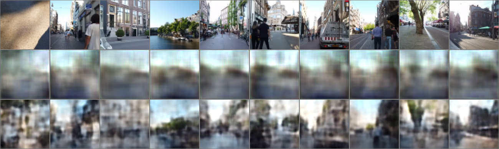
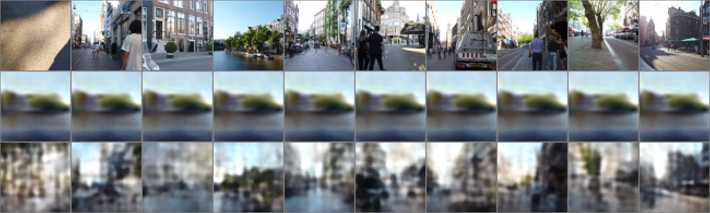

# vision: 単一ストリームから PC-ALM で VAE のエンコーダを学ぶ

計画は [PLAN.md](PLAN.md)、V0 の実装の仕様は [plans/v0-foundation.md](plans/v0-foundation.md)。V0〜V8 のまとめは [results/v0-v8.md](results/v0-v8.md)。V0〜V10 の結果を、学習の経過の図・描き戻した画像・注釈つきで読める 1 枚のページにまとめたものが [report.html](report.html)（ブラウザで開く）。V11〜V15（optimizer の研究）の結果は、図と表で読める [report-optim.html](report-optim.html) にまとめた。`exp/video`（M0〜M18）の続きで、番号を V0 から振り直した。`exp/video` のコードは tag `video-final`（mujou 7a8b72e）にある。

## 実行方法

```bash
# 手元で 1 本
uv run python -m exp.vision.main +experiment=v0/base --out runs/x
# fleet（std-00〜03、mini-00 は試しだけ）
just fleet submit --batch <b> +experiment=v0/base --sweep optim.tau=1e5,1e6 --seeds 0
# posthoc（run の後、GPU のあるホストで。MUJOU_EXP_DATA はデータの置き場所）
MUJOU_EXP_DATA=/data/geson/mujou-exp/.fleet/data python -m exp.vision.eval <run_dir>
# bench（B = 1 の速さと GPU メモリ）
python -m exp.vision.bench --device cuda --frames 100
# optimizer ごとの bench（ViT-S だけ、勾配の計測つき）
python -m exp.vision.bench --device cuda --frames 100 --models vit_s optim=muon measure.grad_stats=true
# 勾配の計測（measure.grad_stats=true の run の grad.jsonl）の集計
python -m exp.vision.grad_table <run_dir> [...]
# OGD（V13）: sgd・rmsprop・adamw の一歩を、ogd_every 秒ごとに保持した直近 ogd_n 個の勾配に直交させる
just fleet submit --batch <b> +experiment=v0/base optim=rmsprop optim.tau=1e4 optim.ogd_n=16 optim.ogd_every=1 --seeds 0
# 幅と μP（V14）: ヘッドの次元は 64、デコーダも幅 / 256 倍
just fleet submit --batch <b> +experiment=v0/base optim=rmsprop model.width=512 model.scale_decoder=true model.param=mup --seeds 0
# coord check（幅 128〜1024、SP と μP、RMSProp τ = 1e4、最初の 100 フレーム）。GPU のホストで
just fleet x std-00 -- env MUJOU_EXP_DATA=/data/geson/mujou-exp/.fleet/data CUDA_VISIBLE_DEVICES=0 python -m exp.vision.coord_check --device cuda
```

## V0: 土台の確認（2026-11-18）

snapshot `f0d3cbe8bc0d`（mujou 3d26a3c、PR Geson-anko/mujou#123 のブランチ）。

### bench（$B$ = 1、100 フレーム、単位/秒。リアルタイムは 10）

| | ViT-S | ViT-M | ViT-L | ResNet-S | ResNet-M | ResNet-L |
| -- | -- | -- | -- | -- | -- | -- |
| エンコーダのパラメータ | 6.83M | 9.99M | 16.31M | 5.91M | 9.44M | 16.50M |
| 4090（std-00） | 6.38 | 6.24 | 6.16 | 6.35 | 6.31 | 6.14 |
| 5070 Ti（mini-00） | 5.52 | 5.47 | 5.44 | 5.49 | 5.49 | 5.64 |
| GPU メモリ（4090、MB） | 121 | 155 | 221 | 115 | 155 | 231 |

速さはモデルの大きさによらずほぼ同じで、1 フレーム 50 ステップ × 9 ノードの、ステップごとのオーバーヘッドで決まっているとみられる（未確認）。リアルタイムには届かない。1800 秒の run は 4090 で約 48 分。

### 試しの run（mini-00、v0/base、SGD $\tau$ = 1e5、120 秒、seed 0）

`v0-base-5804bbe3-s0`。120 秒のあいだ値はすべて有限。loss は 110814 → −38725、ln σ は −0.85 → −1.81 と下がった。

| t（秒） | stack_mse | recon_blur（4 seed の平均 ± sd） | dyn_1/copy_1 |
| -- | -- | -- | -- |
| 0 | 6.707 | 0.2849 ± 0.0041 | 0.880 |
| 60 | 1.115 | 0.2568 ± 0.0015 | 0.874 |
| 120 | 2.036 | 0.2538 ± 0.0052 | 0.875 |
| 画素の PCA（$D$ = 256） | | 0.0615 ± 0.0027 | 0.897 |

目視（`posthoc/00120.0.png`）: システムのデコーダは、120 秒の時点でどの窓にもほぼ同じ画像（空と暗い地面）を出し、まだ $z$ を使っていない。`stack_mse` が 1 を上回るのはこのため。

## V1: 出発点の設定は安定して学べるか（回す前に決めたこと、2026-11-18）

**問い**: v0/base（ViT-S、8 枚、64×64、SGD）で、1800 秒のあいだ発散せず、初期化時より下がる $\tau$ はあるか。あれば、その中で最も小さい $\tau$（最も大きい学習率）を以降の出発点にする。

**腕**: SGD の $\tau \in \{10^4, 10^5, 10^6, 10^7\}$、seed 0、1800 秒、std-00・02・03 の 4090（std-01 は GPU が見えないので外す）。posthoc は 0・60・300・600・1200・1800 秒の checkpoint。

**判定**（val、1800 秒と 0 秒の比べ）

- 安定: stream の全行が有限
- 学べた: 次の 3 つをすべて満たす
  - `stack_mse` が 0 秒より小さい
  - `recon_blur` の差が、2 点の標準誤差を合わせたものの 2 倍より大きい（$\Delta > 2\sqrt{(s_0^2 + s_1^2)/4}$、$s$ は 4 seed の sd）
  - `dyn_1/copy_1` が 0 秒より小さい
- 目視: システムのデコーダが窓ごとに違う画像を出しているかを書く（判定には入れない）

**予想**: $10^4$ は発散する（合成データで発散した）。$10^5$ は安定して学べる。$10^6$ は学べるが遅い。$10^7$ はほとんど動かず `recon_blur` で外れる。

**反証**: どの $\tau$ も「学べた」を満たさなければ、次は学習則より前の段（目的の式の重み、デコーダの形、`learn_interval`）を疑う。

## V1: 結果（2026-11-18）

batch `v1-tau`、snapshot `0b8a21ad1fde`。fleet が 4 本とも std-00 に置いたので、同じ GPU に 3 本が並び、1 本は約 3.7 単位/秒・約 80 分かかった（結果には影響しない。速さは V0 の bench の値で読む）。

### 判定

0 秒の行は 4 本で同じ（同じ初期値）: `stack_mse` 6.707、`recon_blur` 0.2820 ± 0.0006、`dyn_1/copy_1` 0.8798。

| $\tau$ | run | 安定 | `stack_mse`（1800 秒） | `recon_blur`（1800 秒） | 差 / 閾値 | `dyn_1/copy_1`（1800 秒） | 学べた |
| -- | -- | -- | -- | -- | -- | -- | -- |
| 1e4 | `v0-base-db27fa3b-s0` | ×（2 秒で非有限） | — | — | — | — | × |
| 1e5 | `v0-base-b53efc4f-s0` | ○ | 1.518 | 0.2175 ± 0.0027 | 0.0646 / 0.0028 | 0.7957 | ○ |
| 1e6 | `v0-base-13f529cf-s0` | ○ | 1.492 | 0.2402 ± 0.0032 | 0.0418 / 0.0032 | 0.8694 | ○ |
| 1e7 | `v0-base-0df71d0e-s0` | ○ | 0.954 | 0.2517 ± 0.0029 | 0.0303 / 0.0030 | 0.8806 | ×（`dyn_1/copy_1`） |
| 画素の PCA | | | | 0.0624 ± 0.0039 | | 0.8971 | |

規則の上では、学べた $\tau$ のうち最も小さいのは $10^5$ で、これが以降の出発点になる。予想は 1e4・1e5・1e6 が当たり、1e7 は外れた（`recon_blur` は下がり、`dyn_1/copy_1` で外れた）。

### 1e5 の経過（val）

| t（秒） | 0 | 60 | 300 | 600 | 1200 | 1800 |
| -- | -- | -- | -- | -- | -- | -- |
| `stack_mse` | 6.707 | 1.367 | 1.758 | 1.417 | 1.120 | 1.518 |
| `recon_blur` | 0.2820 | 0.2555 | 0.2416 | 0.2372 | 0.2213 | 0.2175 |
| `dyn_1/copy_1` | 0.880 | 0.874 | 0.870 | 0.865 | 0.836 | 0.796 |
| `copy_1` | 0.205 | 0.132 | 0.089 | 0.068 | 0.033 | 0.021 |
| 実効ランク | 80.6 | 43.8 | 28.1 | 23.8 | 12.7 | 10.2 |

### 目視と、判定に入れていない問題

- **システムのデコーダは $z$ を使っていない**。1e5 と 1e6 の 1800 秒（`posthoc/01800.0.png`）では、val の 10 窓のどれにも同じ画像を出す。その画像は Zurich ではなく、学習のストリームのその時刻の場面（水辺と木々）に見える。デコーダが、いま流れている場面の平均を自分のパラメータで追い、入力を描き戻していないと読める（未確認）。`stack_mse` が 1800 秒でも 1 を上回る（平均の stack より悪い）こととも合う
- 3 条件が下がったのは、主に符号の側の変化による。後から学ぶデコーダの `recon_blur` は 0.282 → 0.218 と下がったが、画素の PCA（0.062）には遠い
- 符号の実効ランクは 80.6 → 10.2 と縮み、`copy_1` も 0.205 → 0.021 と小さくなった。`dyn_1/copy_1` の低下は、符号がゆっくり動くようになったことと区別できていない

「初期化時より下がる」を 3 つとも満たしても、システムのデコーダは入力を描き戻していない。この基準だけでは、VAE が学べたかどうかを分けられない。

## V2〜V5: 決めた軸を出発点から 1 本ずつ動かす（回す前に決めたこと、2026-11-18）

ユーザーの指示（2026-11-18）: SGD だけでは何とも言えないので、計画で決めた軸を最後まで回す。

**出発点**: v0/base（ViT-S、8 枚、64×64、SGD $\tau = 10^5$、1800 秒、seed 0）。各軸はここから 1 つだけ動かす。どれも 1 seed の絞り込みで、軸の中の順位は参考とする。

| 軸 | 腕 | 本数 |
| -- | -- | -- |
| V2 モデル | ViT-M、ViT-L、ResNet-S、ResNet-M、ResNet-L（ViT-S は V1 の $\tau = 10^5$ の run） | 5 |
| V3 momentum | `sgd_momentum`、$\tau = 10^5$、$\tau_m \in \{0.1, 1, 10\}$ 秒 | 3 |
| V4 stack の枚数 | $n \in \{4, 8, 16\}$。$n = 16$ は既定の評価の窓（clips 256）が Zurich に収まらないので、3 本とも `measure.clips=128` にそろえる | 3 |
| V5 適応的な optimizer | RMSProp（$\tau_v$ = 30 秒）と AdamW（$\tau_m$ = 1 秒、$\tau_v$ = 30 秒、weight decay 0.01）、$\tau \in \{10^2, 10^3, 10^4\}$（1 フレームに 1 回学ぶので、要素ごとの一歩は約 $0.1/\tau$、つまり 1e-3・1e-4・1e-5） | 6 |

V2 で $\tau = 10^5$ が発散したモデルは、$\tau = 10^6$ で 1 本回し直す（事前に決めた手当て）。

**判定**（val、1800 秒と 0 秒の比べ。V1 の 3 条件に 1 つ足す）

- 安定: stream の全行が有限
- 学べた: 次の 4 つをすべて満たす
  - `stack_mse` が 0 秒より小さい
  - **`stack_mse` < 1**（新しく足す。システムのデコーダが学習の平均の stack より良い。V1 では 3 条件を満たしても、デコーダが窓によらず同じ画像を出していた）
  - `recon_blur` の差が、2 点の標準誤差を合わせたものの 2 倍より大きい
  - `dyn_1/copy_1` が 0 秒より小さい
- 診断（判定には入れない）: 直前 64 秒の学習のストリームの `recent_stack_mse`（同じ窓の初期化時の値と並べる）、システムのデコーダの出力の窓をまたいだばらつき `dec_spread`（val と直前の区間）、画像
- 軸の中の比べ: 学べた腕のうち 1800 秒の `recon_blur` を並べる。差が 2 点の標準誤差を合わせたものの 2 倍より小さいものは区別しない

V1 の 4 本も、足した診断の評価をかけ直す。

**予想**

- V2: どのモデルも `stack_mse` < 1 を満たさない（V1 のデコーダの問題は、エンコーダの大きさでは変わらない）。ResNet と ViT の差は区別できない
- V3: $\tau_m$ によらず V1 と区別できない
- V4: $n = 4$ の `recon_blur` が最も小さい
- V5: 少なくとも 1 本が `stack_mse` < 1 を満たし、SGD より `recon_blur` が小さい

**反証**: どの腕も `stack_mse` < 1 を満たさなければ、学習の設定ではなく、目的の式かストリームの非定常（デコーダがいまの場面を追う）を疑う。診断の `recent_stack_mse` と `dec_spread` で、そのどちらかを切り分ける。

## V2〜V5: 結果（2026-11-18）

batch `v2-model`・`v3-mom`・`v4-frames`・`v5-adapt`、snapshot `e605244269fa`（mujou 3d26a3c）。std-00〜03 に 4〜5 本ずつ置いた。1 台に posthoc と並んだので、1 本 108〜154 分かかった。V1 の 3 本にも、足した診断の posthoc をかけ直した。表は `uv run python -m exp.vision.tables runs/v1-tau runs/v2-model runs/v3-mom runs/v4-frames runs/v5-adapt` で出る。

### 判定

0 秒の行は、ViT-S・8 枚の run で V1 と同じ（`stack_mse` 6.707、`recon_blur` 0.2820 ± 0.0006、`dyn_1/copy_1` 0.880）。ほかの腕は自分の 0 秒と比べる。`dec_spread` は val の 10 窓をまたいだシステムのデコーダの出力のばらつき、`recent_stack_mse` は直前 64 秒の学習のストリームでの値（0 秒は約 6.0）。

| 軸 | 腕 | run | 安定 | `stack_mse` | `recon_blur` | `dyn_1/copy_1` | `dec_spread` | `recent_stack_mse` | 学べた |
| -- | -- | -- | -- | -- | -- | -- | -- | -- | -- |
| 出発点 | ViT-S（V1、$\tau = 10^5$） | `b53efc4f` | ○ | 1.518 | 0.2175 ± 0.0027 | 0.796 | 0.000 | 1.519 | ×（< 1） |
| V2 | ViT-M | `11558c6e` | ○ | 1.454 | 0.2075 ± 0.0020 | 0.776 | 0.000 | 1.509 | ×（< 1） |
| V2 | ViT-L | `708b0734` | ○ | 1.524 | 0.2195 ± 0.0034 | 0.729 | 0.000 | 1.597 | ×（< 1） |
| V2 | ResNet-S | `55cac856` | ×（2 秒） | — | — | — | — | — | × |
| V2 | ResNet-S、$\tau = 10^6$ | `b141533f` | ○ | 1.569 | 0.4518 ± 0.0342 | 0.849 → 0.945 | 0.004 | 1.617 | ×（< 1、dyn） |
| V2 | ResNet-M | `7be1356d` | ○ | 1.410 | 0.4794 ± 0.0285 | 0.810 → 0.976 | 0.000 | 1.468 | ×（< 1、dyn） |
| V2 | ResNet-L | `3ebb9431` | ×（5 秒） | — | — | — | — | — | × |
| V2 | ResNet-L、$\tau = 10^6$ | `1f33e6a3` | ○ | 1.348 | 0.4039 ± 0.0199 | 0.743 → 0.939 | 0.000 | 1.388 | ×（< 1、dyn） |
| V3 | $\tau_m$ = 0.1 秒 | `91caada9` | ○ | 1.476 | 0.2214 ± 0.0077 | 0.754 | 0.000 | 1.532 | ×（< 1） |
| V3 | $\tau_m$ = 1 秒 | `21dd4b43` | ○ | 1.383 | 0.2101 ± 0.0095 | 0.768 | 0.000 | 1.448 | ×（< 1） |
| V3 | $\tau_m$ = 10 秒 | `56381ae8` | ○ | 1.028 | 0.3191 ± 0.0058（0 秒より悪い） | 0.470 | 0.364 | 1.020 | ×（< 1、blur） |
| V4 | $n$ = 4 | `068e2adf` | ○ | 1.586 | 0.1747 ± 0.0025 | 0.877 → 0.811 | 0.001 | 1.680 | ×（< 1） |
| V4 | $n$ = 8 | `2980d7e2` | ○ | 1.493 | 0.2173 ± 0.0029 | 0.873 → 0.787 | 0.000 | 1.519 | ×（< 1） |
| V4 | $n$ = 16 | `f2c9a74d` | ○ | 1.028 | 0.2713 ± 0.0034（0 秒 0.3535） | 0.903 → 0.834 | 0.000 | 1.109 | ×（< 1） |
| V5 | RMSProp $\tau = 10^2$ | `d2b8821d` | ×（57 秒） | — | — | — | — | — | × |
| V5 | RMSProp $\tau = 10^3$ | `32201807` | ○ | 1.435 | 0.2045 ± 0.0061 | 0.523 | 0.000 | 1.482 | ×（< 1） |
| V5 | **RMSProp $\tau = 10^4$** | `22a7fda6` | ○ | **0.640** | 0.2312 ± 0.0031 | 0.729 | 0.284 | 0.635 | **○** |
| V5 | AdamW $\tau = 10^2$ | `e77b7a41` | ○ | 1.434 | 0.2931 ± 0.0072（0 秒より悪い） | 0.155 | 0.000 | 1.487 | ×（< 1、blur） |
| V5 | AdamW $\tau = 10^3$ | `c3f8e24a` | ○ | 1.342 | 0.2045 ± 0.0009 | 0.272 | 0.001 | 1.413 | ×（< 1） |
| V5 | AdamW $\tau = 10^4$ | `d0a03b18` | ○ | 1.004 | 0.2754 ± 0.0045 | 0.376 | 0.184 | 0.872 | ×（< 1） |

run は `v0-base-<id>-s0`。V4 の $n$ = 8 は V1 の 1e5 と同じ設定（評価の窓だけ clips 128）で、`recon_blur` は 0.2173 と 0.2175 で一致した。

予想との比べ

- V2: どのモデルも `stack_mse` < 1 を満たさない、は当たった。ResNet と ViT は区別できない、は外れた。ResNet は S・L が $\tau = 10^5$ で数秒で発散し、3 つとも `recon_blur` が 0.40〜0.48 と ViT（0.21〜0.22）より大きく、`dyn_1/copy_1` は 0 秒より上がった
- V3: $\tau_m$ = 0.1・1 秒は V1 と区別できない、は当たった。10 秒は外れた（`recon_blur` が 0 秒より悪い）
- V4: $n$ = 4 の `recon_blur` が最も小さい、は当たった（0.175 < 0.217 < 0.271）
- V5: 少なくとも 1 本が `stack_mse` < 1 を満たす、は当たった（RMSProp $10^4$）。SGD より `recon_blur` が小さい、は外れた（0.231 対 0.218）

### 目視（1800 秒、`posthoc/01800.0.png` と `-recent.png`）

- **RMSProp $\tau = 10^4$**: システムのデコーダが、val の窓ごとに違う画像を出す。左に木の暗い塊がある最初の 3 窓と、空と建物が並ぶ残りの窓で、明暗の配置が変わる。細部は無く、ぼやけた明暗の配置だけ。直前 64 秒でも、屋内の暗い窓と屋外の窓で出力が変わる。`stack_mse` は 600 秒から下がり始め、1.120（600 秒）→ 0.758（1200 秒）→ 0.640（1800 秒）と、まだ下がっている
- **ResNet-M**: システムのデコーダが、どの窓にも学習のストリームの場面（水辺と木々）をくっきり描く。V1 の ViT-S より鮮明に、いまの場面を自分のパラメータで覚えている
- **momentum $\tau_m$ = 10 秒・AdamW $\tau = 10^4$**: 窓ごとに出力が変わるが、形が崩れた明暗の塊（momentum）か、最初の 3 窓だけが違う（AdamW）
- ほかの腕: V1 と同じく、どの窓にも同じ画像を出す

### 読み

- **`dec_spread` ≈ 0 の腕では、システムのデコーダが $z$ を使っていない**。止めた checkpoint では、直前 64 秒の学習のストリームでも `recent_stack_mse` が 1.4〜1.6 になる
- **ただし、走っている最中のデコーダの誤差は小さい**。最後の 60 秒の stream の `sq` / $P$ は、ほとんどの腕で 0.025 前後で、val の平均の stack の誤差 / $P$（0.0696）で割ると約 0.37 になる（学習のストリームの平均の stack で割ったものではないので目安）。止めた重みでは 64 秒前の場面を描けず、走りながらなら描ける。デコーダは $z$ ではなく自分のパラメータで、数秒〜数十秒の時間で、いまの場面を追っていると読める。（この節の最初の版では、`recent_stack_mse` を根拠に「いまの場面を覚えているだけ」を否定していた。直前 64 秒の窓は場面をいくつもまたぐので、この診断では否定できない。訂正する）
- **KL はつぶれていない**。学習の最後の 60 秒の KL は、どの腕でも 300〜700 nat ある。後から学ぶデコーダは $z$ から 0.20〜0.23 まで描き戻せるので、符号には入力の情報がある
- **KL と再構成の釣り合いが腕ごとに違う**。係数 $\beta$ は置いておらず、学ぶ $\sigma$ が釣り合いを決める（$\sigma$ を 1 にした $\beta$-VAE の $\beta = 2\sigma^2$ と同じ）。1800 秒の $\sigma^2$ は、SGD の腕で 0.006〜0.011、RMSProp $10^4$ で 0.054、AdamW で 0.030〜0.057 と、最大で 9 倍違う。どの腕でも、stream の誤差 / $P$（0.025〜0.054）とずれており、$\sigma$ は最尤の値まで来ていない。$z$ を使い始めた RMSProp $10^4$ は、$\sigma^2$ が大きい側（KL が相対的に強く、デコーダの再構成の勾配が小さい側）にある。optimizer の効果と釣り合いの効果は、いまの腕では分けられない
- **適応的な optimizer の大きい $\tau$ でだけ、デコーダが $z$ を使い始めた**（RMSProp $10^4$、AdamW $10^4$ の一部）。要素ごとに一歩を揃えるので、勾配の小さい $z$ の経路の重みも動く、という読みと合う（未確認）
- **符号の実効ランクの崩れ**: AdamW $10^2$ は 1.2、RMSProp・AdamW $10^3$ は 3.5 まで縮み、`dyn_1/copy_1` が 0.16〜0.52 まで下がった。符号がほとんど動かず、線形の動力学が当てやすくなっただけで、`recon_blur` は下がらないか少ししか下がらない。`dyn_1/copy_1` の低下を、そのまま良い符号と読んではいけない

V2〜V5 の判定で学べたのは RMSProp $\tau = 10^4$ の 1 本だけで、1 seed。次は V6 で、seed を足して確かめ、$\tau$ を上へ広げる。

## V6: RMSProp $\tau = 10^4$ は seed によらず学べるか（回す前に決めたこと、2026-11-18）

**問い**: V5 で唯一学べた RMSProp $\tau = 10^4$ は、seed を変えても学べるか。$\tau$ を 1 桁上げるとどうなるか。

**腕**（v0/base から optimizer だけ変える、1800 秒、std-00〜03 に 1 本ずつ）

| 腕 | seed |
| -- | -- |
| RMSProp $\tau = 10^4$ | 1、2 |
| RMSProp $\tau = 10^5$ | 0 |
| AdamW $\tau = 10^5$ | 0 |

**判定**: V2〜V5 と同じ（4 条件、診断は判定に入れない）。

**予想**

- RMSProp $10^4$ は seed 1・2 とも学べる
- RMSProp $10^5$ は安定するが、1800 秒では `stack_mse` が 1 を下回らない（$10^4$ でも 1 を切ったのは 600〜1200 秒の間）
- AdamW $10^5$ は窓ごとに違う画像を出し始める（`dec_spread` > 0.1）が、`stack_mse` < 1 は満たさない

**反証**: seed 1・2 のどちらかが `stack_mse` < 1 を満たさなければ、V5 の結果は seed の偶然とみなし、適応的な optimizer で学べるとは言わない。

## V6: 結果（2026-11-18）

batch `v6-rms`、snapshot `358f87399dfb`。1 台に 1 本ずつ置き、1 本 50〜51 分で終わった。4 本とも発散しなかった。

| 腕 | run | `stack_mse`（0 → 1800 秒） | `recon_blur` | 差 / 閾値 | `dyn_1/copy_1` | `dec_spread` | 1800 秒の $\sigma^2$ | 学べた |
| -- | -- | -- | -- | -- | -- | -- | -- | -- |
| RMSProp $10^4$、seed 0（V5） | `22a7fda6-s0` | 6.707 → 0.640 | 0.2312 ± 0.0031 | 0.0508 / 0.0032 | 0.880 → 0.729 | 0.284 | 0.054 | ○ |
| RMSProp $10^4$、seed 1 | `06c0f687-s1` | 7.704 → 0.673 | 0.2239 ± 0.0019 | 0.0607 / 0.0031 | 0.878 → 0.735 | 0.242 | 0.054 | ○ |
| RMSProp $10^4$、seed 2 | `06c0f687-s2` | 6.958 → 0.676 | 0.2332 ± 0.0020 | 0.0527 / 0.0054 | 0.877 → 0.726 | 0.245 | 0.054 | ○ |
| RMSProp $10^5$ | `3b9a274d-s0` | 6.707 → 0.708 | 0.2382 ± 0.0041 | 0.0438 / 0.0042 | 0.880 → 0.881 | 0.308 | 0.073 | ×（`dyn_1/copy_1`） |
| AdamW $10^5$ | `8a3f253a-s0` | 6.707 → 0.685 | 0.2331 ± 0.0044 | 0.0489 / 0.0044 | 0.880 → 0.875 | 0.307 | 0.073 | ○ |

run は `v0-base-<id>`。seed を変えると初期値が変わるので、0 秒の行も seed ごとに違う。

予想との比べ

- RMSProp $10^4$ は seed 1・2 とも学べる、は当たった。3 つの seed の `stack_mse` は 0.640〜0.676、`dec_spread` は 0.24〜0.28 とそろった。V5 の結果は seed の偶然ではない
- RMSProp $10^5$ は `stack_mse` が 1 を下回らない、は外れた（0.708）。`dyn_1/copy_1` が下がらず、「学べた」には入らない
- AdamW $10^5$ は `stack_mse` < 1 を満たさない、は外れた（0.685 で、4 条件を満たした。`dyn_1/copy_1` の下がりは 0.880 → 0.875 とわずか）

$\tau = 10^5$ の 2 本では、$\sigma^2$ が 1800 秒でも初期値（0.0743）からほとんど動いていない。V1〜V6 で `stack_mse` が 0.75 を下回った 5 本（RMSProp $10^4$ の 3 本、RMSProp・AdamW $10^5$）は、どれも 1800 秒の $\sigma^2$ が 0.054〜0.073 だった。ただし、$\sigma^2$ が 0.029 の SGD $10^7$（V1）と momentum $\tau_m$ = 10 秒（V3）でも、`dec_spread` は 0.1 を超えた（0.125、0.364）。$\sigma^2$ だけでは決まらない。釣り合いの効果と optimizer の効果は、V7 で分ける。

## V7: KL と再構成の釣り合い（$\sigma$ の固定）（回す前に決めたこと、2026-11-18）

**問い**: V2〜V5 では、学ぶ $\sigma$ が KL と再構成の釣り合いを決めていた。1800 秒の $\sigma^2$ は腕ごとに最大 9 倍違い、optimizer の効果と分けられなかった。$\sigma$ を固定して釣り合いをそろえたとき、システムのデコーダは $z$ を使うか。それは optimizer によるか。

**変更**: `model.learn_sigma=false` で $\ln\sigma$ を学ばず、$\sigma^2$ を `model.sigma0_sq` に固定する（テストで、$\ln\sigma$ が動かず、ほかのパラメータは固定した $\sigma$ での −ELBO の BP の勾配で学ぶことを確かめた）。$\sigma$ を 1 にした $\beta$-VAE の $\beta = 2\sigma^2$ にあたる。

**腕**（v0/base から、1800 秒、seed 0）

| | $\sigma^2$ = 0.01 | $\sigma^2$ = 0.03 | $\sigma^2$ = 0.1 |
| -- | -- | -- | -- |
| SGD $\tau = 10^5$ | 1 本 | 1 本 | 1 本 |
| RMSProp $\tau = 10^4$ | 1 本 | 1 本 | 1 本 |

- 0.01: SGD の腕が 1800 秒で学んでいた $\sigma^2$（0.006〜0.011）
- 0.03: 走りながらの誤差 / 画素（約 0.025）に近い値。最尤の $\sigma^2$ の目安
- 0.1: 平均の stack のまわりの分散（$\sigma_0^2$ = 0.0743）より上。RMSProp $10^4$ の 0.054 より大きい

SGD では、$\sigma^2$ を大きくすると再構成の勾配が $1/\sigma^2$ で小さくなり、再構成の側の実効の学習率も下がる（KL の側は変わらない）。RMSProp は要素ごとに一歩をそろえるので、$\sigma$ の効果は、主にエンコーダの出力で KL と再構成の勾配が釣り合う位置を通して出る。

**判定**: V2〜V5 と同じ 4 条件。あわせて `dec_spread` と、走りながらの誤差（stream の `sq` / $P$）を並べる。

**予想**

- SGD: $\sigma^2$ = 0.01 は V1 と同じく学べない。0.1 では `dec_spread` > 0.1 になる（デコーダが重みで場面を追う力が弱まり、$z$ を使い始める）
- RMSProp: 0.03 と 0.1 は学べる。0.01 は学べない
- どちらの optimizer でも、$\sigma^2$ が大きいほど `dec_spread` が大きい

**反証と次の手**

- SGD の 0.1 が学べたら、V5 の「RMSProp で学べた」は、主に釣り合いの効果とみなす
- RMSProp の 0.01 でも学べたら、釣り合いではなく optimizer の効果とみなす
- どの腕も `dec_spread` ≈ 0 なら、釣り合いでは説明できない。そのときは、デコーダが重みで場面を追う速さ（デコーダだけ $\tau$ を大きくする）を疑う

## V7: 結果（2026-11-18）

batch `v7-sigma`、snapshot `b6a97b1`（mujou 3d26a3c）。6 本のうち 4 本が終わり、2 本が発散した。

| optimizer | 固定した $\sigma^2$ | run | 安定 | `stack_mse`（1800 秒） | `recon_blur` | `dyn_1/copy_1` | `dec_spread` | 学べた |
| -- | -- | -- | -- | -- | -- | -- | -- | -- |
| SGD $10^5$ | 0.01 | `087311d1` | ×（1 秒で非有限） | — | — | — | — | × |
| SGD $10^5$ | 0.03 | `70567fe8` | ×（2 秒で非有限） | — | — | — | — | × |
| SGD $10^5$ | 0.1 | `794cf7df` | ○ | 1.413 | 0.2305 ± 0.0027 | 0.859 | 0.001 | ×（< 1） |
| RMSProp $10^4$ | 0.01 | `8a3d6f22` | ○ | 0.664 | 0.2313 ± 0.0047 | 0.756 | 0.289 | ○ |
| RMSProp $10^4$ | 0.03 | `c680cf0e` | ○ | 0.654 | 0.2318 ± 0.0044 | 0.739 | 0.279 | ○ |
| RMSProp $10^4$ | 0.1 | `598cc9e6` | ○ | 0.678 | 0.2275 ± 0.0038 | 0.726 | 0.236 | ○ |

run は `v0-base-<id>-s0`。0 秒の行は V1 と同じ。

予想との比べ

- SGD の 0.01 は学べない、は当たった。ただし予想していたのは V1 と同じ「学べない」で、発散は予想していなかった。0.03 も発散した。$\sigma$ を学ぶ run では $\sigma^2$ が 0.0743 から少しずつ下がるが、固定すると最初から再構成の勾配が $0.0743/\sigma^2$ 倍になり、$\tau = 10^5$ では大きすぎた
- SGD の 0.1 で `dec_spread` > 0.1 になる、は外れた（0.001）。どの窓にも同じ画像を出す
- RMSProp の 0.03 と 0.1 が学べる、は当たった。0.01 は学べない、は外れた（0.664 で学べた）
- $\sigma^2$ が大きいほど `dec_spread` が大きい、は外れた。RMSProp の 3 本は 0.236〜0.289 で、むしろ 0.1 が最も小さい

**判定**: 事前に決めた反証の規則で、RMSProp の 0.01 でも学べたので、V5 の「RMSProp で学べた」は**釣り合いではなく optimizer の効果**とみなす。RMSProp では、$\sigma^2$ を 10 倍変えても `stack_mse`（0.654〜0.678）、`recon_blur`（0.228〜0.232）、`dec_spread` はほとんど変わらない。SGD は、$\sigma^2$ を V1 の 10 倍（0.1）にしても、デコーダが $z$ を使わない。

**補足（2026-11-19、資料を作る中で気づいたこと）**: SGD の $\sigma^2$ は 1 秒ごとに大きく揺れる（V1 の $\tau = 10^5$ では、600 秒以降も 0.003〜0.11）。V2〜V5 の読みに書いた「1800 秒の $\sigma^2$」（SGD の腕で 0.006〜0.011）は 1800 秒ちょうどの 1 点の値で、最後の 60 秒の平均は、$\tau = 10^5$〜$10^6$ の SGD（V1〜V4）で 0.025〜0.029 だった。RMSProp $10^4$ は 0.054 で、ほとんど揺れない。V7 は 0.01・0.03・0.1 をすべて試したので、この判定は変わらない。

## V8: 学習のストリームそのもので評価し直す（回す前に決めたこと、2026-11-19）

ユーザーの指摘（2026-11-19）: ストリームから学ぶとは学び続けることなので、学習に使ったデータ全体で評価する。過去の損失が大きければ忘れている。未来の損失が小さければ汎化している。今の損失は、ある程度学ぶまで意味を持たない。

**評価**（`python -m exp.vision.stream_eval <run_dir>`、`posthoc_stream/`）

- 学習のストリーム（Amsterdam の先頭から）の 5 秒ごとの stack と、run の後の 3000 秒（Amsterdam の続き）の 10 秒ごとの stack で、システムのデコーダの誤差を測る。平均の stack を 1 とする
- チェックポイントを 60 秒ごと（31 個）にし、各チェックポイントで過去（見た時期で 4 つ）と未来（来る時期で 4 つ）の誤差を出す
- 忘却: 過去の誤差から、その stack を学んだときの誤差（`stream.jsonl` の `sq`、学ぶ前の誤差。近似）を引く
- `recon_blur` と `dyn_1/copy_1`: 学習区間を 10 秒ずつに分け、奇数番目で当てはめ、偶数番目（span）、run の後（after）、Zurich で測る。0・60・300・600・1200・1800 秒のチェックポイントだけ

**run**: V1〜V7 の、発散しなかった設定 26 本を、`measure.ckpt_every=60` で回し直す（学習は同じ設定。V4 の 8 枚は V1 の $\tau = 10^5$ と同じなので省く）。batch は `v8-tau`・`v8-model`・`v8-mom`・`v8-frames`・`v8-adapt`・`v8-rms`・`v8-sigma`。

**判定**（1800 秒と 0 秒の比べ。すべて満たせば「学べた」）

1. span（学習区間の全体。1800 秒ではすべて過去）の誤差が 0 秒より小さく、1 より小さい
2. after（run の後の Amsterdam）の誤差が 0 秒より小さい
3. span の `recon_blur` が、0 秒より、標準誤差を合わせたものの 2 倍を超えて小さい
4. span の `dyn_1/copy_1` が 0 秒より小さい

Zurich の値と、見た時期ごとの忘却は、判定に入れずに並べる。

**予想**

- SGD の run（V1〜V4、V7 の SGD）は、1 で外れる。今（直前 10 秒）の誤差は小さいが、5 分以上前の誤差は学んだときより大きい（忘却が大きい）
- V2〜V7 で Zurich で学べた run（RMSProp $10^4$ の 6 本、AdamW $10^5$）は、4 条件を満たす。忘却は SGD より小さい
- after の誤差は、学べた run で 1 を下回る

**反証**: 学べた run でも 5 分以上前の忘却が SGD と変わらなければ、「RMSProp は $z$ を通して覚えている」という読みは成り立たない。

## V8: 結果（2026-11-19）

batch `v8-tau`・`v8-model`・`v8-mom`・`v8-frames`・`v8-adapt`・`v8-rms`・`v8-sigma`、snapshot `2ee162ca33aa`（mujou 3d26a3c）。26 本とも発散せず、評価まで終わった。1 台に 6〜7 本を同時に置き、1 本 2.5〜3 時間かかった。

チェックポイントの間隔は学習を変えない。V7 の RMSProp・$\sigma^2$ = 0.03 の run（チェックポイント 6 個）と、同じ設定を V8 で回し直した run（60 秒ごと）では、1800 秒の評価の値が完全に一致した。

### 判定

| batch | 腕 | run | span 0 → 1800 | after 0 → 1800 | 今（学習中） | 忘却 10–60 / 60–300 / 300– 秒 | `recon_blur` span（差 / 閾値） | `dyn_1/copy_1` span | rank | 学べた |
| -- | -- | -- | -- | -- | -- | -- | -- | -- | -- | -- |
| `v8-tau` | SGD $10^{6}$ | `0b563aac-s0` | 6.587 → 1.748 | 7.060 → 1.676 | 0.42（0.18） | 1.47 / 1.43 / 1.37 | 0.451（0.067 / 0.007） | 0.994 → 1.010 | 27.5 | ×（span_lt1, dyn_down） |
| `v8-tau` | SGD $10^{5}$ | `ba9d09f2-s0` | 6.587 → 1.675 | 7.060 → 1.602 | 0.53（0.17） | 1.43 / 1.36 / 1.33 | 0.428（0.090 / 0.006） | 0.994 → 0.910 | 9.1 | ×（span_lt1） |
| `v8-tau` | SGD $10^{7}$ | `beccd61d-s0` | 6.587 → 1.154 | 7.060 → 1.142 | 0.30（0.26） | 0.79 / 0.74 / 0.52 | 0.447（0.070 / 0.005） | 0.994 → 1.009 | 33.8 | ×（span_lt1, dyn_down） |
| `v8-model` | SGD $10^{6}$、ResNet-S | `17a1aa1e-s0` | 6.551 → 1.844 | 7.006 → 1.772 | 0.42（0.17） | 1.56 / 1.55 / 1.49 | 0.580（0.231 / 0.008） | 0.922 → 1.091 | 14.9 | ×（span_lt1, dyn_down） |
| `v8-model` | SGD $10^{5}$、ViT-L | `1dc764f3-s0` | 6.495 → 1.827 | 6.965 → 1.756 | 0.42（0.18） | 1.57 / 1.52 / 1.48 | 0.397（0.120 / 0.004） | 0.995 → 0.805 | 6.2 | ×（span_lt1） |
| `v8-model` | SGD $10^{6}$、ResNet-L | `70dc1ca5-s0` | 6.472 → 1.589 | 6.923 → 1.512 | 0.40（0.16） | 1.28 / 1.26 / 1.24 | 0.580（0.441 / 0.007） | 0.769 → 1.115 | 8.7 | ×（span_lt1, dyn_down） |
| `v8-model` | SGD $10^{5}$、ViT-M | `83fdc0d0-s0` | 6.510 → 1.717 | 6.963 → 1.641 | 0.40（0.18） | 1.42 / 1.40 / 1.37 | 0.405（0.108 / 0.007） | 0.997 → 0.874 | 7.5 | ×（span_lt1） |
| `v8-model` | SGD $10^{5}$、ResNet-M | `f0a25307-s0` | 6.514 → 1.679 | 6.966 → 1.601 | 0.39（0.18） | 1.40 / 1.37 / 1.34 | 0.573（0.321 / 0.013） | 0.874 → 1.091 | 3.0 | ×（span_lt1, dyn_down） |
| `v8-mom` | SGD+mom $10^{5}$、$\tau_m$ = 10 秒 | `5384f9c6-s0` | 6.587 → 1.057 | 7.060 → 1.072 | 0.64（0.68） | 0.18 / 0.20 / 0.03 | 0.489（0.029 / 0.009） | 0.994 → 0.499 | 2.7 | ×（span_lt1） |
| `v8-mom` | SGD+mom $10^{5}$、$\tau_m$ = 0.1 秒 | `6c9f4e0c-s0` | 6.587 → 1.741 | 7.060 → 1.669 | 0.41（0.14） | 1.46 / 1.44 / 1.42 | 0.417（0.101 / 0.008） | 0.994 → 0.821 | 7.4 | ×（span_lt1） |
| `v8-mom` | SGD+mom $10^{5}$、$\tau_m$ = 1 秒 | `d88c1a7e-s0` | 6.587 → 1.637 | 7.060 → 1.559 | 0.41（0.26） | 1.08 / 1.01 / 1.04 | 0.410（0.108 / 0.007） | 0.994 → 0.871 | 8.1 | ×（span_lt1） |
| `v8-frames` | SGD $10^{5}$、16 枚 | `e1d882d4-s0` | 7.326 → 1.332 | 7.889 → 1.251 | 0.52（0.21） | 0.83 / 0.90 / 0.98 | 0.545（0.059 / 0.008） | 1.015 → 0.985 | 11.1 | ×（span_lt1） |
| `v8-frames` | SGD $10^{5}$、4 枚 | `eeb0acea-s0` | 6.174 → 1.914 | 6.636 → 1.847 | 0.42（0.15） | 1.66 / 1.64 / 1.58 | 0.330（0.106 / 0.005） | 0.972 → 0.874 | 8.9 | ×（span_lt1） |
| `v8-adapt` | RMSProp $10^{4}$ | `142ba038-s0` | 6.587 → 0.708 | 7.060 → 0.722 | 0.27（0.18） | 0.28 / 0.35 / 0.24 | 0.449（0.069 / 0.006） | 0.994 → 0.835 | 23.6 | ○ |
| `v8-adapt` | AdamW $10^{4}$ | `1e8c5cd4-s0` | 6.587 → 1.082 | 7.060 → 1.097 | 0.34（0.31） | 0.36 / 0.50 / 0.33 | 0.480（0.038 / 0.007） | 0.994 → 0.392 | 6.2 | ×（span_lt1） |
| `v8-adapt` | AdamW $10^{2}$ | `3134d88d-s0` | 6.587 → 1.690 | 7.060 → 1.618 | 0.43（0.24） | 1.14 / 1.14 / 1.17 | 0.416（0.101 / 0.012） | 0.994 → 0.171 | 1.2 | ×（span_lt1） |
| `v8-adapt` | RMSProp $10^{3}$ | `d1c13c4c-s0` | 6.587 → 1.679 | 7.060 → 1.605 | 0.41（0.16） | 1.41 / 1.37 / 1.32 | 0.367（0.151 / 0.008） | 0.994 → 0.562 | 3.5 | ×（span_lt1） |
| `v8-adapt` | AdamW $10^{3}$ | `d1e4c8c2-s0` | 6.587 → 1.571 | 7.060 → 1.495 | 0.43（0.28） | 1.04 / 0.98 / 1.00 | 0.358（0.160 / 0.007） | 0.994 → 0.296 | 3.4 | ×（span_lt1） |
| `v8-rms` | RMSProp $10^{4}$、seed 1 | `142ba038-s1` | 7.611 → 0.736 | 8.163 → 0.752 | 0.29（0.19） | 0.25 / 0.39 / 0.24 | 0.439（0.075 / 0.007） | 0.989 → 0.839 | 23.8 | ○ |
| `v8-rms` | RMSProp $10^{4}$、seed 2 | `142ba038-s2` | 6.821 → 0.778 | 7.325 → 0.808 | 0.27（0.18） | 0.29 / 0.46 / 0.29 | 0.447（0.067 / 0.009） | 0.993 → 0.828 | 23.1 | ○ |
| `v8-rms` | RMSProp $10^{5}$ | `27b254cc-s0` | 6.587 → 0.784 | 7.060 → 0.803 | 0.44（0.41） | 0.09 / 0.21 / -0.62 | 0.436（0.082 / 0.007） | 0.994 → 1.005 | 25.3 | ×（dyn_down） |
| `v8-rms` | AdamW $10^{5}$ | `edf05c88-s0` | 6.587 → 0.760 | 7.060 → 0.775 | 0.48（0.48） | 0.01 / 0.11 / -0.74 | 0.428（0.090 / 0.006） | 0.994 → 0.988 | 19.5 | ○ |
| `v8-sigma` | SGD $10^{5}$、$\sigma^2$ = 0.1 | `1e29d313-s0` | 6.587 → 1.660 | 7.060 → 1.585 | 0.41（0.16） | 1.42 / 1.35 / 1.31 | 0.454（0.064 / 0.006） | 0.994 → 0.993 | 20.0 | ×（span_lt1） |
| `v8-sigma` | RMSProp $10^{4}$、$\sigma^2$ = 0.03 | `72a3fbfb-s0` | 6.587 → 0.725 | 7.060 → 0.739 | 0.27（0.17） | 0.26 / 0.39 / 0.26 | 0.448（0.069 / 0.005） | 0.994 → 0.854 | 24.3 | ○ |
| `v8-sigma` | RMSProp $10^{4}$、$\sigma^2$ = 0.1 | `af1f022c-s0` | 6.587 → 0.750 | 7.060 → 0.763 | 0.26（0.19） | 0.31 / 0.39 / 0.27 | 0.444（0.074 / 0.007） | 0.994 → 0.839 | 25.2 | ○ |
| `v8-sigma` | RMSProp $10^{4}$、$\sigma^2$ = 0.01 | `d2f68082-s0` | 6.587 → 0.728 | 7.060 → 0.736 | 0.29（0.17） | 0.29 / 0.38 / 0.26 | 0.446（0.072 / 0.010） | 0.994 → 0.867 | 24.8 | ○ |

run は `v0-base-<id>`。値はどれも、平均の stack を出したときの誤差を 1 とする。

- span・after: 学習区間（0〜1800 秒）と、その後の Amsterdam（1800〜4800 秒）の誤差
- 今（学習中）: 1800 秒の直前 10 秒の stack の誤差（stack は 2 つ）。括弧の中は、その stack が流れたときの学習中の誤差
- 忘却: 見た時期ごとに、1800 秒の誤差から、流れたときの学習中の誤差を引いたもの
- 0 秒の値は、seed 0 の run どうしで同じ（6.587、7.060）

**予想との比べ**

- SGD の run は条件 1 で外れる、は当たった。SGD の 14 本は、どれも span が 1 を上回った（1.06〜1.91）
- SGD は、今の誤差は小さいが、5 分以上前の誤差は学んだときより大きい、も当たった。ただし、忘れるまでの時間は 5 分ではなく、数秒だった（次の節）
- RMSProp $10^4$ の 6 本と AdamW $10^5$ は 4 条件を満たし、忘却は SGD より小さい、は当たった。300 秒以上前の忘却は、RMSProp $10^4$ の 6 本で 0.24〜0.29、SGD $10^5$ で 1.33 だった。SGD の 14 本にも、忘却の小さい run が 2 本ある（momentum $\tau_m$ = 10 秒の 0.03、SGD $10^7$ の 0.52）。どちらも学ぶのが遅い run で、span は 1 を下回らない（1.06、1.15）
- after は、学べた run で 1 を下回る、も当たった（0.722〜0.808）

RMSProp $10^5$ は、V6 と同じく `dyn_1/copy_1` だけが下がらなかった（0.994 → 1.005）。反証の条件（学べた run の忘却が SGD と変わらない）には当たらない。学べた run は、Zurich で判定した V2〜V7 と同じ 7 本になった。

### チェックポイントから見た相対時刻ごとの誤差（判定には入れない）


stack の時刻からチェックポイントの時刻を引いたもの（相対時刻）ごとに、誤差を平均した。負は過去（学習済み）、正は未来である。600〜1740 秒の 20 個のチェックポイントで平均した（`results/v8/figs.py`）。

| run | −1800〜−300 | −300〜−60 | −60〜−15 | −10 | −5 | 0 | +5 | +10 | +15〜+60 | +60〜+300 | +300〜+3000 |
| -- | -- | -- | -- | -- | -- | -- | -- | -- | -- | -- | -- |
| SGD $10^5$ | 1.72 | 1.77 | 1.64 | 1.51 | 1.19 | 0.31 | 1.22 | 1.49 | 1.66 | 1.74 | 1.76 |
| SGD+momentum $\tau_m$ = 10 秒 | 1.37 | 1.37 | 1.23 | 1.18 | 0.93 | 0.90 | 1.12 | 1.22 | 1.32 | 1.30 | 1.38 |
| RMSProp $10^4$ | 0.91 | 0.95 | 0.89 | 0.81 | 0.67 | 0.33 | 0.79 | 0.89 | 0.94 | 0.98 | 1.00 |
| RMSProp $10^5$ | 0.90 | 0.96 | 0.93 | 0.88 | 0.80 | 0.65 | 0.94 | 0.94 | 0.98 | 1.03 | 1.04 |
| AdamW $10^5$ | 0.89 | 0.94 | 0.91 | 0.86 | 0.78 | 0.74 | 0.95 | 0.93 | 0.97 | 1.02 | 1.03 |

1. **相対時刻 0 の誤差は、学習中の誤差とほぼ同じ。** 相対時刻 0 は、チェックポイントの瞬間に流れていた stack である。SGD は 0.31、RMSProp $10^4$ は 0.33 で、同じ時期の学習中の誤差（0.31、0.35）とほぼ同じだった。止めたモデルで測る誤差と学習中の誤差は、測り方が違う（学習中は潜在の活動が直前のフレームの誤差で引き寄せられている）。しかし違いは小さいので、表の「忘却」はそのまま忘却として読める
2. **SGD は数秒で忘れる。** 5 秒離れると 1.19、10 秒で 1.51 になり、それより遠くでは 1.6〜1.8 になる。過去と未来がほぼ対称で、過去の方が良いということがない。SGD の重みにあるのは今の場面だけで、学んだものは残っていない。1800 秒のシステムのデコーダは、どの入力にもその時点の運河の場面を出す（下の図の 2 段目）
3. **RMSProp $10^4$ も今の場面を重みで追うが、その下に残るものがある。** 相対時刻 0 で 0.33 まで下がり、離れても 0.8〜1.0 にとどまる。60 秒より前（0.91〜0.95）と 60 秒より先（0.98〜1.00）の差は小さい。学んだものの多くは、見た場面に限らず、まだ見ていない場面にも効く
4. **RMSProp $10^5$ と AdamW $10^5$ は、今の場面を追う力が弱く、そのぶん忘れにくい。** 相対時刻 0 の下がりは小さい（0.65、0.74）。判定の表で 300 秒以上前の忘却が負になるのは、学習の初めの stack を、流れたとき（まだ学べていなかった時期）より今の方がよく描けるからである
5. **同じ stack を、見た直後と後で比べても、同じことが分かる。** stack を見た直後のチェックポイントと、それより後のチェックポイントの誤差の差を、経過時間ごとに平均した。RMSProp $10^4$ は、2 分後に +0.11、10〜20 分後に −0.28、20〜30 分後に −0.55 だった。長い目で見ると、前に見たものもよく描けるようになる。SGD は、2 分以後ずっと +0.18〜+0.35 だった。60 秒ごとのチェックポイントでは、SGD は見た直後のチェックポイントまでにすでに忘れている。そのため、この差は数秒で起きる忘却を含まない

| RMSProp $10^4$（1800 秒、span） | SGD $10^5$（1800 秒、span） |
| -- | -- |
|  |  |

各図の 1 段目は本物の最後の 1 枚、2 段目はシステムのデコーダ、3 段目は後から学んだデコーダ（seed 0）。学習区間から等間隔に 10 個選んだ。

### 学習の経過


- SGD は、300 秒までに約 1.7 まで下がって止まる。その後はチェックポイントごとに 1.3〜2.7 と大きく揺れる。出力がそのときの場面で決まるからである
- RMSProp $10^4$ は、最初の 60 秒で 2 を下回り、その後も下がり続ける。ときどき跳ね上がる（1140 秒、1500 秒）
- RMSProp $10^5$ と AdamW $10^5$ は、滑らかにゆっくり下がり、900 秒ごろに RMSProp $10^4$ に並ぶ
- 学べた run は、1800 秒でもまだ下がっている。RMSProp $10^4$ は、1500 秒の 0.85 から 1800 秒の 0.71 まで下がった
- span と after は、どの run でも、どのチェックポイントでもほぼ同じ。学習区間だけに合わせた覚え方はしていない

### probe

- span の `recon_blur` は、SGD（0.33〜0.58）と RMSProp $10^4$（0.44〜0.45）で大きな差がない。SGD の $z$ にも入力の情報はあり、後から学んだデコーダは、どちらの $z$ からも場面を描ける（上の図の 3 段目）。差は、$z$ の中身ではなく、システムのデコーダが $z$ を使うかどうかにある
- RMSProp $10^4$ の `recon_blur` は 600 秒で最も小さく（0.429）、1800 秒ではやや戻る（0.449）
- `dyn_1/copy_1` は、$z$ がほとんど動かない run（rank が 6.2 以下の AdamW $10^2$〜$10^4$、RMSProp $10^3$、momentum 10 秒）で大きく下がる。V2〜V5 と同じく、単独では使えない
- 学習区間での `recon_blur` と `dyn_1/copy_1` は、Zurich の値（V2〜V7）より大きい。当てはめに使う組の数（1800 組）と、データの違いによる。比べるのは、同じ評価の中のチェックポイントどうしと run どうしに限る

### 判定のまとめ

学習のストリームで評価し直しても、V2〜V7 の結論は変わらない。学べるのは RMSProp $10^4$（3 つの seed、3 つの $\sigma^2$）と AdamW $10^5$ で、SGD は、どの設定でも学べない。新しく分かったのは、SGD が学べない仕組みである。SGD は、デコーダの重みを数秒ごとに書き換えて今の場面だけを描く。学んだものは数秒で消える。RMSProp と AdamW は、今の場面を追いながらも、見た場面にもまだ見ていない場面にも効くものを重みに残す。学べた run は 1800 秒でもまだ下がっている。そこで run を長くして、どこまで下がるかを見る（V9）。

## V9: run を長くする（回す前に決めたこと、2026-11-19）

**問い**: V8 で学べた run は、1800 秒でもまだ誤差が下がっていた。学び続けると、どこまで下がるか。別の動画（都市）を学んだ後も、Amsterdam で学んだものは残るか。

**run**: v0/base から、6000 秒、チェックポイント 60 秒ごと（101 個）、seed 0。batch `v9-long`。

| 腕 | 理由 |
| -- | -- |
| RMSProp $\tau = 10^4$ | V8 で学べた。今の場面を重みで強く追う |
| AdamW $\tau = 10^5$ | V8 で学べた。今の場面を追う力が弱く、忘れにくい |
| SGD $\tau = 10^5$ | 対照。学べない設定が長く回すと変わるかを見る |

ストリームは動画を名前順につないだもので、Amsterdam（0〜4912 秒）の次の動画に入る。6000 秒の run は、次の動画の最初の約 1090 秒も学ぶ。評価は V8 と同じ `stream_eval` で、学習区間は 0〜6000 秒、after は 6000〜9000 秒（次の動画の続き）になる。probe は V8 の 6 点と、最後の 6000 秒で取る（`d55084e`）。

**判定**（6000 秒と 0 秒の比べ。V8 と同じ 4 条件）

1. span の誤差が 0 秒より小さく、1 より小さい
2. after の誤差が 0 秒より小さい
3. span の `recon_blur` が、0 秒より、標準誤差を合わせたものの 2 倍を超えて小さい
4. span の `dyn_1/copy_1` が 0 秒より小さい

あわせて、行列から次の 3 つを出す（判定には入れない）。

- A: Amsterdam の最初の 1800 秒の誤差を、1800 秒・4860 秒（次の動画に入る直前）・6000 秒のチェックポイントで比べる
- B: 次の動画の最初の 1090 秒の誤差を、4860 秒（まだ見ていない）と 6000 秒（学んだ後）で比べる
- C: 相対時刻ごとの誤差（V8 と同じ。600〜5940 秒のチェックポイントで平均）

**予想**

- RMSProp と AdamW は 4 条件を満たす。span の誤差は 0.6 を下回る
- A: RMSProp と AdamW では、4860 秒の誤差が 1800 秒より小さい（同じ都市の中では、学び続けるほど前のものもよく描ける）。6000 秒での上がりは 0.1 未満
- B: 4860 秒の誤差は、同じチェックポイントでの Amsterdam の誤差より大きく、6000 秒では下がる
- SGD は、6000 秒でも span が 1 を上回る

**反証と次の手**

- A で、6000 秒の Amsterdam の誤差が 1800 秒の値を上回ったら、学んだものは別の都市を学ぶと消える（破滅的忘却）。そのときは、忘却を抑える仕組みを次の問いにする
- RMSProp と AdamW の span が 4800 秒までに下がらなくなったら（最後の 1200 秒の下がりが 0.02 未満）、モデルの大きさや optimizer の設定が上限を決めているとみなし、モデルを大きくする（ViT-M・L）

## V9: 結果（2026-11-19）

batch `v9-long`、snapshot `6c8b60a4d870`（mujou 3d26a3c）。3 本とも 6000 秒まで発散しなかった。学習は 1 本 2.6 時間、評価は 0.4〜0.5 時間。AdamW の run は、workflow の担当エージェントが途中で止まったため、評価を別に回した（同じ手順）。

### 判定（6000 秒と 0 秒の比べ）

| 腕 | run | span 0 → 6000 | after 0 → 6000 | 今（学習中） | 忘却 10–60 / 60–300 / 300– 秒 | `recon_blur` span（差 / 閾値） | `dyn_1/copy_1` span | rank | 学べた |
| -- | -- | -- | -- | -- | -- | -- | -- | -- | -- |
| SGD $10^5$ | `e6572532-s0` | 6.497 → 1.816 | 5.017 → 1.298 | 0.53（0.22） | 0.78 / 0.78 / 1.53 | 0.320（0.107 / 0.008） | 0.887 → 0.546 | 6.9 | ×（span_lt1） |
| RMSProp $10^4$ | `39f691a8-s0` | 6.497 → 0.520 | 5.017 → 0.475 | 0.30（0.20） | 0.08 / 0.10 / 0.16 | 0.339（0.088 / 0.006） | 0.887 → 0.750 | 41.4 | ○ |
| AdamW $10^5$ | `cde03409-s0` | 6.497 → 0.472 | 5.017 → 0.436 | 0.29（0.28） | 0.00 / 0.01 / −0.29 | 0.323（0.104 / 0.005） | 0.887 → 0.867 | 26.0 | ○ |

run は `v0-base-<id>`。span は学習区間 0〜6000 秒、after は 6000〜9000 秒（次の動画の続き）なので、0 秒の値も V8 と違う。表は `uv run python -m exp.vision.tables --stream runs/v9-long` で出る。

**予想との比べ**

- RMSProp と AdamW が 4 条件を満たし、span が 0.6 を下回るという予想は当たった（0.520、0.472）
- SGD は 6000 秒でも span が 1 を上回るという予想は当たった（1.816）。60 秒以降のどのチェックポイントでも 1 を下回らない（最小は 3240 秒の 1.19）
- どちらも頭打ちの条件（最後の 1200 秒の span の下がりが 0.02 未満）に当たらない。4800 → 6000 秒で、RMSProp は 0.656 → 0.520、AdamW は 0.507 → 0.472。AdamW は下がり方が小さくなってきている

### A・B: 別の都市を学んだ後も残るか（判定には入れない）

区間ごとの誤差（区間の stack で、誤差の和 ÷ 平均の stack の誤差の和）。括弧の中は、そのチェックポイントまでの 5 個（直前 300 秒）の平均で、チェックポイントごとの揺れを均してある。Amsterdam は 0〜4912 秒で、そこから次の動画に入る。`exp/vision/results/v9/figs.py` で出る。

| 腕 | 区間 | 1800 秒 | 3000 秒 | 4860 秒 | 6000 秒 |
| -- | -- | -- | -- | -- | -- |
| SGD $10^5$ | Amsterdam 0〜1800 秒 | 1.645（1.555） | 1.958（1.708） | 1.386（1.597） | 1.922（2.051） |
| | 次の動画 4912〜6000 秒 | 1.706（1.457） | 1.532（1.511） | 1.475（1.704） | 1.273（1.572） |
| RMSProp $10^4$ | Amsterdam 0〜1800 秒 | 0.695（0.769） | 0.739（0.681） | 0.673（0.625） | 0.539（0.568） |
| | Amsterdam 1800〜4912 秒 | 0.738（0.822） | 0.750（0.694） | 0.692（0.641） | 0.542（0.582） |
| | 次の動画 4912〜6000 秒 | 0.679（0.722） | 0.633（0.637） | 0.745（0.666） | 0.450（0.475） |
| AdamW $10^5$ | Amsterdam 0〜1800 秒 | 0.747（0.742） | 0.632（0.607） | 0.499（0.506） | 0.481（0.487） |
| | Amsterdam 1800〜4912 秒 | 0.794（0.789） | 0.652（0.622） | 0.493（0.505） | 0.487（0.495） |
| | 次の動画 4912〜6000 秒 | 0.772（0.718） | 0.581（0.578） | 0.507（0.503） | 0.426（0.430） |


- **A は予想どおり。** RMSProp と AdamW では、Amsterdam の最初の 1800 秒の誤差が、4860 秒で 1800 秒より小さい（0.695 → 0.673、0.747 → 0.499）。次の動画を学んだ後の 6000 秒でも上がらず、さらに下がった（0.539、0.481）。反証の条件（6000 秒の値が 1800 秒の値を上回る）には当てはまらない。別の都市を約 1090 秒学んでも、Amsterdam で学んだものは消えていない
- **B も予想どおり。** 次の動画の誤差は、まだ見ていない 4860 秒では同じチェックポイントの Amsterdam より大きく（RMSProp 0.745 対 0.673〜0.692、AdamW 0.507 対 0.493〜0.499）、学んだ後の 6000 秒では下がった（0.450、0.426）。ただし差は小さい。まだ見ていない都市でも、学んだ都市とあまり変わらない誤差で描ける
- 図では、RMSProp と AdamW の 4 つの区間の誤差が、次の動画に入った後もそろって下がり続けている。SGD は、どの区間も 1.2〜2.8 の間で揺れ続ける

### C: 相対時刻ごとの誤差（判定には入れない）

600〜5940 秒のチェックポイントで平均した（V8 の表と同じ方法）。

| 腕 | −6000〜−300 | −300〜−60 | −10 | −5 | 0 | +5 | +10 | +60〜+300 | +300〜 |
| -- | -- | -- | -- | -- | -- | -- | -- | -- | -- |
| SGD $10^5$ | 1.78 | 1.63 | 1.33 | 1.09 | 0.33 | 1.20 | 1.46 | 1.62 | 1.64 |
| RMSProp $10^4$ | 0.62 | 0.68 | 0.56 | 0.51 | 0.33 | 0.60 | 0.66 | 0.71 | 0.81 |
| AdamW $10^5$ | 0.53 | 0.62 | 0.53 | 0.53 | 0.53 | 0.62 | 0.63 | 0.65 | 0.81 |

- SGD は V8 と同じく、今の stack だけを描ける（0.33）。5 秒離れると 1 を超える
- RMSProp は、今の場面を追う谷（0.33）を保ったまま、谷の外が V8 の 0.8〜1.0 から 0.5〜0.8 まで下がった
- AdamW には谷がない（−10〜0 秒が 0.53 で同じ）。今の場面を重みで追わず、過去（0.53）も近い未来（0.62〜0.65）も同じように描く

### σ²

最後の 60 秒の平均は、SGD 0.032、RMSProp 0.028、AdamW 0.068。RMSProp の $\sigma^2$ は、1800 秒の 0.054 から下がり続けた。

### まとめ

学び続けると、RMSProp も AdamW も誤差が下がり続け、6000 秒で span は 0.52 と 0.47 になった。別の動画に入っても、前に学んだ Amsterdam の誤差は上がらず、さらに下がった。この長さでは破滅的忘却は見えない。1800 秒の時点では RMSProp $10^4$ が最も小さかったが、6000 秒では AdamW $10^5$ の方が小さい（どちらも 1 seed）。AdamW は今の場面を重みで追わず、過去の stack も近い未来の stack も、同じ程度の誤差で描く（相対時刻 −6000〜0 秒で 0.53、+5〜+300 秒で 0.62〜0.65）。

## V10: モデルの種類と大きさ（回す前に決めたこと、2026-11-19）

**問い**: V8 で学べた最良の設定（RMSProp $\tau = 10^4$）で、エンコーダの種類（ViT・ResNet）と大きさ（S・M・L）を変えると、学び方は変わるか。V2 は SGD で比べたので、どのモデルも学べず、違いを読めなかった。

**run**: v0/base から `optim=rmsprop optim.tau=1e4` にし、`model` だけを変える。1800 秒、チェックポイント 60 秒ごと、seed 0・1・2。batch `v10-model`。評価は V8 と同じ `stream_eval`。

| | S | M | L |
| -- | -- | -- | -- |
| ViT | V8 の run を使う（`v8-adapt` の `142ba038-s0`、`v8-rms` の `142ba038-s1`・`s2`） | 3 本 | 3 本 |
| ResNet | 3 本 | 3 本 | 3 本 |
| エンコーダのパラメータ（V0） | ViT 6.83M、ResNet 5.91M | ViT 9.99M、ResNet 9.44M | ViT 16.31M、ResNet 16.50M |

ViT-S は V8 の 3 本と同じ設定である（チェックポイントの間隔が学習を変えないことは V8 で確かめた）。新しい run は 5 腕 × 3 seed の 15 本。デコーダはどの腕でも同じ（2 ノード）。std-00〜02 では V9 の run と同じ GPU に並ぶが、並んでも遅くなるだけで、結果は変わらない。

**事前に決めた手当て**: $\tau = 10^4$ で発散した腕は、その腕だけ $\tau = 10^5$ で 3 seed を回し直す（V2 と同じ考え方）。

**判定**

- run ごと: V8 と同じ 4 条件（span が 0 秒より小さく 1 より小さい、after が 0 秒より小さい、span の `recon_blur` の差が閾値より大きい、span の `dyn_1/copy_1` が 0 秒より小さい）
- 腕ごと: 3 seed がすべて 4 条件を満たせば「学べた」
- 腕の比べ: 1800 秒の span、after、span の `recon_blur`、300 秒以上前の忘却を、3 seed で並べる。2 つの腕は、3 seed の値の範囲（最小〜最大）が重ならないときだけ「違う」とする。ViT-S の 3 seed の span は 0.708〜0.778（幅 0.07）

**予想**

- ViT-M・L は学べる。span は ViT-S と区別できない（いまの限界はエンコーダの大きさにはない）
- ResNet は $\tau = 10^4$ で発散しない（RMSProp は要素ごとの一歩を約 $10^{-5}$ にそろえるので、SGD $\tau = 10^5$ で数秒で発散した S・L も安定する）。学べるが、span の `recon_blur` は ViT より大きい（V2・V8 の SGD と同じ向き）
- 同じ種類の中で、S・M・L の span は区別できない

**反証と次の手**

- ViT の M か L の span が ViT-S より小さく、区別できたら、エンコーダの大きさが限界を決めている。次は大きいモデルで run を長くする
- ResNet のどれかの span が ViT-S より小さく、区別できたら、以降の出発点を ResNet にする
- どの腕も ViT-S と区別できなければ、出発点は ViT-S のままにする（速さはモデルによらないので、ほかに決め手がない）。そのときは、限界がエンコーダの外（デコーダの形、run の長さ）にあるとみなす

## V10: 結果（2026-11-19）

batch `v10-model`、snapshot `dc63758aee6b`（mujou 3d26a3c）。15 本とも 1800 秒まで発散しなかったので、$\tau = 10^5$ での回し直しはしていない。学習は 1 本 1.9〜5.3 時間（同じ GPU に 3〜6 本が並んだため、速さは比べられない）、評価は 0.7〜0.8 時間。std-03 の fleet の表示は古い snapshot を示していたが、評価は `code/latest`（`dc63758aee6b`）で回したことを確かめた。

### 判定（1800 秒と 0 秒の比べ）

| 腕 | run | span 0 → 1800 | after 0 → 1800 | 今（学習中） | 忘却 10–60 / 60–300 / 300– 秒 | `recon_blur` span（差 / 閾値） | `dyn_1/copy_1` span | rank | 学べた |
| -- | -- | -- | -- | -- | -- | -- | -- | -- | -- |
| ViT-S | `142ba038-s0`（V8） | 6.587 → 0.708 | 7.060 → 0.722 | 0.27（0.18） | 0.28 / 0.35 / 0.24 | 0.4491（0.0686 / 0.0061） | 0.994 → 0.835 | 23.6 | ○ |
| | `142ba038-s1`（V8） | 7.611 → 0.736 | 8.163 → 0.752 | 0.29（0.19） | 0.25 / 0.39 / 0.24 | 0.4389（0.0748 / 0.0075） | 0.989 → 0.839 | 23.8 | ○ |
| | `142ba038-s2`（V8） | 6.821 → 0.778 | 7.325 → 0.808 | 0.27（0.18） | 0.29 / 0.46 / 0.29 | 0.4470（0.0673 / 0.0095） | 0.993 → 0.828 | 23.1 | ○ |
| ViT-M | `4a3e0888-s0` | 6.510 → 0.733 | 6.963 → 0.757 | 0.28（0.18） | 0.27 / 0.37 / 0.27 | 0.4429（0.0701 / 0.0067） | 0.997 → 0.793 | 22.3 | ○ |
| | `4a3e0888-s1` | 7.536 → 0.740 | 8.101 → 0.757 | 0.28（0.18） | 0.28 / 0.38 / 0.25 | 0.4540（0.0603 / 0.0057） | 0.990 → 0.802 | 21.7 | ○ |
| | `4a3e0888-s2` | 6.808 → 0.817 | 7.301 → 0.832 | 0.30（0.18） | 0.37 / 0.47 / 0.34 | 0.4507（0.0627 / 0.0058） | 0.994 → 0.786 | 21.3 | ○ |
| ViT-L | `201c6eb4-s0` | 6.495 → 0.927 | 6.965 → 0.966 | 0.33（0.19） | 0.46 / 0.61 / 0.46 | 0.4617（0.0551 / 0.0036） | 0.995 → 0.755 | 19.7 | ○ |
| | `201c6eb4-s1` | 7.723 → 0.820 | 8.302 → 0.841 | 0.30（0.19） | 0.37 / 0.50 / 0.32 | 0.4695（0.0471 / 0.0073） | 0.988 → 0.776 | 21.4 | ○ |
| | `201c6eb4-s2` | 6.856 → 0.792 | 7.326 → 0.787 | 0.31（0.18） | 0.33 / 0.42 / 0.32 | 0.4451（0.0616 / 0.0100） | 0.992 → 0.798 | 20.2 | ○ |
| ResNet-S | `5c3150b2-s0` | 6.551 → 1.475 | 7.006 → 1.491 | 0.38（0.20） | 1.04 / 1.17 / 0.99 | 0.6594（0.1520 / 0.0082） | 0.922 → 1.109 | 21.7 | ×（span_lt1, dyn_down） |
| | `5c3150b2-s1` | 7.610 → 1.511 | 8.192 → 1.448 | 0.38（0.20） | 1.19 / 1.10 / 1.00 | 0.6792（0.0808 / 0.0097） | 0.961 → 1.104 | 30.6 | ×（span_lt1, dyn_down） |
| | `5c3150b2-s2` | 6.746 → 1.329 | 7.221 → 1.304 | 0.42（0.19） | 0.89 / 0.97 / 0.84 | 0.6300（0.1753 / 0.0096） | 0.937 → 1.085 | 14.2 | ×（span_lt1, dyn_down） |
| ResNet-M | `38dd4598-s0` | 6.514 → 1.476 | 6.966 → 1.436 | 0.40（0.20） | 1.13 / 1.08 / 1.01 | 0.6508（0.2431 / 0.0113） | 0.874 → 1.060 | 4.0 | ×（span_lt1, dyn_down） |
| | `38dd4598-s1` | 7.541 → 1.658 | 8.101 → 1.602 | 0.40（0.19） | 1.26 / 1.31 / 1.16 | 0.6526（0.2338 / 0.0141） | 0.903 → 1.190 | 5.3 | ×（span_lt1, dyn_down） |
| | `38dd4598-s2` | 6.736 → 1.421 | 7.200 → 1.356 | 0.40（0.20） | 1.06 / 1.01 / 0.95 | 0.6181（0.2664 / 0.0069） | 0.898 → 0.953 | 3.6 | ×（span_lt1, dyn_down） |
| ResNet-L | `65b937cf-s0` | 6.472 → 1.638 | 6.923 → 1.568 | 0.40（0.20） | 1.28 / 1.27 / 1.17 | 0.6768（0.3440 / 0.0094） | 0.769 → 1.055 | 4.8 | ×（span_lt1, dyn_down） |
| | `65b937cf-s1` | 7.531 → 1.547 | 8.082 → 1.489 | 0.39（0.19） | 1.16 / 1.17 / 1.06 | 0.6481（0.3391 / 0.0143） | 0.812 → 1.013 | 3.2 | ×（span_lt1, dyn_down） |
| | `65b937cf-s2` | 6.728 → 1.653 | 7.221 → 1.564 | 0.40（0.20） | 1.34 / 1.29 / 1.18 | 0.6427（0.3972 / 0.0095） | 0.787 → 1.052 | 1.9 | ×（span_lt1, dyn_down） |

run は `v0-base-<id>`。表は `uv run python -m exp.vision.tables --stream runs/v10-model runs/v8-adapt runs/v8-rms` で出る（ViT-S の行は V8 の表と同じ）。

- **腕ごと**: ViT-S・M・L は 3 seed とも 4 条件を満たし、学べた。ResNet-S・M・L は 3 seed とも学べなかった。span が 1 を下回らず、`dyn_1/copy_1` が 0 秒のときより上がった。after の下がりと `recon_blur` の差の条件は満たした
- **腕の比べ**（3 seed の範囲、最小〜最大）

| 腕 | span | after | `recon_blur` span | 忘却 300– 秒 |
| -- | -- | -- | -- | -- |
| ViT-S | 0.708〜0.778 | 0.722〜0.808 | 0.4389〜0.4491 | 0.24〜0.29 |
| ViT-M | 0.733〜0.817 | 0.757〜0.832 | 0.4429〜0.4540 | 0.25〜0.34 |
| ViT-L | 0.792〜0.927 | 0.787〜0.966 | 0.4451〜0.4695 | 0.32〜0.46 |
| ResNet-S | 1.329〜1.511 | 1.304〜1.491 | 0.6300〜0.6792 | 0.84〜1.00 |
| ResNet-M | 1.421〜1.658 | 1.356〜1.602 | 0.6181〜0.6526 | 0.95〜1.16 |
| ResNet-L | 1.547〜1.653 | 1.489〜1.568 | 0.6427〜0.6768 | 1.06〜1.18 |

  - ViT-M は、4 つの値のどれでも ViT-S と範囲が重なるため、区別できない
  - ViT-L は、span（0.792〜0.927）と 300 秒以上前の忘却（0.32〜0.46）で ViT-S と範囲が重ならず、ViT-S より**悪い**。after と `recon_blur` は範囲が重なる
  - ResNet の 3 腕は、4 つの値のすべてで ViT の 3 腕より悪く、範囲は重ならない
  - ResNet の中では、span で S（1.329〜1.511）と L（1.547〜1.653）の範囲が重ならず、L の方が悪い。S と M、M と L は範囲が重なる

**予想との比べ**

- ViT-M・L は学べる: 当たった
- ViT-M・L の span は ViT-S と区別できない: M は当たり、L は外れた。ただし L は ViT-S より悪い向きで、反証の条件（ViT-S より小さい）には当たらない
- ResNet は $\tau = 10^4$ で発散しない: 当たった
- ResNet は学べる: 外れた
- ResNet の `recon_blur` は ViT より大きい: 当たった（0.618〜0.679 対 0.439〜0.470）
- 同じ種類の中で S・M・L の span は区別できない: 外れた。ViT でも ResNet でも、L が S より悪い（S と M は区別できない）

### span の経過（判定には入れない）

`exp/vision/results/v10/figs.py` で出る。1800 秒の値は 1 つのチェックポイントの値で、揺れが大きい（ViT-S は 1500 秒で 1.00〜1.04、1800 秒で 0.71〜0.78）。そこで、1500 秒より後の 5 個のチェックポイントの平均と、各 run の span が最も小さかった時刻も並べる。

| 腕 | span（1500〜1800 秒の平均、seed 0 / 1 / 2） | 最も小さい span（時刻） |
| -- | -- | -- |
| ViT-S | 0.783 / 0.794 / 0.853 | 0.708（1800）/ 0.736（1800）/ 0.778（1800） |
| ViT-M | 0.778 / 0.782 / 0.844 | 0.733（1800）/ 0.740（1800）/ 0.812（1620） |
| ViT-L | 0.949 / 0.833 / 0.906 | 0.922（1740）/ 0.779（1620）/ 0.792（1800） |
| ResNet-S | 1.389 / 1.521 / 1.459 | 1.126（1440）/ 1.062（480）/ 1.158（480） |
| ResNet-M | 1.614 / 1.552 / 1.453 | 1.261（480）/ 1.246（360）/ 1.292（360） |
| ResNet-L | 1.644 / 1.593 / 1.673 | 1.245（1560）/ 1.230（360）/ 1.323（1560） |


- ViT はどの大きさも 1800 秒まで下がり続けている。ViT-L は 1000 秒ごろから S・M より高い値で推移するが、5 個の平均では ViT-S と範囲が重なる（0.833〜0.949 対 0.783〜0.853）。ViT-L が悪いという判定は、1 つのチェックポイントでは成り立つが、差は小さい
- ResNet は 300〜500 秒までに下がった後、それ以上は下がらない。最も小さい span は 1.06〜1.32 で、9 本のうち 6 本は 360〜480 秒に出た。1800 秒には 1.3〜1.7 に上がっている。発散ではない。V8 の SGD の run と同じく、1 より上で止まる
- span が上がる時刻と下がる時刻は、ViT と ResNet のすべての run でそろっている。直前に流れた場面によって、どの run の誤差も同じように上下する
- ResNet-M・L の rank は 1.9〜5.3 で、ViT（19.7〜23.8）より小さい。$z$ で使われている次元が少ない

### まとめ

RMSProp $\tau = 10^4$ で学べるのは ViT だけだった。ResNet は発散しないが、span は 1 を下回らず、$z$ の時間の動き（`dyn_1/copy_1`）も学べない。大きさを上げても良くならず、L はどちらの種類でも S より悪かった。ViT-S を上回る腕はないので、事前に決めたとおり、出発点は ViT-S のままにする。いまの限界はエンコーダの大きさの外（デコーダの形、run の長さ）にあるとみなす。

ResNet の結果は「$\tau = 10^4$ で学べない」であり、「ResNet では学べない」とまでは言えない。学習率は安定性だけで選ぶ方針なので、発散しない $\tau = 10^4$ の結果をこの比べの答えとする。

## V11〜V14: ストリームで学べる optimizer を探す（計画、2026-11-19）

ユーザーと決めた計画と実装の仕様は [plans/optim-study.md](plans/optim-study.md)。目的は、ストリームの設定で学べる最適な optimizer を、mujou のフレームワークに合う形（ノードの中で閉じる、時間の形で書ける、遅すぎない）で見つけること。順位は、V8 の 4 条件を満たしたうえでの 1800 秒の span で決める。ViT-S の 3 seed の span は 0.708〜0.778（V10）なので、1 seed の絞り込みでは、差が 0.07 より小さい腕は区別しない。

## V11: optimizer の総当たり（回す前に決めたこと、2026-11-19）

**問い**: PyTorch にある基本の optimizer のうち、ステップ数を更新式に含まないものを、時間の形にしてストリームで学ぶと、どれが学べるか。V5〜V9 の読み「要素ごとに一歩の大きさを揃えると、デコーダが $z$ を使い始める」は成り立つか。

**run**: v0/base（ViT-S）から optimizer だけを変える。1800 秒、`measure.ckpt_every=60`、`measure.grad_stats=true`、seed 0。batch `v11-zoo`。

| 系統 | 腕 | $\tau$ | 本数 |
| -- | -- | -- | -- |
| 正規化なし | `nesterov`（$\tau_m$ = 1 秒） | 1e4、1e5、1e6 | 3 |
| 要素ごとの正規化 | `rmsprop_centered`（$\tau_v$ = 30 秒） | 1e3、1e4、1e5 | 3 |
| 要素ごとの正規化 | `adadelta`（$\tau_v$ = 30 秒、`eps` 1e-6） | 0.1、1、10（1 フレームの学習率 1、0.1、0.01） | 3 |
| 符号 | `rprop` | 1e3、1e4、1e5（1 フレームの一歩の上限 1e-4、1e-5、1e-6） | 3 |
| 行列の単位 | `muon`（$\tau_m$ = 1 秒、行列以外は AdamW） | 1e3、1e4、1e5 | 3 |
| 基準（計測つきで回し直す） | `sgd` 1e5、`rmsprop` 1e4、`adamw` 1e5（V8 と同じ設定） | | 3 |

基準の 3 本は、勾配の計測が学習を変えないことの確かめも兼ねる。V8 の同じ設定の run と、`stream.jsonl` の `sq` が一致するはず。

各 optimizer の 1 フレームの計算時間を bench（$B$ = 1、100 フレーム、std の 4090）で測り、RMSProp と並べる。

**判定**: run ごとに V8 の 4 条件。腕は、3 つの $\tau$ のうち 1 つでも 4 条件を満たせば「学べた」とする。学べた腕は、最も小さい span で並べる。

**予想**

- `nesterov` は、どの $\tau$ でも span が 1 を下回らない（正規化のない SGD 系なので、SGD・momentum と同じ）
- `rmsprop_centered` は $\tau = 10^4$ で学べ、span は RMSProp と区別できない
- `adadelta` と `rprop` は、少なくとも 1 つの $\tau$ で学べる（要素ごとに一歩を揃える）。`rprop` は、ストリームで勾配の符号がよく反転するので、一歩が下限へ縮み、RMSProp より遅い
- `muon` は学べる。行列ごとに一歩の大きさを揃えれば、勾配の小さい $z$ の経路の行列も動く
- 勾配の計測: SGD の基準の run で、デコーダのノードの直前の勾配との cos（age 0.1 秒）は 0.5 を超え、age 100 秒では 0.1 を下回る。$\rho_{0.1}$（0.1 秒ごとの直近 16 個に射影した後に残る割合）は 0.5 を下回る

**反証**

- `adadelta`・`rprop` がどちらも学べなければ、「要素ごとに一歩を揃える」だけでは足りない。RMSProp・AdamW に固有の何か（2 次モーメントの時定数、一歩の大きさ）を疑う
- `muon` が学べず、`adadelta`・`rprop` が学べたら、揃える単位は行列ではなく要素であることが効いている

## V12: デコーダの速さ（回す前に決めたこと、2026-11-19）

**問い**: SGD のデコーダは、$z$ ではなく自分の重みで、いまの場面を追っている（V8）。デコーダを遅くして重みで追えなくすると、デコーダは $z$ を使い始めるか。

**run**: デコーダのノード（`dec1`・`dec2`・`out`）の $\tau$ だけを `optim.dec_scale` 倍にする。1800 秒、`measure.ckpt_every=60`、`measure.grad_stats=true`、seed 0。batch `v12-dec`。

| 基準 | `dec_scale` | 本数 |
| -- | -- | -- |
| `sgd` $\tau = 10^5$ | 0.1、10、100 | 3 |
| `rmsprop` $\tau = 10^4$ | 0.1、10、100 | 3 |

`dec_scale` = 1 は V11 の基準の run を使う。

**判定**: run ごとに V8 の 4 条件。あわせて、V2〜V5 の診断の `dec_spread`（システムのデコーダの出力の、窓をまたいだばらつき）と、相対時刻ごとの誤差（今と 10〜60 秒前の差。重みで場面を追う度合い）を並べる。

**予想**

- 「重みで場面を追うことが $z$ を使う妨げになっている」が正しければ、SGD の `dec_scale` = 100 で `dec_spread` が 0 を上回り、span が 1 を下回る。`dec_scale` = 0.1 は、場面をさらに強く追い、span は悪くなる（発散もありうる）
- RMSProp の `dec_scale` = 10 は学べるが、1800 秒の span は基準より大きい（遅い）。0.1 は基準より悪い

**反証**: SGD の `dec_scale` = 10・100 で `dec_spread` が 0 のままなら、SGD でデコーダが $z$ を使わない理由は、重みで場面を追うことではない。

## V14: 幅と μP（回す前に決めたこと、2026-11-19）

**問い**: モデルの幅を変えると、適切な学習率は変わるか。μP（Tensor Programs V）にすると、幅によらず同じ学習率が最適になるか（muTransfer）。

**run**: v0/base から `optim=rmsprop`（$\tau_v$ = 30 秒）にし、幅と学習率と parametrization を変える。幅はヘッドの次元 64 を保ち、デコーダのチャネルも同じ倍率にする。基準の幅は 256 で、幅 256 の μP は SP と同じ run。1800 秒、`measure.ckpt_every=60`、seed 0。batch `v14-width`。

| | 幅 128 | 幅 256 | 幅 512 | 幅 1024 |
| -- | -- | -- | -- | -- |
| SP | $\tau$ 5 点 | $\tau$ 5 点 | $\tau$ 5 点 | $\tau$ 5 点 |
| μP | $\tau$ 5 点 | （SP と同じ） | $\tau$ 5 点 | $\tau$ 5 点 |

$\tau \in \{10^3, 3 \cdot 10^3, 10^4, 3 \cdot 10^4, 10^5\}$。35 本。投入の前に coord check（plans/optim-study.md）を行い、μP で各ノードの出力の RMS の変化が幅によらないことを確かめる。確かめられなければ投入しない。

**判定**: run ごとに V8 の 4 条件。幅と parametrization ごとに、4 条件を満たす $\tau$ のうち span が最も小さいものを最適とする。muTransfer が成り立つとは、μP の最適の $\tau$ が 4 つの幅で同じ点か隣の点（$\sqrt{10}$ 倍以内）にあり、SP の最適の $\tau$ はそれより大きく幅とともにずれること。

**予想**

- SP: 幅が広いほど最適の $\tau$ が大きい（学習率が小さい）。幅 1024 では $\tau = 10^3$ が発散する
- μP: 最適の $\tau$ は幅によらず同じ点か隣の点にある。最適の点の span は、幅が広いほど小さいか同じ

**反証**: μP でも最適の $\tau$ が SP と同じだけずれたら、μP の実装か、PC-ALM の緩和（エネルギーは幅について和を取る）が転移を壊している。幅ごとに、各ノードの勾配が BP の勾配と一致するかを確かめ直す。

### V14: coord check（投入前、2026-11-19）

std-00 で coord check（`python -m exp.vision.coord_check`）を回した。rmsprop、$\tau = 10^4$、幅 128・256・512・1024、0・10・50・100 フレーム。

- SP: 各ノードの出力の変化（delta）は、幅とともに大きくなった。50 フレームの enc4 では、幅 128 から 1024 で 3.8 倍
- μP: 隠れ層のノードすべてと enc4 は、幅によらなかった（50・100 フレームで log-log の傾きの絶対値が 0.15 以下）。out の傾きは −0.45（10 フレーム）、−0.33（50 フレーム）、−0.25（100 フレーム）で、決めておいた基準（50・100 フレームで |傾き| ≤ 0.3）を 50 フレームの 1 か所で外れた
- out の delta（50 フレーム、幅 128 / 256 / 512 / 1024）: SP 0.349 / 0.372 / 0.456 / 0.536、μP 0.504 / 0.373 / 0.315 / 0.247

基準は後から緩め、V14 はこのまま投入する。μP では、出力の変化は $O(1)$ の $\Delta W\, x$ の項と、$1/k$ で消える $W\, \Delta x$ の項の和になる。幅が狭いほど後者が残るので、変化は大きく見える。out の傾きの絶対値はフレームとともに小さくなり、符号も SP と逆である。muTransfer（最適の $\tau$ が幅によらないこと）が成り立つかは、V14 の判定そのもので確かめる。

## V13: 勾配の直交化（回す前に決めたこと、2026-11-20）

**問い**: 各ノードで、直近に保持した勾配と（前処理の計量で）直交する向きにだけ動かすと、忘れにくくなるか。それで 1800 秒の span は小さくなるか。

**V11 の勾配の計測**（基準の 3 本、300〜1800 秒の平均）。隠れ層の欄は enc1〜enc4・dec1・dec2 の 6 ノードの範囲。`out` は readout の Conv と $\ln\sigma$ を持つノード。cos は、直前（0.1 秒前）と、約 1・10・100 秒前の勾配とのもの。$\rho_s$ は、$s$ 秒ごとに保持した直近 16 本の張る空間に射影した後に残る割合（ユークリッドの射影）。

| | 直前 | 1 秒前 | 10 秒前 | 100 秒前 | $\rho_{0.1}$ | $\rho_1$ | $\rho_{10}$ |
| -- | -- | -- | -- | -- | -- | -- | -- |
| SGD $10^5$、隠れ層 | −0.38〜−0.27 | 0.13〜0.21 | −0.01〜0.02 | −0.03〜0.00 | 0.36〜0.52 | 0.66〜0.92 | 0.77〜0.99 |
| SGD $10^5$、`out` | −0.13 | 0.27 | −0.01 | −0.03 | 0.32 | 0.60 | 0.72 |
| RMSProp $10^4$、隠れ層 | −0.10〜0.12 | 0.02〜0.08 | −0.03〜−0.01 | −0.02〜0.00 | 0.38〜0.57 | 0.67〜0.92 | 0.73〜0.97 |
| RMSProp $10^4$、`out` | 0.92 | 0.79 | 0.65 | 0.63 | 0.09 | 0.21 | 0.24 |
| AdamW $10^5$、隠れ層 | 0.87〜0.93 | 0.45〜0.58 | −0.07〜−0.03 | 0.01〜0.03 | 0.20〜0.38 | 0.48〜0.71 | 0.62〜0.84 |
| AdamW $10^5$、`out` | 0.99 | 0.85 | 0.55 | 0.49 | 0.09 | 0.22 | 0.28 |

- 隠れ層の勾配は、10 秒離れるとほぼ無相関になる。SGD では、直前の勾配と負の相関がある（1 フレームごとに振動している）。V11 の予想「SGD のデコーダで、直前の勾配との cos が 0.5 を超える」は外れた
- 16 本で覆う時間は、$s$ = 0.1 で 1.6 秒、1 で 16 秒、10 で 160 秒。V8 では、RMSProp $10^4$ の誤差は、見た瞬間の 0.33 から、10 秒前の stack で 0.81 まで戻っていた。忘れるのは数秒〜数十秒のうちなので、$s$ = 1 と 10 がこの時間の規模に当たる
- RMSProp・AdamW の OGD は前処理の計量で射影するので、$\rho_s$ は一歩がどれだけ残るかの目安にとどまる。AdamW の $d = \hat m$ は直近約 1 秒の勾配の平均なので、残る割合は $\rho_s$ よりさらに小さいはず
- RMSProp・AdamW の `out` の勾配は、100 秒離れても同じ向きを保つ（cos 0.5〜0.6）。射影はこの向きを消すので、`out` の一歩は $s$ = 10 でも 4 分の 1 ほどに縮む

**run**: V11 の基準の 3 本（`sgd` $10^5$、`rmsprop` $10^4$、`adamw` $10^5$。V8 と同じ設定）に、`optim.ogd_n=16` と `optim.ogd_every` ∈ {0.1, 1, 10} を掛ける。9 本。1800 秒、`measure.ckpt_every=60`、`measure.grad_stats=true`、seed 0。batch `v13-ogd`。OGD なしは、V11 の基準の run（V8 とビット単位で同じ）を使う。

**判定**: run ごとに V8 の 4 条件。OGD の効果は、同じ base の OGD なしと、span、忘却（10–60 / 60–300 / 300– 秒）、今（相対時刻 0 の誤差）を比べて読む。差が 0.07 より小さいものは区別しない。OGD なしの値（V8）:

| base | span | 忘却 10–60 / 60–300 / 300– 秒 | 今 |
| -- | -- | -- | -- |
| SGD $10^5$ | 1.675 | 1.43 / 1.36 / 1.33 | 0.53 |
| RMSProp $10^4$ | 0.708 | 0.28 / 0.35 / 0.24 | 0.27 |
| AdamW $10^5$ | 0.760 | 0.01 / 0.11 / −0.74 | 0.48 |

**予想**

- $s$ = 0.1 は一歩を大きく削る（隠れ層で $\rho$ 0.2〜0.6、`out` で 0.1 以下）。学ぶのが遅くなり、RMSProp と AdamW の span は OGD なしより 0.07 以上大きい。AdamW の $s$ = 0.1 は学べない（span が 1 を下回らない）
- RMSProp の $s$ = 1 と 10 は、10〜60 秒の忘却を 0.07 以上小さくする。ただし、今の場面を追う力も弱まり（今の誤差が上がる）、span は OGD なしと区別できない
- AdamW は、OGD なしでもほとんど忘れていないので、$s$ = 1・10 でも忘却は変わらず、遅くなるだけ
- SGD は、どの $s$ でも span が 1 を下回らない。SGD が学べないのはデコーダが $z$ を使わないためで（V8）、勾配どうしの干渉のためではない

**支持と反証**

- 支持: RMSProp か AdamW で、4 条件を満たし、span が OGD なしより 0.07 以上小さい $s$ がある。そのときは OGD を mujou に足す候補にする
- 反証: RMSProp の $s$ = 1・10 のどちらでも、10〜60 秒の忘却が 0.07 以上下がらなければ、数十秒のうちに忘れるのは、直近の勾配の張る空間を通した干渉のためではない

## V11: 結果（2026-11-20）

batch `v11-zoo`、snapshot `6ecef901c9dc`（mujou 3d26a3c）。18 本のうち、nesterov $10^4$ と adadelta 0.1 は 1 分以内に発散した。発散の途中で非有限の勾配が出て、勾配の計測が例外を出したため、記録上は failed になっている（`8f1a979` で、例外ではなく NaN を返すように直した）。rprop $10^3$ は GPU のメモリ不足で 596 秒に止まり、600 秒のチェックポイントから再開して完走した。

基準の 3 本（SGD・RMSProp・AdamW）の `sq` は、V8 の同じ設定の run と、1800 秒の全点でビット単位で一致した。勾配の計測は学習を変えない。

### 判定

| 系統 | 腕 | run | span 0 → 1800 | after 0 → 1800 | 今（学習中） | 忘却 10–60 / 60–300 / 300– 秒 | `recon_blur` span（差 / 閾値） | `dyn_1/copy_1` span | 学べた |
| -- | -- | -- | -- | -- | -- | -- | -- | -- | -- |
| 正規化なし | nesterov $10^4$ | `6b8e41ec-s0` | 発散（56 秒） | | | | | | × |
| 正規化なし | nesterov $10^5$ | `4394ab36-s0` | 6.587 → 1.638 | 7.060 → 1.568 | 0.41（0.25） | 1.16 / 1.12 / −1.86 | 0.418（0.098 / 0.006） | 0.994 → 0.900 | ×（span_lt1） |
| 正規化なし | nesterov $10^6$ | `2bcdc458-s0` | 6.587 → 1.547 | 7.060 → 1.519 | 0.40（0.28） | 1.02 / 0.99 / 0.91 | 0.406（0.110 / 0.005） | 0.994 → 0.933 | ×（span_lt1） |
| 要素ごと | rmsprop_centered $10^3$ | `69758ee3-s0` | 6.587 → 1.676 | 7.060 → 1.595 | 0.40（0.16） | 1.41 / 1.36 / 1.32 | 0.357（0.159 / 0.007） | 0.994 → 0.445 | ×（span_lt1） |
| 要素ごと | rmsprop_centered $10^4$ | `451c6328-s0` | 6.587 → 0.715 | 7.060 → 0.723 | 0.27（0.17） | 0.28 / 0.37 / 0.26 | 0.449（0.067 / 0.004） | 0.994 → 0.842 | ○ |
| 要素ごと | rmsprop_centered $10^5$ | `3c719594-s0` | 6.587 → 0.748 | 7.060 → 0.769 | 0.42（0.38） | 0.10 / 0.20 / −0.31 | 0.438（0.079 / 0.005） | 0.994 → 1.004 | ×（dyn_down） |
| 要素ごと | adadelta 0.1 | `d773c4bc-s0` | 発散（52 秒） | | | | | | × |
| 要素ごと | adadelta 1 | `33efda5d-s0` | 6.587 → 1.692 | 7.060 → 1.609 | 0.39（0.15） | 1.44 / 1.39 / 1.33 | 0.401（0.115 / 0.004） | 0.994 → 0.587 | ×（span_lt1） |
| 要素ごと | adadelta 10 | `081dc7e8-s0` | 6.587 → 1.671 | 7.060 → 1.593 | 0.40（0.16） | 1.40 / 1.34 / 1.27 | 0.395（0.121 / 0.006） | 0.994 → 0.778 | ×（span_lt1） |
| 符号 | rprop $10^3$ | `919580fa-s0` | 6.587 → 1.683 | 7.060 → 1.617 | 0.45（0.20） | 1.28 / 1.25 / 1.19 | 0.366（0.152 / 0.006） | 0.994 → 0.700 | ×（span_lt1） |
| 符号 | rprop $10^4$ | `334283f8-s0` | 6.587 → 1.228 | 7.060 → 1.240 | 0.39（0.35） | 0.40 / 0.56 / 0.34 | 0.404（0.112 / 0.007） | 0.994 → 0.757 | ×（span_lt1） |
| 符号 | rprop $10^5$ | `9f3c0684-s0` | 6.587 → 1.082 | 7.060 → 1.074 | 0.59（0.77） | 0.10 / 0.10 / −1.17 | 0.454（0.062 / 0.004） | 0.994 → 1.014 | ×（span_lt1, dyn_down） |
| 行列ごと | muon $10^3$ | `103ad69e-s0` | 6.587 → 0.971 | 7.060 → 0.961 | 0.34（0.22） | 0.39 / 0.52 / 0.37 | 0.513（0.004 / 0.005） | 0.994 → 0.930 | ×（recon_blur_down） |
| 行列ごと | muon $10^4$ | `ffc42691-s0` | 6.587 → 0.649 | 7.060 → 0.648 | 0.38（0.43） | −0.05 / 0.04 / −1.10 | 0.471（0.045 / 0.004） | 0.994 → 1.004 | ×（dyn_down） |
| 行列ごと | muon $10^5$ | `027d0efa-s0` | 6.587 → 3.551 | 7.060 → 3.805 | 5.09（5.14） | −0.07 / −0.20 / −1.35 | 0.508（0.008 / 0.007） | 0.994 → 0.990 | ×（span_lt1） |
| 基準 | SGD $10^5$ | `43ddd19d-s0` | 6.587 → 1.675 | 7.060 → 1.602 | 0.53（0.17） | 1.43 / 1.36 / 1.33 | 0.430（0.087 / 0.005） | 0.994 → 0.910 | ×（span_lt1） |
| 基準 | RMSProp $10^4$ | `64ae5ffa-s0` | 6.587 → 0.708 | 7.060 → 0.722 | 0.27（0.18） | 0.28 / 0.35 / 0.24 | 0.451（0.065 / 0.004） | 0.994 → 0.835 | ○ |
| 基準 | AdamW $10^5$ | `acef3b0a-s0` | 6.587 → 0.760 | 7.060 → 0.775 | 0.48（0.48） | 0.01 / 0.11 / −0.74 | 0.426（0.090 / 0.005） | 0.994 → 0.988 | ○ |

run は `v0-base-<id>`。列の意味は V8 の判定の表と同じ。値は `python -m exp.vision.tables --stream runs/v11-zoo` から。

1800 秒時点のシステムでは、学べた run でも、デコーダは入力によらずほぼ同じ平均的な画像を出し、明るさや空の色が少し変わるだけだった（V8 と同じ）。muon $10^4$ も同じで、細かい格子状の模様が乗る。

**4 条件を満たした腕**: RMSProp $10^4$（0.708）、rmsprop_centered $10^4$（0.715）、AdamW $10^5$（0.760）。3 本の span の差は 0.07 より小さく、区別しない。新しい 5 種のうち、4 条件を満たしたのは rmsprop_centered だけだった。

**span が最も小さいのは muon $10^4$（0.649）だった。** ただし `dyn_1/copy_1` が下がらず（0.994 → 1.004）、条件 4 で外れた。RMSProp $10^4$ との差（0.059）も 0.07 より小さい。今の誤差（0.38）は学習中の誤差（0.43）とほぼ同じで、忘却は 0 前後である。RMSProp $10^5$・AdamW $10^5$（V8）と同じく、今の場面を追う力が弱いぶん忘れにくい、遅い側の学び方をしている。

**adadelta は SGD と見分けがつかない。** 1 と 10 の span（1.692、1.671）、忘却（1.3〜1.4）、今の誤差（0.39〜0.40）は、SGD $10^5$（1.675、1.33〜1.43、0.53）とほぼ同じだった。adadelta も RMSProp と同じく $\sqrt{\hat v}$ で割るが、さらに過去の一歩の大きさ $\sqrt{\hat u}$ を掛ける。

**rprop は、学べた $\tau$ がない。** $10^4$ は span 1.228、$10^5$ は 1.082 で、どちらも 1 を下回らない。$10^5$ は遅すぎ、今の誤差が 0.59 に残る。

**予想との比べ**

- nesterov は、どの $\tau$ でも span が 1 を下回らない、は当たった（$10^4$ は発散、$10^5$・$10^6$ は 1.638・1.547）
- rmsprop_centered は $10^4$ で学べ、RMSProp と区別できない、は当たった（0.715 と 0.708）
- adadelta と rprop は少なくとも 1 つの $\tau$ で学べる、は外れた
- muon は学べる、は外れた。$10^4$ の span は全腕で最も小さいが、条件 4 で外れた
- 勾配の計測: SGD のデコーダの直前の勾配との cos が 0.5 を超える、は外れた（dec1 −0.27、dec2 −0.33。負の相関で、1 フレームごとに振動している）。100 秒では 0.1 を下回る、は当たった（0.00 前後）。$\rho_{0.1}$ が 0.5 を下回る、は dec2（0.38）で当たり、dec1（0.52）で外れた

**反証の判定**: adadelta も rprop も、どの $\tau$ でも学べなかった。決めておいた規則により、「要素ごとに一歩を揃える」だけでは足りない。何が足りないかは、V12（デコーダの速さ）の結果と合わせて読む。

## V12: 結果（2026-11-20）

batch `v12-dec`、snapshot `6ecef901c9dc`。SGD の `dec_scale` = 0.1 は 29 秒で発散した。ほかの 5 本は完走した。`dec_scale` = 1 は V11 の基準の run。

| base | `dec_scale` | run | span 0 → 1800 | after 0 → 1800 | 今（学習中） | 忘却 10–60 / 60–300 / 300– 秒 | `recon_blur` span（差 / 閾値） | `dyn_1/copy_1` span | 学べた |
| -- | -- | -- | -- | -- | -- | -- | -- | -- | -- |
| SGD $10^5$ | 0.1 | `84cd9eb2-s0` | 発散（29 秒） | | | | | | × |
| SGD $10^5$ | 1 | `43ddd19d-s0` | 6.587 → 1.675 | 7.060 → 1.602 | 0.53（0.17） | 1.43 / 1.36 / 1.33 | 0.430（0.087 / 0.005） | 0.994 → 0.910 | ×（span_lt1） |
| SGD $10^5$ | 10 | `aaf9fe5a-s0` | 6.587 → 1.876 | 7.060 → 1.809 | 0.45（0.17） | 1.63 / 1.59 / 1.51 | 0.401（0.115 / 0.008） | 0.994 → 0.685 | ×（span_lt1） |
| SGD $10^5$ | 100 | `dcbe054c-s0` | 6.587 → 0.703 | 7.060 → 0.709 | 0.27（0.20） | 0.22 / 0.34 / 0.29 | 0.460（0.056 / 0.005） | 0.994 → 0.520 | ○ |
| RMSProp $10^4$ | 0.1 | `81b2550d-s0` | 6.587 → 1.681 | 7.060 → 1.607 | 0.40（0.17） | 1.41 / 1.37 / 1.32 | 0.435（0.081 / 0.007） | 0.994 → 0.958 | ×（span_lt1） |
| RMSProp $10^4$ | 1 | `64ae5ffa-s0` | 6.587 → 0.708 | 7.060 → 0.722 | 0.27（0.18） | 0.28 / 0.35 / 0.24 | 0.451（0.065 / 0.004） | 0.994 → 0.835 | ○ |
| RMSProp $10^4$ | 10 | `51c9ad08-s0` | 6.587 → 0.732 | 7.060 → 0.750 | 0.36（0.32） | 0.14 / 0.27 / −0.46 | 0.416（0.100 / 0.005） | 0.994 → 0.799 | ○ |
| RMSProp $10^4$ | 100 | `03e7f19e-s0` | 6.587 → 2.790 | 7.060 → 2.997 | 3.90（3.83） | 0.10 / −0.01 / −1.08 | 0.391（0.125 / 0.004） | 0.994 → 0.667 | ×（span_lt1） |

**SGD は、デコーダを 100 倍遅くすると学べた。** span 0.703 は RMSProp $10^4$（0.708）と区別できず、`dyn_1/copy_1`（0.520）は RMSProp（0.835）より下がった。300 秒以上前の忘却も 1.33 から 0.29 に下がり、RMSProp（0.24）と同じ程度になった。デコーダの出す画像も、RMSProp $10^4$ と同じ程度に入力で変わる。V8 では、モデル全体の $\tau$ を $10^7$ にした SGD は学べなかった（span 1.154）。エンコーダは $10^5$ のまま、デコーダだけを $10^7$ にしたことが、学べた理由になっている。

**10 倍では、かえって悪くなった。** SGD の `dec_scale` = 10 の span（1.876）と忘却（1.5〜1.6）は、`dec_scale` = 1 より大きい。

**RMSProp は、デコーダを速くすると SGD と同じになった。** `dec_scale` = 0.1 の span（1.681）・忘却（1.3〜1.4）・今の誤差（0.40）は、SGD $10^5$ とほぼ同じだった。10 倍遅くしても学べ（0.732）、100 倍では遅すぎて学べなかった（2.790。今の誤差も 3.90 に残る）。

**予想との比べ**

- SGD の `dec_scale` = 100 で span が 1 を下回る、は当たった。`dec_spread` の代わりに、デコーダが $z$ を使うかを `z_use` で直接測った（下の節）。`dec_scale` = 100 のデコーダは $z$ を使い、10 のデコーダは使わない
- SGD の `dec_scale` = 0.1 は悪くなる（発散もありうる）、は当たった（発散）
- RMSProp の `dec_scale` = 10 は学べるが span は大きい、は半分当たった。学べたが、span の差（0.024）は区別できない
- RMSProp の `dec_scale` = 0.1 は基準より悪い、は当たった

**読み**: 学べるかどうかは、optimizer の種類より、デコーダの重みがどれだけ速く動くかで決まっている。デコーダが速いと（SGD、RMSProp の 0.1、adadelta）、デコーダは自分の重みで今の場面を追い、数秒で忘れる。デコーダを十分に遅くすれば、SGD でも RMSProp と同じ程度に学べる。

これを、勾配の計測の 1 フレームの相対的な一歩 $\lVert\Delta\theta\rVert/\lVert\theta\rVert$（ノードごと、300〜1800 秒の平均）で確かめた。$T_{\mathrm{dec}}$ は、dec2 がその速さで 1 ラジアン回るのにかかる時間 $0.1\,\text{秒} / (\lVert\Delta\theta\rVert/\lVert\theta\rVert)$。「$z$ の差」は次の節の `z_use` の値（900 秒離れた $z$ − 正しい $z$）。

| run | enc2 | dec2 | out | dec2 / enc2 | $T_{\mathrm{dec}}$ | $z$ の差 | 学べた |
| -- | -- | -- | -- | -- | -- | -- | -- |
| adadelta 1 | 5.4e-4 | 6.6e-3 | 1.0e-2 | 12 | 15 秒 | −0.002 | × |
| SGD $10^5$ | 1.3e-4 | 5.7e-3 | 1.1e-2 | 44 | 18 秒 | −0.001 | × |
| adadelta 10 | 1.2e-3 | 1.7e-3 | 1.6e-3 | 1.4 | 59 秒 | 0.000 | × |
| RMSProp、`dec_scale` 0.1 | 2.7e-4 | 1.6e-3 | 2.2e-3 | 5.9 | 63 秒 | −0.003 | × |
| rmsprop_centered $10^3$ | 2.5e-3 | 1.6e-3 | 2.2e-3 | 0.65 | 63 秒 | −0.001 | × |
| nesterov $10^5$ | 4.3e-5 | 1.6e-3 | 4.0e-3 | 38 | 63 秒 | +0.001 | × |
| SGD、`dec_scale` 10 | 1.5e-4 | 1.4e-3 | 3.8e-3 | 9.6 | 71 秒 | +0.002 | × |
| rprop $10^3$ | 4.9e-4 | 8.2e-4 | 1.2e-3 | 1.7 | 120 秒 | −0.001 | × |
| nesterov $10^6$ | 1.3e-5 | 4.3e-4 | 1.5e-3 | 34 | 230 秒 | +0.081 | × |
| muon $10^3$ | 3.4e-4 | 3.5e-4 | 5.4e-4 | 1.0 | 290 秒 | +0.596 | ×（span 0.971） |
| SGD、`dec_scale` 100 | 2.7e-4 | 1.9e-4 | 3.1e-4 | 0.70 | 530 秒 | +0.802 | ○ |
| RMSProp $10^4$ | 2.9e-4 | 1.7e-4 | 2.2e-4 | 0.56 | 590 秒 | +0.724 | ○ |
| rmsprop_centered $10^4$ | 3.0e-4 | 1.7e-4 | 2.2e-4 | 0.56 | 590 秒 | +0.768 | ○ |
| rprop $10^4$ | 1.3e-4 | 1.1e-4 | 2.0e-4 | 0.86 | 910 秒 | +0.345 | × |
| muon $10^4$ | 3.4e-5 | 3.4e-5 | 5.5e-5 | 1.0 | 2900 秒 | +0.694 | 条件 4 だけ × |
| RMSProp、`dec_scale` 10 | 3.0e-4 | 1.7e-5 | 2.4e-5 | 0.06 | 5900 秒 | +0.855 | ○ |
| rmsprop_centered $10^5$ | 3.1e-5 | 1.7e-5 | 2.6e-5 | 0.56 | 5900 秒 | +0.772 | 条件 4 だけ × |
| AdamW $10^5$ | 2.1e-5 | 1.3e-5 | 2.1e-5 | 0.62 | 7700 秒 | +0.732 | ○ |
| RMSProp、`dec_scale` 100 | 3.0e-4 | 1.8e-6 | 2.6e-6 | 0.01 | 56000 秒 | +0.388 | ×（遅すぎる） |

- $T_{\mathrm{dec}}$ が 120 秒以下の 8 本では、デコーダは $z$ をまったく読まない（差 ±0.003）。optimizer の種類にも、dec2/enc2 の比にもよらない。rmsprop_centered $10^3$ は比が 0.65 でも、adadelta 10 は 1.4 でも、$z$ を読まない
- $T_{\mathrm{dec}}$ が 230〜290 秒の 2 本は、$z$ を読み始めている（+0.08、+0.60）。500 秒以上では、すべての run が $z$ を読む（+0.25〜+0.86）
- $z$ を読んでも、学べるとは限らない。rprop $10^4$（span 1.228）と RMSProp の `dec_scale` 100（2.790）は、学ぶのが遅すぎる
- 初めは dec2/enc2 の比（学べた run で 0.6〜1.0、SGD 系で 6〜44）で分かれると読んだが、Fable の指摘を受けて、上の表に rmsprop_centered $10^3$ などを足して確かめ、退けた。分けているのは、デコーダの速さの絶対値である
- SGD では勾配の大きさがそのまま一歩になるので、勾配の大きいデコーダ（とくに出力に近い dec2・out）が速く動く。RMSProp・AdamW・muon は要素ごとか行列ごとに一歩を揃えるので、$\tau$ で決まる速さで、どのノードもほぼ揃って動く

V5〜V9 の読み「要素ごとに一歩を揃えると、デコーダが $z$ を使い始める」は、次のように読み替えられる。デコーダの重みが場面の変わる時間（数十秒〜数分）より速く動くと、デコーダは $z$ を読まず、重みで今の場面を追う。RMSProp $10^4$ が学べるのは、デコーダの速さ（$T_{\mathrm{dec}}$ 約 600 秒）がこの境目より遅いからで、要素ごとの正規化そのもののためではない。

（追記、V15 の後）1 フレームの一歩から測った $T_{\mathrm{dec}}$ は、一歩がフレームごとに打ち消し合う分を数えないので、optimizer をまたいでは比べられない。V15 の結果で、チェックポイントから測った 60 秒の正味の変位で読み直した。

### デコーダは $z$ を使っているか（`z_use`、2026-11-20）

span < 1 は、システムが平均の stack より良く描くことを示すだけで、デコーダが $z$ を読んでいることまでは示さない（Codex の指摘）。そこで `python -m exp.vision.z_use` を作った（`9b0aea1`）。span と同じ stack（学習区間を 5 秒ごと）で、各 stack を次の 3 つの $z$ から描き、平均の stack を 1 とする誤差を出す。

- 正しい $z$（`stream_eval` の span と同じ値）
- 学習区間の半分（900 秒）離れた stack の $z$（別の場面）
- 全 stack の $z$ の平均

デコーダが $z$ を読まなければ、3 つは同じになる。1800 秒のチェックポイントの値:

| run | span（正しい $z$） | 900 秒離れた $z$ | 平均の $z$ | 差（離れた $z$ − 正しい $z$） |
| -- | -- | -- | -- | -- |
| SGD $10^5$ | 1.675 | 1.675 | 1.675 | −0.001 |
| SGD、`dec_scale` 10 | 1.876 | 1.878 | 1.879 | +0.002 |
| nesterov $10^5$ | 1.638 | 1.639 | 1.639 | +0.001 |
| nesterov $10^6$ | 1.547 | 1.628 | 1.630 | +0.081 |
| adadelta 1 | 1.692 | 1.691 | 1.691 | −0.002 |
| adadelta 10 | 1.671 | 1.671 | 1.671 | 0.000 |
| rmsprop_centered $10^3$ | 1.676 | 1.676 | 1.675 | −0.001 |
| RMSProp、`dec_scale` 0.1 | 1.681 | 1.679 | 1.679 | −0.003 |
| rprop $10^3$ | 1.683 | 1.681 | 1.681 | −0.001 |
| rprop $10^4$ | 1.228 | 1.573 | 1.568 | +0.345 |
| rprop $10^5$ | 1.082 | 1.335 | 1.269 | +0.253 |
| muon $10^3$ | 0.971 | 1.567 | 1.495 | +0.596 |
| muon $10^5$ | 3.551 | 3.568 | 3.563 | +0.016 |
| RMSProp、`dec_scale` 100 | 2.790 | 3.178 | 3.023 | +0.388 |
| SGD、`dec_scale` 100 | 0.703 | 1.504 | 1.236 | +0.802 |
| RMSProp $10^4$ | 0.708 | 1.432 | 1.188 | +0.724 |
| RMSProp、`dec_scale` 10 | 0.732 | 1.587 | 1.227 | +0.855 |
| rmsprop_centered $10^4$ | 0.715 | 1.482 | 1.206 | +0.768 |
| rmsprop_centered $10^5$ | 0.748 | 1.520 | 1.200 | +0.772 |
| AdamW $10^5$ | 0.760 | 1.492 | 1.179 | +0.732 |
| muon $10^4$ | 0.649 | 1.343 | 1.096 | +0.694 |

- 学べなかった SGD 系の 7 本（SGD、SGD の `dec_scale` 10、nesterov $10^5$、adadelta 2 本、rmsprop_centered $10^3$、RMSProp の `dec_scale` 0.1）と rprop $10^3$ では、$z$ を入れ替えても誤差が ±0.003 しか変わらない。デコーダは $z$ をまったく読まず、自分の重みに持つ今の場面を出している。span が 1 を上回るのはそのためである
- span < 1 の 6 本と muon $10^4$ では、900 秒離れた $z$ にすると誤差が 0.69〜0.86 増える。デコーダは $z$ を読んでいる
- rprop $10^4$・$10^5$、muon $10^3$、RMSProp の `dec_scale` 100 は、$z$ を読み始めている（+0.25〜+0.60）が、span は 1 を下回らない（muon $10^3$ は 0.971）。学ぶのが遅い
- SGD の `dec_scale` 100 は、$z$ を読む度合い（+0.802）も RMSProp $10^4$（+0.724）と同じ程度である。V12 の予想（デコーダを遅くすると $z$ を使い始める）は、$z$ を使うかを直接測っても当たった

**留保**（Codex の指摘）

- `dec_scale` は、`out` ノードの $\ln\sigma$ の $\tau$ も同じ倍率で変える。再構成と KL の釣り合いが変わるので、デコーダの重みの速さだけの効果とは言い切れない
- デコーダの一歩の大きさは学習の後半（300〜1800 秒）に観測した量で、原因か結果かは分けていない。$z$ を読むかは最初の数十秒で決まっているかもしれない。$z$ を読まないデコーダは今の場面を重みで追うので、勾配が大きく、SGD では一歩も大きくなる。一方、SGD の dec2 の勾配のノルムは `dec_scale` 1・10・100 で $6.7$・$13.4$・$17.3 \times 10^4$（300〜1800 秒の平均）と増えており、一歩が小さくなったのは勾配ではなく $\tau$ による。因果を切るには、同じチェックポイントから $\sigma$ を共通に固定し、デコーダの $\tau$ だけを変えて短く分岐する

## V15: デコーダとエンコーダの速さの格子（回す前に決めたこと、2026-11-20）

**背景**: V12 と `z_use` で、デコーダが $z$ を読むかは、デコーダの重みが動く速さの絶対値で分かれた（dec2 が 1 ラジアン回る時間 $T_{\mathrm{dec}}$ が 120 秒以下なら読まない、500 秒以上なら読む）。ただし、これは optimizer ごとに観測した速さで、速さを独立変数にした実験ではない。OGD（V13）は、ストリームにタスクという区切りがないので、この研究から外す（ユーザーの判断、2026-11-20）。

**問い**

1. デコーダの速さ $T_{\mathrm{dec}}$ を直接決めると、$z$ を読むかは $T_{\mathrm{dec}}$ だけで決まるか。エンコーダの速さ $T_{\mathrm{enc}}$ や、比 $T_{\mathrm{enc}}/T_{\mathrm{dec}}$ にはよらないか
2. 学べる範囲（4 条件）は $(T_{\mathrm{enc}}, T_{\mathrm{dec}})$ のどこにあるか
3. 速さを秒で決める optimizer は、RMSProp より良く学べるか

**optimizer**: `optim=angular`（`exp/lib/angular.py`、`d0c668e`）。行列（2 次元以上のパラメータ）は、勾配の移動平均 $\hat m$（$\tau_m$ = 1 秒）の向きに、自分のノルムの $\delta/\tau$ だけ動く: $\Delta\theta = -(\delta/\tau)\,\lVert\theta\rVert\,\hat m/\lVert\hat m\rVert$。相対的な一歩が $\delta/\tau$ に固定されるので、$\tau$ は行列が約 1 ラジアン回る秒数で、勾配や損失のスケールによらない。行列でないもの（bias、正規化の gain と offset）は RMSProp（$10\,\tau$、$\tau_v$ = 30 秒）で動かす。$\tau$ = 1000 秒で、V8 の RMSProp $10^4$ と同じになる。$\ln\sigma$ は RMSProp $10^4$ に固定する（`dec_scale` で変えない。V12 の留保の、$\sigma$ の交絡を除くため）。エンコーダは $\tau = T_{\mathrm{enc}}$、デコーダ（dec1・dec2・out）は $\tau \cdot$ `dec_scale` $= T_{\mathrm{dec}}$。

Fable の評価では、この規則に理論の裏付けがあるのは、正規化の前に置かれた重み（スケールを変えても出力が変わらない）だけで、それ以外にはヒューリスティックの面がある。ここでは、まず速さを決める道具として使う。

**smoke**（mini-00、30 秒、$T_{\mathrm{enc}}$ = 300 秒、$T_{\mathrm{dec}}$ = 1000 秒、batch `v15-smoke`）: 完走し、`sq` は下がった（5.1 fps）。勾配の計測でノード全体の相対的な一歩から測った 1 ラジアンの時間は、enc1〜enc4 で 440〜520 秒、dec1・out で約 1100 秒、dec2 で約 1950 秒だった。設定した $\tau$ の 1.5〜2 倍になるのは、ノードのノルムに、遅く動く行列でないパラメータ（正規化の gain など）が入るためである。V12 の境目（120〜500 秒）はノード全体で測った値なので、比べるときは測った値を使う。格子は、この換算を入れても境目を挟む。

**run**: v0/base（ViT-S）、1800 秒、`measure.ckpt_every=60`、`measure.grad_stats=true`、seed 0。batch `v15-speed`。

- 格子: $T_{\mathrm{enc}} \in \{100, 300, 1000, 3000\}$ 秒 × $T_{\mathrm{dec}} \in \{30, 100, 300, 1000, 3000, 10000\}$ 秒。24 本
- seed を足す（batch `v15-seeds`）: SGD $10^5$ の `dec_scale` 100 と muon $10^4$ に seed 1・2。4 本。RMSProp $10^4$ の 3 seed は V8 にある（0.708、0.736、0.778）

**判定**: run ごとに V8 の 4 条件と `z_use`（900 秒離れた $z$ − 正しい $z$。0.2 を超えれば「$z$ を読む」、0.05 未満なら「読まない」）。勾配の計測から、実際の dec2・enc2 の相対的な一歩が $\delta/\tau$ になっているかも確かめる。

**予想**

- $T_{\mathrm{dec}} \le 100$ 秒の 8 本は、どの $T_{\mathrm{enc}}$ でも $z$ を読まない（`z_use` < 0.05）。対角の $T_{\mathrm{enc}} = T_{\mathrm{dec}} = 100$ 秒も読まない
- $T_{\mathrm{dec}} \ge 1000$ 秒で $T_{\mathrm{enc}} \le 1000$ 秒の 9 本は、$z$ を読む（> 0.2）
- 4 条件を満たす点は、$T_{\mathrm{dec}}$ が 300〜3000 秒の帯にある。AdamW $10^5$（$T_{\mathrm{enc}}$ 約 4800 秒）が学べたので、$T_{\mathrm{enc}} = 3000$ 秒でも学べる
- 最も小さい span は、RMSProp $10^4$（0.708）と区別できない（差 0.07 未満）

**反証**

- $T_{\mathrm{dec}} \le 100$ 秒で $z$ を読む点（> 0.2）があれば、「デコーダの速さの絶対値で決まる」は成り立たない
- $T_{\mathrm{dec}} \ge 1000$ 秒、$T_{\mathrm{enc}} \le 1000$ 秒で $z$ を読まない点があれば、速さが遅いだけでは足りない（RMSProp の要素ごとの正規化に、速さ以外の効き目がある）
- span が 0.638 以下（RMSProp $10^4$ より 0.07 以上小さい）の点があれば、`angular` を mujou に足す候補にする

## V13: 結果（2026-11-20）

batch `v13-ogd`、snapshot `9208b67e7c51`（mujou 3d26a3c）。9 本とも完走した。「$z$ の差」は `z_use` の値（900 秒離れた $z$ − 正しい $z$）。

| base | $s$ | run | span 0 → 1800 | after 0 → 1800 | 今（学習中） | 忘却 10–60 / 60–300 / 300– 秒 | `recon_blur` span（差 / 閾値） | `dyn_1/copy_1` span | $z$ の差 | 学べた |
| -- | -- | -- | -- | -- | -- | -- | -- | -- | -- | -- |
| SGD $10^5$ | 0.1 | `7566c52f-s0` | 6.587 → 1.491 | 7.060 → 1.450 | 0.40（0.20） | 1.00 / 1.21 / 1.12 | 0.442（0.076 / 0.008） | 0.994 → 0.836 | +0.045 | ×（span_lt1） |
| SGD $10^5$ | 1 | `61f6482f-s0` | 6.587 → 1.655 | 7.060 → 1.576 | 0.42（0.17） | 1.35 / 1.32 / 1.31 | 0.411（0.106 / 0.005） | 0.994 → 0.864 | −0.001 | ×（span_lt1） |
| SGD $10^5$ | 10 | `90238e06-s0` | 6.587 → 1.689 | 7.060 → 1.610 | 0.41（0.16） | 1.42 / 1.38 / 1.35 | 0.419（0.098 / 0.006） | 0.994 → 0.821 | −0.001 | ×（span_lt1） |
| RMSProp $10^4$ | 0.1 | `63c9b576-s0` | 6.587 → 3.623 | 7.060 → 3.896 | 5.05（4.98） | 0.13 / 0.15 / −0.26 | 0.441（0.077 / 0.007） | 0.994 → 0.921 | +0.380 | ×（span_lt1） |
| RMSProp $10^4$ | 1 | `808b8327-s0` | 6.587 → 3.378 | 7.060 → 3.635 | 4.71（4.62） | 0.14 / 0.15 / −0.26 | 0.438（0.080 / 0.005） | 0.994 → 0.888 | +0.446 | ×（span_lt1） |
| RMSProp $10^4$ | 10 | `4f39cfd0-s0` | 6.587 → 2.987 | 7.060 → 3.210 | 4.12（4.02） | 0.18 / 0.20 / −0.22 | 0.444（0.074 / 0.007） | 0.994 → 0.779 | +0.514 | ×（span_lt1） |
| AdamW $10^5$ | 0.1 | `9517d007-s0` | 6.587 → 4.860 | 7.060 → 5.207 | 6.76（6.77） | −0.01 / −0.11 / −0.70 | 0.510（0.007 / 0.007） | 0.994 → 0.992 | +0.008 | ×（span_lt1） |
| AdamW $10^5$ | 1 | `03190e93-s0` | 6.587 → 4.556 | 7.060 → 4.892 | 6.43（6.40） | 0.04 / −0.02 / −0.42 | 0.495（0.023 / 0.008） | 0.994 → 1.018 | +0.025 | ×（span_lt1, dyn_down） |
| AdamW $10^5$ | 10 | `9885210d-s0` | 6.587 → 4.261 | 7.060 → 4.561 | 5.94（5.90） | 0.08 / 0.02 / −0.33 | 0.467（0.051 / 0.006） | 0.994 → 1.014 | +0.088 | ×（span_lt1, dyn_down） |

**OGD を入れると、どの base も学べなかった。** RMSProp と AdamW では、今の場面の誤差すら 4〜7 に残り、1800 秒かけても平均の stack より悪い。OGD は直近の勾配の張る空間を射影で除くが、ストリームでは直近の勾配こそ今下るべき向きなので、一歩がほとんど消える（とくに、勾配が同じ向きを保つ `out`）。SGD は OGD なし（1.675）と同じ程度に学べないままだった。

**予想との比べ**

- $s$ = 0.1 は RMSProp と AdamW を遅くし、AdamW は学べない、は当たった。ただし、遅くなる程度は予想よりずっと大きく、どの $s$ でも学べなかった
- RMSProp の $s$ = 1・10 は 10〜60 秒の忘却を 0.07 以上小さくする、は数字の上では当たった（0.28 → 0.14・0.18）。しかし、今の誤差が 4〜5 で、覚えるべきものをほとんど学んでいないので、忘れにくくなったとは読めない
- RMSProp の span は OGD なしと区別できない、は外れた（3.0〜3.4）
- SGD はどの $s$ でも span が 1 を下回らない、は当たった

**判定**: 支持の条件（4 条件を満たし、span が OGD なしより 0.07 以上小さい $s$）を満たす run はない。OGD は mujou に足さない。ユーザーの判断（2026-11-20）により、OGD はこの研究から外す。

## V14: 結果（2026-11-20）

batch `v14-width`、snapshot `6ecef901c9dc`（mujou 3d26a3c）。35 本とも完走した。幅 512 の μP $\tau = 10^5$ と幅 256 の $\tau = 3 \cdot 10^3$ は、初回の `stream_eval` が失敗し、回し直して評価した。span 0 秒の値は、幅と parametrization ごとに初期化が違うので異なる。

| 幅 | parametrization | $\tau$ | run | span 0 → 1800 | after 0 → 1800 | 今（学習中） | 忘却 10–60 / 60–300 / 300– 秒 | `recon_blur` span（差 / 閾値） | `dyn_1/copy_1` span | $z$ の差 | 学べた |
| -- | -- | -- | -- | -- | -- | -- | -- | -- | -- | -- | -- |
| 128 | SP | $10^3$ | `779d78b6-s0` | 7.624 → 1.674 | 8.176 → 1.598 | 0.40（0.18） | 1.39 / 1.34 / 1.29 | 0.413（0.103 / 0.006） | 0.995 → 0.690 | +0.000 | ×（span_lt1） |
| 128 | SP | $3 \cdot 10^3$ | `28e8ae2a-s0` | 7.624 → 1.683 | 8.176 → 1.612 | 0.39（0.18） | 1.36 / 1.36 / 1.23 | 0.407（0.109 / 0.005） | 0.995 → 0.522 | +0.028 | ×（span_lt1） |
| 128 | SP | $10^4$ | `4a50d9d1-s0` | 7.624 → 0.710 | 8.176 → 0.729 | 0.27（0.21） | 0.23 / 0.33 / 0.06 | 0.438（0.080 / 0.004） | 0.995 → 0.923 | +0.772 | ○ |
| 128 | SP | $3 \cdot 10^4$ | `065107b2-s0` | 7.624 → 0.737 | 8.176 → 0.754 | 0.34（0.29） | 0.18 / 0.29 / −0.44 | 0.454（0.062 / 0.004） | 0.995 → 0.997 | +0.761 | ×（dyn_down） |
| 128 | SP | $10^5$ | `89ff7325-s0` | 7.624 → 0.989 | 8.176 → 1.008 | 0.74（0.74） | 0.09 / 0.10 / −1.71 | 0.457（0.060 / 0.004） | 0.995 → 1.006 | +0.563 | ×（dyn_down） |
| 128 | μP | $10^3$ | `194f7ca0-s0` | 10.285 → 1.659 | 11.047 → 1.587 | 0.40（0.17） | 1.38 / 1.34 / 1.28 | 0.353（0.161 / 0.004） | 0.996 → 0.484 | −0.001 | ×（span_lt1） |
| 128 | μP | $3 \cdot 10^3$ | `2ff0d2bd-s0` | 10.285 → 1.647 | 11.047 → 1.580 | 0.40（0.19） | 1.32 / 1.32 / 1.23 | 0.388（0.125 / 0.004） | 0.996 → 0.439 | −0.006 | ×（span_lt1） |
| 128 | μP | $10^4$ | `5abe57c7-s0` | 10.285 → 0.769 | 11.047 → 0.778 | 0.31（0.20） | 0.31 / 0.41 / 0.20 | 0.439（0.074 / 0.003） | 0.996 → 0.856 | +0.687 | ○ |
| 128 | μP | $3 \cdot 10^4$ | `1d297fdf-s0` | 10.285 → 0.717 | 11.047 → 0.738 | 0.30（0.25） | 0.19 / 0.30 / −0.23 | 0.434（0.079 / 0.005） | 0.996 → 0.964 | +0.784 | ○ |
| 128 | μP | $10^5$ | `77d70a4b-s0` | 10.285 → 0.928 | 11.047 → 0.953 | 0.53（0.48） | 0.16 / 0.27 / −1.17 | 0.444（0.069 / 0.004） | 0.996 → 1.006 | +0.633 | ×（dyn_down） |
| 256 | SP = μP | $10^3$ | `65c470de-s0` | 6.587 → 1.679 | 7.060 → 1.605 | 0.41（0.16） | 1.41 / 1.37 / 1.32 | 0.362（0.154 / 0.006） | 0.994 → 0.562 | +0.000 | ×（span_lt1） |
| 256 | SP = μP | $3 \cdot 10^3$ | `fce57682-s0` | 6.587 → 1.685 | 7.060 → 1.626 | 0.40（0.17） | 1.28 / 1.39 / 1.30 | 0.391（0.127 / 0.005） | 0.994 → 0.396 | +0.013 | ×（span_lt1） |
| 256 | SP = μP | $10^4$ | `c206e3e0-s0` | 6.587 → 0.708 | 7.060 → 0.722 | 0.27（0.18） | 0.28 / 0.35 / 0.24 | 0.449（0.069 / 0.006） | 0.994 → 0.835 | +0.724 | ○ |
| 256 | SP = μP | $3 \cdot 10^4$ | `f20100bc-s0` | 6.587 → 0.635 | 7.060 → 0.655 | 0.30（0.24） | 0.14 / 0.24 / −0.08 | 0.437（0.080 / 0.002） | 0.994 → 0.973 | +0.889 | ○ |
| 256 | SP = μP | $10^5$ | `ab012c0a-s0` | 6.587 → 0.784 | 7.060 → 0.803 | 0.44（0.41） | 0.09 / 0.21 / −0.62 | 0.436（0.082 / 0.007） | 0.994 → 1.005 | +0.744 | ×（dyn_down） |
| 512 | SP | $10^3$ | `b84c1b41-s0` | 8.995 → 1.661 | 9.683 → 1.582 | 0.39（0.14） | 1.45 / 1.38 / 1.33 | 0.367（0.147 / 0.007） | 0.994 → 0.287 | +0.000 | ×（span_lt1） |
| 512 | SP | $3 \cdot 10^3$ | `2f3dba05-s0` | 8.995 → 1.698 | 9.683 → 1.618 | 0.40（0.15） | 1.47 / 1.41 / 1.36 | 0.383（0.131 / 0.007） | 0.994 → 0.469 | +0.000 | ×（span_lt1） |
| 512 | SP | $10^4$ | `a7a5ebe4-s0` | 8.995 → 1.217 | 9.683 → 1.211 | 0.34（0.17） | 0.78 / 0.92 / 0.83 | 0.440（0.073 / 0.007） | 0.994 → 0.778 | +0.352 | ×（span_lt1） |
| 512 | SP | $3 \cdot 10^4$ | `9571fe51-s0` | 8.995 → 0.623 | 9.683 → 0.637 | 0.25（0.18） | 0.17 / 0.28 / 0.15 | 0.444（0.070 / 0.009） | 0.994 → 0.932 | +0.894 | ○ |
| 512 | SP | $10^5$ | `dbff2cc5-s0` | 8.995 → 0.598 | 9.683 → 0.609 | 0.29（0.25） | 0.08 / 0.17 / −0.18 | 0.438（0.076 / 0.006） | 0.994 → 0.998 | +0.975 | ×（dyn_down） |
| 512 | μP | $10^3$ | `a09857be-s0` | 7.366 → 1.699 | 7.916 → 1.622 | 0.41（0.16） | 1.47 / 1.42 / 1.38 | 0.394（0.126 / 0.009） | 0.991 → 0.386 | −0.000 | ×（span_lt1） |
| 512 | μP | $3 \cdot 10^3$ | `c4738452-s0` | 7.366 → 1.683 | 7.916 → 1.606 | 0.39（0.15） | 1.41 / 1.40 / 1.33 | 0.399（0.121 / 0.009） | 0.991 → 0.650 | −0.004 | ×（span_lt1） |
| 512 | μP | $10^4$ | `ca41177b-s0` | 7.366 → 0.715 | 7.916 → 0.737 | 0.29（0.17） | 0.30 / 0.42 / 0.30 | 0.440（0.080 / 0.009） | 0.991 → 0.793 | +0.755 | ○ |
| 512 | μP | $3 \cdot 10^4$ | `15741728-s0` | 7.366 → 0.593 | 7.916 → 0.607 | 0.25（0.20） | 0.12 / 0.22 / 0.02 | 0.439（0.081 / 0.009） | 0.991 → 0.971 | +0.923 | ○ |
| 512 | μP | $10^5$ | `f50950b2-s0` | 7.366 → 0.629 | 7.916 → 0.640 | 0.31（0.29） | 0.07 / 0.14 / −0.42 | 0.439（0.080 / 0.007） | 0.991 → 1.000 | +0.908 | ×（dyn_down） |
| 1024 | SP | $10^3$ | `bbd9ff6c-s0` | 8.305 → 1.639 | 8.922 → 1.564 | 0.41（0.14） | 1.42 / 1.35 / 1.31 | 0.363（0.143 / 0.009） | 0.999 → 0.332 | −0.000 | ×（span_lt1） |
| 1024 | SP | $3 \cdot 10^3$ | `b1596c1f-s0` | 8.305 → 1.688 | 8.922 → 1.610 | 0.39（0.13） | 1.48 / 1.42 / 1.37 | 0.375（0.131 / 0.007） | 0.999 → 0.631 | +0.001 | ×（span_lt1） |
| 1024 | SP | $10^4$ | `b671d601-s0` | 8.305 → 1.587 | 8.922 → 1.547 | 0.43（0.16） | 1.18 / 1.31 / 1.25 | 0.397（0.109 / 0.006） | 0.999 → 0.923 | +0.039 | ×（span_lt1） |
| 1024 | SP | $3 \cdot 10^4$ | `4357ab07-s0` | 8.305 → 0.926 | 8.922 → 0.950 | 0.33（0.17） | 0.43 / 0.60 / 0.54 | 0.441（0.064 / 0.006） | 0.999 → 0.829 | +0.633 | ○ |
| 1024 | SP | $10^5$ | `f0a2421a-s0` | 8.305 → 0.597 | 8.922 → 0.611 | 0.26（0.20） | 0.13 / 0.23 / 0.07 | 0.434（0.073 / 0.005） | 0.999 → 0.972 | +0.972 | ○ |
| 1024 | μP | $10^3$ | `9cd5d793-s0` | 6.137 → 1.702 | 6.583 → 1.622 | 0.40（0.13） | 1.50 / 1.44 / 1.39 | 0.405（0.117 / 0.008） | 0.996 → 0.358 | −0.001 | ×（span_lt1） |
| 1024 | μP | $3 \cdot 10^3$ | `e6a19353-s0` | 6.137 → 1.718 | 6.583 → 1.638 | 0.42（0.15） | 1.42 / 1.42 / 1.39 | 0.412（0.110 / 0.004） | 0.996 → 0.627 | −0.028 | ×（span_lt1） |
| 1024 | μP | $10^4$ | `43404ecc-s0` | 6.137 → 0.917 | 6.583 → 0.920 | 0.35（0.17） | 0.46 / 0.58 / 0.54 | 0.431（0.091 / 0.004） | 0.996 → 0.818 | +0.585 | ○ |
| 1024 | μP | $3 \cdot 10^4$ | `7ca14000-s0` | 6.137 → 0.633 | 6.583 → 0.650 | 0.27（0.18） | 0.17 / 0.28 / 0.13 | 0.431（0.091 / 0.005） | 0.996 → 0.939 | +0.892 | ○ |
| 1024 | μP | $10^5$ | `b2006f0a-s0` | 6.137 → 0.587 | 6.583 → 0.604 | 0.29（0.26） | 0.04 / 0.14 / −0.27 | 0.432（0.090 / 0.004） | 0.996 → 0.984 | +1.021 | ○ |

**最適の $\tau$**（4 条件を満たすもののうち span が最小。括弧は、それと 0.07 以内で区別できない $\tau$）

| | 幅 128 | 幅 256 | 幅 512 | 幅 1024 |
| -- | -- | -- | -- | -- |
| SP | $10^4$（0.710） | $3 \cdot 10^4$（0.635） | $3 \cdot 10^4$（0.623） | $10^5$（0.597） |
| μP | $3 \cdot 10^4$（0.717。$10^4$ の 0.769 も） | $3 \cdot 10^4$（0.635） | $3 \cdot 10^4$（0.593） | $10^5$（0.587。$3 \cdot 10^4$ の 0.633 も） |

**muTransfer は成り立った（1 seed）。** μP の最適の $\tau$ は、4 つの幅で $3 \cdot 10^4$ か隣の $10^5$ にあり、幅 1024 でも $3 \cdot 10^4$ は最適と区別できない。SP の最適は、幅 128 の $10^4$ から幅 1024 の $10^5$ まで 10 倍ずれた。同じ $\tau = 10^4$ でも、SP は幅 512・1024 で学べない（1.217、1.587）が、μP は学べる（0.715、0.917）。

**幅を広げると、span は小さくなる。** 最適の点の span は、μP で 0.717 → 0.635 → 0.593 → 0.587、SP で 0.710 → 0.635 → 0.623 → 0.597。幅 1024 の μP $10^5$（0.587）が V11〜V14 のすべての run で最も小さい。

**幅 256（ViT-S）では、RMSProp $3 \cdot 10^4$ が $10^4$ より小さい span で学べた**（0.635 と 0.708、差 0.073）。V8 は $10^4$ と $10^5$ しか試していなかった。差は区別の閾値をわずかに超えるだけで、1 seed である。

$\tau = 10^5$ は、幅 1024 を除いて条件 4（`dyn_1/copy_1` が下がる）で外れた。span は小さくても、動きを読む力が育つ前の、遅い学び方である（V8 の RMSProp $10^5$ と同じ）。$\tau \le 3 \cdot 10^3$ は、どの幅でもデコーダが $z$ を読まない（$z$ の差 ±0.03）。

**予想との比べ**

- SP は、幅が広いほど最適の $\tau$ が大きい、は当たった
- SP の幅 1024 で $\tau = 10^3$ が発散する、は外れた（span 1.639 で、ほかの幅の $10^3$ と同じく $z$ を読まないだけ）
- μP の最適の $\tau$ は幅によらず同じ点か隣の点にある、は当たった
- μP の最適の点の span は、幅が広いほど小さいか同じ、は当たった
- 判定の文言「SP の最適の $\tau$ は μP より大きい」は、幅 128 で SP（$10^4$）が μP（$3 \cdot 10^4$）より小さく、そのままでは成り立たない。μP は基準の幅 256 で SP と一致するように作ってあり、狭い幅では SP の学習率のほうが小さい。そのため、SP の最適は幅 256 より狭い側では μP より小さく、広い側では大きくなる。決めておいた文言のほうが誤っていた。muTransfer の判定の中身（μP の最適は動かず、SP の最適は動く）は満たしている。

## V15: 結果（2026-11-20）

batch `v15-speed`（24 本）と `v15-seeds`（4 本）、snapshot `50bcf201597f`（mujou 3d26a3c）。28 本とも完走した。

### 格子

各セルは「span（1800 秒）/ $z$ の差 / 判定」。$T_{\mathrm{enc}}$・$T_{\mathrm{dec}}$ は設定した $\tau$（秒）。

| $T_{\mathrm{enc}}$ ＼ $T_{\mathrm{dec}}$ | 30 | 100 | 300 | 1000 | 3000 | 10000 |
| -- | -- | -- | -- | -- | -- | -- |
| 100 | 1.619 / +0.000 / × | 1.625 / +0.000 / × | 1.585 / −0.001 / × | 0.827 / +0.655 / ○ | 0.715 / +0.801 / ×（recon_blur） | 0.873 / +0.692 / ○ |
| 300 | 1.642 / +0.001 / × | 1.624 / +0.002 / × | 1.644 / −0.002 / × | 0.881 / +0.686 / ○ | 0.851 / +0.740 / ○ | 1.067 / +0.572 / × |
| 1000 | 1.622 / −0.000 / × | 1.577 / +0.003 / × | 1.013 / +0.449 / × | 0.802 / +0.692 / ○ | 0.822 / +0.674 / ○ | 1.042 / +0.513 / × |
| 3000 | 1.669 / +0.000 / × | 1.213 / +0.225 / × | 0.887 / +0.550 / ×（dyn） | 0.859 / +0.594 / ×（dyn） | 0.908 / +0.499 / ×（dyn） | 1.094 / +0.369 / × |

run の id と全列は `python -m exp.vision.tables --stream runs/v15-speed` から。格子の位置と run の対応（行は $T_{\mathrm{enc}}$ = 100・300・1000・3000、列は $T_{\mathrm{dec}}$ の小さい順）:

| $T_{\mathrm{enc}}$ | 30 | 100 | 300 | 1000 | 3000 | 10000 |
| -- | -- | -- | -- | -- | -- | -- |
| 100 | `ef795f67` | `cbb013cd` | `496b0308` | `a7b1c7fe` | `f3ae6e3d` | `8554e185` |
| 300 | `2608ae72` | `a5aa38d3` | `5a45baf7` | `471acc94` | `d7192c1a` | `20868b6e` |
| 1000 | `135775df` | `b310462c` | `1a474fa0` | `0a32295e` | `b2acf681` | `60b6cca2` |
| 3000 | `26ec2a38` | `7b4c9639` | `a774c4a1` | `3dc704da` | `29d4cd37` | `222b2511` |

勾配の計測から測ったノード全体の 1 フレームの相対的な一歩（300〜1800 秒の平均）を 1 ラジアンの時間に直すと、enc2 は設定の 1.6 倍（159・500・1660・4970 秒）、dec2 は 1.1〜1.95 倍（34・178・576・1944・5850・19490 秒）だった。行列は設定どおり $\delta/\tau$ で動き（テストで確かめてある）、ずれは、ノードに含まれる行列以外のパラメータによる（smoke と同じ）。

### seed

| 腕 | seed 0 | seed 1 | seed 2 | 学べた |
| -- | -- | -- | -- | -- |
| SGD $10^5$、`dec_scale` 100 | 0.703（+0.802） | 0.771（+0.873） | 0.664（+0.760） | 3 本とも ○ |
| muon $10^4$ | 0.649（+0.694） | 0.701（+0.676） | 0.678（+0.717） | 3 本とも ×（dyn_down） |

括弧は $z$ の差。seed 1・2 は `v15-seeds` の `4819962c`（SGD）と `2b7448a2`（muon）。SGD の `dec_scale` 100 は、seed によらず学べる（平均 0.713、RMSProp $10^4$ の 3 seed の平均 0.741 と区別できない）。muon $10^4$ は、3 seed とも span は小さいが、`dyn_1/copy_1` が下がらない（1.004〜1.009）。

### 1 フレームの一歩ではなく、60 秒の変位で読む

格子の $T_{\mathrm{enc}}$ = 300・$T_{\mathrm{dec}}$ = 300 秒（`5a45baf7`）は、1 フレームの一歩から測った速さ（enc2 500 秒、dec2 576 秒）が RMSProp $10^4$（同じ測り方で 340 秒、603 秒。V12 の表の 590 秒は、一歩を 2 桁に丸めた 1.7e-4 から求めた値）とほぼ同じなのに、$z$ をまったく読まなかった（−0.002、span 1.644）。V12 の読み「1 フレームの一歩から測った $T_{\mathrm{dec}}$ が 500 秒以上なら $z$ を読む」は、optimizer をまたぐと成り立たない。

そこで、チェックポイント（60 秒ごと）から、重みが 60 秒で実際にどれだけ動いたか（正味の変位）を測った。モジュール（エンコーダ全体・デコーダ全体）の行列について $\lVert\theta(t+60) - \theta(t)\rVert / \lVert\theta(t)\rVert$ を、300〜1800 秒で平均した値である（以下、60 秒の変位）。

| run | エンコーダ | デコーダ | span | $z$ の差 |
| -- | -- | -- | -- | -- |
| RMSProp $10^4$ | 0.019 | 0.013 | 0.708 | +0.724 |
| angular 300 / 300 | 0.041 | 0.041 | 1.644 | −0.002 |
| angular 1000 / 1000 | 0.011 | 0.011 | 0.802 | +0.692 |
| angular 1000 / 300 | 0.012 | 0.041 | 1.013 | +0.449 |
| angular 300 / 1000 | 0.032 | 0.011 | 0.881 | +0.686 |
| SGD $10^5$ | 0.034 | 0.096 | 1.675 | −0.001 |
| SGD、`dec_scale` 100 | 0.046 | 0.0046 | 0.703 | +0.802 |
| AdamW $10^5$ | 0.0047 | 0.0027 | 0.760 | +0.732 |
| RMSProp $3 \cdot 10^4$（V14、幅 256） | 0.0079 | 0.0053 | 0.635 | +0.889 |

1 フレームの速さが同じでも、angular のデコーダは 60 秒で RMSProp の約 3 倍動く。angular は勾配の移動平均（$\tau_m$ = 1 秒）の向きに進むので、続くフレームの一歩がほぼ同じ向きに積み重なる。RMSProp の一歩は生の勾配の向きで、隠れ層の勾配はフレームごとにほぼ無相関（V13 の表、直前との cos −0.10〜0.12）なので、打ち消し合う。

V11・V12・V15 の完走した 49 本を、デコーダの 60 秒の変位で並べると、次のように分かれた。

| デコーダの 60 秒の変位 | 本数 | $z$ を読んだ（差 > 0.2） | 例外 |
| -- | -- | -- | -- |
| 0.014 未満 | 27 | 26 | muon $10^5$（+0.016）。エンコーダもほぼ動かず（0.0009）、何も学べていない（今の誤差 5.09） |
| 0.02〜0.05 | 7 | 3 | エンコーダが遅い angular 1000 / 300（+0.449）・3000 / 300（+0.550）と、muon $10^3$（+0.596）は読む。SGD の `dec_scale` 10・nesterov $10^6$（+0.081）・angular 100 / 300・300 / 300 は読まない |
| 0.06 以上 | 15 | 1 | angular 3000 / 100（+0.225、境目をわずかに超える） |

optimizer の種類（SGD 系、要素ごとの正規化、符号、行列ごと、angular）によらず、デコーダの重みが 60 秒で 1.4% 未満しか動かなければデコーダは $z$ を読み、6% 以上動けば読まない。その間では、エンコーダが遅いほど読みやすい。

### 学べる範囲

4 条件を満たしたのは、格子で 6 点: $(T_{\mathrm{enc}}, T_{\mathrm{dec}})$ = (100, 1000)、(100, 10000)、(300, 1000)、(300, 3000)、(1000, 1000)、(1000, 3000)。外れ方は 3 通りある。

- デコーダが速い（$T_{\mathrm{dec}} \le 300$ 秒の大半）: $z$ を読まず、span が 1 を下回らない
- エンコーダが遅い（$T_{\mathrm{enc}}$ = 3000 秒の全点）: span は 0.86〜0.91 まで下がるが、`dyn_1/copy_1` が下がらない。エンコーダの 60 秒の変位は 0.004〜0.005 で、同じく条件 4 で外れた RMSProp $10^5$・rmsprop_centered $10^5$・muon $10^4$（0.004〜0.008）と同じ程度である。AdamW $10^5$（0.0047）は 0.994 → 0.988 で、わずかに下がって通った
- デコーダが遅すぎる（$T_{\mathrm{dec}}$ = 10000 秒。60 秒の変位 0.0015 前後）: $z$ は読むが、1800 秒では span が 1 を下回らない（$T_{\mathrm{enc}}$ = 100 を除く）

span が最も小さいのは (100, 3000) の 0.715 だが、`recon_blur` の条件で外れた（ぼかした入力でも誤差が下がらない）。4 条件を満たす点で最小は (1000, 1000) の 0.802 である。

### 予想との比べ

- $T_{\mathrm{dec}} \le 100$ 秒の 8 本は $z$ を読まない、は 7 本で当たり、(3000, 100) で外れた（+0.225）
- $T_{\mathrm{dec}} \ge 1000$ 秒・$T_{\mathrm{enc}} \le 1000$ 秒の 9 本は $z$ を読む、は当たった（+0.51〜+0.80）
- 4 条件を満たす点は $T_{\mathrm{dec}}$ が 300〜3000 秒の帯にある、は半分当たった。満たした 6 点は $T_{\mathrm{dec}}$ = 1000〜10000 秒で、300 秒の点はどれも満たさなかった
- $T_{\mathrm{enc}}$ = 3000 秒でも学べる、は外れた（4 点とも条件 4）
- 最も小さい span は RMSProp $10^4$ と区別できない、は外れた。4 条件を満たす点の最小（0.802）は、RMSProp $10^4$（0.708）より 0.094 大きい

### 反証の判定

- $T_{\mathrm{dec}} \le 100$ 秒で $z$ を読む点がある（(3000, 100) の +0.225）。決めておいた規則により、「$z$ を読むかはデコーダの速さの絶対値だけで決まる」は成り立たない。60 秒の変位で並べても、0.02〜0.05 の帯ではエンコーダの速さが効く。ただし、両端（0.014 未満と 0.06 以上）では、デコーダの変位だけでほぼ決まる
- $T_{\mathrm{dec}} \ge 1000$ 秒・$T_{\mathrm{enc}} \le 1000$ 秒で $z$ を読まない点はない。「RMSProp の要素ごとの正規化に、速さ以外の効き目がある」は支持されない。1 フレームの一歩で比べると RMSProp の方が学べるように見えたのは、一歩が打ち消し合う分を数えていなかったためである
- span が 0.638 以下の点はない。`angular` は mujou に足さない

### まとめ（V11〜V15）

- 学べるかどうかを分けているのは、optimizer の種類ではなく、デコーダの重みが場面の変わる時間（数十秒）のうちに正味でどれだけ動くかである。60 秒で 1% 程度まで遅くすれば、SGD でも 3 seed で RMSProp と同じ程度に学べる
- RMSProp・AdamW が 1 つの $\tau$ で学べるのは、要素ごとに一歩を揃えるので、エンコーダとデコーダの変位がこの範囲に入るからだと読める。SGD は勾配の大きいデコーダだけが速く動くので、デコーダだけを遅くする必要がある
- 速さを直接決める `angular` は、RMSProp より良くならなかった。勾配の移動平均の向きに進むと、同じ $\tau$ でも正味の変位が大きくなる
- これまでの最小の span は、幅 256 で RMSProp $3 \cdot 10^4$ の 0.635、全体で幅 1024 の μP RMSProp $10^5$ の 0.587（どちらも 1 seed）

## V16: 同じモデルを、ストリームでなく普通の VAE として学ぶ（回す前に決めたこと、2026-11-20）

**背景**: V11〜V15 で最も span が小さかったのは、幅 1024・μP・RMSProp $\tau = 10^5$ の run（V14 の `b2006f0a-s0`、span 0.587、`recon_blur` 0.432）である。この値が、モデルそのものの限界なのか、ストリームと PC-ALM で学ぶことによる限界なのかは分かっていない。μP は今後も使う（ユーザーの判断、2026-11-20）。

**問い**

1. 同じモデルを、ランダムに選んだ stack のミニバッチで、BP と AdamW で学ぶと、span・after・`recon_blur`・描き戻した画像はどこまで良くなるか
2. ストリームの run が見たのと同じ 1800 秒ぶんの stack だけで学んだ場合と、学習用の動画すべてで学んだ場合で、どう違うか

**学び方**（`exp/vision/iid.py`）: モデルと初期値は `b2006f0a-s0` の `config.yaml` のまま（ViT-S、幅 1024、μP、`scale_decoder`、seed 0）。目的の式もストリームの run と同じ ELBO（学習する $\ln\sigma$、$y = (x+u)/256$、$z$ はサンプル）で、BP で微分する。

- optimizer: AdamW（$\beta$ = 0.9・0.999、weight decay 0）。μP の規則で、隠れ層と出力の行列の学習率を幅 / 256 で割る（`mup_lr`）
- 学習率: 最初の 1000 step で 0 から線形に上げ、60000 step で cosine で 0 まで下げる。勾配の clip はしない
- batch: 100 stack。1 step 約 0.08 秒（4090）
- stack の選び方: 一様に、重複を許して選ぶ
  - `span`: ストリームの run の 1800 秒（18000 stack）。after は学習に使っていない場面になる
  - `all`: 学習用の動画すべて（Zurich を除く 479350 フレーム）。after も学習のデータに含まれる
- checkpoint の時刻: 見た stack の数 × 0.1 秒とする（1 step = 10 秒）。$t$ = 1800 秒は、ストリームの run が 1800 秒で見るのと同じ 18000 stack を見たところ（180 step で、学習率はまだ上がっている途中）。最後は 600000 秒（60000 step）
- 評価: ストリームの run と同じ `stream_eval` と `z_use`

**run**: `span`・`all` × 学習率 $\{10^{-4}, 3 \cdot 10^{-4}, 10^{-3}\}$、seed 0。6 本。出力は `runs/v16-iid/iid-<data>-lr<lr>-s0/`。

```bash
# std-0X の 4090 で（環境は fleet の run と同じ）
export OMP_NUM_THREADS=1 CUBLAS_WORKSPACE_CONFIG=:4096:8 MUJOU_EXP_DATA=/data/geson/mujou-exp/.fleet/data
python -m exp.vision.iid --config <b2006f0a-s0 の config.yaml> --data all --lr 3e-4 --steps 60000 --out <run_dir>
python -m exp.vision.stream_eval <run_dir> && python -m exp.vision.z_use <run_dir>
```

**判定**: 学習率は、data ごとに最後の checkpoint の span が最小のものを選ぶ。それを `b2006f0a-s0` の 1800 秒と比べる。span の差が 0.07 未満なら区別しない（V11〜V15 と同じ）。画像（`posthoc_stream/<t>-span.png`）も目で比べる。

**予想**

- `all` の最小の span は 0.35 以下で、ストリームの 0.587 よりはっきり小さい
- `all` の `recon_blur`（span）は 0.30 以下で、ストリームの 0.432 より小さい
- `span` は、span が `all` より小さく、after が span より 0.1 以上大きい（同じ 1800 秒を何百回も見るので、覚えてしまう）
- どの run もデコーダは $z$ を読む（`z_use` の差 > 0.2）
- $t$ = 1800 秒（同じ 18000 stack）では、ストリームの run と区別できない。学習率が上がりきっていないので、参考にとどめる

## V16: 結果（2026-11-21）

batch `v16-iid`、snapshot `0177ba16f95c`（mujou 3d26a3c）。6 本とも完走した。学習は 1 本 73〜87 分（4090、60000 step）。

### 最後の checkpoint の値

最後の checkpoint（60000 step、$t$ = 600000 秒、600 万 stack）の値。比べる相手は `b2006f0a-s0` の 1800 秒（1.8 万 stack）。`recon_blur` は span の値で、4 seed の sd から求めた閾値は 0.003〜0.008。

| run | span | after | `recon_blur` | `dyn_1/copy_1` | $z$ の差 |
| -- | -- | -- | -- | -- | -- |
| ストリーム（`b2006f0a-s0`、1800 秒） | 0.587 | 0.604 | 0.432 | 0.984 | +1.021 |
| `all`、$10^{-4}$ | 0.183 | 0.171 | 0.382 | 1.081 | +1.651 |
| `all`、$3 \cdot 10^{-4}$ | **0.164** | 0.153 | 0.401 | 1.097 | +1.687 |
| `all`、$10^{-3}$ | 0.176 | 0.165 | 0.398 | 0.993 | +1.663 |
| `span`、$10^{-4}$ | 0.093 | 0.412 | 0.362 | 1.021 | +1.831 |
| `span`、$3 \cdot 10^{-4}$ | 0.076 | 0.394 | 0.350 | 1.009 | +1.864 |
| `span`、$10^{-3}$ | **0.074** | 0.374 | 0.371 | 1.002 | +1.869 |

判定の規則で選ぶ学習率は、`all` が $3 \cdot 10^{-4}$、`span` が $10^{-3}$（太字）。どちらも、同じ data のほかの学習率との差は 0.07 未満で、区別できない。

学習中の二乗誤差（`train.jsonl` の `sq`、最後の 100 step の平均）は、`all` が 883〜990、`span` が 438〜552。ストリームの run の 1700〜1800 秒の平均（学ぶ前に測った誤差）は 3064 だった。

### 見た stack の数と span

| $t$（秒） | 見た stack | `all` $3 \cdot 10^{-4}$ の span / after | `span` $10^{-3}$ の span / after |
| -- | -- | -- | -- |
| 1800 | 1.8 万 | 0.607 / 0.609 | 0.509 / 0.517 |
| 6000 | 6 万 | 0.381 / 0.369 | 0.388 / 0.398 |
| 18000 | 18 万 | 1.982 / 2.190 | 0.482 / 0.484 |
| 60000 | 60 万 | 0.224 / 0.210 | 0.162 / 0.300 |
| 180000 | 180 万 | 0.187 / 0.174 | 0.101 / 0.320 |
| 600000 | 600 万 | 0.164 / 0.153 | 0.074 / 0.374 |

- 18000 秒の `all` $3 \cdot 10^{-4}$ の 1.982 は、一時的に誤差が大きく上がった時点に当たったもの。学習中の `sq` は 1800 step で 1695、1900 step で 4240 に上がり、2500 step で 2063 に戻った。$10^{-3}$ でも同じころに誤差が上がり（18000 秒の span 0.922）、$10^{-4}$ では上がらなかった
- 1800 秒（ストリームの run と同じ 1.8 万 stack）の span は、学習率 $10^{-4}$・$3 \cdot 10^{-4}$・$10^{-3}$ の順に、`all` で 1.420・0.607・0.491、`span` で 1.410・0.617・0.509。ストリームの 0.587 と同じ程度である。この時点で、普通の学習はまだ 180 step しか進んでおらず、学習率も上がりきっていない
- 6000 秒（6 万 stack、600 step）で、すでにストリームの run の 1800 秒より小さい（0.38〜0.43）
- `span` の after は、60000 秒より後は増え続けた（0.300 → 0.374）。span は下がり続けたので、同じ 1800 秒の内容を覚えていったと読める

### 画像

`posthoc_stream/<t>-span.png` と `-after.png` の 3 段は、上から、元のフレーム、モデル自身のデコーダが描き戻したもの、評価のために後から当てはめたデコーダ（`recon_blur` を測るもの）が描いたもの。

- ストリームの run（1800 秒）: 自身のデコーダの段は、どの場面もほぼ同じ灰色のぼやけで、緑や紫のむらが乗る。場面は見分けられない。span・after とも同じ
- `all` $3 \cdot 10^{-4}$（600000 秒）: 自身のデコーダの段で、場面が見分けられる。川と空、街路樹、道路、建物の輪郭と明るさの配置が合っている。人や看板などの細かいものはぼやけて消える。after（学習に使ったが、評価の場面としては span の後）でも同じ程度に描ける
- `span` $3 \cdot 10^{-4}$（600000 秒）: span の画像では、人・木・トラックまで形が分かり、`all` よりはっきりしている。after の画像は、色の合った断片が並び、別の場面の一部が混ざる。学習に使った 1800 秒を覚えていて、使っていない場面には当てはまらない
- `all` $10^{-3}$ の 1800 秒（1.8 万 stack）: 自身のデコーダの段は、ストリームの run と同じく灰色のぼやけで、場面は見分けられない
- 後から当てはめたデコーダの段は、どの run でも同じ程度のぼやけで、run による違いがほとんど見えない。`recon_blur` の差が小さい（0.03〜0.08）ことと合っている

### 予想との比べ

- `all` の span は 0.35 以下で、ストリームよりはっきり小さい: 当たった（0.164、差 0.423）
- `all` の `recon_blur` は 0.30 以下: 外れた。0.401 で、ストリームの 0.432 より閾値（0.006）を超えて小さいが、差は 0.031 にとどまる
- `span` は span が `all` より小さく、after が span より 0.1 以上大きい: 当たった（span 0.074、after 0.374）
- どの run もデコーダは $z$ を読む: 当たった（+1.65〜+1.87。ストリームは +1.021）
- 1800 秒ではストリームの run と区別できない: `all` は当たり（0.607、差 0.020）、`span` は外れた（0.509、差 0.078 で、普通の学習の方がわずかに小さい）。参考にとどめる

### 読み

- **ストリームでなく普通の深層学習で学べば、同じモデルでも span は 0.164 まで下がり、描き戻した画像で場面が見分けられる。** ストリームの run の 0.587 は、このモデルの限界ではない
- 同じ 1.8 万 stack しか見ていない時点では、普通の学習もストリームの run と同じ程度（span 0.49〜0.61、画像も同じ灰色のぼやけ）だった。差の大部分は、見た stack の数（600 万と 1.8 万）による。ストリームを 1800 秒より長く続けたとき、普通の学習の値にどこまで近づくかは、まだ確かめていない
- `recon_blur` は、どの run でもあまり下がらなかった（0.35〜0.40）。自身のデコーダの画像と span は大きく良くなったので、`recon_blur` は、後から当てはめるデコーダの側で、それ以上下がらなくなっていると考えられる。その場合、`recon_blur` は $z$ の情報量の比較には使えるが、描き戻しのきれいさは表さない。当てはめの step を増やして確かめてはいない
- $z$ の時間の予測（`dyn_1/copy_1`）は、普通の学習でもストリームの run（0.984）より良くならなかった（0.99〜1.10）
