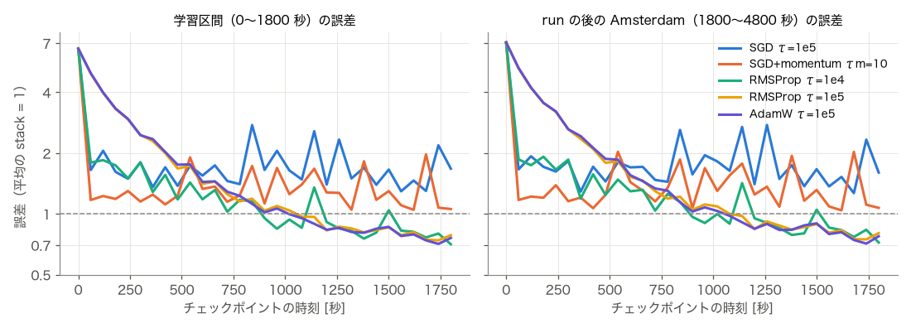
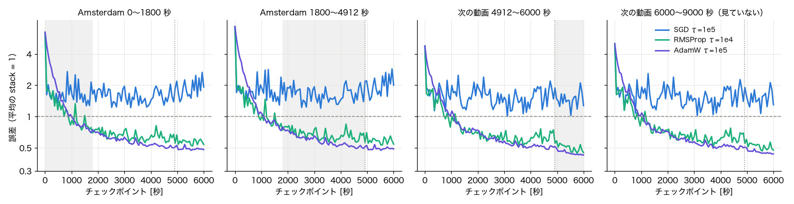
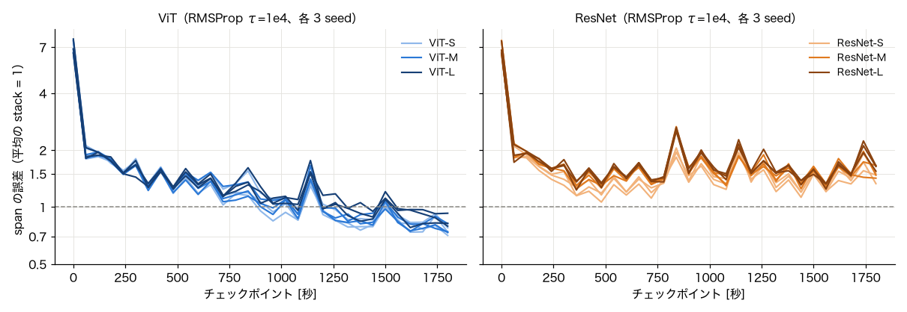
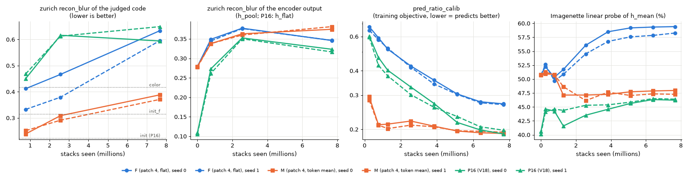
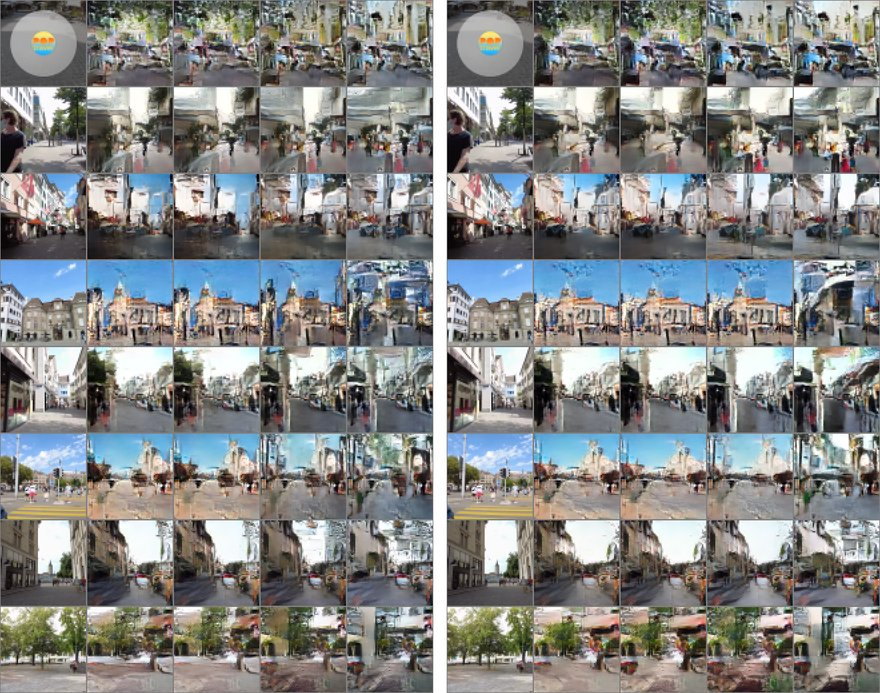

# vision: 単一ストリームから PC-ALM で VAE のエンコーダを学ぶ

計画は [PLAN.md](PLAN.md)、V0 の実装の仕様は [plans/v0-foundation.md](plans/v0-foundation.md)。V0〜V8 のまとめは [results/v0-v8.md](results/v0-v8.md)。V0〜V10 の結果を、学習の経過の図・描き戻した画像・注釈つきで読める 1 枚のページにまとめたものが [report.html](report.html)（ブラウザで開く）。V11〜V15（optimizer の研究）と V16（同じモデルを普通の深層学習で学んだ結果）は、図と表で読める [report-optim.html](report-optim.html) にまとめた。V17（1 本のストリームを 480 万 stack まで見せた結果と、連続する stack をまとめる学び方の検証）は [report-long.html](report-long.html) にまとめた。V18・V18b・V18c（BP と i.i.d. なミニバッチで JEPA を学んだ結果。V18c は掃引・主の指標の 3 回の試み・長い run の L1・自分の表現空間での補完の同定まで）と、JEPA の計画の全体と今後の進め方は、図と表で読める [report-jepa.html](report-jepa.html) にまとめた。V18c の評価指標（崩壊の検出、主の指標の 3 回の試み、補完の同定・対照・移植と局所性）は、図つきの解説 [eval-guide.html](eval-guide.html) で説明した。`exp/video`（M0〜M18）の続きで、番号を V0 から振り直した。`exp/video` のコードは tag `video-final`（mujou 7a8b72e）にある。

## 実行方法

```bash
# 手元で 1 本
uv run python -m exp.vision.main +experiment=v0/base --out runs/x
# fleet（std-00〜03、mini-00 は試しだけ）
just fleet submit --batch <b> +experiment=v0/base --sweep optim.tau=1e5,1e6 --seeds 0
# posthoc（run の後、GPU のあるホストで。MUJOU_EXP_DATA はデータの置き場所）
MUJOU_EXP_DATA=/data/geson/mujou-exp/.fleet/data python -m exp.vision.eval <run_dir>
# bench（B = 1 の速さと GPU メモリ）
python -m exp.vision.bench --device cuda --frames 100
# optimizer ごとの bench（ViT-S だけ、勾配の計測つき）
python -m exp.vision.bench --device cuda --frames 100 --models vit_s optim=muon measure.grad_stats=true
# 勾配の計測（measure.grad_stats=true の run の grad.jsonl）の集計
python -m exp.vision.grad_table <run_dir> [...]
# OGD（V13）: sgd・rmsprop・adamw の一歩を、ogd_every 秒ごとに保持した直近 ogd_n 個の勾配に直交させる
just fleet submit --batch <b> +experiment=v0/base optim=rmsprop optim.tau=1e4 optim.ogd_n=16 optim.ogd_every=1 --seeds 0
# 幅と μP（V14）: ヘッドの次元は 64、デコーダも幅 / 256 倍
just fleet submit --batch <b> +experiment=v0/base optim=rmsprop model.width=512 model.scale_decoder=true model.param=mup --seeds 0
# coord check（幅 128〜1024、SP と μP、RMSProp τ = 1e4、最初の 100 フレーム）。GPU のホストで
just fleet x std-00 -- env MUJOU_EXP_DATA=/data/geson/mujou-exp/.fleet/data CUDA_VISIBLE_DEVICES=0 python -m exp.vision.coord_check --device cuda
```

## V0: 土台の確認（2026-11-18）

snapshot `f0d3cbe8bc0d`（mujou 3d26a3c、PR Geson-anko/mujou#123 のブランチ）。

### bench（$B$ = 1、100 フレーム、単位/秒。リアルタイムは 10）

| | ViT-S | ViT-M | ViT-L | ResNet-S | ResNet-M | ResNet-L |
| -- | -- | -- | -- | -- | -- | -- |
| エンコーダのパラメータ | 6.83M | 9.99M | 16.31M | 5.91M | 9.44M | 16.50M |
| 4090（std-00） | 6.38 | 6.24 | 6.16 | 6.35 | 6.31 | 6.14 |
| 5070 Ti（mini-00） | 5.52 | 5.47 | 5.44 | 5.49 | 5.49 | 5.64 |
| GPU メモリ（4090、MB） | 121 | 155 | 221 | 115 | 155 | 231 |

速さはモデルの大きさによらずほぼ同じで、1 フレーム 50 ステップ × 9 ノードの、ステップごとのオーバーヘッドで決まっているとみられる（未確認）。リアルタイムには届かない。1800 秒の run は 4090 で約 48 分。

### 試しの run（mini-00、v0/base、SGD $\tau$ = 1e5、120 秒、seed 0）

`v0-base-5804bbe3-s0`。120 秒のあいだ値はすべて有限。loss は 110814 → −38725、ln σ は −0.85 → −1.81 と下がった。

| t（秒） | stack_mse | recon_blur（4 seed の平均 ± sd） | dyn_1/copy_1 |
| -- | -- | -- | -- |
| 0 | 6.707 | 0.2849 ± 0.0041 | 0.880 |
| 60 | 1.115 | 0.2568 ± 0.0015 | 0.874 |
| 120 | 2.036 | 0.2538 ± 0.0052 | 0.875 |
| 画素の PCA（$D$ = 256） | | 0.0615 ± 0.0027 | 0.897 |

目視（`posthoc/00120.0.png`）: システムのデコーダは、120 秒の時点でどの窓にもほぼ同じ画像（空と暗い地面）を出し、まだ $z$ を使っていない。`stack_mse` が 1 を上回るのはこのため。

## V1: 出発点の設定は安定して学べるか（回す前に決めたこと、2026-11-18）

**問い**: v0/base（ViT-S、8 枚、64×64、SGD）で、1800 秒のあいだ発散せず、初期化時より下がる $\tau$ はあるか。あれば、その中で最も小さい $\tau$（最も大きい学習率）を以降の出発点にする。

**腕**: SGD の $\tau \in \{10^4, 10^5, 10^6, 10^7\}$、seed 0、1800 秒、std-00・02・03 の 4090（std-01 は GPU が見えないので外す）。posthoc は 0・60・300・600・1200・1800 秒の checkpoint。

**判定**（val、1800 秒と 0 秒の比べ）

- 安定: stream の全行が有限
- 学べた: 次の 3 つをすべて満たす
  - `stack_mse` が 0 秒より小さい
  - `recon_blur` の差が、2 点の標準誤差を合わせたものの 2 倍より大きい（$\Delta > 2\sqrt{(s_0^2 + s_1^2)/4}$、$s$ は 4 seed の sd）
  - `dyn_1/copy_1` が 0 秒より小さい
- 目視: システムのデコーダが窓ごとに違う画像を出しているかを書く（判定には入れない）

**予想**: $10^4$ は発散する（合成データで発散した）。$10^5$ は安定して学べる。$10^6$ は学べるが遅い。$10^7$ はほとんど動かず `recon_blur` で外れる。

**反証**: どの $\tau$ も「学べた」を満たさなければ、次は学習則より前の段（目的の式の重み、デコーダの形、`learn_interval`）を疑う。

## V1: 結果（2026-11-18）

batch `v1-tau`、snapshot `0b8a21ad1fde`。fleet が 4 本とも std-00 に置いたので、同じ GPU に 3 本が並び、1 本は約 3.7 単位/秒・約 80 分かかった（結果には影響しない。速さは V0 の bench の値で読む）。

### 判定

0 秒の行は 4 本で同じ（同じ初期値）: `stack_mse` 6.707、`recon_blur` 0.2820 ± 0.0006、`dyn_1/copy_1` 0.8798。

| $\tau$ | run | 安定 | `stack_mse`（1800 秒） | `recon_blur`（1800 秒） | 差 / 閾値 | `dyn_1/copy_1`（1800 秒） | 学べた |
| -- | -- | -- | -- | -- | -- | -- | -- |
| 1e4 | `v0-base-db27fa3b-s0` | ×（2 秒で非有限） | — | — | — | — | × |
| 1e5 | `v0-base-b53efc4f-s0` | ○ | 1.518 | 0.2175 ± 0.0027 | 0.0646 / 0.0028 | 0.7957 | ○ |
| 1e6 | `v0-base-13f529cf-s0` | ○ | 1.492 | 0.2402 ± 0.0032 | 0.0418 / 0.0032 | 0.8694 | ○ |
| 1e7 | `v0-base-0df71d0e-s0` | ○ | 0.954 | 0.2517 ± 0.0029 | 0.0303 / 0.0030 | 0.8806 | ×（`dyn_1/copy_1`） |
| 画素の PCA | | | | 0.0624 ± 0.0039 | | 0.8971 | |

規則の上では、学べた $\tau$ のうち最も小さいのは $10^5$ で、これが以降の出発点になる。予想は 1e4・1e5・1e6 が当たり、1e7 は外れた（`recon_blur` は下がり、`dyn_1/copy_1` で外れた）。

### 1e5 の経過（val）

| t（秒） | 0 | 60 | 300 | 600 | 1200 | 1800 |
| -- | -- | -- | -- | -- | -- | -- |
| `stack_mse` | 6.707 | 1.367 | 1.758 | 1.417 | 1.120 | 1.518 |
| `recon_blur` | 0.2820 | 0.2555 | 0.2416 | 0.2372 | 0.2213 | 0.2175 |
| `dyn_1/copy_1` | 0.880 | 0.874 | 0.870 | 0.865 | 0.836 | 0.796 |
| `copy_1` | 0.205 | 0.132 | 0.089 | 0.068 | 0.033 | 0.021 |
| 実効ランク | 80.6 | 43.8 | 28.1 | 23.8 | 12.7 | 10.2 |

### 目視と、判定に入れていない問題

- **システムのデコーダは $z$ を使っていない**。1e5 と 1e6 の 1800 秒（`posthoc/01800.0.png`）では、val の 10 窓のどれにも同じ画像を出す。その画像は Zurich ではなく、学習のストリームのその時刻の場面（水辺と木々）に見える。デコーダが、いま流れている場面の平均を自分のパラメータで追い、入力を描き戻していないと読める（未確認）。`stack_mse` が 1800 秒でも 1 を上回る（平均の stack より悪い）こととも合う
- 3 条件が下がったのは、主に符号の側の変化による。後から学ぶデコーダの `recon_blur` は 0.282 → 0.218 と下がったが、画素の PCA（0.062）には遠い
- 符号の実効ランクは 80.6 → 10.2 と縮み、`copy_1` も 0.205 → 0.021 と小さくなった。`dyn_1/copy_1` の低下は、符号がゆっくり動くようになったことと区別できていない

「初期化時より下がる」を 3 つとも満たしても、システムのデコーダは入力を描き戻していない。この基準だけでは、VAE が学べたかどうかを分けられない。

## V2〜V5: 決めた軸を出発点から 1 本ずつ動かす（回す前に決めたこと、2026-11-18）

ユーザーの指示（2026-11-18）: SGD だけでは何とも言えないので、計画で決めた軸を最後まで回す。

**出発点**: v0/base（ViT-S、8 枚、64×64、SGD $\tau = 10^5$、1800 秒、seed 0）。各軸はここから 1 つだけ動かす。どれも 1 seed の絞り込みで、軸の中の順位は参考とする。

| 軸 | 腕 | 本数 |
| -- | -- | -- |
| V2 モデル | ViT-M、ViT-L、ResNet-S、ResNet-M、ResNet-L（ViT-S は V1 の $\tau = 10^5$ の run） | 5 |
| V3 momentum | `sgd_momentum`、$\tau = 10^5$、$\tau_m \in \{0.1, 1, 10\}$ 秒 | 3 |
| V4 stack の枚数 | $n \in \{4, 8, 16\}$。$n = 16$ は既定の評価の窓（clips 256）が Zurich に収まらないので、3 本とも `measure.clips=128` にそろえる | 3 |
| V5 適応的な optimizer | RMSProp（$\tau_v$ = 30 秒）と AdamW（$\tau_m$ = 1 秒、$\tau_v$ = 30 秒、weight decay 0.01）、$\tau \in \{10^2, 10^3, 10^4\}$（1 フレームに 1 回学ぶので、要素ごとの一歩は約 $0.1/\tau$、つまり 1e-3・1e-4・1e-5） | 6 |

V2 で $\tau = 10^5$ が発散したモデルは、$\tau = 10^6$ で 1 本回し直す（事前に決めた手当て）。

**判定**（val、1800 秒と 0 秒の比べ。V1 の 3 条件に 1 つ足す）

- 安定: stream の全行が有限
- 学べた: 次の 4 つをすべて満たす
  - `stack_mse` が 0 秒より小さい
  - **`stack_mse` < 1**（新しく足す。システムのデコーダが学習の平均の stack より良い。V1 では 3 条件を満たしても、デコーダが窓によらず同じ画像を出していた）
  - `recon_blur` の差が、2 点の標準誤差を合わせたものの 2 倍より大きい
  - `dyn_1/copy_1` が 0 秒より小さい
- 診断（判定には入れない）: 直前 64 秒の学習のストリームの `recent_stack_mse`（同じ窓の初期化時の値と並べる）、システムのデコーダの出力の窓をまたいだばらつき `dec_spread`（val と直前の区間）、画像
- 軸の中の比べ: 学べた腕のうち 1800 秒の `recon_blur` を並べる。差が 2 点の標準誤差を合わせたものの 2 倍より小さいものは区別しない

V1 の 4 本も、足した診断の評価をかけ直す。

**予想**

- V2: どのモデルも `stack_mse` < 1 を満たさない（V1 のデコーダの問題は、エンコーダの大きさでは変わらない）。ResNet と ViT の差は区別できない
- V3: $\tau_m$ によらず V1 と区別できない
- V4: $n = 4$ の `recon_blur` が最も小さい
- V5: 少なくとも 1 本が `stack_mse` < 1 を満たし、SGD より `recon_blur` が小さい

**反証**: どの腕も `stack_mse` < 1 を満たさなければ、学習の設定ではなく、目的の式かストリームの非定常（デコーダがいまの場面を追う）を疑う。診断の `recent_stack_mse` と `dec_spread` で、そのどちらかを切り分ける。

## V2〜V5: 結果（2026-11-18）

batch `v2-model`・`v3-mom`・`v4-frames`・`v5-adapt`、snapshot `e605244269fa`（mujou 3d26a3c）。std-00〜03 に 4〜5 本ずつ置いた。1 台に posthoc と並んだので、1 本 108〜154 分かかった。V1 の 3 本にも、足した診断の posthoc をかけ直した。表は `uv run python -m exp.vision.tables runs/v1-tau runs/v2-model runs/v3-mom runs/v4-frames runs/v5-adapt` で出る。

### 判定

0 秒の行は、ViT-S・8 枚の run で V1 と同じ（`stack_mse` 6.707、`recon_blur` 0.2820 ± 0.0006、`dyn_1/copy_1` 0.880）。ほかの腕は自分の 0 秒と比べる。`dec_spread` は val の 10 窓をまたいだシステムのデコーダの出力のばらつき、`recent_stack_mse` は直前 64 秒の学習のストリームでの値（0 秒は約 6.0）。

| 軸 | 腕 | run | 安定 | `stack_mse` | `recon_blur` | `dyn_1/copy_1` | `dec_spread` | `recent_stack_mse` | 学べた |
| -- | -- | -- | -- | -- | -- | -- | -- | -- | -- |
| 出発点 | ViT-S（V1、$\tau = 10^5$） | `b53efc4f` | ○ | 1.518 | 0.2175 ± 0.0027 | 0.796 | 0.000 | 1.519 | ×（< 1） |
| V2 | ViT-M | `11558c6e` | ○ | 1.454 | 0.2075 ± 0.0020 | 0.776 | 0.000 | 1.509 | ×（< 1） |
| V2 | ViT-L | `708b0734` | ○ | 1.524 | 0.2195 ± 0.0034 | 0.729 | 0.000 | 1.597 | ×（< 1） |
| V2 | ResNet-S | `55cac856` | ×（2 秒） | — | — | — | — | — | × |
| V2 | ResNet-S、$\tau = 10^6$ | `b141533f` | ○ | 1.569 | 0.4518 ± 0.0342 | 0.849 → 0.945 | 0.004 | 1.617 | ×（< 1、dyn） |
| V2 | ResNet-M | `7be1356d` | ○ | 1.410 | 0.4794 ± 0.0285 | 0.810 → 0.976 | 0.000 | 1.468 | ×（< 1、dyn） |
| V2 | ResNet-L | `3ebb9431` | ×（5 秒） | — | — | — | — | — | × |
| V2 | ResNet-L、$\tau = 10^6$ | `1f33e6a3` | ○ | 1.348 | 0.4039 ± 0.0199 | 0.743 → 0.939 | 0.000 | 1.388 | ×（< 1、dyn） |
| V3 | $\tau_m$ = 0.1 秒 | `91caada9` | ○ | 1.476 | 0.2214 ± 0.0077 | 0.754 | 0.000 | 1.532 | ×（< 1） |
| V3 | $\tau_m$ = 1 秒 | `21dd4b43` | ○ | 1.383 | 0.2101 ± 0.0095 | 0.768 | 0.000 | 1.448 | ×（< 1） |
| V3 | $\tau_m$ = 10 秒 | `56381ae8` | ○ | 1.028 | 0.3191 ± 0.0058（0 秒より悪い） | 0.470 | 0.364 | 1.020 | ×（< 1、blur） |
| V4 | $n$ = 4 | `068e2adf` | ○ | 1.586 | 0.1747 ± 0.0025 | 0.877 → 0.811 | 0.001 | 1.680 | ×（< 1） |
| V4 | $n$ = 8 | `2980d7e2` | ○ | 1.493 | 0.2173 ± 0.0029 | 0.873 → 0.787 | 0.000 | 1.519 | ×（< 1） |
| V4 | $n$ = 16 | `f2c9a74d` | ○ | 1.028 | 0.2713 ± 0.0034（0 秒 0.3535） | 0.903 → 0.834 | 0.000 | 1.109 | ×（< 1） |
| V5 | RMSProp $\tau = 10^2$ | `d2b8821d` | ×（57 秒） | — | — | — | — | — | × |
| V5 | RMSProp $\tau = 10^3$ | `32201807` | ○ | 1.435 | 0.2045 ± 0.0061 | 0.523 | 0.000 | 1.482 | ×（< 1） |
| V5 | **RMSProp $\tau = 10^4$** | `22a7fda6` | ○ | **0.640** | 0.2312 ± 0.0031 | 0.729 | 0.284 | 0.635 | **○** |
| V5 | AdamW $\tau = 10^2$ | `e77b7a41` | ○ | 1.434 | 0.2931 ± 0.0072（0 秒より悪い） | 0.155 | 0.000 | 1.487 | ×（< 1、blur） |
| V5 | AdamW $\tau = 10^3$ | `c3f8e24a` | ○ | 1.342 | 0.2045 ± 0.0009 | 0.272 | 0.001 | 1.413 | ×（< 1） |
| V5 | AdamW $\tau = 10^4$ | `d0a03b18` | ○ | 1.004 | 0.2754 ± 0.0045 | 0.376 | 0.184 | 0.872 | ×（< 1） |

run は `v0-base-<id>-s0`。V4 の $n$ = 8 は V1 の 1e5 と同じ設定（評価の窓だけ clips 128）で、`recon_blur` は 0.2173 と 0.2175 で一致した。

予想との比べ

- V2: どのモデルも `stack_mse` < 1 を満たさない、は当たった。ResNet と ViT は区別できない、は外れた。ResNet は S・L が $\tau = 10^5$ で数秒で発散し、3 つとも `recon_blur` が 0.40〜0.48 と ViT（0.21〜0.22）より大きく、`dyn_1/copy_1` は 0 秒より上がった
- V3: $\tau_m$ = 0.1・1 秒は V1 と区別できない、は当たった。10 秒は外れた（`recon_blur` が 0 秒より悪い）
- V4: $n$ = 4 の `recon_blur` が最も小さい、は当たった（0.175 < 0.217 < 0.271）
- V5: 少なくとも 1 本が `stack_mse` < 1 を満たす、は当たった（RMSProp $10^4$）。SGD より `recon_blur` が小さい、は外れた（0.231 対 0.218）

### 目視（1800 秒、`posthoc/01800.0.png` と `-recent.png`）

- **RMSProp $\tau = 10^4$**: システムのデコーダが、val の窓ごとに違う画像を出す。左に木の暗い塊がある最初の 3 窓と、空と建物が並ぶ残りの窓で、明暗の配置が変わる。細部は無く、ぼやけた明暗の配置だけ。直前 64 秒でも、屋内の暗い窓と屋外の窓で出力が変わる。`stack_mse` は 600 秒から下がり始め、1.120（600 秒）→ 0.758（1200 秒）→ 0.640（1800 秒）と、まだ下がっている
- **ResNet-M**: システムのデコーダが、どの窓にも学習のストリームの場面（水辺と木々）をくっきり描く。V1 の ViT-S より鮮明に、いまの場面を自分のパラメータで覚えている
- **momentum $\tau_m$ = 10 秒・AdamW $\tau = 10^4$**: 窓ごとに出力が変わるが、形が崩れた明暗の塊（momentum）か、最初の 3 窓だけが違う（AdamW）
- ほかの腕: V1 と同じく、どの窓にも同じ画像を出す

### 読み

- **`dec_spread` ≈ 0 の腕では、システムのデコーダが $z$ を使っていない**。止めた checkpoint では、直前 64 秒の学習のストリームでも `recent_stack_mse` が 1.4〜1.6 になる
- **ただし、走っている最中のデコーダの誤差は小さい**。最後の 60 秒の stream の `sq` / $P$ は、ほとんどの腕で 0.025 前後で、val の平均の stack の誤差 / $P$（0.0696）で割ると約 0.37 になる（学習のストリームの平均の stack で割ったものではないので目安）。止めた重みでは 64 秒前の場面を描けず、走りながらなら描ける。デコーダは $z$ ではなく自分のパラメータで、数秒〜数十秒の時間で、いまの場面を追っていると読める。（この節の最初の版では、`recent_stack_mse` を根拠に「いまの場面を覚えているだけ」を否定していた。直前 64 秒の窓は場面をいくつもまたぐので、この診断では否定できない。訂正する）
- **KL はつぶれていない**。学習の最後の 60 秒の KL は、どの腕でも 300〜700 nat ある。後から学ぶデコーダは $z$ から 0.20〜0.23 まで描き戻せるので、符号には入力の情報がある
- **KL と再構成の釣り合いが腕ごとに違う**。係数 $\beta$ は置いておらず、学ぶ $\sigma$ が釣り合いを決める（$\sigma$ を 1 にした $\beta$-VAE の $\beta = 2\sigma^2$ と同じ）。1800 秒の $\sigma^2$ は、SGD の腕で 0.006〜0.011、RMSProp $10^4$ で 0.054、AdamW で 0.030〜0.057 と、最大で 9 倍違う。どの腕でも、stream の誤差 / $P$（0.025〜0.054）とずれており、$\sigma$ は最尤の値まで来ていない。$z$ を使い始めた RMSProp $10^4$ は、$\sigma^2$ が大きい側（KL が相対的に強く、デコーダの再構成の勾配が小さい側）にある。optimizer の効果と釣り合いの効果は、いまの腕では分けられない
- **適応的な optimizer の大きい $\tau$ でだけ、デコーダが $z$ を使い始めた**（RMSProp $10^4$、AdamW $10^4$ の一部）。要素ごとに一歩を揃えるので、勾配の小さい $z$ の経路の重みも動く、という読みと合う（未確認）
- **符号の実効ランクの崩れ**: AdamW $10^2$ は 1.2、RMSProp・AdamW $10^3$ は 3.5 まで縮み、`dyn_1/copy_1` が 0.16〜0.52 まで下がった。符号がほとんど動かず、線形の動力学が当てやすくなっただけで、`recon_blur` は下がらないか少ししか下がらない。`dyn_1/copy_1` の低下を、そのまま良い符号と読んではいけない

V2〜V5 の判定で学べたのは RMSProp $\tau = 10^4$ の 1 本だけで、1 seed。次は V6 で、seed を足して確かめ、$\tau$ を上へ広げる。

## V6: RMSProp $\tau = 10^4$ は seed によらず学べるか（回す前に決めたこと、2026-11-18）

**問い**: V5 で唯一学べた RMSProp $\tau = 10^4$ は、seed を変えても学べるか。$\tau$ を 1 桁上げるとどうなるか。

**腕**（v0/base から optimizer だけ変える、1800 秒、std-00〜03 に 1 本ずつ）

| 腕 | seed |
| -- | -- |
| RMSProp $\tau = 10^4$ | 1、2 |
| RMSProp $\tau = 10^5$ | 0 |
| AdamW $\tau = 10^5$ | 0 |

**判定**: V2〜V5 と同じ（4 条件、診断は判定に入れない）。

**予想**

- RMSProp $10^4$ は seed 1・2 とも学べる
- RMSProp $10^5$ は安定するが、1800 秒では `stack_mse` が 1 を下回らない（$10^4$ でも 1 を切ったのは 600〜1200 秒の間）
- AdamW $10^5$ は窓ごとに違う画像を出し始める（`dec_spread` > 0.1）が、`stack_mse` < 1 は満たさない

**反証**: seed 1・2 のどちらかが `stack_mse` < 1 を満たさなければ、V5 の結果は seed の偶然とみなし、適応的な optimizer で学べるとは言わない。

## V6: 結果（2026-11-18）

batch `v6-rms`、snapshot `358f87399dfb`。1 台に 1 本ずつ置き、1 本 50〜51 分で終わった。4 本とも発散しなかった。

| 腕 | run | `stack_mse`（0 → 1800 秒） | `recon_blur` | 差 / 閾値 | `dyn_1/copy_1` | `dec_spread` | 1800 秒の $\sigma^2$ | 学べた |
| -- | -- | -- | -- | -- | -- | -- | -- | -- |
| RMSProp $10^4$、seed 0（V5） | `22a7fda6-s0` | 6.707 → 0.640 | 0.2312 ± 0.0031 | 0.0508 / 0.0032 | 0.880 → 0.729 | 0.284 | 0.054 | ○ |
| RMSProp $10^4$、seed 1 | `06c0f687-s1` | 7.704 → 0.673 | 0.2239 ± 0.0019 | 0.0607 / 0.0031 | 0.878 → 0.735 | 0.242 | 0.054 | ○ |
| RMSProp $10^4$、seed 2 | `06c0f687-s2` | 6.958 → 0.676 | 0.2332 ± 0.0020 | 0.0527 / 0.0054 | 0.877 → 0.726 | 0.245 | 0.054 | ○ |
| RMSProp $10^5$ | `3b9a274d-s0` | 6.707 → 0.708 | 0.2382 ± 0.0041 | 0.0438 / 0.0042 | 0.880 → 0.881 | 0.308 | 0.073 | ×（`dyn_1/copy_1`） |
| AdamW $10^5$ | `8a3f253a-s0` | 6.707 → 0.685 | 0.2331 ± 0.0044 | 0.0489 / 0.0044 | 0.880 → 0.875 | 0.307 | 0.073 | ○ |

run は `v0-base-<id>`。seed を変えると初期値が変わるので、0 秒の行も seed ごとに違う。

予想との比べ

- RMSProp $10^4$ は seed 1・2 とも学べる、は当たった。3 つの seed の `stack_mse` は 0.640〜0.676、`dec_spread` は 0.24〜0.28 とそろった。V5 の結果は seed の偶然ではない
- RMSProp $10^5$ は `stack_mse` が 1 を下回らない、は外れた（0.708）。`dyn_1/copy_1` が下がらず、「学べた」には入らない
- AdamW $10^5$ は `stack_mse` < 1 を満たさない、は外れた（0.685 で、4 条件を満たした。`dyn_1/copy_1` の下がりは 0.880 → 0.875 とわずか）

$\tau = 10^5$ の 2 本では、$\sigma^2$ が 1800 秒でも初期値（0.0743）からほとんど動いていない。V1〜V6 で `stack_mse` が 0.75 を下回った 5 本（RMSProp $10^4$ の 3 本、RMSProp・AdamW $10^5$）は、どれも 1800 秒の $\sigma^2$ が 0.054〜0.073 だった。ただし、$\sigma^2$ が 0.029 の SGD $10^7$（V1）と momentum $\tau_m$ = 10 秒（V3）でも、`dec_spread` は 0.1 を超えた（0.125、0.364）。$\sigma^2$ だけでは決まらない。釣り合いの効果と optimizer の効果は、V7 で分ける。

## V7: KL と再構成の釣り合い（$\sigma$ の固定）（回す前に決めたこと、2026-11-18）

**問い**: V2〜V5 では、学ぶ $\sigma$ が KL と再構成の釣り合いを決めていた。1800 秒の $\sigma^2$ は腕ごとに最大 9 倍違い、optimizer の効果と分けられなかった。$\sigma$ を固定して釣り合いをそろえたとき、システムのデコーダは $z$ を使うか。それは optimizer によるか。

**変更**: `model.learn_sigma=false` で $\ln\sigma$ を学ばず、$\sigma^2$ を `model.sigma0_sq` に固定する（テストで、$\ln\sigma$ が動かず、ほかのパラメータは固定した $\sigma$ での −ELBO の BP の勾配で学ぶことを確かめた）。$\sigma$ を 1 にした $\beta$-VAE の $\beta = 2\sigma^2$ にあたる。

**腕**（v0/base から、1800 秒、seed 0）

| | $\sigma^2$ = 0.01 | $\sigma^2$ = 0.03 | $\sigma^2$ = 0.1 |
| -- | -- | -- | -- |
| SGD $\tau = 10^5$ | 1 本 | 1 本 | 1 本 |
| RMSProp $\tau = 10^4$ | 1 本 | 1 本 | 1 本 |

- 0.01: SGD の腕が 1800 秒で学んでいた $\sigma^2$（0.006〜0.011）
- 0.03: 走りながらの誤差 / 画素（約 0.025）に近い値。最尤の $\sigma^2$ の目安
- 0.1: 平均の stack のまわりの分散（$\sigma_0^2$ = 0.0743）より上。RMSProp $10^4$ の 0.054 より大きい

SGD では、$\sigma^2$ を大きくすると再構成の勾配が $1/\sigma^2$ で小さくなり、再構成の側の実効の学習率も下がる（KL の側は変わらない）。RMSProp は要素ごとに一歩をそろえるので、$\sigma$ の効果は、主にエンコーダの出力で KL と再構成の勾配が釣り合う位置を通して出る。

**判定**: V2〜V5 と同じ 4 条件。あわせて `dec_spread` と、走りながらの誤差（stream の `sq` / $P$）を並べる。

**予想**

- SGD: $\sigma^2$ = 0.01 は V1 と同じく学べない。0.1 では `dec_spread` > 0.1 になる（デコーダが重みで場面を追う力が弱まり、$z$ を使い始める）
- RMSProp: 0.03 と 0.1 は学べる。0.01 は学べない
- どちらの optimizer でも、$\sigma^2$ が大きいほど `dec_spread` が大きい

**反証と次の手**

- SGD の 0.1 が学べたら、V5 の「RMSProp で学べた」は、主に釣り合いの効果とみなす
- RMSProp の 0.01 でも学べたら、釣り合いではなく optimizer の効果とみなす
- どの腕も `dec_spread` ≈ 0 なら、釣り合いでは説明できない。そのときは、デコーダが重みで場面を追う速さ（デコーダだけ $\tau$ を大きくする）を疑う

## V7: 結果（2026-11-18）

batch `v7-sigma`、snapshot `b6a97b1`（mujou 3d26a3c）。6 本のうち 4 本が終わり、2 本が発散した。

| optimizer | 固定した $\sigma^2$ | run | 安定 | `stack_mse`（1800 秒） | `recon_blur` | `dyn_1/copy_1` | `dec_spread` | 学べた |
| -- | -- | -- | -- | -- | -- | -- | -- | -- |
| SGD $10^5$ | 0.01 | `087311d1` | ×（1 秒で非有限） | — | — | — | — | × |
| SGD $10^5$ | 0.03 | `70567fe8` | ×（2 秒で非有限） | — | — | — | — | × |
| SGD $10^5$ | 0.1 | `794cf7df` | ○ | 1.413 | 0.2305 ± 0.0027 | 0.859 | 0.001 | ×（< 1） |
| RMSProp $10^4$ | 0.01 | `8a3d6f22` | ○ | 0.664 | 0.2313 ± 0.0047 | 0.756 | 0.289 | ○ |
| RMSProp $10^4$ | 0.03 | `c680cf0e` | ○ | 0.654 | 0.2318 ± 0.0044 | 0.739 | 0.279 | ○ |
| RMSProp $10^4$ | 0.1 | `598cc9e6` | ○ | 0.678 | 0.2275 ± 0.0038 | 0.726 | 0.236 | ○ |

run は `v0-base-<id>-s0`。0 秒の行は V1 と同じ。

予想との比べ

- SGD の 0.01 は学べない、は当たった。ただし予想していたのは V1 と同じ「学べない」で、発散は予想していなかった。0.03 も発散した。$\sigma$ を学ぶ run では $\sigma^2$ が 0.0743 から少しずつ下がるが、固定すると最初から再構成の勾配が $0.0743/\sigma^2$ 倍になり、$\tau = 10^5$ では大きすぎた
- SGD の 0.1 で `dec_spread` > 0.1 になる、は外れた（0.001）。どの窓にも同じ画像を出す
- RMSProp の 0.03 と 0.1 が学べる、は当たった。0.01 は学べない、は外れた（0.664 で学べた）
- $\sigma^2$ が大きいほど `dec_spread` が大きい、は外れた。RMSProp の 3 本は 0.236〜0.289 で、むしろ 0.1 が最も小さい

**判定**: 事前に決めた反証の規則で、RMSProp の 0.01 でも学べたので、V5 の「RMSProp で学べた」は**釣り合いではなく optimizer の効果**とみなす。RMSProp では、$\sigma^2$ を 10 倍変えても `stack_mse`（0.654〜0.678）、`recon_blur`（0.228〜0.232）、`dec_spread` はほとんど変わらない。SGD は、$\sigma^2$ を V1 の 10 倍（0.1）にしても、デコーダが $z$ を使わない。

**補足（2026-11-19、資料を作る中で気づいたこと）**: SGD の $\sigma^2$ は 1 秒ごとに大きく揺れる（V1 の $\tau = 10^5$ では、600 秒以降も 0.003〜0.11）。V2〜V5 の読みに書いた「1800 秒の $\sigma^2$」（SGD の腕で 0.006〜0.011）は 1800 秒ちょうどの 1 点の値で、最後の 60 秒の平均は、$\tau = 10^5$〜$10^6$ の SGD（V1〜V4）で 0.025〜0.029 だった。RMSProp $10^4$ は 0.054 で、ほとんど揺れない。V7 は 0.01・0.03・0.1 をすべて試したので、この判定は変わらない。

## V8: 学習のストリームそのもので評価し直す（回す前に決めたこと、2026-11-19）

ユーザーの指摘（2026-11-19）: ストリームから学ぶとは学び続けることなので、学習に使ったデータ全体で評価する。過去の損失が大きければ忘れている。未来の損失が小さければ汎化している。今の損失は、ある程度学ぶまで意味を持たない。

**評価**（`python -m exp.vision.stream_eval <run_dir>`、`posthoc_stream/`）

- 学習のストリーム（Amsterdam の先頭から）の 5 秒ごとの stack と、run の後の 3000 秒（Amsterdam の続き）の 10 秒ごとの stack で、システムのデコーダの誤差を測る。平均の stack を 1 とする
- チェックポイントを 60 秒ごと（31 個）にし、各チェックポイントで過去（見た時期で 4 つ）と未来（来る時期で 4 つ）の誤差を出す
- 忘却: 過去の誤差から、その stack を学んだときの誤差（`stream.jsonl` の `sq`、学ぶ前の誤差。近似）を引く
- `recon_blur` と `dyn_1/copy_1`: 学習区間を 10 秒ずつに分け、奇数番目で当てはめ、偶数番目（span）、run の後（after）、Zurich で測る。0・60・300・600・1200・1800 秒のチェックポイントだけ

**run**: V1〜V7 の、発散しなかった設定 26 本を、`measure.ckpt_every=60` で回し直す（学習は同じ設定。V4 の 8 枚は V1 の $\tau = 10^5$ と同じなので省く）。batch は `v8-tau`・`v8-model`・`v8-mom`・`v8-frames`・`v8-adapt`・`v8-rms`・`v8-sigma`。

**判定**（1800 秒と 0 秒の比べ。すべて満たせば「学べた」）

1. span（学習区間の全体。1800 秒ではすべて過去）の誤差が 0 秒より小さく、1 より小さい
2. after（run の後の Amsterdam）の誤差が 0 秒より小さい
3. span の `recon_blur` が、0 秒より、標準誤差を合わせたものの 2 倍を超えて小さい
4. span の `dyn_1/copy_1` が 0 秒より小さい

Zurich の値と、見た時期ごとの忘却は、判定に入れずに並べる。

**予想**

- SGD の run（V1〜V4、V7 の SGD）は、1 で外れる。今（直前 10 秒）の誤差は小さいが、5 分以上前の誤差は学んだときより大きい（忘却が大きい）
- V2〜V7 で Zurich で学べた run（RMSProp $10^4$ の 6 本、AdamW $10^5$）は、4 条件を満たす。忘却は SGD より小さい
- after の誤差は、学べた run で 1 を下回る

**反証**: 学べた run でも 5 分以上前の忘却が SGD と変わらなければ、「RMSProp は $z$ を通して覚えている」という読みは成り立たない。

## V8: 結果（2026-11-19）

batch `v8-tau`・`v8-model`・`v8-mom`・`v8-frames`・`v8-adapt`・`v8-rms`・`v8-sigma`、snapshot `2ee162ca33aa`（mujou 3d26a3c）。26 本とも発散せず、評価まで終わった。1 台に 6〜7 本を同時に置き、1 本 2.5〜3 時間かかった。

チェックポイントの間隔は学習を変えない。V7 の RMSProp・$\sigma^2$ = 0.03 の run（チェックポイント 6 個）と、同じ設定を V8 で回し直した run（60 秒ごと）では、1800 秒の評価の値が完全に一致した。

### 判定

| batch | 腕 | run | span 0 → 1800 | after 0 → 1800 | 今（学習中） | 忘却 10–60 / 60–300 / 300– 秒 | `recon_blur` span（差 / 閾値） | `dyn_1/copy_1` span | rank | 学べた |
| -- | -- | -- | -- | -- | -- | -- | -- | -- | -- | -- |
| `v8-tau` | SGD $10^{6}$ | `0b563aac-s0` | 6.587 → 1.748 | 7.060 → 1.676 | 0.42（0.18） | 1.47 / 1.43 / 1.37 | 0.451（0.067 / 0.007） | 0.994 → 1.010 | 27.5 | ×（span_lt1, dyn_down） |
| `v8-tau` | SGD $10^{5}$ | `ba9d09f2-s0` | 6.587 → 1.675 | 7.060 → 1.602 | 0.53（0.17） | 1.43 / 1.36 / 1.33 | 0.428（0.090 / 0.006） | 0.994 → 0.910 | 9.1 | ×（span_lt1） |
| `v8-tau` | SGD $10^{7}$ | `beccd61d-s0` | 6.587 → 1.154 | 7.060 → 1.142 | 0.30（0.26） | 0.79 / 0.74 / 0.52 | 0.447（0.070 / 0.005） | 0.994 → 1.009 | 33.8 | ×（span_lt1, dyn_down） |
| `v8-model` | SGD $10^{6}$、ResNet-S | `17a1aa1e-s0` | 6.551 → 1.844 | 7.006 → 1.772 | 0.42（0.17） | 1.56 / 1.55 / 1.49 | 0.580（0.231 / 0.008） | 0.922 → 1.091 | 14.9 | ×（span_lt1, dyn_down） |
| `v8-model` | SGD $10^{5}$、ViT-L | `1dc764f3-s0` | 6.495 → 1.827 | 6.965 → 1.756 | 0.42（0.18） | 1.57 / 1.52 / 1.48 | 0.397（0.120 / 0.004） | 0.995 → 0.805 | 6.2 | ×（span_lt1） |
| `v8-model` | SGD $10^{6}$、ResNet-L | `70dc1ca5-s0` | 6.472 → 1.589 | 6.923 → 1.512 | 0.40（0.16） | 1.28 / 1.26 / 1.24 | 0.580（0.441 / 0.007） | 0.769 → 1.115 | 8.7 | ×（span_lt1, dyn_down） |
| `v8-model` | SGD $10^{5}$、ViT-M | `83fdc0d0-s0` | 6.510 → 1.717 | 6.963 → 1.641 | 0.40（0.18） | 1.42 / 1.40 / 1.37 | 0.405（0.108 / 0.007） | 0.997 → 0.874 | 7.5 | ×（span_lt1） |
| `v8-model` | SGD $10^{5}$、ResNet-M | `f0a25307-s0` | 6.514 → 1.679 | 6.966 → 1.601 | 0.39（0.18） | 1.40 / 1.37 / 1.34 | 0.573（0.321 / 0.013） | 0.874 → 1.091 | 3.0 | ×（span_lt1, dyn_down） |
| `v8-mom` | SGD+mom $10^{5}$、$\tau_m$ = 10 秒 | `5384f9c6-s0` | 6.587 → 1.057 | 7.060 → 1.072 | 0.64（0.68） | 0.18 / 0.20 / 0.03 | 0.489（0.029 / 0.009） | 0.994 → 0.499 | 2.7 | ×（span_lt1） |
| `v8-mom` | SGD+mom $10^{5}$、$\tau_m$ = 0.1 秒 | `6c9f4e0c-s0` | 6.587 → 1.741 | 7.060 → 1.669 | 0.41（0.14） | 1.46 / 1.44 / 1.42 | 0.417（0.101 / 0.008） | 0.994 → 0.821 | 7.4 | ×（span_lt1） |
| `v8-mom` | SGD+mom $10^{5}$、$\tau_m$ = 1 秒 | `d88c1a7e-s0` | 6.587 → 1.637 | 7.060 → 1.559 | 0.41（0.26） | 1.08 / 1.01 / 1.04 | 0.410（0.108 / 0.007） | 0.994 → 0.871 | 8.1 | ×（span_lt1） |
| `v8-frames` | SGD $10^{5}$、16 枚 | `e1d882d4-s0` | 7.326 → 1.332 | 7.889 → 1.251 | 0.52（0.21） | 0.83 / 0.90 / 0.98 | 0.545（0.059 / 0.008） | 1.015 → 0.985 | 11.1 | ×（span_lt1） |
| `v8-frames` | SGD $10^{5}$、4 枚 | `eeb0acea-s0` | 6.174 → 1.914 | 6.636 → 1.847 | 0.42（0.15） | 1.66 / 1.64 / 1.58 | 0.330（0.106 / 0.005） | 0.972 → 0.874 | 8.9 | ×（span_lt1） |
| `v8-adapt` | RMSProp $10^{4}$ | `142ba038-s0` | 6.587 → 0.708 | 7.060 → 0.722 | 0.27（0.18） | 0.28 / 0.35 / 0.24 | 0.449（0.069 / 0.006） | 0.994 → 0.835 | 23.6 | ○ |
| `v8-adapt` | AdamW $10^{4}$ | `1e8c5cd4-s0` | 6.587 → 1.082 | 7.060 → 1.097 | 0.34（0.31） | 0.36 / 0.50 / 0.33 | 0.480（0.038 / 0.007） | 0.994 → 0.392 | 6.2 | ×（span_lt1） |
| `v8-adapt` | AdamW $10^{2}$ | `3134d88d-s0` | 6.587 → 1.690 | 7.060 → 1.618 | 0.43（0.24） | 1.14 / 1.14 / 1.17 | 0.416（0.101 / 0.012） | 0.994 → 0.171 | 1.2 | ×（span_lt1） |
| `v8-adapt` | RMSProp $10^{3}$ | `d1c13c4c-s0` | 6.587 → 1.679 | 7.060 → 1.605 | 0.41（0.16） | 1.41 / 1.37 / 1.32 | 0.367（0.151 / 0.008） | 0.994 → 0.562 | 3.5 | ×（span_lt1） |
| `v8-adapt` | AdamW $10^{3}$ | `d1e4c8c2-s0` | 6.587 → 1.571 | 7.060 → 1.495 | 0.43（0.28） | 1.04 / 0.98 / 1.00 | 0.358（0.160 / 0.007） | 0.994 → 0.296 | 3.4 | ×（span_lt1） |
| `v8-rms` | RMSProp $10^{4}$、seed 1 | `142ba038-s1` | 7.611 → 0.736 | 8.163 → 0.752 | 0.29（0.19） | 0.25 / 0.39 / 0.24 | 0.439（0.075 / 0.007） | 0.989 → 0.839 | 23.8 | ○ |
| `v8-rms` | RMSProp $10^{4}$、seed 2 | `142ba038-s2` | 6.821 → 0.778 | 7.325 → 0.808 | 0.27（0.18） | 0.29 / 0.46 / 0.29 | 0.447（0.067 / 0.009） | 0.993 → 0.828 | 23.1 | ○ |
| `v8-rms` | RMSProp $10^{5}$ | `27b254cc-s0` | 6.587 → 0.784 | 7.060 → 0.803 | 0.44（0.41） | 0.09 / 0.21 / -0.62 | 0.436（0.082 / 0.007） | 0.994 → 1.005 | 25.3 | ×（dyn_down） |
| `v8-rms` | AdamW $10^{5}$ | `edf05c88-s0` | 6.587 → 0.760 | 7.060 → 0.775 | 0.48（0.48） | 0.01 / 0.11 / -0.74 | 0.428（0.090 / 0.006） | 0.994 → 0.988 | 19.5 | ○ |
| `v8-sigma` | SGD $10^{5}$、$\sigma^2$ = 0.1 | `1e29d313-s0` | 6.587 → 1.660 | 7.060 → 1.585 | 0.41（0.16） | 1.42 / 1.35 / 1.31 | 0.454（0.064 / 0.006） | 0.994 → 0.993 | 20.0 | ×（span_lt1） |
| `v8-sigma` | RMSProp $10^{4}$、$\sigma^2$ = 0.03 | `72a3fbfb-s0` | 6.587 → 0.725 | 7.060 → 0.739 | 0.27（0.17） | 0.26 / 0.39 / 0.26 | 0.448（0.069 / 0.005） | 0.994 → 0.854 | 24.3 | ○ |
| `v8-sigma` | RMSProp $10^{4}$、$\sigma^2$ = 0.1 | `af1f022c-s0` | 6.587 → 0.750 | 7.060 → 0.763 | 0.26（0.19） | 0.31 / 0.39 / 0.27 | 0.444（0.074 / 0.007） | 0.994 → 0.839 | 25.2 | ○ |
| `v8-sigma` | RMSProp $10^{4}$、$\sigma^2$ = 0.01 | `d2f68082-s0` | 6.587 → 0.728 | 7.060 → 0.736 | 0.29（0.17） | 0.29 / 0.38 / 0.26 | 0.446（0.072 / 0.010） | 0.994 → 0.867 | 24.8 | ○ |

run は `v0-base-<id>`。値はどれも、平均の stack を出したときの誤差を 1 とする。

- span・after: 学習区間（0〜1800 秒）と、その後の Amsterdam（1800〜4800 秒）の誤差
- 今（学習中）: 1800 秒の直前 10 秒の stack の誤差（stack は 2 つ）。括弧の中は、その stack が流れたときの学習中の誤差
- 忘却: 見た時期ごとに、1800 秒の誤差から、流れたときの学習中の誤差を引いたもの
- 0 秒の値は、seed 0 の run どうしで同じ（6.587、7.060）

**予想との比べ**

- SGD の run は条件 1 で外れる、は当たった。SGD の 14 本は、どれも span が 1 を上回った（1.06〜1.91）
- SGD は、今の誤差は小さいが、5 分以上前の誤差は学んだときより大きい、も当たった。ただし、忘れるまでの時間は 5 分ではなく、数秒だった（次の節）
- RMSProp $10^4$ の 6 本と AdamW $10^5$ は 4 条件を満たし、忘却は SGD より小さい、は当たった。300 秒以上前の忘却は、RMSProp $10^4$ の 6 本で 0.24〜0.29、SGD $10^5$ で 1.33 だった。SGD の 14 本にも、忘却の小さい run が 2 本ある（momentum $\tau_m$ = 10 秒の 0.03、SGD $10^7$ の 0.52）。どちらも学ぶのが遅い run で、span は 1 を下回らない（1.06、1.15）
- after は、学べた run で 1 を下回る、も当たった（0.722〜0.808）

RMSProp $10^5$ は、V6 と同じく `dyn_1/copy_1` だけが下がらなかった（0.994 → 1.005）。反証の条件（学べた run の忘却が SGD と変わらない）には当たらない。学べた run は、Zurich で判定した V2〜V7 と同じ 7 本になった。

### チェックポイントから見た相対時刻ごとの誤差（判定には入れない）


stack の時刻からチェックポイントの時刻を引いたもの（相対時刻）ごとに、誤差を平均した。負は過去（学習済み）、正は未来である。600〜1740 秒の 20 個のチェックポイントで平均した（`results/v8/figs.py`）。

| run | −1800〜−300 | −300〜−60 | −60〜−15 | −10 | −5 | 0 | +5 | +10 | +15〜+60 | +60〜+300 | +300〜+3000 |
| -- | -- | -- | -- | -- | -- | -- | -- | -- | -- | -- | -- |
| SGD $10^5$ | 1.72 | 1.77 | 1.64 | 1.51 | 1.19 | 0.31 | 1.22 | 1.49 | 1.66 | 1.74 | 1.76 |
| SGD+momentum $\tau_m$ = 10 秒 | 1.37 | 1.37 | 1.23 | 1.18 | 0.93 | 0.90 | 1.12 | 1.22 | 1.32 | 1.30 | 1.38 |
| RMSProp $10^4$ | 0.91 | 0.95 | 0.89 | 0.81 | 0.67 | 0.33 | 0.79 | 0.89 | 0.94 | 0.98 | 1.00 |
| RMSProp $10^5$ | 0.90 | 0.96 | 0.93 | 0.88 | 0.80 | 0.65 | 0.94 | 0.94 | 0.98 | 1.03 | 1.04 |
| AdamW $10^5$ | 0.89 | 0.94 | 0.91 | 0.86 | 0.78 | 0.74 | 0.95 | 0.93 | 0.97 | 1.02 | 1.03 |

1. **相対時刻 0 の誤差は、学習中の誤差とほぼ同じ。** 相対時刻 0 は、チェックポイントの瞬間に流れていた stack である。SGD は 0.31、RMSProp $10^4$ は 0.33 で、同じ時期の学習中の誤差（0.31、0.35）とほぼ同じだった。止めたモデルで測る誤差と学習中の誤差は、測り方が違う（学習中は潜在の活動が直前のフレームの誤差で引き寄せられている）。しかし違いは小さいので、表の「忘却」はそのまま忘却として読める
2. **SGD は数秒で忘れる。** 5 秒離れると 1.19、10 秒で 1.51 になり、それより遠くでは 1.6〜1.8 になる。過去と未来がほぼ対称で、過去の方が良いということがない。SGD の重みにあるのは今の場面だけで、学んだものは残っていない。1800 秒のシステムのデコーダは、どの入力にもその時点の運河の場面を出す（下の図の 2 段目）
3. **RMSProp $10^4$ も今の場面を重みで追うが、その下に残るものがある。** 相対時刻 0 で 0.33 まで下がり、離れても 0.8〜1.0 にとどまる。60 秒より前（0.91〜0.95）と 60 秒より先（0.98〜1.00）の差は小さい。学んだものの多くは、見た場面に限らず、まだ見ていない場面にも効く
4. **RMSProp $10^5$ と AdamW $10^5$ は、今の場面を追う力が弱く、そのぶん忘れにくい。** 相対時刻 0 の下がりは小さい（0.65、0.74）。判定の表で 300 秒以上前の忘却が負になるのは、学習の初めの stack を、流れたとき（まだ学べていなかった時期）より今の方がよく描けるからである
5. **同じ stack を、見た直後と後で比べても、同じことが分かる。** stack を見た直後のチェックポイントと、それより後のチェックポイントの誤差の差を、経過時間ごとに平均した。RMSProp $10^4$ は、2 分後に +0.11、10〜20 分後に −0.28、20〜30 分後に −0.55 だった。長い目で見ると、前に見たものもよく描けるようになる。SGD は、2 分以後ずっと +0.18〜+0.35 だった。60 秒ごとのチェックポイントでは、SGD は見た直後のチェックポイントまでにすでに忘れている。そのため、この差は数秒で起きる忘却を含まない

| RMSProp $10^4$（1800 秒、span） | SGD $10^5$（1800 秒、span） |
| -- | -- |
|  |  |

各図の 1 段目は本物の最後の 1 枚、2 段目はシステムのデコーダ、3 段目は後から学んだデコーダ（seed 0）。学習区間から等間隔に 10 個選んだ。

### 学習の経過



- SGD は、300 秒までに約 1.7 まで下がって止まる。その後はチェックポイントごとに 1.3〜2.7 と大きく揺れる。出力がそのときの場面で決まるからである
- RMSProp $10^4$ は、最初の 60 秒で 2 を下回り、その後も下がり続ける。ときどき跳ね上がる（1140 秒、1500 秒）
- RMSProp $10^5$ と AdamW $10^5$ は、滑らかにゆっくり下がり、900 秒ごろに RMSProp $10^4$ に並ぶ
- 学べた run は、1800 秒でもまだ下がっている。RMSProp $10^4$ は、1500 秒の 0.85 から 1800 秒の 0.71 まで下がった
- span と after は、どの run でも、どのチェックポイントでもほぼ同じ。学習区間だけに合わせた覚え方はしていない

### probe

- span の `recon_blur` は、SGD（0.33〜0.58）と RMSProp $10^4$（0.44〜0.45）で大きな差がない。SGD の $z$ にも入力の情報はあり、後から学んだデコーダは、どちらの $z$ からも場面を描ける（上の図の 3 段目）。差は、$z$ の中身ではなく、システムのデコーダが $z$ を使うかどうかにある
- RMSProp $10^4$ の `recon_blur` は 600 秒で最も小さく（0.429）、1800 秒ではやや戻る（0.449）
- `dyn_1/copy_1` は、$z$ がほとんど動かない run（rank が 6.2 以下の AdamW $10^2$〜$10^4$、RMSProp $10^3$、momentum 10 秒）で大きく下がる。V2〜V5 と同じく、単独では使えない
- 学習区間での `recon_blur` と `dyn_1/copy_1` は、Zurich の値（V2〜V7）より大きい。当てはめに使う組の数（1800 組）と、データの違いによる。比べるのは、同じ評価の中のチェックポイントどうしと run どうしに限る

### 判定のまとめ

学習のストリームで評価し直しても、V2〜V7 の結論は変わらない。学べるのは RMSProp $10^4$（3 つの seed、3 つの $\sigma^2$）と AdamW $10^5$ で、SGD は、どの設定でも学べない。新しく分かったのは、SGD が学べない仕組みである。SGD は、デコーダの重みを数秒ごとに書き換えて今の場面だけを描く。学んだものは数秒で消える。RMSProp と AdamW は、今の場面を追いながらも、見た場面にもまだ見ていない場面にも効くものを重みに残す。学べた run は 1800 秒でもまだ下がっている。そこで run を長くして、どこまで下がるかを見る（V9）。

## V9: run を長くする（回す前に決めたこと、2026-11-19）

**問い**: V8 で学べた run は、1800 秒でもまだ誤差が下がっていた。学び続けると、どこまで下がるか。別の動画（都市）を学んだ後も、Amsterdam で学んだものは残るか。

**run**: v0/base から、6000 秒、チェックポイント 60 秒ごと（101 個）、seed 0。batch `v9-long`。

| 腕 | 理由 |
| -- | -- |
| RMSProp $\tau = 10^4$ | V8 で学べた。今の場面を重みで強く追う |
| AdamW $\tau = 10^5$ | V8 で学べた。今の場面を追う力が弱く、忘れにくい |
| SGD $\tau = 10^5$ | 対照。学べない設定が長く回すと変わるかを見る |

ストリームは動画を名前順につないだもので、Amsterdam（0〜4912 秒）の次の動画に入る。6000 秒の run は、次の動画の最初の約 1090 秒も学ぶ。評価は V8 と同じ `stream_eval` で、学習区間は 0〜6000 秒、after は 6000〜9000 秒（次の動画の続き）になる。probe は V8 の 6 点と、最後の 6000 秒で取る（`d55084e`）。

**判定**（6000 秒と 0 秒の比べ。V8 と同じ 4 条件）

1. span の誤差が 0 秒より小さく、1 より小さい
2. after の誤差が 0 秒より小さい
3. span の `recon_blur` が、0 秒より、標準誤差を合わせたものの 2 倍を超えて小さい
4. span の `dyn_1/copy_1` が 0 秒より小さい

あわせて、行列から次の 3 つを出す（判定には入れない）。

- A: Amsterdam の最初の 1800 秒の誤差を、1800 秒・4860 秒（次の動画に入る直前）・6000 秒のチェックポイントで比べる
- B: 次の動画の最初の 1090 秒の誤差を、4860 秒（まだ見ていない）と 6000 秒（学んだ後）で比べる
- C: 相対時刻ごとの誤差（V8 と同じ。600〜5940 秒のチェックポイントで平均）

**予想**

- RMSProp と AdamW は 4 条件を満たす。span の誤差は 0.6 を下回る
- A: RMSProp と AdamW では、4860 秒の誤差が 1800 秒より小さい（同じ都市の中では、学び続けるほど前のものもよく描ける）。6000 秒での上がりは 0.1 未満
- B: 4860 秒の誤差は、同じチェックポイントでの Amsterdam の誤差より大きく、6000 秒では下がる
- SGD は、6000 秒でも span が 1 を上回る

**反証と次の手**

- A で、6000 秒の Amsterdam の誤差が 1800 秒の値を上回ったら、学んだものは別の都市を学ぶと消える（破滅的忘却）。そのときは、忘却を抑える仕組みを次の問いにする
- RMSProp と AdamW の span が 4800 秒までに下がらなくなったら（最後の 1200 秒の下がりが 0.02 未満）、モデルの大きさや optimizer の設定が上限を決めているとみなし、モデルを大きくする（ViT-M・L）

## V9: 結果（2026-11-19）

batch `v9-long`、snapshot `6c8b60a4d870`（mujou 3d26a3c）。3 本とも 6000 秒まで発散しなかった。学習は 1 本 2.6 時間、評価は 0.4〜0.5 時間。AdamW の run は、workflow の担当エージェントが途中で止まったため、評価を別に回した（同じ手順）。

### 判定（6000 秒と 0 秒の比べ）

| 腕 | run | span 0 → 6000 | after 0 → 6000 | 今（学習中） | 忘却 10–60 / 60–300 / 300– 秒 | `recon_blur` span（差 / 閾値） | `dyn_1/copy_1` span | rank | 学べた |
| -- | -- | -- | -- | -- | -- | -- | -- | -- | -- |
| SGD $10^5$ | `e6572532-s0` | 6.497 → 1.816 | 5.017 → 1.298 | 0.53（0.22） | 0.78 / 0.78 / 1.53 | 0.320（0.107 / 0.008） | 0.887 → 0.546 | 6.9 | ×（span_lt1） |
| RMSProp $10^4$ | `39f691a8-s0` | 6.497 → 0.520 | 5.017 → 0.475 | 0.30（0.20） | 0.08 / 0.10 / 0.16 | 0.339（0.088 / 0.006） | 0.887 → 0.750 | 41.4 | ○ |
| AdamW $10^5$ | `cde03409-s0` | 6.497 → 0.472 | 5.017 → 0.436 | 0.29（0.28） | 0.00 / 0.01 / −0.29 | 0.323（0.104 / 0.005） | 0.887 → 0.867 | 26.0 | ○ |

run は `v0-base-<id>`。span は学習区間 0〜6000 秒、after は 6000〜9000 秒（次の動画の続き）なので、0 秒の値も V8 と違う。表は `uv run python -m exp.vision.tables --stream runs/v9-long` で出る。

**予想との比べ**

- RMSProp と AdamW が 4 条件を満たし、span が 0.6 を下回るという予想は当たった（0.520、0.472）
- SGD は 6000 秒でも span が 1 を上回るという予想は当たった（1.816）。60 秒以降のどのチェックポイントでも 1 を下回らない（最小は 3240 秒の 1.19）
- どちらも頭打ちの条件（最後の 1200 秒の span の下がりが 0.02 未満）に当たらない。4800 → 6000 秒で、RMSProp は 0.656 → 0.520、AdamW は 0.507 → 0.472。AdamW は下がり方が小さくなってきている

### A・B: 別の都市を学んだ後も残るか（判定には入れない）

区間ごとの誤差（区間の stack で、誤差の和 ÷ 平均の stack の誤差の和）。括弧の中は、そのチェックポイントまでの 5 個（直前 300 秒）の平均で、チェックポイントごとの揺れを均してある。Amsterdam は 0〜4912 秒で、そこから次の動画に入る。`exp/vision/results/v9/figs.py` で出る。

| 腕 | 区間 | 1800 秒 | 3000 秒 | 4860 秒 | 6000 秒 |
| -- | -- | -- | -- | -- | -- |
| SGD $10^5$ | Amsterdam 0〜1800 秒 | 1.645（1.555） | 1.958（1.708） | 1.386（1.597） | 1.922（2.051） |
| | 次の動画 4912〜6000 秒 | 1.706（1.457） | 1.532（1.511） | 1.475（1.704） | 1.273（1.572） |
| RMSProp $10^4$ | Amsterdam 0〜1800 秒 | 0.695（0.769） | 0.739（0.681） | 0.673（0.625） | 0.539（0.568） |
| | Amsterdam 1800〜4912 秒 | 0.738（0.822） | 0.750（0.694） | 0.692（0.641） | 0.542（0.582） |
| | 次の動画 4912〜6000 秒 | 0.679（0.722） | 0.633（0.637） | 0.745（0.666） | 0.450（0.475） |
| AdamW $10^5$ | Amsterdam 0〜1800 秒 | 0.747（0.742） | 0.632（0.607） | 0.499（0.506） | 0.481（0.487） |
| | Amsterdam 1800〜4912 秒 | 0.794（0.789） | 0.652（0.622） | 0.493（0.505） | 0.487（0.495） |
| | 次の動画 4912〜6000 秒 | 0.772（0.718） | 0.581（0.578） | 0.507（0.503） | 0.426（0.430） |



- **A は予想どおり。** RMSProp と AdamW では、Amsterdam の最初の 1800 秒の誤差が、4860 秒で 1800 秒より小さい（0.695 → 0.673、0.747 → 0.499）。次の動画を学んだ後の 6000 秒でも上がらず、さらに下がった（0.539、0.481）。反証の条件（6000 秒の値が 1800 秒の値を上回る）には当てはまらない。別の都市を約 1090 秒学んでも、Amsterdam で学んだものは消えていない
- **B も予想どおり。** 次の動画の誤差は、まだ見ていない 4860 秒では同じチェックポイントの Amsterdam より大きく（RMSProp 0.745 対 0.673〜0.692、AdamW 0.507 対 0.493〜0.499）、学んだ後の 6000 秒では下がった（0.450、0.426）。ただし差は小さい。まだ見ていない都市でも、学んだ都市とあまり変わらない誤差で描ける
- 図では、RMSProp と AdamW の 4 つの区間の誤差が、次の動画に入った後もそろって下がり続けている。SGD は、どの区間も 1.2〜2.8 の間で揺れ続ける

### C: 相対時刻ごとの誤差（判定には入れない）

600〜5940 秒のチェックポイントで平均した（V8 の表と同じ方法）。

| 腕 | −6000〜−300 | −300〜−60 | −10 | −5 | 0 | +5 | +10 | +60〜+300 | +300〜 |
| -- | -- | -- | -- | -- | -- | -- | -- | -- | -- |
| SGD $10^5$ | 1.78 | 1.63 | 1.33 | 1.09 | 0.33 | 1.20 | 1.46 | 1.62 | 1.64 |
| RMSProp $10^4$ | 0.62 | 0.68 | 0.56 | 0.51 | 0.33 | 0.60 | 0.66 | 0.71 | 0.81 |
| AdamW $10^5$ | 0.53 | 0.62 | 0.53 | 0.53 | 0.53 | 0.62 | 0.63 | 0.65 | 0.81 |

- SGD は V8 と同じく、今の stack だけを描ける（0.33）。5 秒離れると 1 を超える
- RMSProp は、今の場面を追う谷（0.33）を保ったまま、谷の外が V8 の 0.8〜1.0 から 0.5〜0.8 まで下がった
- AdamW には谷がない（−10〜0 秒が 0.53 で同じ）。今の場面を重みで追わず、過去（0.53）も近い未来（0.62〜0.65）も同じように描く

### σ²

最後の 60 秒の平均は、SGD 0.032、RMSProp 0.028、AdamW 0.068。RMSProp の $\sigma^2$ は、1800 秒の 0.054 から下がり続けた。

### まとめ

学び続けると、RMSProp も AdamW も誤差が下がり続け、6000 秒で span は 0.52 と 0.47 になった。別の動画に入っても、前に学んだ Amsterdam の誤差は上がらず、さらに下がった。この長さでは破滅的忘却は見えない。1800 秒の時点では RMSProp $10^4$ が最も小さかったが、6000 秒では AdamW $10^5$ の方が小さい（どちらも 1 seed）。AdamW は今の場面を重みで追わず、過去の stack も近い未来の stack も、同じ程度の誤差で描く（相対時刻 −6000〜0 秒で 0.53、+5〜+300 秒で 0.62〜0.65）。

## V10: モデルの種類と大きさ（回す前に決めたこと、2026-11-19）

**問い**: V8 で学べた最良の設定（RMSProp $\tau = 10^4$）で、エンコーダの種類（ViT・ResNet）と大きさ（S・M・L）を変えると、学び方は変わるか。V2 は SGD で比べたので、どのモデルも学べず、違いを読めなかった。

**run**: v0/base から `optim=rmsprop optim.tau=1e4` にし、`model` だけを変える。1800 秒、チェックポイント 60 秒ごと、seed 0・1・2。batch `v10-model`。評価は V8 と同じ `stream_eval`。

| | S | M | L |
| -- | -- | -- | -- |
| ViT | V8 の run を使う（`v8-adapt` の `142ba038-s0`、`v8-rms` の `142ba038-s1`・`s2`） | 3 本 | 3 本 |
| ResNet | 3 本 | 3 本 | 3 本 |
| エンコーダのパラメータ（V0） | ViT 6.83M、ResNet 5.91M | ViT 9.99M、ResNet 9.44M | ViT 16.31M、ResNet 16.50M |

ViT-S は V8 の 3 本と同じ設定である（チェックポイントの間隔が学習を変えないことは V8 で確かめた）。新しい run は 5 腕 × 3 seed の 15 本。デコーダはどの腕でも同じ（2 ノード）。std-00〜02 では V9 の run と同じ GPU に並ぶが、並んでも遅くなるだけで、結果は変わらない。

**事前に決めた手当て**: $\tau = 10^4$ で発散した腕は、その腕だけ $\tau = 10^5$ で 3 seed を回し直す（V2 と同じ考え方）。

**判定**

- run ごと: V8 と同じ 4 条件（span が 0 秒より小さく 1 より小さい、after が 0 秒より小さい、span の `recon_blur` の差が閾値より大きい、span の `dyn_1/copy_1` が 0 秒より小さい）
- 腕ごと: 3 seed がすべて 4 条件を満たせば「学べた」
- 腕の比べ: 1800 秒の span、after、span の `recon_blur`、300 秒以上前の忘却を、3 seed で並べる。2 つの腕は、3 seed の値の範囲（最小〜最大）が重ならないときだけ「違う」とする。ViT-S の 3 seed の span は 0.708〜0.778（幅 0.07）

**予想**

- ViT-M・L は学べる。span は ViT-S と区別できない（いまの限界はエンコーダの大きさにはない）
- ResNet は $\tau = 10^4$ で発散しない（RMSProp は要素ごとの一歩を約 $10^{-5}$ にそろえるので、SGD $\tau = 10^5$ で数秒で発散した S・L も安定する）。学べるが、span の `recon_blur` は ViT より大きい（V2・V8 の SGD と同じ向き）
- 同じ種類の中で、S・M・L の span は区別できない

**反証と次の手**

- ViT の M か L の span が ViT-S より小さく、区別できたら、エンコーダの大きさが限界を決めている。次は大きいモデルで run を長くする
- ResNet のどれかの span が ViT-S より小さく、区別できたら、以降の出発点を ResNet にする
- どの腕も ViT-S と区別できなければ、出発点は ViT-S のままにする（速さはモデルによらないので、ほかに決め手がない）。そのときは、限界がエンコーダの外（デコーダの形、run の長さ）にあるとみなす

## V10: 結果（2026-11-19）

batch `v10-model`、snapshot `dc63758aee6b`（mujou 3d26a3c）。15 本とも 1800 秒まで発散しなかったので、$\tau = 10^5$ での回し直しはしていない。学習は 1 本 1.9〜5.3 時間（同じ GPU に 3〜6 本が並んだため、速さは比べられない）、評価は 0.7〜0.8 時間。std-03 の fleet の表示は古い snapshot を示していたが、評価は `code/latest`（`dc63758aee6b`）で回したことを確かめた。

### 判定（1800 秒と 0 秒の比べ）

| 腕 | run | span 0 → 1800 | after 0 → 1800 | 今（学習中） | 忘却 10–60 / 60–300 / 300– 秒 | `recon_blur` span（差 / 閾値） | `dyn_1/copy_1` span | rank | 学べた |
| -- | -- | -- | -- | -- | -- | -- | -- | -- | -- |
| ViT-S | `142ba038-s0`（V8） | 6.587 → 0.708 | 7.060 → 0.722 | 0.27（0.18） | 0.28 / 0.35 / 0.24 | 0.4491（0.0686 / 0.0061） | 0.994 → 0.835 | 23.6 | ○ |
| | `142ba038-s1`（V8） | 7.611 → 0.736 | 8.163 → 0.752 | 0.29（0.19） | 0.25 / 0.39 / 0.24 | 0.4389（0.0748 / 0.0075） | 0.989 → 0.839 | 23.8 | ○ |
| | `142ba038-s2`（V8） | 6.821 → 0.778 | 7.325 → 0.808 | 0.27（0.18） | 0.29 / 0.46 / 0.29 | 0.4470（0.0673 / 0.0095） | 0.993 → 0.828 | 23.1 | ○ |
| ViT-M | `4a3e0888-s0` | 6.510 → 0.733 | 6.963 → 0.757 | 0.28（0.18） | 0.27 / 0.37 / 0.27 | 0.4429（0.0701 / 0.0067） | 0.997 → 0.793 | 22.3 | ○ |
| | `4a3e0888-s1` | 7.536 → 0.740 | 8.101 → 0.757 | 0.28（0.18） | 0.28 / 0.38 / 0.25 | 0.4540（0.0603 / 0.0057） | 0.990 → 0.802 | 21.7 | ○ |
| | `4a3e0888-s2` | 6.808 → 0.817 | 7.301 → 0.832 | 0.30（0.18） | 0.37 / 0.47 / 0.34 | 0.4507（0.0627 / 0.0058） | 0.994 → 0.786 | 21.3 | ○ |
| ViT-L | `201c6eb4-s0` | 6.495 → 0.927 | 6.965 → 0.966 | 0.33（0.19） | 0.46 / 0.61 / 0.46 | 0.4617（0.0551 / 0.0036） | 0.995 → 0.755 | 19.7 | ○ |
| | `201c6eb4-s1` | 7.723 → 0.820 | 8.302 → 0.841 | 0.30（0.19） | 0.37 / 0.50 / 0.32 | 0.4695（0.0471 / 0.0073） | 0.988 → 0.776 | 21.4 | ○ |
| | `201c6eb4-s2` | 6.856 → 0.792 | 7.326 → 0.787 | 0.31（0.18） | 0.33 / 0.42 / 0.32 | 0.4451（0.0616 / 0.0100） | 0.992 → 0.798 | 20.2 | ○ |
| ResNet-S | `5c3150b2-s0` | 6.551 → 1.475 | 7.006 → 1.491 | 0.38（0.20） | 1.04 / 1.17 / 0.99 | 0.6594（0.1520 / 0.0082） | 0.922 → 1.109 | 21.7 | ×（span_lt1, dyn_down） |
| | `5c3150b2-s1` | 7.610 → 1.511 | 8.192 → 1.448 | 0.38（0.20） | 1.19 / 1.10 / 1.00 | 0.6792（0.0808 / 0.0097） | 0.961 → 1.104 | 30.6 | ×（span_lt1, dyn_down） |
| | `5c3150b2-s2` | 6.746 → 1.329 | 7.221 → 1.304 | 0.42（0.19） | 0.89 / 0.97 / 0.84 | 0.6300（0.1753 / 0.0096） | 0.937 → 1.085 | 14.2 | ×（span_lt1, dyn_down） |
| ResNet-M | `38dd4598-s0` | 6.514 → 1.476 | 6.966 → 1.436 | 0.40（0.20） | 1.13 / 1.08 / 1.01 | 0.6508（0.2431 / 0.0113） | 0.874 → 1.060 | 4.0 | ×（span_lt1, dyn_down） |
| | `38dd4598-s1` | 7.541 → 1.658 | 8.101 → 1.602 | 0.40（0.19） | 1.26 / 1.31 / 1.16 | 0.6526（0.2338 / 0.0141） | 0.903 → 1.190 | 5.3 | ×（span_lt1, dyn_down） |
| | `38dd4598-s2` | 6.736 → 1.421 | 7.200 → 1.356 | 0.40（0.20） | 1.06 / 1.01 / 0.95 | 0.6181（0.2664 / 0.0069） | 0.898 → 0.953 | 3.6 | ×（span_lt1, dyn_down） |
| ResNet-L | `65b937cf-s0` | 6.472 → 1.638 | 6.923 → 1.568 | 0.40（0.20） | 1.28 / 1.27 / 1.17 | 0.6768（0.3440 / 0.0094） | 0.769 → 1.055 | 4.8 | ×（span_lt1, dyn_down） |
| | `65b937cf-s1` | 7.531 → 1.547 | 8.082 → 1.489 | 0.39（0.19） | 1.16 / 1.17 / 1.06 | 0.6481（0.3391 / 0.0143） | 0.812 → 1.013 | 3.2 | ×（span_lt1, dyn_down） |
| | `65b937cf-s2` | 6.728 → 1.653 | 7.221 → 1.564 | 0.40（0.20） | 1.34 / 1.29 / 1.18 | 0.6427（0.3972 / 0.0095） | 0.787 → 1.052 | 1.9 | ×（span_lt1, dyn_down） |

run は `v0-base-<id>`。表は `uv run python -m exp.vision.tables --stream runs/v10-model runs/v8-adapt runs/v8-rms` で出る（ViT-S の行は V8 の表と同じ）。

- **腕ごと**: ViT-S・M・L は 3 seed とも 4 条件を満たし、学べた。ResNet-S・M・L は 3 seed とも学べなかった。span が 1 を下回らず、`dyn_1/copy_1` が 0 秒のときより上がった。after の下がりと `recon_blur` の差の条件は満たした
- **腕の比べ**（3 seed の範囲、最小〜最大）

| 腕 | span | after | `recon_blur` span | 忘却 300– 秒 |
| -- | -- | -- | -- | -- |
| ViT-S | 0.708〜0.778 | 0.722〜0.808 | 0.4389〜0.4491 | 0.24〜0.29 |
| ViT-M | 0.733〜0.817 | 0.757〜0.832 | 0.4429〜0.4540 | 0.25〜0.34 |
| ViT-L | 0.792〜0.927 | 0.787〜0.966 | 0.4451〜0.4695 | 0.32〜0.46 |
| ResNet-S | 1.329〜1.511 | 1.304〜1.491 | 0.6300〜0.6792 | 0.84〜1.00 |
| ResNet-M | 1.421〜1.658 | 1.356〜1.602 | 0.6181〜0.6526 | 0.95〜1.16 |
| ResNet-L | 1.547〜1.653 | 1.489〜1.568 | 0.6427〜0.6768 | 1.06〜1.18 |

  - ViT-M は、4 つの値のどれでも ViT-S と範囲が重なるため、区別できない
  - ViT-L は、span（0.792〜0.927）と 300 秒以上前の忘却（0.32〜0.46）で ViT-S と範囲が重ならず、ViT-S より**悪い**。after と `recon_blur` は範囲が重なる
  - ResNet の 3 腕は、4 つの値のすべてで ViT の 3 腕より悪く、範囲は重ならない
  - ResNet の中では、span で S（1.329〜1.511）と L（1.547〜1.653）の範囲が重ならず、L の方が悪い。S と M、M と L は範囲が重なる

**予想との比べ**

- ViT-M・L は学べる: 当たった
- ViT-M・L の span は ViT-S と区別できない: M は当たり、L は外れた。ただし L は ViT-S より悪い向きで、反証の条件（ViT-S より小さい）には当たらない
- ResNet は $\tau = 10^4$ で発散しない: 当たった
- ResNet は学べる: 外れた
- ResNet の `recon_blur` は ViT より大きい: 当たった（0.618〜0.679 対 0.439〜0.470）
- 同じ種類の中で S・M・L の span は区別できない: 外れた。ViT でも ResNet でも、L が S より悪い（S と M は区別できない）

### span の経過（判定には入れない）

`exp/vision/results/v10/figs.py` で出る。1800 秒の値は 1 つのチェックポイントの値で、揺れが大きい（ViT-S は 1500 秒で 1.00〜1.04、1800 秒で 0.71〜0.78）。そこで、1500 秒より後の 5 個のチェックポイントの平均と、各 run の span が最も小さかった時刻も並べる。

| 腕 | span（1500〜1800 秒の平均、seed 0 / 1 / 2） | 最も小さい span（時刻） |
| -- | -- | -- |
| ViT-S | 0.783 / 0.794 / 0.853 | 0.708（1800）/ 0.736（1800）/ 0.778（1800） |
| ViT-M | 0.778 / 0.782 / 0.844 | 0.733（1800）/ 0.740（1800）/ 0.812（1620） |
| ViT-L | 0.949 / 0.833 / 0.906 | 0.922（1740）/ 0.779（1620）/ 0.792（1800） |
| ResNet-S | 1.389 / 1.521 / 1.459 | 1.126（1440）/ 1.062（480）/ 1.158（480） |
| ResNet-M | 1.614 / 1.552 / 1.453 | 1.261（480）/ 1.246（360）/ 1.292（360） |
| ResNet-L | 1.644 / 1.593 / 1.673 | 1.245（1560）/ 1.230（360）/ 1.323（1560） |



- ViT はどの大きさも 1800 秒まで下がり続けている。ViT-L は 1000 秒ごろから S・M より高い値で推移するが、5 個の平均では ViT-S と範囲が重なる（0.833〜0.949 対 0.783〜0.853）。ViT-L が悪いという判定は、1 つのチェックポイントでは成り立つが、差は小さい
- ResNet は 300〜500 秒までに下がった後、それ以上は下がらない。最も小さい span は 1.06〜1.32 で、9 本のうち 6 本は 360〜480 秒に出た。1800 秒には 1.3〜1.7 に上がっている。発散ではない。V8 の SGD の run と同じく、1 より上で止まる
- span が上がる時刻と下がる時刻は、ViT と ResNet のすべての run でそろっている。直前に流れた場面によって、どの run の誤差も同じように上下する
- ResNet-M・L の rank は 1.9〜5.3 で、ViT（19.7〜23.8）より小さい。$z$ で使われている次元が少ない

### まとめ

RMSProp $\tau = 10^4$ で学べるのは ViT だけだった。ResNet は発散しないが、span は 1 を下回らず、$z$ の時間の動き（`dyn_1/copy_1`）も学べない。大きさを上げても良くならず、L はどちらの種類でも S より悪かった。ViT-S を上回る腕はないので、事前に決めたとおり、出発点は ViT-S のままにする。いまの限界はエンコーダの大きさの外（デコーダの形、run の長さ）にあるとみなす。

ResNet の結果は「$\tau = 10^4$ で学べない」であり、「ResNet では学べない」とまでは言えない。学習率は安定性だけで選ぶ方針なので、発散しない $\tau = 10^4$ の結果をこの比べの答えとする。

## V11〜V14: ストリームで学べる optimizer を探す（計画、2026-11-19）

ユーザーと決めた計画と実装の仕様は [plans/optim-study.md](plans/optim-study.md)。目的は、ストリームの設定で学べる最適な optimizer を、mujou のフレームワークに合う形（ノードの中で閉じる、時間の形で書ける、遅すぎない）で見つけること。順位は、V8 の 4 条件を満たしたうえでの 1800 秒の span で決める。ViT-S の 3 seed の span は 0.708〜0.778（V10）なので、1 seed の絞り込みでは、差が 0.07 より小さい腕は区別しない。

## V11: optimizer の総当たり（回す前に決めたこと、2026-11-19）

**問い**: PyTorch にある基本の optimizer のうち、ステップ数を更新式に含まないものを、時間の形にしてストリームで学ぶと、どれが学べるか。V5〜V9 の読み「要素ごとに一歩の大きさを揃えると、デコーダが $z$ を使い始める」は成り立つか。

**run**: v0/base（ViT-S）から optimizer だけを変える。1800 秒、`measure.ckpt_every=60`、`measure.grad_stats=true`、seed 0。batch `v11-zoo`。

| 系統 | 腕 | $\tau$ | 本数 |
| -- | -- | -- | -- |
| 正規化なし | `nesterov`（$\tau_m$ = 1 秒） | 1e4、1e5、1e6 | 3 |
| 要素ごとの正規化 | `rmsprop_centered`（$\tau_v$ = 30 秒） | 1e3、1e4、1e5 | 3 |
| 要素ごとの正規化 | `adadelta`（$\tau_v$ = 30 秒、`eps` 1e-6） | 0.1、1、10（1 フレームの学習率 1、0.1、0.01） | 3 |
| 符号 | `rprop` | 1e3、1e4、1e5（1 フレームの一歩の上限 1e-4、1e-5、1e-6） | 3 |
| 行列の単位 | `muon`（$\tau_m$ = 1 秒、行列以外は AdamW） | 1e3、1e4、1e5 | 3 |
| 基準（計測つきで回し直す） | `sgd` 1e5、`rmsprop` 1e4、`adamw` 1e5（V8 と同じ設定） | | 3 |

基準の 3 本は、勾配の計測が学習を変えないことの確かめも兼ねる。V8 の同じ設定の run と、`stream.jsonl` の `sq` が一致するはず。

各 optimizer の 1 フレームの計算時間を bench（$B$ = 1、100 フレーム、std の 4090）で測り、RMSProp と並べる。

**判定**: run ごとに V8 の 4 条件。腕は、3 つの $\tau$ のうち 1 つでも 4 条件を満たせば「学べた」とする。学べた腕は、最も小さい span で並べる。

**予想**

- `nesterov` は、どの $\tau$ でも span が 1 を下回らない（正規化のない SGD 系なので、SGD・momentum と同じ）
- `rmsprop_centered` は $\tau = 10^4$ で学べ、span は RMSProp と区別できない
- `adadelta` と `rprop` は、少なくとも 1 つの $\tau$ で学べる（要素ごとに一歩を揃える）。`rprop` は、ストリームで勾配の符号がよく反転するので、一歩が下限へ縮み、RMSProp より遅い
- `muon` は学べる。行列ごとに一歩の大きさを揃えれば、勾配の小さい $z$ の経路の行列も動く
- 勾配の計測: SGD の基準の run で、デコーダのノードの直前の勾配との cos（age 0.1 秒）は 0.5 を超え、age 100 秒では 0.1 を下回る。$\rho_{0.1}$（0.1 秒ごとの直近 16 個に射影した後に残る割合）は 0.5 を下回る

**反証**

- `adadelta`・`rprop` がどちらも学べなければ、「要素ごとに一歩を揃える」だけでは足りない。RMSProp・AdamW に固有の何か（2 次モーメントの時定数、一歩の大きさ）を疑う
- `muon` が学べず、`adadelta`・`rprop` が学べたら、揃える単位は行列ではなく要素であることが効いている

## V12: デコーダの速さ（回す前に決めたこと、2026-11-19）

**問い**: SGD のデコーダは、$z$ ではなく自分の重みで、いまの場面を追っている（V8）。デコーダを遅くして重みで追えなくすると、デコーダは $z$ を使い始めるか。

**run**: デコーダのノード（`dec1`・`dec2`・`out`）の $\tau$ だけを `optim.dec_scale` 倍にする。1800 秒、`measure.ckpt_every=60`、`measure.grad_stats=true`、seed 0。batch `v12-dec`。

| 基準 | `dec_scale` | 本数 |
| -- | -- | -- |
| `sgd` $\tau = 10^5$ | 0.1、10、100 | 3 |
| `rmsprop` $\tau = 10^4$ | 0.1、10、100 | 3 |

`dec_scale` = 1 は V11 の基準の run を使う。

**判定**: run ごとに V8 の 4 条件。あわせて、V2〜V5 の診断の `dec_spread`（システムのデコーダの出力の、窓をまたいだばらつき）と、相対時刻ごとの誤差（今と 10〜60 秒前の差。重みで場面を追う度合い）を並べる。

**予想**

- 「重みで場面を追うことが $z$ を使う妨げになっている」が正しければ、SGD の `dec_scale` = 100 で `dec_spread` が 0 を上回り、span が 1 を下回る。`dec_scale` = 0.1 は、場面をさらに強く追い、span は悪くなる（発散もありうる）
- RMSProp の `dec_scale` = 10 は学べるが、1800 秒の span は基準より大きい（遅い）。0.1 は基準より悪い

**反証**: SGD の `dec_scale` = 10・100 で `dec_spread` が 0 のままなら、SGD でデコーダが $z$ を使わない理由は、重みで場面を追うことではない。

## V14: 幅と μP（回す前に決めたこと、2026-11-19）

**問い**: モデルの幅を変えると、適切な学習率は変わるか。μP（Tensor Programs V）にすると、幅によらず同じ学習率が最適になるか（muTransfer）。

**run**: v0/base から `optim=rmsprop`（$\tau_v$ = 30 秒）にし、幅と学習率と parametrization を変える。幅はヘッドの次元 64 を保ち、デコーダのチャネルも同じ倍率にする。基準の幅は 256 で、幅 256 の μP は SP と同じ run。1800 秒、`measure.ckpt_every=60`、seed 0。batch `v14-width`。

| | 幅 128 | 幅 256 | 幅 512 | 幅 1024 |
| -- | -- | -- | -- | -- |
| SP | $\tau$ 5 点 | $\tau$ 5 点 | $\tau$ 5 点 | $\tau$ 5 点 |
| μP | $\tau$ 5 点 | （SP と同じ） | $\tau$ 5 点 | $\tau$ 5 点 |

$\tau \in \{10^3, 3 \cdot 10^3, 10^4, 3 \cdot 10^4, 10^5\}$。35 本。投入の前に coord check（plans/optim-study.md）を行い、μP で各ノードの出力の RMS の変化が幅によらないことを確かめる。確かめられなければ投入しない。

**判定**: run ごとに V8 の 4 条件。幅と parametrization ごとに、4 条件を満たす $\tau$ のうち span が最も小さいものを最適とする。muTransfer が成り立つとは、μP の最適の $\tau$ が 4 つの幅で同じ点か隣の点（$\sqrt{10}$ 倍以内）にあり、SP の最適の $\tau$ はそれより大きく幅とともにずれること。

**予想**

- SP: 幅が広いほど最適の $\tau$ が大きい（学習率が小さい）。幅 1024 では $\tau = 10^3$ が発散する
- μP: 最適の $\tau$ は幅によらず同じ点か隣の点にある。最適の点の span は、幅が広いほど小さいか同じ

**反証**: μP でも最適の $\tau$ が SP と同じだけずれたら、μP の実装か、PC-ALM の緩和（エネルギーは幅について和を取る）が転移を壊している。幅ごとに、各ノードの勾配が BP の勾配と一致するかを確かめ直す。

### V14: coord check（投入前、2026-11-19）

std-00 で coord check（`python -m exp.vision.coord_check`）を回した。rmsprop、$\tau = 10^4$、幅 128・256・512・1024、0・10・50・100 フレーム。

- SP: 各ノードの出力の変化（delta）は、幅とともに大きくなった。50 フレームの enc4 では、幅 128 から 1024 で 3.8 倍
- μP: 隠れ層のノードすべてと enc4 は、幅によらなかった（50・100 フレームで log-log の傾きの絶対値が 0.15 以下）。out の傾きは −0.45（10 フレーム）、−0.33（50 フレーム）、−0.25（100 フレーム）で、決めておいた基準（50・100 フレームで |傾き| ≤ 0.3）を 50 フレームの 1 か所で外れた
- out の delta（50 フレーム、幅 128 / 256 / 512 / 1024）: SP 0.349 / 0.372 / 0.456 / 0.536、μP 0.504 / 0.373 / 0.315 / 0.247

基準は後から緩め、V14 はこのまま投入する。μP では、出力の変化は $O(1)$ の $\Delta W\, x$ の項と、$1/k$ で消える $W\, \Delta x$ の項の和になる。幅が狭いほど後者が残るので、変化は大きく見える。out の傾きの絶対値はフレームとともに小さくなり、符号も SP と逆である。muTransfer（最適の $\tau$ が幅によらないこと）が成り立つかは、V14 の判定そのもので確かめる。

## V13: 勾配の直交化（回す前に決めたこと、2026-11-20）

**問い**: 各ノードで、直近に保持した勾配と（前処理の計量で）直交する向きにだけ動かすと、忘れにくくなるか。それで 1800 秒の span は小さくなるか。

**V11 の勾配の計測**（基準の 3 本、300〜1800 秒の平均）。隠れ層の欄は enc1〜enc4・dec1・dec2 の 6 ノードの範囲。`out` は readout の Conv と $\ln\sigma$ を持つノード。cos は、直前（0.1 秒前）と、約 1・10・100 秒前の勾配とのもの。$\rho_s$ は、$s$ 秒ごとに保持した直近 16 本の張る空間に射影した後に残る割合（ユークリッドの射影）。

| | 直前 | 1 秒前 | 10 秒前 | 100 秒前 | $\rho_{0.1}$ | $\rho_1$ | $\rho_{10}$ |
| -- | -- | -- | -- | -- | -- | -- | -- |
| SGD $10^5$、隠れ層 | −0.38〜−0.27 | 0.13〜0.21 | −0.01〜0.02 | −0.03〜0.00 | 0.36〜0.52 | 0.66〜0.92 | 0.77〜0.99 |
| SGD $10^5$、`out` | −0.13 | 0.27 | −0.01 | −0.03 | 0.32 | 0.60 | 0.72 |
| RMSProp $10^4$、隠れ層 | −0.10〜0.12 | 0.02〜0.08 | −0.03〜−0.01 | −0.02〜0.00 | 0.38〜0.57 | 0.67〜0.92 | 0.73〜0.97 |
| RMSProp $10^4$、`out` | 0.92 | 0.79 | 0.65 | 0.63 | 0.09 | 0.21 | 0.24 |
| AdamW $10^5$、隠れ層 | 0.87〜0.93 | 0.45〜0.58 | −0.07〜−0.03 | 0.01〜0.03 | 0.20〜0.38 | 0.48〜0.71 | 0.62〜0.84 |
| AdamW $10^5$、`out` | 0.99 | 0.85 | 0.55 | 0.49 | 0.09 | 0.22 | 0.28 |

- 隠れ層の勾配は、10 秒離れるとほぼ無相関になる。SGD では、直前の勾配と負の相関がある（1 フレームごとに振動している）。V11 の予想「SGD のデコーダで、直前の勾配との cos が 0.5 を超える」は外れた
- 16 本で覆う時間は、$s$ = 0.1 で 1.6 秒、1 で 16 秒、10 で 160 秒。V8 では、RMSProp $10^4$ の誤差は、見た瞬間の 0.33 から、10 秒前の stack で 0.81 まで戻っていた。忘れるのは数秒〜数十秒のうちなので、$s$ = 1 と 10 がこの時間の規模に当たる
- RMSProp・AdamW の OGD は前処理の計量で射影するので、$\rho_s$ は一歩がどれだけ残るかの目安にとどまる。AdamW の $d = \hat m$ は直近約 1 秒の勾配の平均なので、残る割合は $\rho_s$ よりさらに小さいはず
- RMSProp・AdamW の `out` の勾配は、100 秒離れても同じ向きを保つ（cos 0.5〜0.6）。射影はこの向きを消すので、`out` の一歩は $s$ = 10 でも 4 分の 1 ほどに縮む

**run**: V11 の基準の 3 本（`sgd` $10^5$、`rmsprop` $10^4$、`adamw` $10^5$。V8 と同じ設定）に、`optim.ogd_n=16` と `optim.ogd_every` ∈ {0.1, 1, 10} を掛ける。9 本。1800 秒、`measure.ckpt_every=60`、`measure.grad_stats=true`、seed 0。batch `v13-ogd`。OGD なしは、V11 の基準の run（V8 とビット単位で同じ）を使う。

**判定**: run ごとに V8 の 4 条件。OGD の効果は、同じ base の OGD なしと、span、忘却（10–60 / 60–300 / 300– 秒）、今（相対時刻 0 の誤差）を比べて読む。差が 0.07 より小さいものは区別しない。OGD なしの値（V8）:

| base | span | 忘却 10–60 / 60–300 / 300– 秒 | 今 |
| -- | -- | -- | -- |
| SGD $10^5$ | 1.675 | 1.43 / 1.36 / 1.33 | 0.53 |
| RMSProp $10^4$ | 0.708 | 0.28 / 0.35 / 0.24 | 0.27 |
| AdamW $10^5$ | 0.760 | 0.01 / 0.11 / −0.74 | 0.48 |

**予想**

- $s$ = 0.1 は一歩を大きく削る（隠れ層で $\rho$ 0.2〜0.6、`out` で 0.1 以下）。学ぶのが遅くなり、RMSProp と AdamW の span は OGD なしより 0.07 以上大きい。AdamW の $s$ = 0.1 は学べない（span が 1 を下回らない）
- RMSProp の $s$ = 1 と 10 は、10〜60 秒の忘却を 0.07 以上小さくする。ただし、今の場面を追う力も弱まり（今の誤差が上がる）、span は OGD なしと区別できない
- AdamW は、OGD なしでもほとんど忘れていないので、$s$ = 1・10 でも忘却は変わらず、遅くなるだけ
- SGD は、どの $s$ でも span が 1 を下回らない。SGD が学べないのはデコーダが $z$ を使わないためで（V8）、勾配どうしの干渉のためではない

**支持と反証**

- 支持: RMSProp か AdamW で、4 条件を満たし、span が OGD なしより 0.07 以上小さい $s$ がある。そのときは OGD を mujou に足す候補にする
- 反証: RMSProp の $s$ = 1・10 のどちらでも、10〜60 秒の忘却が 0.07 以上下がらなければ、数十秒のうちに忘れるのは、直近の勾配の張る空間を通した干渉のためではない

## V11: 結果（2026-11-20）

batch `v11-zoo`、snapshot `6ecef901c9dc`（mujou 3d26a3c）。18 本のうち、nesterov $10^4$ と adadelta 0.1 は 1 分以内に発散した。発散の途中で非有限の勾配が出て、勾配の計測が例外を出したため、記録上は failed になっている（`8f1a979` で、例外ではなく NaN を返すように直した）。rprop $10^3$ は GPU のメモリ不足で 596 秒に止まり、600 秒のチェックポイントから再開して完走した。

基準の 3 本（SGD・RMSProp・AdamW）の `sq` は、V8 の同じ設定の run と、1800 秒の全点でビット単位で一致した。勾配の計測は学習を変えない。

### 判定

| 系統 | 腕 | run | span 0 → 1800 | after 0 → 1800 | 今（学習中） | 忘却 10–60 / 60–300 / 300– 秒 | `recon_blur` span（差 / 閾値） | `dyn_1/copy_1` span | 学べた |
| -- | -- | -- | -- | -- | -- | -- | -- | -- | -- |
| 正規化なし | nesterov $10^4$ | `6b8e41ec-s0` | 発散（56 秒） | | | | | | × |
| 正規化なし | nesterov $10^5$ | `4394ab36-s0` | 6.587 → 1.638 | 7.060 → 1.568 | 0.41（0.25） | 1.16 / 1.12 / −1.86 | 0.418（0.098 / 0.006） | 0.994 → 0.900 | ×（span_lt1） |
| 正規化なし | nesterov $10^6$ | `2bcdc458-s0` | 6.587 → 1.547 | 7.060 → 1.519 | 0.40（0.28） | 1.02 / 0.99 / 0.91 | 0.406（0.110 / 0.005） | 0.994 → 0.933 | ×（span_lt1） |
| 要素ごと | rmsprop_centered $10^3$ | `69758ee3-s0` | 6.587 → 1.676 | 7.060 → 1.595 | 0.40（0.16） | 1.41 / 1.36 / 1.32 | 0.357（0.159 / 0.007） | 0.994 → 0.445 | ×（span_lt1） |
| 要素ごと | rmsprop_centered $10^4$ | `451c6328-s0` | 6.587 → 0.715 | 7.060 → 0.723 | 0.27（0.17） | 0.28 / 0.37 / 0.26 | 0.449（0.067 / 0.004） | 0.994 → 0.842 | ○ |
| 要素ごと | rmsprop_centered $10^5$ | `3c719594-s0` | 6.587 → 0.748 | 7.060 → 0.769 | 0.42（0.38） | 0.10 / 0.20 / −0.31 | 0.438（0.079 / 0.005） | 0.994 → 1.004 | ×（dyn_down） |
| 要素ごと | adadelta 0.1 | `d773c4bc-s0` | 発散（52 秒） | | | | | | × |
| 要素ごと | adadelta 1 | `33efda5d-s0` | 6.587 → 1.692 | 7.060 → 1.609 | 0.39（0.15） | 1.44 / 1.39 / 1.33 | 0.401（0.115 / 0.004） | 0.994 → 0.587 | ×（span_lt1） |
| 要素ごと | adadelta 10 | `081dc7e8-s0` | 6.587 → 1.671 | 7.060 → 1.593 | 0.40（0.16） | 1.40 / 1.34 / 1.27 | 0.395（0.121 / 0.006） | 0.994 → 0.778 | ×（span_lt1） |
| 符号 | rprop $10^3$ | `919580fa-s0` | 6.587 → 1.683 | 7.060 → 1.617 | 0.45（0.20） | 1.28 / 1.25 / 1.19 | 0.366（0.152 / 0.006） | 0.994 → 0.700 | ×（span_lt1） |
| 符号 | rprop $10^4$ | `334283f8-s0` | 6.587 → 1.228 | 7.060 → 1.240 | 0.39（0.35） | 0.40 / 0.56 / 0.34 | 0.404（0.112 / 0.007） | 0.994 → 0.757 | ×（span_lt1） |
| 符号 | rprop $10^5$ | `9f3c0684-s0` | 6.587 → 1.082 | 7.060 → 1.074 | 0.59（0.77） | 0.10 / 0.10 / −1.17 | 0.454（0.062 / 0.004） | 0.994 → 1.014 | ×（span_lt1, dyn_down） |
| 行列ごと | muon $10^3$ | `103ad69e-s0` | 6.587 → 0.971 | 7.060 → 0.961 | 0.34（0.22） | 0.39 / 0.52 / 0.37 | 0.513（0.004 / 0.005） | 0.994 → 0.930 | ×（recon_blur_down） |
| 行列ごと | muon $10^4$ | `ffc42691-s0` | 6.587 → 0.649 | 7.060 → 0.648 | 0.38（0.43） | −0.05 / 0.04 / −1.10 | 0.471（0.045 / 0.004） | 0.994 → 1.004 | ×（dyn_down） |
| 行列ごと | muon $10^5$ | `027d0efa-s0` | 6.587 → 3.551 | 7.060 → 3.805 | 5.09（5.14） | −0.07 / −0.20 / −1.35 | 0.508（0.008 / 0.007） | 0.994 → 0.990 | ×（span_lt1） |
| 基準 | SGD $10^5$ | `43ddd19d-s0` | 6.587 → 1.675 | 7.060 → 1.602 | 0.53（0.17） | 1.43 / 1.36 / 1.33 | 0.430（0.087 / 0.005） | 0.994 → 0.910 | ×（span_lt1） |
| 基準 | RMSProp $10^4$ | `64ae5ffa-s0` | 6.587 → 0.708 | 7.060 → 0.722 | 0.27（0.18） | 0.28 / 0.35 / 0.24 | 0.451（0.065 / 0.004） | 0.994 → 0.835 | ○ |
| 基準 | AdamW $10^5$ | `acef3b0a-s0` | 6.587 → 0.760 | 7.060 → 0.775 | 0.48（0.48） | 0.01 / 0.11 / −0.74 | 0.426（0.090 / 0.005） | 0.994 → 0.988 | ○ |

run は `v0-base-<id>`。列の意味は V8 の判定の表と同じ。値は `python -m exp.vision.tables --stream runs/v11-zoo` から。

1800 秒時点のシステムでは、学べた run でも、デコーダは入力によらずほぼ同じ平均的な画像を出し、明るさや空の色が少し変わるだけだった（V8 と同じ）。muon $10^4$ も同じで、細かい格子状の模様が乗る。

**4 条件を満たした腕**: RMSProp $10^4$（0.708）、rmsprop_centered $10^4$（0.715）、AdamW $10^5$（0.760）。3 本の span の差は 0.07 より小さく、区別しない。新しい 5 種のうち、4 条件を満たしたのは rmsprop_centered だけだった。

**span が最も小さいのは muon $10^4$（0.649）だった。** ただし `dyn_1/copy_1` が下がらず（0.994 → 1.004）、条件 4 で外れた。RMSProp $10^4$ との差（0.059）も 0.07 より小さい。今の誤差（0.38）は学習中の誤差（0.43）とほぼ同じで、忘却は 0 前後である。RMSProp $10^5$・AdamW $10^5$（V8）と同じく、今の場面を追う力が弱いぶん忘れにくい、遅い側の学び方をしている。

**adadelta は SGD と見分けがつかない。** 1 と 10 の span（1.692、1.671）、忘却（1.3〜1.4）、今の誤差（0.39〜0.40）は、SGD $10^5$（1.675、1.33〜1.43、0.53）とほぼ同じだった。adadelta も RMSProp と同じく $\sqrt{\hat v}$ で割るが、さらに過去の一歩の大きさ $\sqrt{\hat u}$ を掛ける。

**rprop は、学べた $\tau$ がない。** $10^4$ は span 1.228、$10^5$ は 1.082 で、どちらも 1 を下回らない。$10^5$ は遅すぎ、今の誤差が 0.59 に残る。

**予想との比べ**

- nesterov は、どの $\tau$ でも span が 1 を下回らない、は当たった（$10^4$ は発散、$10^5$・$10^6$ は 1.638・1.547）
- rmsprop_centered は $10^4$ で学べ、RMSProp と区別できない、は当たった（0.715 と 0.708）
- adadelta と rprop は少なくとも 1 つの $\tau$ で学べる、は外れた
- muon は学べる、は外れた。$10^4$ の span は全腕で最も小さいが、条件 4 で外れた
- 勾配の計測: SGD のデコーダの直前の勾配との cos が 0.5 を超える、は外れた（dec1 −0.27、dec2 −0.33。負の相関で、1 フレームごとに振動している）。100 秒では 0.1 を下回る、は当たった（0.00 前後）。$\rho_{0.1}$ が 0.5 を下回る、は dec2（0.38）で当たり、dec1（0.52）で外れた

**反証の判定**: adadelta も rprop も、どの $\tau$ でも学べなかった。決めておいた規則により、「要素ごとに一歩を揃える」だけでは足りない。何が足りないかは、V12（デコーダの速さ）の結果と合わせて読む。

## V12: 結果（2026-11-20）

batch `v12-dec`、snapshot `6ecef901c9dc`。SGD の `dec_scale` = 0.1 は 29 秒で発散した。ほかの 5 本は完走した。`dec_scale` = 1 は V11 の基準の run。

| base | `dec_scale` | run | span 0 → 1800 | after 0 → 1800 | 今（学習中） | 忘却 10–60 / 60–300 / 300– 秒 | `recon_blur` span（差 / 閾値） | `dyn_1/copy_1` span | 学べた |
| -- | -- | -- | -- | -- | -- | -- | -- | -- | -- |
| SGD $10^5$ | 0.1 | `84cd9eb2-s0` | 発散（29 秒） | | | | | | × |
| SGD $10^5$ | 1 | `43ddd19d-s0` | 6.587 → 1.675 | 7.060 → 1.602 | 0.53（0.17） | 1.43 / 1.36 / 1.33 | 0.430（0.087 / 0.005） | 0.994 → 0.910 | ×（span_lt1） |
| SGD $10^5$ | 10 | `aaf9fe5a-s0` | 6.587 → 1.876 | 7.060 → 1.809 | 0.45（0.17） | 1.63 / 1.59 / 1.51 | 0.401（0.115 / 0.008） | 0.994 → 0.685 | ×（span_lt1） |
| SGD $10^5$ | 100 | `dcbe054c-s0` | 6.587 → 0.703 | 7.060 → 0.709 | 0.27（0.20） | 0.22 / 0.34 / 0.29 | 0.460（0.056 / 0.005） | 0.994 → 0.520 | ○ |
| RMSProp $10^4$ | 0.1 | `81b2550d-s0` | 6.587 → 1.681 | 7.060 → 1.607 | 0.40（0.17） | 1.41 / 1.37 / 1.32 | 0.435（0.081 / 0.007） | 0.994 → 0.958 | ×（span_lt1） |
| RMSProp $10^4$ | 1 | `64ae5ffa-s0` | 6.587 → 0.708 | 7.060 → 0.722 | 0.27（0.18） | 0.28 / 0.35 / 0.24 | 0.451（0.065 / 0.004） | 0.994 → 0.835 | ○ |
| RMSProp $10^4$ | 10 | `51c9ad08-s0` | 6.587 → 0.732 | 7.060 → 0.750 | 0.36（0.32） | 0.14 / 0.27 / −0.46 | 0.416（0.100 / 0.005） | 0.994 → 0.799 | ○ |
| RMSProp $10^4$ | 100 | `03e7f19e-s0` | 6.587 → 2.790 | 7.060 → 2.997 | 3.90（3.83） | 0.10 / −0.01 / −1.08 | 0.391（0.125 / 0.004） | 0.994 → 0.667 | ×（span_lt1） |

**SGD は、デコーダを 100 倍遅くすると学べた。** span 0.703 は RMSProp $10^4$（0.708）と区別できず、`dyn_1/copy_1`（0.520）は RMSProp（0.835）より下がった。300 秒以上前の忘却も 1.33 から 0.29 に下がり、RMSProp（0.24）と同じ程度になった。デコーダの出す画像も、RMSProp $10^4$ と同じ程度に入力で変わる。V8 では、モデル全体の $\tau$ を $10^7$ にした SGD は学べなかった（span 1.154）。エンコーダは $10^5$ のまま、デコーダだけを $10^7$ にしたことが、学べた理由になっている。

**10 倍では、かえって悪くなった。** SGD の `dec_scale` = 10 の span（1.876）と忘却（1.5〜1.6）は、`dec_scale` = 1 より大きい。

**RMSProp は、デコーダを速くすると SGD と同じになった。** `dec_scale` = 0.1 の span（1.681）・忘却（1.3〜1.4）・今の誤差（0.40）は、SGD $10^5$ とほぼ同じだった。10 倍遅くしても学べ（0.732）、100 倍では遅すぎて学べなかった（2.790。今の誤差も 3.90 に残る）。

**予想との比べ**

- SGD の `dec_scale` = 100 で span が 1 を下回る、は当たった。`dec_spread` の代わりに、デコーダが $z$ を使うかを `z_use` で直接測った（下の節）。`dec_scale` = 100 のデコーダは $z$ を使い、10 のデコーダは使わない
- SGD の `dec_scale` = 0.1 は悪くなる（発散もありうる）、は当たった（発散）
- RMSProp の `dec_scale` = 10 は学べるが span は大きい、は半分当たった。学べたが、span の差（0.024）は区別できない
- RMSProp の `dec_scale` = 0.1 は基準より悪い、は当たった

**読み**: 学べるかどうかは、optimizer の種類より、デコーダの重みがどれだけ速く動くかで決まっている。デコーダが速いと（SGD、RMSProp の 0.1、adadelta）、デコーダは自分の重みで今の場面を追い、数秒で忘れる。デコーダを十分に遅くすれば、SGD でも RMSProp と同じ程度に学べる。

これを、勾配の計測の 1 フレームの相対的な一歩 $\lVert\Delta\theta\rVert/\lVert\theta\rVert$（ノードごと、300〜1800 秒の平均）で確かめた。$T_{\mathrm{dec}}$ は、dec2 がその速さで 1 ラジアン回るのにかかる時間 $0.1\,\text{秒} / (\lVert\Delta\theta\rVert/\lVert\theta\rVert)$。「$z$ の差」は次の節の `z_use` の値（900 秒離れた $z$ − 正しい $z$）。

| run | enc2 | dec2 | out | dec2 / enc2 | $T_{\mathrm{dec}}$ | $z$ の差 | 学べた |
| -- | -- | -- | -- | -- | -- | -- | -- |
| adadelta 1 | 5.4e-4 | 6.6e-3 | 1.0e-2 | 12 | 15 秒 | −0.002 | × |
| SGD $10^5$ | 1.3e-4 | 5.7e-3 | 1.1e-2 | 44 | 18 秒 | −0.001 | × |
| adadelta 10 | 1.2e-3 | 1.7e-3 | 1.6e-3 | 1.4 | 59 秒 | 0.000 | × |
| RMSProp、`dec_scale` 0.1 | 2.7e-4 | 1.6e-3 | 2.2e-3 | 5.9 | 63 秒 | −0.003 | × |
| rmsprop_centered $10^3$ | 2.5e-3 | 1.6e-3 | 2.2e-3 | 0.65 | 63 秒 | −0.001 | × |
| nesterov $10^5$ | 4.3e-5 | 1.6e-3 | 4.0e-3 | 38 | 63 秒 | +0.001 | × |
| SGD、`dec_scale` 10 | 1.5e-4 | 1.4e-3 | 3.8e-3 | 9.6 | 71 秒 | +0.002 | × |
| rprop $10^3$ | 4.9e-4 | 8.2e-4 | 1.2e-3 | 1.7 | 120 秒 | −0.001 | × |
| nesterov $10^6$ | 1.3e-5 | 4.3e-4 | 1.5e-3 | 34 | 230 秒 | +0.081 | × |
| muon $10^3$ | 3.4e-4 | 3.5e-4 | 5.4e-4 | 1.0 | 290 秒 | +0.596 | ×（span 0.971） |
| SGD、`dec_scale` 100 | 2.7e-4 | 1.9e-4 | 3.1e-4 | 0.70 | 530 秒 | +0.802 | ○ |
| RMSProp $10^4$ | 2.9e-4 | 1.7e-4 | 2.2e-4 | 0.56 | 590 秒 | +0.724 | ○ |
| rmsprop_centered $10^4$ | 3.0e-4 | 1.7e-4 | 2.2e-4 | 0.56 | 590 秒 | +0.768 | ○ |
| rprop $10^4$ | 1.3e-4 | 1.1e-4 | 2.0e-4 | 0.86 | 910 秒 | +0.345 | × |
| muon $10^4$ | 3.4e-5 | 3.4e-5 | 5.5e-5 | 1.0 | 2900 秒 | +0.694 | 条件 4 だけ × |
| RMSProp、`dec_scale` 10 | 3.0e-4 | 1.7e-5 | 2.4e-5 | 0.06 | 5900 秒 | +0.855 | ○ |
| rmsprop_centered $10^5$ | 3.1e-5 | 1.7e-5 | 2.6e-5 | 0.56 | 5900 秒 | +0.772 | 条件 4 だけ × |
| AdamW $10^5$ | 2.1e-5 | 1.3e-5 | 2.1e-5 | 0.62 | 7700 秒 | +0.732 | ○ |
| RMSProp、`dec_scale` 100 | 3.0e-4 | 1.8e-6 | 2.6e-6 | 0.01 | 56000 秒 | +0.388 | ×（遅すぎる） |

- $T_{\mathrm{dec}}$ が 120 秒以下の 8 本では、デコーダは $z$ をまったく読まない（差 ±0.003）。optimizer の種類にも、dec2/enc2 の比にもよらない。rmsprop_centered $10^3$ は比が 0.65 でも、adadelta 10 は 1.4 でも、$z$ を読まない
- $T_{\mathrm{dec}}$ が 230〜290 秒の 2 本は、$z$ を読み始めている（+0.08、+0.60）。500 秒以上では、すべての run が $z$ を読む（+0.25〜+0.86）
- $z$ を読んでも、学べるとは限らない。rprop $10^4$（span 1.228）と RMSProp の `dec_scale` 100（2.790）は、学ぶのが遅すぎる
- 初めは dec2/enc2 の比（学べた run で 0.6〜1.0、SGD 系で 6〜44）で分かれると読んだが、Fable の指摘を受けて、上の表に rmsprop_centered $10^3$ などを足して確かめ、退けた。分けているのは、デコーダの速さの絶対値である
- SGD では勾配の大きさがそのまま一歩になるので、勾配の大きいデコーダ（とくに出力に近い dec2・out）が速く動く。RMSProp・AdamW・muon は要素ごとか行列ごとに一歩を揃えるので、$\tau$ で決まる速さで、どのノードもほぼ揃って動く

V5〜V9 の読み「要素ごとに一歩を揃えると、デコーダが $z$ を使い始める」は、次のように読み替えられる。デコーダの重みが場面の変わる時間（数十秒〜数分）より速く動くと、デコーダは $z$ を読まず、重みで今の場面を追う。RMSProp $10^4$ が学べるのは、デコーダの速さ（$T_{\mathrm{dec}}$ 約 600 秒）がこの境目より遅いからで、要素ごとの正規化そのもののためではない。

（追記、V15 の後）1 フレームの一歩から測った $T_{\mathrm{dec}}$ は、一歩がフレームごとに打ち消し合う分を数えないので、optimizer をまたいでは比べられない。V15 の結果で、チェックポイントから測った 60 秒の正味の変位で読み直した。

### デコーダは $z$ を使っているか（`z_use`、2026-11-20）

span < 1 は、システムが平均の stack より良く描くことを示すだけで、デコーダが $z$ を読んでいることまでは示さない（Codex の指摘）。そこで `python -m exp.vision.z_use` を作った（`9b0aea1`）。span と同じ stack（学習区間を 5 秒ごと）で、各 stack を次の 3 つの $z$ から描き、平均の stack を 1 とする誤差を出す。

- 正しい $z$（`stream_eval` の span と同じ値）
- 学習区間の半分（900 秒）離れた stack の $z$（別の場面）
- 全 stack の $z$ の平均

デコーダが $z$ を読まなければ、3 つは同じになる。1800 秒のチェックポイントの値:

| run | span（正しい $z$） | 900 秒離れた $z$ | 平均の $z$ | 差（離れた $z$ − 正しい $z$） |
| -- | -- | -- | -- | -- |
| SGD $10^5$ | 1.675 | 1.675 | 1.675 | −0.001 |
| SGD、`dec_scale` 10 | 1.876 | 1.878 | 1.879 | +0.002 |
| nesterov $10^5$ | 1.638 | 1.639 | 1.639 | +0.001 |
| nesterov $10^6$ | 1.547 | 1.628 | 1.630 | +0.081 |
| adadelta 1 | 1.692 | 1.691 | 1.691 | −0.002 |
| adadelta 10 | 1.671 | 1.671 | 1.671 | 0.000 |
| rmsprop_centered $10^3$ | 1.676 | 1.676 | 1.675 | −0.001 |
| RMSProp、`dec_scale` 0.1 | 1.681 | 1.679 | 1.679 | −0.003 |
| rprop $10^3$ | 1.683 | 1.681 | 1.681 | −0.001 |
| rprop $10^4$ | 1.228 | 1.573 | 1.568 | +0.345 |
| rprop $10^5$ | 1.082 | 1.335 | 1.269 | +0.253 |
| muon $10^3$ | 0.971 | 1.567 | 1.495 | +0.596 |
| muon $10^5$ | 3.551 | 3.568 | 3.563 | +0.016 |
| RMSProp、`dec_scale` 100 | 2.790 | 3.178 | 3.023 | +0.388 |
| SGD、`dec_scale` 100 | 0.703 | 1.504 | 1.236 | +0.802 |
| RMSProp $10^4$ | 0.708 | 1.432 | 1.188 | +0.724 |
| RMSProp、`dec_scale` 10 | 0.732 | 1.587 | 1.227 | +0.855 |
| rmsprop_centered $10^4$ | 0.715 | 1.482 | 1.206 | +0.768 |
| rmsprop_centered $10^5$ | 0.748 | 1.520 | 1.200 | +0.772 |
| AdamW $10^5$ | 0.760 | 1.492 | 1.179 | +0.732 |
| muon $10^4$ | 0.649 | 1.343 | 1.096 | +0.694 |

- 学べなかった SGD 系の 7 本（SGD、SGD の `dec_scale` 10、nesterov $10^5$、adadelta 2 本、rmsprop_centered $10^3$、RMSProp の `dec_scale` 0.1）と rprop $10^3$ では、$z$ を入れ替えても誤差が ±0.003 しか変わらない。デコーダは $z$ をまったく読まず、自分の重みに持つ今の場面を出している。span が 1 を上回るのはそのためである
- span < 1 の 6 本と muon $10^4$ では、900 秒離れた $z$ にすると誤差が 0.69〜0.86 増える。デコーダは $z$ を読んでいる
- rprop $10^4$・$10^5$、muon $10^3$、RMSProp の `dec_scale` 100 は、$z$ を読み始めている（+0.25〜+0.60）が、span は 1 を下回らない（muon $10^3$ は 0.971）。学ぶのが遅い
- SGD の `dec_scale` 100 は、$z$ を読む度合い（+0.802）も RMSProp $10^4$（+0.724）と同じ程度である。V12 の予想（デコーダを遅くすると $z$ を使い始める）は、$z$ を使うかを直接測っても当たった

**留保**（Codex の指摘）

- `dec_scale` は、`out` ノードの $\ln\sigma$ の $\tau$ も同じ倍率で変える。再構成と KL の釣り合いが変わるので、デコーダの重みの速さだけの効果とは言い切れない
- デコーダの一歩の大きさは学習の後半（300〜1800 秒）に観測した量で、原因か結果かは分けていない。$z$ を読むかは最初の数十秒で決まっているかもしれない。$z$ を読まないデコーダは今の場面を重みで追うので、勾配が大きく、SGD では一歩も大きくなる。一方、SGD の dec2 の勾配のノルムは `dec_scale` 1・10・100 で $6.7$・$13.4$・$17.3 \times 10^4$（300〜1800 秒の平均）と増えており、一歩が小さくなったのは勾配ではなく $\tau$ による。因果を切るには、同じチェックポイントから $\sigma$ を共通に固定し、デコーダの $\tau$ だけを変えて短く分岐する

## V15: デコーダとエンコーダの速さの格子（回す前に決めたこと、2026-11-20）

**背景**: V12 と `z_use` で、デコーダが $z$ を読むかは、デコーダの重みが動く速さの絶対値で分かれた（dec2 が 1 ラジアン回る時間 $T_{\mathrm{dec}}$ が 120 秒以下なら読まない、500 秒以上なら読む）。ただし、これは optimizer ごとに観測した速さで、速さを独立変数にした実験ではない。OGD（V13）は、ストリームにタスクという区切りがないので、この研究から外す（ユーザーの判断、2026-11-20）。

**問い**

1. デコーダの速さ $T_{\mathrm{dec}}$ を直接決めると、$z$ を読むかは $T_{\mathrm{dec}}$ だけで決まるか。エンコーダの速さ $T_{\mathrm{enc}}$ や、比 $T_{\mathrm{enc}}/T_{\mathrm{dec}}$ にはよらないか
2. 学べる範囲（4 条件）は $(T_{\mathrm{enc}}, T_{\mathrm{dec}})$ のどこにあるか
3. 速さを秒で決める optimizer は、RMSProp より良く学べるか

**optimizer**: `optim=angular`（`exp/lib/angular.py`、`d0c668e`）。行列（2 次元以上のパラメータ）は、勾配の移動平均 $\hat m$（$\tau_m$ = 1 秒）の向きに、自分のノルムの $\delta/\tau$ だけ動く: $\Delta\theta = -(\delta/\tau)\,\lVert\theta\rVert\,\hat m/\lVert\hat m\rVert$。相対的な一歩が $\delta/\tau$ に固定されるので、$\tau$ は行列が約 1 ラジアン回る秒数で、勾配や損失のスケールによらない。行列でないもの（bias、正規化の gain と offset）は RMSProp（$10\,\tau$、$\tau_v$ = 30 秒）で動かす。$\tau$ = 1000 秒で、V8 の RMSProp $10^4$ と同じになる。$\ln\sigma$ は RMSProp $10^4$ に固定する（`dec_scale` で変えない。V12 の留保の、$\sigma$ の交絡を除くため）。エンコーダは $\tau = T_{\mathrm{enc}}$、デコーダ（dec1・dec2・out）は $\tau \cdot$ `dec_scale` $= T_{\mathrm{dec}}$。

Fable の評価では、この規則に理論の裏付けがあるのは、正規化の前に置かれた重み（スケールを変えても出力が変わらない）だけで、それ以外にはヒューリスティックの面がある。ここでは、まず速さを決める道具として使う。

**smoke**（mini-00、30 秒、$T_{\mathrm{enc}}$ = 300 秒、$T_{\mathrm{dec}}$ = 1000 秒、batch `v15-smoke`）: 完走し、`sq` は下がった（5.1 fps）。勾配の計測でノード全体の相対的な一歩から測った 1 ラジアンの時間は、enc1〜enc4 で 440〜520 秒、dec1・out で約 1100 秒、dec2 で約 1950 秒だった。設定した $\tau$ の 1.5〜2 倍になるのは、ノードのノルムに、遅く動く行列でないパラメータ（正規化の gain など）が入るためである。V12 の境目（120〜500 秒）はノード全体で測った値なので、比べるときは測った値を使う。格子は、この換算を入れても境目を挟む。

**run**: v0/base（ViT-S）、1800 秒、`measure.ckpt_every=60`、`measure.grad_stats=true`、seed 0。batch `v15-speed`。

- 格子: $T_{\mathrm{enc}} \in \{100, 300, 1000, 3000\}$ 秒 × $T_{\mathrm{dec}} \in \{30, 100, 300, 1000, 3000, 10000\}$ 秒。24 本
- seed を足す（batch `v15-seeds`）: SGD $10^5$ の `dec_scale` 100 と muon $10^4$ に seed 1・2。4 本。RMSProp $10^4$ の 3 seed は V8 にある（0.708、0.736、0.778）

**判定**: run ごとに V8 の 4 条件と `z_use`（900 秒離れた $z$ − 正しい $z$。0.2 を超えれば「$z$ を読む」、0.05 未満なら「読まない」）。勾配の計測から、実際の dec2・enc2 の相対的な一歩が $\delta/\tau$ になっているかも確かめる。

**予想**

- $T_{\mathrm{dec}} \le 100$ 秒の 8 本は、どの $T_{\mathrm{enc}}$ でも $z$ を読まない（`z_use` < 0.05）。対角の $T_{\mathrm{enc}} = T_{\mathrm{dec}} = 100$ 秒も読まない
- $T_{\mathrm{dec}} \ge 1000$ 秒で $T_{\mathrm{enc}} \le 1000$ 秒の 9 本は、$z$ を読む（> 0.2）
- 4 条件を満たす点は、$T_{\mathrm{dec}}$ が 300〜3000 秒の帯にある。AdamW $10^5$（$T_{\mathrm{enc}}$ 約 4800 秒）が学べたので、$T_{\mathrm{enc}} = 3000$ 秒でも学べる
- 最も小さい span は、RMSProp $10^4$（0.708）と区別できない（差 0.07 未満）

**反証**

- $T_{\mathrm{dec}} \le 100$ 秒で $z$ を読む点（> 0.2）があれば、「デコーダの速さの絶対値で決まる」は成り立たない
- $T_{\mathrm{dec}} \ge 1000$ 秒、$T_{\mathrm{enc}} \le 1000$ 秒で $z$ を読まない点があれば、速さが遅いだけでは足りない（RMSProp の要素ごとの正規化に、速さ以外の効き目がある）
- span が 0.638 以下（RMSProp $10^4$ より 0.07 以上小さい）の点があれば、`angular` を mujou に足す候補にする

## V13: 結果（2026-11-20）

batch `v13-ogd`、snapshot `9208b67e7c51`（mujou 3d26a3c）。9 本とも完走した。「$z$ の差」は `z_use` の値（900 秒離れた $z$ − 正しい $z$）。

| base | $s$ | run | span 0 → 1800 | after 0 → 1800 | 今（学習中） | 忘却 10–60 / 60–300 / 300– 秒 | `recon_blur` span（差 / 閾値） | `dyn_1/copy_1` span | $z$ の差 | 学べた |
| -- | -- | -- | -- | -- | -- | -- | -- | -- | -- | -- |
| SGD $10^5$ | 0.1 | `7566c52f-s0` | 6.587 → 1.491 | 7.060 → 1.450 | 0.40（0.20） | 1.00 / 1.21 / 1.12 | 0.442（0.076 / 0.008） | 0.994 → 0.836 | +0.045 | ×（span_lt1） |
| SGD $10^5$ | 1 | `61f6482f-s0` | 6.587 → 1.655 | 7.060 → 1.576 | 0.42（0.17） | 1.35 / 1.32 / 1.31 | 0.411（0.106 / 0.005） | 0.994 → 0.864 | −0.001 | ×（span_lt1） |
| SGD $10^5$ | 10 | `90238e06-s0` | 6.587 → 1.689 | 7.060 → 1.610 | 0.41（0.16） | 1.42 / 1.38 / 1.35 | 0.419（0.098 / 0.006） | 0.994 → 0.821 | −0.001 | ×（span_lt1） |
| RMSProp $10^4$ | 0.1 | `63c9b576-s0` | 6.587 → 3.623 | 7.060 → 3.896 | 5.05（4.98） | 0.13 / 0.15 / −0.26 | 0.441（0.077 / 0.007） | 0.994 → 0.921 | +0.380 | ×（span_lt1） |
| RMSProp $10^4$ | 1 | `808b8327-s0` | 6.587 → 3.378 | 7.060 → 3.635 | 4.71（4.62） | 0.14 / 0.15 / −0.26 | 0.438（0.080 / 0.005） | 0.994 → 0.888 | +0.446 | ×（span_lt1） |
| RMSProp $10^4$ | 10 | `4f39cfd0-s0` | 6.587 → 2.987 | 7.060 → 3.210 | 4.12（4.02） | 0.18 / 0.20 / −0.22 | 0.444（0.074 / 0.007） | 0.994 → 0.779 | +0.514 | ×（span_lt1） |
| AdamW $10^5$ | 0.1 | `9517d007-s0` | 6.587 → 4.860 | 7.060 → 5.207 | 6.76（6.77） | −0.01 / −0.11 / −0.70 | 0.510（0.007 / 0.007） | 0.994 → 0.992 | +0.008 | ×（span_lt1） |
| AdamW $10^5$ | 1 | `03190e93-s0` | 6.587 → 4.556 | 7.060 → 4.892 | 6.43（6.40） | 0.04 / −0.02 / −0.42 | 0.495（0.023 / 0.008） | 0.994 → 1.018 | +0.025 | ×（span_lt1, dyn_down） |
| AdamW $10^5$ | 10 | `9885210d-s0` | 6.587 → 4.261 | 7.060 → 4.561 | 5.94（5.90） | 0.08 / 0.02 / −0.33 | 0.467（0.051 / 0.006） | 0.994 → 1.014 | +0.088 | ×（span_lt1, dyn_down） |

**OGD を入れると、どの base も学べなかった。** RMSProp と AdamW では、今の場面の誤差すら 4〜7 に残り、1800 秒かけても平均の stack より悪い。OGD は直近の勾配の張る空間を射影で除くが、ストリームでは直近の勾配こそ今下るべき向きなので、一歩がほとんど消える（とくに、勾配が同じ向きを保つ `out`）。SGD は OGD なし（1.675）と同じ程度に学べないままだった。

**予想との比べ**

- $s$ = 0.1 は RMSProp と AdamW を遅くし、AdamW は学べない、は当たった。ただし、遅くなる程度は予想よりずっと大きく、どの $s$ でも学べなかった
- RMSProp の $s$ = 1・10 は 10〜60 秒の忘却を 0.07 以上小さくする、は数字の上では当たった（0.28 → 0.14・0.18）。しかし、今の誤差が 4〜5 で、覚えるべきものをほとんど学んでいないので、忘れにくくなったとは読めない
- RMSProp の span は OGD なしと区別できない、は外れた（3.0〜3.4）
- SGD はどの $s$ でも span が 1 を下回らない、は当たった

**判定**: 支持の条件（4 条件を満たし、span が OGD なしより 0.07 以上小さい $s$）を満たす run はない。OGD は mujou に足さない。ユーザーの判断（2026-11-20）により、OGD はこの研究から外す。

## V14: 結果（2026-11-20）

batch `v14-width`、snapshot `6ecef901c9dc`（mujou 3d26a3c）。35 本とも完走した。幅 512 の μP $\tau = 10^5$ と幅 256 の $\tau = 3 \cdot 10^3$ は、初回の `stream_eval` が失敗し、回し直して評価した。span 0 秒の値は、幅と parametrization ごとに初期化が違うので異なる。

| 幅 | parametrization | $\tau$ | run | span 0 → 1800 | after 0 → 1800 | 今（学習中） | 忘却 10–60 / 60–300 / 300– 秒 | `recon_blur` span（差 / 閾値） | `dyn_1/copy_1` span | $z$ の差 | 学べた |
| -- | -- | -- | -- | -- | -- | -- | -- | -- | -- | -- | -- |
| 128 | SP | $10^3$ | `779d78b6-s0` | 7.624 → 1.674 | 8.176 → 1.598 | 0.40（0.18） | 1.39 / 1.34 / 1.29 | 0.413（0.103 / 0.006） | 0.995 → 0.690 | +0.000 | ×（span_lt1） |
| 128 | SP | $3 \cdot 10^3$ | `28e8ae2a-s0` | 7.624 → 1.683 | 8.176 → 1.612 | 0.39（0.18） | 1.36 / 1.36 / 1.23 | 0.407（0.109 / 0.005） | 0.995 → 0.522 | +0.028 | ×（span_lt1） |
| 128 | SP | $10^4$ | `4a50d9d1-s0` | 7.624 → 0.710 | 8.176 → 0.729 | 0.27（0.21） | 0.23 / 0.33 / 0.06 | 0.438（0.080 / 0.004） | 0.995 → 0.923 | +0.772 | ○ |
| 128 | SP | $3 \cdot 10^4$ | `065107b2-s0` | 7.624 → 0.737 | 8.176 → 0.754 | 0.34（0.29） | 0.18 / 0.29 / −0.44 | 0.454（0.062 / 0.004） | 0.995 → 0.997 | +0.761 | ×（dyn_down） |
| 128 | SP | $10^5$ | `89ff7325-s0` | 7.624 → 0.989 | 8.176 → 1.008 | 0.74（0.74） | 0.09 / 0.10 / −1.71 | 0.457（0.060 / 0.004） | 0.995 → 1.006 | +0.563 | ×（dyn_down） |
| 128 | μP | $10^3$ | `194f7ca0-s0` | 10.285 → 1.659 | 11.047 → 1.587 | 0.40（0.17） | 1.38 / 1.34 / 1.28 | 0.353（0.161 / 0.004） | 0.996 → 0.484 | −0.001 | ×（span_lt1） |
| 128 | μP | $3 \cdot 10^3$ | `2ff0d2bd-s0` | 10.285 → 1.647 | 11.047 → 1.580 | 0.40（0.19） | 1.32 / 1.32 / 1.23 | 0.388（0.125 / 0.004） | 0.996 → 0.439 | −0.006 | ×（span_lt1） |
| 128 | μP | $10^4$ | `5abe57c7-s0` | 10.285 → 0.769 | 11.047 → 0.778 | 0.31（0.20） | 0.31 / 0.41 / 0.20 | 0.439（0.074 / 0.003） | 0.996 → 0.856 | +0.687 | ○ |
| 128 | μP | $3 \cdot 10^4$ | `1d297fdf-s0` | 10.285 → 0.717 | 11.047 → 0.738 | 0.30（0.25） | 0.19 / 0.30 / −0.23 | 0.434（0.079 / 0.005） | 0.996 → 0.964 | +0.784 | ○ |
| 128 | μP | $10^5$ | `77d70a4b-s0` | 10.285 → 0.928 | 11.047 → 0.953 | 0.53（0.48） | 0.16 / 0.27 / −1.17 | 0.444（0.069 / 0.004） | 0.996 → 1.006 | +0.633 | ×（dyn_down） |
| 256 | SP = μP | $10^3$ | `65c470de-s0` | 6.587 → 1.679 | 7.060 → 1.605 | 0.41（0.16） | 1.41 / 1.37 / 1.32 | 0.362（0.154 / 0.006） | 0.994 → 0.562 | +0.000 | ×（span_lt1） |
| 256 | SP = μP | $3 \cdot 10^3$ | `fce57682-s0` | 6.587 → 1.685 | 7.060 → 1.626 | 0.40（0.17） | 1.28 / 1.39 / 1.30 | 0.391（0.127 / 0.005） | 0.994 → 0.396 | +0.013 | ×（span_lt1） |
| 256 | SP = μP | $10^4$ | `c206e3e0-s0` | 6.587 → 0.708 | 7.060 → 0.722 | 0.27（0.18） | 0.28 / 0.35 / 0.24 | 0.449（0.069 / 0.006） | 0.994 → 0.835 | +0.724 | ○ |
| 256 | SP = μP | $3 \cdot 10^4$ | `f20100bc-s0` | 6.587 → 0.635 | 7.060 → 0.655 | 0.30（0.24） | 0.14 / 0.24 / −0.08 | 0.437（0.080 / 0.002） | 0.994 → 0.973 | +0.889 | ○ |
| 256 | SP = μP | $10^5$ | `ab012c0a-s0` | 6.587 → 0.784 | 7.060 → 0.803 | 0.44（0.41） | 0.09 / 0.21 / −0.62 | 0.436（0.082 / 0.007） | 0.994 → 1.005 | +0.744 | ×（dyn_down） |
| 512 | SP | $10^3$ | `b84c1b41-s0` | 8.995 → 1.661 | 9.683 → 1.582 | 0.39（0.14） | 1.45 / 1.38 / 1.33 | 0.367（0.147 / 0.007） | 0.994 → 0.287 | +0.000 | ×（span_lt1） |
| 512 | SP | $3 \cdot 10^3$ | `2f3dba05-s0` | 8.995 → 1.698 | 9.683 → 1.618 | 0.40（0.15） | 1.47 / 1.41 / 1.36 | 0.383（0.131 / 0.007） | 0.994 → 0.469 | +0.000 | ×（span_lt1） |
| 512 | SP | $10^4$ | `a7a5ebe4-s0` | 8.995 → 1.217 | 9.683 → 1.211 | 0.34（0.17） | 0.78 / 0.92 / 0.83 | 0.440（0.073 / 0.007） | 0.994 → 0.778 | +0.352 | ×（span_lt1） |
| 512 | SP | $3 \cdot 10^4$ | `9571fe51-s0` | 8.995 → 0.623 | 9.683 → 0.637 | 0.25（0.18） | 0.17 / 0.28 / 0.15 | 0.444（0.070 / 0.009） | 0.994 → 0.932 | +0.894 | ○ |
| 512 | SP | $10^5$ | `dbff2cc5-s0` | 8.995 → 0.598 | 9.683 → 0.609 | 0.29（0.25） | 0.08 / 0.17 / −0.18 | 0.438（0.076 / 0.006） | 0.994 → 0.998 | +0.975 | ×（dyn_down） |
| 512 | μP | $10^3$ | `a09857be-s0` | 7.366 → 1.699 | 7.916 → 1.622 | 0.41（0.16） | 1.47 / 1.42 / 1.38 | 0.394（0.126 / 0.009） | 0.991 → 0.386 | −0.000 | ×（span_lt1） |
| 512 | μP | $3 \cdot 10^3$ | `c4738452-s0` | 7.366 → 1.683 | 7.916 → 1.606 | 0.39（0.15） | 1.41 / 1.40 / 1.33 | 0.399（0.121 / 0.009） | 0.991 → 0.650 | −0.004 | ×（span_lt1） |
| 512 | μP | $10^4$ | `ca41177b-s0` | 7.366 → 0.715 | 7.916 → 0.737 | 0.29（0.17） | 0.30 / 0.42 / 0.30 | 0.440（0.080 / 0.009） | 0.991 → 0.793 | +0.755 | ○ |
| 512 | μP | $3 \cdot 10^4$ | `15741728-s0` | 7.366 → 0.593 | 7.916 → 0.607 | 0.25（0.20） | 0.12 / 0.22 / 0.02 | 0.439（0.081 / 0.009） | 0.991 → 0.971 | +0.923 | ○ |
| 512 | μP | $10^5$ | `f50950b2-s0` | 7.366 → 0.629 | 7.916 → 0.640 | 0.31（0.29） | 0.07 / 0.14 / −0.42 | 0.439（0.080 / 0.007） | 0.991 → 1.000 | +0.908 | ×（dyn_down） |
| 1024 | SP | $10^3$ | `bbd9ff6c-s0` | 8.305 → 1.639 | 8.922 → 1.564 | 0.41（0.14） | 1.42 / 1.35 / 1.31 | 0.363（0.143 / 0.009） | 0.999 → 0.332 | −0.000 | ×（span_lt1） |
| 1024 | SP | $3 \cdot 10^3$ | `b1596c1f-s0` | 8.305 → 1.688 | 8.922 → 1.610 | 0.39（0.13） | 1.48 / 1.42 / 1.37 | 0.375（0.131 / 0.007） | 0.999 → 0.631 | +0.001 | ×（span_lt1） |
| 1024 | SP | $10^4$ | `b671d601-s0` | 8.305 → 1.587 | 8.922 → 1.547 | 0.43（0.16） | 1.18 / 1.31 / 1.25 | 0.397（0.109 / 0.006） | 0.999 → 0.923 | +0.039 | ×（span_lt1） |
| 1024 | SP | $3 \cdot 10^4$ | `4357ab07-s0` | 8.305 → 0.926 | 8.922 → 0.950 | 0.33（0.17） | 0.43 / 0.60 / 0.54 | 0.441（0.064 / 0.006） | 0.999 → 0.829 | +0.633 | ○ |
| 1024 | SP | $10^5$ | `f0a2421a-s0` | 8.305 → 0.597 | 8.922 → 0.611 | 0.26（0.20） | 0.13 / 0.23 / 0.07 | 0.434（0.073 / 0.005） | 0.999 → 0.972 | +0.972 | ○ |
| 1024 | μP | $10^3$ | `9cd5d793-s0` | 6.137 → 1.702 | 6.583 → 1.622 | 0.40（0.13） | 1.50 / 1.44 / 1.39 | 0.405（0.117 / 0.008） | 0.996 → 0.358 | −0.001 | ×（span_lt1） |
| 1024 | μP | $3 \cdot 10^3$ | `e6a19353-s0` | 6.137 → 1.718 | 6.583 → 1.638 | 0.42（0.15） | 1.42 / 1.42 / 1.39 | 0.412（0.110 / 0.004） | 0.996 → 0.627 | −0.028 | ×（span_lt1） |
| 1024 | μP | $10^4$ | `43404ecc-s0` | 6.137 → 0.917 | 6.583 → 0.920 | 0.35（0.17） | 0.46 / 0.58 / 0.54 | 0.431（0.091 / 0.004） | 0.996 → 0.818 | +0.585 | ○ |
| 1024 | μP | $3 \cdot 10^4$ | `7ca14000-s0` | 6.137 → 0.633 | 6.583 → 0.650 | 0.27（0.18） | 0.17 / 0.28 / 0.13 | 0.431（0.091 / 0.005） | 0.996 → 0.939 | +0.892 | ○ |
| 1024 | μP | $10^5$ | `b2006f0a-s0` | 6.137 → 0.587 | 6.583 → 0.604 | 0.29（0.26） | 0.04 / 0.14 / −0.27 | 0.432（0.090 / 0.004） | 0.996 → 0.984 | +1.021 | ○ |

**最適の $\tau$**（4 条件を満たすもののうち span が最小。括弧は、それと 0.07 以内で区別できない $\tau$）

| | 幅 128 | 幅 256 | 幅 512 | 幅 1024 |
| -- | -- | -- | -- | -- |
| SP | $10^4$（0.710） | $3 \cdot 10^4$（0.635） | $3 \cdot 10^4$（0.623） | $10^5$（0.597） |
| μP | $3 \cdot 10^4$（0.717。$10^4$ の 0.769 も） | $3 \cdot 10^4$（0.635） | $3 \cdot 10^4$（0.593） | $10^5$（0.587。$3 \cdot 10^4$ の 0.633 も） |

**muTransfer は成り立った（1 seed）。** μP の最適の $\tau$ は、4 つの幅で $3 \cdot 10^4$ か隣の $10^5$ にあり、幅 1024 でも $3 \cdot 10^4$ は最適と区別できない。SP の最適は、幅 128 の $10^4$ から幅 1024 の $10^5$ まで 10 倍ずれた。同じ $\tau = 10^4$ でも、SP は幅 512・1024 で学べない（1.217、1.587）が、μP は学べる（0.715、0.917）。

**幅を広げると、span は小さくなる。** 最適の点の span は、μP で 0.717 → 0.635 → 0.593 → 0.587、SP で 0.710 → 0.635 → 0.623 → 0.597。幅 1024 の μP $10^5$（0.587）が V11〜V14 のすべての run で最も小さい。

**幅 256（ViT-S）では、RMSProp $3 \cdot 10^4$ が $10^4$ より小さい span で学べた**（0.635 と 0.708、差 0.073）。V8 は $10^4$ と $10^5$ しか試していなかった。差は区別の閾値をわずかに超えるだけで、1 seed である。

$\tau = 10^5$ は、幅 1024 を除いて条件 4（`dyn_1/copy_1` が下がる）で外れた。span は小さくても、動きを読む力が育つ前の、遅い学び方である（V8 の RMSProp $10^5$ と同じ）。$\tau \le 3 \cdot 10^3$ は、どの幅でもデコーダが $z$ を読まない（$z$ の差 ±0.03）。

**予想との比べ**

- SP は、幅が広いほど最適の $\tau$ が大きい、は当たった
- SP の幅 1024 で $\tau = 10^3$ が発散する、は外れた（span 1.639 で、ほかの幅の $10^3$ と同じく $z$ を読まないだけ）
- μP の最適の $\tau$ は幅によらず同じ点か隣の点にある、は当たった
- μP の最適の点の span は、幅が広いほど小さいか同じ、は当たった
- 判定の文言「SP の最適の $\tau$ は μP より大きい」は、幅 128 で SP（$10^4$）が μP（$3 \cdot 10^4$）より小さく、そのままでは成り立たない。μP は基準の幅 256 で SP と一致するように作ってあり、狭い幅では SP の学習率のほうが小さい。そのため、SP の最適は幅 256 より狭い側では μP より小さく、広い側では大きくなる。決めておいた文言のほうが誤っていた。muTransfer の判定の中身（μP の最適は動かず、SP の最適は動く）は満たしている。

## V15: 結果（2026-11-20）

batch `v15-speed`（24 本）と `v15-seeds`（4 本）、snapshot `50bcf201597f`（mujou 3d26a3c）。28 本とも完走した。

### 格子

各セルは「span（1800 秒）/ $z$ の差 / 判定」。$T_{\mathrm{enc}}$・$T_{\mathrm{dec}}$ は設定した $\tau$（秒）。

| $T_{\mathrm{enc}}$ ＼ $T_{\mathrm{dec}}$ | 30 | 100 | 300 | 1000 | 3000 | 10000 |
| -- | -- | -- | -- | -- | -- | -- |
| 100 | 1.619 / +0.000 / × | 1.625 / +0.000 / × | 1.585 / −0.001 / × | 0.827 / +0.655 / ○ | 0.715 / +0.801 / ×（recon_blur） | 0.873 / +0.692 / ○ |
| 300 | 1.642 / +0.001 / × | 1.624 / +0.002 / × | 1.644 / −0.002 / × | 0.881 / +0.686 / ○ | 0.851 / +0.740 / ○ | 1.067 / +0.572 / × |
| 1000 | 1.622 / −0.000 / × | 1.577 / +0.003 / × | 1.013 / +0.449 / × | 0.802 / +0.692 / ○ | 0.822 / +0.674 / ○ | 1.042 / +0.513 / × |
| 3000 | 1.669 / +0.000 / × | 1.213 / +0.225 / × | 0.887 / +0.550 / ×（dyn） | 0.859 / +0.594 / ×（dyn） | 0.908 / +0.499 / ×（dyn） | 1.094 / +0.369 / × |

run の id と全列は `python -m exp.vision.tables --stream runs/v15-speed` から。格子の位置と run の対応（行は $T_{\mathrm{enc}}$ = 100・300・1000・3000、列は $T_{\mathrm{dec}}$ の小さい順）:

| $T_{\mathrm{enc}}$ | 30 | 100 | 300 | 1000 | 3000 | 10000 |
| -- | -- | -- | -- | -- | -- | -- |
| 100 | `ef795f67` | `cbb013cd` | `496b0308` | `a7b1c7fe` | `f3ae6e3d` | `8554e185` |
| 300 | `2608ae72` | `a5aa38d3` | `5a45baf7` | `471acc94` | `d7192c1a` | `20868b6e` |
| 1000 | `135775df` | `b310462c` | `1a474fa0` | `0a32295e` | `b2acf681` | `60b6cca2` |
| 3000 | `26ec2a38` | `7b4c9639` | `a774c4a1` | `3dc704da` | `29d4cd37` | `222b2511` |

勾配の計測から測ったノード全体の 1 フレームの相対的な一歩（300〜1800 秒の平均）を 1 ラジアンの時間に直すと、enc2 は設定の 1.6 倍（159・500・1660・4970 秒）、dec2 は 1.1〜1.95 倍（34・178・576・1944・5850・19490 秒）だった。行列は設定どおり $\delta/\tau$ で動き（テストで確かめてある）、ずれは、ノードに含まれる行列以外のパラメータによる（smoke と同じ）。

### seed

| 腕 | seed 0 | seed 1 | seed 2 | 学べた |
| -- | -- | -- | -- | -- |
| SGD $10^5$、`dec_scale` 100 | 0.703（+0.802） | 0.771（+0.873） | 0.664（+0.760） | 3 本とも ○ |
| muon $10^4$ | 0.649（+0.694） | 0.701（+0.676） | 0.678（+0.717） | 3 本とも ×（dyn_down） |

括弧は $z$ の差。seed 1・2 は `v15-seeds` の `4819962c`（SGD）と `2b7448a2`（muon）。SGD の `dec_scale` 100 は、seed によらず学べる（平均 0.713、RMSProp $10^4$ の 3 seed の平均 0.741 と区別できない）。muon $10^4$ は、3 seed とも span は小さいが、`dyn_1/copy_1` が下がらない（1.004〜1.009）。

### 1 フレームの一歩ではなく、60 秒の変位で読む

格子の $T_{\mathrm{enc}}$ = 300・$T_{\mathrm{dec}}$ = 300 秒（`5a45baf7`）は、1 フレームの一歩から測った速さ（enc2 500 秒、dec2 576 秒）が RMSProp $10^4$（同じ測り方で 340 秒、603 秒。V12 の表の 590 秒は、一歩を 2 桁に丸めた 1.7e-4 から求めた値）とほぼ同じなのに、$z$ をまったく読まなかった（−0.002、span 1.644）。V12 の読み「1 フレームの一歩から測った $T_{\mathrm{dec}}$ が 500 秒以上なら $z$ を読む」は、optimizer をまたぐと成り立たない。

そこで、チェックポイント（60 秒ごと）から、重みが 60 秒で実際にどれだけ動いたか（正味の変位）を測った。モジュール（エンコーダ全体・デコーダ全体）の行列について $\lVert\theta(t+60) - \theta(t)\rVert / \lVert\theta(t)\rVert$ を、300〜1800 秒で平均した値である（以下、60 秒の変位）。

| run | エンコーダ | デコーダ | span | $z$ の差 |
| -- | -- | -- | -- | -- |
| RMSProp $10^4$ | 0.019 | 0.013 | 0.708 | +0.724 |
| angular 300 / 300 | 0.041 | 0.041 | 1.644 | −0.002 |
| angular 1000 / 1000 | 0.011 | 0.011 | 0.802 | +0.692 |
| angular 1000 / 300 | 0.012 | 0.041 | 1.013 | +0.449 |
| angular 300 / 1000 | 0.032 | 0.011 | 0.881 | +0.686 |
| SGD $10^5$ | 0.034 | 0.096 | 1.675 | −0.001 |
| SGD、`dec_scale` 100 | 0.046 | 0.0046 | 0.703 | +0.802 |
| AdamW $10^5$ | 0.0047 | 0.0027 | 0.760 | +0.732 |
| RMSProp $3 \cdot 10^4$（V14、幅 256） | 0.0079 | 0.0053 | 0.635 | +0.889 |

1 フレームの速さが同じでも、angular のデコーダは 60 秒で RMSProp の約 3 倍動く。angular は勾配の移動平均（$\tau_m$ = 1 秒）の向きに進むので、続くフレームの一歩がほぼ同じ向きに積み重なる。RMSProp の一歩は生の勾配の向きで、隠れ層の勾配はフレームごとにほぼ無相関（V13 の表、直前との cos −0.10〜0.12）なので、打ち消し合う。

V11・V12・V15 の完走した 49 本を、デコーダの 60 秒の変位で並べると、次のように分かれた。

| デコーダの 60 秒の変位 | 本数 | $z$ を読んだ（差 > 0.2） | 例外 |
| -- | -- | -- | -- |
| 0.014 未満 | 27 | 26 | muon $10^5$（+0.016）。エンコーダもほぼ動かず（0.0009）、何も学べていない（今の誤差 5.09） |
| 0.02〜0.05 | 7 | 3 | エンコーダが遅い angular 1000 / 300（+0.449）・3000 / 300（+0.550）と、muon $10^3$（+0.596）は読む。SGD の `dec_scale` 10・nesterov $10^6$（+0.081）・angular 100 / 300・300 / 300 は読まない |
| 0.06 以上 | 15 | 1 | angular 3000 / 100（+0.225、境目をわずかに超える） |

optimizer の種類（SGD 系、要素ごとの正規化、符号、行列ごと、angular）によらず、デコーダの重みが 60 秒で 1.4% 未満しか動かなければデコーダは $z$ を読み、6% 以上動けば読まない。その間では、エンコーダが遅いほど読みやすい。

### 学べる範囲

4 条件を満たしたのは、格子で 6 点: $(T_{\mathrm{enc}}, T_{\mathrm{dec}})$ = (100, 1000)、(100, 10000)、(300, 1000)、(300, 3000)、(1000, 1000)、(1000, 3000)。外れ方は 3 通りある。

- デコーダが速い（$T_{\mathrm{dec}} \le 300$ 秒の大半）: $z$ を読まず、span が 1 を下回らない
- エンコーダが遅い（$T_{\mathrm{enc}}$ = 3000 秒の全点）: span は 0.86〜0.91 まで下がるが、`dyn_1/copy_1` が下がらない。エンコーダの 60 秒の変位は 0.004〜0.005 で、同じく条件 4 で外れた RMSProp $10^5$・rmsprop_centered $10^5$・muon $10^4$（0.004〜0.008）と同じ程度である。AdamW $10^5$（0.0047）は 0.994 → 0.988 で、わずかに下がって通った
- デコーダが遅すぎる（$T_{\mathrm{dec}}$ = 10000 秒。60 秒の変位 0.0015 前後）: $z$ は読むが、1800 秒では span が 1 を下回らない（$T_{\mathrm{enc}}$ = 100 を除く）

span が最も小さいのは (100, 3000) の 0.715 だが、`recon_blur` の条件で外れた（ぼかした入力でも誤差が下がらない）。4 条件を満たす点で最小は (1000, 1000) の 0.802 である。

### 予想との比べ

- $T_{\mathrm{dec}} \le 100$ 秒の 8 本は $z$ を読まない、は 7 本で当たり、(3000, 100) で外れた（+0.225）
- $T_{\mathrm{dec}} \ge 1000$ 秒・$T_{\mathrm{enc}} \le 1000$ 秒の 9 本は $z$ を読む、は当たった（+0.51〜+0.80）
- 4 条件を満たす点は $T_{\mathrm{dec}}$ が 300〜3000 秒の帯にある、は半分当たった。満たした 6 点は $T_{\mathrm{dec}}$ = 1000〜10000 秒で、300 秒の点はどれも満たさなかった
- $T_{\mathrm{enc}}$ = 3000 秒でも学べる、は外れた（4 点とも条件 4）
- 最も小さい span は RMSProp $10^4$ と区別できない、は外れた。4 条件を満たす点の最小（0.802）は、RMSProp $10^4$（0.708）より 0.094 大きい

### 反証の判定

- $T_{\mathrm{dec}} \le 100$ 秒で $z$ を読む点がある（(3000, 100) の +0.225）。決めておいた規則により、「$z$ を読むかはデコーダの速さの絶対値だけで決まる」は成り立たない。60 秒の変位で並べても、0.02〜0.05 の帯ではエンコーダの速さが効く。ただし、両端（0.014 未満と 0.06 以上）では、デコーダの変位だけでほぼ決まる
- $T_{\mathrm{dec}} \ge 1000$ 秒・$T_{\mathrm{enc}} \le 1000$ 秒で $z$ を読まない点はない。「RMSProp の要素ごとの正規化に、速さ以外の効き目がある」は支持されない。1 フレームの一歩で比べると RMSProp の方が学べるように見えたのは、一歩が打ち消し合う分を数えていなかったためである
- span が 0.638 以下の点はない。`angular` は mujou に足さない

### まとめ（V11〜V15）

- 学べるかどうかを分けているのは、optimizer の種類ではなく、デコーダの重みが場面の変わる時間（数十秒）のうちに正味でどれだけ動くかである。60 秒で 1% 程度まで遅くすれば、SGD でも 3 seed で RMSProp と同じ程度に学べる
- RMSProp・AdamW が 1 つの $\tau$ で学べるのは、要素ごとに一歩を揃えるので、エンコーダとデコーダの変位がこの範囲に入るからだと読める。SGD は勾配の大きいデコーダだけが速く動くので、デコーダだけを遅くする必要がある
- 速さを直接決める `angular` は、RMSProp より良くならなかった。勾配の移動平均の向きに進むと、同じ $\tau$ でも正味の変位が大きくなる
- これまでの最小の span は、幅 256 で RMSProp $3 \cdot 10^4$ の 0.635、全体で幅 1024 の μP RMSProp $10^5$ の 0.587（どちらも 1 seed）

## V16: 同じモデルを、ストリームでなく普通の VAE として学ぶ（回す前に決めたこと、2026-11-20）

**背景**: V11〜V15 で最も span が小さかったのは、幅 1024・μP・RMSProp $\tau = 10^5$ の run（V14 の `b2006f0a-s0`、span 0.587、`recon_blur` 0.432）である。この値が、モデルそのものの限界なのか、ストリームと PC-ALM で学ぶことによる限界なのかは分かっていない。μP は今後も使う（ユーザーの判断、2026-11-20）。

**問い**

1. 同じモデルを、ランダムに選んだ stack のミニバッチで、BP と AdamW で学ぶと、span・after・`recon_blur`・描き戻した画像はどこまで良くなるか
2. ストリームの run が見たのと同じ 1800 秒ぶんの stack だけで学んだ場合と、学習用の動画すべてで学んだ場合で、どう違うか

**学び方**（`exp/vision/iid.py`）: モデルと初期値は `b2006f0a-s0` の `config.yaml` のまま（ViT-S、幅 1024、μP、`scale_decoder`、seed 0）。目的の式もストリームの run と同じ ELBO（学習する $\ln\sigma$、$y = (x+u)/256$、$z$ はサンプル）で、BP で微分する。

- optimizer: AdamW（$\beta$ = 0.9・0.999、weight decay 0）。μP の規則で、隠れ層と出力の行列の学習率を幅 / 256 で割る（`mup_lr`）
- 学習率: 最初の 1000 step で 0 から線形に上げ、60000 step で cosine で 0 まで下げる。勾配の clip はしない
- batch: 100 stack。1 step 約 0.08 秒（4090）
- stack の選び方: 一様に、重複を許して選ぶ
  - `span`: ストリームの run の 1800 秒（18000 stack）。after は学習に使っていない場面になる
  - `all`: 学習用の動画すべて（Zurich を除く 479350 フレーム）。after も学習のデータに含まれる
- checkpoint の時刻: 見た stack の数 × 0.1 秒とする（1 step = 10 秒）。$t$ = 1800 秒は、ストリームの run が 1800 秒で見るのと同じ 18000 stack を見たところ（180 step で、学習率はまだ上がっている途中）。最後は 600000 秒（60000 step）
- 評価: ストリームの run と同じ `stream_eval` と `z_use`

**run**: `span`・`all` × 学習率 $\{10^{-4}, 3 \cdot 10^{-4}, 10^{-3}\}$、seed 0。6 本。出力は `runs/v16-iid/iid-<data>-lr<lr>-s0/`。

```bash
# std-0X の 4090 で（環境は fleet の run と同じ）
export OMP_NUM_THREADS=1 CUBLAS_WORKSPACE_CONFIG=:4096:8 MUJOU_EXP_DATA=/data/geson/mujou-exp/.fleet/data
python -m exp.vision.iid --config <b2006f0a-s0 の config.yaml> --data all --lr 3e-4 --steps 60000 --out <run_dir>
python -m exp.vision.stream_eval <run_dir> && python -m exp.vision.z_use <run_dir>
```

**判定**: 学習率は、data ごとに最後の checkpoint の span が最小のものを選ぶ。それを `b2006f0a-s0` の 1800 秒と比べる。span の差が 0.07 未満なら区別しない（V11〜V15 と同じ）。画像（`posthoc_stream/<t>-span.png`）も目で比べる。

**予想**

- `all` の最小の span は 0.35 以下で、ストリームの 0.587 よりはっきり小さい
- `all` の `recon_blur`（span）は 0.30 以下で、ストリームの 0.432 より小さい
- `span` は、span が `all` より小さく、after が span より 0.1 以上大きい（同じ 1800 秒を何百回も見るので、覚えてしまう）
- どの run もデコーダは $z$ を読む（`z_use` の差 > 0.2）
- $t$ = 1800 秒（同じ 18000 stack）では、ストリームの run と区別できない。学習率が上がりきっていないので、参考にとどめる

## V16: 結果（2026-11-21）

batch `v16-iid`、snapshot `0177ba16f95c`（mujou 3d26a3c）。6 本とも完走した。学習は 1 本 73〜87 分（4090、60000 step）。

### 最後の checkpoint の値

最後の checkpoint（60000 step、$t$ = 600000 秒、600 万 stack）の値。比べる相手は `b2006f0a-s0` の 1800 秒（1.8 万 stack）。`recon_blur` は span の値で、4 seed の sd から求めた閾値は 0.003〜0.008。

| run | span | after | `recon_blur` | `dyn_1/copy_1` | $z$ の差 |
| -- | -- | -- | -- | -- | -- |
| ストリーム（`b2006f0a-s0`、1800 秒） | 0.587 | 0.604 | 0.432 | 0.984 | +1.021 |
| `all`、$10^{-4}$ | 0.183 | 0.171 | 0.382 | 1.081 | +1.651 |
| `all`、$3 \cdot 10^{-4}$ | **0.164** | 0.153 | 0.401 | 1.097 | +1.687 |
| `all`、$10^{-3}$ | 0.176 | 0.165 | 0.398 | 0.993 | +1.663 |
| `span`、$10^{-4}$ | 0.093 | 0.412 | 0.362 | 1.021 | +1.831 |
| `span`、$3 \cdot 10^{-4}$ | 0.076 | 0.394 | 0.350 | 1.009 | +1.864 |
| `span`、$10^{-3}$ | **0.074** | 0.374 | 0.371 | 1.002 | +1.869 |

判定の規則で選ぶ学習率は、`all` が $3 \cdot 10^{-4}$、`span` が $10^{-3}$（太字）。どちらも、同じ data のほかの学習率との差は 0.07 未満で、区別できない。

学習中の二乗誤差（`train.jsonl` の `sq`、最後の 100 step の平均）は、`all` が 883〜990、`span` が 438〜552。ストリームの run の 1700〜1800 秒の平均（学ぶ前に測った誤差）は 3064 だった。

### 見た stack の数と span

| $t$（秒） | 見た stack | `all` $3 \cdot 10^{-4}$ の span / after | `span` $10^{-3}$ の span / after |
| -- | -- | -- | -- |
| 1800 | 1.8 万 | 0.607 / 0.609 | 0.509 / 0.517 |
| 6000 | 6 万 | 0.381 / 0.369 | 0.388 / 0.398 |
| 18000 | 18 万 | 1.982 / 2.190 | 0.482 / 0.484 |
| 60000 | 60 万 | 0.224 / 0.210 | 0.162 / 0.300 |
| 180000 | 180 万 | 0.187 / 0.174 | 0.101 / 0.320 |
| 600000 | 600 万 | 0.164 / 0.153 | 0.074 / 0.374 |

- 18000 秒の `all` $3 \cdot 10^{-4}$ の 1.982 は、一時的に誤差が大きく上がった時点に当たったもの。学習中の `sq` は 1800 step で 1695、1900 step で 4240 に上がり、2500 step で 2063 に戻った。$10^{-3}$ でも同じころに誤差が上がり（18000 秒の span 0.922）、$10^{-4}$ では上がらなかった
- 1800 秒（ストリームの run と同じ 1.8 万 stack）の span は、学習率 $10^{-4}$・$3 \cdot 10^{-4}$・$10^{-3}$ の順に、`all` で 1.420・0.607・0.491、`span` で 1.410・0.617・0.509。ストリームの 0.587 と同じ程度である。この時点で、普通の学習はまだ 180 step しか進んでおらず、学習率も上がりきっていない
- 6000 秒（6 万 stack、600 step）で、すでにストリームの run の 1800 秒より小さい（0.38〜0.43）
- `span` の after は、60000 秒より後は増え続けた（0.300 → 0.374）。span は下がり続けたので、同じ 1800 秒の内容を覚えていったと読める

### 画像

`posthoc_stream/<t>-span.png` と `-after.png` の 3 段は、上から、元のフレーム、モデル自身のデコーダが描き戻したもの、評価のために後から当てはめたデコーダ（`recon_blur` を測るもの）が描いたもの。

- ストリームの run（1800 秒）: 自身のデコーダの段は、どの場面もほぼ同じ灰色のぼやけで、緑や紫のむらが乗る。場面は見分けられない。span・after とも同じ
- `all` $3 \cdot 10^{-4}$（600000 秒）: 自身のデコーダの段で、場面が見分けられる。川と空、街路樹、道路、建物の輪郭と明るさの配置が合っている。人や看板などの細かいものはぼやけて消える。after（学習に使ったが、評価の場面としては span の後）でも同じ程度に描ける
- `span` $3 \cdot 10^{-4}$（600000 秒）: span の画像では、人・木・トラックまで形が分かり、`all` よりはっきりしている。after の画像は、色の合った断片が並び、別の場面の一部が混ざる。学習に使った 1800 秒を覚えていて、使っていない場面には当てはまらない
- `all` $10^{-3}$ の 1800 秒（1.8 万 stack）: 自身のデコーダの段は、ストリームの run と同じく灰色のぼやけで、場面は見分けられない
- 後から当てはめたデコーダの段は、どの run でも同じ程度のぼやけで、run による違いがほとんど見えない。`recon_blur` の差が小さい（0.03〜0.08）ことと合っている

### 予想との比べ

- `all` の span は 0.35 以下で、ストリームよりはっきり小さい: 当たった（0.164、差 0.423）
- `all` の `recon_blur` は 0.30 以下: 外れた。0.401 で、ストリームの 0.432 より閾値（0.006）を超えて小さいが、差は 0.031 にとどまる
- `span` は span が `all` より小さく、after が span より 0.1 以上大きい: 当たった（span 0.074、after 0.374）
- どの run もデコーダは $z$ を読む: 当たった（+1.65〜+1.87。ストリームは +1.021）
- 1800 秒ではストリームの run と区別できない: `all` は当たり（0.607、差 0.020）、`span` は外れた（0.509、差 0.078 で、普通の学習の方がわずかに小さい）。参考にとどめる

### 読み

- **ストリームでなく普通の深層学習で学べば、同じモデルでも span は 0.164 まで下がり、描き戻した画像で場面が見分けられる。** ストリームの run の 0.587 は、このモデルの限界ではない
- 同じ 1.8 万 stack しか見ていない時点では、普通の学習もストリームの run と同じ程度（span 0.49〜0.61、画像も同じ灰色のぼやけ）だった。差の大部分は、見た stack の数（600 万と 1.8 万）による。ストリームを 1800 秒より長く続けたとき、普通の学習の値にどこまで近づくかは、まだ確かめていない
- `recon_blur` は、どの run でもあまり下がらなかった（0.35〜0.40）。自身のデコーダの画像と span は大きく良くなったので、`recon_blur` は、後から当てはめるデコーダの側で、それ以上下がらなくなっていると考えられる。その場合、`recon_blur` は $z$ の情報量の比較には使えるが、描き戻しのきれいさは表さない。当てはめの step を増やして確かめてはいない
- $z$ の時間の予測（`dyn_1/copy_1`）は、普通の学習でもストリームの run（0.984）より良くならなかった（0.99〜1.10）

## V17: ストリームを 600 万 stack まで続ける（回す前に決めたこと、2026-11-21）

計画は [plans/long-stream.md](plans/long-stream.md)。

**問い**: V16 では、同じモデルを普通の深層学習で 600 万 stack 学ぶと、描き戻した画像で場面を見分けられるまで良くなった。ストリームの run は 1.8 万 stack しか見ていない。PC-ALM の単一ストリームでも、600 万 stack（全動画を約 12.5 周）見せれば、そこまで良くなるか。

**学び方**: B = 1 の単一ストリームで 600 万 stack を見せると 2〜4 週間かかる。そこで、単一ストリームの連続する 100 stack を 1 回の batch にして学ぶ（`data.streams=100 data.layout=chunk`、`exp.lib.tours.stacks.StackedTourFrames`）。run の $k$ フレーム目に、単一ストリームの $100k$〜$100k+99$ 番目の stack を並べて見せる。B = 1 の run で、10 秒（100 stack）ごとに勾配を平均して 1 回だけ学ぶのと同じになる。ほかの違いは、PC-ALM の推論の状態（$r$・$\lambda$）を、0.1 秒前ではなく 10 秒前の stack から引き継ぐことだけである。各ノードの推論は 1 回の更新で固定点に着く（`exp/vision/pc.py`）ので、この違いはほぼ効かない。

- 1 回の更新が動画の 10 秒を表すので、optimizer の時定数は B = 1 の 100 分の 1 にする（$\tau_v$ = 0.3 秒）。$\tau$ は、100 個の勾配がほぼ同じ向きなら $10^5/100 = 10^3$（線形）、無相関なら $10^5/10 = 10^4$（平方根）で B = 1 の $10^5$ に当たる。どちらかは勾配の相関で決まるので、$\{10^3, 3 \cdot 10^3, 10^4\}$ を回して、B = 1 と比べて選ぶ
- 評価は、run を、それが歩く単一ストリームの run として読む（`eval.stream_view`）。run の時刻 $t$ は、単一ストリームの時刻 $100t$ に当たる（以下「動画の時刻」）。全動画を何周もするので、span は動画の 0〜6000 秒に固定する（`stream_eval --span 6000`、`z_use --span 6000`）。after は 6000〜9000 秒で、2 周目以降はどちらも学習に使った場面になる。年齢で分けた群（`now`・`past_*`・`next_*`）は 1 周目（動画の時刻 47935 秒）までしか意味がないので、判定に使わない
- 一度も学習に使わない場面は Zurich だけなので、`summary.jsonl` に `zurich`（Zurich の val の窓の最初の stack での、span と同じ誤差の比。平均の stack は span のもの）を足した

**run**（seed 0、snapshot は投入時に記録する）。モデルは V14 の `b2006f0a-s0` と同じ（ViT-S・幅 1024・μP・`scale_decoder`・RMSProp）。

| batch | 設定 | 長さ | checkpoint |
| -- | -- | -- | -- |
| `v17-b1` | B = 1、$\tau = 10^5$、$\tau_v$ = 30 秒 | 6000 秒 | 60 秒ごと |
| `v17-chunk` | `data.streams=100 data.layout=chunk`、$\tau \in \{10^3, 3 \cdot 10^3, 10^4\}$、$\tau_v$ = 0.3 秒 | 6000 秒（動画の 600000 秒、600 万 stack） | 動画の時刻で 0、60、300〜6000 秒（300 秒ごと）、12000、18000、30000、48000、60000、96000、120000、180000〜600000 秒（60000 秒ごと） |

```bash
C="+experiment=v0/base model.width=1024 model.scale_decoder=true model.param=mup optim=rmsprop"
just fleet submit --batch v17-b1 $C optim.tau=1e5 measure.duration=6000 measure.ckpt_every=60 --seeds 0 --res 4090
just fleet submit --batch v17-chunk $C data.streams=100 data.layout=chunk optim.tau_v=0.3 measure.duration=6000 \
  'measure.ckpt_times=[0,0.6,3,6,...,60,120,180,300,480,600,960,1200,1800,2400,3000,3600,4200,4800,5400,6000]' \
  --sweep optim.tau=1e3,3e3,1e4 --seeds 0 --res 4090
python -m exp.vision.stream_eval <run_dir> --span 6000 --probe-at 0,1800,6000,18000,60000,180000,600000
python -m exp.vision.z_use <run_dir> --span 6000 --at 0,1800,6000,18000,60000,180000,600000
```

`v17-chunk` の run の、動画の時刻 6000 秒までの部分は、同じ設定で 6000 秒だけ回す検証の run と同じ計算になる。そこで、検証と本番を分けずに 3 本を最後まで回す。下の規則で選んだ $\tau$ の run を本番として読む。

**検証の判定**（`v17-chunk` の 3 本を、それぞれ `v17-b1` と比べる。span はどれも動画の 0〜6000 秒）

- 差 $d(t)$ = chunk の span − B = 1 の span。$t$ は動画の時刻 600、1200、…、6000 秒（10 点）
- 合格: $|d(1800)| < 0.07$、$|d(6000)| < 0.07$、6000 秒の $z$ の差（`z_use` の `span_shifted − span`）> 0.2
- 合格したもののうち、10 点の $|d|$ の平均が最小の $\tau$ を本番とする。合格がなければ、平均が最小のものを本番として読むが、「B = 1 の再現にはなっていない」と書く

**本番の予想**（選んだ $\tau$ の run）

1. 検証では、$\tau = 10^3$（線形）が合格し、B = 1 に最も近い（連続する 10 秒の場面は似ていて、勾配はほぼ同じ向きなので）
2. span は 1 周目（動画の時刻 48000 秒）の後も下がり続ける。600000 秒の span は 0.40 以下で、`v17-b1` の 6000 秒の値より 0.07 以上小さい。描き戻した画像で場面を見分けられる（目で判定する）
3. `zurich` も下がる。600000 秒の値は、6000 秒の値より 0.07 以上小さい
4. 忘れない: 48000 秒以降の checkpoint で、span が、それまでの最小の値を 0.07 以上上回ることはない
5. 1800 秒以降の probe の checkpoint で、$z$ の差は 0.2 を上回る。発散しない

**反証**: 600000 秒の span が 0.50 を上回ったら、単一ストリームの PC-ALM は、600 万 stack を見ても大きくは良くならない（モデルの限界ではないことは V16 で分かっている）。

**止める規則**: 動画の時刻 180000 秒（run の 1800 秒）の checkpoint で、60000 秒からの span の下がりが 0.02 未満なら、頭打ちとみなし、その run を止める。発散したら止める。止めるかどうかは、メインのエージェントが判断する。

### V17 の追加の調査（回す前に決めたこと、2026-11-21）

検証では 3 本とも合格しなかった（$d(1800)$ は $\tau = 10^3$ で +0.186、$d(6000)$ は +0.070）。chunk は序盤に B = 1 より遅れ、6000 秒にかけて追いつく。本番の 3 本が走っている約 33 時間のあいだに、空いている GPU で、この遅れの性質を調べる。本番の 3 本が使う std-00〜02 の 4090 には載せない。

| batch | 設定 | 長さ | 置き場所 | 問い |
| -- | -- | -- | -- | -- |
| `v17-b1-long` | `v17-b1` と同じ、seed 1 | 48000 秒（約 1 周） | std-03 の 4090 | chunk は 1 周の長さで B = 1 に追いつくか。0〜6000 秒は seed の揺れも測る |
| `v17-b1-seeds` | `v17-b1` と同じ、seed 2、3 | 6000 秒 | 4060 | B = 1 の seed による揺れ |
| `v17-chunk-x` | `v17-chunk` と同じ、$\tau \in \{100, 300\}$（seed 0）と $\tau = 10^3$（seed 1） | run の 60 秒（動画の 6000 秒） | std-03 の 4090 | $\tau$ を $10^3$ より小さくすると遅れが縮むか。chunk の seed による揺れ |
| `v17-c10` | `data.streams=10 data.layout=chunk`、$\tau_v$ = 3 秒、$\tau \in \{3 \cdot 10^3, 10^4\}$ | run の 600 秒（動画の 6000 秒） | mini-00 | 遅れは連続する stack の数 $c$ とともに大きくなるか（$c$ = 1、10、100 の 3 点） |

checkpoint は、どれも動画の時刻で 0、60、300〜6000 秒（300 秒ごと）。`v17-b1-long` は 12000、18000、30000、48000 秒も足す。評価は `stream_eval --span 6000` と `z_use --span 6000`。

**予想**

1. B = 1 の seed による揺れ: 600〜6000 秒の各点で、4 本（seed 0〜3）の span の幅（最大 − 最小）は 0.10 未満。1800 秒での chunk の遅れ（+0.186）は、この幅より大きい（遅れは本物）
2. $\tau$ を小さくすると、序盤の遅れは縮む: $d(1800)$ は $\tau = 300$ で +0.186 より小さい。$\tau = 100$ でも発散しない。B = 1 は 10 秒に 100 回、そのときの勾配で歩く。chunk は 10 秒の平均の勾配で 1 回だけ歩く。勾配の向きが速く変わる序盤は、chunk のほうが進まないので、一歩を大きくすると近づく、と考える
3. 遅れは $c$ とともに大きくなる: $c = 10$（線形の $\tau = 10^4$）の $d(1800)$ は 0 と +0.186 のあいだにある
4. 1 周の長さでは追いつく: `v17-chunk` の $\tau = 10^3$ と `v17-b1-long` の差は、18000、30000、48000 秒で $|d| < 0.07$。これが外れたら、本番の結果は「B = 1 の 600 万 stack」ではなく、「10 秒ごとに平均の勾配で学ぶ単一ストリーム」の結果として読む

```bash
C="+experiment=v0/base model.width=1024 model.scale_decoder=true model.param=mup optim=rmsprop"
just fleet submit --batch v17-b1-long $C optim.tau=1e5 measure.duration=48000 'measure.ckpt_times=[0,60,300,...,6000,12000,18000,30000,48000]' --seeds 1 --res 4090 --host std-03
just fleet submit --batch v17-b1-seeds $C optim.tau=1e5 measure.duration=6000 'measure.ckpt_times=[0,60,300,...,6000]' --seeds 2,3 --res 4060
just fleet submit --batch v17-chunk-x $C data.streams=100 data.layout=chunk optim.tau_v=0.3 measure.duration=60 'measure.ckpt_times=[0,0.6,3,...,60]' --sweep optim.tau=100,300 --seeds 0 --res 4090 --host std-03 --gpu-mem 18
just fleet submit --batch v17-chunk-x （同じ）optim.tau=1e3 --seeds 1
just fleet submit --batch v17-c10 $C data.streams=10 data.layout=chunk optim.tau_v=3 measure.duration=600 'measure.ckpt_times=[0,6,30,...,600]' --sweep optim.tau=3e3,1e4 --seeds 0 --res 5070ti --gpu-mem 4
```

run（snapshot `e605244269fa`）: `v17-b1-long` は `v0-base-7cdd64bd-s1`、`v17-b1-seeds` は `v0-base-8ad53307-s2`・`-s3`、`v17-chunk-x` は $\tau = 100$ が `v0-base-3c77cbb1-s0`・300 が `v0-base-a9b990fa-s0`・$10^3$（seed 1）が `v0-base-3bce6481-s1`、`v17-c10` は $3 \cdot 10^3$ が `v0-base-dbc83e8e-s0`・$10^4$ が `v0-base-b0bf3edc-s0`。

$\tau = 100$ と $10^3$（seed 1）は、はじめ std-03 の 4090 で、`v17-b1-long` と GPU を分け合って回した。そこで 3 回、`CUDA error: an illegal memory access was encountered`（mujou の `codec.wait_for_clones` の中、SIGABRT）で落ちた（`v0-base-0e58f973-s0` は run の 9.9 秒と 2 回目、`v0-base-38d84981-s1` は 57.2 秒）。発散ではない。GPU を 1 本で使う std-00〜02 の本番の 3 本は落ちていない。そのため mini-00 に移して回し直した（上の id）。

**追加の 2 本**（途中で決めたこと、2026-11-21 20:30）。`v17-c10` の $\tau = 10^4$（線形）は、0〜6000 秒で B = 1 とほぼ同じだった（$|d|$ の平均 0.014）。$c = 100$ の遅れは、$\tau$ を $10^3$ より小さくしても縮まなかった（$\tau = 300$ で $d(1800)$ = +0.333、$\tau = 100$ で +0.563）。そこで、空いた GPU で次の 2 本を回す。

| batch | 設定 | 長さ | 置き場所 | 問い |
| -- | -- | -- | -- | -- |
| `v17-c10-long` | `v17-c10` の $\tau = 10^4$ と同じ | run の 12000 秒（動画の 120000 秒、約 2.5 周） | mini-00 | B = 1 の代わりに長く延ばした曲線。$c = 100$ の遅れは長い目で消えるか |
| `v17-c30` | `data.streams=30 data.layout=chunk`、$\tau = 10^5/30$、$\tau_v$ = 1 秒 | run の 200 秒（動画の 6000 秒） | 4060 | $c$ の段のあいだの点 |

5. $c = 30$ の $d(1800)$ は、$c = 10$（+0.004）と $c = 100$（+0.186）のあいだにある
6. `v17-c10-long` は、18000〜48000 秒で `v17-b1-long` と $|d| < 0.07$。`v17-chunk` の $\tau = 10^3$ と `v17-c10-long` の差は、18000 秒以降のどの checkpoint でも $|d| < 0.07$（$c = 100$ の遅れは序盤だけ）

run（snapshot `e605244269fa`）: `v17-c10-long` は `v0-base-966b62e1-s0`（checkpoint は run の 0、6、30〜600 秒（30 秒ごと）、1200、1800、3000、4800、6000、9600、12000 秒）、`v17-c30` は `v0-base-85c3657f-s0`（$\tau$ = 3333、checkpoint は run の 0、2、10〜200 秒（10 秒ごと））。

## V17: 結果（2026-11-22）

数字は `uv run python -m exp.vision.results.v17.judge`（本番の判定）と `uv run python -m exp.vision.results.v17.extra`（追加の調査）で作った。時刻はどれも単一ストリームの時刻（動画の時刻）、span は動画の 0〜6000 秒の場面。

**止めた時点**: 本番の 3 本は、ユーザーの判断で、run の約 5056 秒で止めた（2026-11-22）。評価に使える最後の checkpoint は run の 4800 秒（動画の 480000 秒、480 万 stack）。以下の本番の判定は、600000 秒ではなく、この 480000 秒の値で行った。V16 の値とは場面の範囲が違って直接は比べられないので、これ以上延ばす理由が薄い、という判断である。

### 検証: B = 1 と比べて $\tau$ を選ぶ

| | 1800 秒の span | 6000 秒の span | $d(1800)$ | $d(6000)$ | 10 点の $\lvert d \rvert$ の平均 | 6000 秒の $z$ の差 | 合格 |
| -- | -- | -- | -- | -- | -- | -- | -- |
| `v17-b1`（B = 1） | 0.588 | 0.431 | | | | +1.194 | |
| $\tau = 10^3$ | 0.773 | 0.501 | +0.186 | +0.070 | **0.136** | +1.014 | × |
| $\tau = 3 \cdot 10^3$ | 0.800 | 0.509 | +0.212 | +0.078 | 0.167 | +1.007 | × |
| $\tau = 10^4$ | 1.488 | 0.628 | +0.901 | +0.197 | 0.628 | +0.882 | × |

3 本とも合格しなかった。規則どおり、平均が最小の $\tau = 10^3$ を本番として読む。**本番は B = 1 の再現にはなっていない**: 3 本とも序盤に B = 1 より遅れ、6000 秒にかけて差が縮む。

### 本番: 480 万 stack までの span

| $\tau$ | 6000 | 18000 | 48000（約 1 周） | 60000 | 120000 | 180000 | 300000 | 420000 | 480000 |
| -- | -- | -- | -- | -- | -- | -- | -- | -- | -- |
| $10^3$（本番） | 0.501 | 0.443 | 0.357 | 0.325 | 0.278 | 0.276 | 0.231 | 0.224 | **0.211** |
| $3 \cdot 10^3$ | 0.509 | 0.434 | 0.373 | 0.332 | 0.294 | 0.274 | 0.244 | 0.235 | 0.226 |
| $10^4$ | 0.628 | 0.464 | 0.422 | 0.384 | 0.316 | 0.297 | 0.272 | 0.264 | 0.252 |

480000 秒の $\tau = 10^3$ の値: after 0.201、zurich 0.177（6000 秒は 0.547）、$z$ の差 +1.605、`recon_blur`（span）0.235、`dyn_1/copy_1`（span）0.729。止める規則（60000 → 180000 秒の下がり）は、$10^3$ で 0.325 → 0.276、$3 \cdot 10^3$ で 0.332 → 0.274、$10^4$ で 0.384 → 0.297 で、3 本とも続けた。

描き戻した画像（`posthoc_stream/04800.0-span.png`、名前は run の秒）: 自身のデコーダの段で場面を見分けられる。空と地面の境、運河と対岸の建物の帯、木と道路、夜空と屋根の影、通りに立つ人の影が描ける。窓・線路・人の輪郭は溶ける。V16 の `all`（600 万 stack）の画像のほうが、人や木の幹の形がはっきりしている（場面の範囲が違うので参考）。V14 の 1800 秒（どの場面も同じ灰色のぼやけ）と比べると、はっきり進んだ。

### 本番の予想の判定（$\tau = 10^3$、480000 秒）

| 予想 | 判定 | 根拠 |
| -- | -- | -- |
| 1. $\tau = 10^3$ が合格し、B = 1 に最も近い | 外れ | 最も近いのは $10^3$ だが、合格しなかった（$d(1800)$ = +0.186） |
| 2. span は 1 周目の後も下がり続け、0.40 以下・B = 1 の 6000 秒より 0.07 以上小さい。場面を見分けられる | 当たり | 0.211（B = 1 の 6000 秒は 0.431）。画像で場面を見分けられる |
| 3. zurich も 0.07 以上下がる | 当たり | 0.547 → 0.177 |
| 4. 48000 秒以降、span が最小値を 0.07 以上上回らない | 当たり | 10 点で一度も上回らない（最大の上がり 0.000） |
| 5. 1800 秒以降の $z$ の差は 0.2 を上回り、発散しない | 当たり | 最小 +0.805（1800 秒）、480000 秒で +1.605 |
| 反証: 600000 秒の span > 0.50 | 起きなかった | 480000 秒で 0.211 |

### 追加の調査

**B = 1 の seed による揺れ**（`v17-b1` s0、`v17-b1-long` s1、`v17-b1-seeds` s2・s3）: 600〜6000 秒の各点で、4 本の span の幅は最大 0.025（1800 秒で 0.017）。B = 1 の曲線の凸凹（4200 秒で上がり、4800 秒で下がる）は 4 本ともそろっていて、seed ではなく場面から来ている。V11〜V16 の閾値 0.07 は、ストリームの run の seed の揺れよりかなり大きい。

**連続する stack の数 $c$ と $\tau$**（$d$ は B = 1 の seed 0 との差）

| 腕 | $d(1800)$ | $d(6000)$ | 10 点の $\lvert d \rvert$ の平均 | 6000 秒の $z$ の差 |
| -- | -- | -- | -- | -- |
| $c = 10$、$\tau = 10^4$（線形） | +0.004 | −0.006 | **0.014** | +1.127 |
| $c = 10$、$\tau = 3 \cdot 10^3$ | +0.024 | −0.023 | 0.034 | +1.114 |
| $c = 30$、$\tau = 3333$（線形） | +0.066 | +0.014 | 0.045 | +1.028 |
| $c = 100$、$\tau = 100$ | +0.563 | +0.268 | 0.501 | +0.687 |
| $c = 100$、$\tau = 300$ | +0.333 | +0.177 | 0.269 | +0.944 |
| $c = 100$、$\tau = 10^3$（seed 0） | +0.186 | +0.070 | 0.136 | +1.014 |
| $c = 100$、$\tau = 10^3$（seed 1） | +0.170 | +0.075 | 0.130 | +0.976 |
| $c = 100$、$\tau = 3 \cdot 10^3$ | +0.212 | +0.078 | 0.167 | +1.007 |
| $c = 100$、$\tau = 10^4$ | +0.901 | +0.197 | 0.628 | +0.882 |

**1 周の長さ**（span、カッコ内は zurich）

| 動画の時刻 | B = 1（seed 1） | $c = 10$、$\tau = 10^4$ | $c = 100$、$\tau = 10^3$（本番） |
| -- | -- | -- | -- |
| 6000 | 0.432（0.424） | 0.425（0.426） | 0.501（0.547） |
| 18000 | 0.348（0.319） | 0.346（0.319） | 0.443（0.407） |
| 30000 | 0.296（0.257） | 0.297（0.261） | 0.417（0.398） |
| 48000 | 0.302（0.261） | 0.294（0.261） | 0.357（0.329） |
| 60000 | | 0.268（0.229） | 0.325（0.288） |
| 96000 | | 0.259（0.219） | 0.295（0.249） |
| 120000 | | 0.241（0.205） | 0.278（0.245） |

| 予想 | 判定 | 根拠 |
| -- | -- | -- |
| 1. B = 1 の seed の幅は 0.10 未満で、chunk の遅れ（+0.186）はそれより大きい | 当たり | 幅は最大 0.025 |
| 2. $\tau$ を小さくすると序盤の遅れが縮む | 外れ | $d(1800)$ は $\tau$ = 300 で +0.333、100 で +0.563 と、$10^3$ の +0.186 より大きい。発散はしない |
| 3. $c = 10$ の $d(1800)$ は 0 と +0.186 のあいだ | 当たり | +0.004 |
| 4. 18000〜48000 秒で、本番は B = 1 と $\lvert d \rvert$ < 0.07 | 外れ | +0.096、+0.121、+0.055 |
| 5. $c = 30$ の $d(1800)$ は $c = 10$ と $c = 100$ のあいだ | 当たり | +0.066 |
| 6. $c = 10$ は 1 周まで B = 1 と 0.07 以内。本番は 18000 秒以降 $c = 10$ と 0.07 以内 | 前半は当たり、後半は外れ | $c = 10$ − B = 1 は −0.001、+0.001、−0.008。本番 − $c = 10$ は 18000〜48000 秒で +0.062〜+0.119、60000 秒以降は +0.036〜+0.057 |

### 読み

- **単一ストリームの PC-ALM も、長く見せれば良くなる。** 本番は 480 万 stack で span 0.211 まで下がり、一度も学習に使わない Zurich でも 0.177 まで下がった。1 周（48000 秒）を過ぎても下がり続け、忘れて悪くなる様子はない。デコーダは $z$ を使い続けた（$z$ の差 +1.6）。V14 の 1800 秒の 0.587 は、見た量が少なかったことが大きい
- **連続する 100 stack を 1 batch にする学び方（$c = 100$）は、B = 1 より遅い。** 1 周目のあいだ 0.06〜0.12 遅れ、2 周目以降も約 0.04 遅れる。一歩を大きくしても（$\tau$ を小さくしても）縮まないので、10 秒ぶんの勾配を平均して 1 歩にすること自体が遅れの元と読める。本番の値は、B = 1 なら届く値より悪い側にある
- **$c = 10$ なら、時定数を線形に縮めるだけで B = 1 をほぼ再現する**（1 周まで差 0.01 以内）。長い単一ストリームを安く回すなら、$c = 10$ を使う。速さは、`v17-c10-long` が 1 秒あたり 23 stack（mini-00 の 5070 Ti に 1 本、2.31 frame/s）、`v17-b1-long` が 5.2 stack（4090、5.24 frame/s）だった。同じ GPU では測っていない
- 本番の 3 本のうち、480000 秒の span は $\tau = 10^3$ が最小（0.211）。$\tau = 3 \cdot 10^3$（0.226）との差は 0.07 未満で区別しない

### 途中で起きたこと

- std-03 の 4090 で、B = 100 の run が 3 回 `CUDA error: an illegal memory access was encountered` で落ちた（mujou の `codec.wait_for_clones` の中、SIGABRT）。どれも `v17-b1-long` と同じ GPU を分け合っていたときで、同じ設定を mini-00 で回すと完走した。GPU を 1 本で使う std-00〜02 の本番は落ちていない。原因（std-03 の GPU か、同居か）は切り分けていない
- 本番に止める要求を出してから止まるまで約 1.6 時間かかり、そのあいだ run の時刻は 4 秒しか進まなかった

## V18: BP と i.i.d. なミニバッチで JEPA を学べるか（回す前に決めたこと、2026-11-23）

計画は [plans/jepa.md](plans/jepa.md)。モジュール・マスク・損失・評価の細部と、目的の式の自明な解の導出は、そこの「V18」の節にある。

**背景**: V17 で VAE の検証を終え、検証する対象を JEPA に移す。M17 の JEPA は、BP と i.i.d. なミニバッチで学べることを確かめないまま、単一ストリームで崩壊への対処に追われ、学べない原因を分けられなかった。そこで V16 と同じ順序で、まず普通の深層学習で学べるかを確かめる。評価には M17 と V16 の反省を入れる。

- M17 の再構成の基準は、tubelet ごとの平均の色だけの符号でも満たせた（同じデコーダを通すと、学習前の ViT と幅 0.021 の中で並んだ）
- V16 の `recon_blur` は、後から学ぶデコーダを当てはめる組の数（1800）で頭打ちになっていた。同じ学習前のモデルで、V17 の 6000 組では zurich の値が 0.502 から 0.404 に下がった

**問い**

1. V14〜V17 と同じ ViT-S（幅 1024、μP、early fusion）を、LeJEPA の形の JEPA で、BP と AdamW で学ぶ。崩壊せずに、学習前の ViT とパッチごとの平均の色を超える符号になるか
2. マスク率（隠すトークンの割合）で何が変わるか。ただし、マスク率と隠したブロックの形は交絡している。2 成分のマスク（1×1 の孤立したセルを含む）の割合は、$k$ = 4 で 56%（632 個中 352 個）、8 で 10%（436 個中 44 個）、12 で 0% である。$r$ の効果には「隠したブロックがまとまっているか」の効果が混ざるので、V18 ではこの 2 つを分けて読まない
3. 目的の式の導出が予言する崩壊（stack の中のトークンがすべて同じになる解。下の「導出」）は、小さい $\lambda$ で起きるか

**学び方**（`exp/vision/jepa_iid.py`）

- **エンコーダ**: V16 と同じ config（`b2006f0a-s0`、ViT-S・幅 1024・μP・patch 16・seed 0）の ViT から、VAE の head を除いたもの。stack の 8 枚 × 3 チャネルを 24 チャネルにまとめ（early fusion）、4×4 = 16 トークンにする。ブロックの初期値は V16 の VAE と同じ
- **表現**: 各トークンを 64 次元に線形に写し（射影）、並べた $z \in \mathbb{R}^{1024}$
- **予測器**: 幅 256・4 段の transformer。文脈側のトークンと、隠した位置に置く mask token（位置の符号つき）から、隠した位置の $z_p$ を当てる
- **マスク**: 隠す位置はちょうど $k$ 個にする。4×4 の格子をトーラス（端をつないだもの）とみて、矩形 1〜2 個の和集合でちょうど $k$ 個を覆うものから、一様に 1 つ選ぶ（$k$ = 4・8・12 で 632・436・232 通り）。族がトーラスの平行移動で閉じているので、各位置が隠れる確率はちょうど $k/16$ になる。early fusion なので、8 枚すべてで同じ位置が隠れる。文脈側では、見えるトークンだけをエンコーダに通す（隠したトークンを落とす）。標的側では、全トークンを同じエンコーダに通す
- **損失**: $(1 - \lambda) L_{\mathrm{pred}} + \lambda S$。$L_{\mathrm{pred}}$ は隠した位置の座標あたりの二乗誤差。$S$ は batch の 128 個の $z$ の SIGReg（`exp/lib/sigreg.py` の Epps–Pulley、1024 本の方向を step ごとに引き直す、バッファなし）。EMA も stop-gradient も使わない
- **optimizer**: AdamW（$\beta$ = 0.9・0.999、weight decay 0）、μP の学習率の規則（エンコーダは VAE と同じ。射影と予測器の入口は output の役割で 1/4）。最初の 1000 step で線形に上げ、cosine で 0 まで下げる。clip しない
- **データ**: batch は 128 stack。学習用の動画すべて（Zurich を除く）から、一様に、重複を許して選ぶ（V16 の `all`）
- **checkpoint の時刻**: 見た stack の数 × 0.1 秒（V16 と同じ）。6000 step は 76.8 万 stack で、$t$ = 76800 秒

**run**（seed 0、6000 step、batch `v18-jepa`、18 本）: 学習率 $\{10^{-4}, 10^{-3}\}$ × $\lambda$ $\{0.005, 0.05, 0.5\}$ × マスク率 $r$ $\{0.25, 0.5, 0.75\}$（$k$ = 4・8・12）。checkpoint は step 0、1000、2000、4000、6000、probe は 2000 と 6000（step 0 は 18 本で同じなので、物差しの `init` として 1 回だけ評価する）。出力は `runs/v18-jepa/jepa-r<r>-lam<λ>-lr<lr>-s0/`。snapshot と mujou のコミットは投入時に記録する。run は host の `code/<snap>`（snapshot）から走らせる。`jepa.json` の `provenance` に、その `CODE.json`（snapshot と mujou のコミット）・host・コマンド行が自動で残る。

```bash
# std-0X の GPU に 1 本ずつ（環境は V16 と同じ）
export OMP_NUM_THREADS=1 CUBLAS_WORKSPACE_CONFIG=:4096:8 MUJOU_EXP_DATA=/data/geson/mujou-exp/.fleet/data
python -m exp.vision.jepa_iid --config <V16 と同じ config.yaml> --mask-ratio 0.5 --lam 0.05 --lr 1e-3 --steps 6000 --batch 128 --out <run_dir>
python -m exp.vision.jepa_eval <run_dir> --span 6000
# 物差し（1 回だけ）
python -m exp.vision.jepa_eval --yardsticks --config <同上> --v16 <ckpt> --v17 <ckpt> --span 6000 --out runs/v18-jepa/yardsticks
# 長い run（60000 step）の評価。probe の step を規則 4 にそろえる
python -m exp.vision.jepa_eval <run_dir> --span 6000 --probe-steps 6000,20000,60000
```

`--span` の既定は 6000 秒（`jepa_eval.SPAN`）なので、省いても V16 の config の 1800 秒には戻らない。`posthoc_jepa/config.json` の `span` で確かめられる。

**評価**（`exp/vision/jepa_eval.py`。判定は Zurich の val の 1024 窓で、最後の checkpoint の値で行う）

- `recon_blur` と `dyn_1/copy_1`: V17 と同じ probe（`stream_eval --span 6000` と同じ当てはめ。学習のストリームの 0〜6000 秒の奇数番目の 10 秒の区間の約 6000 組で、後から学ぶデコーダを 4 seed 当てはめる）。JEPA の符号は標的側の $z$
- 崩壊を見る量
  - `sigreg_heldin`: 学習のデータから引いた 128 stack の $S$（16 batch の平均）。$z \sim N(0, I)$ なら 1.05、定数なら 52.3
  - `rank`: zurich の $z$ の実効ランク
  - `token_r2`: 同じ stack の 1 つのトークン $z_p$ から別のトークン $z_q$ を線形回帰（ridge、当てはめの組の stack で求め、zurich で評価）したときの $R^2$ を、$p \ne q$ の 240 組で平均したもの。導出の解（stack の中で一定）は、位置ごとの可逆な線形写像 $A_p$ を掛けた $z_{n,p} = A_p h(x_n)$ の族をなす。`token_r2` は、どの $A_p$ でも 1 になる、基底によらない量である。位置どうしが独立なら 0
  - `participation`: zurich の $z$ の共分散の participation ratio $r_2$（導出の超過の式の $r_2$）。並べるだけにする
  - `rho_in`: 位置ごとの平均を引いたトークンのばらつきのうち、stack の中のばらつき（stack の平均トークンからのずれ）の割合。stack の中で一定なら 0、位置どうしが無相関なら 15/16。基底に依存し、導出の解を位置ごとの直交行列で回した版は 0.93 になって、独立なガウス（0.94）と区別できない。そこで判定には使わず、恒等の版の診断として並べるだけにする
  - `sigreg_zurich`（zurich の 1024 窓の $S$）と `z_var`（座標ごとの分散）は並べるだけにする。zurich は 1 本の動画なので、健全な符号でも $N(0, I)$ の値には届かない
- マスク予測: zurich の `pred_ratio` = 予測器の $L_{\mathrm{pred}}$ / 隠した位置を位置ごとの $z_p$ の平均で当てたときの値（固定したマスク、各 stack に 8 個）。この平均は学習のストリームで求めるので、ドメインのずれの分だけ分母が大きくなり、`pred_ratio` は良く見える。読みの幅を見るため、zurich 自身の calib の窓の平均で当てた `pred_ratio_calib` も並べる
- **物差し**（同じ probe に通す）
  - `init`: 学習前の JEPA（step 0）
  - `init256`: `init` の $z$ を PCA で 256 次元（VAE の $\mu$ と同じ）に落としたもの。並べるだけ（下の「次元の偏り」）
  - `color`: パッチごと・チャネルごとの画素の平均（384 次元）。M17 の `tube` にあたる
  - `pca`: 画素の PCA（1024 成分）。上側の参照で、並べるだけ
  - `v16`: V16 の `all`・学習率 $3 \cdot 10^{-4}$ の最後の checkpoint の VAE の $\mu$
  - `v17`: V17 の本番（$\tau = 10^3$）の 480000 秒の VAE の $\mu$

**次元の偏り**: 後から学ぶデコーダと ridge の線形動力学に入る次元は、VAE の $\mu$ が 256、`init`・JEPA・`pca` が 1024、`color` が 384 である。入力は標準化されるが、デコーダの容量と動力学の自由度は次元とともに増える。そのため VAE は `init` を下回りにくく、下の物差しの有効性の規則では、組が「使えない」と判定されやすい（保守的な方向）。run と `init` の比較は、同じ 1024 次元なので公平である。`init` と `init256` の差で、この偏りの大きさを見る。

**閾値**: V17 の B = 1 の 4 seed（`v17-b1`・`v17-b1-long`・`v17-b1-seeds`）の、1800 秒と 6000 秒の zurich での幅（最大 − 最小）から決める。幅は `recon_blur` で最大 0.0062、`dyn_1/copy_1` で最大 0.0139 だった。切り上げて、$\delta_r$ = 0.01、$\delta_d$ = 0.02 とする。`recon_blur` では、比べる 2 つのデコーダの 4 seed の標準誤差を合わせたものの 2 倍（V1 の規則、$2\sqrt{(s_a^2 + s_b^2)/4}$）の方が大きければ、そちらを使う。

**崩壊**（最後の checkpoint で、次のどれか 1 つでも当てはまれば崩壊とする）

- K1（定数への崩壊）: `sigreg_heldin` ≥ 26.7。$z \sim N(0, I)$ の 1.05 と定数の 52.3 の中点で、どちらも評価が同じ方向・同じ $N$ で計算した値を使う
- K2（次元の崩壊）: zurich の `rank` が、`color` と `init` の小さい方より小さい。stack の中で一定の解（実効ランク約 50）は、`color` の実効ランクがそれより小さいと K2 を通るので、K3 で捕まえる
- K3（stack の中で一定）: zurich の `token_r2` が $\theta_3 = (1 + \max(\texttt{token\_r2}(\texttt{color}), \texttt{token\_r2}(\texttt{init}))) / 2$ 以上。K1 と同じく、下側の物差しの大きい方と、自明な解の値（1）の中点である。この量は導出の族（どの $A_p$ でも）を捕まえるが、位置ごとの内容を一部だけ捨てた符号は捕まえない。それは probe（`recon_blur`）で見る（下の「導出」）

損失が有限でなくなって止まった run（発散）も、崩壊と同じく不合格とする。

**物差しの有効性**: M17 では、合否を分けない基準（どの run も学習前の ViT も満たす、または満たせない基準）が判定に混ざっていた。そこで、指標 $m$（`recon_blur` か `dyn_1/copy_1`）と下側の物差し $Y$（`init` か `color`）の組は、V16 か V17 の $\mu$ の少なくとも一方が $m(Y) - \delta_m$ を下回るときだけ、判定に使う。学べたと分かっている VAE が下回れない組は、学べたかどうかを分けないので、並べるだけにする。ある指標で使える組が 1 つもなければ、評価が壊れているとみなし、判定をせずに評価を調べる。

予想では、(`dyn_1/copy_1`, `color`) の組が使えなくなる。隣り合う stack は 8 枚のうち 7 枚を共有する。平均の色の符号では、その 7 枚ぶんの座標が並べ替わるだけなので、線形の動力学で写し取れる（M17 の `tube` で 0.169）。学習した非線形の符号は、この構造を持たない（V17 の $\mu$ で 0.768）。

**判定**（run ごと、6000 step）: 崩壊せず、使える組のすべてで $m(\mathrm{run}) < m(Y) - \delta_m$ を満たせば合格とする。`recon_blur` と `dyn_1/copy_1` の両方で、使える組が少なくとも 1 つずつ必要である。

**長い run に進む規則**

1. マスク率ごとに、合格した run のうち、zurich の `recon_blur` が最小のものを選ぶ。同じマスク率に、その値から $\delta_r$ 以内の合格した run がほかにあれば、それらの中で `dyn_1/copy_1` が最小のものにする。合格した run がないマスク率は回さない
2. 選んだ設定（最大 3 つ）を、60000 step・seed 0 で回す
3. その中から同じ規則（`recon_blur` が最小、$\delta_r$ 以内なら `dyn_1/copy_1` が最小）で 1 つ選び、seed 1 の 60000 step を足す。長い run は最大 4 本で、4090 に 1 本ずつ置く
4. checkpoint は step 0、2000、6000、10000、20000、30000、40000、50000、60000。probe は 6000、20000、60000
5. 長い run の判定（60000 step）: 上の合格の条件を満たし、zurich の `recon_blur` が、同じ run の 6000 step の値より $\delta_r$ を超えて小さいこと。3 で選んだ設定の seed 0 と 1 がどちらも満たせば、その設定を V18 の基準として V19 に進む。seed 0 だけが満たしたら、結果を書いてユーザーに諮る
6. 選んだ点が掃引の端（$\lambda$ = 0.5 など）にあっても、掃引は広げない。端であることを書く

**導出**（[plans/jepa.md](plans/jepa.md) の「自明な解の導出」）: $N$ = 128、$D$ = 1024 の batch の SIGReg は、$z \sim N(0, I)$ で 1.05、定数で $0.409 N$ = 52.3 になる。健全な解の予測の損失を $\ell_H$（座標あたり、0〜1 程度）とする。

- 定数の解と、位置だけで決まる解（stack 単位では定数）は、$\lambda > \ell_H / (\ell_H + 51.3)$ で排除される。$\lambda \ge 0.05$ なら排除されるが、$\lambda$ = 0.005 では $\ell_H > 0.26$ のとき排除されない
- stack の中で一定の解（どのトークンも同じ 64 次元 $h(x)$、$h \sim N(0, I_{64})$）は、$S$ の超過が約 0.5 しかない。$h$ を見える部分から推定できる量にすれば、$L_{\mathrm{pred}} \approx 0$ になる。排除されるのは $\lambda > \ell_H / (\ell_H + 0.5)$ のときだけである。$\lambda \in \{0.005, 0.05\}$ では排除されず、$\lambda$ = 0.5 でも $\ell_H > 0.5$ なら排除されない。超過は $N$ に比例する（$N$ = 1024 で 3.46）
- この解は、位置ごとの可逆な線形写像 $A_p$ を掛けた $z_{n,p} = A_p h(x_n)$ でも同じ損失になる（予測器は $A_q A_p^{-1}$ で写せる。$A_p$ が直交なら $\Sigma$ のスペクトルも同じ）。K3 を、この族全体で 1 になる `token_r2` で測るのはそのためである
- 一般に、$N$ = 128 の batch の SIGReg は、$r_2$ を $N$ 程度まで下げることをほとんど罰しない。「トークンごとに違う線形の読み出しで、どの見える部分からも推定できる約 128 次元の大域的な潜在を表す」符号の超過は約 $0.241 \cdot 128 \cdot (1/128 - 1/1024) \approx 0.21$ で、$L_{\mathrm{pred}} \approx 0$ と両立する（`token_r2` ≈ 1、`rho_in` ≈ 15/16）。どこまで位置ごとの内容を残したかは、SIGReg の値ではなく probe（`recon_blur`）でしか分からない
- これらは目的の式の大域的な最小どうしの値の比較で、学習の動きの議論ではない。1 標本あたりの勾配の重みの比は $\lambda B / (1 - \lambda)$（$\lambda$ = 0.005 で約 0.64）なので、どちらに向かって動くかは導出だけでは決まらない

**予想**

物差し（zurich、6000 組の当てはめ）

1. `init` の `recon_blur` は 0.38〜0.42、`dyn_1/copy_1` は 0.90〜0.95（同じ ViT の VAE の初期値は 0.404・0.924）
2. `color` の `recon_blur` は、`init` との差が 0.03 以内。`dyn_1/copy_1` は 0.10〜0.20 で、V16・V17 の $\mu$ のどちらも下回れない（判定に使わない組になる）
3. `v17` の評価し直しは、0.2136・0.768 を $\delta$ の中で再現する。`v16` の `recon_blur` は 0.20〜0.28（1800 組の当てはめの 0.400 より下がる）、`dyn_1/copy_1` は 0.85〜1.0
4. `pca` の `recon_blur` は 0.10 以下
5. `token_r2` は、`color` が 0.4〜0.8（場面全体の明るさと色を、どのパッチも持つ）、`init` が 0.3〜0.8（注意が近いトークンを混ぜる）。どちらも 0.9 未満で、$\theta_3$ は 0.95 未満になる。どちらかが 0.9 以上なら、K3 は導出の族と健全な符号をほとんど分けないので、その事実を書いたうえで K3 を判定に使う。`init256` の `recon_blur` は `init` より大きく、その差は 0.05 未満

run（6000 step）

6. 発散する run はない
7. $\lambda$ = 0.005 は、6 本とも崩壊する（K3。zurich の `token_r2` が $\theta_3$ 以上）。学習の `pred` は 0.05 未満、zurich の `pred_ratio` は 0.3 未満（自明な解に近いので、予測は当たる）
8. $\lambda$ = 0.05 は、同じ (学習率, $r$) の $\lambda$ = 0.5 より `token_r2` が大きい（6 組すべて）。6 本のうち 3 本以上が K3 で崩壊する
9. $\lambda$ = 0.5 は、6 本とも崩壊しない。そのうち 3 本以上が合格する。zurich の `recon_blur` は 0.28〜0.36、`dyn_1/copy_1` は 0.80〜0.90、`pred_ratio` は 0.4〜0.9 で、$r$ が大きいほど大きい
10. $\lambda$ = 0.5 では、学習率 $10^{-3}$ が $10^{-4}$ より、`recon_blur` で $\delta_r$ を超えて小さい（3 つの $r$ のうち 2 つ以上）。6000 step は V16 の 8 分の 1 の stack しか見ないので、小さい学習率では進みきらない
11. 規則 3 で選ばれるのは、$r$ = 0.5・$\lambda$ = 0.5・学習率 $10^{-3}$
12. 合格した run の `recon_blur` は、V17 の $\mu$（0.214）より大きい。JEPA は画素の再構成で学ばないので、画素の細部を持たない。`dyn_1/copy_1` も、V17 の 0.768 より大きい

長い run

13. 選んだ設定は 60000 step で崩壊せず、合格する。zurich の `recon_blur` は、6000 step より $\delta_r$ を超えて下がり、0.24〜0.30 になる。seed 0 と 1 の差は 0.02 未満

**反証**: どの設定も合格しなければ、V19 に進まない。崩れ方で、次に調べることを分ける。

- $\lambda$ = 0.5 でも K3 で崩壊したら、導出（$N$ = 128 の batch の SIGReg は、$r_2$ を $N$ 程度まで下げることをほとんど罰しない）を第一の説明とする。理論から出る次の軸は標本数 $N$（batch の大きさ）で、変えるかどうかはユーザーが決める。K3 に当たらなくても、$r_2$ を下げた符号（大域的な潜在だけを持つ符号）は `token_r2` が高めになり、`recon_blur` が物差しを下回らない形で現れる。そのときも同じ説明を第一に置く
- 崩壊せずに物差しを超えなければ、表現か評価を疑う（予測器の入出力、`color` の経路、後から学ぶデコーダ）
- 予想 7 が外れて、$\lambda$ = 0.005 が崩壊しなければ、導出の前提（$h$ をどの見える部分からも推定できる）は、6000 step の学習では成り立たないと読む

### 試しの run（2026-11-23）

snapshot `0737fa003f0f`（mujou 5aa3773）、mini-00（RTX 5070 Ti）、`MUJOU_EXP_DATA=/data/geson/mujou-exp/.fleet/data`（data_version `ad6e56b5995e`）。予想や判定の規則は変えていない。出力は NAS の `runs/v18-trial/`（試しの run）と `runs/v18-baselines/`（物差し）、ckpt を除いて `./runs/` に置いた。

**学習**（$r$ = 0.5、$\lambda$ = 0.05、学習率 $10^{-3}$、batch 128、200 step。warmup が 1000 step なので学習率は 2e-4 までしか上がっていない）

- 速さ: 0.058 秒 / step（17 step/s、40〜200 step の平均。最初の 20 step は起動で 3.9 秒）。200 step は約 14 秒
- GPU メモリ: `max_memory_allocated` が 2.0 GB、`max_memory_reserved` が 2.1 GB。V16（batch 100）の 9 GB より小さい。トークンが 16 個で、見える文脈が少ないため
- 見積もり: 6000 step は約 6 分、60000 step は約 58 分（mini-00）。4090 はこの 1.2〜1.5 倍速い見込み（V16 の B=1 で 4090 が mini-00 の約 1.25 倍）。18 本の掃引は、mini-00 で 1 本ずつなら約 1.8 時間、5 台の GPU に分ければ 30 分を切る。4060（8 GB）には載る（ピーク 2.1 GB、$r$ = 0.25 でも文脈が増えるだけで 3 GB 以下の見込み。実測はしていない）
- 損失: 20 step 平均の $L_{\mathrm{pred}}$ は 0.54 → 0.29 → 0.65 → 0.58 → 0.53、`sigreg` は 55.1（20 step）→ 31.3 → 11.8 → 7.5（140 step）→ 6.5（200 step）、`z_var` は 0.03 → 0.65、`grad_norm` は 17 → 5。NaN も発散もなし。$L_{\mathrm{pred}}$ が上がるのは、$z$ の分散が 0.03 から 0.65 に広がり、予測の標的の尺度が大きくなったため
- checkpoint は 1 つ 241 MB（step 0 と 200）。`ckpt/02560.0.pt`（200 step = 2.56 万 stack × 0.1 秒）

**評価の CLI**: `jepa_eval <run_dir> --span 6000 --probe-steps 200` が通り、`posthoc_jepa/` に `jepa.jsonl`、`probes.jsonl`、`02560.0-{span,zurich}.png` を出した（所要 7 分、物差しと同時に同じ GPU で）。step 200 の値（zurich）: `recon_blur` 0.239、`dyn_1/copy_1` 0.642、`rank` 28.6、`sigreg_heldin` 7.0、`token_r2` 0.216、`pred_ratio` 0.84（`pred_ratio_calib` 0.83）、`participation` 14.3。200 step ではまだ学習の途中で、判定には使わない。

**物差し**（`jepa_eval --yardsticks --span 6000`、所要 22.7 分、V16 は `all`・$3 \cdot 10^{-4}$ の 600000 秒、V17 は `v17-chunk` の $\tau = 10^3$（`v0-base-49b81800-s0`）の 4800 秒）。zurich の値。

| 物差し | `recon_blur` | sd | `dyn_1/copy_1` | `rank` | `token_r2` | `sigreg_heldin` |
| -- | -- | -- | -- | -- | -- | -- |
| `init` | 0.2232 | 0.0032 | 0.931 | 119.3 | 0.039 | 66.4 |
| `init256` | 0.2819 | 0.0015 | 0.903 | 58.5 | | 40.1 |
| `color` | 0.4171 | 0.0086 | 0.109 | 12.5 | -0.093 | 66.6 |
| `pca` | 0.1612 | 0.0082 | 0.469 | 52.4 | | 50.5 |
| `v16` | 0.2432 | 0.0037 | 0.938 | 148.8 | | 3.3 |
| `v17` | 0.2160 | 0.0052 | 0.768 | 116.1 | | 14.5 |

- 予想との比べ: 1 は `recon_blur` が外れた（`init` 0.223、予想 0.38〜0.42。`dyn_1/copy_1` 0.931 は当たり）。2 は `color` の `recon_blur` が `init` と 0.19 違って外れ、`dyn_1/copy_1` 0.109 は 0.10〜0.20 で当たり。3 は `v17` が 0.2160・0.768 で再現（V17 の 0.2136・0.768 と $\delta_r$ の中）、`v16` は 0.243 で 0.20〜0.28 に入り、`dyn_1/copy_1` 0.938 も当たり。4 は `pca` 0.161 で 0.10 以下を外れた。5 は `token_r2` が `color` -0.093、`init` 0.039 で、予想の 0.4〜0.8 と 0.3〜0.8 を外れた（どちらも 0.9 未満なので $\theta_3$ は 0.95 未満で、K3 は導出の族と健全な符号を分けられる）。`init256` の `recon_blur` は `init` より 0.059 大きく、予想の 0.05 未満を外れた
- **物差しの有効性**: $\delta_r$ = 0.01、$\delta_d$ = 0.02 で、V16・V17 の少なくとも一方が $m(Y) - \delta_m$ を下回る組は次の 2 つだけである。
  - (`recon_blur`, `color`): 使える（0.417 - 0.01 に対し 0.243、0.216）
  - (`dyn_1/copy_1`, `init`): 使える（0.931 - 0.02 に対し `v17` 0.768）
  - (`recon_blur`, `init`): 使えない（0.213 に対し 0.243、0.216 で、どちらも下回れない）
  - (`dyn_1/copy_1`, `color`): 使えない（`color` が 0.109 で、V16・V17 のどちらも下回れない。予想どおり）
  - どちらの指標にも使える組が 1 つずつあるので、評価は壊れていない。ただし `recon_blur` の判定は `color` との比較だけで決まり、`init` を上回れなくても合格する
- 読み: 学習前の ViT の $z$（1024 次元の線形の射影）は、6000 組のデコーダで 0.223 まで描き戻せる。これは V17 の $\mu$（0.216）と区別しにくく、V16 の $\mu$（0.243）より小さい。1800 組で 0.40 だった V16 の VAE の初期値は、組の数を 6000 にしたことに加えて、次元が 256 から 1024 になったことでも下がっている（`init256` は 0.282）。次元の偏りは、`recon_blur` で 0.059 ほどある。JEPA が `init` を上回ったかは `recon_blur` の判定の規則では見ないので、結果を読むときは `init` との差も並べて見る
- 試しの run の 200 step の `recon_blur`（0.239）は `init`（0.223）より大きく、`color`（0.417）より小さい。`rank` は 28.6 まで下がっていて（`init` は 119）、200 step の時点では学習前より痩せている。学習が進んだときの動きは、18 本の掃引で見る

## V18: 掃引の結果（2026-11-23）

snapshot `6fcf06cf0b5e`（`f96da4f` と、この README の作業中の変更）、mujou `5aa3773`、data_version は試しの run と同じ。std-00〜03 の 4090・4060 と mini-00 の 9 枚の GPU に 1 本ずつ置き、18 本すべてが 6000 step まで走った（約 42 分）。出力は NAS の `runs/v18-screen/v18-lr<lr>-lam<λ>-r<r>-s0/`（事前登録に書いた `runs/v18-jepa/jepa-r…` から名前だけ変えた）で、ckpt を除いて `./runs/` に置いた。物差しは試しの run で求めた `runs/v18-baselines/`。集計は `uv run python -m exp.vision.results.v18.judge`（[results/v18/judge.py](results/v18/judge.py)）で、事前登録の規則をそのまま当てはめた。

**規則に入る量**（物差しから決まる）

- 使える組は (`recon_blur`, `color`) と (`dyn_1/copy_1`, `init`) の 2 つ（試しの run の節のとおり）。`recon_blur` の閾値は、標準誤差の規則を入れても全 run で $\delta_r$ = 0.01 のまま（2 つの sd を合わせた値の 2 倍が 0.01 を超える run はない）
- K1 の線は 26.69（`sigreg_heldin` の 1.046 と 52.34 の中点）、K2 の床は 12.5（`color` の `rank`）、$\theta_3$ = (1 + 0.039) / 2 = 0.520

**run ごとの値**（zurich、step 6000。K の列の × が崩壊、`−init` は `init` の `recon_blur` 0.223 との差）

| $r$ | 学習率 | $\lambda$ | K1 | K2 | K3 | `recon_blur` | −init | `dyn_1/copy_1` | `rank` | `token_r2` | `sigreg_heldin` | `pred_ratio` | 学習の `pred` | 判定 |
| -- | -- | -- | -- | -- | -- | -- | -- | -- | -- | -- | -- | -- | -- | -- |
| 0.25 | 1e-4 | 0.005 | · | × | × | 0.586 | +0.363 | 1.006 | 5.3 | 0.832 | 6.78 | 0.019 | 0.016 | 崩壊 |
| 0.25 | 1e-4 | 0.05 | · | · | · | 0.528 | +0.305 | 1.006 | 12.8 | 0.455 | 3.29 | 0.068 | 0.076 | 不合格 |
| 0.25 | 1e-4 | 0.5 | · | · | · | **0.326** | +0.103 | **0.767** | 87.7 | 0.032 | 1.45 | 0.464 | 0.477 | **合格** |
| 0.25 | 1e-3 | 0.005 | · | × | × | 0.644 | +0.421 | 0.985 | 4.3 | 0.568 | 7.22 | 0.011 | 0.010 | 崩壊 |
| 0.25 | 1e-3 | 0.05 | · | · | · | 0.688 | +0.465 | 1.060 | 19.4 | 0.373 | 2.39 | 0.057 | 0.061 | 不合格 |
| 0.25 | 1e-3 | 0.5 | · | · | · | 0.678 | +0.455 | 0.968 | 73.0 | 0.075 | 1.51 | 0.625 | 0.663 | 不合格 |
| 0.5 | 1e-4 | 0.005 | · | × | × | 0.648 | +0.425 | 1.050 | 3.3 | 0.881 | 10.60 | 0.047 | 0.038 | 崩壊 |
| 0.5 | 1e-4 | 0.05 | · | × | × | 0.520 | +0.296 | 1.044 | 11.6 | 0.621 | 4.05 | 0.133 | 0.138 | 崩壊 |
| 0.5 | 1e-4 | 0.5 | · | · | · | **0.336** | +0.113 | **0.808** | 93.3 | 0.014 | 1.39 | 0.674 | 0.673 | **合格** |
| 0.5 | 1e-3 | 0.005 | · | × | × | 0.692 | +0.469 | 1.012 | 2.1 | 0.837 | 13.14 | 0.046 | 0.036 | 崩壊 |
| 0.5 | 1e-3 | 0.05 | · | · | · | 0.624 | +0.401 | 1.067 | 13.7 | 0.499 | 2.98 | 0.121 | 0.123 | 不合格 |
| 0.5 | 1e-3 | 0.5 | · | · | · | 0.726 | +0.502 | 0.957 | 66.4 | 0.049 | 1.56 | 0.826 | 0.800 | 不合格 |
| 0.75 | 1e-4 | 0.005 | · | × | × | 0.660 | +0.437 | 1.039 | 2.3 | 0.920 | 19.23 | 0.223 | 0.058 | 崩壊 |
| 0.75 | 1e-4 | 0.05 | · | × | × | 0.439 | +0.216 | 0.997 | 11.0 | 0.656 | 4.65 | 0.280 | 0.242 | 崩壊 |
| 0.75 | 1e-4 | 0.5 | · | · | · | **0.371** | +0.148 | **0.887** | 101.0 | 0.007 | 1.35 | 0.806 | 0.805 | **合格** |
| 0.75 | 1e-3 | 0.005 | · | × | × | 0.790 | +0.567 | 1.036 | 1.9 | 0.829 | 23.58 | 0.198 | 0.054 | 崩壊 |
| 0.75 | 1e-3 | 0.05 | · | · | × | 0.588 | +0.365 | 1.069 | 14.5 | 0.578 | 3.55 | 0.282 | 0.239 | 崩壊 |
| 0.75 | 1e-3 | 0.5 | · | · | · | 0.724 | +0.501 | 0.926 | 71.0 | 0.037 | 1.50 | 0.926 | 0.910 | 不合格 |

発散した run はない。`pred_ratio_calib` は `pred_ratio` と 0.05 以内で、並びは変わらない。崩壊していない不合格の 6 本は、どれも `recon_blur` で `color`（0.417）を、`dyn_1/copy_1` で `init`（0.931）を下回れなかった。

**マスク率ごと**（崩壊していない run の中の値）

| $r$ | $k$ | 崩壊 | 合格 | 最小の `recon_blur` | 最小の `dyn_1/copy_1` | `pred_ratio` の平均 |
| -- | -- | -- | -- | -- | -- | -- |
| 0.25 | 4 | 2 / 6 | 1 / 6 | 0.326 | 0.767 | 0.303 |
| 0.5 | 8 | 3 / 6 | 1 / 6 | 0.336 | 0.808 | 0.541 |
| 0.75 | 12 | 4 / 6 | 1 / 6 | 0.371 | 0.887 | 0.866 |

- 崩壊は $r$ が大きいほど多い（$\lambda$ = 0.05 で、$r$ = 0.25 は 0 本、0.5 は 1 本、0.75 は 2 本）。隠す位置が多いと、見えるトークンが少なく、stack の大域的な量を当てる解の方へ寄りやすい
- 合格した 3 本（どれも学習率 $10^{-4}$・$\lambda$ = 0.5）では、$r$ が小さいほど `recon_blur` と `dyn_1/copy_1` が小さい。ただし `recon_blur` の $r$ = 0.25 と 0.5 の差は 0.009 で $\delta_r$ の中、`dyn_1/copy_1` の差は 0.040 で $\delta_d$ を超える
- 問い 2 のとおり、$r$ の効果には隠したブロックの形（$k$ = 4 の 56% は 2 成分）の効果が混ざっていて、分けて読まない

**画像との突き合わせ**（`posthoc_jepa/76800.0-zurich.png` と物差しの `*-zurich.png` を目で見た）

- `init`: 建物の縁・階段・木の暗い塊が、場所を保って出ている。`color`: 空と地面の色の配置は合うが、物の形はない
- 合格した $r$ = 0.25 と 0.5: 色と大まかな配置は合い、暗い物の塊が `color` より局所的に出る。ただし `init` より形が崩れていて（階段・建物の縁が見えない）、数値の `init` との差（+0.10〜0.11）と合う。$r$ = 0.75 はさらにぼやける
- 学習率 $10^{-3}$・$\lambda$ = 0.5（0.726）: 全体に色がにじみ、一部は色味がずれる（湖畔のコマが緑がかる）。`color` より悪いという数値と合う
- $\lambda$ = 0.005（崩壊）: 各コマがほぼ一様な色の広がりで、場面全体の明るさと色合いだけが残る。stack の中で一定の解（`token_r2` 0.83〜0.92）の見た目と合う
- 数値と見た目が食い違う所は見つからなかった。ただし、合格の根拠である「`color` を下回る」は、画像では「平均の色より少し形が出る」程度の差である

**学習の中の動き**（`train.jsonl` と step 2000 の probe）

- $\lambda$ = 0.005 では、導出の解へ向かう動きが直接見えた。学習率 $10^{-4}$・$r$ = 0.5 の学習の `rho_in` は、step 100 の 0.77 から step 1000 で 0.035 に落ち（stack の中で一定の解の恒等の版は 0）、その後 0.31 まで戻った（`token_r2` は 0.88 のまま）。位置ごとの写像 $A_p$ が恒等から離れただけで、導出の族の中にある
- **18 本すべてで、zurich の `recon_blur` は step 2000 から 6000 にかけて悪くなった**（合格の 3 本も 0.301 → 0.326、0.310 → 0.336、0.314 → 0.371）。学習率 $10^{-3}$・$\lambda$ = 0.5 では 0.48〜0.52 → 0.68〜0.73 と大きく悪くなった。学習の損失（$L_{\mathrm{pred}}$ と $S$）は同じ間に下がっている
- 学習率 $10^{-3}$・$\lambda$ = 0.5 は、学習の `pred` も $10^{-4}$ より大きい（0.66〜0.91 と 0.48〜0.81）。$S$ はどちらも 1.4〜1.6 で同程度

**予想との比べ**（予想 1〜5 は試しの run の節で比べた）

- 6（発散なし）: 当たり
- 7（$\lambda$ = 0.005 は 6 本とも K3）: 当たり（`token_r2` 0.57〜0.92、6 本とも K2 にも当たる）。`pred_ratio` < 0.3 も 6 本とも当たり。学習の `pred` < 0.05 は 4 本で当たり、$r$ = 0.75 の 2 本（0.058、0.054）で外れた
- 8（$\lambda$ = 0.05 の `token_r2` が $\lambda$ = 0.5 より大きい、3 本以上が K3）: 当たり（6 組すべてで大きく、K3 はちょうど 3 本）
- 9（$\lambda$ = 0.5 は崩壊なし、3 本以上合格、値の範囲、`pred_ratio` が $r$ とともに増える）: 崩壊なし・3 本合格・`pred_ratio` の並びは当たり。`recon_blur` 0.28〜0.36 は 2 本だけ（0.326、0.336）、`dyn_1/copy_1` 0.80〜0.90 も 2 本だけ（0.808、0.887）、`pred_ratio` 0.4〜0.9 は 5 本（0.926 が外れ）
- 10（$\lambda$ = 0.5 で学習率 $10^{-3}$ が $10^{-4}$ より良い）: 外れ。逆に、3 つの $r$ すべてで $10^{-3}$ が 0.35〜0.39 悪い
- 11（規則 3 で $r$ = 0.5・$\lambda$ = 0.5・学習率 $10^{-3}$）: 外れ。選ばれたのは $r$ = 0.25・$\lambda$ = 0.5・学習率 $10^{-4}$
- 12（合格した run は `recon_blur`・`dyn_1/copy_1` とも V17 の $\mu$ より大きい）: `recon_blur` は当たり（0.326〜0.371 > 0.216）。`dyn_1/copy_1` は $r$ = 0.5・0.75 で当たり、$r$ = 0.25 は 0.7673 で 0.768 をわずかに下回って字面では外れ（差 0.001 は $\delta_d$ の中で、区別できない）

**問いへの答え**

1. 学べたのは $\lambda$ = 0.5・学習率 $10^{-4}$ の 3 本で、崩壊せず、`color` を `recon_blur` で、`init` を `dyn_1/copy_1` で上回った。ただし `recon_blur` では、3 本とも `init` より 0.10〜0.15 悪い（判定の規則は (`recon_blur`, `init`) を使わないので、合格は変わらない）。JEPA の学習は、画素を描き戻せる情報を学習前の ViT より減らし、その分、線形の動力学で次を当てやすい符号を作った（`dyn_1/copy_1` 0.767 は V17 の $\mu$ と並ぶ）
2. 小さいマスク率ほど崩壊しにくく、合格した run の中でも `dyn_1/copy_1` が良い。ブロックの形と交絡している
3. 起きた。$\lambda$ = 0.005 は 6 本とも、$\lambda$ = 0.05 は 3 本が、導出の族（`token_r2` が高い）に入った

**長い run に進む規則の適用**

1. マスク率ごとの合格は 1 本ずつなので、そのまま選ぶ: $r$ = 0.25・0.5・0.75 の、学習率 $10^{-4}$・$\lambda$ = 0.5
2. この 3 つを 60000 step・seed 0 で回す（`v18-long-lr1e-4-lam0.5-r0.25-s0`、`-r0.5-s0`、`-r0.75-s0`）
3. 3 つの中で `recon_blur` が最小は $r$ = 0.25（0.3263）。$r$ = 0.5（0.3357）は差 0.0093 で $\delta_r$ の中なので、`dyn_1/copy_1` で比べ、$r$ = 0.25（0.767 < 0.808）を選ぶ。`v18-long-lr1e-4-lam0.5-r0.25-s1` を足して 4 本にする
4. 規則 6: 選んだ点は、$\lambda$ では掃引の上端（0.5）、学習率では下端（$10^{-4}$）にある。どちらの軸でも端で、掃引は広げない

**規則について気づいたこと**（規則は変えず、上の結果は規則どおり）

- 合格は「`color` より描き戻せて、`init` より動力学で当てやすい」を意味し、問い 1 の「学習前の ViT を超える符号」を `recon_blur` では満たしていない。(`recon_blur`, `init`) を使わないことは事前に決めた（V16・V17 の $\mu$ が `init` を下回れないため）ので、規則の誤りではないが、合格を「学習前より良い符号」と読まない
- 長い run の判定（規則 5）は、60000 step の `recon_blur` が 6000 step より $\delta_r$ を超えて下がることを求める。掃引では 18 本すべてで step 2000 から 6000 に悪くなっていて、予想 13 は外れる見込みが高い。規則は変えずに回す

## V18: 結果（2026-11-23）

この節は V18 の結論である。上の「掃引の結果」（6000 step の 18 本）を短くまとめ、そのあと長い run（60000 step の 4 本）の判定と経過を書く。数字は `uv run python -m exp.vision.results.v18.judge --json exp/vision/results/v18/judge.json` で作った。図は `uv run --no-project --with matplotlib python exp/vision/results/v18/figs.py exp/vision/results/v18` で作った。

### 言葉の意味

| 言葉 | 意味 |
| -- | -- |
| 見た stack の数 | step × batch（128）。60000 step は 768 万 stack。V16 の 60000 step（batch 100）は 600 万 stack |
| 短い run | 掃引の 18 本。6000 step で、学習率は 6000 step で 0 まで下がる |
| 長い run | 60000 step。学習率は 60000 step で 0 まで下がる。そのため、長い run の 6000 step の学習率はほぼ最大（$0.98 \cdot 10^{-4}$）で、短い run の 6000 step（学習率 0）とは別の点である |
| 合格 | 崩壊せず（K1〜K3 に当たらない）、`recon_blur` で `color` を、`dyn_1/copy_1` で `init` を、閾値を超えて下回ること（物差しの有効性の規則で使える組がこの 2 つだったため） |
| 規則 5 | 長い run の判定。60000 step で合格し、かつ zurich の `recon_blur` が同じ run の 6000 step より閾値を超えて下がること |
| span | 学習のストリームの 0〜6000 秒のうち、デコーダの当てはめに使わなかった区間（学習と同じ分布）。zurich は学習に使っていない動画 |

### 長い run の実行

- snapshot `e29a8ae3684c`（`f96da4f` と、この README の作業中の変更）、mujou `5aa3773`、data_version は掃引と同じ
- 規則 1〜3 で選んだ 4 本: 学習率 $10^{-4}$・$\lambda$ = 0.5 で、$r$ = 0.25・0.5・0.75 の seed 0 と、$r$ = 0.25 の seed 1
- std-00〜03 の 4090 に 1 本ずつ置いた。4 本とも 60000 step まで走り、失敗も投げ直しもない。学習は 2172〜2657 秒（約 36〜44 分）で、続けて同じ GPU で `jepa_eval --span 6000 --probe-steps 6000,20000,60000` を走らせた
- 出力は NAS の `runs/v18-long/v18-long-lr1e-4-lam0.5-r<r>-s<seed>/`。ckpt を除いて `./runs/v18-long/` に置いた

### 結果 1: 掃引（6000 step）の要約

詳しくは上の「掃引の結果」にある。

- 合格は 3 本で、どれも学習率 $10^{-4}$・$\lambda$ = 0.5（$r$ = 0.25・0.5・0.75 に 1 本ずつ）。zurich の `recon_blur` は 0.326〜0.371、`dyn_1/copy_1` は 0.767〜0.887
- 崩壊は 9 本。$\lambda$ = 0.005 の 6 本と $\lambda$ = 0.05 の 3 本が K3（stack の中で一定の解の族）に当たった。これは導出の予言どおりである
- 合格した 3 本も、`recon_blur` は学習前の `init`（0.223）より 0.10〜0.15 悪い
- 18 本すべてで、zurich の `recon_blur` は step 2000 から 6000 にかけて悪くなった

### 結果 2: 長い run の判定（規則 5）

zurich の値。δ は比べる 2 つの checkpoint の閾値（0.01 と、4 seed の標準誤差の規則の大きい方）。

| run | 崩壊 | `recon_blur` 6000 | 20000 | 60000 | 60000 − 6000 | δ | `dyn_1/copy_1` 6000 | 20000 | 60000 | 合格 | 規則 5 |
| -- | -- | -- | -- | -- | -- | -- | -- | -- | -- | -- | -- |
| $r$ = 0.25、seed 0 | なし | 0.450 | 0.616 | 0.594 | +0.144 | 0.014 | 0.945 | 1.058 | 1.101 | × | × |
| $r$ = 0.25、seed 1 | なし | 0.468 | 0.613 | 0.649 | +0.181 | 0.020 | 0.985 | 1.076 | 1.134 | × | × |
| $r$ = 0.5、seed 0 | なし | 0.441 | 0.569 | 0.558 | +0.117 | 0.010 | 0.962 | 0.999 | 1.052 | × | × |
| $r$ = 0.75、seed 0 | なし | 0.448 | 0.640 | 0.574 | +0.126 | 0.013 | 0.910 | 0.977 | 1.038 | × | × |
| 物差し `color` | | 0.417 | | | | | 0.109 | | | | |
| 物差し `init` | | 0.223 | | | | | 0.931 | | | | |

- 4 本とも崩壊しない。60000 step で、`sigreg_heldin` は 1.18〜1.24（K1 の線 26.7）、`rank` は 116〜146（K2 の床 12.5）、`token_r2` は 0.02〜0.05（K3 の線 0.52）
- 4 本とも合格しない。60000 step の `recon_blur`（0.558〜0.649）は `color`（0.417）より大きい。`dyn_1/copy_1`（1.04〜1.13）は `init`（0.931）より大きく、1 も超える。つまり、学習した線形の動力学は前の符号をそのまま写す予測より悪い
- 4 本とも、`recon_blur` は 6000 step から 60000 step にかけて**上がった**（+0.12〜+0.18）。規則 5 は下がることを求めるので、4 本とも満たさない
- 規則 3 で選んだ設定（$r$ = 0.25）は、seed 0 と 1 のどちらも規則 5 を満たさない。**V19 に進む条件は成り立たない**

### 結果 3: 長い run の経過（見た stack の数ごと）


図の左は zurich の `recon_blur`、中は `dyn_1/copy_1`、右は `pred_ratio`（予測器の誤差 ÷ 位置ごとの平均で当てた誤差、1 より小さいほど予測が当たる）。横軸は見た stack の数。白抜きの四角は短い run の step 2000 と 6000 である。

次の表は $r$ = 0.25・seed 0 の経過である。ほかの 3 本も同じ形で、全部の表は `judge` の出力にある。

| step | 見た stack | 学習率 | 学習の `pred` | 学習の $S$ | `pred_ratio` | `sigreg_heldin` | `token_r2` | zurich `recon_blur` | span `recon_blur` | zurich `dyn_1/copy_1` | `rank` |
| -- | -- | -- | -- | -- | -- | -- | -- | -- | -- | -- | -- |
| 2000 | 25.6 万 | $1.0 \cdot 10^{-4}$ | 0.611 | 1.65 | 0.593 | 1.70 | 0.033 | | | | |
| 6000 | 76.8 万 | $0.98 \cdot 10^{-4}$ | 0.468 | 1.47 | 0.464 | 1.45 | 0.036 | 0.450 | 0.422 | 0.945 | 92.7 |
| 20000 | 256 万 | $0.77 \cdot 10^{-4}$ | 0.315 | 1.29 | 0.328 | 1.28 | 0.042 | 0.616 | 0.546 | 1.058 | 139.5 |
| 40000 | 512 万 | $0.26 \cdot 10^{-4}$ | 0.215 | 1.21 | 0.214 | 1.23 | 0.052 | | | | |
| 60000 | 768 万 | 0 | 0.184 | 1.18 | 0.187 | 1.19 | 0.051 | 0.594 | 0.529 | 1.101 | 146.0 |

ここから分かることを順に書く。

1. **JEPA の目的は最後まで下がり続けた。** 学習の `pred` は 0.61 から 0.18 に、SIGReg の値 $S$ は 1.65 から 1.18 に下がった（$z \sim N(0, I)$ なら 1.05）。zurich の `pred_ratio` も 0.59 から 0.19 に下がり、学習と zurich の値はほぼ同じである。予測器は隠した位置の $z$ を位置ごとの平均の 5 分の 1 の誤差で当てている
2. **一方で、probe の値は悪くなった。** zurich の `recon_blur` は 76.8 万 stack の 0.450 から 256 万 stack の 0.616 に上がり、768 万 stack でも 0.594 にとどまった。学習率が下がる後半に、4 本中 3 本でわずかに戻ったが、6000 step の値には届かない
3. **悪化は Zurich だけのことではない。** 学習と同じ分布の span でも、`recon_blur` は 0.422 から 0.529 に上がった。ドメインのずれでは説明できない
4. **同じ見た stack の数でも、学習率の予定で値が違う。** 76.8 万 stack の `recon_blur` は短い run（学習率 0 まで下げた）で 0.326、長い run（学習率がほぼ最大）で 0.450 だった。短い run の step 2000（25.6 万 stack、学習率 $0.9 \cdot 10^{-4}$）は 0.301 である。学習率を下げると値はよくなるが、全体としては、学習が進むほど悪くなる
5. **形の崩壊は起きていない。** `token_r2` は 0.03〜0.05 で、学習前（0.039）と変わらない。トークンどうしが冗長になる解（導出の族）には入っていない。`rank` は 93 から 146 に増えた
6. **符号は時間方向に滑らか。** zurich の `copy_1`（隣の stack の $z$ の差の 2 乗 ÷ $z$ の分散）は 60000 step で 0.039〜0.067 で、V16 の $\mu$（0.076）より小さい。それでも、学習した線形の動力学はコピーより当たらない（`dyn_1/copy_1` > 1）。隣どうしの小さな差は線形には予測できない

### 結果 4: 物差し・V16 の VAE との比べ

zurich の値。V16 と V17 は同じ評価（6000 組の当てはめ）に通し直した値。

| 符号 | 見た stack | `recon_blur` | `dyn_1/copy_1` | `rank` |
| -- | -- | -- | -- | -- |
| `pca`（画素の PCA、上側の参照） | | 0.161 | 0.469 | 52.4 |
| `v17`（VAE、ストリーム） | 480 万 | 0.216 | 0.768 | 116.1 |
| `init`（学習前の ViT） | 0 | 0.223 | 0.931 | 119.3 |
| `v16`（VAE、`all`・$3 \cdot 10^{-4}$） | 600 万 | 0.243 | 0.938 | 148.8 |
| 短い run の最良（$r$ = 0.25、step 6000） | 76.8 万 | 0.326 | 0.767 | 87.7 |
| `color`（パッチごとの平均の色） | | 0.417 | 0.109 | 12.5 |
| 長い run の最良（$r$ = 0.5、step 60000） | 768 万 | 0.558 | 1.052 | 116.1 |
| 長い run の最悪（$r$ = 0.25・seed 1、step 60000） | 768 万 | 0.649 | 1.134 | 135.0 |

- V16 の VAE は、ほぼ同じ数の stack（600 万）を i.i.d. な batch で学んで、`recon_blur` 0.243 になった。同じ数の stack を学んだ JEPA の z は 0.56〜0.65 で、2 倍以上悪い
- 長い run の z は、描き戻しで学習前の ViT（`init`）にもパッチごとの平均の色（`color`）にも劣る。`dyn_1/copy_1` でも `init` を下回れない
- 合格の基準を満たしたのは、短い run の 6000 step だけだった。長く学ぶと満たさなくなった

### 結果 5: 画像の目視

`posthoc_jepa/<t>-zurich.png` と `<t>-span.png`（上段が本物の最後のフレーム、下段が後から学ぶデコーダの描き戻し）を、物差しの絵と並べて見た。

- 60000 step（$r$ = 0.25・seed 0 と $r$ = 0.75）: 空の青と地面の明るさの上下の配置は出る。ただし、木・建物・人の暗い塊が本物と違う場所にまだらに散らばる。どのコマも「よくある街の景色」の模様に近く、そのコマに固有の配置が出ない
- 6000 step（長い run）: 60000 step より滑らかで、本物の配置に少し近い。数値（0.450 と 0.594）の差と合う
- `color`: ぼやけているが、暗い塊（例えば 1 コマ目の左の木）の場所は本物と合う。長い run の絵は、この点で `color` に負ける。数値の並びと合う
- `init`: 建物の縁・木・階段の暗い部分が場所を保って出る。どの JEPA の絵よりもよい
- span の 60000 step: 近くの地面だけのコマ（1 コマ目）が、建物のある街の景色として描かれた。学習と同じ分布でも、そのコマの内容が z から読み出せていない
- 数値と見た目が食い違う所はなかった

### 結果 6: マスク率についての読み

- **JEPA の課題の難しさは、マスク率で明確に変わる。** 60000 step の `pred_ratio` は $r$ = 0.25 で 0.19、0.5 で 0.40、0.75 で 0.62 だった。隠す位置が多いほど、予測は当たりにくい
- **probe の値はマスク率では分けられない。** 60000 step の `recon_blur` は $r$ = 0.5 が 0.558、0.75 が 0.574、0.25 が 0.594（seed 1 は 0.649）で、短い run とは並びが逆になった。しかし $r$ = 0.25 の seed の差（0.055）が、$r$ どうしの差（0.016〜0.036）より大きい。`dyn_1/copy_1` も同じで、seed の差 0.033 に対し、$r$ どうしの差は 0.014〜0.063 である。長い run で $r$ の効果は読めない
- **どのマスク率でも、長く学ぶと悪くなる。** $r$ = 0.75 で見えるトークンが 4 個でも、$r$ = 0.25 で 12 個でも、形は同じだった。マスク率を変えても、結果 3 の悪化は避けられない
- **崩壊とマスク率**: 掃引では、$r$ が大きいほど崩壊しやすかった（$\lambda$ = 0.05 で 0 本・1 本・2 本）。$\lambda$ = 0.5 では、$r$ = 0.75 の 60000 step でも `token_r2` は 0.017 で、崩壊の兆しはない
- ここでも、$r$ の効果には隠したブロックの形（$k$ = 4 の 56% が 2 成分）が混ざっている。分けて読まない

### 予想との比べ

予想 1〜12 は上の「試しの run」と「掃引の結果」で比べた。

- 13（長い run は崩壊せず合格し、`recon_blur` が 6000 step より $\delta_r$ を超えて下がり 0.24〜0.30 になる。seed の差は 0.02 未満）
  - 崩壊しない: 当たり
  - 合格する: 外れ（4 本とも `color` も `init` も下回れない）
  - `recon_blur` が下がる: 外れ。逆に 0.12〜0.18 上がった
  - 0.24〜0.30: 外れ（0.558〜0.649）
  - seed の差 0.02 未満: 外れ（0.055）

### 反証の判定

事前に書いた反証の規則のうち、当てはまるのは「崩壊せずに物差しを超えなければ、表現か評価を疑う」である。$\lambda$ = 0.5 は K3 で崩壊していないので、1 つ目の規則（導出を第一の説明とする）の条件には当たらない。ただし、1 つ目の規則の後半（K3 に当たらなくても、$r_2$ を下げた符号は `recon_blur` が物差しを下回らない形で現れる）は、形としては当てはまる。この点は下の「言えないこと」に書く。

**言えること**

1. この実装・この評価で、BP と i.i.d. なミニバッチで、LeJEPA の形の目的（$\lambda$ = 0.5、学習率 $10^{-4}$、$N$ = 128）は安定に最適化できる。768 万 stack まで発散も崩壊もなく、予測の誤差と SIGReg の値は下がり続けた
2. しかし、その最適化は標的側の z（射影の後の 1024 次元）を probe でよい符号にしない。学習が進むほど、z から画素を描き戻す力と、線形の動力学で次を当てる力は落ちる。768 万 stack で、z は学習前の ViT にも、パッチごとの平均の色にも負ける
3. 3 つのマスク率のどれでも、2 つの seed のどちらでも、同じことが起きた。マスク率や seed の偶然ではない
4. 短い run の合格は、学習の初め（25.6 万〜76.8 万 stack）に、まだ学習前の情報が残っていたことを映していた可能性が高い。V18 の「JEPA の上限の目安」（V16 にあたるもの）は得られなかった

**言えないこと**

1. **「JEPA はこのデータで学べない」とは言えない。** 評価したのは、SIGReg と予測の損失がかかる射影の後の z（トークンあたり 64 次元）だけである。LeJEPA は SIGReg を射影の後にかけ、評価は射影の前のエンコーダの出力（ここではトークンあたり 1024 次元）で行う。損失を直接かける層は損失に要らない情報を捨てやすいことが知られている（射影の後の層ほど下流の課題で劣る、Bordes ら 2022 の guillotine regularization）。`init` の z は、学習前のトークンをランダムに射影したものなので画素の情報が残っている。学習した射影は予測できる成分だけを残しているのかもしれない。エンコーダの中に情報が残っているかは、まだ測っていない
2. **導出の説明（$N$ = 128 の SIGReg は $r_2$ を $N$ 程度まで下げることをほとんど罰しない）が当たっているかは分からない。** `sigreg_heldin` の 1.05 からの超過（0.13〜0.19）を、ガウスの共分散の偏りだけによるとみて導出の式で読むと、$r_2$ はおよそ 140〜190 になる。これは「$r_2$ を $N$ 程度まで下げた」符号と矛盾しない。ただし、超過がガウスでないことによる可能性もあり、この読みは目安にすぎない。`token_r2` は低いので、導出の族そのもの（どのトークンも同じ大域的な量を持つ符号）ではない
3. **学習の設定（$\lambda$・学習率）を変えれば結果が変わる可能性は否定できない。** 長い run は 1 つの設定だけで、その設定は $\lambda$ では掃引の上端、学習率では下端にある（規則 6 で広げない）。$\lambda$ をもっと大きくした場合や、もっと小さな学習率は試していない
4. **後から学ぶデコーダの限界とは区別できていない。** デコーダ（6000 組、2000 step）は、`init`・VAE・`color` では値を区別できている。ただし、ガウスに近づけた高い次元の符号にも同じだけ効くかは確かめていない

### 次に疑うもの

上から順に、手間が小さく、切り分けの力が大きいもの。どれもまだ実行していない。

1. **評価として、射影の前のトークン $h$ を probe にかける。** NAS にある長い run の ckpt（step 6000・20000・60000）と `init` で、16 × 1024 次元の $h$（または、その位置ごとの平均）を同じデコーダと動力学に通す。$h$ で `recon_blur` が下がれば、情報は射影で捨てられているだけで、エンコーダは学べている。$h$ でも悪くなれば、エンコーダ自身が情報を失っている。評価を変えるだけで、学習は回し直さない
2. 1 で $h$ も悪かった場合は、表現の設計を疑う。予測の標的は z そのもので、stop-gradient がない。エンコーダは予測しにくい細部を z から捨てるほど予測の損失を下げられる。それを止めるのは SIGReg だけで、$N$ = 128 では弱い（導出）。理論から出る次の軸は標本数 $N$（batch の大きさ）で、事前に書いたとおり、変えるかどうかはユーザーが決める
3. 実装は最後に疑う。`pred_ratio` が 0.19 まで下がったので、標的と予測の位置の対応は合っていると考える。z の評価の経路は物差し（`init`・`color`・V16・V17）で確かめた。疑う場合は、`jepa_eval` の JEPA の符号が標的側の z（16 トークン全部を通したもの）であること、トークンの並び（行優先）が probe の全体で同じであることを、テストで確かめる
4. 学習の設定では、$\lambda$ の上側（例えば 0.8）と、より小さい学習率が候補になる。ただし、短い run では学習率 $10^{-3}$ がもっと悪かった。1 を測る前には広げない

### V19 に進めるか

**進めない。** 事前に決めた規則 5 を、選んだ設定の seed 0 と 1 のどちらも満たさなかった。計画（各段の判定が外れたら次の段に進まず原因を調べる）に従い、V19（ストリーム）には進まない。V18 は「i.i.d. なミニバッチでも、射影の後の z は、学習が進むほど probe で悪くなる」という結果で止める。次は「次に疑うもの」の 1（射影の前の $h$ の probe）を先に行い、その結果を見てユーザーと進め方を決める。

### 診断（回す前に決めたこと、2026-11-23）

学習は回し直さない。NAS にある V18 の checkpoint に評価を足し、不合格の原因を 3 つの問いで切り分ける。予想と読み方は、結果を見てから変えない。コードは `exp/vision/jepa_diag.py`（コマンドは `tokens`・`sigreg`・`imagenette` の 3 つ）。Imagenette の線形 probe は `exp/video/diag/imagenette.py` から `exp/lib/metrics.py` の `probe_accuracy` に移した（手順は同じ）。

**問い**

1. 射影の前の表現 $h$（エンコーダの最後の LayerNorm の出力。16 トークン × 1024 次元で、射影 $P$ の入力）は、$z$ より probe でよいか。LeJEPA は射影の前の backbone を評価する。$h$ は 2 通りに読む。`h_flat` は平らにした 16384 次元、`h_mean` はトークンの平均の 1024 次元である。どちらも $z$ と同じ後から学ぶデコーダと線形の動力学（`StreamEvaluator.probes`、6000 組）に通す
2. Imagenette の線形 probe（M17 の A と同じ手順。ridge の one-hot 回帰で、penalty は train の最後の 5 分の 1 で選ぶ。val の 3925 枚の正解率で、偶然は 10%）で、学習前・V18 の各 checkpoint・V16 と V17 の VAE の $\mu$・`color` を比べる。V18 の表現は `h_mean` と $z$
3. zurich の `sigreg_zurich`（長い run の 60000 step で 21〜32。`sigreg_heldin` は 1.2）は、Zurich の分布のずれによるのか、評価の標本の相関（val の 1024 窓は、Zurich の中ほど約 22 分に平均 1.3 秒おきに並ぶ）による偏りなのか

**問い 1 のやり方**（`jepa_diag tokens`）

- 長い run の 4 本で、step 0（学習前）・6000・20000・60000 の checkpoint を評価する。表現は `z`・`h_mean`・`h_flat` の 3 つ。`z` も同じ評価器で測り直し、`posthoc_jepa` の値を再現するか確かめる（テストでは、同じ checkpoint の `jepa_eval` の値と一致する）
- `h_flat` の重さ（導出）: 線形の動力学は float64 の $D \times D$ 行列（$D$ = 16384 で 1 つ 2.15 GB）を、`select_alpha` で同時に 4 つまで（$C_{00}$・$C_{01}$・LU 分解・$A$）、`errors` の白色化でさらに 2 つ持つ。符号（当てはめの 6000 組 × 2 で 0.79 GB ほか）と、デコーダの最初の層 `Linear(16384, 8192)` と Adam の状態（約 2.1 GB）を足すと、ピークは約 13 GB の見込みである（実測していない）。計算は、LU 分解が $\frac23 D^3$、$D$ 本の右辺の解が $2D^3$ で、ridge の 10 個の値で約 $1.2 \times 10^{14}$ flop。4090 の float64（約 1.3 TFLOPS）で 1 checkpoint あたり 2〜5 分になる。4090（24 GB）には載るので、`h_flat` はそのまま評価する。4060（8 GB）には載らない。4090 でもメモリが足りなければ、その事実を書く。そのうえで、動力学を双対の形 $A^\top = X_0^\top (X_0 X_0^\top + \alpha I)^{-1} X_1$（中心化した当てはめの符号 $X_0, X_1$ は $n \times D$、$n \approx 6000 < D$。push-through の恒等式で、同じ $A$ になる）で $n \times n$ の解に書き直す
- 次元の偏り: デコーダの容量と動力学の自由度は次元とともに増える（「次元の偏り」）。そのため、`h_flat`（16384）は同じ `h_flat` の step どうし（学習前を含む）でだけ比べ、`z` との比較は参考にとどめる。`h_mean` は `z` と同じ 1024 次元なので、`z` と公平に比べられる

**問い 2 のやり方**（`jepa_diag imagenette`）

- データは M17 の `prep` の出力（128 px、std-01 の `/data/geson/mujou-exp/.fleet/imagenette/u8/{train,val}.pt`、train 9469 枚、val 3925 枚）。2 × 2 の画素の平均で 64 px に縮め（`shrink`、四捨五入して u8）、同じ画像を 8 枚並べた stack（`still_stacks`）にして early fusion に通す
- この入力の扱いが妥当な理由: early fusion のパッチ埋め込みは 24 チャネル（8 枚 × 3）の線形写像なので、同じ画像を 8 枚並べると、重みを 8 枚分足した 1 枚の画像の埋め込み $(\sum_f W_f) x$ になる。WT の stack は 0.8 秒の 8 枚で、隣のフレームどうしはよく似ている（M17 の画素の相関は 0.1 秒で 0.89）。止まった stack は、学習の分布の「動きのない端」にあたる。最後の 1 枚だけに画像を置いて残りを 0 にする案は、学習のどの stack とも違うので採らない。画像の内容（物が中央にある写真）は WT と違う。そのため、正解率の絶対値は M17 の A（128 px、64 トークン、学習前 40.7%）と比べず、同じ入力の符号どうしで比べる
- 符号: `color`（パッチごとの平均の色、384 次元）、`v16`・`v17`（物差しと同じ checkpoint、256 次元）、長い run の 4 本の全 checkpoint（step 0〜60000 の 9 個）の `h_mean` と `z`
- 閾値: val の 3925 枚の正解率の差の標準誤差は、最大で $\sqrt{2 \cdot 0.25 / 3925}$ = 1.13 ポイント（$p$ = 0.5、独立とみた上限）。その 2 倍を切り上げて $\delta_a$ = 2.3 ポイントとする

**問い 3 のやり方**（`jepa_diag sigreg`）

- Zurich（38996 フレーム、10 fps で 65 分）の全体に、1 秒（10 フレーム）おきに stack を置く（3899 個）。その先頭の $Pn$ 個を、同じ標本のまま 2 通りの $n$ 個の組に分ける（`partition`、$P = \lfloor 3899 / n \rfloor$）。`consec` は隣り合う $n$ 個（1 秒おき）、`spaced` は $P$ 個おき（$n$ = 128 で 30 秒おき、$n$ = 1024 で 3 秒おき）である。どちらも同じ標本を 1 回ずつ使うので、周辺の分布は同じで、組の中の相関だけが違う。$S$ は評価と同じ 1024 本の方向で、組ごとの平均をとる
- $n$ = 128 は学習の batch と同じで、`sigreg_heldin`（学習の動画から i.i.d. に引いた 128 stack の 16 batch）とそのまま比べられる。$n$ = 1024 は val と同じ大きさで、held-in の 8 batch をつないだ 1024 個（2 組）とも並べる。Zurich の中では、$n$ = 128 の 30 秒おきが最大の間隔である。M17 の白色化した相関は、学習前の平らなトークンでは 25.6 秒で 0.0013 で、$1/(n-1)$ = 0.0079 を下回った。一方、pool した $z$ では 0.064 で下回らなかった。V18 の $z$ がどちらに近いかは分からない。そこで、間隔をあけた組に残る相関も、次の式で見積もる
- 式との照合: Fable さんの $E\,S = S_0 + \frac1N \sum_{i \ne j} G(\rho_{ij})$ を、平均 $m$・分散 $s^2$ が 0・1 でない射影に広げた式（`exp.lib.sigreg.expected_epps_pulley`。同じ 17 点の台形則で、ガウス過程の $E\,S$ を閉じた形で出す。$m$ = 0、$s^2$ = 1 では Fable さんの式になり、モンテカルロとも合う）を使う。方向ごとに、グリッドの射影の平均・分散・自己共分散 $c(l)$（FFT で求める）を入れて、`pred`（相関を入れた値）と `pred_iid`（相関を 0 にした値）を出す。`pred - pred_iid` が相関による偏りの予測、`pred_iid - S_0` がガウスの 2 次までで見た分布のずれの予測、実測と `pred` の差は高次（ガウスでない形）と見積もりの誤差である
- 長い run の 4 本で、全 checkpoint を評価する

**予想**（判定は 60000 step、4 本）

問い 1

1. `init`（step 0）の zurich の `recon_blur` は、`h_flat` が 0.15〜0.22（`z` の 0.223 は `h_flat` の線形写像なので、それ以下）、`h_mean` が 0.30〜0.42（位置の配置を捨てる）
2. 60000 step の `h_mean` は、同じ step の `z` より $\delta_r$ を超えて小さい（4 本とも）
3. `h_flat` も 6000 step から 60000 step にかけて悪くなる。ただし、その上がり幅は `z` の上がり幅（+0.12〜+0.18）の半分未満である（3 本以上）。損失の勾配が $h$ に直接かかるのは、標的側の射影 $P$（1024 → 64）と、文脈側の予測器の入口（1024 → 256）の行空間の成分だけで、トークンあたり 1024 次元のうち最大 320 次元である。残りの成分は学習前の特徴に近く残るとみる

問い 2

4. `init` の `h_mean` と `z` は 25〜40%、`color` は 20〜35%、`v16`・`v17` は 25〜40%
5. 60000 step の `h_mean` と `init` の `h_mean` の差は −3〜+8 ポイント（M17 のマスクした view は、拡張なしで +7〜+15 だった。V18 は WT で学ぶので、Imagenette への移りはそれより小さいとみる）。学習した step では、`z` は `h_mean` より低い

問い 3

6. 相関が主因である。$n$ = 128 で、`consec` − `spaced` は `spaced` − `heldin` より大きい（4 本とも）
7. `consec` − `spaced` の実測は、式の予測 $(\texttt{pred} - \texttt{pred\_iid})_{\mathrm{consec}} - (\texttt{pred} - \texttt{pred\_iid})_{\mathrm{spaced}}$ と ±30% で合う
8. $n$ = 1024 の `consec` は、val の `sigreg_zurich` と ±30% で合う（同じ相関の組み方）

**読み方**

問い 1（`recon_blur` の閾値は V18 と同じ $\delta_r$、比べる 2 つの 4 seed の標準誤差の規則を含む。`dyn_1/copy_1` は $\delta_d$ = 0.02）

- 情報は射影で捨てられ、エンコーダは保っている: `h_flat` の `recon_blur` が 6000 step から 60000 step で $\delta_r$ を超えて上がらない（3 本以上）。かつ `h_mean` が同じ step の `z` より $\delta_r$ を超えて小さい。このとき、V18 の評価の位置（$z$）が LeJEPA の評価の位置と違ったことが不合格の主因の候補になる。V18 の判定を $h$ でやり直すかは、ユーザーが決める
- エンコーダ自身が失う: `h_flat` も $\delta_r$ を超えて上がる（3 本以上）。このときは、目的の式の設計（予測の標的が stop-gradient のない $z$、$N$ = 128 の SIGReg の弱さ）を第一の説明とする
- どちらでもない（4 本が割れる）: 割れたことを書き、判定しない
- `h_flat` の学習前（step 0）との比較と `dyn_1/copy_1` は並べるだけにする

問い 2（$\delta_a$ = 2.3 ポイント）

- 意味の情報を学んだ: `h_mean` が `init` より $\delta_a$ を超えて高い
- 学習とともに失った: 60000 step の `h_mean` が 6000 step より $\delta_a$ を超えて低い
- 問い 1 と組み合わせる。WT の `recon_blur` が悪くなるのに Imagenette の probe が上がるなら、JEPA は画素の情報を捨てて意味の情報に寄せている。このとき、画素の描き戻しを主にした V18 の合格の基準が、JEPA の学んだものを測っていないことになる。基準を変えるかはユーザーが決める。両方が悪くなるなら、表現そのものが悪くなっている

問い 3（$n$ = 128、60000 step）

- $A$ = `consec` − `spaced`（同じ標本で、相関の分）、$B$ = `spaced` − `heldin`（同じ $n$ で、Zurich と学習の分布の差。`spaced` に残る相関の分は、その組の `pred` − `pred_iid` で見積もる）
- $A > B$ なら相関が主因、$B > A$ なら分布のずれが主因とする。$A$ が式の予測と ±30% で合えば、Fable さんの式で相関の偏りを説明できる。合わなければ、ガウスでない形か $c(l)$ の見積もりの誤差による。どちらによるかは、実測と `pred` の差から読む
- 分布のずれが主因なら、$z$ は Zurich で学習の分布から外れている。問い 1 の probe の悪化と同じ向きの証拠として読む。相関が主因なら、`sigreg_zurich` は評価の組み方による値で、表現の診断に使えない。そのことを書き、V19 以降の評価では間隔をあけた組の値に替える

**実行**（std-00〜03 の 4090。Imagenette は std-01 にしかないので、`imagenette` は std-01 で走らせる。出力は NAS の run の下の `posthoc_diag/` と `runs/v18-diag/imagenette/` で、`./runs/` には ckpt を除いて置く）

```bash
export OMP_NUM_THREADS=1 CUBLAS_WORKSPACE_CONFIG=:4096:8 MUJOU_EXP_DATA=/data/geson/mujou-exp/.fleet/data
R=/nas/geson/mujou-exp/runs/v18-long
# 問い 1 と 3（run ごとに 1 枚の 4090）
python -m exp.vision.jepa_diag tokens $R/v18-long-lr1e-4-lam0.5-r0.25-s0 --steps 0,6000,20000,60000
python -m exp.vision.jepa_diag sigreg $R/v18-long-lr1e-4-lam0.5-r0.25-s0
# 問い 2（std-01）
python -m exp.vision.jepa_diag imagenette --data /data/geson/mujou-exp/.fleet/imagenette/u8 \
    --out /nas/geson/mujou-exp/runs/v18-diag/imagenette --runs $R/v18-long-* \
    --v16 /nas/geson/mujou-exp/runs/v16-iid/iid-all-lr3e-4-s0/ckpt/600000.0.pt \
    --v17 /nas/geson/mujou-exp/runs/v17-chunk/v0-base-49b81800-s0/ckpt/04800.0.pt
```

出力: `tokens` は `posthoc_diag/tokens.jsonl`（checkpoint・符号・group ごとの行）と、`<t>-<符号>-{zurich,span}.png`。`sigreg` は `posthoc_diag/sigreg.jsonl` で、checkpoint ごとに `consec`・`spaced`（$n$ = 128・1024）・`val`・`heldin`（128・1024）の行がある。列は `sigreg`・`sigreg_sd`・`pred`・`pred_iid`・`rho`（隣の組の相関、方向の平均）・`spacing`（フレーム）。`imagenette` は `imagenette.jsonl`（符号ごとの `acc`）。どれも設定と provenance を `*.json` に残す。画像（`h_flat` と `z` の描き戻し）は、数値と並べて目で見る。

### 診断の結果（2026-11-23）

学習は回し直さず、NAS の checkpoint に `jepa_diag` の 3 つのコマンドをかけた。上の予想と読み方は変えていない。

**実行**

- snapshot `1d2d1dc9e565`（`df48592` と作業中の変更）、mujou `5aa3773`。`just fleet x` で std-00〜03 の 4090 を 1 枚ずつ使った。スクリプトは NAS の `runs/v18-diag/jobs-*.sh`
- 問い 1 と 3 は長い run の 4 本に加えて、短い run の合格 3 本（$\lambda$ = 0.5）と崩壊の代表 2 本（$\lambda$ = 0.005・0.05、$r$ = 0.25）にもかけた。崩壊の 2 本は std-01 と std-02 に振り直した。そのときに `tokens` の評価をいったん止め、`sigreg` だけを手で起動し直した
- `h_flat` は 4090 に載り、メモリ不足は出なかった（ピークは実測していない）。双対の形への書き直しは要らなかった
- 出力は NAS の各 run の `posthoc_diag/` と `runs/v18-diag/imagenette/`。ckpt を除いて `./runs/v18-diag/` に写した。目視用の画像は `./runs/v18-diag/img/` にある（$r$ = 0.5・seed 0 の step 0・6000・60000 の、`h_flat`・`h_mean`・`z` の zurich）

以下、`recon_blur` は zurich の値、dyn は zurich の `dyn_1/copy_1` である。

#### 問い 1: 射影の前の表現 $h$ の probe

長い run（step 0 / 6000 / 20000 / 60000）

| run | 表現 | `recon_blur` | dyn |
| -- | -- | -- | -- |
| $r$ = 0.25、seed 0 | `z` | 0.222 / 0.450 / 0.616 / 0.594 | 0.931 / 0.945 / 1.058 / 1.101 |
| | `h_mean` | 0.643 / 0.648 / 0.700 / 0.661 | 0.355 / 0.810 / 0.918 / 0.956 |
| | `h_flat` | 0.109 / 0.273 / 0.352 / 0.323 | 0.782 / 0.964 / 1.169 / 1.309 |
| $r$ = 0.25、seed 1 | `z` | 0.226 / 0.468 / 0.613 / 0.649 | 0.935 / 0.985 / 1.076 / 1.134 |
| | `h_mean` | 0.650 / 0.682 / 0.748 / 0.736 | 0.350 / 0.801 / 0.972 / 0.972 |
| | `h_flat` | 0.106 / 0.261 / 0.350 / 0.317 | 0.777 / 0.973 / 1.135 / 1.205 |
| $r$ = 0.5、seed 0 | `z` | 0.222 / 0.441 / 0.569 / 0.558 | 0.931 / 0.962 / 0.999 / 1.052 |
| | `h_mean` | 0.643 / 0.677 / 0.766 / 0.782 | 0.355 / 0.917 / 0.920 / 0.929 |
| | `h_flat` | 0.109 / 0.269 / 0.298 / 0.273 | 0.782 / 0.967 / 1.013 / 1.087 |
| $r$ = 0.75、seed 0 | `z` | 0.222 / 0.448 / 0.640 / 0.573 | 0.931 / 0.910 / 0.977 / 1.038 |
| | `h_mean` | 0.643 / 0.691 / 0.802 / 0.795 | 0.355 / 0.817 / 0.918 / 0.960 |
| | `h_flat` | 0.109 / 0.269 / 0.314 / 0.294 | 0.782 / 0.871 / 0.970 / 1.067 |

短い run（step 0 / 2000 / 6000）

| run | 表現 | `recon_blur` | dyn |
| -- | -- | -- | -- |
| 合格、$r$ = 0.25 | `z` | 0.222 / 0.301 / 0.326 | 0.931 / 0.695 / 0.767 |
| | `h_mean` | 0.643 / 0.630 / 0.615 | 0.355 / 0.475 / 0.604 |
| | `h_flat` | 0.109 / 0.159 / 0.188 | 0.782 / 0.741 / 0.821 |
| 合格、$r$ = 0.5 | `z` | 0.222 / 0.310 / 0.330 | 0.931 / 0.725 / 0.808 |
| | `h_mean` | 0.643 / 0.620 / 0.635 | 0.355 / 0.501 / 0.637 |
| | `h_flat` | 0.109 / 0.167 / 0.196 | 0.782 / 0.741 / 0.802 |
| 合格、$r$ = 0.75 | `z` | 0.222 / 0.314 / 0.365 | 0.931 / 0.739 / 0.887 |
| | `h_mean` | 0.643 / 0.620 / 0.654 | 0.355 / 0.509 / 0.713 |
| | `h_flat` | 0.109 / 0.174 / 0.213 | 0.782 / 0.741 / 0.810 |
| 崩壊、$\lambda$ = 0.005 | `z` | 0.222 / 0.479 / 0.586 | 0.931 / 0.972 / 1.006 |
| | `h_mean` | 0.643 / 0.461 / 0.455 | 0.355 / 0.645 / 0.693 |
| | `h_flat` | 0.109 / 0.115 / 0.135 | 0.782 / 0.900 / 0.974 |
| 崩壊、$\lambda$ = 0.05 | `z` | 0.222 / 0.419 / 0.531 | 0.931 / 0.927 / 1.006 |
| | `h_mean` | 0.643 / 0.554 / 0.520 | 0.355 / 0.597 / 0.724 |
| | `h_flat` | 0.109 / 0.124 / 0.135 | 0.782 / 0.949 / 1.039 |

1. **評価の経路は再現した。** `z` の step 0 は 0.222 / 0.931 で、`posthoc_jepa` の `init`（0.223 / 0.931）と合う。短い run の `z` も掃引の値と 0.006 以内で合う（step 2000 は 0.301・0.310・0.314 で一致。step 6000 は 0.326 で一致、0.336 に対し 0.330、0.371 に対し 0.365）
2. **`h_flat` も学習で悪くなるが、悪くなるのは主に最初の 6000 step である。** 4 本の `h_flat` は学習前の 0.106〜0.109 から、6000 step で 0.261〜0.273、20000 step で 0.298〜0.352 になった。20000 step から 60000 step では、4 本とも 0.020〜0.033 下がった（60000 step で 0.273〜0.323）。60000 step の値は学習前より 0.16〜0.21 大きい。span でも同じ形だった（学習前 0.116〜0.121、60000 step 0.267〜0.310）
3. **6000 step から 60000 step の上がり幅は、`h_flat` が `z` より小さい。** `h_flat` は +0.050・+0.056・+0.004・+0.025（$r$ = 0.25 の seed 0・1、0.5、0.75 の順）、`z` は +0.144・+0.181・+0.117・+0.126 で、`h_flat` の上がり幅は `z` の 3〜35% である
4. **`h_mean` は学習前から描き戻せない。** 学習前の 0.643〜0.650 は `color`（0.417）より大きく、合格した短い run と長い run の学習した checkpoint でも 0.615〜0.802 にとどまる。60000 step では、4 本とも `z` より 0.07〜0.22 大きい。`h_mean` はトークンの平均なので位置の配置を捨てるうえ、`rank` も 14.6（`z` は 119.3）と小さい。ただし、崩壊した run の `h_flat` は `rank` 11.2 でも 0.135 を出すので、`rank` の小ささだけでは説明できない。原因は測っていない。描き戻しでは、`h_mean` は `z` と比べる物差しにならなかった
5. **dyn の比が 1 を超えたのは、予測の誤差が増えたからではない。** 隣の stack の間で表現の変化が小さくなり、学習した線形の動力学のコピーに対する上積みが消えた。`z`（$r$ = 0.5）の `dyn_1` は 0.186 から 0.044 に、`copy_1` は 0.199 から 0.042 に下がった。白色化した `copyw_1` は、4 本とも 0.669〜0.674 から 0.079〜0.145 に下がった。`h_flat` の dyn も 0.78 から 1.07〜1.31 に上がったが、`copy_1` は 0.213〜0.216 から 0.034〜0.085 に下がっている。比べる stack は 8 フレームのうち 7 フレームを共有するので、これが示すのは、そのラグでの滑らかさである
6. **崩壊は射影の後で起き、`h_flat` は描き戻せる情報をほぼ保つ。** 崩壊した 2 本では、6000 step で `z` が 0.222 から 0.586・0.531 に悪くなった。一方、`h_flat` は 0.109 から 0.135 にしか悪くならなかった（`rank` は 161.5 から 11.2・28.5 に下がった）。`h_mean` は逆に 0.455・0.520 によくなった。dyn は `h_flat` でも 0.78 から 0.97・1.04 に上がった
7. 短い run の合格 3 本でも、`h_flat` は step 2000 から 6000 にかけて 0.159〜0.174 から 0.188〜0.213 に悪くなった

**読み方の規則での判定**

- 閾値は $\max(0.01, \sqrt{s_a^2 + s_b^2})$ で、4 本の `h_flat` の 6000 step と 60000 step の組では 0.012・0.010・0.010・0.012 である
- `h_flat` が 6000 step から 60000 step で閾値を超えて上がったのは 3 本（$r$ = 0.25 の seed 0・1 と $r$ = 0.75）。$r$ = 0.5 は +0.004 で超えない
- 「情報は射影で捨てられ、エンコーダは保っている」は満たさない。前半（`h_flat` が上がらない、3 本以上）も、後半（`h_mean` が `z` より小さい）も成り立たない
- 「エンコーダ自身が失う」（3 本以上）に、ちょうど 3 本で当たる。規則に従い、目的の式の設計を第一の説明とする
- ただし、`h_flat` の悪化の大半は 0 から 6000 step で起き、後半はわずかに戻る。規則が比べる 6000 step から 60000 step は、この経過の後ろの部分にあたる
- `h_flat`（16384 次元）と `z`（1024 次元）の値の比較は、次元の偏りがあるので参考にとどめる

#### 問い 2: Imagenette の線形 probe

val の正解率（%）。物差しは `color` 38.5、`v16` 38.4、`v17` 40.2。

| run | 表現 | 0 | 2000 | 6000 | 10000 | 20000 | 30000 | 40000 | 50000 | 60000 |
| -- | -- | -- | -- | -- | -- | -- | -- | -- | -- | -- |
| $r$ = 0.25、seed 0 | `h_mean` | 40.6 | 44.6 | 44.3 | 41.6 | 43.5 | 44.6 | 45.6 | 46.3 | 46.2 |
| | `z` | 39.7 | 43.0 | 41.8 | 39.5 | 40.4 | 41.0 | 41.0 | 41.4 | 41.5 |
| $r$ = 0.25、seed 1 | `h_mean` | 40.2 | 44.1 | 44.6 | 44.4 | 45.3 | 45.4 | 45.9 | 46.5 | 46.4 |
| | `z` | 39.8 | 42.0 | 41.7 | 41.6 | 42.4 | 42.9 | 42.3 | 42.6 | 43.0 |
| $r$ = 0.5、seed 0 | `h_mean` | 40.6 | 44.9 | 45.5 | 43.1 | 45.7 | 43.4 | 45.7 | 45.9 | 45.6 |
| | `z` | 39.7 | 42.9 | 42.1 | 42.4 | 43.6 | 42.9 | 43.8 | 43.5 | 43.4 |
| $r$ = 0.75、seed 0 | `h_mean` | 40.6 | 44.7 | 44.3 | 44.8 | 43.8 | 44.1 | 43.7 | 44.7 | 44.7 |
| | `z` | 39.7 | 42.9 | 43.2 | 42.5 | 41.2 | 43.3 | 43.4 | 43.8 | 43.8 |

1. 学習前の ViT（`h_mean` 40.2〜40.6、`z` 39.7〜39.8）と、`color`・`v16`・`v17` は、すべて 38.4〜40.6 の 2.2 ポイントに収まる。$\delta_a$（2.3）の中で、区別できない
2. 60000 step の `h_mean` は 44.7〜46.4 で、学習前より 4.1〜6.2 ポイント高い（4 本とも $\delta_a$ を超える）。上がりの大半は最初の 2000 step で起きた（+3.9〜+4.3）
3. 60000 step の `h_mean` は 6000 step より 0.1〜1.9 ポイント高く、学習とともに失ってはいない
4. `z` は 60000 step で 41.5〜43.8（学習前より +1.8〜+4.1）。学習した checkpoint の 32 点のすべてで、`z` は `h_mean` より低い
5. 読み方の規則の言葉では、`h_mean` は「意味の情報を学んだ」に当たり、問い 1 と合わせると「画素の情報を捨てて意味の情報に寄せている」に当たる。ただし、Codex さんの指摘を受けて、この読みは弱める。言えるのは静止した Imagenette のクラスが `h_mean` から 4.1〜6.2 ポイント読みやすくなったことまでで、WT の局所の情報を意味と引き換えに捨てた証拠にはならない。M17 の拡張つきの view（40.7% → 78.5%、入力が違うので絶対値は比べない）と比べても、上がり幅は小さい。そのため、この結果は合格の基準を変える根拠にならないとみる（変えるかはユーザーが決める）

#### 問い 3: Zurich の SIGReg の値

60000 step、$n$ = 128。$A$ = `consec` − `spaced`、$B$ = `spaced` − `heldin`。$A$ の予測は $(\texttt{pred} - \texttt{pred\_iid})_{\mathrm{consec}} - (\texttt{pred} - \texttt{pred\_iid})_{\mathrm{spaced}}$。

| run | `heldin` | `spaced` | `consec` | $A$ | $B$ | $A$ の予測 | 実測 ÷ 予測 |
| -- | -- | -- | -- | -- | -- | -- | -- |
| $r$ = 0.25、seed 0 | 1.19 | 1.92 | 6.04 | 4.12 | 0.73 | 3.52 | 1.17 |
| $r$ = 0.25、seed 1 | 1.18 | 1.93 | 6.41 | 4.48 | 0.75 | 3.75 | 1.20 |
| $r$ = 0.5、seed 0 | 1.24 | 2.45 | 8.46 | 6.01 | 1.21 | 5.05 | 1.19 |
| $r$ = 0.75、seed 0 | 1.22 | 2.41 | 7.48 | 5.08 | 1.19 | 4.28 | 1.19 |

60000 step、$n$ = 1024。`consec` は 3 組の平均と標準偏差。

| run | `heldin` | `spaced` | `consec` | val（`sigreg_zurich`） | val の `pred_iid` | `consec` ÷ val |
| -- | -- | -- | -- | -- | -- | -- |
| $r$ = 0.25、seed 0 | 2.15 | 8.48 | 12.73 ± 5.49 | 21.11 | 20.70 | 0.60 |
| $r$ = 0.25、seed 1 | 2.13 | 9.14 | 13.51 ± 5.07 | 21.54 | 21.57 | 0.63 |
| $r$ = 0.5、seed 0 | 2.47 | 13.06 | 19.01 ± 8.87 | 32.27 | 31.02 | 0.59 |
| $r$ = 0.75、seed 0 | 2.50 | 12.84 | 17.37 ± 7.47 | 32.29 | 31.17 | 0.54 |

1. **$n$ = 128 では、相関が主因である。** $A$ は $B$ の 4.3〜6.0 倍で、4 本とも $A > B$
2. **Fable さんの式で、相関の分の 84〜85% を予測できた。** $A$ の実測は予測の 1.17〜1.20 倍である。`consec` の実測は `pred` より 0.58〜0.92 大きく、`spaced` の実測は `pred` と 0.05 以内で合う。超えた分は `consec` の 30 組の標準誤差（0.62〜1.02）と同じ程度で、ガウスでない形によるのか、$c(l)$ の見積もりの誤差によるのかは分けられない
3. **$B$ は 2 次までの分布のずれでほぼ説明できる。** `spaced` と `heldin` の `pred_iid` の差は 0.75〜1.26 で、$B$（0.73〜1.21）と近い。`spaced` に残る隣の組の相関は 0.027〜0.047 で、その組の `pred` − `pred_iid` は −0.04〜−0.02 とほぼ 0 である
4. **$n$ = 1024 の `consec` は val の値の 0.54〜0.63 倍しかない。** val は `consec` の 3 組の平均より、その標準偏差の 1.5〜2.0 倍大きい。val の `pred_iid` は実測と 4% 以内で合うので、val の大きな値はその 1024 窓の方向ごとの平均と分散で説明できる。ただし、これは窓の周辺の分布で値を説明できることを示すだけで、長い相関による揺らぎか、場面による分布の変化かは分けられない（Codex さんの指摘）
5. **$n$ = 1024 の `spaced` の `pred` は壊れた。** 60000 step では、4 本のうち 3 本で $10^4$〜$10^{15}$ に発散し、$r$ = 0.5 も 15.9 で実測（13.1）から外れた。実測と `pred_iid` は 8.5〜13.2 で合う。`spaced` の $n$ = 1024 は 3 秒おきで、自己共分散のラグが 3899 個のうち約 3000 に達する。`autocov` が $1/(G - l)$ で正規化するため、長いラグの推定が壊れたとみる。まだ直していない
6. 読み方の規則に従い、`sigreg_zurich`（val）は評価の組み方による値で、表現の診断に使えないとする。V19 以降の評価では、間隔をあけた組（`spaced`、$n$ = 128）の値に替える

#### 予想との比べ

1. 外れ。学習前の `h_flat` は 0.106〜0.109 で、予想の 0.15〜0.22 より小さい（`z` の 0.222 以下という点は合う）。`h_mean` は 0.643〜0.650 で、予想の 0.30〜0.42 より大きい
2. 外れ。60000 step の `h_mean` は 4 本とも `z` より大きい
3. 当たり。`h_flat` は 3 本で閾値を超えて上がり、上がり幅は 4 本とも `z` の半分未満（3〜35%）だった。ただし、予想の根拠（勾配が直接かかるのは最大 320 次元なので、残りは保たれる）は弱かった。上流の重みは共有されているので、残りの成分も動く（Codex さんの指摘）
4. 一部外れ。`init` の `z`（39.7〜39.8%）と `v16`（38.4%）は 25〜40% に入った。`h_mean`（40.2〜40.6%）と `v17`（40.2%）はわずかに超え、`color`（38.5%）は 20〜35% を超えた
5. 当たり。`h_mean` の差は +4.1〜+6.2 ポイントで、学習した step では `z` が `h_mean` より低い
6. 当たり。4 本とも $A > B$
7. 当たり。$A$ の実測は予測の 1.17〜1.20 倍
8. 外れ。$n$ = 1024 の `consec` は val の 0.54〜0.63 倍

#### 画像の目視

`./runs/v18-diag/img/` の zurich の描き戻し（$r$ = 0.5・seed 0。上段が本物の最後のフレーム、下段が描き戻し）を見た。

- `h_flat` の step 0: 1 コマ目の左の木、2 コマ目の教会の塔、4 コマ目の階段の斜めの線、6 コマ目の人、7 コマ目の左上の赤い日よけの暗い部分が、本物と同じ場所に出る。どの絵よりもよい
- `h_flat` の step 6000 と 60000: ぼけが増え、階段の線は薄くなる。それでも、1 コマ目の左の木は本物と同じ場所に出る。6000 と 60000 の見た目の差は小さく、数値（0.269 と 0.273）と合う
- `z` の step 60000: 暗い塊が本物と違う場所にまだらに散る（結果 5 と同じ）。`h_flat` の 60000 step より配置が合わない。数値（0.558 と 0.273）の差と合う
- `h_mean`（step 0 と 60000）: 出るのは全体の色と明るさが主で、配置は 1 コマ目の木のような大きなものがぼんやり出る程度である
- 数値と見た目が食い違う所はなかった

#### Codex さんの見立て

Codex さん（gpt-6.2-sol、`-e high`、読み取り専用）に 2 往復相談した。共有したのは、V18 の節、M17 の Imagenette の診断、Fable さんの調査（`memory/agents/fable/temporal-sigreg.md`）、上の 3 つの問いの表、$r$ = 0.5・seed 0 の描き戻しの目視である。やりとりと受け止めの全体は `memory/agents/main/v18-codex.md` にある。以下の 1〜3 は Codex さんの意見である。

1. **原因の第一候補は、空間マスクの予測が標的 $z$ そのものを当てやすく変えること。** 標的にも勾配が流れるので、条件付き分散の大きい成分（位置に固有で、見える部分から当てられない内容）を落とせば誤差が下がる。射影 $P$ はこの傾向を強め、$N$ = 128 の SIGReg はそれを許しやすい。ただし、有限標本の問題を直しても、SIGReg は入力の情報を守らない
   - checkpoint のまま見分ける実験: (1) $h$ に固定したランダム射影（トークンあたり 64 次元）を当て、学習した $P$ と比べる。(2) 凍結した $z$ を、同じマスク・同じ容量の予測器で当て直し、標的の分散に対する残差と、隠した位置の画素の復元誤差を並べる。(3) held-in の大きな標本で、共分散のスペクトルと $S$ の $N$ への依存を測る
   - 拡張なしの view と 4×4 のトークンは、単一の因子を変える対照で調べる。学習前の `h_flat` が 0.109 を出すので、4×4 でも容量は足りている
2. **目的の直し方:** 重ならない未来の $z_{t+\delta}$ を、いまの $z_t$ から線形の $F_\delta$ で予測する（最初は $\delta$ = 1 秒）。制約は 2 つで、入力の歪み $E\, d_x(x_t, g(z_t)) \le \varepsilon$ と $\mathrm{Cov}(z_t) = I$ である
   - 時間方向の view を直接一致させる目的では、持続する背景だけで有利になる近道がある。途中を隠す時間マスクは補間になる。i.i.d. な時間の対にも、動画 ID や照明を ±1 に写すだけで $F = I$・誤差 0 になる近道が残る。同じ動画の中で標的の時刻をシャッフルした対照が要る
   - $\mathrm{Cov} = I$ は、SIGReg ではなく共分散の等式制約で足りる。SIGReg の高次の項が見分けるのは、二値の ID のような、白色でもガウスでない符号だけである
   - $\varepsilon$ は許容できる歪みから決める。初回は `color` の歪み − $\delta_r$ を使う
3. **掃引は、安い反証として回す価値がある。** 根拠は step 6000 の値が短い run で 0.326、長い run で 0.450 と違い、学習率の予定が効いていることである
   - 案: $r$ = 0.25、学習率 $\{10^{-5}, 10^{-4}\}$ × $\lambda$ $\{0.5, 0.8\}$。`pred` と $S$ は別々に追う
   - 判定: 低い学習率が同程度の `pred`・$S$ まで進み、probe の改善が 2 seed で規則 5 を満たせば、救えたとする。十分に学んだ腕でも span と zurich の両方で悪くなれば、目的の不整合とみる。初期値の近くに留まった腕は判定を保留する

**私たち（Claude）の受け止め**

- **同意する。** 第一の説明は 1 の候補である。計画の導出（約 128 次元の大域的な潜在の解は、$S$ の超過 0.21 のまま $L_{\mathrm{pred}} \approx 0$ にできる）と合い、$z$ が大きく遅くなったこと（`copyw_1` が 0.67 から 0.08〜0.15 へ）とも同じ向きである。入力の保持は SIGReg に頼らず歪みの制約として目的に入れるのが筋で、M13 と同じ教訓である。拡張ラグランジュ法の PC-ALM にも、制約の形は自然に乗る。「意味に寄せた」と「dyn が悪くなった」の書き方は強すぎたので、上の問い 1 の 5 と問い 2 の 5 で弱めた。val の `pred_iid` が実測と合っても、相関と分布のずれは分けられない
- **考え直した。** 「$\lambda$ を上げても、変わるのは解に向かう速さだけ」は誤りだった。候補の解どうしで $S$ が違えば、$S$ の相対の重みが 1 から 4 になって順位が変わり得る。予想 3 の根拠も弱かった。i.i.d. な時間の対にも、近道（動画 ID と照明）が残る
- **同意しない点と保留。** $\lambda$ = 0.8 は Codex さんの提案値で、導出の根拠はない。回すなら「目的の不整合の反証」として判定を先に書き、救える見込みは低いと明記する。規則 6（端でも掃引を広げない）を変えるかはユーザーが決める。$d_x$ を何にするか（低域の最終フレームか、stack 全体か）は、V18 の物差しと揃えて計画で決め、ここでは決めない。固定のランダム射影の対照は優先度が低いとみる。$P$ との差が示すのは「$P$ が選んだ」ことだけで、エンコーダの寄与は `h_flat` の経過（悪化が初めに集中し、後半は戻る）にすでに見えている

#### 言えること

1. 情報を失ったのは射影 $P$ だけではない。エンコーダの出力 `h_flat` も 3 本で 6000 step から 60000 step に閾値を超えて悪くなり、規則では「エンコーダ自身が失う」に当たる。ただし、悪化の大半は最初の 6000 step で起き、後半は少し戻る。上がり幅は `z` の 3〜35% である
2. 描き戻しに最もよいのは学習前の ViT の `h_flat`（0.106〜0.109）で、JEPA の学習はそこから描き戻せる情報を減らした。崩壊した run では、逆に `h_flat` がほぼ保たれ、`z` だけが悪くなった
3. 静止した Imagenette のクラスは `h_mean` から 4.1〜6.2 ポイント読みやすくなり、学習とともに失われなかった。`z` の上がり幅はそれより小さい
4. Zurich の SIGReg の大きな値は、主に評価の標本の相関による（$n$ = 128 で $A$ は $B$ の 4.3〜6.0 倍）。Fable さんの式は相関の分の 84〜85% を予測した。`sigreg_zurich` は表現の診断に使えない

#### 言えないこと

1. Codex さんの第一の説明（標的 $z$ が当てやすく変わる）が正しいとはまだ言えない。直接の確かめ（凍結した $z$ の当て直しなど）はしていない
2. 「JEPA は画素の情報を捨てて意味に寄せた」とは言えない。Imagenette の上がり幅は小さく、60000 step の `h_mean` は物差しより 4.5〜8.0 ポイント高いだけである
3. val の `sigreg_zurich` が `consec` より大きい理由（場面による分布の変化か、長い相関の揺らぎか）は分からない
4. 学習の設定（学習率・$\lambda$）を変えれば救えるかは、まだ分からない
5. `h_mean` が学習前から描き戻せない理由は測っていない

#### 次の候補（ユーザーが選ぶ）

どれもまだ実行していない。どれを選んでも、`autocov` の長いラグの修正と、`sigreg_zurich` を `spaced`（$n$ = 128）に替えることは先に行う。

1. **目的を直す計画を書く。** Codex さんの 2 の形（重ならない未来の $z$ を線形に予測し、入力の歪みの制約と $\mathrm{Cov}(z) = I$ の等式制約を課す）で、V18 の次の計画を導出から書く。$d_x$ と $\varepsilon$、標的の時刻をシャッフルした対照も計画で決める。PC-ALM にそのまま乗る形である
2. **checkpoint のままの切り分け。** 凍結した $z$ を同じマスク・同じ容量の予測器で当て直し、第一の説明を直接確かめる。held-in の大きな標本で、共分散のスペクトルと $S$ の $N$ への依存も測る。固定のランダム射影の対照は優先度を下げる
3. **安い反証の掃引。** $r$ = 0.25、学習率 $\{10^{-5}, 10^{-4}\}$ × $\lambda$ $\{0.5, 0.8\}$ を、判定を先に書いて回す。規則 6 を変えることになり、$\lambda$ = 0.8 には導出の根拠がない。救える見込みは低い

私たちの推奨は 1 である。第一の説明は V18 の導出、`h_flat` の経過、$z$ の遅さのどれとも合い、目的の構造を直すことが根本の対処になる。2 の当て直しは 1 の計画の中で第一の説明の確かめとして先に回せる。3 は目的の不整合の反証にとどまるので、回すかどうかはユーザーの判断に任せる。

## V18b: トークンを細かくすると JEPA は画素の細部を保てるか（回す前に決めたこと、2026-11-23）

計画は [plans/jepa.md](plans/jepa.md) の「V18b」の節。腕ごとの形・マスクの写像・評価の符号・テストと、腕ごとの自明な解の導出は、そこにある。ここに書いていないところは、V18 の「回す前に決めたこと」のとおりにする。

**背景**

- V18 では、短い掃引（6000 step）で合格したのは学習率 $10^{-4}$・$\lambda$ = 0.5 だけだった。長い run（60000 step）は崩壊しなかったが、zurich の `recon_blur` は 6000 step の 0.44〜0.47 から 60000 step の 0.56〜0.65 に悪くなり、規則 5 を満たさなかった
- 診断では、射影の前の `h_flat` も学習前の 0.106〜0.109 から 60000 step の 0.27〜0.32 に悪くなった。悪化の大半は最初の 6000 step に集中している。Imagenette の線形 probe では、`h_mean` が 40.2〜40.6% から 44.7〜46.4% に上がった。静止した Imagenette のクラスは、`h_mean` から読みやすくなった。`h_mean` の `rank` は 14.6 しかない
- Codex さんの見立て（H-target）: 的にも勾配が流れるので、エンコーダは、見える部分から当てにくい成分を落とすほど予測の誤差を下げられる。$N$ = 128 の SIGReg は、それをほとんど止めない
- ユーザーの決定（2026-11-23）: (1) トークンが粗い可能性を確かめるため、パッチを 16×16 から 4×4 にする（16×16 = 256 トークン、トークンの入力は 384 次元）。その後で、未来予測の学習（V18c）に進む。(2) ハイパラを広げて調べる。(3) SIGReg のデータ点として、トークン平均を試す。ただし平均だけの SIGReg は K3（stack の中で全トークンが同じ族）を罰しないので、平らに並べる腕と並べて比べる

**問い**

1. トークンを細かくすると、長く学んだときの `recon_blur` の悪化は止まるか、小さくなるか（腕 F と P16 の比較。H-coarse と H-target のどちらが当たるか）
2. SIGReg のデータ点をトークン平均にすると、何が起きるか（腕 M と F の比較）。導出は、M が K3 に崩れると予言する
3. 学習率を下げるか、$\lambda$ を上げると、目的の値（`pred` と $S$）が同じ程度まで下がったまま、`recon_blur` がよくなるか（Codex さんの「安い反証」の掃引を広げたもの）

**腕**（どれも ViT-S・幅 1024・μP・early fusion・予測器は幅 256・4 段、batch 128）

| 腕 | パッチ | トークン | $d$ | SIGReg のデータ点 | 判定に使う符号 |
| -- | -- | -- | -- | -- | -- |
| F（平らに並べる） | 4 | 256 | 4 | 平らにした $z \in \mathbb{R}^{256 \times 4} = \mathbb{R}^{1024}$ | `z`（1024 次元） |
| M（トークン平均） | 4 | 256 | 64 | $\bar z = \frac1T \sum_p z_p \in \mathbb{R}^{64}$ | `zpca`（平らな $z \in \mathbb{R}^{16384}$ を PCA で 1024 次元にしたもの） |
| P16（比較） | 16 | 16 | 64 | 平らにした $z \in \mathbb{R}^{1024}$ | `z`（V18 と同じ） |

- F は、$D$ = 1024 も、画素あたりの圧縮率（6144 → 64 と 384 → 4）も V18 と同じで、トークンの細かさだけが違う
- M の予測の的は、V18 と同じく隠した位置のトークンの $z_p \in \mathbb{R}^{64}$ である
- 判定の符号を 1024 次元にそろえるのは、次元の偏り（V18 の「次元の偏り」）を腕の比較に持ち込まないためである

**マスク**: V18 の 4×4 の族 $F_k$（$k$ = 4・8・12）から同じ生成器で引き、粗い 1 マスを細かい格子の 4×4 ブロックに広げる。画素の領域が V18 とまったく同じになり、各位置が隠れる確率もちょうど $k/16$ のままである。同じ seed の 3 つの腕は、step ごとに同じ画素を隠す。マスクの形の違いを、トークンの細かさと混ぜないためである（テストのオラクルで確かめる）。

**μP**: 役割と倍率は V18 のまま変えない。パッチの埋め込みは fan-in が 6144 から 384 になるが、μP は入力の次元を固定の定数として扱う。Adam では、同じ学習率で埋め込みの出力の変化が fan-in に比例するので、F・M の埋め込みは P16 の約 16 分の 1 しか動かない。導出の裏付けのある補正ではないので、倍率は足さない。そのかわり、checkpoint ごとに初期値からの動き（`embed_drift`・`block_drift`）を測って並べる。埋め込みが動かないことは、初期値の情報を残す向き（H-coarse に有利な向き）に効く。

**掃引**（6000 step、batch 128、seed 0、warmup 1000 step と cosine は V18 と同じ。checkpoint は step 0・1000・2000・4000・6000、probe は 2000 と 6000）

- 第 1 段（$r$ = 0.5）: 3 つの腕のそれぞれで、学習率 $\{10^{-5}, 3 \cdot 10^{-5}, 10^{-4}\}$ × $\lambda$ $\{0.5, 0.8, 0.95\}$ の 9 本、合わせて 27 本。P16 の学習率 $10^{-4}$・$\lambda$ = 0.5 は、再利用の確認（計画の「実行」）が通れば V18 の run を使う
- 第 2 段: 各腕で第 1 段の最良（下の「選び方」）の学習率と $\lambda$ を、$r$ = 0.25・0.75 でも回す（最大 6 本）。P16 の最良が V18 の設定（学習率 $10^{-4}$・$\lambda$ = 0.5）なら、V18 の run を使う
- 出力は NAS の `runs/v18b-screen/v18b-<腕>-lr<lr>-lam<λ>-r<r>-s0/`（腕は `f`・`m`・`p16`）。ckpt を除いて `./runs/` に置く

```bash
export OMP_NUM_THREADS=1 CUBLAS_WORKSPACE_CONFIG=:4096:8 MUJOU_EXP_DATA=/data/geson/mujou-exp/.fleet/data
# 腕 F・M（4090 に 1 本ずつ。--checkpoint-blocks は試しの run の実測で決める）
python -m exp.vision.jepa_iid --patch 4 --token-dim 4 --sigreg-on flat --mask-ratio 0.5 --lam 0.8 --lr 3e-5 --steps 6000 --out <run_dir>
python -m exp.vision.jepa_iid --patch 4 --token-dim 64 --sigreg-on mean --mask-ratio 0.5 --lam 0.8 --lr 3e-5 --steps 6000 --out <run_dir>
# 腕 P16（4060 に 1 本ずつ。V18 と同じ）
python -m exp.vision.jepa_iid --mask-ratio 0.5 --lam 0.8 --lr 3e-5 --steps 6000 --out <run_dir>
python -m exp.vision.jepa_eval <run_dir> --span 6000
# 物差し（パッチ 4、1 回だけ）。V18 の物差しは runs/v18-baselines/ をそのまま使う
python -m exp.vision.jepa_eval --yardsticks --patch 4 --span 6000 --out runs/v18b-baselines
# Imagenette（std-01）
python -m exp.vision.jepa_diag imagenette --data /data/geson/mujou-exp/.fleet/imagenette/u8 --out /nas/geson/mujou-exp/runs/v18b-imagenette --runs <run_dir> ...
```

**計算の予算と削り方**（試しの run の実測で、機械的に決める）

- 試しの run（std-00 の 4090）で、F と M を $r$ = 0.25（最も重い）・200 step 回し、秒 / step の大きい方を $t_4$、`--probe-steps 200` の評価の時間の 2 倍を $e_4$（短い run 1 本の評価）とする。メモリが 22 GB を超えたら、activation checkpointing（値は変わらない）を入れて測り直し、F・M のすべての run で使う
- 第 1 段のパッチ 4 の run（18 本）を std の 4090 の 4 枚で回したときの時間 $W_1 = 18 (6000\, t_4 + e_4) / 4$ を求める。見込みは $t_4$ = 0.4〜0.75 秒（V18 の約 17 倍の計算）で、$W_1$ は 5〜9 時間である
- $W_1$ が 36 時間を超えたら、F と M の学習率 $3 \cdot 10^{-5}$ の列（6 本）を削る。それでも超えたら、F と M の $\lambda$ = 0.8 の行も削る（$\lambda$ は両端の 0.5 と 0.95 を残す）。それでも超えたら（$t_4$ が約 10 秒を超えるとき）、回さずに報告する
- P16 は 4060 で回すので、この予算に入れず、削らない。4090 はパッチ 4 の run を先にする
- 実行の順: 試しと物差し → 第 1 段（4090 では学習率 $10^{-4}$、$10^{-5}$、$3 \cdot 10^{-5}$ の順。判定保留の基準になる $10^{-4}$ を先にし、削るときの列を最後にする。P16 は 4060 で並べて回す）→ Imagenette（std-01 の 4060、終わった run から）→ 第 2 段 → 長い run

**評価と物差し**（判定は zurich の val の 1024 窓、最後の checkpoint の値。probe は V18 と同じ 6000 組の当てはめ）

- 主の基準: 判定の符号の `recon_blur` と `dyn_1/copy_1`（V18 と同じ）
- 副の基準: Imagenette の線形 probe（V18 の診断と同じ手順）。`h_mean` を全部の腕で、M では `zbar`（$\bar z$）も測る。同じ腕の step 0 から $\delta_a$ = 2.3 ポイント以上上がったら「上がった」とする。F と P16 の `z` は並べるだけにする
- 並べるもの: `h_mean`（全部の腕）、M の `zbar`・`zflat`、長い run の `h_pool`（パッチ 4 の $h$ を 4×4 のブロックごとに平均した 16384 次元。P16 の `h_flat` と同じ次元・同じ画素の領域）と P16 の `h_flat`、`embed_drift`・`block_drift`、`rho_in`、`participation`、`sigreg_zurich`。パッチ 4 の `h_flat` は 262144 次元になるので外す
- 物差し: V18 の `color`（パッチ 16 の平均の色、384 次元、0.417 / 0.109）・`v16`・`v17`・`pca` に加えて、腕ごとの `init`（その腕の step 0 の判定の符号。F は `init_f`、M は `init_m`、P16 は V18 の `init`）。パッチ 4 の平均の色 `color4`（6144 次元）は K3 の閾値にだけ使い、`recon_blur` は並べるだけにする（16×16 の格子の平均の色は、ぼかした画像をほぼ描き戻せるので、合格の物差しにすると誰も合格できない）
- 閾値: V18 と同じ。$\delta_r$ = 0.01（比べる 2 つの 4 seed の標準誤差の規則の方が大きければ、そちら）、$\delta_d$ = 0.02、$\delta_a$ = 2.3 ポイント

**崩壊**（V18 の K1〜K3 を腕ごとに当てはめる。どれか 1 つでも当たれば崩壊。発散も不合格）

- K1: SIGReg のデータ点（F・P16 は `z`、M は `zbar`）の `sigreg_heldin` ≥ 26.7。健全な値 1.05 と定数の値 52.3 は、どちらも $D_S$ によらない
- K2: 判定の符号の zurich の `rank` が、`color` と腕の `init` の小さい方より小さい
- K3: zurich の `token_r2`（全部の順序つきの組、パッチ 4 で 65280 組）が $\theta_3 = (1 + \max(\texttt{token\_r2}(\text{同じ格子の color}), \texttt{token\_r2}(\text{腕の init}))) / 2$ 以上。同じ格子の color は、パッチ 4 の腕で `color4`、P16 で V18 の `color`（$\theta_3$ = 0.520 のまま）。細かいトークンは隣どうしが似るので、閾値は同じ格子の物差しから決める
- `rho_in` は並べるだけにする。K3 の恒等の版で 0、位置どうしが独立なら 255/256 になる（1 ではなく 0 に近づくのが崩壊の向き）。M では、`rho_in` の分子が「SIGReg が見ない成分」そのものなので、予想を `rho_in` でも書く

**物差しの有効性**: V18 の規則を腕ごとに当てはめる。指標 $m$ と物差し $Y$（`color` か腕の `init`）の組は、V16 か V17 の $\mu$ の少なくとも一方が $m(Y) - \delta_m$ を下回るときだけ使う。`color` の組は V18 と同じ（`recon_blur` だけ使える）。腕の `init` の組は、物差しを測ってから決める。

**判定**（run ごと）

- 合格: V18 と同じ。崩壊せず、使える組のすべてで $m(\mathrm{run}) < m(Y) - \delta_m$ を満たすこと。`recon_blur` と `dyn_1/copy_1` の両方に、使える組が少なくとも 1 つずつ要る
- **判定保留**（Codex さんの助言。学習率が低く、初期値の近くに留まって probe がよく見えるだけの run を、良い設定として選ばないため）: 第 1 段では、同じ腕・同じ $\lambda$ の、崩壊していない run のうち学習率が最大のものを基準にする（ふつうは学習率 $10^{-4}$）。基準でない run は、step 6000 の zurich の `pred_ratio_calib` が基準より 0.05 を超えて大きいか、`sigreg_heldin` が基準より 0.05 を超えて大きければ、判定保留とする。0.05 は、V18 の $r$ = 0.25 の 2 seed の step 6000 の差（`pred_ratio_calib` 0.042、`sigreg_heldin` 0.007）を切り上げたものである。判定保留の run は、合否を書いたうえで、選び方と仮説の読みに使わない
- 第 2 段の run には判定保留を当てはめない（比べる基準の run がない）

**選び方**（腕ごと。第 1 段の最良と、長い run の設定に使う）

1. 合格し、判定保留でない run のうち、判定の符号の zurich の `recon_blur` が最小のもの。その値から $\delta_r$ 以内のものがほかにあれば、それらの中で `dyn_1/copy_1` が最小のもの。さらに $\delta_d$ 以内のものがあれば、それらの中で Imagenette の `h_mean` が最大のもの（副の基準）
2. 合格した run がなければ、崩壊せず判定保留でない run から同じ規則で選び、「合格なし」と書く。仮説の判定（問い 1）には長い run が要るためである。V18c の基準の候補にはしない
3. 選べる run がなければ（すべて崩壊か判定保留）、その腕の第 2 段と長い run は回さない。そのこと自体を結果とする

**長い run に進む規則**

1. 各腕で、選んだ学習率と $\lambda$ の 3 本（$r$ = 0.25・0.5・0.75）から、上の選び方で 1 つの設定を選ぶ
2. パッチ 4 の腕（F と M）は、選んだ設定を seed 0 と 1 で回す（最大 4 本、4090 に 1 本ずつ）。P16 は、選んだ設定が V18 の長い run（学習率 $10^{-4}$・$\lambda$ = 0.5・$r$ = 0.25）と違うときだけ seed 0 を 1 本回す。同じなら V18 の 2 本（seed 0・1）を使う
3. step 数は $s_{\mathrm{long}} = \min(60000,\ 2000 \lfloor 48 \cdot 3600 / (2000\, t_4) \rfloor)$（4090 1 枚で 48 時間に収まる、2000 の倍数）。$t_4$ の見込みからは 60000 になる。60000 なら checkpoint は V18 と同じ（0・2000・6000・10000・20000・30000・40000・50000・60000）、probe は 6000・20000・60000。60000 より小さければ、0・2000・6000 と $s_{\mathrm{long}} j/6$（$j$ = 1〜6、2000 の倍数に切り下げ）を残し、probe は 6000・$s_{\mathrm{long}}/3$・$s_{\mathrm{long}}$ にする。P16 は 60000 で回す
4. 長い run の評価: 判定の符号の probe、`h_pool`（P16 は `h_flat`）の probe（step 0・6000・20000・$s_{\mathrm{long}}$）、Imagenette（全 checkpoint）
5. 規則 5（V18 と同じ）: $s_{\mathrm{long}}$ で合格し、zurich の `recon_blur` が同じ run の 6000 step より $\delta_r$ を超えて小さいこと
6. 掃引の端の扱いは V18 と同じ（端でも広げない。端であることを書く）

**問い 1 の読み方**（H-coarse と H-target。F の 2 seed で読む）

- $\Delta_F$ = F の長い run の zurich の `recon_blur` の、$s_{\mathrm{long}}$ の値 − 6000 step の値（規則 5 と同じ区間）。$\Delta_{P16}$ = P16 の長い run の同じ量（V18 の 2 本なら +0.144 と +0.181 の平均 +0.162）
- 学習が続いたこと（`pred_ratio_calib` が 6000 step から $s_{\mathrm{long}}$ に下がったこと）を、どの読みの前提にもする。下がっていなければ、悪化が止まったのは学習が止まったからかもしれないので、判定しない
- 両方の seed で $\Delta_F \le \delta_r$: **H-coarse を支持し、H-target を棄却する**
- 両方の seed で $\delta_r < \Delta_F < 0.5\, \Delta_{P16}$: 悪化は小さくなったが残る。H-coarse を一部支持し、H-target は棄却しない
- 両方の seed で $\Delta_F \ge 0.5\, \Delta_{P16}$ かつ $\Delta_F > \delta_r$: **H-coarse を棄却し、H-target を支持する**
- seed が別の区分に割れたら、判定しない
- 学習前からの悪化（$s_{\mathrm{long}}$ の値 − 腕の `init` の値）と、`h_pool` と P16 の `h_flat` の経過は、並べて読む。区間で読みが食い違ったら、両方を書く
- 埋め込みが動かないこと（μP の節）が F の悪化を小さく見せる向きに効くので、H-coarse を支持する読みでは、F と P16 の `block_drift` を並べて書く

**V18c に渡すもの**: どの結果でも V18c（未来予測の学習）の計画を書き、設計の前に結果をユーザーに報告する。トークンの設定の候補は、崩壊していない腕のうち、長い run の $s_{\mathrm{long}}$ の zurich の `recon_blur` が最小のもの（$\delta_r$ 以内なら `dyn_1/copy_1`、さらに $\delta_d$ 以内なら Imagenette の `h_mean`）とする。

**導出**（[plans/jepa.md](plans/jepa.md) の「自明な解の導出（$N$ = 128、腕ごと）」）: 数値は $N$ = 128、$M$ = 1024 本の Epps–Pulley。健全な値は 1.06、定数は 52.3 で、どの腕でも同じ。

- **F**: K3（全トークンが同じ 4 次元の $h$）は、$\Sigma$ のランクが 4 なので $S$ = 8.37（超過 7.3）になる。$\lambda > \ell_H / (\ell_H + 7.3)$（$\ell_H \le 1$ で 0.12）で排除されるので、掃引の $\lambda \ge 0.5$ では起きない。一方、トークンごとに違う読み出しで約 128 次元の大域的な潜在を表す符号は、$S$ = 1.28（超過 0.22）で $L_{\mathrm{pred}} \approx 0$ と両立し、`token_r2` も小さい。V18 の P16 の同じ解（超過 0.21）と同じである。**目的の式は、F でも H-target の道を閉じない。** H-coarse が当たるなら、それは学習の動きによる
- **M**: $S$ は $\bar z$ だけで決まり、$\partial S / \partial z_{n,p}$ は $p$ によらない。SIGReg は stack の全トークンを同じだけ動かし、stack の中のばらつきには働かない。K3（$z_{n,p} = h(x_n)$、$h \sim N(0, I_{64})$）は $S$ = 1.06 で健全な値そのものになり、$h$ を見える部分から推定できる量にすれば $L_{\mathrm{pred}} \approx 0$ になる。**どの $\lambda < 1$ でも K3 は目的の下限に届き、排除されない。** 位置どうしが独立なトークンでは $\bar z$ の分散が $1/256$ になって $S$ = 51.5 になるので、M はむしろ、stack で共有する成分を持つ符号を好む
- P16 は V18 の導出のとおり（K3 の超過 0.5）

**予想**

物差し（zurich、6000 組の当てはめ）

1. `init_f` の `recon_blur` は 0.15〜0.26、`dyn_1/copy_1` は 0.88〜0.97
2. `init_m`（`zpca`）の `recon_blur` は 0.12〜0.23。`zflat` は `zpca` 以下
3. `token_r2` は `color4` が −0.1〜0.3、`init_f`・`init_m` が −0.05〜0.3。パッチ 4 の $\theta_3$ は 0.45〜0.65
4. 腕の `init` の組は、(`dyn_1/copy_1`, `init`) が使え、(`recon_blur`, `init`) は使えない（V18 と同じ形）

第 1 段（$r$ = 0.5、6000 step）

5. 発散する run はない（27 本）
6. F は 9 本とも崩壊しない（K3 の超過 7.3 のため）。P16 も、$\lambda \ge 0.5$ なので崩壊しない
7. M は、学習率 $10^{-4}$ の 3 本のうち 2 本以上が K3 に当たる。3 本とも step 6000 の zurich の `rho_in` が 0.2 未満で、`zbar` の `sigreg_heldin` は 1.05〜1.3。学習率 $3 \cdot 10^{-5}$ の 3 本でも、`rho_in` は step 0 より 0.3 以上下がる。`pred_ratio_calib` は 3 本とも 0.3 未満
8. M の `zpca` の `recon_blur` は、同じ学習率・$\lambda$ の F の `z` より $\delta_r$ を超えて大きい（学習率 $10^{-4}$ の 3 つの $\lambda$ すべてで）
9. 判定保留: 学習率 $10^{-5}$ の、崩壊していない run の 7 割以上が判定保留になる。学習率 $3 \cdot 10^{-5}$ でも半分以上が判定保留になる。step 6000 の `sigreg_heldin` は、学習率 $10^{-5}$ で 1.8〜8、$3 \cdot 10^{-5}$ で 1.4〜2.5、$10^{-4}$ で 1.1〜1.6
10. $\lambda$（学習率 $10^{-4}$、F と P16）: $\lambda$ が大きいほど `sigreg_heldin` は小さく、`pred_ratio_calib` は大きい（0.5 < 0.8 < 0.95 の順、両方の腕で）。`recon_blur` は $\lambda$ = 0.95 が 0.5 より $\delta_r$ を超えて小さい（両方の腕で）。$\lambda$ を上げると、的を当てやすく変える圧力が弱まるためである
11. F と P16（学習率 $10^{-4}$・$\lambda$ = 0.5）: F の `recon_blur` − `init_f` は、P16 の 0.113（0.336 − 0.223）と ±0.05 の中に入る（0.06〜0.16）。導出が H-target の道を閉じないことからの予想である
12. Imagenette（step 6000、学習率 $10^{-4}$）: F の `h_mean` は 3 つの $\lambda$ のうち 2 つ以上で `init_f` より $\delta_a$ 以上高い。M の `h_mean` は、3 つの $\lambda$ のうち 2 つ以上で、F の `h_mean` より $\delta_a$ 以上高い。M の `zbar` も、2 つ以上で F の `z` より $\delta_a$ 以上高い（M は大域的な量を共有の成分に集めるため）
13. 選び方の結果: F と P16 の最良は、学習率 $10^{-4}$ で $\lambda \in \{0.8, 0.95\}$。M は合格する run がないか、あっても $\lambda$ = 0.95 だけ

第 2 段

14. F と P16 では、$r$ = 0.25 が最良になる（V18 と同じく、小さいマスク率ほどよい）

長い run

15. 私たち（Claude）の予想は H-target である。F の 2 seed とも $\Delta_F \ge 0.5\, \Delta_{P16}$ かつ $\Delta_F > \delta_r$ で、$\Delta_F$ は +0.09〜+0.20、$s_{\mathrm{long}}$ の `recon_blur` は 0.40〜0.65 になる。規則 5 は満たさない。F の `h_pool` も、学習前より 0.1 以上悪くなる。H-coarse の予想は、$\Delta_F \le \delta_r$、または $\Delta_F < 0.5\, \Delta_{P16}$ である
16. F の `pred_ratio_calib` は、2 seed とも 6000 step から $s_{\mathrm{long}}$ に下がる（学習は続く）
17. F の `h_mean` の Imagenette は、$s_{\mathrm{long}}$ で `init_f` より $\delta_a$ 以上高い
18. M の長い run を回すなら、K3 のまま（`rho_in` が 0.1 未満）で、`recon_blur` は F より大きい。Imagenette の `h_mean` は F より $\delta_a$ 以上高い
19. P16 の長い run を新しく回すなら、$\Delta_{P16}$ は +0.10〜+0.20（V18 と同じ程度）

**反証**

- **H-coarse を棄却する**: F の 2 seed とも、学習が続いたうえで（`pred_ratio_calib` が下がる）、$\Delta_F > \delta_r$ かつ $\Delta_F \ge 0.5\, \Delta_{P16}$ のとき。トークンを細かくしても悪化は残り、Codex さんの見立て（的を当てやすく変える）を第一の説明のまま V18c の設計に進む
- **H-target を棄却する**: F の 2 seed とも、学習が続いたうえで $\Delta_F \le \delta_r$ のとき。トークンが粗いことが V18 の悪化の主な原因だったと読み、V18c はパッチ 4 で設計する
- **M の導出を棄却する**: 学習率 $10^{-4}$ の 3 つの $\lambda$ すべてで、M が K3 に当たらず（`token_r2` < $\theta_3$）、`rho_in` が 0.5 より大きいとき。このとき、6000 step の学習は導出の大域的な最小に向かわない（M は導出より素直）と読む
- **M の Imagenette の予想を棄却する**: 予想 12 の M の 2 つの比較が、どちらも 3 つの $\lambda$ のうち 1 つ以下でしか成り立たないとき。トークン平均の SIGReg が大域的な量を学ばせるという読みは外れる
- **Codex さんの「救える」の筋**: 判定保留でない学習率 $3 \cdot 10^{-5}$ か $10^{-5}$ の run が、同じ腕・同じ $\lambda$ の学習率 $10^{-4}$ より `recon_blur` で $\delta_r$ を超えて小さく、選び方で選ばれ、その長い run が規則 5 を満たせば、学習率で救えたとする。予想 9 のとおり判定保留が多ければ、この筋は確かめられないと書く
- どの腕も崩壊か判定保留で選べなければ、V18c に進まず、目的の式と学習の設定を調べる

### 試しの run（2026-11-23）

snapshot `a7afc26cac38`（`a7afc26`、作業ツリーはきれい）、mujou `5aa3773`、data_version `ad6e56b5995e`。`just fleet x` で std-00〜03 の 4090 と 4060 を 1 枚に 1 本ずつ使った。予想・判定の規則・削り方の規則は変えていない。出力は NAS の `runs/v18b-trial/`（ジョブのスクリプトと `logs/` も）で、ckpt を除いて `./runs/v18b-trial/` に置いた。どの run も学習率 $10^{-4}$・$\lambda$ = 0.5・batch 128・200 step・seed 0（warmup が 1000 step なので、学習率は 2e-5 までしか上がっていない）。

**速さとメモリ**（`train.jsonl` の 20 step ごとの行から、40〜200 step の平均の秒 / step。`max_mem` は `max_memory_allocated` で GiB）

| GPU | 腕 | $r$ | `--checkpoint-blocks` | 秒 / step | `max_mem` |
| -- | -- | -- | -- | -- | -- |
| 4090 | F | 0.25 | なし | **0.560** | 21.35 |
| 4090 | M | 0.25 | なし | 0.560 | 21.36 |
| 4090 | F | 0.5 | なし | 0.486 | 18.66 |
| 4090 | M | 0.5 | なし | 0.489 | 18.67 |
| 4090 | F | 0.25 | あり | 0.698 | 5.10 |
| 4090 | M | 0.25 | あり | 0.700 | 5.11 |
| 4090 | F | 0.5 | あり | 0.608 | 4.91 |
| 4090 | M | 0.5 | あり | 0.609 | 4.92 |
| 4060 | F | 0.25 | なし | メモリ不足で落ちた（7.6 GiB） | — |
| 4060 | F | 0.25 | あり | 3.50 | 5.10 |
| 4060 | M | 0.25 | あり | 3.48 | 5.11 |
| 4060 | P16 | 0.5 | なし | 0.175 | 2.01 |

- 4090 では、$r$ = 0.25 でも `max_mem` が 21.36 で 22 を超えず、activation checkpointing なしで載った（`nvidia-smi` の使用量は 23.3 GB）。規則のとおり、F・M のすべての run を `--checkpoint-blocks` なしで回す。`--checkpoint-blocks` は 1.25 倍遅くなるだけで、4 組とも `train.jsonl` の全部の列（`loss`・`pred`・`sigreg`・`grad_norm`・`z_var`・`rho_in`・`zbar_var`）が、なしの run とちょうど一致した
- 4060（8 GB）には、パッチ 4 は activation checkpointing なしでは載らない。ありなら載る（5.1 GiB）が、4090 の 6.2 倍遅い（6000 step で約 5.8 時間）。計画のとおり、パッチ 4 の run は 4090 だけで回す
- P16 の速さは V18 の記録を使う（`runs/v18-screen/` の `train.jsonl`、1000 step 以降: 4090 で 0.036〜0.060 秒 / step、4060 で 0.156〜0.204 秒 / step）。4060 の試しの 0.175 もこの範囲にある
- **P16 の再利用の確認**: 4060 の P16（$r$ = 0.5）の 100・200 step の `loss`・`pred`・`sigreg`（20 step ごとの行の 5 行の平均）が、V18 の `v18-screen/v18-lr1e-4-lam0.5-r0.5-s0` とちょうど一致した（相対誤差 0、規則は $10^{-3}$ 以内）。V18 の run を再利用する
- 起動と checkpoint の保存（模型の構築・データの準備・step 0 と 200 の ckpt）は、1 本あたり約 20 秒

**学習の動き**（$r$ = 0.25 の 4090、20 step ごとの平均。$r$ = 0.5 も同じ形）。NaN も発散もない

| 腕 | step | `pred` | `sigreg` | `z_var` | `rho_in` | `zbar_var` | `grad_norm` |
| -- | -- | -- | -- | -- | -- | -- | -- |
| F | 20 | 0.43 | 58.3 | 0.015 | 0.88 | 0.002 | 314 |
| F | 100 | 0.88 | 7.43 | 0.87 | 0.69 | 0.28 | 69 |
| F | 200 | 0.90 | 4.20 | 1.06 | 0.76 | 0.25 | 46 |
| M | 20 | 0.96 | 69.7 | 0.016 | 0.82 | 0.003 | 180 |
| M | 100 | 0.22 | 50.5 | 0.035 | 0.73 | 0.010 | 15 |
| M | 200 | 1.20 | 24.0 | 1.37 | 0.52 | 0.66 | 41 |

- F の $S$ は V18 の P16（200 step で 4.09）と同じ速さで下がる。M の $S$（$\bar z$ の SIGReg）は下がるのが遅く、200 step で 24.0 である。$\bar z$ の分散（`zbar_var`）を 1 に近づけるために、トークンの分散（`z_var`）を 1.37 まで広げている。`pred` が 0.22 から 1.20 に上がるのは、V18 の試しと同じく、標的の尺度が広がったためである
- M の `rho_in` は 0.82 から 0.52 に下がっている（K3 の恒等の版は 0）。200 step の値なので、判定には使わない

**評価の CLI**: `jepa_eval <run_dir> --span 6000 --probe-steps 200` が F・M の $r$ = 0.5 の試しの run（`-cb` の方。値はなしの run と同じ）で通った。`posthoc_jepa/` に `jepa.jsonl`・`probes.jsonl` と、腕の符号ごとの画像（F は `z`・`h_mean`、M は `zpca`・`zbar`・`zflat`。どれも `02560.0-<符号>-{span,zurich}.png`）が出た。所要は 4090 で F が 408 秒、M が 1058 秒。M は符号が 4 つあり、`token_r2` が 64 次元のトークンの 65280 組になるので長い。step 200 の zurich の値（学習の途中なので、判定には使わない）:

| 腕 | 符号 | `recon_blur` | `dyn_1/copy_1` | `rank` | `sigreg_heldin` | `token_r2` | `rho_in` | `pred_ratio_calib` | `embed_drift` | `block_drift` |
| -- | -- | -- | -- | -- | -- | -- | -- | -- | -- | -- |
| F | `z` | 0.213 | 0.742 | 32.6 | 4.26 | −0.051 | 0.88 | 0.917 | 0.0073 | 0.0094 |
| M | `zpca` | 0.195 | 0.567 | 17.5 | | | | 1.130 | 0.0112 | 0.0253 |
| M | `zbar` | 0.523 | 0.184 | 1.0 | 24.3 | | | | | |
| M | `zflat` | 0.236 | 0.630 | 18.2 | 16.3 | 0.348 | 0.64 | | | |

- step 0 の `sigreg_heldin` は F の `z` が 61.4、M の `zbar` が 72.0（定数の値 52.3 より大きい）
- 画像（`02560.0-z-zurich.png` ほか）は、真の最後のフレームとデコーダの出力が並んで出る

**Imagenette**（std-01 の 4060、`jepa_diag imagenette --steps 0,200`、所要 485 秒）: 線形 probe の正解率が出た。`color`（パッチ 16）が 38.5%。F と M の step 0 の `h_mean` はどちらも 50.8% で一致した（F と M のエンコーダの初期値が同じことと合う。V18 のパッチ 16 の step 0 は 40.2〜40.6%）。step 200 では、F の `h_mean` が 51.1%、`z` が 37.1% → 36.3%、M の `h_mean` が 48.3%、`zbar` が 37.7% → 32.6% である（判定には使わない）。

**見積もりと削り方**（「計算の予算と削り方」の規則をそのまま当てはめた）

- $t_4$ = 0.560 秒（F と M の $r$ = 0.25 の大きい方。F の 0.5602）
- $e_4$ = 2 × 1058 = 2116 秒。評価の時間は、長い方の M を使った（F の 408 秒を使っても、下の結論は変わらない）
- $W_1 = 18\,(6000 \cdot 0.560 + 2116) / 4$ = 24600 秒 = **6.8 時間**（F の評価の時間なら 5.2 時間）。36 時間を超えないので、**何も削らない**。第 1 段は 27 本のうち、再利用する 1 本を除く 26 本を回す。パッチ 4 の 1 本は学習 56 分と評価 35 分で、4090 の 4 枚に 18 本を並べると約 5 巡（約 7.6 時間）になる
- P16 は 4060 で 1 本あたり学習約 18 分（V18 の記録から）。8 本を 4060 の 4 枚に並べる
- 長い run の step 数: $s_{\mathrm{long}} = \min(60000,\ 2000 \lfloor 48 \cdot 3600 / (2000 \cdot 0.560) \rfloor) = \min(60000,\ 308000)$ = **60000**。checkpoint は V18 と同じ（0・2000・6000・10000・20000・30000・40000・50000・60000）、probe は 6000・20000・60000。1 本の学習は 4090 で約 9.3 時間

**確定した第 1 段の一覧**（$r$ = 0.5、6000 step、seed 0、出力は NAS の `runs/v18b-screen/<名前>/`。実行の順は規則のとおり、4090 では学習率 $10^{-4}$、$10^{-5}$、$3 \cdot 10^{-5}$ の順。P16 は 4060 で同じ学習率の順に並べて回す）

| 順 | 学習率 | 4090（F・M） | 4060（P16） |
| -- | -- | -- | -- |
| 1 | $10^{-4}$ | `v18b-f-lr1e-4-lam0.5-r0.5-s0`、`v18b-m-lr1e-4-lam0.5-r0.5-s0`、`v18b-f-lr1e-4-lam0.8-r0.5-s0`、`v18b-m-lr1e-4-lam0.8-r0.5-s0`、`v18b-f-lr1e-4-lam0.95-r0.5-s0`、`v18b-m-lr1e-4-lam0.95-r0.5-s0` | `v18b-p16-lr1e-4-lam0.8-r0.5-s0`、`v18b-p16-lr1e-4-lam0.95-r0.5-s0` |
| 2 | $10^{-5}$ | `v18b-f-lr1e-5-lam0.5-r0.5-s0`、`v18b-m-lr1e-5-lam0.5-r0.5-s0`、`v18b-f-lr1e-5-lam0.8-r0.5-s0`、`v18b-m-lr1e-5-lam0.8-r0.5-s0`、`v18b-f-lr1e-5-lam0.95-r0.5-s0`、`v18b-m-lr1e-5-lam0.95-r0.5-s0` | `v18b-p16-lr1e-5-lam0.5-r0.5-s0`、`v18b-p16-lr1e-5-lam0.8-r0.5-s0`、`v18b-p16-lr1e-5-lam0.95-r0.5-s0` |
| 3 | $3 \cdot 10^{-5}$ | `v18b-f-lr3e-5-lam0.5-r0.5-s0`、`v18b-m-lr3e-5-lam0.5-r0.5-s0`、`v18b-f-lr3e-5-lam0.8-r0.5-s0`、`v18b-m-lr3e-5-lam0.8-r0.5-s0`、`v18b-f-lr3e-5-lam0.95-r0.5-s0`、`v18b-m-lr3e-5-lam0.95-r0.5-s0` | `v18b-p16-lr3e-5-lam0.5-r0.5-s0`、`v18b-p16-lr3e-5-lam0.8-r0.5-s0`、`v18b-p16-lr3e-5-lam0.95-r0.5-s0` |

- P16 の学習率 $10^{-4}$・$\lambda$ = 0.5 は回さず、V18 の `v18-screen/v18-lr1e-4-lam0.5-r0.5-s0` を使う（上の再利用の確認が通った。新しく足した評価の `h_mean`・`drift`・Imagenette だけを、NAS の ckpt にかける）
- 物差し（`jepa_eval --yardsticks --patch 4`）は、第 1 段の前に 1 回回す（規則の実行の順のとおり）
- 第 2 段（$r$ = 0.25・0.75）の run は、第 1 段の判定（選び方）で決める

## V18b: 掃引の結果（2026-11-23）

snapshot `69096bb52662`（`69096bb`、作業ツリーはきれい）、mujou `5aa3773`、data_version `ad6e56b5995e`。`just fleet x` で std-00〜03 の 4090（パッチ 4）と 4060（P16）に 1 本ずつ置いた。第 1 段は 26 本を新しく回し、P16 の学習率 $10^{-4}$・$\lambda$ = 0.5 には V18 の run（snapshot `6fcf06cf0b5e`）を使った（評価は新しいコードでかけ直した）。27 本すべてが 6000 step まで走り、発散も失敗もなかった。第 2 段は 6 本で、P16 の 2 本は規則のとおり V18 の run を使った。出力は NAS の `runs/v18b-screen/`（ジョブのスクリプト、`logs/`、`events.log`、Imagenette の `imagenette/` を含む）で、ckpt を除いて `./runs/v18b-screen/` に置いた。

集計は `uv run python -m exp.vision.results.v18b.judge --json exp/vision/results/v18b/judge.json`（[results/v18b/judge.py](results/v18b/judge.py)、数字は [results/v18b/judge.json](results/v18b/judge.json)）で行い、事前登録の規則をそのまま当てはめた。予想と判定の規則は、結果を見てから変えていない。規則の不備に気づいた所は、最後の「規則について気づいたこと」に書いた。上の判定は規則どおりのままである。

### 規則に入る量（物差しから決まる）

パッチ 4 の物差し（`runs/v18b-baselines/`、zurich）。V18 の物差しは `runs/v18-baselines/` の値のまま使った。

| 物差し | `recon_blur` | sd | `dyn_1/copy_1` | `rank` | `token_r2` | `sigreg_heldin` |
| -- | -- | -- | -- | -- | -- | -- |
| `init_f`（F の step 0 の `z`） | 0.3159 | 0.0038 | 0.987 | 148.2 | −0.029 | 61.4 |
| `init_m`（M の step 0 の `zpca`） | 0.1322 | 0.0053 | 0.666 | 70.9 | | 25.6 |
| `init_m` の `zbar` | 0.5210 | 0.0150 | 0.378 | 2.8 | | 72.0 |
| `init_m` の `zflat` | 0.1182 | 0.0038 | 0.795 | 152.5 | 0.066 | 71.0 |
| `color4` | 0.1716 | 0.0076 | 0.220 | 47.9 | −0.051 | 63.4 |
| （V18）`init` | 0.2232 | 0.0032 | 0.931 | 119.3 | 0.039 | 66.4 |
| （V18）`color` | 0.4171 | 0.0086 | 0.109 | 12.5 | −0.093 | 66.6 |
| （V18）`v16`・`v17` | 0.2435・0.2136 | | 0.938・0.768 | | | |

腕ごとの判定の組と閾値（物差しの有効性の規則を、腕の `init` にも当てはめた）

| 腕 | 使える組 | K2 の床 | $\theta_3$ |
| -- | -- | -- | -- |
| F | (`recon_blur`, `color`)、(`recon_blur`, `init_f`)、(`dyn_1/copy_1`, `init_f`) | 12.5 | 0.486 |
| M | (`recon_blur`, `color`) だけ | 12.5 | 0.533 |
| P16 | (`recon_blur`, `color`)、(`dyn_1/copy_1`, `init`)（V18 と同じ） | 12.5 | 0.520 |

- F では (`recon_blur`, `init_f`) が使える組になった（`v16` 0.244・`v17` 0.214 が 0.316 − 0.01 を下回る）。予想 4 と違い、F は `recon_blur` で学習前の自分を超えないと合格しない
- **M には `dyn_1/copy_1` の使える組が 1 つもない。** `init_m` の 0.666 は `v16`（0.938）も `v17`（0.768）も下回れず、`color` の 0.109 も同じである。V18 の規則（「ある指標で使える組が 1 つもなければ、評価が壊れているとみなし、判定をせずに評価を調べる」）では、M の合否は判定しない。そこで M の run は「判定なし」と書き、合格は 0 本として扱った（合格には両方の指標に組が要る）。評価を調べた結果は「規則について気づいたこと」の 1 に書いた
- K1 の線は、どの腕でも 26.7（F・P16 は `z` の 1.046 と 52.34 の中点、M は `zbar` の 1.077 と 52.34 の中点）
- 閾値: `recon_blur` の比較では、2 つの sd の標準誤差の規則が $\delta_r$ = 0.01 を超える run がある（F の学習率 $10^{-4}$・$\lambda$ = 0.5 と 0.95 は sd が 0.028 で、`color` との閾値が 0.029 になる）。規則どおり、大きい方を使った

### 第 1 段（$r$ = 0.5、step 6000、zurich）

`S` は SIGReg のデータ点の `sigreg_heldin`（F・P16 は `z`、M は `zbar`）、`calib` は `pred_ratio_calib`、`−init` は腕の `init` の `recon_blur` との差、Imagenette は `h_mean` の線形 probe の正解率（%、step 0 は F・M が 50.8、P16 が 40.6）、`drift` は `block_drift`。判定保留の列の「基準」は、規則の基準の run（同じ腕・同じ $\lambda$ で、崩壊していない run のうち学習率が最大のもの）である。

**F**（パッチ 4、$d$ = 4、平らに並べる）。9 本とも崩壊しない（`token_r2` は −0.018〜−0.001、$\theta_3$ = 0.486）

| 学習率 | $\lambda$ | `recon_blur` | −init | `dyn_1/copy_1` | `rank` | `rho_in` | `S` | `calib` | Imagenette | `drift` | 判定保留 | 判定 |
| -- | -- | -- | -- | -- | -- | -- | -- | -- | -- | -- | -- | -- |
| 1e-5 | 0.5 | 0.351 | +0.035 | 0.956 | 220.6 | 0.965 | 1.302 | 0.860 | 54.3 | 0.029 | 保留 | 不合格 |
| 1e-5 | 0.8 | 0.364 | +0.048 | 0.944 | 234.1 | 0.971 | 1.249 | 0.887 | 54.3 | 0.030 | 保留 | 不合格 |
| 1e-5 | 0.95 | 0.369 | +0.053 | 0.939 | 235.4 | 0.972 | 1.245 | 0.893 | 54.4 | 0.031 | 保留 | 不合格 |
| 3e-5 | 0.5 | 0.340 | +0.024 | 0.983 | 249.3 | 0.968 | 1.217 | 0.804 | 54.2 | 0.040 | 保留 | 不合格 |
| 3e-5 | 0.8 | 0.412 | +0.097 | 0.967 | 285.7 | 0.981 | 1.169 | 0.863 | 54.0 | 0.040 | · | 不合格 |
| 3e-5 | 0.95 | 0.453 | +0.137 | 0.961 | 290.8 | 0.984 | 1.166 | 0.875 | 54.2 | 0.041 | · | 不合格 |
| 1e-4 | 0.5 | 0.393 | +0.077 | 1.006 | 266.0 | 0.964 | 1.207 | 0.740 | 52.3 | 0.074 | 基準 | 不合格 |
| 1e-4 | 0.8 | 0.547 | +0.231 | 0.986 | 315.7 | 0.985 | 1.146 | 0.826 | 52.9 | 0.075 | 基準 | 不合格 |
| 1e-4 | 0.95 | 0.637 | +0.321 | 0.975 | 323.1 | 0.989 | 1.140 | 0.846 | 52.7 | 0.076 | 基準 | 不合格 |

9 本とも、`recon_blur` で `init_f` を下回れなかった（−init は +0.024〜+0.321）。そのため、どれも不合格である。`color` を下回ったのは学習率 $10^{-5}$ の 3 本と $3 \cdot 10^{-5}$・$\lambda$ = 0.5 の 4 本、`init_f` を `dyn_1/copy_1` で下回ったのは学習率 $10^{-5}$ の 3 本と $3 \cdot 10^{-5}$・$\lambda$ = 0.95 の 4 本だけである。

**M**（パッチ 4、$d$ = 64、SIGReg はトークン平均 $\bar z$）。`recon_blur`・`dyn_1/copy_1`・`rank` は `zpca`、`token_r2`・`rho_in` は `zflat`（`rho_in` の step 0 は 0.898）、`S` は `zbar`。Imagenette の右は `zbar` の正解率（step 0 は 37.7）

| 学習率 | $\lambda$ | K2 | K3 | `recon_blur` | −init | `dyn_1/copy_1` | `rank` | `token_r2` | `rho_in` | `S` | `calib` | Imagenette（`h_mean` / `zbar`） | `drift` | 判定保留 | 判定 |
| -- | -- | -- | -- | -- | -- | -- | -- | -- | -- | -- | -- | -- | -- | -- | -- |
| 1e-5 | 0.5 | × | × | 0.242 | +0.109 | 1.029 | 11.3 | 0.733 | 0.208 | 6.41 | 0.367 | 51.9 / 36.1 | 0.055 | — | 崩壊 |
| 1e-5 | 0.8 | · | · | 0.237 | +0.105 | 1.113 | 30.7 | 0.456 | 0.507 | 7.04 | 0.482 | 51.6 / 36.6 | 0.056 | 保留 | 判定なし |
| 1e-5 | 0.95 | · | · | 0.246 | +0.114 | 0.956 | 24.6 | 0.441 | 0.524 | 8.72 | 0.418 | 51.9 / 36.4 | 0.055 | 保留 | 判定なし |
| 3e-5 | 0.5 | × | × | 0.219 | +0.087 | 1.058 | 10.8 | 0.870 | 0.118 | 4.22 | 0.328 | 50.7 / 35.2 | 0.075 | — | 崩壊 |
| 3e-5 | 0.8 | · | · | 0.254 | +0.122 | 1.117 | 31.7 | 0.523 | 0.452 | 4.40 | 0.414 | 51.5 / 37.3 | 0.079 | 基準 | 判定なし |
| 3e-5 | 0.95 | · | · | 0.285 | +0.152 | 1.146 | 49.5 | 0.388 | 0.583 | 4.38 | 0.473 | 52.1 / 37.7 | 0.080 | 保留 | 判定なし |
| 1e-4 | 0.5 | · | × | 0.280 | +0.148 | 1.127 | 16.7 | 0.947 | 0.050 | 2.46 | 0.345 | 48.4 / 35.2 | 0.122 | — | 崩壊 |
| 1e-4 | 0.8 | · | × | 0.241 | +0.109 | 1.167 | 25.2 | 0.770 | 0.231 | 2.73 | 0.396 | 48.5 / 36.2 | 0.124 | — | 崩壊 |
| 1e-4 | 0.95 | · | · | 0.299 | +0.167 | 1.184 | 59.8 | 0.422 | 0.525 | 2.71 | 0.512 | 49.5 / 37.2 | 0.124 | 基準 | 判定なし |

K1 に当たる run はない（`S` は 2.46〜8.72）。崩壊は 4 本で、どれも K3 に当たった（$\lambda$ = 0.5 の 3 本すべてと、学習率 $10^{-4}$・$\lambda$ = 0.8）。そのうち 2 本は K2 にも当たる。崩壊していない 5 本は、どれも `recon_blur` で `color` を下回るが、`dyn_1/copy_1` の組がないので合否は判定しない。$\lambda$ = 0.5 では 3 本とも崩壊したので、判定保留の基準の run がない。$\lambda$ = 0.8 では学習率 $10^{-4}$ が崩壊したので、$3 \cdot 10^{-5}$ が基準になった。

**P16**（パッチ 16、V18 と同じ）。9 本とも崩壊しない（`token_r2` は −0.010〜0.039、$\theta_3$ = 0.520）

| 学習率 | $\lambda$ | `recon_blur` | −init | `dyn_1/copy_1` | `rank` | `rho_in` | `S` | `calib` | Imagenette | `drift` | 判定保留 | 判定 |
| -- | -- | -- | -- | -- | -- | -- | -- | -- | -- | -- | -- | -- |
| 1e-5 | 0.5 | 0.250 | +0.027 | 0.763 | 95.4 | 0.910 | 1.479 | 0.803 | 45.9 | 0.023 | 保留 | 合格 |
| 1e-5 | 0.8 | 0.256 | +0.033 | 0.754 | 99.2 | 0.921 | 1.450 | 0.838 | 46.9 | 0.024 | 保留 | 合格 |
| 1e-5 | 0.95 | 0.262 | +0.039 | 0.751 | 99.8 | 0.924 | 1.446 | 0.847 | 46.9 | 0.025 | 保留 | 合格 |
| 3e-5 | 0.5 | 0.254 | +0.031 | 0.702 | 96.3 | 0.935 | 1.452 | 0.727 | 45.7 | 0.039 | 保留 | 合格 |
| 3e-5 | 0.8 | 0.282 | +0.059 | 0.699 | 101.0 | 0.943 | 1.414 | 0.784 | 45.2 | 0.042 | 保留 | 合格 |
| 3e-5 | 0.95 | 0.287 | +0.064 | 0.700 | 101.7 | 0.945 | 1.406 | 0.800 | 45.2 | 0.043 | 保留 | 合格 |
| 1e-4 | 0.5 | 0.336 | +0.113 | 0.808 | 93.3 | 0.960 | 1.388 | 0.689 | 46.2 | 0.084 | 基準 | **合格**（V18 の run） |
| 1e-4 | 0.8 | 0.431 | +0.208 | 0.912 | 110.6 | 0.955 | 1.319 | 0.813 | 44.3 | 0.091 | 基準 | 不合格 |
| 1e-4 | 0.95 | 0.424 | +0.201 | 0.903 | 110.2 | 0.953 | 1.298 | 0.841 | 44.2 | 0.092 | 基準 | 不合格 |

学習率 $10^{-5}$ と $3 \cdot 10^{-5}$ の 6 本は合格したが、6 本とも判定保留である。どれも `S` が基準より 0.064〜0.148 大きい（学習率 $10^{-5}$・$\lambda$ = 0.5 は `calib` も 0.114 大きい）。学習率 $3 \cdot 10^{-5}$・$\lambda$ = 0.5 は、`S` の差 0.064 で判定保留になった（`calib` の差は 0.038 で、0.05 の中）。

**判定保留の数**（崩壊していない run のうち）: 学習率 $10^{-5}$ が 8 本中 8 本（F 3、M 2、P16 3）、$3 \cdot 10^{-5}$ が 8 本中 5 本（F 1、M 1、P16 3）。判定保留の run は、`block_drift` が基準の 0.3〜0.7 倍しかなく、初期値の近くに留まっている（F 0.029〜0.040 対 0.074〜0.076、M 0.055〜0.080 対 0.079〜0.124、P16 0.023〜0.043 対 0.084〜0.092）。

### `pred` と $S$ を分けて読む

- **$\lambda$ を上げる**（学習率 $10^{-4}$）: F と P16 では、$\lambda$ が大きいほど `S` は下がり（F 1.207 → 1.146 → 1.140、P16 1.388 → 1.319 → 1.298）、`calib` は上がる（F 0.740 → 0.826 → 0.846、P16 0.689 → 0.813 → 0.841）。`recon_blur` は悪くなる（F 0.393 → 0.547 → 0.637、P16 0.336 → 0.431 → 0.424）。M は $\lambda$ = 0.5・0.8 が K3 で、0.95 だけが K3 を外れた（`token_r2` 0.947 → 0.770 → 0.422、`rho_in` 0.050 → 0.231 → 0.525）
- **学習率を下げる**（同じ $\lambda$）: 3 つの腕すべてで `S` が上がる。F と P16 では `calib` も上がる。どちらも、目的の値が下がりきっていないことを示す。`recon_blur` は下がる（F の $\lambda$ = 0.8 で 0.547 → 0.412 → 0.364、P16 の $\lambda$ = 0.8 で 0.431 → 0.282 → 0.256）。ただし、`recon_blur` が下がった run の多くは判定保留である
- **学習の中の動き**（checkpoint ごと）: F の学習率 $10^{-4}$ では、step 1000 で `S` が 1.55〜1.65 まで下がり、そのあと 6000 にかけて `calib` が 0.85〜0.88 から 0.74〜0.85 へゆっくり下がる。`recon_blur` は step 2000 から 6000 にかけて、$\lambda$ = 0.5 で 0.408 → 0.393（ほぼ同じ）、0.8 で 0.444 → 0.547、0.95 で 0.424 → 0.637 と悪くなる。M の学習率 $10^{-4}$・$\lambda$ = 0.5 では、`rho_in` が step 1000 の 0.21 から 6000 の 0.05 へ、`token_r2` が 0.75 から 0.95 へ進む。導出の K3 の族へ、学習の中で近づいていく
- M の `S`（$\bar z$ の SIGReg）は、学習率 $10^{-4}$ でも 2.46〜2.73 に留まり、健全な値 1.08 に届かない。F（1.14〜1.21）と P16（1.30〜1.39）は届く

### K3 の検出（M）

- 導出の予言どおり、M は K3 に当たった。$\lambda$ = 0.5 では 3 つの学習率すべてが K3 で、`rho_in` は 0.050〜0.208 まで下がった（恒等の版の K3 は 0、step 0 は 0.898）
- $\lambda$ = 0.95 では、3 つの学習率のどれも K3 に当たらない（`token_r2` 0.388〜0.441、`rho_in` 0.524〜0.583）。$\lambda$ = 0.8 では、学習率で分かれた（$10^{-4}$ が 0.770 で K3、$3 \cdot 10^{-5}$ が 0.523、$10^{-5}$ が 0.456）。$3 \cdot 10^{-5}$・$\lambda$ = 0.8 は、$\theta_3$ = 0.533 の 0.010 下にある
- 導出は「どの $\lambda < 1$ でも K3 は目的の下限に届く」とだけ言い、そこへ向かう速さは言わない。$\lambda$ が大きいと予測の損失の重みが小さくなり、6000 step の中では K3 まで進まなかった、と読む（M の `S` が健全な値に届かないことと合わせて、6000 step では大域的な最小に着いていない）
- K3 に当たった M の描き戻し（下の「画像」）は、V18 の $\lambda$ = 0.005 のような一様な色にはならず、場面の配置が残る。`zflat` の `token_r2` は、位置ごとに違う線形写像 $A_p$ の族（V18 の「導出」）を捕まえるので、トークンが同じ値になったことを意味しない。`zpca` の `recon_blur`（0.219〜0.280）は F の `z` より小さい
- F と P16 は、どの run でも `token_r2` が 0.04 以下で、K3 の気配はない

### Imagenette（線形 probe、step 0 → 6000、%）

- F の `h_mean`: 学習率 $10^{-5}$・$3 \cdot 10^{-5}$ の 6 本は +3.2〜+3.6 で、$\delta_a$ = 2.3 ポイント以上上がった。学習率 $10^{-4}$ の 3 本は +1.5〜+2.1 で、上がったとは言えない。F の `z` は 37.1 から 31.2〜35.7 に下がった
- M の `h_mean`: 9 本とも上がらない（学習率 $10^{-4}$ は 50.8 → 48.4〜49.5 に下がり、ほかは −0.1〜+1.3）。M の `zbar` も 37.7 → 35.2〜37.7 で上がらない
- P16 の `h_mean`: 9 本とも上がった（40.6 → 44.2〜46.9、+3.6〜+6.3）。P16 の `z` は 39.7 → 40.2〜43.7
- Codex さんの言い直しに従うと、P16 と、学習率の小さい F では、静止した Imagenette のクラスが `h_mean` から少し読みやすくなった。M では読みやすくならなかった。パッチ 4 の `h_mean` は step 0 から 50.8% あり、P16 の学習後（44〜47%）より高い

### 画像との突き合わせ

各 run の `posthoc_jepa/76800.0-<符号>-zurich.png` と物差しの `*-zurich.png`（上段が本物の最後のフレーム、下段が描き戻し）を目で見た。

- `color4`（0.172）: 木の緑、赤い日よけ、教会の塔が、場所を保って出る。物差しの中で最もよく描き戻す。数値と合う
- `init_f`（0.316）: 全体にぼやけるが、左の木や青い空など、大まかな配置は合う
- F・学習率 $10^{-4}$・$\lambda$ = 0.5（0.393）: `init_f` よりさらにぼやけ、色が薄い。$\lambda$ = 0.95（0.637）では、最初のコマの木が消え、灰色と白の地に暗いしみが散る。学習率 $10^{-5}$・$\lambda$ = 0.5（0.351）は `init_f` に近い。並びは数値と合う。ただし、0.393 と 0.637 の見た目の差は、数値の差ほど大きくは見えない
- `init_m`（`zpca`、0.132）: `init_f` と同じ程度にぼやけて見える。**数値（0.132 対 0.316）ほどの差が、見た目には見つからない。** 数値と見た目が食い違う所として書いておく
- M・学習率 $3 \cdot 10^{-5}$・$\lambda$ = 0.8（0.254）: まだらで、暗いしみが多い。M・学習率 $10^{-4}$・$\lambda$ = 0.5（K3、0.280）: なめらかで色の配置は残り、形はほとんどない
- P16・学習率 $10^{-5}$（0.250）: V18 の合格した run より形が少し残る。学習率 $10^{-4}$・$\lambda$ = 0.8（0.431）はしみが多い。数値と合う

### 選び方と第 2 段

規則の「選び方」を腕ごとに当てはめた。

- **F**: 合格した run がないので、規則 2 で、崩壊せず判定保留でない 5 本（学習率 $10^{-4}$ の 3 本と、$3 \cdot 10^{-5}$ の $\lambda$ = 0.8・0.95）から選んだ。`recon_blur` が最小は学習率 $10^{-4}$・$\lambda$ = 0.5（0.393）で、$\delta_r$ 以内にほかの run はない（次は 0.412）。**最良は学習率 $10^{-4}$・$\lambda$ = 0.5（合格なし）**
- **M**: 合否を判定しないので合格した run はなく、規則 2 で、崩壊せず判定保留でない 2 本（学習率 $3 \cdot 10^{-5}$・$\lambda$ = 0.8 と $10^{-4}$・$\lambda$ = 0.95）から選んだ。0.254 と 0.299 で、**最良は学習率 $3 \cdot 10^{-5}$・$\lambda$ = 0.8（合格なし）**
- **P16**: 合格し判定保留でないのは、学習率 $10^{-4}$・$\lambda$ = 0.5（V18 の run）だけである。**最良は V18 の設定**で、第 2 段は V18 の `v18-screen/v18-lr1e-4-lam0.5-r0.25-s0`・`-r0.75-s0` を使う（新しく足した評価の `h_mean`・`drift`・Imagenette を NAS の ckpt にかけ直した）

第 2 段の一覧（6000 step、seed 0）: `v18b-f-lr1e-4-lam0.5-r0.25-s0`、`v18b-f-lr1e-4-lam0.5-r0.75-s0`、`v18b-m-lr3e-5-lam0.8-r0.25-s0`、`v18b-m-lr3e-5-lam0.8-r0.75-s0`（4090 に 1 本ずつ）、`v18b-p16-lr1e-4-lam0.5-r0.25-s0`、`v18b-p16-lr1e-4-lam0.5-r0.75-s0`（V18 の run の再利用）。

### 第 2 段（step 6000、zurich）

各腕の最良の学習率と $\lambda$ を $r$ = 0.25・0.75 でも回した（$r$ = 0.5 は第 1 段の run）。第 2 段には判定保留を当てはめない。4 本の新しい run はどれも 6000 step まで走り、失敗はなかった。P16 の 2 本は V18 の run で、評価をかけ直した。

| 腕（学習率、$\lambda$） | $r$ | K3 | `recon_blur` | −init | `dyn_1/copy_1` | `rank` | `token_r2` | `rho_in` | `S` | `calib` | Imagenette `h_mean` | 判定 |
| -- | -- | -- | -- | -- | -- | -- | -- | -- | -- | -- | -- | -- |
| F（1e-4、0.5） | 0.25 | · | **0.353** | +0.037 | 1.011 | 247.0 | −0.026 | 0.958 | 1.225 | 0.584 | 51.9 | 不合格 |
| | 0.5 | · | 0.393 | +0.077 | 1.006 | 266.0 | −0.018 | 0.964 | 1.207 | 0.740 | 52.3 | 不合格 |
| | 0.75 | · | 0.364 | +0.048 | 1.004 | 289.5 | −0.016 | 0.969 | 1.190 | 0.852 | 53.1 | 不合格 |
| M（3e-5、0.8） | 0.25 | · | **0.261** | +0.128 | 1.112 | 34.2 | 0.491 | 0.489 | 4.42 | 0.248 | 51.6 | 判定なし |
| | 0.5 | · | 0.254 | +0.122 | 1.117 | 31.7 | 0.523 | 0.452 | 4.40 | 0.414 | 51.5 | 判定なし |
| | 0.75 | × | 0.252 | +0.120 | 1.120 | 30.2 | 0.551 | 0.413 | 4.22 | 0.613 | 51.7 | 崩壊 |
| P16（1e-4、0.5） | 0.25 | · | **0.322** | +0.098 | 0.767 | 87.7 | 0.032 | 0.963 | 1.446 | 0.471 | 46.5 | 合格 |
| | 0.5 | · | 0.336 | +0.113 | 0.808 | 93.3 | 0.014 | 0.960 | 1.388 | 0.689 | 46.2 | 合格 |
| | 0.75 | · | 0.373 | +0.150 | 0.887 | 101.0 | 0.007 | 0.953 | 1.354 | 0.825 | 45.5 | 合格 |

- F の 3 本は、どれも `recon_blur` で `init_f` を下回れず不合格。$r$ = 0.25 は 0.353 で、$r$ = 0.75（0.364）との差は 0.0105 と $\delta_r$ をわずかに超える
- M の $r$ = 0.75 は、`token_r2` 0.551 が $\theta_3$ = 0.533 を超えて K3 に当たった。マスク率が大きいほど `token_r2` が大きく、`rho_in` が小さい（0.491 → 0.523 → 0.551、0.489 → 0.452 → 0.413）。V18 で、隠す位置が多いほど崩壊が多かったのと同じ向きである
- P16 の評価のかけ直しは、V18 の値と `dyn_1/copy_1` で一致し、`recon_blur` では $r$ = 0.25 で 0.3263 → 0.3216、0.75 で 0.3713 → 0.3732 と、$\delta_r$ の中でずれた（デコーダの 4 seed の値が違う。$r$ = 0.5 は 4 seed ともちょうど一致した）。V18 の値を使っても、下の選択は変わらない（$r$ = 0.25 と 0.5 が $\delta_r$ 以内になり、`dyn_1/copy_1` で $r$ = 0.25 を選ぶ）
- 画像（`76800.0-<符号>-zurich.png`）: F の $r$ = 0.25 は $r$ = 0.5 と同じ程度のしみの多い描き戻しで、差は数値（0.04）ほどには見えない。M の 2 本はまだらで、最初のコマの木の緑がわずかに残る。P16 の $r$ = 0.25 は V18 の掃引の結果に書いたとおりである。数値と見た目の並びが逆になる所は見つからなかった

### 長い run の一覧（「長い run に進む規則」をそのまま当てはめた）

1. 各腕で、3 本（$r$ = 0.25・0.5・0.75）から選び方の規則で 1 つ選んだ
   - F: 合格なしなので、崩壊していない 3 本から選んだ。`recon_blur` が最小の $r$ = 0.25（0.353）で、$\delta_r$ 以内のほかの run はない。**学習率 $10^{-4}$・$\lambda$ = 0.5・$r$ = 0.25（合格なし）**
   - M: 判定なしで、崩壊していない 2 本（$r$ = 0.25・0.5）から選んだ。`recon_blur` は $r$ = 0.5 が 0.254 で最小だが、$r$ = 0.25（0.261）は $\delta_r$ 以内にある。`dyn_1/copy_1` は $r$ = 0.25 が 1.112 で最小、$r$ = 0.5（1.117）も $\delta_d$ 以内なので、Imagenette の `h_mean` で比べた（51.59% 対 51.54%）。**学習率 $3 \cdot 10^{-5}$・$\lambda$ = 0.8・$r$ = 0.25（合格なし）**。最後の比較の差は 0.05 ポイントで、$\delta_a$ よりずっと小さい。規則どおりに選んだが、$r$ = 0.25 と 0.5 は区別できない
   - P16: 合格した 3 本から、`recon_blur` が最小の $r$ = 0.25（0.322、次の 0.336 とは 0.014 差）。**学習率 $10^{-4}$・$\lambda$ = 0.5・$r$ = 0.25**。V18 の長い run と同じ設定なので、規則 2 のとおり新しくは回さず、V18 の 2 本（`v18-long-lr1e-4-lam0.5-r0.25-s0`・`-s1`、$\Delta_{P16}$ = +0.162）を使う
2. 長い run は 4 本（4090 に 1 本ずつ、60000 step。$s_{\mathrm{long}}$ は試しの run で 60000 に決まった）
   - `v18b-long-f-lr1e-4-lam0.5-r0.25-s0`、`v18b-long-f-lr1e-4-lam0.5-r0.25-s1`
   - `v18b-long-m-lr3e-5-lam0.8-r0.25-s0`、`v18b-long-m-lr3e-5-lam0.8-r0.25-s1`
3. checkpoint は 0・2000・6000・10000・20000・30000・40000・50000・60000、probe は 6000・20000・60000（V18 と同じ）
4. 規則 6: F の設定は、学習率でも $\lambda$ でも $r$ でも掃引の端（学習率の上端、$\lambda$ の下端、$r$ の下端）にある。M の学習率と $\lambda$ は掃引の中ほどで、$r$ は下端にある。掃引は広げない

F と M は、どちらも合格した run がないまま長い run に進む。規則 2 の「仮説の判定（問い 1）には長い run が要る」ためで、どちらも V18c の基準の候補にはしない。M の長い run は問い 2（K3 に崩れるか）を見るためのもので、`dyn_1/copy_1` の組がないので、規則 5 の判定はできない。


### 予想との比べ（予想 1〜13、第 1 段まで）

物差し

- 1（`init_f` の `recon_blur` 0.15〜0.26、`dyn_1/copy_1` 0.88〜0.97）: 外れ（0.316、0.987）
- 2（`init_m` の `zpca` が 0.12〜0.23、`zflat` は `zpca` 以下）: 当たり（0.132、`zflat` 0.118）
- 3（`token_r2` は `color4` が −0.1〜0.3、`init_f`・`init_m` が −0.05〜0.3、$\theta_3$ は 0.45〜0.65）: 当たり（−0.051、−0.029・0.066、0.486・0.533）
- 4（腕の `init` は (`dyn_1/copy_1`, `init`) が使え、(`recon_blur`, `init`) は使えない）: F は (`recon_blur`, `init_f`) も使えて外れ、M は (`dyn_1/copy_1`, `init_m`) が使えず外れ

第 1 段

- 5（発散なし）: 当たり（27 本）
- 6（F の 9 本と P16 は崩壊しない）: 当たり
- 7（M は学習率 $10^{-4}$ の 2 本以上が K3、3 本とも `rho_in` < 0.2・`zbar` の `S` 1.05〜1.3・`calib` < 0.3、学習率 $3 \cdot 10^{-5}$ でも `rho_in` が step 0 より 0.3 以上下がる）: K3 は当たり（2 本）。`rho_in` < 0.2 は 1 本だけで外れ（0.050・0.231・0.525）。`S` は 2.46〜2.73 で外れ。`calib` < 0.3 も外れ（0.345〜0.512）。学習率 $3 \cdot 10^{-5}$ の `rho_in` の下がり幅は 0.78・0.45・0.32 で当たり
- 8（学習率 $10^{-4}$ で、M の `zpca` の `recon_blur` が F の `z` より $\delta_r$ を超えて大きい）: 外れ。逆に、3 つの $\lambda$ すべてで M の方が 0.11〜0.34 小さい（ただし −init では M が +0.109〜+0.167、F が +0.077〜+0.321 で、M の `init_m` が強いことが効いている）
- 9（判定保留は学習率 $10^{-5}$ の 7 割以上、$3 \cdot 10^{-5}$ の半分以上。`S` は $10^{-5}$ で 1.8〜8、$3 \cdot 10^{-5}$ で 1.4〜2.5、$10^{-4}$ で 1.1〜1.6）: 判定保留の割合は当たり（8 / 8、5 / 8）。`S` の範囲は腕で分かれ、F（1.25〜1.30、1.17〜1.22）は下に外れ、M（6.41〜8.72、4.22〜4.40、2.46〜2.73）は上に外れ、P16（1.45〜1.48、1.41〜1.45、1.30〜1.39）は $10^{-5}$ だけ下に外れた
- 10（学習率 $10^{-4}$ の F と P16 で、$\lambda$ が大きいほど `S` は小さく `calib` は大きい。`recon_blur` は $\lambda$ = 0.95 が 0.5 より $\delta_r$ を超えて小さい）: `S` と `calib` の並びは当たり（両方の腕）。`recon_blur` は外れで、逆に $\lambda$ = 0.95 の方が F で 0.244、P16 で 0.088 大きい
- 11（F の −init が 0.06〜0.16）: 当たり（+0.077。P16 は +0.113）
- 12（学習率 $10^{-4}$ の Imagenette: F の `h_mean` が 2 つ以上の $\lambda$ で `init_f` より $\delta_a$ 以上高い。M の `h_mean` が 2 つ以上で F より $\delta_a$ 以上高い。M の `zbar` が 2 つ以上で F の `z` より $\delta_a$ 以上高い）: 1 つ目は外れ（0 / 3、+1.5〜+2.1）。2 つ目も外れ（0 / 3、M の方が 3.2〜4.4 低い）。3 つ目は当たり（2 / 3、$\lambda$ = 0.8 で +4.4、0.95 で +6.0、0.5 で −0.5）
- 13（F と P16 の最良は学習率 $10^{-4}$・$\lambda \in \{0.8, 0.95\}$、M は合格なしか $\lambda$ = 0.95 だけ）: F と P16 は外れ（どちらも $\lambda$ = 0.5）。M の「合格なし」は字面では当たりだが、K3 のためではなく、`dyn_1/copy_1` の組がないためである

反証の条件（第 1 段で決まるもの）

- **M の導出の棄却**（学習率 $10^{-4}$ の 3 つの $\lambda$ すべてで K3 に当たらず `rho_in` > 0.5）: 当たらない。2 つの $\lambda$ で K3 に当たったので、導出は棄却しない
- **M の Imagenette の予想の棄却**（予想 12 の M の 2 つの比較が、どちらも 1 つ以下の $\lambda$ でしか成り立たない）: `h_mean` は 0 / 3、`zbar` は 2 / 3 なので、条件の字面には当たらず、棄却しない。ただし `h_mean` の比較は 1 つも成り立たず、M の `h_mean` は学習前より下がった
- **Codex さんの「救える」の筋**（判定保留でない学習率 $3 \cdot 10^{-5}$ か $10^{-5}$ の run が、同じ腕・同じ $\lambda$ の $10^{-4}$ より `recon_blur` で $\delta_r$ を超えて小さく、選ばれ、長い run が規則 5 を満たす）: F の学習率 $3 \cdot 10^{-5}$・$\lambda$ = 0.8・0.95 は、判定保留でなく、$10^{-4}$ より 0.135・0.184 小さい。しかし `init_f` より悪く（+0.097・+0.137）、学習率 $10^{-4}$・$\lambda$ = 0.5（0.393）に負けて選ばれなかった。M の $3 \cdot 10^{-5}$・$\lambda$ = 0.8 は選ばれたが、比べる学習率 $10^{-4}$・$\lambda$ = 0.8 が崩壊しているので、条件の比較ができない。学習率 $10^{-5}$ は 8 本すべてが判定保留で、予想 9 のとおり、この筋は学習率 $10^{-5}$ では確かめられない

### 第 2 段の予想との比べ

- 14（F と P16 では $r$ = 0.25 が最良）: 当たり（F 0.353 < 0.364 < 0.393、P16 0.322 < 0.336 < 0.373）

### 規則について気づいたこと（規則は変えず、上の結果は規則どおり）

1. **M には `dyn_1/copy_1` の使える組がない。** V18 の規則に従い、M の合否は判定しなかった。評価を調べた。`zpca` は `zflat`（16384 次元）を当てはめの組の PCA で 1024 次元にしたもので、run の step 0 の値が物差しの `init_m` とちょうど一致する。予想 2 の並び（`zflat` 0.118 ≤ `zpca` 0.132）も成り立つ。計算の誤りは見つからなかった。`init_m` は、`recon_blur`（0.132）では `v17`（0.214）と画素の `pca`（0.161）より小さく、`dyn_1/copy_1`（0.666）でも `v17`（0.768）より小さい。学習前の M の符号は、どちらの指標でも物差しとして強すぎる。V18 で `color` が `dyn_1/copy_1` の物差しにならなかったのと同じ形で、「評価が壊れている」というより、事前登録で腕の `init` の強さを見込んでいなかった不備である。ただし、`init_m` と `init_f` の描き戻しの見た目の差は、数値の差より小さい（「画像との突き合わせ」）。`zpca` の `recon_blur` が見た目より良く出ている可能性は、確かめていない
2. **腕のあいだで合格の条件が揃っていない。** F は (`recon_blur`, `init_f`) が使える組になったので、学習前の自分を `recon_blur` で超えないと合格しない。P16 は V18 のまま、(`recon_blur`, `init`) を使わない。F の「合格なし」は主にこの組による。P16 と同じ組（`color` と `dyn_1/copy_1` の `init_f`）で判定すると、F で合格するのは学習率 $10^{-5}$ の 3 本で、3 本とも判定保留である。F の最良は変わらない
3. **K2 の「color」の読み方。** 規則の文は「`color` と腕の `init` の小さい方」で、`color4` は「K3 の閾値にだけ使う」とあるので、V18 の `color`（`rank` 12.5）を使った。`color4`（47.9）と読むと、M の学習率 $10^{-5}$・$\lambda$ = 0.8・0.95 と $3 \cdot 10^{-5}$・$\lambda$ = 0.8 も K2 で崩壊し、M の最良は学習率 $10^{-4}$・$\lambda$ = 0.95 になる（$r$ = 0.25・0.75 の `rank` は 34.2・30.2 なので、第 2 段の結果も変わる）。F と P16 は変わらない
4. **M の判定保留の `S`。** 判定保留の `sigreg_heldin` には、SIGReg のデータ点の値（M は `zbar`）を使った。判定の符号の `zpca` の `sigreg_heldin`（step 6000 で 95 前後）は、M の SIGReg が見る量ではないためである
5. **M の第 2 段の選択は区別できない差で決まった**（上の 1）。長い run の M を $r$ = 0.5 にしても、規則の上では同じ程度に正当である

## V18b: 結果（2026-11-23）

この節は V18b の結論である。上の「掃引の結果」を短くまとめ、そのあと長い run（60000 step の 4 本）の判定と経過、問い 1〜3 の答え、V18c に渡すものを順に書く。事前登録の予想・判定の規則・読み方は、結果を見てから変えていない。

数字は `uv run python -m exp.vision.results.v18b.judge --json exp/vision/results/v18b/judge.json`（[results/v18b/judge.py](results/v18b/judge.py)）で作った。長い run の判定（規則 5）、問い 1 の読み、V18c に渡すトークンの設定も、このスクリプトが規則どおりに出す。図は `uv run --no-project --with matplotlib python exp/vision/results/v18b/figs.py exp/vision/results/v18b` で作った。

### 言葉の意味

| 言葉 | 意味 |
| -- | -- |
| 判定の符号 | 腕ごとに合否を決める表現。F と P16 は射影の後の `z`（1024 次元）、M は平らな `z`（16384 次元）を PCA で 1024 次元にした `zpca` |
| $\Delta$ | 長い run の zurich の `recon_blur` の、60000 step の値 − 6000 step の値。正なら長く学ぶほど悪くなった。$\Delta_F$ は F、$\Delta_{P16}$ は P16（V18 の 2 本の平均 +0.162） |
| $\delta$ | 2 つの値の差を「差がある」とみなす閾値。0.01 と、比べる 2 つのデコーダ 4 seed の標準誤差の規則の、大きい方 |
| 学習が続いた | `pred_ratio_calib`（予測器の誤差 ÷ 位置ごとの平均で当てた誤差）が 6000 step から 60000 step に下がったこと。問い 1 の読みの前提 |
| `h_pool` | パッチ 4 のエンコーダの出力 $h$ を、4×4 のブロックごとに平均したもの（16384 次元）。P16 の `h_flat` と同じ次元で、同じ画素の領域を受け持つ |
| H-coarse | ユーザーの仮説。トークンが粗いので、近くから当てられる成分だけで予測が済む。パッチ 4 にすると、長い run の悪化が止まるか小さくなる |
| H-target | Codex さんの見立て。的にも勾配が流れるので、エンコーダは見える部分から当てにくい成分を落とすほど誤差を下げられる。トークンを細かくしても悪化は残る |
| K3 | stack の中の全トークンが、位置ごとの線形写像を除いて同じ値になる崩壊の族。`token_r2` が $\theta_3$ 以上で判定する |

### 長い run の実行

- snapshot `ff8806ce0c4e`（`ff8806c`、作業ツリーはきれい）、mujou `5aa3773`、data_version は掃引と同じ
- 「長い run の一覧」の 4 本を回した。F は学習率 $10^{-4}$・$\lambda$ = 0.5・$r$ = 0.25 の seed 0 と 1、M は学習率 $3 \cdot 10^{-5}$・$\lambda$ = 0.8・$r$ = 0.25 の seed 0 と 1 である。P16 は規則どおり V18 の長い run 2 本（`v18-long-lr1e-4-lam0.5-r0.25-s0`・`-s1`）を使った
- `just fleet x` で、std-00〜03 の 4090 に 1 本ずつ置いた（F は std-00・std-01、M は std-02・std-03）。4 本とも 60000 step まで走り、発散も失敗も投げ直しもない
- 学習は 1 本あたり 33900〜34300 秒（約 9.5 時間）だった。続けて同じ GPU で `jepa_eval --span 6000 --probe-steps 6000,20000,60000`（F は約 1260 秒、M は約 3190 秒）と、`jepa_diag tokens` の `h_pool`（step 0・6000・20000・60000、約 1850 秒）を走らせた
- Imagenette の線形 probe は std-01 の 4060 で全 9 個の checkpoint にかけた（1 本あたり約 17.5 分）。ジョブのスクリプトの誤りで、4 本とも終了コードが 1 と記録され、`.failed` の印が付いた。スクリプトが 1 回目の終了コードを `[ $rc -ne 0 ] && python ...; rc=$?` で上書きしていたためで、成功しても `rc` が 1 になる。2 回目の実行のログはなく、`imagenette.jsonl` には 4 本とも全 19 行がそろっている。値はそのまま使った
- 出力は NAS の `runs/v18b-long/`。ckpt を除いて `./runs/v18b-long/` に置いた

### 結果 1: 掃引（6000 step）の要約

詳しくは上の「掃引の結果」にある。

- 第 1 段（$r$ = 0.5）の 27 本のうち、合格したのは P16 の 7 本だけで、そのうち 6 本は判定保留だった。判定保留でない合格は V18 と同じ学習率 $10^{-4}$・$\lambda$ = 0.5 だけである
- F は 9 本とも崩壊しなかったが、どれも `recon_blur` で学習前の自分（`init_f` 0.316）を下回れず、不合格だった
- M は $\lambda$ = 0.5 の 3 本と学習率 $10^{-4}$・$\lambda$ = 0.8 が K3 に当たった。導出の予言どおりである。M には `dyn_1/copy_1` の使える組がないので、合否は判定していない
- 学習率を下げると、3 つの腕すべてで目的の値（`pred` と $S$）が下がりきらず、判定保留が増えた。$\lambda$ を上げると、F と P16 では $S$ が下がり、`recon_blur` は悪くなった
- 選び方の規則で、長い run の設定は F が学習率 $10^{-4}$・$\lambda$ = 0.5・$r$ = 0.25、M が学習率 $3 \cdot 10^{-5}$・$\lambda$ = 0.8・$r$ = 0.25 になった。どちらも合格した run がないまま選ばれた（規則 2）

### 結果 2: 長い run の判定（規則 5）

zurich の値。`recon_blur` と dyn（`dyn_1/copy_1`）は判定の符号、`calib` は `pred_ratio_calib`。P16 は V18 の 2 本で、V18 の規則で判定した。

| run | 崩壊 | `recon_blur` 6000 | 20000 | 60000 | $\Delta$ | $\delta$ | dyn 6000 | 60000 | `calib` 6000 | 60000 | 合格 | 規則 5 |
| -- | -- | -- | -- | -- | -- | -- | -- | -- | -- | -- | -- | -- |
| F、seed 0 | なし | 0.412 | 0.466 | 0.634 | +0.222 | 0.012 | 1.050 | 1.162 | 0.591 | 0.271 | × | × |
| F、seed 1 | なし | 0.333 | 0.379 | 0.596 | +0.263 | 0.019 | 1.050 | 1.207 | 0.579 | 0.268 | × | × |
| M、seed 0 | K3 | 0.239 | 0.309 | 0.388 | +0.150 | 0.010 | 1.144 | 1.112 | 0.211 | 0.191 | × | × |
| M、seed 1 | K3 | 0.251 | 0.291 | 0.371 | +0.120 | 0.010 | 1.169 | 1.126 | 0.210 | 0.193 | × | × |
| P16、seed 0（V18） | なし | 0.450 | 0.616 | 0.594 | +0.144 | 0.014 | 0.945 | 1.101 | 0.468 | 0.189 | × | × |
| P16、seed 1（V18） | なし | 0.468 | 0.613 | 0.649 | +0.181 | 0.020 | 0.985 | 1.134 | 0.426 | 0.198 | × | × |
| 物差し `color` | | 0.417 | | | | | 0.109 | | | | | |
| 物差し `init_f`（F） | | 0.316 | | | | | 0.987 | | | | | |
| 物差し `init_m`（M） | | 0.132 | | | | | 0.666 | | | | | |
| 物差し `init`（P16） | | 0.223 | | | | | 0.931 | | | | | |

1. **F は 2 本とも崩壊しないが、合格しない。** 60000 step の `sigreg_heldin` は 1.24・1.19（K1 の線 26.7）、`rank` は 154・150（K2 の床 12.5）、`token_r2` は −0.020（K3 の線 0.486）である。一方、`recon_blur`（0.634・0.596）は `color` にも `init_f` にも負け、dyn（1.162・1.207）も `init_f`（0.987）に負けた
2. **M は 2 本とも K3 で崩壊した。** 60000 step の `token_r2` は 0.899・0.906 で、$\theta_3$ = 0.533 を大きく超える。`recon_blur` は `color` を下回るが、崩壊しているうえに `dyn_1/copy_1` の使える組がないので、合格にはならない
3. **6 本すべてで、`recon_blur` は 6000 step から 60000 step にかけて上がった。** F は +0.222・+0.263、M は +0.150・+0.120、P16 は +0.144・+0.181 で、どれも $\delta$ を大きく超える。規則 5 は下がることを求めるので、どの run も満たさない
4. 規則 5 を満たす設定がないので、V18b にも V18c の基準の候補となる「合格した長い run」はない。V18c に渡すトークンの設定は、事前に決めた別の規則で選ぶ（結果 7）

### 結果 3: 長い run の経過（見た stack の数ごと）



図は左から、判定の符号の zurich の `recon_blur`、エンコーダの出力（F と M は `h_pool`、P16 は `h_flat`）の zurich の `recon_blur`、`pred_ratio_calib`（対数の目盛り）、Imagenette の `h_mean` の線形 probe の正解率である。横軸は見た stack の数（step × 128）。実線が seed 0、破線が seed 1 である。M の判定の符号は `zpca` で、学習前の値（`init_m` 0.132）が F や P16 の `z` より小さいので、左の図の高さは腕のあいだで比べない。

次の表は F・seed 0 の経過である。seed 1 も同じ形で、全部の表は `judge` の出力にある。

| step | 見た stack | 学習率 | `calib` | $S$ | `token_r2` | `block_drift` | `recon_blur` | span `recon_blur` | dyn | `copy_1` | `rank` | `h_pool` | Imagenette `h_mean` |
| -- | -- | -- | -- | -- | -- | -- | -- | -- | -- | -- | -- | -- | -- |
| 0 | 0 | 0 | 46.2 | 61.4 | −0.029 | 0 | | | | | | 0.279 | 50.8 |
| 2000 | 25.6 万 | $1.0 \cdot 10^{-4}$ | 0.675 | 1.35 | −0.009 | 0.061 | | | | | | | 52.2 |
| 6000 | 76.8 万 | $0.98 \cdot 10^{-4}$ | 0.591 | 1.36 | −0.020 | 0.101 | 0.412 | 0.336 | 1.050 | 0.078 | 264.5 | 0.349 | 50.3 |
| 20000 | 256 万 | $0.77 \cdot 10^{-4}$ | 0.423 | 1.29 | −0.019 | 0.223 | 0.466 | 0.409 | 0.970 | 0.077 | 211.5 | 0.377 | 56.1 |
| 40000 | 512 万 | $0.26 \cdot 10^{-4}$ | 0.304 | 1.28 | −0.016 | 0.292 | | | | | | | 59.2 |
| 60000 | 768 万 | 0 | 0.271 | 1.24 | −0.020 | 0.298 | 0.634 | 0.515 | 1.162 | 0.051 | 154.2 | 0.346 | 59.4 |

ここから分かることを順に書く。

1. **F の JEPA の目的は最後まで下がり続けた。** `pred_ratio_calib` は 6000 step の 0.59・0.58 から 60000 step の 0.27 に下がり、ほぼ半分になった。$S$ も 1.36・1.30 から 1.24・1.19 に下がった。学習が続いたという、問い 1 の読みの前提は満たされる
2. **F の `z` の描き戻しは後半ほど悪くなった。** zurich の `recon_blur` は 6000 → 20000 step で +0.05、20000 → 60000 step で +0.17・+0.22 上がった。V18 の P16 は 6000 → 20000 step で +0.15 上がり、そのあとは少し戻るか横ばいだった。F は悪くなる時期が P16 より遅い
3. **悪化は zurich だけのことではない。** 学習と同じ分布の span でも、F の `recon_blur` は 0.336・0.309 から 0.515・0.501 に上がった
4. **F の `z` は滑らかになり、`rank` は下がった。** `copy_1`（隣の stack の $z$ の差の 2 乗 ÷ $z$ の分散）は 0.078 から 0.051・0.045 に下がった。dyn は 6000 step ですでに 1.05 で、60000 step では 1.16・1.21 になった。V18 の診断と同じく、隣の stack の間で $z$ の変化が小さくなり、学習した線形の動力学のコピーに対する上積みが消えた。`rank` は 264 から 154・150 に下がった（P16 は 93 から 146 に上がった）
5. **F の `h_pool` は 6000 step から 60000 step でほとんど変わらない。** 0.349 → 0.346 と 0.345 → 0.346 で、差（−0.003・+0.002）は $\delta$（0.010）の中にある。悪くなったのは最初の 6000 step（学習前の 0.279・0.277 から +0.07）だけである。同じ区間で `z` は +0.22・+0.26 悪くなった。`h_pool` で測れる範囲では、後半の悪化はエンコーダの出力ではなく射影の後の $z$ で起きている
6. **M は学習の中で K3 へ進んだ。** `token_r2` は 2000 step の 0.47 から 60000 step の 0.90・0.91 へ、`rho_in` は 0.50 から 0.079・0.077 へ動いた。同時に $S$（$\bar z$ の SIGReg）は 6.1〜6.6 から 1.23・1.25 に下がり、健全な値（1.08）に近づいた。M の `pred_ratio_calib` は 6000 step で 0.21 になり、そのあとはほぼ動かない（60000 step で 0.19）
7. 学習率が 0 に近づく 40000 step 以降、F と M の値はほとんど動かない（`block_drift` は F が 0.29〜0.30、M が 0.19 で止まる）

### 結果 4: 問い 1（トークンを細かくすると悪化は止まるか）

事前に決めた読み方を、F の 2 本にそのまま当てはめた。

| | seed 0 | seed 1 | 規則 |
| -- | -- | -- | -- |
| 学習が続いた（`calib` 6000 → 60000） | 0.591 → 0.271 | 0.579 → 0.268 | 下がること |
| $\Delta_F$ | +0.222 | +0.263 | |
| $\delta$ | 0.012 | 0.019 | $\Delta_F \le \delta$ なら H-coarse を支持 |
| $0.5\, \Delta_{P16}$ | 0.081 | 0.081 | $\Delta_F \ge 0.5\, \Delta_{P16}$ かつ $\Delta_F > \delta$ なら H-target を支持 |
| 区分 | H-target | H-target | |

**判定: H-coarse を棄却し、H-target を支持する。** 2 本とも学習が続いたうえで、$\Delta_F$ は $\delta$ も $0.5\, \Delta_{P16}$ も大きく超えた。$\Delta_F$ の平均（+0.243）は P16 の +0.162 より大きい。トークンを 16 個から 256 個に細かくしても、長く学んだときの悪化は止まらず、小さくもならなかった。

読み方の規則にある、ほかの区間と量も並べる。

1. **学習前からの悪化**（60000 step の値 − 腕の `init`）: F は +0.318・+0.280、P16 は +0.371・+0.426 である。F の平均は P16 の平均の 0.75 倍で、0.5 倍を超える。この区間でも H-target の区分に入り、6000 step からの区間と読みは食い違わない。ただし、`init_f` は seed 0 の初期値の値で、seed 1 の初期値は測っていない
2. **エンコーダの出力の経過**: F の `h_pool` は学習前から 60000 step で +0.067・+0.069、6000 step から 60000 step で −0.003・+0.002 だった。P16 の `h_flat` はそれぞれ +0.215・+0.211 と +0.050・+0.055 である。エンコーダの出力で見ると、F の悪化は P16 より小さく、6000 step 以降は止まっている。この点だけは H-coarse の向きである。ただし、F の `h_pool` は学習前から 0.279 で、P16 の `h_flat`（0.109）より描き戻しがずっと悪い。4×4 のブロックで平均すると、ブロックの中の細部は `h_pool` に残らない。そのため、F のエンコーダがブロックの中の細部を保ったかどうかは、`h_pool` からは分からない
3. **埋め込みの動き**: F の `embed_drift` は 60000 step で 0.18 になり、`block_drift`（0.30）の 0.6 倍まで動いた。計画の「μP」の節は「埋め込みは P16 の約 16 分の 1 しか動かない」と見込んだが、掃引の step 2000 では F が 0.025、P16 が 0.057 で、0.43 倍だった。規則では、埋め込みと `block_drift` は H-coarse を支持する読みのときに並べる量で、今回は判定に関わらない

### 結果 5: 問い 2（トークン平均の SIGReg）

1. **M は導出の予言どおり K3 に崩れた。** 長い run では 6000 step ですでに `token_r2` が 0.616・0.634 で $\theta_3$（0.533）を超え、60000 step では 0.90 になった。`rho_in` は 0.08 まで下がった（K3 の恒等の版は 0、位置どうしが独立なら 255/256）。導出は「$S$ は $\bar z$ だけで決まり、どの $\lambda < 1$ でも K3 は目的の下限に届く」と言う。$S$ が健全な値に近づくのと同時に K3 が深まったことは、これと合う
2. **M の `zpca` の `recon_blur`（0.388・0.371）は、F の `z`（0.634・0.596）より小さい。** しかし、M の学習前の値（`init_m` 0.132）は F（0.316）よりずっと小さく、M は学習前から +0.256・+0.239 悪くなった。M の `zflat` は 0.452・0.448、`zbar` は 0.773・0.769 である。描き戻しの値が F より小さいことは、M が健全であることを示さない
3. **M の Imagenette は下がった。** `h_mean` は 50.8・50.7% から 47.9・47.3% に、`zbar` は 37.7・37.2% から 34.3・36.5% になった。F の `h_mean`（59.4・58.3%）より 11 ポイント低い
4. **M のエンコーダの出力も悪くなり続けた。** `h_pool` は学習前の 0.279・0.277 から、6000 step で 0.338、60000 step で 0.375・0.381 になった。6000 step から 60000 step の上がり幅（+0.037・+0.044）は $\delta$ を超える。F の `h_pool` が 6000 step 以降に止まったのとは違う

### 結果 6: 問い 3（学習率と $\lambda$）

問い 3 は掃引で答えが出た（上の「`pred` と $S$ を分けて読む」）。長い run で分かったことを足す。

1. 掃引では、学習率を下げた run の `recon_blur` は小さかったが、ほとんどが判定保留だった（学習率 $10^{-5}$ は崩壊していない 8 本のすべて、$3 \cdot 10^{-5}$ は 8 本中 5 本）。目的の値が下がりきらず、初期値の近くに留まっていた
2. 長い run では、F（学習率 $10^{-4}$）の目的の値が下がるほど、`recon_blur` は zurich でも span でも悪くなった。Codex さんの言う「十分に学んだ腕でも、`pred` が下がるにつれて span と zurich の両方で悪くなる」（目的の不整合）の形である
3. M（学習率 $3 \cdot 10^{-5}$）は長い run で判定保留にはならず、目的の値も下がったが、K3 に崩れた。学習率を下げて救えたとは言えない
4. 規則の「Codex さんの『救える』の筋」は、学習率 $10^{-4}$ 未満の run が選ばれ、その長い run が規則 5 を満たすことを求める。選ばれたのは M だけで、M は崩壊し、`recon_blur` も上がった。この筋は成り立たなかった

### 結果 7: 物差し・V18 との比べと、V18c に渡すトークンの設定

zurich の値（60000 step は 2 seed の平均）。

| 符号 | 見た stack | `recon_blur` | `dyn_1/copy_1` | Imagenette `h_mean`（%） |
| -- | -- | -- | -- | -- |
| `pca`（画素の PCA、上側の参照） | | 0.161 | 0.469 | |
| `color4`（パッチ 4 の平均の色） | | 0.172 | 0.220 | |
| `v17`（VAE、ストリーム） | 480 万 | 0.214 | 0.768 | 40.2 |
| `init`（P16 の学習前） | 0 | 0.223 | 0.931 | 40.2〜40.6 |
| `init_f`（F の学習前） | 0 | 0.316 | 0.987 | 50.7〜50.8 |
| `color`（パッチ 16 の平均の色） | | 0.417 | 0.109 | 38.5 |
| F（60000 step） | 768 万 | 0.615 | 1.184 | 58.8 |
| P16（V18、60000 step） | 768 万 | 0.622 | 1.117 | 46.3 |

- F と P16 の 60000 step の `recon_blur` の差は 0.007 で、$\delta_r$ の中にある。seed ごとに見ると、seed 0 では P16 が 0.040 よく、seed 1 では F が 0.053 よい。トークンの細かさによる差は、seed の差に埋もれる
- 長く学んだ F の `z` は P16 と同じく、描き戻しで学習前の ViT にもパッチごとの平均の色にも負ける
- **V18c に渡すトークンの設定は P16（パッチ 16）になる。** 事前に決めた規則（崩壊していない腕のうち、60000 step の `recon_blur` が最小のもの。$\delta_r$ 以内なら `dyn_1/copy_1`、さらに $\delta_d$ 以内なら Imagenette の `h_mean`）で選んだ。M は崩壊したので外れる。F と P16 は `recon_blur` が $\delta_r$ 以内なので、`dyn_1/copy_1`（F 1.184、P16 1.117、差 0.067 は $\delta_d$ = 0.02 を超える）で P16 になった。腕の値には 2 seed の平均を使った。規則は seed の扱いを書いていなかったので、これは私たち（Claude）が決めた読み方である
- 計算の量もパッチ 16 の方がずっと小さい（4090 で 1 step あたり、P16 は 0.036〜0.060 秒、F は 0.56 秒）

### 結果 8: 画像の目視

`posthoc_jepa/<t>-<符号>-zurich.png` と `posthoc_diag/<t>-h_pool-zurich.png`（上段が本物の最後のフレーム、下段が描き戻し）を見た。F と M は seed 0、P16 は V18 の seed 0 である。

- F の `z` の 6000 step（0.412）: ぼやけているが、1 コマ目の左の木と 7 コマ目の左の暗い日よけは本物と同じ場所に出る
- F の `z` の 60000 step（0.634）: 1 コマ目の木が左から消え、暗い塊が画面のあちこちに散る。どのコマも似た街の模様になる。V18 の P16 の 60000 step（0.594）と、見た目はほとんど区別できない。数値の差が小さいことと合う
- F の `h_pool` の 0 step（0.279）と 60000 step（0.346）: どちらも 1 コマ目の左の木と 7 コマ目の左の暗い部分が、本物の場所に出る。60000 step は少しぼけが増えるだけで、`z` の 60000 step より配置がずっと合う。数値と合う
- M の `zpca` の 60000 step（0.388）: なめらかで、空と地面の色の配置と 1 コマ目の左の緑は残るが、形はほとんどない。掃引の「K3 に当たった M の描き戻し」と同じ見え方である。F の `z` の 60000 step よりは配置が合い、数値の並びと合う
- 数値と見た目が食い違う所はなかった

### 予想との比べ

予想 1〜14 は上の「掃引の結果」で比べた。

- 15（H-target。F の 2 seed とも $\Delta_F \ge 0.5\, \Delta_{P16}$ かつ $\Delta_F > \delta_r$ で、$\Delta_F$ は +0.09〜+0.20、60000 step の `recon_blur` は 0.40〜0.65。規則 5 は満たさない。F の `h_pool` は学習前より 0.1 以上悪くなる）
  - H-target の区分: 当たり
  - $\Delta_F$ が +0.09〜+0.20: 外れ（+0.222・+0.263。上に外れた）
  - `recon_blur` が 0.40〜0.65: 当たり（0.634・0.596）
  - 規則 5 を満たさない: 当たり
  - `h_pool` が学習前より 0.1 以上悪くなる: 外れ（+0.067・+0.069）
- 16（F の `pred_ratio_calib` は 2 seed とも 6000 step から 60000 step に下がる）: 当たり（0.591 → 0.271、0.579 → 0.268）
- 17（F の `h_mean` の Imagenette は 60000 step で `init_f` より $\delta_a$ 以上高い）: 当たり（50.8 → 59.4、50.7 → 58.3。+8.6・+7.6 ポイント）
- 18（M は K3 のまま `rho_in` が 0.1 未満で、`recon_blur` は F より大きい。Imagenette の `h_mean` は F より $\delta_a$ 以上高い）
  - K3 で `rho_in` < 0.1: 当たり（0.079・0.077）
  - `recon_blur` が F より大きい: 外れ（M の `zpca` 0.388・0.371、F の `z` 0.634・0.596。ただし符号が違い、学習前からの悪化では M が +0.256・+0.239、F が +0.318・+0.280）
  - Imagenette が F より高い: 外れ（逆に M が 11 ポイント低い）
- 19（P16 の長い run を新しく回すなら、$\Delta_{P16}$ は +0.10〜+0.20）: 回していないので比べない

### 反証の判定

事前に書いた反証の規則を、1 つずつ当てはめた。

1. **H-coarse を棄却する**（F の 2 seed とも、学習が続いたうえで $\Delta_F > \delta_r$ かつ $\Delta_F \ge 0.5\, \Delta_{P16}$）: **当たる。** H-coarse を棄却し、Codex さんの見立て（的を当てやすく変える）を第一の説明のまま V18c の設計に進む
2. **H-target を棄却する**（F の 2 seed とも $\Delta_F \le \delta_r$）: 当たらない
3. **M の導出を棄却する**（学習率 $10^{-4}$ の 3 つの $\lambda$ すべてで K3 に当たらない）: 掃引で当たらないと決まった。長い run も K3 に崩れ、導出と合う
4. **M の Imagenette の予想を棄却する**: 掃引では字面の条件に当たらず、棄却しなかった。長い run では予想 18 の Imagenette の部分が外れた（M は F より 11 ポイント低い）。「トークン平均の SIGReg が大域的な量を学ばせる」という読みは、長い run では支持されない
5. **Codex さんの「救える」の筋**: 成り立たなかった（結果 6 の 4）
6. **どの腕も崩壊か判定保留で選べなければ、V18c に進まない**: 当たらない。F と P16 は崩壊していない

**言えること**

1. この実装・この評価で、トークンを 16 個（パッチ 16）から 256 個（パッチ 4）に細かくしても、長く学んだときの射影の後の $z$ の描き戻しの悪化は止まらず、小さくもならなかった。$D$ = 1024 と画素あたりの圧縮率は同じで、変えたのはトークンの細かさだけである。2 seed とも、学習が続いたうえで同じ区分に入った
2. 悪化は JEPA の目的の値が下がり続ける中で起きた（F の `pred_ratio_calib` は半分になった）。学習と同じ分布の span でも同じだった。学習が止まったことやドメインのずれでは説明できない
3. トークン平均の SIGReg は導出どおり K3（stack の中で全トークンが同じ族）に崩れる。$S$ が健全な値に近づくほど K3 が深まった。静止した Imagenette のクラスも、`h_mean` から読みにくくなった
4. 静止した Imagenette のクラスは F の `h_mean` から読みやすくなった（+7.6〜+8.6 ポイント）。上がりの大半は 10000 step 以降で、$z$ の描き戻しが悪くなる時期と重なる

**言えないこと**

1. **H-target の仕組みそのものを確かめたわけではない。** 確かめたのは「トークンの細かさは主な原因ではない」ことまでである。「的が当てやすく変わる」ことを直接示す実験（凍結した $z$ の当て直しなど）はしていない
2. **F のエンコーダが細部を保ったかは分からない。** F の `h_pool` は 6000 step 以降に悪くならなかったが、4×4 のブロックの平均なので、ブロックの中の細部は測れていない。パッチ 4 の `h_flat`（262144 次元）は計画どおり測っていない
3. **「意味に寄せた」とは言えない。** Codex さんの言い直しに従い、言えるのは、静止した Imagenette のクラスが `h_mean` から読みやすくなったことまでである。WT の局所の情報を意味と引き換えに捨てた証拠にはならない。パッチ 4 の `h_mean` は学習前から 50.8% で、P16 の学習後（46%）より高い
4. **F と P16 の値の差は seed の差と区別できない。** 60000 step の `recon_blur` は、seed 0 では P16、seed 1 では F の方がよい。6000 step の F の 2 seed の差（0.079）も大きい
5. **ほかの設定（$\lambda$ の上側、低い学習率）の長い run は回していない。** 掃引では、低い学習率は初期値の近くに留まり、$\lambda$ を上げると `recon_blur` は悪くなった。長く学べば違う結果になる可能性は否定できない

### V18c（未来予測）に向けて分かったこと

1. **原因はトークンの細かさではなく、目的の形にある。** V18c ではトークンを細かくする方向ではなく、目的を変える方向で設計する。V18 の診断の Codex さんの案（重ならない未来の $z$ を線形に予測し、入力の歪みの制約と $\mathrm{Cov}(z) = I$ の等式制約を課す）が候補になる
2. **トークンの設定はパッチ 16（16 トークン、$d$ = 64）にする。** 事前の規則で P16 が選ばれた（結果 7）。パッチ 4 は計算が約 9〜16 倍重いのに、描き戻しの値は seed の差の中でしか違わない
3. **トークン平均だけの SIGReg は使わない。** 導出どおり K3 に崩れる。V18c で SIGReg のデータ点を変えるときは、K3 を罰するか、導出で K3 が下限に届かないことを確かめてからにする
4. **V18c でも `pred` と $S$ を別々に追い、学習が続いたことを読みの前提に置く。** 目的の値が下がるほど probe が悪くなるのは、目的の不整合の印である
5. **エンコーダの出力と射影の後の $z$ の両方を測る。** F では、後半の悪化は射影の後の $z$ で起き、`h_pool` は 6000 step 以降に止まっていた。V18c でも、V18 の `h_flat` と同じ評価を並べる
6. 事前の規則のとおり、V18c の計画は設計の前にユーザーに報告してから書く

## V18c: 生成と Inception で JEPA の符号を測り直す（回す前に決めたこと、2026-11-24）

計画は [plans/jepa.md](plans/jepa.md) の「V18c: 評価（生成と Inception、未観測の部分、詳細設計）」の節。デコーダの形・学習の組・候補・Inception の前処理・出力・テストは、そこにある。この節は評価の側だけを扱う。次の学習（パッチ 8、案 B: $t_p = R h_p$、$z = W \cdot \mathrm{vec}(t)$）の事前登録は別の節に書く。

**背景**

- V18 と V18b の長い run（60000 step）は崩壊せず目的の値も下がり続けたのに、射影の後の $z$ の zurich の `recon_blur` は 6000 step から悪くなった（P16 で +0.14〜+0.18、F で +0.22〜+0.26）。私たちはこれを「情報を失った」と読み、目的を変える方向（未来予測・入力の歪みの制約）を推奨した
- ユーザーの判断（2026-11-24）: 学習目的と評価が合っていなかった。JEPA は細部ではなく抽象的な特徴を得る仕組みなので、決定的なデコーダの再構成が良くなることは期待できない。描き戻した画像は悪化しても同一画像と判別できる程度には描けている。**`recon_blur` は判定から外し**、空間のマスク予測の V-JEPA のまま進める（[memory/feedback_eval_matches_objective.md](../../memory/feedback_eval_matches_objective.md)）
- 新しい主の指標は符号を条件にした軽量の拡散デコーダで画像を生成し、Inception V3 の特徴で、元の画像を候補の中から当てる**同定の正解率**（`top1`）である。拡散のデコーダは符号に無い細部ももっともらしく描くので、「細部は捨てたが、どの画像かは分かる」符号を罰しない。同定は符号が画像を他の画像から区別する情報を持つかだけを問う
- 既存の V18・V18b の checkpoint にこの物差しをかけ、`recon_blur` の悪化が「区別する情報も失った」のか「細部だけを捨てた」のかを分ける。あわせて、エンコーダの出力の固定のランダム写像 $z_W = W \cdot \mathrm{vec}(h)$ も測る。これは案 B の前の形で、新しい学習の $z = W \cdot \mathrm{vec}(R h)$ とは別の符号である（$R$ は各トークンを 16 次元に落とすので、新しい $z$ のほうが情報が少ない）。`z_w` は「射影 $P$ を通さないエンコーダの出力」の物差しとして読み、V18c の $z$ と同じ写像としては並べない。案 B と同じ形の符号を旧 checkpoint に足すかは未決定（[plans/jepa.md](plans/jepa.md) の「未決定」）

**問い**

1. 既存の checkpoint の符号は、新しい物差しで学習前（同じ run の step 0）より良いか
2. 学習とともに（step 0 → 6000 → 20000 → 60000）、同定の正解率は上がるか、下がるか
3. 射影の後の `z` と、エンコーダの出力の固定のランダム写像 `z_w` で違うか

**かけるもの**

- checkpoint: V18 の長い run（パッチ 16、学習率 $10^{-4}$・$\lambda$ = 0.5・$r$ = 0.25）の seed 0・1 と、V18b の F（パッチ 4、同じ設定）の seed 0・1 の step 0・6000・20000・60000。V18b の M（K3 に崩れた run）の seed 0 の 60000
- 符号: `z`（今までの評価の符号。M は `zpca`）と `z_w`（$W$ は seed 61 で固定した $1024 \times Tw$ のガウス行列を $1/\sqrt{Tw}$ で正規化したもの。$Tw$ が同じ run どうしでは同じ写像だが、P16（$Tw$ = 16384）とパッチ 4 の F・M（262144）では形が違い、別のランダム写像になる。案 B の学習の $z$ とは別の符号）
- 物差し: `init`（P16 の step 0 の `z`）、`init_f`（F の step 0 の `z`）、`init_m`（M の step 0 の `zpca`）、`color`（パッチ 16 の平均の色、384 次元）、`pca`（画素の PCA、1024 次元）、`v16`・`v17`（VAE の $\mu$）、`uncond`（符号を 0 にした条件なし。偶然と FID の基準）
- 本物どうしの参照: `real_shift`（候補の 1 秒後の本物で当てたときの正解率。同定の上限の目安）、`fid_cand`（候補の本物 512 枚と $R$ の FID。`fid` の下限の目安）、`fid_train`（学習の動画の 512 枚ずつ 8 組と $R$ の FID の平均。学習の動画と Zurich のずれの目安）
- すべての符号で、同じデコーダの形・同じ step 数・同じ学習の組（学習の動画から引いた 131072 stack）・同じ雑音を使う。classifier-free guidance などの足し算は入れない

**指標**（候補は Zurich の 1 秒おきの格子から 7〜8 秒おきにとった 512 個。各候補の符号から 8 枚生成する）

- 主: `top1`（生成した画像の Inception の特徴で、512 個の候補の本物の特徴から $\cos$ の最近傍で元の画像を当てた割合）。偶然の値は $1/512$ = 0.002
- 副: `top5`、`hard_top1`（候補を同じ動画の前後 ±2〜±32 秒の 33 個に限ったもの、偶然 1/33）、FID（サンプル $j$ ごとに、生成 512 枚（各候補 1 枚）と Zurich の本物 4096 枚 $R$ の FID をとり、8 つの $j$ で平均したもの。4096 枚をまとめないのは、符号が情報を持つほど同じ候補の 8 枚が似て実質の標本数が減り、FID の有限標本の偏りが情報の多い符号ほど大きくなって、順位が入れ替わりうるからである。`fid_cand` と `fid_train` の間で読む。**64 px を拡大した少数の標本なので、絶対値ではなく、この表の符号どうしの比較にだけ使う**）、`feat_ratio`（生成と元の本物の特徴の距離を、本物どうしの距離で割ったもの）、`fm_zurich`、`z_w` の `dyn_1/copy_1`・Imagenette、崩壊の検出（既存の K1・K3）
- `recon_blur` は並べるだけで、判定に使わない
- デコーダの過学習の見張り: 情報の多い符号では、デコーダが学習の組の 131072 個を符号から引くように覚え、Zurich では外れることがありうる（10000 step・batch 128 で約 10 周）。`fm_zurich` − `fit_loss` を `top1` と並べ、`uncond` の同じ差（ドメインのずれの分）より大きく開いた符号では、`top1` の低さが符号の情報の欠けか、デコーダの過学習かを絵と `fit_log` で切り分けてから読む

**閾値**（seed の違う 2 本と、デコーダの seed を変えた 3 組から機械的に決まる）

- $\mathrm{SE}_{\mathrm{pair}}(A, B)$: 比べる 2 つの結果の、候補ごとの当たり $h_i$ の差の標準誤差 $\mathrm{sd}_i(h^A_i - h^B_i)/\sqrt{512}$。2 seed の平均どうしなら、$h_i$ を seed で平均してからとる
- $\sigma_{\mathrm{dec}}^2$: デコーダの seed だけを変えた 3 組（V18 の seed 0 の step 0 と 60000 の `z`、F の seed 0 の 60000 の `z_w`）の差 $\Delta$ について、$\frac13 \sum \Delta^2 / 2$。サンプルの雑音（`SAMPLE_SEED`）は 3 組とも、またどの符号でも同じに固定してあるので、サンプルの雑音による揺れは $\sigma_{\mathrm{dec}}$ にも $\mathrm{SE}_{\mathrm{pair}}$ にも十分には入らない。比べる 2 つが同じ雑音を使う（共通の乱数）ので、その揺れは差では打ち消し合う、という前提で閾値を置く
- $\sigma_{\mathrm{seed}}^2$: run の seed だけが違う 16 組（P16 と F × `z` と `z_w` × step 0・6000・20000・60000）の差について、$\frac1{16} \sum \Delta^2 / 2$（1 本の run の値の分散。デコーダの揺れを含む）
- 同じ run の中の比較（step どうし、`z` と `z_w`）: $\delta_w = 2\sqrt{\mathrm{SE}_{\mathrm{pair}}^2 + 2\sigma_{\mathrm{dec}}^2}$
- 2 seed の平均と物差しの比較: $\delta_y = 2\sqrt{\mathrm{SE}_{\mathrm{pair}}^2 + \sigma_{\mathrm{seed}}^2/2 + \sigma_{\mathrm{dec}}^2}$
- 2 seed の平均どうし（P16 と F）: $\delta_a = 2\sqrt{\mathrm{SE}_{\mathrm{pair}}^2 + \sigma_{\mathrm{seed}}^2}$
- 副の指標も同じ式で、$\sigma$ はその指標自身の値から求める。FID には候補ごとの値がないので $\mathrm{SE}_{\mathrm{pair}}$ = 0 とする。Imagenette と `dyn_1/copy_1` は V18 と同じ $\delta_a$ = 2.3 ポイントと $\delta_d$ = 0.02
- 推定に使う組は 3 組と 16 組しかないので、閾値そのものが粗い。そのことを結果に書く

**評価の有効性**（数値を読む前に確かめる。満たさなければ、問い 1〜3 を読まずに原因を調べる）

- V-G1: `uncond` の `top1` が $1/512 + 2\sqrt{(1/512)(1 - 1/512)/512}$ = 0.0059 以下（条件のないデコーダで当たるなら、採点か候補に漏れがある）
- V-G2: `v17` と `pca` の `top1` が、どちらも `uncond` より $\delta_w$ を超えて高い（画像の情報を持つと分かっている符号で当たらなければ、物差しが符号を見分けない）
- V-G3: どの job も、最後の 1000 step の損失の平均が最初の 1000 step の平均より小さく、有限
- `real_shift` は上限の目安として並べる（条件にはしない）
- **画像を見る**（[memory/feedback_metrics_need_qualitative_check.md](../../memory/feedback_metrics_need_qualitative_check.md)）: 数値を読む前に、`uncond`・`pca`・`v17`・`init`・V18 と F の seed 0 の 6000 と 60000（`z` と `z_w`）・M の絵を見て、サンプルが本物の配置に従うかを記録する。数値と見た目が食い違う比較は、そう書いて判定しない
- **hub を確かめる**: 同定は $R$ の平均を引いてから $\cos$ で比べるので、デコーダが系統的に偏った画像（ぼけ・色のずれ）を描くと、全候補に共通のずれに沿う候補に当たりが集まり、`top1` に情報量と共通のずれが混ざる。判定の前に、各行の `pick_max`（1 つの候補に集まった選択の割合の最大。偏りがなければ数 / 512 程度）を符号どうしで並べ、他より大きく外れた符号は、絵でずれの向き（全体の明るさ・色・ぼけ）を確かめてから読む。E1・E1e・E2・E1g の行の `pick_max_easy` も同じく見る

**読み方の規則**（`top1` で読む。副の指標は同じ規則で並べ、主と食い違えば両方を書く）

- 問い 1: 腕（P16・F）と符号（`z`・`z_w`）ごとに、seed ごとの $d_s$ = `top1`(60000) − `top1`(0)（同じ run の step 0）を求める。2 seed とも $d_s > \delta_w$ なら「学習前より良い」、2 seed とも $d_s < -\delta_w$ なら「学習前より悪い」、2 seed とも $\lvert d_s \rvert \le \delta_w$ なら「区別できない」、それ以外は「seed で割れた（判定しない）」。6000 と 20000 も同じ規則で step 0 と比べて並べる。物差し（`color`・`pca`・`v16`・`v17`）とは、60000 の 2 seed の平均を $\delta_y$ で比べる
- 問い 2: 6000 → 60000（V18 の規則 5 と同じ区間）を主にし、問い 1 と同じ規則で「上がる・下がる・変わらない・割れた」に分ける。0 → 6000 と 6000 → 20000 → 60000 の各区間も同じ規則で並べる
- 問い 3: step ごとに、seed ごとの $d_s$ = `top1`(`z_w`) − `top1`(`z`) を同じ規則（$\delta_w$）で分ける
- P16 と F: 60000 の 2 seed の平均を $\delta_a$ で比べ、並べるだけにする
- M: 並べるだけにする。K3 に崩れた符号でも、場面を表す大域的な量が残るので、偶然の値よりは高いと思われる
- **見立ての読み**: 60000 の `z` か `z_w` の `top1` が、両方の腕の 2 seed とも `uncond` より $\delta_w$ を超えて高く、問い 2 の 6000 → 60000 が「下がる」でなければ、ユーザーの見立て（区別する抽象的な情報は残っている）を支持する。`z` の `top1` が両方の腕の 2 seed とも 6000 → 60000 で下がり、学習前より悪ければ、Codex さんの見立て（H-target: 当てにくい成分を捨てた）と合う。両方が同時に当たることもあり、そのときは両方を書く
- 規則と閾値は結果を見てから変えない。規則で決まらないものは「規則では決まらない」と書いて、読み方を分けて書く

**予想**（私たち（Claude）の予想。数値はどれも推測）

1. V-G1〜V-G3 は満たされる。`uncond` の `top1` は 0.006 以下
2. `real_shift` の `top1` は 0.55〜0.95
3. 物差しの `top1`: `pca` 0.30〜0.80、`v17` 0.25〜0.70、`init`・`init_f` 0.25〜0.70、`color` 0.10〜0.45
4. P16 と F の `z` の 60000 の `top1` は 0.03〜0.25。2 seed とも `uncond` より $\delta_w$ を超えて高く、学習前より $\delta_w$ を超えて低い（問い 1 は「悪い」）
5. `z` の 0 → 6000 と 6000 → 60000 は、どちらも「下がる」（両方の腕）
6. step 0 では `z` と `z_w` は区別できない（どちらも同じ $h$ のランダムな線形写像）。60000 では `z_w` が `z` より $\delta_w$ を超えて高い（両方の腕）。V18 の診断で、射影の前の `h_flat` の悪化が `z` より小さく、6000 step 以降はほぼ止まっていたためである
7. `z_w` の 6000 → 60000 は「変わらない」。`z_w` の 60000 は、P16 では学習前より低い（`h_flat` は学習前の 0.106 から 0.27〜0.32 に悪くなった）。F では学習前と区別できないか、低い
8. M の `zpca` の 60000 の `top1` は 0.01〜0.12
9. FID: `uncond` の FID は `fid_train` の ±40% の中。`pca`・`v17`・`init` の FID は `uncond` より $\delta_y$ を超えて小さい
10. `feat_ratio`: `pca`・`init` は 0.4〜0.8、P16 と F の `z` の 60000 は 0.75〜1.0、`uncond` は 0.95〜1.15
11. `hard_top1` の符号の順序は `top1` と同じ

### V18c: 未観測の部分の評価（E1・E1e・E1g・E2）

計画は [plans/jepa.md](plans/jepa.md) の同じ節（「未観測の部分」の各項）。Fable さんの提案（[memory/agents/fable/out-of-view-eval.md](../../memory/agents/fable/out-of-view-eval.md)）をユーザーが推奨どおりに採った。

**背景**

- ユーザーが JEPA に求める性質は、観測した部分だけから未観測の部分の特徴まで得られること（経験から観測できない場所の情報を補い、広い知覚を仮想的に可能にする）である
- 情報量だけでは測れない。見える部分 $V$ のどんな符号 $c(V)$ も$V$ の画素そのものより多くの情報は持てない（データ処理不等式 $I(c(V); T(U)) \le I(V; T(U))$）。測れるのは「**小さい決まった読み出しで取り出せる形になっているか**」である。そのため読み出しの形（線形の ridge）と当てはめの組（span の約 6000 組）を固定し、物差しとの差を読む
- いちばん強い形は読み出しに予測を当てはめさせないことである。**E1** は全体を見たときのトークンで当てはめて凍結した読み出し $g_U$ に、予測器の出力を通す。予測が的と同じ空間の同じ意味の所に出ていなければ値が出ないので、probe の容量で帳尻が合わない
- 的は隠した領域だけを切り出した画像の外部の特徴（Inception V3 の pool3 を PCA で 256 次元にしたもの）と、領域の平均の色（`color`）の 2 本。的に同じエンコーダのトークンを使う指標（`pred_ratio` など）は、K3 に近い解で満点になるので判定に使わない

**問い**

1. 予測器は隠した領域の外部の特徴を当てるか（E1 の `pred` と `mean`）
2. エンコーダのトークンは、その位置の中身を持つか。学習とともにそれは減るか（E1 の `oracle`。H-target なら下がる）
3. 見える部分の符号は未観測の部分の特徴を物差し以上に取り出せる形で持つか（E1e と E2）
4. 学習とともに 1 の値は上がるか

**評価とマスク**

- 評価のマスク（粗い 4×4 の格子の上、パッチ 16・8・4 で画素の領域が同じ）: `Q`（四半分を隠す、4 通り、$k$ = 4）、`H`（半分、4 通り、$k$ = 8）、`R`（外周を隠して中央の 2×2 だけを見せる、$k$ = 12）、`S`（対角の 2 つの四半分、2 通り、$k$ = 8。`swap` に使う）。どれも V18 のマスクの族 $F_k$ に入ることをテストで確かめる
- 分布の中のマスク（run の $k$ と同じ $k$）で判定し、外のマスクは「分布の外」と明記して並べる。例外は条件 1 の `swap` だけ（下）。$r$ = 0.25 の run（V18 の 2 本、F の 2 本、M）は `Q` が中。V18 の $r$ = 0.5・0.75 の seed 0（step 0・6000・60000）も、`H`・`S` と `R` を分布の中で受ける run として E1 にかける。$r$ どうしの比べには使わない（マスクが違う）
- E1: 4 段 `oracle`（全体を見たトークン）・`pred`（予測器の出力）・`mean`（位置ごとの平均のトークン。`id_easy` ではちょうど偶然の値。`id_hard` は定数の予測の向きで決まり、1/33 とは限らない）・`shuf`（別の候補の予測）と、対照 `interp`（隠した領域を見える画素から調和補間した画像の特徴）。指標は `r2`・`id_easy`（512 個の候補、偶然 1/512）・`id_hard`（前後 ±2〜±32 秒の 33 個、偶然 1/33）・`swap`（`S` で 2 つの領域 A・B を隠し、A の読み出しが A の本物の特徴を、A の位置の予測の候補ごとの動きから読むか B の位置のものから読むかの 2 択、偶然 0.5。定義と導出は計画書。2 つの位置の予測が候補ごとに同じだけ動く符号（K3 の族）と `mean` は四半分どうしの分布が違ってもちょうど 0.5）。まとめは $\mathrm{gain} = (\texttt{pred} - \texttt{mean}) / (\texttt{oracle} - \texttt{mean})$
- E1e: 文脈側のトークン（見える部分だけをエンコーダに通したもの）から隠した領域の的への ridge。物差しは `init`（同じ run の step 0）、`color_V`（見える部分の平均の色）、`pca_V`（見える部分の画素の PCA）、`ext`（見える部分の的 → 隠した領域の的）
- E1g: 隠した位置を予測で埋めた `z` を、G で全体の `z` から学んだ拡散のデコーダに入れ、生成した画像の隠した領域だけで、本物の同じ領域を当てる（段は `full`・`oracle`・`pred`・`mean`）。追加の学習はない。絵と裏づけに使い、判定には使わない
- E2: 元の動画（854×480）から、中央の正方形の左右の帯（64 px の縮尺で 24 画素ずつ）を切り直した評価専用のデータ（`wide-…`、既存の `data_version` は変えない）。マスクなしの普段の符号から、帯の的への ridge。外側だけの帯（端から離れた 16 画素）も並べる。物差しは G と同じものに、`ext`（中央の画像の的 → 帯の的）と `interp`（端の列の複製）を足す

**閾値**（G と同じ形）

- 同定（`id_easy`・`id_hard`）はG と同じ理由で Zurich の格子の的の平均を中心に引いてから $\cos$ で比べる。自分と同じだけ近い別の候補があれば外れとする
- E1・E1e・E2 は、checkpoint が決まれば決定的に計算される（読み出しにも予測器にも乱数がない）。同じ run の中の比較は $\delta_E = 2\,\mathrm{SE}_{\mathrm{pair}}$（候補ごとの値の差の標準誤差。`r2` は候補ごとの二乗誤差の差からとる）
- seed の揺れ $\sigma_{\mathrm{seed},E}^2$ は、P16 と F の 2 seed の組（step 0・6000・20000・60000 の 8 組）の、同じ指標・同じ段・同じマスクの種類の差から $\frac18 \sum \Delta^2/2$ で求める。2 seed の平均と物差しは $\delta_{Ey} = 2\sqrt{\mathrm{SE}_{\mathrm{pair}}^2 + \sigma_{\mathrm{seed},E}^2/2}$、平均どうしは $\delta_{Ea} = 2\sqrt{\mathrm{SE}_{\mathrm{pair}}^2 + \sigma_{\mathrm{seed},E}^2}$

**評価の有効性**（数値を読む前に確かめる）

- V-E1: どの checkpoint でも、`shuf` の `id_easy` が $1/512 + 2\,\mathrm{SE}$ 以下で、`shuf` の `swap` が $0.5 \pm 2\,\mathrm{SE}$ の中（`shuf` の 2 つの位置の差は、別の候補のものなので的と独立。期待値が 0.5 になるのは、その差か的の分布が 0 について対称なとき）。`mean` の `swap` はちょうど 0.5。外れたら実装の誤りとみて、読まずに調べる
- V-E2: `init`（P16 の step 0）の `oracle` の `id_easy`（`Q`、`incep`）が `mean` より $\delta_E$ を超えて高い。外れたら、的か読み出しが領域を見分けないので、読まずに報告する
- V-E3（K3 の負の対照）: M の 60000 の `pred` の `swap` は 0.5 付近のはず（M は K3 に崩れ、`rho_in` 0.08。位置ごとに違う成分は 8% しかない）。$0.5 + \delta_E$ を超えたら、評価が K3 を見分けるかを調べてから、ほかの値を読む
- E1g の絵を数値を読む前に見て記録する

**「未観測の部分の特徴を持つ」と言える条件**（Fable さんの条件 1〜4。分布の中のマスク `Q`、的は `incep` を主、`color` を副、P16 と F のそれぞれで読む。ただし条件 1 の `swap` は `S` でしか測れない）

1. E1 の 60000 の `pred` が `mean` を、`Q` の `id_easy`・`id_hard` と、`S` の `swap` のすべてで、2 seed とも $\delta_E$ を超えて上回る。$r$ = 0.25 の run（P16 と F）では `S`（$k$ = 8）は**分布の外**で、そう明記したうえで使う。分布の外でも使う理由: `mean` の `swap` は定義からちょうど 0.5 で、2 つの位置の予測が候補ごとに同じだけ動く予測（場面や時刻だけを表す予測。位置ごとの定数のずれがあってもよい）もマスクの形や四半分の分布によらず 0.5 になる。位置ごとの動きが的と無関係な雑音でも、期待値は 0.5 である。分布の外にすると予測は崩れうるが、崩れた予測が 0.5 を $\delta_E$ を超えて上回るのは、A の位置の予測の候補ごとの動きが B の位置のものより A の真の特徴に沿うときだけなので、超えたときの読み（位置ごとの中身を持つ）は分布の外でも成り立つ。逆に超えないときは分布の外のせいかもしれない。そのため、`id_easy` と `id_hard` が満たされ `swap` だけが満たされないときは、条件 1 を「満たされない」ではなく「規則では決まらない（`swap` は分布の外）」とし、`S` が分布の中にある $r$ = 0.5 の run（seed 0）の `swap` を並べる
2. E1e（`Q`）か E2（`side`）で、60000 の学習後の符号（2 seed の平均）が、`init`・`color_V`（E2 は `color`）・`pca_V`（E2 は `pca`）のすべてを`id_easy` と `r2` の両方で $\delta_{Ey}$ を超えて上回る
3. 2 を満たした評価で、学習後の符号が `interp` も同じく上回る（E2 は外側だけの帯 `outer` でも 2 を満たす）
4. E1 の `pred` の `id_easy` が、2 seed とも 60000 で 6000 から $\delta_E$ を超えて下がらない

1 だけなら「予測器は当てている」まで。1 と 2 で「学習で、見えない部分の特徴が取り出せる形になった」。1〜3 で「端の延長ではない補完」。4 はそれが学習とともに進むか（少なくとも後退しないか）を表す。

**言えないこと**（どの結果でも）

- `pred_ratio` や自分の空間での検索だけが良い: 言えない（K3 の族と H-target で良くなる）
- `id_easy` だけが良く `id_hard` と `swap` が偶然に近い: 「どの場面かは分かる」まで。隠した領域の中身を持つとは言えない
- `color` の的だけが良く、`incep` が物差しと区別できない: 「おおまかな配色の補完」まで
- 物体の単位の補完（amodal completion）や物の永続性: どの条件がそろっても言えない
- 64 px の切り出しの Inception の特徴は、意味より質感と色に寄ると思われる。「抽象的な特徴」と呼ぶときはImagenette の線形 probe と並べて読む

**予想**（Fable さんの推測と、私たち（Claude）の推測）

12. V-E1〜V-E3 は満たされる。M の 60000 の `pred` の `swap` は 0.45〜0.60、`oracle` の `swap` は 0.50〜0.65（12 と 14 の `swap` の数値は、`swap` の定義を改める前（2026-11-24、実行の前）に書いた。改めた後も同じ数値の範囲で読む）
13. step 0 では予測器が学習前なので、`pred` は `mean` とほぼ同じ（`id_easy` の `gain` が 0.1 未満）
14. P16 と F の 60000（`Q`、`incep`）: `oracle` の `id_easy` は 0.10〜0.45、`pred` は 0.02〜0.20 で `mean` を $\delta_E$ を超えて上回る（条件 1 の `id_easy`）。`swap` は `oracle` 0.80〜0.97、`pred` 0.60〜0.85。条件 1 は両方の腕で満たされる
15. 6000 → 60000 で `oracle` の `id_easy` は下がり、`gain` は上がる（Fable さんの予想。H-target の読みと合う形）。`pred` の `id_easy` は 6000 → 60000 で $\delta_E$ の中（条件 4 は満たされる）。`pred` がどちらへ動くかが、ユーザーの見立て（抽象的な情報は残り、補完は進んでいる）と Codex さんの見立て（当てにくい成分を捨てただけ）を分ける
16. `color` の的の `gain` は `incep` より大きい
17. 分布の中のマスクどうしでは、$k$ が大きいほど `pred` と `mean` の差は小さい（`Q` の $r$ = 0.25 > `H` の 0.5 > `R` の 0.75。マスクが違うので並べるだけ）
18. 条件 2 は満たされない。E1e では学習後の符号は `init` と区別できないか下回り、`ext` が最も高い。E2 では `ext` と `v17` が JEPA の符号以上で、外側だけの帯の `r2` は帯全体より低い。条件 3 は 2 が満たされないので読まない
19. E1g（P16 の seed 0 の 60000、`Q`）: 隠した領域の `id_easy` は `pred` が `mean` を上回り、`full` が最も高い。見える領域の同定はどの段でも高い（`full` との差は 0.1 以内）

### 試し（2026-11-24）

snapshot `09e7b99e5619`（`09e7b99`、作業ツリーはきれい）、mujou `5aa3773`、data_version `ad6e56b5995e`、torch 2.15.0+cu132、torchvision 0.29.2+cu132（PyPI の wheel。std-00 のコンテナで `import torchvision` と Inception の読み込み・前向きが通った）。std-00 の 4090 1 枚で、`just fleet x` から snapshot を固定して（`code/09e7b99e5619` に `cd` して）順に回した。規則と予想は変えていない。試しの出力は判定に使わない。

- **Inception の重み**: `pt_inception-2015-12-05-6726825d.pth`（sha256 `6726825d0af5f729…`）を Mac で一度だけダウンロードし、NAS の `/nas/geson/mujou-exp/cache/inception/` を経由して std-00〜03 の `/data/geson/mujou-exp/.fleet/data/inception/` に置いた（mini-00 には置いていない）。`--inception` を渡さなくても、既定のパス（`$MUJOU_EXP_DATA/inception/`）で読まれた
- **出力**: NAS の V18 の seed 0 の run の `posthoc_gen_trial/`（300 step）・`posthoc_gen_trial10k/`（10000 step）、F の seed 0 の run の `posthoc_gen_trial/`・`posthoc_gen_trial_b64/`、`/nas/geson/mujou-exp/runs/v18c-gen/trial/`（スクリプト・ログ・`y10k/` の `refs` と `uncond`）。ckpt を除いて `./runs/v18c-gen/trial/` に置いた

**時間とメモリ**（4090、1 job = 1 つの符号の 1 つのデコーダ。`sec_*` は行の値、秒）

| job | batch | fit step | `sec_encode` | `sec_fit`（秒 / step） | `sec_sample` | `max_mem`（GiB） |
| -- | -- | -- | -- | -- | -- | -- |
| V18 s0 60000 `z` | 128 | 300 | 17 | 54（0.179） | 154 | 9.61 |
| V18 s0 60000 `z` | 128 | 10000 | 17 | 1793（0.179） | 154 | 9.61 |
| V18 s0 0 `z`（`init`） | 128 | 10000 | 13 | 1793（0.179） | 154 | 9.61 |
| `uncond` | 128 | 10000 | 17 | 1794（0.179） | 154 | 8.88 |
| F s0 60000 `z_w` | 128 | 300 | 117 | 54（0.180） | 154 | 10.59 |
| F s0 60000 `z_w` | 64 | 300 | 116 | 26（0.087） | 154 | 6.35 |

- 起動（Zurich の全フレームの読み込み、格子 3899 個と $R$ 4096 枚の Inception の特徴）は 1 回の CLI あたり約 40 秒。`sample` は 4096 枚の 100 step の Euler 法と Inception の特徴の合計。`refs` は 34 秒
- 10000 step・batch 128 の 1 符号は、起動を含めて約 33 分（V18 の 2 符号の CLI が 3984 秒）
- **step 数の決め方の規則の当てはめ**: batch 128 では $\lfloor (1200 - 117 - 154) / 0.180 / 1000 \rfloor \times 1000$ = 5000 で 6000 を下回るので、規則のとおり batch 64 で測り直した。batch 64 では $\lfloor (1200 - 116 - 154) / 0.0871 / 1000 \rfloor \times 1000$ = 10000（12000 より小さい）。**判定の run は batch 64・`FIT_STEPS` = 10000 で回す**（`--fit-batch 64 --fit-steps 10000`、すべての符号で同じ）。F の `z_w` で 1 job 約 20 分（起動 40 + 符号 116 + 学習 871 + サンプル 154 秒）、P16 の符号は約 18 分
- 下の値は batch 128・10000 step のデコーダ（判定の run の 2 倍の画像を見たもの）なので、判定の run の値はこれより低いかもしれない

**値**（10000 step・batch 128、デコーダの seed 0。候補 512 個、偶然の `top1` は 0.002、`hard_top1` は 1/33 = 0.030）

| 符号 | `top1` | `top5` | `hard_top1` | `pick_max` | FID | `feat_ratio` | `fit_loss` | `fm_zurich` |
| -- | -- | -- | -- | -- | -- | -- | -- | -- |
| `init`（V18 s0 の step 0 の `z`） | **0.023** | 0.090 | 0.080 | 0.080 | 100.4 | 0.94 | 0.155 | 0.146 |
| V18 s0 の 60000 の `z` | **0.010** | 0.052 | 0.051 | 0.085 | 103.8 | 0.98 | 0.167 | 0.159 |
| `uncond` | **0.003** | 0.010 | 0.027 | 0.092 | 120.1 | 1.13 | 0.186 | 0.175 |

- 本物どうしの参照（`refs`）: `real_shift` の `top1` 0.840・`top5` 0.939、`fid_cand` 27.9、`fid_train` 64.9
- 候補ごとの当たりの差（$\mathrm{SE}_{\mathrm{pair}}$ つき）: 60000 − `init` = −0.013 ± 0.003（`hard` −0.029 ± 0.006）、`init` − `uncond` = +0.020 ± 0.004、60000 − `uncond` = +0.007 ± 0.002。$\sigma_{\mathrm{dec}}$ はまだ無いので、規則の判定ではない
- V-G1（`uncond` の `top1` ≤ 0.0059）は満たす（0.0032）。V-G3（最後の 1000 step の損失 < 最初の 1000 step）は 3 つとも満たす（0.155 < 0.393 など）。`fm_zurich` − `fit_loss` は 3 つとも −0.007〜−0.011 で、`uncond` と同じ程度（デコーダの過学習の兆しはない）。V-G2 は `pca`・`v17` を回していないので未確認
- 300 step のデコーダ（時間を測るための試し）は絵が雑音のままで `top1` 0.002・`pick_max` 0.79・FID 416 だった。CLI が最後まで通ることと、絵が出ることだけを確かめた

**画像の目視**（`runs/v18c-gen/trial/` の png。各行は左から本物、サンプル 4 枚、平均、4 × 標準偏差）

- `uncond`: 街の写真らしい画像を描くが、行の本物とは無関係（同じ行のサンプルどうしも場面が違う）。平均はほぼ一様な灰色
- `init`: サンプルが本物の大まかな配置に従う。白い壁の建物の行は白い壁と窓、木の並ぶ広場の行は木と地面、青空の行は上半分が空になる。平均の画像に本物の配置が見える。細部（人・看板・窓の形）は本物と違う
- 60000 の `z`: 街並みとしてもっともらしく、青空の行は空を描くが、配置の一致は `init` より弱い（白い壁の行や木の行で、本物と違う構図が多い）。平均の画像も `init` よりぼける
- 数値（`init` > 60000 > `uncond`）と見た目の順は一致する

**分かったこと・気になること**

- 物差しとしては動く。本物の 1 秒後のフレームでは 84% 当たり（採点に漏れや誤りはない）、`uncond` は偶然と同じで、`init` と 60000 の差は $\mathrm{SE}_{\mathrm{pair}}$ の 4 倍ある
- ただし `top1` の水準は予想（`init` 0.25〜0.70、P16 の 60000 の `z` 0.03〜0.25）よりずっと低い。生成した画像の FID（100〜120）は `fid_train`（65）より大きく、Inception の空間で生成の画像が本物から系統的にずれている。`pick_max` は `uncond` でも 0.09（4096 個の選択のうち約 380 が 1 つの候補に集まる。偏りがなければ約 0.004）で、README の「hub を確かめる」の懸念どおり、共通のずれに沿う候補に選択が集まっている。符号の情報が `top1` に出にくいのは、このずれと、64 px のデコーダの細部の弱さによると思われる。規則は変えず、判定の run でも `pick_max` を符号どうしで並べて読む
- 4060 は試していない。batch 64 の `max_mem` は 6.35 GiB なので 8 GB に載る見込みで、速さは 4090 の 2〜3 倍遅いと見込む
- `fill_eval`（的のキャッシュ・E1・E1e・E2・E1g）はこの試しでは回していない

**全体の見積もり**（G、batch 64・10000 step）

- G の 43 job: 4090 で 1 job 約 18〜20 分、合計約 14 時間分（計画の見込みと同じ）。checkpoint ごとに CLI を分けると起動の 40 秒が job ごとにかかるが、合計の 5% 未満
- 並べ方: std-00 の 4090 と std-00〜03 の 4060 4 枚（1 job 約 45〜60 分の見込み）を使うと、1 時間に約 3 + 4 × 1.1 ≈ 7.4 job で、約 6 時間。std-01〜03 の 4090 が V18c の学習から空けば、4090 4 枚 + 4060 4 枚で約 3 時間。F・M の `z_w`（$W$ が 1 GB、符号の計算が 116 秒）は計画のとおり 4090 を優先する

## V18c: パッチ 8 と固定のランダム写像で JEPA を学ぶ（回す前に決めたこと、2026-11-24）

計画は [plans/jepa.md](plans/jepa.md) の「V18c」の節。写像 $R$・$W$ の作り方・保存・マスクの写像・テストと、自明な解の導出は、そこにある。ここに書いていないところは、V18 の「回す前に決めたこと」のとおりにする。この節は学習の側の事前登録である。新しい評価（拡散のデコーダで生成した画像の Inception の特徴での同定、Fable さんの E1「補完の同定」など）は別の workflow が作っていて、その事前登録は評価の側が書く。

**背景**

- V18・V18b では、JEPA の目的の値（`pred` と $S$）が下がり続ける中で、zurich の `recon_blur` が 6000 step から 60000 step に悪くなった。トークンを細かくしても止まらず、H-coarse は棄却された（「V18b: 結果」）
- ユーザーの決定（2026-11-24）: 悪化の原因は、JEPA の学習目的と評価が合っていなかったことにある。`recon_blur` は判定から外す。描き戻しは悪くなったが、同じ画像と判別できる程度には描けていて、抽象的な情報は残っている。JEPA は細部ではなく抽象的な特徴を得る仕組みなので、再構成の向上は期待できない（[memory/feedback_eval_matches_objective.md](../../memory/feedback_eval_matches_objective.md)）。未来予測には進まず、**空間のマスク予測の V-JEPA のまま**進める
- ユーザーの決定: パッチは 8（64 px で 8×8 = 64 トークン、トークンの入力は 1536 次元）。V18b の規則が V18c に渡したのは P16（パッチ 16）だったが、`recon_blur` で選んだものなので使わない
- ユーザーの決定（案 B）: 潜在空間をトークン数とトークンの次元に依存させず、学習しない固定のランダムな線形写像で決める。各トークン $h_p$（幅 1024）を固定のランダム行列 $R$（1024 → $d$ = 16）で写した $t_p = R h_p$ を予測の的にし、学習する射影 $P$ は無くす。潜在 $z = W\,\mathrm{vec}(t)$（$W$ は固定のランダムのガウス行列、1024 × 1024）に SIGReg をかけ、評価の符号もこの $z$ にする
- 案 B の理由（Claude の導出、計画の「自明な解の導出」）: 射影なしで $h_p$（1024 次元）を的にすると、どのトークンも stack 全体の符号を丸ごと持つ典型の K3 が、$S$ を健全な値と同じ 1.08 に保ったまま $L_{\mathrm{pred}} = 0$ にでき、どの $\lambda$ でも目的の最小値になる。$d$ = 16 なら、K3 の $z$ はランク 16 に縮み、$S$ は 2.9〜3.0（超過約 1.9）になって、掃引の $\lambda \ge 0.5$ では最小値にならない。固定の $R$ は、学習する $P$ と違って「当てやすい方向を選ぶ」自由が無い（Codex さんの H-target の対策）。ただし、見えるトークン全体で符号を分け持つ大域の解は、batch 128 の SIGReg ではほとんど罰せられない（超過 0.07〜0.15）。これは V18 の導出の弱点で、どの案でも残る

**問い**

1. パッチ 8 と案 B の JEPA は、崩壊せずに学べるか。目的の 2 つの項（`pred` と $S$）が、初期値の近くに留まらずに健全な側まで下がるか
2. 導出の予言（$d$ = 16 の K3 は $\lambda \ge 0.5$ で目的の最小値にならない）のとおり、K3 は起きないか
3. 長く学ぶと、新しい評価の主の指標はよくなるか（V18・V18b の `recon_blur` の悪化と逆の向きか）。新しい評価が使えるようになってから答える

**学び方**（`exp/vision/jepa_iid.py`、V18 からの変更だけ）

- **エンコーダ**: V16 と同じ config の ViT-S（幅 1024・μP・seed 0）を、パッチ 8 で作る（`--patch 8`）。トークンは 64 個
- **写像**: $R$（16 × 1024、標準正規 × $1/\sqrt{1024}$、seed 67）と $W$（1024 × 1024、標準正規 × $1/\sqrt{1024}$、seed 61）。評価の側と同じ `exp/lib/randproj.py` の `gaussian_projection` で作り、seed は run の seed に足さない（すべての run で同じ $R$・$W$）。どちらも学習せず、optimizer に入れない。checkpoint に保存し、seed から作り直した値と一致することをテストで確かめる
- **予測器**: 幅 256・4 段（V18 と同じ）。隠した位置の $t_p$（16 次元）を当てる
- **マスク**: V18 の 4×4 の族 $F_k$ から引き、粗い 1 マスを 2×2 のトークンに広げる。隠す画素の領域は V18・V18b と同じで、隠すトークンは $r$ = 0.25・0.5・0.75 で 16・32・48 個。Fable さんの評価のマスク `Q`・`H`・`R` が $F_4$・$F_8$・$F_{12}$ に入ることを、`mask_family` で確かめた（テストにも入れる）
- **損失**: $(1 - \lambda) L_{\mathrm{pred}} + \lambda S$。$L_{\mathrm{pred}}$ は隠した位置の $t$ の座標あたりの二乗誤差、$S$ は batch の 128 個の $z = W\,\mathrm{vec}(t)$ の SIGReg（V 統計量、1024 本の方向を step ごとに引き直す、バッファなし）。EMA も stop-gradient も使わない
- optimizer・データ・batch 128・warmup 1000 step と cosine・checkpoint の時刻（$t$ = 12.8 × step 秒）は V18 と同じ

**掃引**（6000 step、batch 128、seed 0。checkpoint は step 0・1000・2000・4000・6000、probe は 2000 と 6000）

- 第 1 段（$r$ = 0.5）: 学習率 $\{10^{-5}, 3 \cdot 10^{-5}, 10^{-4}\}$ × $\lambda$ $\{0.5, 0.8, 0.95\}$ の 9 本
- 第 2 段: 下の「第 2 段の選び方」で選んだ設定（最大 3 つ）を、$r$ = 0.25 と 0.75 でも回す（最大 6 本）
- 出力は NAS の `runs/v18c-screen/v18c-lr<lr>-lam<λ>-r<r>-s0/`。ckpt を除いて `./runs/v18c-screen/` に置く
- 掃引の checkpoint（とくに step 6000）は、新しい評価が使えるようになったらすべてにかける。長い run の設定はそこで選ぶ

```bash
export OMP_NUM_THREADS=1 CUBLAS_WORKSPACE_CONFIG=:4096:8 MUJOU_EXP_DATA=/data/geson/mujou-exp/.fleet/data
python -m exp.vision.jepa_iid --patch 8 --token-dim 16 --proj fixed --sigreg-on mix --mask-ratio 0.5 --lam 0.8 --lr 3e-5 --steps 6000 --out <run_dir>
python -m exp.vision.jepa_eval <run_dir> --span 6000
# 物差し（1 回だけ）。V18 の物差しは runs/v18-baselines/ をそのまま使う
python -m exp.vision.jepa_eval --yardsticks --patch 8 --token-dim 16 --proj fixed --sigreg-on mix --span 6000 --out runs/v18c-baselines
# Imagenette（std-01）
python -m exp.vision.jepa_diag imagenette --data /data/geson/mujou-exp/.fleet/imagenette/u8 --out /nas/geson/mujou-exp/runs/v18c-imagenette --runs <run_dir> ...
```

**計算の予算と削り方**（試しの run の実測で、機械的に決める）

- 試し: 空いている 4090 と 4060 で、$r$ = 0.25（最も重い）・学習率 $10^{-4}$・$\lambda$ = 0.5 を 200 step。4090 の秒 / step を $t_8$、`--probe-steps 200` の評価の時間の 2 倍を $e_8$ とする。`max_mem` が GPU のメモリの 92% を超えるか落ちたら、その GPU では `--checkpoint-blocks`（値は変わらない）で測り直す
- 4060 は、載って、1 本の時間が 4090 の 3 倍以下のときだけ使う。そのとき 4060 1 枚を 4090 の（4090 の時間 / 4060 の時間）枚と数える
- 同じ GPU を評価の側の workflow も使う。ジョブを置く前に `nvidia-smi` で他のプロセスが無い GPU を選び、1 GPU に 1 本にする。投入のときに空いている GPU の数（4060 は上の換算）を $G$ とする
- 第 1 段と第 2 段の最大 15 本の時間 $W = 15\,(6000\, t_8 + e_8) / G$ を求める。見込みは $t_8$ = 0.10〜0.20 秒、1 本 30〜50 分で、$G$ = 4 なら $W$ は 2〜3 時間である
- $W$ が 24 時間を超えたら、第 2 段の $r$ = 0.75 を削る（12 本で計算し直す）。それでも超えたら、第 1 段の学習率 $10^{-5}$ の列（V18b では 8 本すべてが判定保留）を削る。それでも超えたら、$3 \cdot 10^{-5}$ の列も削る。それでも超えたら、回さずに報告する
- 実行の順: 試しと物差し → 第 1 段（学習率 $10^{-4}$、$10^{-5}$、$3 \cdot 10^{-5}$ の順。判定保留の基準になる $10^{-4}$ を先にし、削るときの列を後にする）→ 第 2 段 → Imagenette（std-01 の 4060、終わった run から）→ 新しい評価を待つ → 長い run

**評価**（この段で使えるもの。判定は zurich の val の 1024 窓、step 6000 の値）

- 崩壊の検出: `sigreg_heldin`（$z$）、`rank`（probe の $z$ の実効ランク）、`token_r2`（$t_p$、4032 組）
- 目的の 2 つの項を別々に: 学習の `pred` と `sigreg`（`train.jsonl`）、zurich の `pred_ratio_calib`、`sigreg_heldin`
- 初期値からの動き: `embed_drift`・`block_drift`
- 並べるだけ: Imagenette の線形 probe（`h_mean` と `z`、step 0 と 6000）、`dyn_1/copy_1`、`recon_blur`、`rho_in`、`participation`、`sigreg_zurich`、`mix_var`
- 新しい評価（同定の正解率・E1・E1g など）は、別の workflow ができたら掃引の checkpoint にかける。この段の判定（崩壊・判定保留・短い run の合格）には使わない
- 物差し: `init_c`（V18c の step 0 の $z$）、`color8`（パッチ 8 のパッチごとの平均の色、1536 次元）、V18 の `color`（12.5 の `rank`）。`recon_blur` と `dyn_1/copy_1` を判定に使わないので、V18 の「物差しの有効性」の規則は使わない

**崩壊**（step 6000 で、次のどれか 1 つでも当てはまれば崩壊とする。発散も不合格）

- K1: `sigreg_heldin` ≥ 26.7（1.05 と 52.3 の中点。V18 と同じ）
- K2: zurich の `rank` が、V18 の `color`（12.5）と `init_c` の小さい方より小さい
- K3: zurich の `token_r2` が $\theta_3 = (1 + \max(\texttt{token\_r2}(\texttt{color8}), \texttt{token\_r2}(\texttt{init\_c}))) / 2$ 以上
- 崩壊したら、まず目的の式の自明な解（計画の導出）と照らし合わせる

**判定**（run ごと）

- **判定保留**（V18b と同じ）: 第 1 段では、同じ $\lambda$ の、崩壊していない run のうち学習率が最大のものを基準にする。基準でない run は、step 6000 の `pred_ratio_calib` が基準より 0.05 を超えて大きいか、`sigreg_heldin` が基準より 0.05 を超えて大きければ、判定保留とする。第 2 段には当てはめない
- **短い run の合格**: 次の 4 つをすべて満たすこと
  1. 崩壊も発散もしない
  2. 判定保留でない
  3. 予測器が自明な当て方を超える: `pred_ratio_calib` < 0.95（位置ごとの平均で当てるより、V18b の判定保留の幅 0.05 を超えてよい）
  4. $S$ が健全な側にある: `sigreg_heldin` < 2.0（健全な値 1.05 と、$d$ = 16 の K3 の値 2.95 の中点。K3 の `token_r2` が見逃す、基底によらない次元の縮みも捕まえる）
- `recon_blur` と `dyn_1/copy_1` は合否に使わない

**第 2 段の選び方**（新しい評価が無いうちに、機械的に決める）: $\lambda$ ごとに、第 1 段の短い run の合格のうち学習率が最大のものを選ぶ（最大 3 つ）。新しい評価が無いうちは良さで順位をつけられないので、$\lambda$ の幅を残したまま、目的の値が最も進んだ学習率を選ぶ。ある $\lambda$ に合格が無ければ、その $\lambda$ は第 2 段を回さない。合格が 1 本も無ければ、第 2 段と長い run を回さず、原因を調べる。

**長い run に進む規則**（新しい評価の主の指標で選ぶ。**新しい評価の数値が無いうちは選ばない**）

1. 新しい評価の主の指標 $m$（生成した画像の Inception の特徴で、元の画像を候補から当てる同定の正解率。定義と下側の物差しは評価の側の事前登録による）が使えるようになったら、短い run の合格（第 1 段・第 2 段）の step 6000 の checkpoint すべてと `init_c` にかける。E1 の数値が出ていれば並べる
2. $m$ が最大の設定を選ぶ。その値から $\delta_m$ 以内のものがほかにあれば、それらの中で E1 の `pred` の `id_hard` が最大のもの、それも出ていないか $\delta_m$ 以内なら `pred_ratio_calib` が最小のものにする。$\delta_m$ は評価の側が事前に決めた閾値とし、決めていなければ、1024 窓の 2 つの正解率の差の標準誤差の上限の 2 倍、$2\sqrt{2 \cdot 0.25 / 1024}$ = 0.044 とする
3. 選んだ設定を seed 0 と 1 で、60000 step 回す（4090 に 1 本ずつ）。step 数は V18b の規則 $s_{\mathrm{long}} = \min(60000,\ 2000 \lfloor 48 \cdot 3600 / (2000\, t_8) \rfloor)$ で、$t_8$ の見込みからは 60000 になる。checkpoint は V18 と同じ（0・2000・6000・10000・20000・30000・40000・50000・60000）
4. 長い run の評価: 新しい評価（少なくとも step 0・6000・20000・60000）、学習の側の評価（probe は 6000・20000・60000、`h_pool` は 0・6000・20000・60000）、Imagenette（全 checkpoint）
5. **長い run の判定**: 60000 step で崩壊せず、$m(60000) > m(6000) + \delta_m$ かつ $m(60000) > m(\texttt{init\_c}) + \delta_m$ を満たすこと。学習が続いたこと（`pred_ratio_calib` が 6000 step から 60000 step に下がったこと）を前提にする。seed 0 と 1 がどちらも満たせば、その設定を V18c の基準として V19 に進む。片方だけなら、結果を書いてユーザーに諮る。どちらも満たさなければ V19 に進まず、原因を調べる
6. 短い run の合格が無ければ、長い run は回さない。選んだ点が掃引の端にあっても、掃引は広げない（端であることを書く）

**導出**（[plans/jepa.md](plans/jepa.md) の「自明な解の導出（$N$ = 128、$D$ = 1024、$T$ = 64、$d$ = 16）」）: 数値は $N$ = 128、$M$ = 1024 本の Epps–Pulley。

- 健全 $z \sim N(0, I)$ は 1.05〜1.06。等方的な $t$ を $W$ で写した $z$ は 1.07〜1.09 で、$W$ の特異値が 0.0012〜2.0 に広がっていても、$N$ = 128 の SIGReg はほとんど見分けない（超過約 0.03、式 $0.241 N (1/r_2 - 1/D)$ で $r_2 \approx D/2$）
- 定数と位置だけの関数は 52.3（$0.409 N$）。$\lambda > \ell_H / (\ell_H + 51.3)$ で排除される
- **典型の K3**（$t_p = A_p u$、$u \in \mathbb{R}^{16}$）: $z$ はランク 16 に縮み、方向ごとの分散の相対的なばらつきは $\sqrt{2(D - d)/(d(D + 2))}$ = 0.35。$S$ は 2.9〜3.0（超過約 1.9）。排除されるのは $\lambda > \ell_H / (\ell_H + 1.9)$（$\ell_H \le 1$ で 0.34 以下）のときで、掃引の $\lambda \ge 0.5$ では起きない。位置ごとの直交行列で回しても同じ（2.88）
- **比べとして、射影なし（$d$ = 1024）の K3** は $S$ = 1.08 で等方的な $t$ と同じになり、どの $\lambda < 1$ でも目的の最小値になる。案 B で $d$ を 16 にした理由である
- **大域の解**（見えるトークン全体で $q$ 次元の符号を分け持つ）: $q \le$ 見える数 × 16（$r$ = 0.25・0.5・0.75 で 768・512・256）で、$S$ は $q$ = 128 で 1.31、768 で 1.10〜1.14 と、ほとんど罰せられない。$\lambda$ = 0.95 だけが、$\ell_H \lesssim 0.9$ の範囲で目的の最小値から外す。`token_r2` は約 $16/q$ で K3 の検査に掛からないので、評価の側の `swap`（大域の符号だけなら 50%）で見張る
- これらは目的の式の大域的な最小どうしの比較で、学習の動きの議論ではない

**予想**

試しと物差し

1. 4090 の $t_8$（$r$ = 0.25）は 0.10〜0.20 秒 / step、`max_mem` は 4〜7 GB。4060 にも activation checkpointing なしで載り、4090 の 3〜6 倍遅い
2. `init_c` の `sigreg_heldin` は 45〜75（定数の値 52.3 の前後。V18 の `init` は 66.4、F の `init_f` は 61.4）。`token_r2` は `init_c` が −0.05〜0.2、`color8` が −0.1〜0.2 で、$\theta_3$ は 0.45〜0.6
3. Imagenette の step 0 の `h_mean` は 42〜50%（パッチ 16 の 40.6% とパッチ 4 の 50.8% の間）

第 1 段（$r$ = 0.5、6000 step）

4. 発散する run はない
5. 9 本とも崩壊しない。`token_r2` は 0.1 以下、`rho_in` は 0.9 以上（位置どうしが独立なら 63/64 = 0.98）
6. 学習率 $10^{-4}$ の step 6000 の `sigreg_heldin` は 1.10〜1.35 で、$\lambda$ が大きいほど小さい。`pred_ratio_calib` は 0.60〜0.85 で、$\lambda$ が大きいほど大きい（V18b の F と P16 と同じ向き）
7. 判定保留は、学習率 $10^{-5}$ で 3 本とも、$3 \cdot 10^{-5}$ で 1 本以上
8. 学習率 $10^{-4}$ の 3 本はすべて短い run の合格になり、第 2 段は学習率 $10^{-4}$ の 3 つの $\lambda$ になる
9. Imagenette の `h_mean` は、学習率 $10^{-4}$ の 3 つの $\lambda$ のうち 2 つ以上で、step 0 より $\delta_a$ = 2.3 ポイント以上高い

第 2 段

10. 崩壊しない。どの $\lambda$ でも、`pred_ratio_calib` は $r$ = 0.25 < 0.5 < 0.75 の順になる（課題の難しさの順、V18 の長い run と同じ）

長い run（新しい評価の数値が出てから）

11. 選ばれる設定の学習率は $10^{-4}$
12. 私たち（Claude）の予想は、seed 0・1 とも長い run の判定（規則 5）を満たすことである。確信は弱い。`pred_ratio_calib` は 2 seed とも 6000 step から 60000 step に下がり、Imagenette の `h_mean` は 60000 step で step 0 より $\delta_a$ 以上高い

**反証**

- **導出の K3 の予言を棄却する**: 学習率 $10^{-4}$ の run のどれかが、$\lambda \ge 0.5$ で K3 に当たったとき。導出は目的の最小値の比較なので、学習の動きが K3 に向かったと読み、その run を外したうえで原因を調べてから第 2 段に進む
- **案 B で目的が健全な側に下がらない**: 学習率 $10^{-4}$ の 3 本がどれも `sigreg_heldin` < 2.0 を満たさないとき。まず $W$ の偏り（SIGReg の理想が $\mathrm{Cov}(\mathrm{vec}\,t) = (W^\top W)^{-1}$ になること）と照らし合わせ、回す前に報告する
- 短い run の合格が 1 本も無ければ（すべて崩壊か判定保留か不合格）、第 2 段と長い run を回さず、目的の式と学習の設定を調べる
- **「長く学ぶほど抽象的な特徴がよくなる」を棄却する**: 長い run の 2 seed とも、学習が続いたうえで $m(60000) \le m(6000) + \delta_m$ のとき。この目的と設定では、新しい評価でも長く学ぶ利点が出ないと読み、V19 に進まない
- **大域の解が起きている**: 評価の側の E1 の `swap` が 50% に近く（評価の側の閾値の中）、同時に `pred_ratio_calib` が小さい（0.6 未満）とき。導出の弱点（batch 128 の SIGReg が大域の解をほとんど罰しない）が学習で起きたと読む。理論から出る次の軸は標本数 $N$（batch・バッファ）で、変えるかどうかはユーザーが決める

### 試しの run（2026-11-24）

snapshot `fa2bf4cd1d41`（`fa2bf4c`、作業ツリーはきれい）、mujou `5aa3773`、data_version `ad6e56b5995e`。`just fleet x` で、どのジョブも `code/fa2bf4cd1d41` の中で走らせた。置く前に `nvidia-smi` で、std-00〜03 の 4090 と 4060 に他のプロセスが無いことを確かめ、1 GPU に 1 本ずつ置いた。予想・判定の規則・削り方の規則は変えていない。出力は NAS の `runs/v18c-trial/`（ジョブのスクリプトと `logs/` も）で、ckpt を除いて `./runs/v18c-trial/` に置いた。どの run も `--patch 8 --token-dim 16 --proj fixed --sigreg-on mix`、学習率 $10^{-4}$・$\lambda$ = 0.5・batch 128・200 step・seed 0 である（warmup が 1000 step なので、学習率は 2e-5 までしか上がっていない）。規則が決めた $r$ = 0.25（最も重い）に加えて、$r$ = 0.5 も回した。

**速さとメモリ**（`train.jsonl` の 20 step ごとの行から、40〜200 step の平均の秒 / step。`max_mem` は `max_memory_allocated` で GiB）

| GPU | $r$ | `--checkpoint-blocks` | 秒 / step | `max_mem` |
| -- | -- | -- | -- | -- |
| 4090 | 0.25 | なし | **0.131** | 5.37 |
| 4090 | 0.5 | なし | 0.114 | 4.82 |
| 4060 | 0.25 | なし | 0.699 | 5.37 |
| 4060 | 0.5 | なし | 0.600 | 4.82 |

- 4090 の `max_mem` は 5.37 GiB で、GPU のメモリの 22% にとどまる。規則のとおり、`--checkpoint-blocks` なしで回す
- 4060（8 GB）にも activation checkpointing なしで載った（67%）。ただし 4090 の 5.35 倍（$r$ = 0.25）・5.26 倍（$r$ = 0.5）遅く、規則の 3 倍を超えるので、掃引には 4060 を使わない
- 起動と checkpoint の保存（模型の構築・データの準備・step 0 と 200 の ckpt）を含めた 1 本の所要は、4090 で 31〜34 秒

**学習の動き**（4090、20 step ごとの平均）。NaN も発散もない

| $r$ | step | `pred` | `sigreg` | `z_var` | `rho_in` | `zbar_var` | `mix_var` | `grad_norm` |
| -- | -- | -- | -- | -- | -- | -- | -- | -- |
| 0.25 | 20 | 1.63 | 106.7 | 0.091 | 0.78 | 0.020 | 0.090 | 717 |
| 0.25 | 60 | 0.65 | 33.9 | 0.25 | 0.70 | 0.074 | 0.24 | 183 |
| 0.25 | 100 | 1.00 | 9.20 | 0.89 | 0.69 | 0.28 | 0.87 | 59 |
| 0.25 | 200 | 0.95 | 4.81 | 1.06 | 0.73 | 0.28 | 1.04 | 39 |
| 0.5 | 20 | 1.64 | 106.7 | 0.091 | 0.78 | 0.020 | 0.090 | 717 |
| 0.5 | 60 | 0.65 | 33.9 | 0.25 | 0.70 | 0.074 | 0.24 | 183 |
| 0.5 | 100 | 0.99 | 9.20 | 0.89 | 0.69 | 0.28 | 0.87 | 58 |
| 0.5 | 200 | 1.02 | 4.80 | 1.06 | 0.73 | 0.28 | 1.04 | 39 |

- $S$（`sigreg`）は 200 step で 4.8 まで下がる。V18b の F（200 step で 4.20）や V18 の P16（4.09）と同じ速さである。`pred` が 60 step の 0.65 から 1.0 前後に上がるのは、V18・V18b の試しと同じく、標的 $t$ の尺度が広がったためである（`mix_var`、つまり $z$ の分散は 0.09 から 1.04 になった）
- $S$ は全体を見た $t$ から作る $z$ にかかるので、$r$ によらない。$r$ = 0.25 と 0.5 の `sigreg` は 80 step まで 4 桁で一致し、200 step でも 4.81 と 4.80 である。$r$ が違うのは `pred` の勾配だけである
- 4060 の値は 4090 に近いが（`sigreg` は 20 step で 107.2 と 106.7、200 step で 4.91 と 4.81）、GPU の型が違うのでビット単位では一致しない

**評価の CLI**: `jepa_eval <run_dir> --span 6000 --probe-steps 200` が $r$ = 0.5 の run で通った（std-02 の 4090、所要 322 秒）。`posthoc_jepa/` に `jepa.jsonl`・`probes.jsonl` と、符号 `z`・`h_mean` の画像（`02560.0-{z,h_mean}-{span,zurich}.png`）が出た。zurich の値（学習の途中なので、判定には使わない）:

| step | 符号 | `sigreg_heldin` | `token_r2` | `rho_in` | `rank` | `participation` | `pred_ratio_calib` | `embed_drift` | `block_drift` | `recon_blur` | `dyn_1/copy_1` |
| -- | -- | -- | -- | -- | -- | -- | -- | -- | -- | -- | -- |
| 0 | `z` | 122.0 | −0.021 | 0.88 | | 26.1 | 28.1 | 0 | 0 | | |
| 200 | `z` | 4.69 | 0.011 | 0.86 | 24.3 | 10.8 | 1.17 | 0.0066 | 0.0072 | 0.222 | 0.854 |
| 200 | `h_mean` | 107.8 | | | 4.1 | 2.0 | | | | 0.548 | 0.143 |

- step 0 の `z` の `sigreg_heldin` は 122.0 で、定数の値 52.3 より大きい。この run の step 0 は、物差しの `init_c` と同じ初期値（seed 0）である。予想 2 の範囲（45〜75）の外になる見込みだが、予想の判定は物差しの run で行う。V18 の `init`（66.4）と同じく、平均がずれて分散の小さい $z$ は、平均 0 の定数より大きな値をとる
- step 0 の `token_r2` は −0.021 で、予想 2 の範囲（−0.05〜0.2）にある
- 崩壊の検出の 3 つ（`sigreg_heldin`・`rank`・`token_r2`）は、どれも出た

**Imagenette**（std-01 の 4060、`jepa_diag imagenette --steps 0,200`、所要 70 秒）: 線形 probe の正解率が出た。`color`（パッチ 16）が 38.5%（V18b の試しと同じ）。step 0 の `h_mean` は 49.2%（予想 3 の 42〜50% の中）、`z` は 39.9%。step 200 では `h_mean` が 49.5%、`z` が 39.0% である（判定には使わない）。

**見積もりと削り方**（「計算の予算と削り方」の規則をそのまま当てはめた）

- $t_8$ = 0.131 秒（4090、$r$ = 0.25）。予想 1 の 0.10〜0.20 の中、`max_mem` 5.37 GiB も予想 1 の 4〜7 GB の中。4060 にも載り、4090 の 5.35 倍遅い（予想 1 の 3〜6 倍の中）
- $e_8$ = 2 × 322 = 644 秒
- 投入の前に `nvidia-smi` で見ると、std-00〜03 の 4090 の 4 枚に他のプロセスは無かった。4060 は使わないので、$G$ = 4
- $W = 15\,(6000 \cdot 0.131 + 644) / 4$ = 5360 秒 = **1.5 時間**。24 時間を超えないので、**何も削らない**。第 1 段は 9 本すべてを回す。1 本は学習約 13 分と評価（probe は 2000 と 6000）で、4090 の 4 枚に 9 本を並べると 3 巡になる
- 長い run の step 数: $s_{\mathrm{long}} = \min(60000,\ 2000 \lfloor 48 \cdot 3600 / (2000 \cdot 0.131) \rfloor)$ = **60000**。1 本の学習は 4090 で約 2.2 時間

**確定した第 1 段の一覧**（$r$ = 0.5、6000 step、batch 128、seed 0、4090 だけ。出力は NAS の `runs/v18c-screen/<名前>/`。実行の順は規則のとおり、学習率 $10^{-4}$、$10^{-5}$、$3 \cdot 10^{-5}$ の順）

| 順 | 学習率 | run |
| -- | -- | -- |
| 1 | $10^{-4}$ | `v18c-lr1e-4-lam0.5-r0.5-s0`、`v18c-lr1e-4-lam0.8-r0.5-s0`、`v18c-lr1e-4-lam0.95-r0.5-s0` |
| 2 | $10^{-5}$ | `v18c-lr1e-5-lam0.5-r0.5-s0`、`v18c-lr1e-5-lam0.8-r0.5-s0`、`v18c-lr1e-5-lam0.95-r0.5-s0` |
| 3 | $3 \cdot 10^{-5}$ | `v18c-lr3e-5-lam0.5-r0.5-s0`、`v18c-lr3e-5-lam0.8-r0.5-s0`、`v18c-lr3e-5-lam0.95-r0.5-s0` |

- 物差し（`jepa_eval --yardsticks --patch 8 --token-dim 16 --proj fixed --sigreg-on mix`、出力 `runs/v18c-baselines`）は、第 1 段の前に 1 回回す（規則の実行の順のとおり）
- 第 2 段（$r$ = 0.25・0.75）の run は、第 1 段の判定（第 2 段の選び方）で決める
- 試しの run の名前は第 1 段と重なるが、置き場所が違う（`runs/v18c-trial/` と `runs/v18c-screen/`）。第 1 段の run は試しの run を引き継がず、0 step から回す

## V18c: 掃引の結果（2026-11-24）

snapshot `3e3feaf1b515`（`3e3feaf`、作業ツリーはきれい）、mujou `5aa3773`、data_version `ad6e56b5995e`、venv `ca4e43cbcebe`。`just fleet push` で配った `code/3e3feaf1b515` の中で、std-00〜03 の 4090 に 1 本ずつ流した（NAS のキュー `runs/v18c-screen/q1/` を各 GPU のループが 1 本ずつ取る。取る前に `nvidia-smi` でその GPU の使用メモリが 1000 MiB 未満であることを確かめる）。投入のときに 4 枚とも他のプロセスは無く、走っている間に塞がっていた GPU も無かった。Imagenette は std-01 の 4060 で、評価の終わった run から順にかけた。物差し（7.6 分）→ 第 1 段 9 本 → 第 2 段 6 本の 16 ジョブがすべて 1 回目で通り、失敗も投げ直しも発散も無かった。所要は物差しの開始から最後の Imagenette まで **1 時間 32 分**（1 本は学習 9.9〜13.4 分と評価 10.5〜10.7 分）。出力は NAS の `runs/v18c-screen/`（ジョブのスクリプト `slot.sh`・`mkjob.sh`・`img.sh`、`events.log`、`logs/`、`imagenette/` を含む）と `runs/v18c-baselines/` で、ckpt を除いて `./runs/` に置いた。ckpt（step 0・1000・2000・4000・6000、ファイル名は $t$ = 12.8 × step 秒）は NAS に残した。

集計は `uv run python -m exp.vision.results.v18c.judge_screen --json exp/vision/results/v18c/judge_screen.json`（[results/v18c/judge_screen.py](results/v18c/judge_screen.py)、数字は [results/v18c/judge_screen.json](results/v18c/judge_screen.json)）で、事前登録の規則をそのまま当てはめた。予想と判定の規則は、結果を見てから変えていない。第 2 段の一覧は、第 1 段の学習率 $10^{-4}$ の 3 本の判定が出た時点で決まった（各 $\lambda$ の基準は自分自身なので判定保留にならず、残りの run の結果で一覧は変わらない）。そのため、第 1 段の残りと並べて流した。

### 規則に入る量（物差しから決まる）

`runs/v18c-baselines/`（`jepa_eval --yardsticks --patch 8 --token-dim 16 --proj fixed --sigreg-on mix --span 6000`）と V18 の `runs/v18-baselines/`。zurich の値。

| 物差し | `sigreg_heldin` | `token_r2` | `rho_in` | `rank` | `participation` | `recon_blur` | `dyn_1/copy_1` |
| -- | -- | -- | -- | -- | -- | -- | -- |
| `init_c`（step 0 の $z$） | 122.0 | −0.020 | 0.880 | 95.2 | 26.1 | 0.273 | 0.927 |
| `init_c_h_mean` | 111.4 | | | 4.7 | 2.2 | 0.551 | 0.142 |
| `color8` | 65.2 | −0.060 | 0.864 | 26.1 | 11.5 | 0.237 | 0.152 |
| （V18）`color` | 66.6 | −0.093 | 0.822 | 12.5 | 7.6 | 0.417 | 0.109 |

- K1 の線 26.69（`init_c` の `sigreg_heldin_gauss` 1.046 と `sigreg_heldin_const` 52.34 の中点）
- K2 の `rank` の床 12.5（V18 の `color` 12.5 と `init_c` 95.2 の小さい方）
- K3 の $\theta_3$ = (1 + max(−0.060, −0.020)) / 2 = **0.490**

### 第 1 段（$r$ = 0.5、step 6000、zurich）

`pred`・$S$ は学習の `train.jsonl` の step 6000 の行（100 step の平均）、`calib` は `pred_ratio_calib`、$S_{\mathrm{h}}$ は `sigreg_heldin`。判定保留の基準は、同じ $\lambda$ の学習率 $10^{-4}$ の run（9 本とも崩壊しないので）。

| 学習率 | $\lambda$ | `pred` | $S$ | `calib` | $S_{\mathrm{h}}$ | `token_r2` | `rho_in` | `rank` | `participation` | `block_drift` | 崩壊 | 判定保留 | 判定 |
| -- | -- | -- | -- | -- | -- | -- | -- | -- | -- | -- | -- | -- | -- |
| 1e-4 | 0.5 | 0.678 | 1.375 | 0.666 | 1.386 | 0.013 | 0.946 | 118.9 | 61.5 | 0.055 | · | 基準 | **合格** |
| 1e-4 | 0.8 | 0.751 | 1.313 | 0.723 | 1.324 | 0.006 | 0.962 | 134.7 | 78.4 | 0.053 | · | 基準 | **合格** |
| 1e-4 | 0.95 | 0.771 | 1.301 | 0.738 | 1.311 | 0.005 | 0.965 | 138.9 | 82.8 | 0.053 | · | 基準 | **合格** |
| 1e-5 | 0.5 | 0.827 | 1.390 | 0.827 | 1.402 | 0.011 | 0.936 | 124.1 | 60.3 | 0.017 | · | 保留 | 不合格 |
| 1e-5 | 0.8 | 0.884 | 1.344 | 0.863 | 1.361 | 0.007 | 0.947 | 131.4 | 69.4 | 0.018 | · | 保留 | 不合格 |
| 1e-5 | 0.95 | 0.899 | 1.337 | 0.871 | 1.356 | 0.006 | 0.950 | 132.8 | 71.3 | 0.018 | · | 保留 | 不合格 |
| 3e-5 | 0.5 | 0.746 | 1.364 | 0.733 | 1.374 | 0.009 | 0.945 | 128.1 | 64.9 | 0.024 | · | 保留 | 不合格 |
| 3e-5 | 0.8 | 0.804 | 1.311 | 0.773 | 1.322 | 0.005 | 0.955 | 141.4 | 78.9 | 0.025 | · | · | **合格** |
| 3e-5 | 0.95 | 0.821 | 1.302 | 0.783 | 1.314 | 0.004 | 0.958 | 144.7 | 82.3 | 0.025 | · | · | **合格** |

- **9 本とも崩壊も発散もしない。** `sigreg_heldin` は 1.31〜1.40（K1 の線 26.7 のはるか下）、`rank` は 119〜145（床 12.5）、`token_r2` は 0.004〜0.013（$\theta_3$ = 0.490）。$d$ = 16 の K3 は、導出の予言どおり $\lambda \ge 0.5$ では起きなかった
- **判定保留は 4 本**: 学習率 $10^{-5}$ の 3 本（`calib` が基準より 0.13〜0.16 大きい。$\lambda$ = 0.8・0.95 は $S_{\mathrm{h}}$ も 0.037・0.045 大きいが、0.05 以内）と、$3 \cdot 10^{-5}$・$\lambda$ = 0.5（`calib` が 0.067 大きい）。$3 \cdot 10^{-5}$・$\lambda$ = 0.8 は `calib` の差が **0.0497** で、規則の幅 0.05 のぎりぎり内側にある。$\lambda$ = 0.95 は 0.045。どちらも規則どおり判定保留ではない
- 判定保留の run も、初期値の近くに留まったわけではない。学習率 $10^{-5}$ でも $S$ は step 1000 の 3.60 から 1.34〜1.39 に下がり、`block_drift` は 0.017〜0.018（$10^{-4}$ の約 1/3）。`calib` が基準まで下がらなかったのが判定保留の理由である
- 短い run の合格は 5 本（学習率 $10^{-4}$ の 3 本と、$3 \cdot 10^{-5}$ の $\lambda$ = 0.8・0.95）。どれも `calib` 0.67〜0.78 < 0.95、$S_{\mathrm{h}}$ 1.31〜1.39 < 2.0 で、両方の条件に余裕を持って入った

**`pred` と $S$ を別々に**（Codex さんの助言）: 同じ学習率では、$\lambda$ を上げると $S$ は下がり（$10^{-4}$ で 1.375 → 1.313 → 1.301）、`pred` は上がる（0.678 → 0.751 → 0.771）。同じ $\lambda$ では、学習率を上げると `pred` は大きく下がり（$\lambda$ = 0.5 で 0.827 → 0.746 → 0.678）、$S$ はほとんど変わらない（1.390 → 1.364 → 1.375）。step 2000 から 6000 にも、どの run でも `calib` と $S_{\mathrm{h}}$ がともに下がった（$10^{-4}$・$\lambda$ = 0.5 で `calib` 0.741 → 0.666、$S_{\mathrm{h}}$ 1.776 → 1.386）。

### 第 2 段（学習率 $10^{-4}$、$r$ = 0.25・0.75）

規則（$\lambda$ ごとに、第 1 段の合格のうち学習率が最大のもの）で選ばれたのは、3 つの $\lambda$ とも学習率 $10^{-4}$ だった。

| $\lambda$ | $r$ | `pred` | $S$ | `calib` | $S_{\mathrm{h}}$ | `token_r2` | `rho_in` | `rank` | 崩壊 | 判定 |
| -- | -- | -- | -- | -- | -- | -- | -- | -- | -- | -- |
| 0.5 | 0.25 | 0.538 | 1.381 | 0.518 | 1.396 | 0.013 | 0.943 | 114.3 | · | **合格** |
| 0.5 | 0.75 | 0.790 | 1.364 | 0.792 | 1.370 | 0.008 | 0.952 | 123.7 | · | **合格** |
| 0.8 | 0.25 | 0.618 | 1.319 | 0.589 | 1.331 | 0.006 | 0.962 | 132.5 | · | **合格** |
| 0.8 | 0.75 | 0.851 | 1.309 | 0.826 | 1.318 | 0.005 | 0.963 | 136.2 | · | **合格** |
| 0.95 | 0.25 | 0.643 | 1.302 | 0.610 | 1.313 | 0.005 | 0.965 | 138.4 | · | **合格** |
| 0.95 | 0.75 | 0.868 | 1.300 | 0.834 | 1.310 | 0.005 | 0.966 | 139.3 | · | **合格** |

- 6 本とも崩壊せず、合格した。`calib` はどの $\lambda$ でも $r$ = 0.25 < 0.5 < 0.75 の順（$\lambda$ = 0.5 で 0.518・0.666・0.792）。$S$ は $r$ によらない（同じ $\lambda$ で差は 0.02 以内）。試しの run で見たとおり、$S$ は全体を見た $t$ から作る $z$ にかかるためである
- 秒 / step は $r$ = 0.25 で 0.131〜0.133、0.5 で 0.114〜0.117、0.75 で 0.098〜0.100

### 並べるだけの量

Imagenette は `h_mean` と `z` の線形 probe の正解率（%）。step 0 は全 run で同じ初期値なので 49.2・39.9、`color`（パッチ 16）は 38.5。

| 学習率 | $\lambda$ | $r$ | `h_mean` 6000 | `z` 6000 | `recon_blur` | `dyn_1/copy_1` | `sigreg_zurich` | `mix_var` |
| -- | -- | -- | -- | -- | -- | -- | -- | -- |
| 1e-4 | 0.5 | 0.5 | 47.5 | 40.4 | 0.277 | 0.669 | 34.3 | 1.001 |
| 1e-4 | 0.8 | 0.5 | 47.4 | 39.3 | 0.314 | 0.641 | 26.9 | 1.025 |
| 1e-4 | 0.95 | 0.5 | 47.5 | 39.2 | 0.331 | 0.636 | 25.1 | 1.033 |
| 1e-5 | 0.5 | 0.5 | 52.2 | 39.3 | 0.243 | 0.821 | 36.2 | 0.987 |
| 1e-5 | 0.8 | 0.5 | 52.3 | 39.2 | 0.277 | 0.807 | 29.5 | 1.013 |
| 1e-5 | 0.95 | 0.5 | 52.2 | 39.1 | 0.293 | 0.803 | 27.8 | 1.021 |
| 3e-5 | 0.5 | 0.5 | 50.9 | 39.5 | 0.255 | 0.750 | 35.3 | 0.997 |
| 3e-5 | 0.8 | 0.5 | 51.0 | 39.1 | 0.299 | 0.731 | 28.4 | 1.023 |
| 3e-5 | 0.95 | 0.5 | 50.9 | 39.0 | 0.314 | 0.726 | 26.6 | 1.031 |
| 1e-4 | 0.5 | 0.25 | 47.2 | 40.1 | 0.272 | 0.674 | 34.9 | 1.009 |
| 1e-4 | 0.5 | 0.75 | 47.4 | 40.1 | 0.296 | 0.661 | 32.6 | 0.996 |
| 1e-4 | 0.8 | 0.25 | 47.5 | 39.3 | 0.307 | 0.641 | 27.2 | 1.028 |
| 1e-4 | 0.8 | 0.75 | 47.1 | 39.5 | 0.320 | 0.640 | 26.3 | 1.024 |
| 1e-4 | 0.95 | 0.25 | 47.5 | 39.2 | 0.333 | 0.636 | 25.2 | 1.033 |
| 1e-4 | 0.95 | 0.75 | 47.4 | 39.1 | 0.333 | 0.636 | 25.0 | 1.032 |

- **Imagenette の `h_mean` は学習率で向きが分かれた。** 学習率 $10^{-4}$ の 9 本はどれも step 0 より 1.7〜2.1 ポイント下がり（47.1〜47.5）、$3 \cdot 10^{-5}$ は 1.7〜1.8 上がり（50.9〜51.0）、$10^{-5}$ は 3.0〜3.1 上がった（52.2〜52.3）。目的の値（`calib`）が最も進んだ学習率で、静止画のクラスの読み出しは最も悪い。$\lambda$ と $r$ にはほとんどよらない。`z` は 39.0〜40.4 で step 0 の 39.9 から動かない
- `recon_blur`（判定に使わない）は学習率 $10^{-4}$ の $\lambda$ = 0.5 で `init_c`（0.273）と同じ程度、$\lambda$ を上げると悪くなる（0.33）。`dyn_1/copy_1` は 0.64〜0.82 で、`init_c` の 0.927 より小さい
- `sigreg_zurich`（相関のある zurich の窓で測る SIGReg。V18 の診断で、主に標本の相関によると分かった量）は 25〜36

### 予想との比べ

| 予想 | 結果 | 当否 |
| -- | -- | -- |
| 2. `init_c` の `sigreg_heldin` 45〜75 | 122.0 | 外れ（試しの run で見込んだとおり。平均がずれて分散の小さい $z$） |
| 2. `token_r2` は `init_c` −0.05〜0.2、`color8` −0.1〜0.2、$\theta_3$ 0.45〜0.6 | −0.020、−0.060、0.490 | 当たり |
| 3. Imagenette の step 0 の `h_mean` 42〜50% | 49.2% | 当たり |
| 4. 発散しない | 発散なし | 当たり |
| 5. 9 本とも崩壊しない、`token_r2` ≤ 0.1、`rho_in` ≥ 0.9 | 崩壊なし、0.004〜0.013、0.936〜0.965 | 当たり |
| 6. 学習率 $10^{-4}$ の $S_{\mathrm{h}}$ 1.10〜1.35 で $\lambda$ が大きいほど小さい | 1.386・1.324・1.311（$\lambda$ = 0.5 が範囲の外）、向きは当たり | 一部外れ |
| 6. 学習率 $10^{-4}$ の `calib` 0.60〜0.85 で $\lambda$ が大きいほど大きい | 0.666・0.723・0.738 | 当たり |
| 7. 判定保留は $10^{-5}$ で 3 本、$3 \cdot 10^{-5}$ で 1 本以上 | 3 本、1 本 | 当たり |
| 8. 学習率 $10^{-4}$ の 3 本が合格し、第 2 段は $10^{-4}$ の 3 つの $\lambda$ | そのとおり | 当たり |
| 9. `h_mean` が $10^{-4}$ の 2 つ以上の $\lambda$ で step 0 より 2.3 ポイント以上高い | 3 つとも 1.7〜1.8 ポイント**低い** | 外れ |
| 10. 第 2 段は崩壊せず、`calib` は $r$ = 0.25 < 0.5 < 0.75 | そのとおり | 当たり |

反証の条件は、どれも当てはまらなかった。K3 の予言（$\lambda \ge 0.5$ で K3 は起きない）は支持され、案 B で目的は健全な側に下がった（15 本すべてで $S_{\mathrm{h}}$ < 2.0）。

### 長い run の設定は、まだ選ばない

規則のとおり、長い run の設定は**新しい評価の主の指標 $m$（生成した画像の Inception の特徴での同定の正解率）の数値が出るまで選ばない**。$m$ をかける対象は、短い run の合格 **11 本**の step 6000 の checkpoint（NAS の `runs/v18c-screen/<run>/ckpt/76800.0.pt`）と `init_c` である。

- 第 1 段: `v18c-lr1e-4-lam{0.5,0.8,0.95}-r0.5-s0`、`v18c-lr3e-5-lam{0.8,0.95}-r0.5-s0`
- 第 2 段: `v18c-lr1e-4-lam{0.5,0.8,0.95}-r{0.25,0.75}-s0`

規則 2 の同点の決め方の最後（`pred_ratio_calib` が最小）まで降りると、学習率 $10^{-4}$・$\lambda$ = 0.5・$r$ = 0.25（0.518）になる。ただし、これは $m$ と E1 が無いときの順位で、選んだことにはしない。

見張ること（評価の側に渡す）:

- **大域の解**: 反証の条件は「E1 の `swap` が 50% に近く、同時に `pred_ratio_calib` < 0.6」である。`calib` が 0.6 を下回ったのは $r$ = 0.25 の $\lambda$ = 0.5（0.518）と 0.8（0.589）の 2 本なので、E1 が出たら、この 2 本の `swap` を先に見る
- **Imagenette の逆向き**: 目的の値が最も進んだ学習率 $10^{-4}$ で、`h_mean` の線形 probe が学習前より下がった。$m$ でも同じ向き（学習率が高いほど悪い）が出るなら、V18・V18b の `recon_blur` の悪化と同じく、空間のマスク予測の目的が評価と合っていないことになる。比べのために、判定保留の 4 本（学習率 $10^{-5}$ の 3 本と $3 \cdot 10^{-5}$・$\lambda$ = 0.5）にも $m$ をかけることを勧める。規則では判定保留の run は長い run の候補にならないので、逆向きが出たときの進め方はユーザーに諮る

## V18c: 生成と Inception・未観測の部分の評価の結果（2026-11-24）

事前登録は上の 2 つの節（「V18c: 生成と Inception で JEPA の符号を測り直す」と「V18c: 未観測の部分の評価」）。集計は [results/v18c/judge.py](results/v18c/judge.py)（数値は [results/v18c/judge.json](results/v18c/judge.json)）で、規則と閾値は結果を見てから変えていない。

### 結論

1. **Inception で測る同定（G の `top1`、E1・E2 の `incep` の的）は物差しとして解像度が足りなかった。** 画素の PCA や VAE でも `top1` は 0.020〜0.024 で、偶然（0.002）の約 10 倍にとどまる。本物の 1 秒後のフレームでは 0.84 当たる。生成の絵はどの符号でも大まかな配置（空・白い壁・木並み）を本物に合わせて描けている。差が数値に出にくいのは、64 px の生成と 32 px の切り出しを Inception に通すことによる、と読む
2. 規則のとおりに読むと、**G はユーザーの見立て（区別する情報は残っている）を支持する。** 60000 step の `z` と `z_w` は、P16 と F の 2 seed とも `uncond` を $\delta_w$ を超えて上回る。6000 → 60000 は 4 つの組（腕 × 符号）すべてで「変わらない」。Codex さんの見立て（6000 → 60000 で下がり、学習前より悪い）の条件は満たさない。ただし 60000 の `top1`（0.008〜0.017）は `pca`・`v16`・`v17`・`init_m` より $\delta_y$ を超えて低く、`color` と区別できない
3. **E1 は事前に決めた有効性の確かめ V-E1 と V-E3 を満たさなかった。** 規則ではE1 の値（Fable さんの条件 1 を含む）を判定に使えない。`shuf` の `swap` が 0.5 より系統的に低く（0.455〜0.476）、K3 の負の対照のはずの M の `pred` の `swap` が 0.63（`incep`）・0.85（`color`）と高かった。以下の E1 の数値は参考として書く
4. 参考として読むと、`color` の的には、Fable さんが「H-target の読みと合う形」と書いた動きがはっきり出た。全体を見たトークン（`oracle`）が持つ四半分の色の情報は、学習とともに大きく減った（P16 の `id_easy` 0.95 → 0.78 → 0.43 → 0.37）。一方で、予測器の出力（`pred`）から読める色は増えた（0.002 → 0.023 → 0.053 → 0.076、`gain` 0.03 → 0.20）。エンコーダの側は細部を捨て、予測器の側の補完は進んだ、という形で、ユーザーの見立てと Codex さんの見立ての両方に合う。ただし M の `pred` も同じ程度の値（0.083）を出すので、この値は崩壊した符号と健全な符号を分けない
5. **画面の外（E2）ではJEPA は VAE にも、自分の学習前にも届かなかった。** `color` の的の帯全体の `id_easy` は、VAE（`v16` 0.18・`v17` 0.17）、学習前（0.11〜0.13）、端の列の複製（`interp` 0.21）に対し、60000 step の JEPA は 0.017〜0.076 だった。Fable さんの条件 2・3 は満たされない

### 言葉の意味

- **G**: 符号を条件にした拡散のデコーダ（rectified flow）で画像を生成し、Inception V3 の特徴で、512 個の候補（Zurich、7〜8 秒おき）から元の画像を当てる評価。`top1` は当たった割合（偶然 1/512 = 0.002）。`hard_top1` は候補を同じ動画の前後 ±2〜±32 秒の 33 個に限ったもの（偶然 0.030）
- **符号**: `z` は射影の後の今までの符号（M は `zpca`）、`z_w` はエンコーダの出力を固定のランダム行列で 1024 次元に写したもの。物差しは `init`（P16 の step 0 の `z`）・`init_f`・`init_m`・`color`・`pca`・`v16`・`v17`・`uncond`（条件なし）
- **E1**: 四半分などを隠し、全体を見たときのトークンで当てはめて凍結した線形の読み出しに、4 つの段の入力を通して、隠した領域の的を当てる評価。段は `oracle`（全体を見たトークン）・`pred`（予測器の出力）・`mean`（平均のトークン）・`shuf`（別の候補の予測）。対照の `interp` は、隠した画素を見える画素から補間した画像そのもの
- **的**: `incep` は隠した領域を切り出した画像の Inception の特徴（PCA 256 次元）、`color` は 8×8 画素のブロックの平均の色
- **`swap`**: 対角の 2 つの四半分を同時に隠し、読み出しが四半分 A の本物の特徴を「A の位置の入力」から読むかどうかの 2 択（偶然 0.5）。`gain` = (`pred` − `mean`) / (`oracle` − `mean`)
- **E1e**: 見える部分のトークンから、隠した領域の的への読み出しを当てはめる版。**E1g**: 隠した位置を予測で埋めた `z` を、G のデコーダで描く版。**E2**: マスクなしの符号から、画面の左右の外側の帯（元の動画から切り直したもの）の的を当てる版。`side` は帯全体、`outer` は端から離れた外側の 16 画素
- **閾値**: $\delta_w$（同じ run の中の比べ）、$\delta_y$（2 seed の平均と物差し）、$\delta_a$（2 seed の平均どうし）、$\delta_E = 2\,\mathrm{SE}_{\mathrm{pair}}$（E の同じ run の中）、$\delta_{Ey}$（E の 2 seed の平均と物差し）。定義は事前登録の節

### 実行

- snapshot `281f6c90cf63`（`281f6c9`）、mujou `5aa3773`、data_version `ad6e56b5995e`、帯のデータ `wide-61bf4460e101`、的のキャッシュ `e34119d01fb6`。`just fleet x` で std-00〜03 の 4090 と 4060 に配った（V18b と同じ環境）。デコーダは試しで決めた batch 64・10000 step で、すべての符号で同じ
- G は 43 個のデコーダ（checkpoint 17 × 2 符号、物差し 6、デコーダの seed を変えた 3）。4090 で 1 個 約 18〜20 分、4060 で約 68 分。物差しの `pca` と `init_m` は 4060 でメモリが足りずに落ち、4090 で回し直した（結果は回し直した 1 回だけ）
- E1・E1e・E1g・E2 は、G と同じ 17 個の checkpoint と、V18 の $r$ = 0.5・0.75 の seed 0（step 0・6000・60000。E1g はなし）にかけた
- **回していないもの**: `z_w` の `dyn_1/copy_1`（`posthoc_jepa_w`）と Imagenette。副の量なので、この節の判定には入らない
- 出力は NAS の各 run の `posthoc_gen/`・`posthoc_fill/`・`posthoc_side/` と `runs/v18c-gen/`・`runs/v18c-fill/` で、ckpt を除いて `./runs/` に置いた

### 結果 1: 評価の有効性

| 確かめ | 値 | 判定 |
| -- | -- | -- |
| V-G1: `uncond` の `top1` ≤ 0.0059 | 0.0020 | 満たす |
| V-G2: `pca`・`v17` の `top1` − `uncond` > $\delta_w$ | +0.021（$\delta_w$ 0.008）・+0.018（0.007） | 満たす |
| V-G3: 最後の 1000 step の損失 < 最初の 1000 step（全 43 個） | すべて 0.15〜0.19 < 0.40〜0.42 | 満たす |
| V-E1: `shuf` の `id_easy` ≤ 偶然 + 2SE、`swap` が 0.5 ± 2SE、`mean` の `swap` = 0.5 | `id_easy` は 1 か所だけわずかに超える（$r$ = 0.75 の `R`、0.0059 と上限 0.0059）。`shuf` の `swap` は 28 か所で外れ、うち 26 か所が 0.455〜0.476（0.5 より低い）。残りの 2 か所は F の seed 1 の step 0 で 0.525・0.526 | **満たさない** |
| V-E2: `init` の `oracle` の `id_easy`（`Q`・`incep`）− `mean` > $\delta_E$ | +0.0083（$\delta_E$ 0.0048） | 満たす（余裕は小さい） |
| V-E3: M の `pred` の `swap` ≤ 0.5 + $\delta_E$ | 0.626（`incep`、上限 0.522）、0.851（`color`） | **満たさない** |

- デコーダの過学習の兆しはない。`fm_zurich` − `fit_loss` は、どの行も −0.009〜−0.0125 で、`uncond`（−0.012）と同じ程度だった
- `pick_max`（1 つの候補に集まった選択の割合）はどの符号も 0.083〜0.109 で、`uncond`（0.096）と変わらない。符号ごとに hub の偏りが違うことはなく、`top1` の比べには効いていない。ただし偏りのない場合（約 0.002）よりずっと大きく、試しで見た共通のずれはそのまま残っている
- **V-E1 について調べたこと**: 外れたのは `shuf` の `swap` だけで、向きがいつも 0.5 より下だった。`shuf` は候補の番号を 256 ずらした予測を使う。Zurich は 1 本の動画なので、候補の並びには時間とともにゆっくり変わる成分（場所・日の当たり方）がある。半周ずらすと、その成分は的と逆向きにそろいやすく、内積の符号が負に偏る。これで向きは説明できるが、確かめてはいない（的のベクトルが要る）。実装の誤りの証拠も見つかっていない。規則のとおり、E1 は判定に使わない
- **V-E3 について調べたこと**: M の 60000 の `oracle` の `color` の `id_easy` は 0.76 で、P16・F の 60000（0.29〜0.43）より高い。M のトークンには四半分ごとに違う色の情報が、線形に読める形で残っている。V18b で M を K3 と判定したのは、位置ごとに違う成分の分散の割合（`rho_in` 0.08）が小さいからだった。分散では小さくてもridge の読み出しはその成分を拾える。合成のデータの厳密な K3 では `swap` がちょうど 0.5 になることは、テストで確かめてある（`tests/vision/test_fill_eval.py`）。したがって、評価が厳密な K3 を見分けないのではなく、M が厳密な K3 ではなかった、と読む。M は負の対照として使えなかった

### 結果 2: 物差し（G）

| 符号 | `top1` | `top5` | `hard_top1` | FID | `feat_ratio` | `pick_max` |
| -- | -- | -- | -- | -- | -- | -- |
| `uncond` | 0.002 | 0.011 | 0.028 | 126.3 | 1.132 | 0.096 |
| `color` | 0.014 | 0.059 | 0.062 | 109.7 | 0.987 | 0.097 |
| `pca` | 0.023 | 0.087 | 0.079 | 105.6 | 0.945 | 0.099 |
| `v16` | 0.024 | 0.095 | 0.082 | 103.1 | 0.931 | 0.088 |
| `v17` | 0.020 | 0.077 | 0.067 | 105.3 | 0.960 | 0.083 |
| `init_m` | 0.020 | 0.084 | 0.078 | 105.3 | 0.942 | 0.097 |
| `init`（P16 の step 0、seed 0 / 1） | 0.017 / 0.016 | 0.074 / 0.070 | 0.068 / 0.073 | 106.0 / 107.7 | 0.963 / 0.967 | 0.095 / 0.097 |
| `init_f`（F の step 0、seed 0 / 1） | 0.015 / 0.015 | 0.063 / 0.060 | 0.063 / 0.066 | 108.0 / 110.3 | 0.975 / 0.985 | 0.098 / 0.104 |

- 本物どうしの参照: `real_shift` の `top1` 0.840・`top5` 0.939、`fid_cand` 27.9、`fid_train` 64.9
- 揺れ: $\sigma_{\mathrm{dec}}$ は `top1` 0.0014・`hard_top1` 0.0028・FID 1.19・`feat_ratio` 0.0031。$\sigma_{\mathrm{seed}}$ は `top1` 0.0016・`hard_top1` 0.0034・FID 0.90・`feat_ratio` 0.0040。推定に使った組は 3 組と 16 組だけなので、閾値そのものが粗い
- 画像の情報を確かに持つ符号（`pca`・`v16`）でも `top1` は 0.02 台で、`real_shift`（0.84）との間が大きく空いている。`feat_ratio`（生成と元の本物の特徴の距離 ÷ 本物どうしの距離）も`pca`・`v16` で 0.93〜0.95 で、生成した画像の特徴は元の本物に、別の候補の本物とほとんど同じだけ遠い
- 試し（batch 128）の `init` は 0.023 だった。判定の run（batch 64）では 0.017 で、試しで見込んだとおり少し下がった

### 結果 3: 各 checkpoint の値（G、seed 0 / seed 1）

| 腕 | 符号 | step | `top1` | `hard_top1` | FID | `feat_ratio` | `pick_max` |
| -- | -- | -- | -- | -- | -- | -- | -- |
| P16 | `z` | 0 | 0.017 / 0.016 | 0.068 / 0.073 | 106.0 / 107.7 | 0.963 / 0.967 | 0.095 / 0.097 |
| P16 | `z` | 6000 | 0.012 / 0.010 | 0.055 / 0.050 | 110.0 / 109.5 | 0.998 / 1.000 | 0.105 / 0.109 |
| P16 | `z` | 20000 | 0.007 / 0.009 | 0.051 / 0.049 | 110.1 / 109.8 | 1.011 / 1.003 | 0.104 / 0.102 |
| P16 | `z` | 60000 | 0.009 / 0.012 | 0.055 / 0.049 | 108.0 / 108.8 | 0.999 / 1.000 | 0.091 / 0.092 |
| P16 | `z_w` | 0 | 0.016 / 0.016 | 0.069 / 0.071 | 105.5 / 105.5 | 0.961 / 0.963 | 0.096 / 0.089 |
| P16 | `z_w` | 6000 | 0.011 / 0.011 | 0.053 / 0.058 | 109.3 / 109.5 | 0.995 / 0.993 | 0.103 / 0.100 |
| P16 | `z_w` | 20000 | 0.008 / 0.011 | 0.053 / 0.052 | 110.5 / 109.8 | 1.006 / 0.999 | 0.104 / 0.104 |
| P16 | `z_w` | 60000 | 0.008 / 0.011 | 0.051 / 0.055 | 108.9 / 108.9 | 0.996 / 0.995 | 0.090 / 0.096 |
| F | `z` | 0 | 0.015 / 0.015 | 0.063 / 0.066 | 108.0 / 110.3 | 0.975 / 0.985 | 0.098 / 0.104 |
| F | `z` | 6000 | 0.011 / 0.013 | 0.059 / 0.066 | 111.1 / 107.8 | 0.989 / 0.974 | 0.085 / 0.093 |
| F | `z` | 20000 | 0.011 / 0.011 | 0.056 / 0.060 | 112.1 / 112.5 | 0.997 / 0.997 | 0.098 / 0.108 |
| F | `z` | 60000 | 0.015 / 0.012 | 0.057 / 0.060 | 110.3 / 110.1 | 0.995 / 0.999 | 0.097 / 0.102 |
| F | `z_w` | 0 | 0.019 / 0.018 | 0.068 / 0.071 | 105.3 / 105.7 | 0.960 / 0.959 | 0.094 / 0.097 |
| F | `z_w` | 6000 | 0.010 / 0.014 | 0.060 / 0.059 | 107.1 / 108.7 | 0.984 / 0.986 | 0.092 / 0.093 |
| F | `z_w` | 20000 | 0.013 / 0.013 | 0.058 / 0.064 | 106.6 / 105.9 | 0.981 / 0.976 | 0.089 / 0.086 |
| F | `z_w` | 60000 | 0.017 / 0.012 | 0.061 / 0.051 | 107.5 / 106.5 | 0.979 / 0.977 | 0.093 / 0.091 |
| M | `z`（`zpca`） | 60000 | 0.010 | 0.056 | 106.8 | 0.989 | 0.086 |
| M | `z_w` | 60000 | 0.013 | 0.062 | 105.7 | 0.972 | 0.089 |

- デコーダの seed を変えた 3 組（seed 0 → 1）: P16 の seed 0 の step 0 の `z` 0.017 → 0.019、60000 の `z` 0.009 → 0.010、F の seed 0 の 60000 の `z_w` 0.017 → 0.014

### 結果 4: 問い 1〜3 と P16・F・M（G、規則のとおり）

**問い 1（学習前より良いか。`top1`、step 0 との差、seed 0 / 1、括弧は $\delta_w$）**

| 腕・符号 | 6000 | 20000 | 60000 |
| -- | -- | -- | -- |
| P16 `z` | −0.006 / −0.006（0.006 / 0.007）区別できない | −0.010 / −0.007（0.007 / 0.007）割れた | −0.008 / −0.004（0.007 / 0.007）割れた |
| P16 `z_w` | −0.005 / −0.005 区別できない | −0.008 / −0.004 割れた | −0.008 / −0.004 割れた |
| F `z` | −0.004 / −0.002 区別できない | −0.004 / −0.004 区別できない | 0.000 / −0.003 区別できない |
| F `z_w` | −0.008 / −0.004 割れた | −0.006 / −0.005 区別できない | −0.002 / −0.006 区別できない |

- 60000 の判定はP16 が「seed で割れた（判定しない）」、F が「区別できない」。差はどれも負の向きで、P16 の seed 0 だけが $\delta_w$ を超える
- 副の指標: `hard_top1` では、P16 の `z`・`z_w` がどの step も 2 seed とも「学習前より悪い」（60000 で −0.014〜−0.025、$\delta_w$ 約 0.013）。F は「区別できない」（`z_w` の 60000 は割れた）。`feat_ratio` は、P16 も F も 60000 で 2 seed とも「学習前より悪い」（大きくなる。+0.015〜+0.036、$\delta_w$ 約 0.011）。FID は 60000 でどれも「区別できない」か「割れた」
- 物差しとの比べ（60000 の 2 seed の平均、$\delta_y$）: 4 つの組（腕 × 符号）とも`uncond` より高く、`pca`・`v16`・`v17` より低い。`init_m` より低い（F の `z_w` だけは区別できない）。`color` とは区別できない

**問い 2（学習とともに上がるか下がるか。`top1`）**

- 主の区間の 6000 → 60000 は、4 つの組すべてで 2 seed とも「変わらない」（差 −0.003〜+0.006、$\delta_w$ 0.006 前後）
- 0 → 6000 はP16 の `z`・`z_w` と F の `z` で「変わらない」、F の `z_w` で「割れた」。6000 → 20000 と 20000 → 60000 も、すべて「変わらない」
- 副の指標でも6000 → 60000 はほぼ「変わらない」（`feat_ratio` の F の `z` だけ割れた）。`hard_top1` の P16 の下がりは 0 → 6000 に集まり、その後は止まっている

**問い 3（`z` と `z_w`）**

- `top1` はP16 と F のどの step でも 2 seed とも「区別できない」（差は 0.004 以内）
- 副の指標ではF の `z_w` は `z` より `feat_ratio` が小さく（60000 で −0.016 / −0.022、2 seed とも $\delta_w$ を超える）、FID も小さい向き（20000 で 2 seed とも超える）。生成と本物の特徴の距離で見ると、パッチ 4 では射影の前のエンコーダの出力のほうが、画像の近くを描かせる

**P16 と F（60000 の 2 seed の平均、$\delta_a$）**: `z` の `top1` は区別できない（F − P16 = +0.003、$\delta_a$ 0.005）。`z_w` は F が高い（+0.0049、$\delta_a$ 0.0048。境目）。`z_w` の `top5`・FID・`feat_ratio` でも F が良い

**M**: `zpca` の 60000 の `top1` は 0.010、`z_w` は 0.013 で、P16 と F の 60000 と同じ範囲にある。K3 に崩れた符号でも、G の値は健全な run と変わらない

**見立ての読み（G）**: 規則のとおりに当てはめると、**ユーザーの見立てを支持する**。60000 の `z` と `z_w` は、両方の腕の 2 seed とも `uncond` を $\delta_w$ を超えて上回り（差 +0.006〜+0.015）、6000 → 60000 は「下がる」ではない。**Codex さんの見立ての条件は満たさない**（6000 → 60000 が「下がる」でない）。ただし次の 3 点で、この支持は弱い

- G の目盛りは`uncond`（0.002）から `pca`（0.023）までの 0.02 しかない。この幅の中で、JEPA の 60000 は物差しの下側（`color` と同じ程度）にある
- P16 は0 → 6000 で `hard_top1` と `feat_ratio` が 2 seed とも悪くなった。学習前と比べた損失は主に最初の 6000 step で起きている（`recon_blur` が 6000 step から悪くなったのと時期が違う）
- K3 に崩れた M も同じ値を出す

### 結果 5: 生成した画像の目視（数値を読む前に見た）

各 run の `posthoc_gen/<step>-<code>-d0.png`（16 個の候補が行で、列は本物・サンプル 4 枚・8 枚の平均・4 × 標準偏差）を`uncond`・`pca`・`v16`・`v17`・`color`・`init`・V18 の seed 0 の 6000 と 60000（`z`・`z_w`）・F の seed 0 の 0・6000・60000（`z`・`z_w`）・M の 60000 で見た。

- `uncond`: 街の写真らしい画像を描くが、本物とは無関係で、平均の画像は一様な灰色になる
- `pca`・`init`: サンプルが本物の大まかな配置に従う。青空の行は上が空、白い壁の行は白い壁と黒い窓、木の行は木と地面になる。平均の画像に本物の配置が見える。細部（人・看板・窓の形）は本物と違う
- V18 の 60000 の `z`: 青空の行と木の行は本物に合う。白い壁の行や、最初の行（タイトルの画面）では本物と違う構図を描く。平均の画像は `init` よりぼける
- F の 0 → 6000 → 60000、`z` と `z_w`、M、`v17` を並べると、**同じ雑音から描いたサンプルが、どれもよく似ている**（共通の乱数なので、雑音が細部を決め、符号は大まかな配置だけを決めている）。空・壁・木の配置はM も含めてどの符号でも本物に従う。符号どうしの差は目で見ても小さい
- 数値の順（`pca`・`init` > JEPA の 60000 ≈ `color` > `uncond`）と見た目の順は合う。どの符号でも「どの場面かは分かる」程度には描けているが、Inception の最近傍では 512 個の街の写真から 1 枚を当てきれない、と読む

### 結果 6: E1（参考。V-E1 と V-E3 を満たさないので判定には使わない）

`Q`（四半分を隠す。$r$ = 0.25 の run では分布の中）の 4 つの平均。値は seed 0 / seed 1。ただし `swap` の列は `S`（分布の外）の seed 0 の値で、`oracle` / `pred` の順。

| 腕 | step | 的 | `oracle` の `id_easy` | `pred` の `id_easy` | `pred` の `id_hard` | `pred` の `r2` | `swap`（`oracle` / `pred`） | `gain`（`id_easy`） |
| -- | -- | -- | -- | -- | -- | -- | -- | -- |
| P16 | 0 | `color` | 0.948 / 0.945 | 0.002 / 0.002 | 0.030 / 0.028 | −10.0 / −26.7 | 0.98 / 0.48 | 0.00 / 0.00 |
| P16 | 6000 | `color` | 0.778 / 0.802 | 0.023 / 0.007 | 0.087 / 0.043 | −0.06 / −0.91 | 0.98 / 0.87 | 0.03 / 0.01 |
| P16 | 20000 | `color` | 0.428 / 0.504 | 0.053 / 0.028 | 0.160 / 0.100 | 0.27 / 0.05 | 0.97 / 0.87 | 0.12 / 0.05 |
| P16 | 60000 | `color` | 0.370 / 0.432 | 0.076 / 0.071 | 0.223 / 0.202 | 0.39 / 0.37 | 0.97 / 0.89 | 0.20 / 0.16 |
| F | 0 | `color` | 0.800 / 0.898 | 0.002 / 0.002 | 0.028 / 0.026 | −20.8 / −15.0 | 0.98 / 0.51 | 0.00 / 0.00 |
| F | 6000 | `color` | 0.574 / 0.696 | 0.064 / 0.074 | 0.166 / 0.218 | 0.23 / 0.32 | 0.97 / 0.89 | 0.11 / 0.10 |
| F | 60000 | `color` | 0.294 / 0.352 | 0.065 / 0.075 | 0.196 / 0.210 | 0.35 / 0.38 | 0.81 / 0.73 | 0.22 / 0.21 |
| M | 60000 | `color` | 0.758 | 0.083 | 0.194 | 0.34 | 0.97 / 0.85 | 0.11 |
| P16 | 60000 | `incep` | 0.013 / 0.008 | 0.008 / 0.006 | 0.041 / 0.055 | −0.025 / −0.025 | 0.70 / 0.68 | 0.59 / 0.67 |
| F | 60000 | `incep` | 0.009 / 0.007 | 0.006 / 0.009 | 0.050 / 0.054 | −0.021 / −0.021 | 0.69 / 0.68 | 0.57 / 1.36 |
| M | 60000 | `incep` | 0.010 | 0.009 | 0.053 | −0.029 | 0.68 / 0.63 | 0.94 |

- 対照: `mean` の `id_easy` は 0.002（定義どおり）、`id_hard` は `color` 0.024・`incep` 0.029。`interp`（補間した画像）は `color` で `id_easy` 0.102・`id_hard` 0.202・`r2` 0.31、`incep` で 0.003・0.046・−1.26
- **`incep` の的は、全体を見たトークンからさえ読めなかった。** `oracle` の `r2` は step 0 でも −0.02 で、`id_easy` は 0.005〜0.013 にとどまる。32×32 の切り出しを 299 に拡大した Inception の特徴は、線形の読み出しで当てる的として弱すぎた。`incep` の `gain` は分母（`oracle` − `mean`）が 0.004〜0.011 しかないので、0.57〜1.36 と大きく揺れ、意味のある数ではない
- **`color` の的では、2 つの動きがはっきり出た。**
  - エンコーダの側: `oracle` の `id_easy` は、2 つの腕の 2 seed とも 6000 → 60000 で $\delta_E$（0.025〜0.031）を大きく超えて下がった（P16 −0.41 / −0.37、F −0.28 / −0.34）。`r2` も下がった（−0.12〜−0.15）。全体を見たトークンが持つ、その位置の色の情報は学習とともに減っている
  - 予測器の側: `pred` の `id_easy` は、P16 では 6000 → 60000 で 2 seed とも上がった（+0.053 / +0.065、$\delta_E$ 0.012〜0.013）。F では変わらない（+0.002 / +0.002）。`pred` の `r2` は P16・F とも上がった。60000 の `pred` の `r2`（0.35〜0.39）は `interp`（0.31）を上回るが、`id_easy`（0.065〜0.076）は `interp`（0.102）を下回る
  - `gain` は学習とともに上がる（P16 0.00 → 0.03 → 0.12 → 0.20）。これは主に分母の `oracle` が下がったことによる
- 分布の中の別のマスク（$r$ = 0.5 の `H`、$r$ = 0.75 の `R`、seed 0、`color`）でも同じ形だった。`oracle` の `id_easy` は 0.996 → 0.797（`H`）、0.998 → 0.898（`R`）と下がり、`pred` は 0.002 → 0.062（`H`）、0.002 → 0.217（`R`）と上がった。`R` の `pred` は `interp`（0.166）を上回った。$r$ = 0.5 の `S`（分布の中）の `swap` は`pred` で 0.89〜0.90（`color`）・0.69（`incep`）
- **M**: `pred` の値（`color` の `id_easy` 0.083、`swap` 0.85）は P16・F と同じ程度で、`oracle` はむしろ高い。この評価の `pred` の値は、V18b で崩壊と判定した M と、健全な run を分けない

### 結果 7: Fable さんの「言える条件 1〜4」

規則ではV-E1 と V-E3 を満たさないので、条件 1 と 4（E1 を使う）は**判定しない**。条件 2 と 3 は E1e と E2 で決まるので、規則のとおりに判定した（E1e も E1 と同じ読み出しの部品と同じ組を使うが、`swap` も `shuf` も使わない）。機械的に計算した値は参考として並べる。

| 条件 | P16（`incep` / `color`） | F（`incep` / `color`） | 規則での扱い |
| -- | -- | -- | -- |
| 1. E1 の 60000 の `pred` が `mean` を `id_easy`・`id_hard`・`swap` で上回る | 計算上は満たす / 満たす | 満たす / 満たす | 判定しない（V-E1・V-E3）。M も同じく満たすので、満たしても K3 と区別できない |
| 2. E1e か E2 で、60000 が `init`・`color_V`・`pca_V` を `id_easy` と `r2` の両方で上回る | 満たさない / 満たさない | 満たさない / 満たさない | **満たさない** |
| 3. 2 に加えて `interp` を上回る | 満たさない | 満たさない | **満たさない**（2 が満たされない） |
| 4. `pred` の `id_easy` が 6000 → 60000 で $\delta_E$ を超えて下がらない | 計算上は満たす / 満たす | 満たす / 満たす | 判定しない（V-E1・V-E3） |

- E1e（`Q`、`color`、2 seed の平均）: 60000 の見える部分のトークンから隠した四半分の色を当てる `id_easy` は、P16 0.060・F 0.054 で、`init`（0.082・0.090）と `pca_V`（0.093）より低く、`color_V`（0.034）より高い。`r2` も同じ順（P16 0.33、`init` 0.39、`pca_V` 0.40）。`incep` ではどの符号も偶然に近い（0.005〜0.012）
- したがって、「言えること」は条件 1 の参考の値を含めても「予測器は隠した四半分のおおまかな配色を、平均より当てている」までで、Fable さんの段の「学習で、見えない部分の特徴が取り出せる形になった」（条件 2）には届かない

### 結果 8: E2（画面の外）と VAE の比べ

帯全体（`side`）、`color` の的、60000 の 2 seed の平均（`init` は同じ符号の step 0 の 2 seed の平均）。

| 符号 | `r2` | `id_easy` | `id_hard` |
| -- | -- | -- | -- |
| P16 `z` | 0.33 | 0.063 | 0.178 |
| P16 `z_w` | 0.41 | 0.076 | 0.199 |
| F `z` | 0.11 | 0.017 | 0.080 |
| F `z_w` | 0.42 | 0.069 | 0.182 |
| `init`（P16 `z` / F `z`） | 0.48 / 0.44 | 0.129 / 0.107 | 0.242 / 0.213 |
| `v16` | 0.52 | 0.179 | 0.292 |
| `v17` | 0.52 | 0.171 | 0.287 |
| `pca` | 0.52 | 0.166 | 0.280 |
| `init_m` | 0.51 | 0.158 | 0.282 |
| `color` | 0.39 | 0.076 | 0.172 |
| `ext`（中央の画像の的 → 帯の的） | 0.40 | 0.116 | 0.201 |
| `interp`（端の列の複製） | 0.30 | 0.208 | 0.277 |

- 学習した JEPA の符号は、VAE（`v16`・`v17`）、画素の PCA、自分の学習前のどれも `id_easy` と `r2` の両方で $\delta_{Ey}$ を超えて下回った。F の `z` がいちばん低い
- `z_w`（射影の前）は `z` より高く、とくに F で差が大きい（`id_easy` 0.069 と 0.017）。射影 $P$ が、帯の色を読める成分を落としている
- 外側だけの帯（`outer`）でも順序は同じ（VAE 0.068〜0.078、JEPA 0.009〜0.045）。`incep` の的では、どの符号も偶然に近い（`id_easy` 0.001〜0.015、`ext` だけ 0.030）
- Fable さんの「JEPA が VAE を上回らなければ、補完の力は JEPA に固有とは言えない」に当てはめると、**この checkpoint では言えない**。画面の外の配色を線形に取り出せる量は、学習で減った

### 結果 9: E1g の絵と値（裏づけ）



- 絵（V18 の seed 0 の `R`）: `full` と `oracle` はほとんど同じ画像になる。`pred` は空の行で空を残すなど、場面の大まかな配置を保つ。`mean` では空の行が建物の画像に変わるなど、配置が崩れる。`Q_br`（四半分 1 つを隠す）では4 つの段がほぼ同じ画像になり、隠した四半分を変えても描く画像はあまり変わらない
- 値（隠した領域の `color` の `id_easy`、seed 0 / 1、60000）: `R` で `full` 0.46 / 0.46、`oracle` 0.40 / 0.37、`pred` 0.125 / 0.109、`mean` 0.014 / 0.004。F の seed 0 は `full` 0.55、`pred` 0.125、`mean` 0.008。M は `full` 0.70、`pred` 0.068。`incep` ではどの段も偶然に近い（0〜0.02）
- 生成した画像の隠した領域を**色で**採点すると、`R` の `full` は 0.46（P16 の 60000）、step 0 では 0.998 になる。G の `top1`（Inception）が 0.01〜0.02 しかないのと対照的で、生成した画像そのものは、色の配置では候補をよく見分けている。G の弱さは主に Inception の側にある、という結果 5 の読みを裏づける
- 予想 19（`pred` が `mean` を上回り、`full` が最も高い）は`color` で当たった

### 結果 10: 2 つの見立てのどちらに合うか

| 観察 | ユーザーの見立て（補完は進み、細部だけ捨てた） | Codex さんの見立て（当てやすい的に変えた） |
| -- | -- | -- |
| G: 60000 は `uncond` より上で、6000 → 60000 は変わらない | 合う | 規則の条件は満たさない |
| G: P16 は 0 → 6000 で `hard_top1`・`feat_ratio` が悪くなる | 「細部を捨てた」とは合う | 合う |
| E1（参考）: `oracle` の色の情報が大きく減る | 「細部を捨てた」とは合う | 合う（自分の的を当てやすくした形） |
| E1（参考）: `pred` の色が増える（P16）、または保たれる（F） | 合う | どちらとも言えない |
| E1（参考）: M も同じ `pred` の値 | この値を補完の証拠にできない | 同じ |
| E2: 画面の外の色が、学習で減り、VAE を下回る | 合わない | 合う |

- まとめると、**両方が同時に当たっている。** 符号は場面を見分ける大まかな情報を保ち（G）、予測器は隠した所の配色を学習とともに当てるようになった（E1 の参考の値）。同時に、エンコーダの出力は位置ごとの細かい情報を捨て、画面の外の配色を線形に読める量も減った（E1 の `oracle`、E2）
- 規則で決まったのはG の「ユーザーの見立てを支持する」と、E の条件 2・3 の「満たさない」の 2 つである

### 予想との比べ

| 予想 | 結果 | 当たり |
| -- | -- | -- |
| 1. V-G1〜V-G3 を満たす | 満たす | 当たり |
| 2. `real_shift` 0.55〜0.95 | 0.84 | 当たり |
| 3. `pca` 0.30〜0.80、`v17` 0.25〜0.70、`init` 0.25〜0.70、`color` 0.10〜0.45 | 0.023、0.020、0.016〜0.019、0.014 | 外れ（1 桁低い） |
| 4. 60000 の `z` は 0.03〜0.25、`uncond` より上、学習前より下 | 0.009〜0.015。`uncond` より上。学習前より下は P16 で割れ、F で区別できない | 一部 |
| 5. `z` の 0 → 6000 と 6000 → 60000 はどちらも下がる | どちらも変わらない（`hard_top1` の P16 の 0 → 6000 だけ下がる） | 外れ |
| 6. step 0 で `z` と `z_w` は区別できず、60000 では `z_w` が高い | step 0 は区別できない。60000 も区別できない | 一部 |
| 7. `z_w` の 6000 → 60000 は変わらない。60000 は P16 で学習前より低い | 変わらない。P16 は割れた | 一部 |
| 8. M の `zpca` 0.01〜0.12 | 0.0105 | 当たり（下の端） |
| 9. `uncond` の FID は `fid_train` の ±40%。`pca` などは `uncond` より小さい | 126（`fid_train` 65 の +94%）。`pca` などは小さい | 一部 |
| 10. `feat_ratio`: `pca`・`init` 0.4〜0.8、JEPA 0.75〜1.0、`uncond` 0.95〜1.15 | 0.95・0.96、約 1.0、1.13 | 一部 |
| 11. `hard_top1` の順序は `top1` と同じ | おおむね同じ | 当たり |
| 12. V-E1〜V-E3 を満たす。M の `swap` は `pred` 0.45〜0.60 | V-E1・V-E3 を満たさない。M の `pred` 0.63 | 外れ |
| 13. step 0 の `gain` は 0.1 未満 | 0.00 | 当たり |
| 14. 60000 の `incep`: `oracle` 0.10〜0.45、`pred` 0.02〜0.20 | 0.007〜0.013、0.006〜0.009 | 外れ |
| 15. 6000 → 60000 で `oracle` は下がり `gain` は上がる。`pred` は変わらない | `color` で当たり（P16 の `pred` は上がる）。`incep` は動かない | 一部 |
| 16. `color` の `gain` は `incep` より大きい | `incep` の `gain` は分母が小さく意味を持たない | 判定できない |
| 17. $k$ が大きいほど `pred` − `mean` は小さい | `R` が最大（隠す領域が大きく、ブロックが多いので当てやすい） | 外れ |
| 18. 条件 2 は満たされない。E1e で `ext` が最も高い。E2 で `ext` と `v17` が JEPA 以上 | 満たされない。`incep` では `ext` が最も高く、`color` では `pca_V` が最も高い。E2 は当たり | おおむね当たり |
| 19. E1g で `pred` > `mean`、`full` が最も高い | `color` で当たり。`incep` は偶然に近い | 一部 |

- いちばん大きな外れはInception の同定の水準（予想 3・14）である。予想は64 px の生成と 32 px の切り出しでも Inception の特徴が場面を見分ける、という前提に立っていた。この前提が成り立たなかった

### 言えること

- 既存の V18・V18b の checkpoint の符号から、拡散のデコーダは本物の大まかな配置（空・壁・木・道）に従う画像を描ける。この点は 60000 step でも学習前でも、K3 に崩れた M でも同じである
- Inception の同定（`top1`）の規則では60000 step の符号は条件なしより見分け、6000 → 60000 で見分ける力は下がらない（ユーザーの見立てを支持）。ただし目盛りは 0.002〜0.024 と狭く、60000 の符号は画素の PCA と VAE より低い
- `z` と `z_w`（射影の前のエンコーダの出力）は`top1` では区別できない。画面の外の色（E2）と `feat_ratio` では、`z_w` のほうが良い（とくにパッチ 4）
- 全体を見たトークンが持つ、その位置の色の情報は学習とともに大きく減る（E1 の `oracle`。V-E1・V-E3 は満たさないが、この減り方は `oracle` の段だけで決まり、`shuf` と M の問題に関わらない）
- 画面の外の配色を線形に取り出せる量は、学習で減り、VAE と自分の学習前を下回る（E2、条件 2・3 は満たさない）

### 言えないこと

- 「予測器が、隠した領域の中身を位置ごとに当てる」: E1 の `pred` と `swap` の値は、V-E1・V-E3 を満たさないので使えない。M も同じ値を出す
- 「JEPA は経験から見えない所の特徴を補う」: 条件 2・3 を満たさず、VAE を下回る
- Inception の特徴でみた意味の補完: `incep` の的は、全体を見たトークンからさえ読めなかったので、何も言えない
- `z_w` の `dyn_1/copy_1` と Imagenette: 回していない

### 次に疑うもの・考えられる手（ユーザーの判断が要る）

1. **G の物差しの解像度**: 生成した画像の隠した領域を色で採点すると、`full` が 0.46〜1.0 当たった（E1g）。G の主の指標をInception の全体の特徴だけでなく、ブロックの平均の色や、より大きい入力（128 px 以上）を前提にした特徴でも並べる案がある。ただし色だけの的は「細部を捨てた符号を罰しない」という G の目的から外れるので、主に据えるかは決めてほしい
2. **V-E1 の `shuf`**: ずらし幅を 256 から変えて（たとえば 1 つずらしと 128 ずらし）`swap` の偏りが変わるかを見れば、動画の時間の傾向による偏りかどうかを確かめられる。的のキャッシュがあるので計算は軽い
3. **負の対照**: M は厳密な K3 ではなかった。合成した厳密な K3 の符号（位置によらない同じトークン）を実データの E1 に通す対照を足す案がある
4. **パッチ 8 の学習（案 B）の評価**: 同じ評価をそのままかけられる。上の 1〜3 を直してからかけるか、先にかけて並べるかを決めてほしい

## V18c: 主の指標を作り直す（回す前に決めたこと、2026-11-25）

計画は [plans/jepa.md](plans/jepa.md) の「V18c: 主の指標の作り直しと E1 の修理」の節。高解像度のフレームの作り方・的・読み出し・ブートストラップ・出力・CLI・テストは、そこにある。Fable さんの提案（[memory/agents/fable/main-metric-v2.md](../../memory/agents/fable/main-metric-v2.md)）と Codex さんの批判（[memory/agents/codex/main-metric-v2-critique.md](../../memory/agents/codex/main-metric-v2-critique.md)）の食い違いをどう決めたかは、計画の「裁定」の表に書いた。

この節は、前の事前登録の次の部分を置き換える。

- 「V18c: 生成と Inception で JEPA の符号を測り直す」の主の指標 `top1`。G は絵と裏づけに回す
- 「V18c: パッチ 8 と固定のランダム写像で JEPA を学ぶ」の「長い run に進む規則」の 1（$m$ の定義）・2（選び方と $\delta_m$）・5（長い run の判定）。崩壊（K1〜K3）、短い run の合格、判定保留、第 2 段の選び方の規則は変えない。規則 3（60000 step、2 seed、checkpoint の時刻）と 4（長い run の評価）は残し、新しい $m$ と E1 の修理を足す
- 「V18c: 未観測の部分の評価」の V-E1・V-E3 と、条件 1・4。V18c の checkpoint には、下の V-E1′ と C1′・C4′ を使う

**背景**

- G の `top1` は、物差しの間の幅が 0.02 しかなかった（`uncond` 0.002、`color` 0.014、`pca` 0.023、`v16` 0.024）。JEPA は 0.008〜0.017、M は 0.010 だった。本物の 1 秒後のフレームなら 0.84 当たるので、Inception そのものは 64 px でも見分ける。候補は同じ街の並びで、配置の細部まで要求した。生成した画像は分布がずれていて（FID 100〜126、`fid_train` 65）、hub（`pick_max` 0.08〜0.11）に寄った。生成した画像を色で採点すると 0.46〜1.0 当たるので、デコーダは配置を写している
- Fable さんの読み: 弱さの原因は 2 つある。(a) 生成 1 枚のサンプルの雑音と、全候補に共通する分布のずれ（`feat_ratio` は `pca` でも 0.945 で、生成の特徴は自分の本物にも他の候補の本物にもほぼ同じだけ遠い）。(b) Inception に 64 px や 32 px を拡大して入れたこと（32 px の切り出しの的は、全体を見たトークンからさえ読めなかった）
- E1 は V-E1（`shuf` の `swap` が 0.455〜0.476 で、0.5 より低い側に偏った）と V-E3（M の `pred` の `swap` が 0.63・0.85 で、M は厳密な K3 ではなかった）を満たさず、判定できなかった
- ユーザーの決定（2026-11-25）: (1) 主の指標を、細部ではなく抽象的な特徴を測る形に作り直し、有効性の確かめを通ってから掃引にかける。(2) E1 は、`shuf` のずらし幅を変えて偏りの原因を確かめ、合成した厳密な K3 の符号を負の対照として実データに通してから、かけ直す。(3) 長い run は学習率 $10^{-4}$ と $10^{-5}$ の両方で回し、$\lambda$ と $r$ は学習率ごとに新しい主の指標で選ぶ。$10^{-5}$ は $r$ = 0.5 の 3 本だけで判定保留だが、候補にする

**問い**

1. 新しい主の指標 $m$ は、有効性の確かめを通るか（物差しを理論で決まる順に並べ、十分な幅で見分けるか）
2. 学習率 $10^{-4}$ と $10^{-5}$ のそれぞれで、$m$ が最大の $(\lambda, r)$ はどれか
3. 長く学ぶと（6000 → 60000 step）、$m$ は短い学習と学習前を上回るか
4. E1 の `shuf` の偏りは何によるか。予測器の出力は、位置をまとめた予測と見える部分の色を超えて、隠した四半分の特徴を持つか

### 新しい主の指標 $m$

**的**（`sem`）: 各 stack の最後のフレームを、元の動画から 64 px の 5 倍の 320×320 で切り直す（中央の 480×480、いまのデータと同じ位置。評価専用の別のデータ `hires-…` で、既存の `data_version` は変えない）。4 つの四半分（160×160）をそれぞれ Inception V3（pytorch-fid と同じ重みと前処理）に通した pool3 を並べ（8192 次元）、当てはめの組で PCA 64 成分にして、成分ごとに当てはめの組の標準偏差で割る（白色化）。

- pool3 は特徴の地図の平均なので、四半分の中の位置を持たない。的が表すのは「どの四半分に、どういう種類のものがあるか」で、数画素のずれや細い線の位置は入らない。JEPA に求める抽象的な特徴は、この粒度とみる
- 的は 64 px の画素の関数ではなく、場面の関数である。どの符号も 64 px しか見ていないので、64 px から分からない分はどの符号からも読めない

**読み出し**: 符号から的への ridge（既存の `readout.fit_ridge`）。当てはめは学習の動画の約 6000 組（E1・E2 と同じ `fit`）。どの符号も 2048 次元以下で、PCA で縮めない。$\alpha$ は 9 つの尺度から、calib の $m$ が最大のものを選ぶ。

**採点**: 組 $E$ の上で、的と予測のそれぞれから $E$ の平均を引き（$\tilde y_i$・$\tilde p_i$）、

$$
m_E = 1 - \frac{\sum_{i \in E} \lVert \tilde p_i - \tilde y_i \rVert^2}{\sum_{i \in E} \lVert \tilde y_i \rVert^2}
$$

- 定数の予測はちょうど 0。学習の動画と Zurich のずれ（全 stack に共通）は平均を引くことで除く
- 誤差を 64 成分でまとめてから割るので、1 つの成分の $R^2$ が大きく負になって全体を決めることがない。白色化した成分は、当てはめの組の上で同じ重みを持つ
- 生成を通さないので、サンプルの雑音とデコーダの乱数が入らない。checkpoint が決まれば決定的に計算できる

**組**: Zurich の 1 秒おきの格子（3899 個）を 6 つの区間に分け、各区間の先頭 30 秒を捨て、区間を順に calib・sel・final に割り当てる（各組は 2 区間、約 1238 個）。$\alpha$ は calib で選ぶ。長い run の設定は sel で選ぶ。長い run の判定は final で読む。いまの calib は格子と重なっていた（1024 個のうち 102 個が開始フレームまで一致し、格子の 1274 個が calib の時間の範囲に入る）ので使わない。E1・E1e・E2 の既存の数値は、この重なりを含んだまま出ている。

**符号**: V18c の run の $z = W\,\mathrm{vec}(t)$（1024 次元、SIGReg のかかる符号）。並べるだけのものとして、`z_k3`（全体を見たトークンを位置の平均で置き換えた $z$。場面だけの分）と `h_mean`。

**物差し**: `mean`（0 点）、`color`（パッチ 16 の平均の色）、`color8`（パッチ 8）、`pca16`・`pca64`・`pca256`・`pca1024`（1 回の画素の PCA の先頭 $k$ 成分）、`v16`・`v17`、`init_c`（V18c の step 0 の $z$）、`init_c_k3`（その位置の平均の複製）、`inc64`（64 px の最後のフレームの Inception の pool3。同じ系統のネットなので、上限ではなく参考の値）。

- **入れ子**（母集団で、線形の読み出しの $m$ が下がらない組）: `pca16` ⊂ `pca64` ⊂ `pca256` ⊂ `pca1024`（部分空間が入れ子）、`color` ⊂ `color8`（`color` の値は `color8` の 4 つの平均）、`init_c_k3` ⊂ `init_c`（$W$ が正則なので、位置の平均は $z$ の線形の関数）
- **K3 の上限**: `init_c_k3` と `z_k3` の中心化した予測のランクは 16 以下なので、Eckart–Young から $m_E \le b_{16}(E) = \sum_{j \le 16} \mu_j / \sum_j \mu_j$（$\mu_j$ は組 $E$ の上の白色化した的の共分散の固有値）が、組ごとにちょうど成り立つ。Fable さんの $16/64$ は、$E$ の上で共分散が単位行列のときだけの値なので使わない（Codex さんの指摘）

### 閾値 $\delta_m$

**標本の誤差 $\mathrm{SE}_{\mathrm{blk}}$**: 組の中の格子を長さ $L$ の連続したブロックに分け、ブロックを重複を許して引き直すブートストラップ（2000 回、全符号で同じ引き方）で、比べる量（2 つの $m$ の差、seed の平均の差）の標準偏差をとる。$L$ は的だけから 1 回決める。格子の並びの上の的の自己相関から積分した相関時間 $\tau$ を求め、$L = \min(\max(\lceil 2\tau \rceil, 16), 154)$ とする。ブロックが相関の長さより十分長いと、ブロックの和はほぼ独立になる。154 は 1 組に 8 個以上のブロックを残すための上限で、上限に当たったら、標準誤差が小さく出ている恐れがあると結果に書く。1 組は 2 つの区間（619 個ずつ。final の後ろの区間だけ 624 個）からなり、ブロックは区間ごとに切る（区間の終わりの余りは直前のブロックに足す）。そのため、区間ごとに 4 個のブロックを残す上限は $\lfloor 619/4 \rfloor = 154$ になる（数値を読む前のレビューで 155 から直した。155 では区間ごとに 3 個、1 組に 6 個しか残らない）。

**seed の揺れ $\sigma_{\mathrm{seed}}$**: 下の選び方の 2 で seed 1・2 を足した設定（学習率ごとに 2 つ、合わせて 4 設定 × 3 seed）の、sel の $m$ の設定の中の分散を合わせたもの（自由度 8）。選び方の 3 で seed を足した設定は入れない（その設定は $\sigma_{\mathrm{seed}}$ から作った $\delta_1$ で選ぶので、入れると規則が循環する）。旧 checkpoint の step の違いは seed の繰り返しではないので使わない。自由度が 8 しかないので閾値そのものが粗いことを、結果に書く。

| 名前 | 使う所 | 式 |
| -- | -- | -- |
| $\delta_w$ | 同じ run の中（step どうし、`z` と `z_k3`、`e1f` の段どうし） | $2\,\mathrm{SE}_{\mathrm{blk}}$ |
| $\delta_{yy}$ | 物差しどうし（有効性の確かめ） | $2\,\mathrm{SE}_{\mathrm{blk}}$ |
| $\delta_1$ | 設定の違う 2 本の 1 seed どうし | $2\sqrt{\mathrm{SE}_{\mathrm{blk}}^2 + 2\sigma_{\mathrm{seed}}^2}$ |
| $\delta_3$ | 設定の違う 2 つの 3 seed の平均どうし | $2\sqrt{\mathrm{SE}_{\mathrm{blk}}(\bar m_A - \bar m_B)^2 + 2\sigma_{\mathrm{seed}}^2/3}$ |
| $\delta_y$ | 1 本の run と物差し（並べるだけ） | $2\sqrt{\mathrm{SE}_{\mathrm{blk}}^2 + \sigma_{\mathrm{seed}}^2}$ |

どの式も、比べる 2 つについてブートストラップを対でとる（$\mathrm{SE}_{\mathrm{blk}}$ は 2 つの差の標準誤差）。前の規則の既定値 0.044 は使わない。

### 有効性の確かめ（掃引にかける前に、物差しだけで満たす）

JEPA の run の値は、どの条件にも入れない（入れると、JEPA が勝つまで物差しを直すことになる）。値は sel で判定し、final の値も並べる。

| 名前 | 条件 | 外れたとき |
| -- | -- | -- |
| V-m0（データと的） | 高解像度のフレームの位置の確かめ（計画の (a)・(b)）が、残したすべてのフレームで通る。的を作る前に、高解像度のフレームを 5×5 で平均したものが、符号の見る stack の最後のフレームと、差の絶対値の平均で 1.0 以下（stack と場所の対応の確かめ）。的の空間で、格子の 1 秒後の stack の的から元の stack を、sel の中の候補から $\cos$ の最近傍（格子の平均を引く）で当てる割合が 0.5 以上 | データか的の誤り。読まずに調べる |
| V-m1（0 点と上限） | `mean` の $m$ がちょうど 0。`init_c_k3` の $m$ が $b_{16}$ を超えない（ちょうど成り立つはずの不等式） | 実装の誤り |
| V-m2（入れ子） | 入れ子の各組（`color` ⊂ `color8`、`pca16` ⊂ `pca64` ⊂ `pca256` ⊂ `pca1024`、`init_c_k3` ⊂ `init_c`）で、大きい側の $m$ − 小さい側の $m$ ≥ $-\delta_{yy}$ | 読み出しが情報の量に応じない |
| V-m3（的の感度） | 3 つの迷惑の変換（明るさ × 0.8、白の釣り合い、$\sigma$ = 1 画素のぼかし）のどれでも、的の動き $d_j$ が、色の統計を合わせた別の場面への入れ替え $d_c$ より小さい（$\rho_j = d_j / d_c < 1$）。かつ、同じ変換をかけた画素の的の比 $\rho^{\mathrm{pix}}_j$ より小さい | 的が照明・色・ぼかしに引きずられ、「抽象的な特徴」を測っていない。次の手は粗いカテゴリの的（Codex さんの案）で、ユーザーに諮る |
| V-m4（K3 を下に置く） | `init_c` − `init_c_k3` > $\delta_{yy}$ | 的が配置（どの四半分に何があるか）を表していない |
| V-m5（幅） | `pca1024` の $m$ ≥ $10\,\delta_1$（$\sigma_{\mathrm{seed}}$ が要るので、選び方の 2 の後に確かめる） | 目盛りが足りず、掃引の run どうしを分けられない |
| V-m6（当てはめの数と組） | 当てはめの組を半分にした 2 つのそれぞれで、全体で $\delta_{yy}$ を超えて離れていた物差しの組の順序が変わらない | 約 6000 組では推定の誤差が支配している |
| 目視 | 的の上位 4 成分のそれぞれについて、値が両端の格子のフレームを 8 枚ずつ並べ、成分が場面の中身（木・建物・空・人・道）に沿うかを記録する。`pca1024`・`init_c` と、選んだ設定の 6000 で、sel の 16 個の候補の予測に的の空間で最も近い本物 3 枚を並べる | 数値と見た目が食い違う比べは判定しない |

- V-m0 の (a) の参照と、的を作る前の場所の確かめは、1 回目の結果を見た後にユーザーの決定で替えた（2026-11-25。「V18c: 作り直した主の指標の有効性」の「結果を見た後の変更」）。閾値 1.0 は変えていない
- **どれか 1 つでも外れたら、$m$ を判定に使わず、止めて報告する。** 外れたあとに $K$・的・閾値を変えて通るまで探すことはしない。`scene`（全体の pool3）の値は並べるだけで、代わりの的にはしない
- V-m5 の 10 は理論から出る値ではなく、先に固定する設計の選択である。前の G は、`uncond` から `pca` までの幅が $\delta_w$ の約 3 倍で、物差しの間に符号を置けなかった。それより十分広いことを求める
- 細部を求めていないことの目安として、`pca16`・`pca64`・`color8` の $m$ が `pca1024` のどれだけの割合かを書く（条件ではなく記述）
- 選んだ $\alpha$ の尺度 $c$ が格子の端（$10^{-8}$ か 1）に当たった符号は、結果に書く。とくに雑音の多い高次元の符号（`inc64` の 2048 次元、`color8` の 1536 次元）では、最適な $\alpha$ が格子の外にあり、$m$ が低く出ている恐れがある。V-m2 と物差しの比べを読むときに確かめる

### E1 の修理

**`shuf` の偏りの診断**（旧 checkpoint と既存の的のキャッシュ。V18 の $r$ = 0.25 の seed 0 の step 0・6000・60000、F の seed 0 の 60000、M の 60000、V18 の $r$ = 0.5 の seed 0 の 60000）

- 候補ごとの、2 つの位置の予測の差を読み出しに通したもの $d_i$ と、的 $t_i$ から、$n \times n$ の内積の行列 $P_{ji} = d_j \cdot t_i$ を作る。すべてのずらし $\tau$ について、内積の平均 $C(\tau)$ と勝率 $s(\tau)$ を、巻き戻しのあり・なしで出す。対角以外の全組の $C_{\mathrm{off}}$・$s_{\mathrm{off}}$ も出す
- **合否には使わない。記述だけにする。** 恒等式 $\sum_\tau C(\tau) = 0$ は内積の平均にしか成り立たず、勝率については何も言えない（Codex さんの反例: 1 次元で $D = T = (-5, 1, -1, 5, 1, -1)$ を半周ずらすと、内積の平均は $-23/3$ なのに勝率は 2/3）。ランダムな対応でも勝率の期待値が 0.5 になる保証はなく、1 本の非定常な動画で、曲線を見てから選んだ遠いずらしを帰無分布にする根拠もない
- 読み方（事前に決めておく記述の分け方。両方が当てはまれば両方を書く）
  - **実装の誤り（H-bug）**: 恒等式の残差 $\max_i \lvert \sum_j P_{ji} \rvert / \max \lvert P \rvert$ が $10^{-9}$ を超える
  - **時間の構造に合う（H-time）**: 学習した checkpoint の `pred` と `oracle` で、$C(1)$ と $C(2)$ が正、$C(256)$ が負で、$s(256)$ が 0.5 より下。予測器が学習前の step 0 の `pred` では、$C(\tau)$ の符号がそろわない
  - **符号の統計量の偏りに合う（H-skew）**: $s_{\mathrm{off}}$ と、巻き戻しのない $s^{\mathrm{nw}}(\tau)$ の大半が、$C$ の符号によらず 0.5 より下

**合成した厳密な K3 の対照**（位置の平均の複製）

- `oracle_k3`: 全体を見たトークンを、全位置の平均で置き換えた符号（読み出しもこの符号で当てはめ直す）。`pred_k3`: 予測器の出力の隠した位置を、隠した位置の平均で置き換えたもの（読み出しは `oracle` のまま）
- 2 つの位置の入力が同じテンソルになるので、`swap` はビットまで引き分けで、ちょうど 0.5 になる。`id_easy`・`id_hard`・`r2` は、場面だけを表す符号・予測器がどこまで当てるかの基準として並べる
- ただし、`swap` が 0.5 になるのは $A_p = I$ の複製だけである。K3 の族 $t_p = A_p u$ 全体では 0.5 にならない（Codex さんの例: $A_B = -A_A$）。族全体の負の対照は、下の `e1f` の `pool` との比べが受け持つ。$A_p u$ の族の崩壊そのものは、これまでどおり `token_r2` と K1〜K3 で見張る
- Fable さんの $\varepsilon$ のはしごは使わない（凍結した読み出しでは、$\varepsilon > 0$ のどの値でも `swap` が変わらない）

**当てはめ直す補完のゲート（`e1f`）**（Codex さんの修正）

- 四半分 $Q_q$ を常に隠し、共通の順序で隠すブロックを足す（$k$ = 4: $Q_q$、8: 横の四半分を足した半分、12: さらに縦の四半分を足し、見えるのは対角の四半分だけ）。採点はいつも $Q_q$ の的（その四半分の高解像度の pool3 の PCA 64・白色化）。4 つの $q$ をまとめて 1 つの $m$ にする
- 入力（どれも自分の入力で ridge を当てはめ直す）: `pred`（予測器の出力の $Q_q$ の位置、256 次元）、`pool`（その 16 個の位置の平均、16 次元）、`pred_k3`（16 個を平均で置き換えたもの）、`vis_color`（見える粗いマスの平均の色）、`oracle`（全体を見たトークンの $Q_q$ の位置）、`mean`
- **導出**: K3 の族 $\hat t_p = A_p u$ では、`pred` の入力 $(A_1 u, \dots, A_{16} u)$ と `pool` の入力 $\bar A u$ が、$\bar A$ が正則なら同じ列空間を張る。当てはめの予測は一致し、母集団でも同じ $m$ になる。したがって $\bar A$ が正則で条件数がよい K3 の族では、「`pred` が `pool` を上回る」ことは起きない（`swap` が 0.5 にならない族でも）
- ただし、$\bar A$ が特異に近い K3 の族では、`pred` が `pool` を上回りうる（レビューの反例: $A_p = A P_1 + (-1)^p A P_2$（$P_1$・$P_2$ は $u$ の補い合う射影）は場面だけを持つ族だが、16 個の平均で $P_2$ の成分が消えて $\bar A = A P_1$ になる。`pool` は $P_1 u$ しか持たず、`pred` は $u$ のすべてを持つ）。Codex さんの例 $A_B = -A_A$ は四半分どうしの符号の反転で、1 つの四半分の中の平均は $\bar A = A_A$ のままなので、この比べで捕まる。そこで `e1f` の行に、当てはめの組の上の `pool` の入力の共分散の条件数 `cond` を四半分ごとに残す
- 予測器の出力で読み出しを当てはめ直すので、oracle で当てはめた読み出しに予測を通すときの分布のずれ（旧 E1 の step 0 の `r2` −10）を抱えない

**直した E1 の有効性の確かめ**（V18c の checkpoint で、数値を読む前に）

| 名前 | 条件 | 外れたとき |
| -- | -- | -- |
| V-E1′1 | `mean`・`oracle_k3`・`pred_k3` の `swap` がちょうど 0.5 で、引き分けの数が候補の数（すべての checkpoint と的） | 実装の誤り。E1 を読まずに調べる |
| V-E1′2 | 恒等式の残差が $10^{-9}$ 以下（V18c の長い run の 0・6000・60000 に `fill_eval diag` をかけた行で） | 実装の誤り |
| V-E1′3 | `e1f` の `mean` の $m$ がちょうど 0。すべての checkpoint と $k$ で、$\lvert m(\texttt{pred\_k3}) - m(\texttt{pool}) \rvert \le 10^{-6}$。`pred_k3` の $\alpha$ の尺度は、`pool` で選んだ $c$ の 16 倍に固定する。こうすると 2 つは代数的に同じ当てはめになり、差は float64 の丸めだけになる（導出と $10^{-6}$ の根拠は計画） | 実装の誤り。`e1f` を読まない |
| V-E1′4 | `init_c`（step 0）の `e1f` の `oracle` の $m$（$k$ = 4）が $\delta_w$ を超える | 的が全体を見たトークンからも読めない。`e1f` を読まない |

- `shuf` は合否に使わない（上の診断の曲線とともに並べる）
- M は負の対照に使わない

**補完の読み方**（Fable さんの条件 1・4 を置き換える。長い run の 60000、その run の学習の $k$、final、seed ごと）

- **C1′**: $m(\texttt{pred}) - m(\texttt{pool}) > \delta_w$ かつ $m(\texttt{pred}) - m(\texttt{vis\_color}) > \delta_w$
  - 2 seed とも満たせば「予測器の出力は、隠した四半分の意味の特徴を、位置をまとめた予測と見える部分の色を超えて、線形に取り出せる形で持つ」
  - `pool` だけを上回れば「位置ごとの中身は持つが、見える部分の色の延長を超えるとは言えない」
  - どちらの読みも、$\bar A$ が特異に近い K3 の族では偽陽性になりうる（上の導出の注意）。`pool` の `cond` が他の checkpoint より桁で大きいときは、そう書く
  - それ以外は言えない
- **C4′**: $m(\texttt{pred}) - m(\texttt{pool})$ が、2 seed とも 6000 → 60000 で $\delta_w$ を超えて下がらない。比べる量は $(p_{60} - q_{60}) - (p_{6} - q_{6})$（$p$ は `pred`、$q$ は `pool`、添字は千 step）で、$\delta_w$ はこの 4 つの符号の差の差の $2\,\mathrm{SE}_{\mathrm{blk}}$（対にしたブートストラップ）
- $k$ = 4・8・12 の全部の値も並べる（学習の $k$ と違う所は「分布の外」と書く）
- 条件 2・3（E1e と E2）は、この回ではかけ直さない。既存の結果をそのまま残す
- 凍結した読み出しの E1（`oracle`・`pred`・`mean`・`shuf`・`oracle_k3`・`pred_k3`、的は `color` と高解像度の `quad`）も、V18c の長い run の 0・6000・60000 にかけて並べる。判定には使わない

### 長い run の選び方（学習率ごと）

1. sel の上で、掃引の step 6000 の $z$ の $m$ を求める。候補は、学習率 $10^{-4}$ が短い run の合格 11 本のうちの 9 本（$\lambda$ ∈ {0.5, 0.8, 0.95} × $r$ ∈ {0.25, 0.5, 0.75}）、$10^{-5}$ がユーザーの決定で $r$ = 0.5 の 3 本（判定保留だが候補）。$3 \cdot 10^{-5}$ の 3 本と step 0〜4000 の値は並べるだけ
2. 学習率ごとに、seed 0 の $m$ の上位 2 設定に、seed 1 と 2 の短い run（6000 step、同じ設定）を足す（8 本）。足した run は、崩壊も発散もせず、`pred_ratio_calib` < 0.95、`sigreg_heldin` < 2.0 を満たすこと（判定保留の規則は当てはめない）。満たさない seed を持つ設定は候補から外し、そう書く（その設定の seed 0 は、1 の最大と 3 の $\delta_1$ の比べには残す）。この 2 で 3 seed がそろった設定から $\sigma_{\mathrm{seed}}$ を求め、V-m5 を確かめる。どちらかの学習率で、この 2 の 3 seed の設定が 2 つ未満なら止めて報告する
3. 学習率ごとに、seed 0 の $m$ が、その学習率の seed 0 の最大から $\delta_1$ 以内にある残りの設定にも、seed 1・2 を足す
4. 学習率ごとに、3 seed がそろった設定の中で、3 seed の平均の $m$ が最大の設定 $A$ を選ぶ。ほかの設定 $B$ は、次のどれかに当てはまれば $A$ と**同点**とする
   - (i) $\bar m_A - \bar m_B \le \delta_3$
   - (ii) 3 つの seed のどれかで $m_{A,s} \le m_{B,s}$（seed ごとの対で向きがそろわない）
   - (iii) 当てはめの組を半分にした 2 つのどちらかで、3 seed の平均の順序が入れ替わる
5. 同点があれば、$A$ と同点の設定の中から、順に (1) $r$ = 0.5、(2) $\lambda$ が大きいもの、(3) 3 seed の平均の `pred_ratio_calib` が小さいもの、で 1 つにする。同点の集まりも書く
   - $r$ = 0.5 を先にする理由: 2 つの学習率の長い run のマスク率がそろい、比べるときの違いが学習率と $\lambda$ だけになる。`S` と `H` を分布の中で使える。$10^{-5}$ には $r$ = 0.5 しかない
   - $\lambda$ が大きいものを次にする理由: 学習の側の導出で、見えるトークン全体で符号を分け持つ大域の解を目的の最小値から外すのは $\lambda$ = 0.95 だけだった
   - `pred_ratio_calib` を先にしない理由: $r$ が小さいほど課題が易しく、機械的に $r$ = 0.25 を選ぶ
   - 画面の外（`out`）と E1 は同点決めに使わない。別の要件で、長い run の結果として並べる
6. seed 0 だけの設定（3 で $\delta_1$ の外）は、最大より明らかに低いとして選ばない
7. 学習率をまたいで $m$ を比べて選ぶことはしない。線形の読み出しは、情報を線形のまま持つ初期値に近い符号に甘い恐れがあり（Codex さんと Claude の懸念）、学習率の違いはその偏りと交絡する。ユーザーの決定どおり、学習率ごとに 1 つ選ぶ

選んだ 2 設定を、seed 0 と 1 で 60000 step 回す（4090 に 1 本ずつ、4 本）。checkpoint は V18 と同じ（0・2000・6000・10000・20000・30000・40000・50000・60000）。評価は `jepa_eval`（probe は 6000・20000・60000）、全 checkpoint の $m$、0・6000・60000 の `e1f` と E1、Imagenette（全 checkpoint）。

### 長い run の判定（前の規則 5 を置き換える）

学習率ごと・seed ごとに、final の上で読む。前提は、学習が続いたこと（`pred_ratio_calib` が 6000 step から 60000 step に下がる）。前提が成り立たない run は判定しない。

- L1: 60000 step で崩壊しない（K1〜K3 の線は掃引と同じ 26.69・12.5・0.490）
- L2: $m(60000) - m(6000) > \delta_w$（同じ run の 6000 の checkpoint）
- L3: $m(60000) - m(\texttt{init\_c}) > \delta_w$（同じ run の step 0）

- 2 seed とも L1〜L3 を満たせば、「この学習率では、長く学ぶと、抽象的な特徴が線形に取り出しやすくなる（短い学習と学習前の両方より）」
- 1 seed だけなら、結果を書いてユーザーに諮る
- **V19 に進む規則**: 2 seed とも満たした学習率が 1 つなら、その設定を V18c の基準として V19 に進む。2 つとも満たしたら、$m$、C1′、Imagenette を並べてユーザーに諮る（学習率をまたいで $m$ で選ばない理由は、選び方の 7）。どちらも満たさなければ V19 に進まず、原因を調べる
- **反証**: 学習が続いたうえで、ある学習率の 2 seed とも L2 を満たさなければ（$m(60000) \le m(6000) + \delta_w$）、その学習率では「長く学ぶほど抽象的な特徴がよくなる」を棄却する
- 物差し（`pca1024`・`color8`・`v16`・`inc64`）との比べは、2 seed の平均を $\delta_y$ で並べるだけにする

**読み方の約束**

- 有効性の確かめを通った $m$ で、学習した JEPA が `init_c` を $\delta_w$ を超えて下回ったら、物差しを作り直さず、「この目的と設定では、高解像度の意味の特徴が、学習前より線形に取り出しにくくなる」と結果として読む。物差しの作り直しは今回で 2 度目である
- 規則と閾値は結果を見てから変えない。規則で決まらないものは「規則では決まらない」と書いて、読み方を分けて書く

**言えること・言えないこと**

- $m$ が `init_c` と `pca1024` を上回る → 「学習で、場面の中身と大まかな配置が、線形に取り出せる形になった」
- $m$ が高くても、JEPA に固有の補完の力は言えない。それは C1′ で読む。$m$ は予測器を見ない
- `z_k3` との差は「場面だけの分を超えて、配置の情報を持つ量」として並べる（判定には使わない）
- 線形の読み出しなので、情報を線形でない形で持つ符号には辛い。Imagenette の線形 probe と同じ制約である
- 的が Inception（ImageNet の教師あり）である点は、前の G と変わらない。V-m3 はその偏りの一部（照明・色・ぼかし）だけを確かめる

### 予想（私たち（Claude）の推測。数値はどれも推測）

1. V-m0 は通る。位置の確かめの差の平均は 0.3〜0.8。1 秒後の stack から元を当てる割合は 0.6〜0.95
2. ブロックの長さ $L$ は 40〜154（上限に当たる確率は 3 割）
3. V-m3 は通る。$\rho_j$ は 0.1〜0.5、画素の的の $\rho^{\mathrm{pix}}_j$ は 0.5〜3（明るさで最も大きい）
4. 物差しの $m$（sel）: `color` 0.10〜0.30、`color8` 0.12〜0.32、`pca16` 0.08〜0.25、`pca1024` 0.20〜0.40、`v16`・`v17` 0.18〜0.38、`init_c` 0.18〜0.38、`init_c_k3` 0.05〜0.20、`inc64` 0.30〜0.55。$b_{16}$ は 0.5〜0.8
5. V-m1・V-m2・V-m4・V-m6 は通る。`pca` の入れ子は `pca256` あたりで頭打ちになる
6. $\sigma_{\mathrm{seed}}$ は 0.002〜0.01、$\delta_1$ は 0.01〜0.03 で、V-m5 は通る
7. 掃引の step 6000: 学習率 $10^{-4}$ の 9 本は `init_c` より 0〜0.08 低い。$10^{-5}$ の 3 本は `init_c` の ±0.03 の中。同じ学習率の中では、$\lambda$ が小さいほど 0.005〜0.02 高く、$r$ の効きは $\delta_1$ より小さい（Imagenette の `h_mean` が学習率だけで決まったことから）
8. 選ばれる設定: $10^{-4}$ は、$\lambda$ = 0.5 が $\delta_3$ を超えて最大になり $(0.5, 0.5)$ か $(0.5, 0.25)$ になる（4 割）か、同点になって同点決めで $(0.95, 0.5)$ になる（4 割）。$10^{-5}$ は 3 本が同点で、$(0.95, 0.5)$ になる（5 割）
9. 長い run: $10^{-4}$ は L3 を 2 seed とも満たさない（6 割。学習前を下回る）。L2 を満たす確率は 4 割。$10^{-5}$ は L2 を満たす確率が 5 割、L3 が 4 割。2 つの学習率がどちらも 2 seed で L1〜L3 を満たす確率は 2 割
10. E1 の診断: 恒等式の残差は $10^{-12}$ 以下。学習した checkpoint では $C(1)$・$C(2)$ が正、$C(256)$ が負で、H-time に合う。$s_{\mathrm{off}}$ は 0.48〜0.51 で、H-skew も弱く混ざる（確信は弱い）
11. V-E1′1〜V-E1′4 は通る。`oracle_k3` の `color` の `id_easy` は 0.1〜0.4（場面だけでも当たる分）
12. C1′: 60000 で `pred` が `pool` を $\delta_w$ を超えて上回る（両方の学習率で 6 割）。`vis_color` も上回る（3.5 割。見える部分の色は強い基準で、とくに $k$ = 4 では 12 マスが見える）

## V18c: 作り直した主の指標の有効性（2026-11-25）

この節には 2 回の結果がある。1 回目は V-m0 の (a) で止まった（下の「結論（1 回目）」から「ユーザーの判断が要ること」まで）。ユーザーの決定で (a) の参照を替えて作り直した 2 回目は、節の終わりの「2 回目の結果」に書いた。**2 回目は V-m0・V-m2・V-m3・V-m4・V-m6 が外れたので、事前の規則どおり $m$ を判定に使わず、掃引にかけずに止めた。**

### 結論（1 回目）

- **有効性の確かめの最初の V-m0 で外れたので、事前の規則どおり止めた。** 高解像度のフレームの位置の確かめ (a)（5×5 で平均した 320 px のフレームと、いまの 64 px のデータの差の絶対値の平均が 1.0 以下）が、残す 9897 枚のうち 9052 枚（91%）で外れた。差の平均は 1.32〜1.66、最大は 4.29。(b)（時刻の取り違え）は全フレームで通った。計画の「外れたら書き出さずに止める。閾値は緩めない」に従い、高解像度のフレームを書き出していない。そのため的を作れず、V-m1〜V-m6、目視、どの符号の $m$ も、まだ計算していない
- 外れた原因は、フレームの位置ではなく色の変換の順序である（下の調べ）。時刻も空間の位置も合っている。いまのデータは、YUV 4:2:0 のまま縮めてから RGB に直している。320 px と 64 px では縮める比が違い、色差の扱いが変わる。そのため、5×5 で平均しても 64 px と同じ演算にならない。計画はこの差を「平均で 0.5 以下の丸めと、色差の位置の違いだけ」と見積もったが、色差の分を小さく見積もりすぎていた。閾値を変えるか、確かめの形を変えるかは、ユーザーの判断に回す
- E1 の `shuf` が 0.5 より下に偏ったのは、動画の時間の構造による（H-time に合う。H-bug・H-skew には合わない）。合成した厳密な K3 の対照（`oracle_k3`・`pred_k3`）と `e1f` は、的の分け方（`zurich_split` を入れた的のキャッシュ）が要るので、回していない。直した E1 が有効かは、まだ言えない

### 実行

- snapshot `78afb87a8446`（`just fleet push`）。std-00〜03 の 4090 と 4060 に、NAS のキューから 1 GPU 1 本で置いた（`runs/v18c-sem/scripts/worker.sh`）。置く前に `nvidia-smi` で 8 枚とも空いていることを確かめた
- `sem_eval frames` → `hires prepare`（3 本の動画を std-00 の CPU で並べて）。3 本とも、最初のほうのフレームで (a) により止まった（Amsterdam のフレーム 100 で $d$ = 1.259、Bangkok の 9 で 1.196、Zurich の 7 で 1.166）
- 原因を調べるため、`exp/vision/results/v18c/hires_check.py` で、残すすべてのフレームの (a)・(b) をフレームを書かずに求めた。先頭の 60 フレームでは、差を分解した
- `fill_eval diag` を旧 checkpoint（事前登録の 6 つ）にかけた。参考として、V18c の短い run の 2 本（$10^{-4}$・$\lambda$ 0.5・$r$ 0.5 の step 0・6000、$10^{-5}$・$\lambda$ 0.95・$r$ 0.5 の step 6000）にもかけた
- 集計: `uv run python -m exp.vision.results.v18c.judge_m_validity --json exp/vision/results/v18c/judge_m_validity.json`

### 結果 1: V-m0（高解像度のフレームの位置）

| 動画 | フレーム | (a) 外れ | (b) 外れ | $d$ 平均 | $d$ 中央 | $d$ 95% | $d$ 最大 | 輝度の $d$ 平均 | 符号つきの差（R, G, B） | 動く隣の $d$ の最小 |
| -- | -- | -- | -- | -- | -- | -- | -- | -- | -- | -- |
| Amsterdam | 4905 | 4501 | 0 | 1.494 | 1.477 | 2.093 | 3.660 | 0.680 | −0.95, −0.36, −1.04 | 2.22 |
| Bangkok | 1093 | 1072 | 0 | 1.657 | 1.567 | 2.503 | 4.291 | 0.707 | −0.97, −0.36, −1.07 | 2.94 |
| Zurich | 3899 | 3479 | 0 | 1.320 | 1.283 | 1.826 | 3.476 | 0.644 | −0.85, −0.37, −1.01 | 2.21 |

先頭の 60 フレームでの分解（$d$ は差の絶対値の平均）

| 動画 | 確かめの $d$ | 同じフィルタの 64 px を再び作ってデータと | RGB で縮めた 320 の 5×5 平均と、RGB で縮めた 64 | RGB で縮めた 64 とデータ | $d$ が最小のずらし（320 px で ±5） |
| -- | -- | -- | -- | -- | -- |
| Amsterdam | 1.146 | 0.000 | 0.256 | 2.337 | (0, 0) |
| Bangkok | 1.512 | 0.000 | 0.260 | 2.986 | (0, 0) |
| Zurich | 1.171 | 0.000 | 0.257 | 2.281 | (0, 0) |

- **時刻は合っている**: いまのフィルタで 64 px を作り直すと、データとビットまで一致する（デコーダと ffmpeg の版はデータと同じ）。(b) は全フレームで通り、動く隣のフレームとの差（最小 2.21〜2.94）は、自分のフレームとの差より大きい
- **空間の位置も合っている**: 320 px のフレームを ±5 画素ずらすと、どの動画でも、ずらさないときが最小になる。320 px で 1 画素ずらすだけで、$d$ は 2〜3 倍になる（内側だけで比べて、Amsterdam 1.15 → 3.01〜3.22、Bangkok 1.57 → 3.72〜4.36、Zurich 1.22 → 2.60〜3.24。`hires_check` の `parts.shift`）
- **計画の理論は、RGB の上では成り立つ**: 2 つの大きさを RGB に直してから縮めると、5×5 の平均と 64 px の差は 0.26 で、u8 の丸めの分だけになる（計画の「(a) の根拠」のとおり）
- **差の出どころは色の変換の順序**: いまのデータは YUV のまま縮めて RGB に直す（RGB で縮めたものとデータの差は 2.3〜3.0）。高解像度のフレームも同じ順序だが、縮める比が違う（輝度は 480 → 320 と 480 → 64、4:2:0 の色差は 240 → 320 の拡大と 240 → 64 の縮小）ので、色差の扱いが変わるとみる（ffmpeg の中は確かめていない）。差は R と B に偏り（符号つきで −0.85〜−1.07）、G は −0.36、輝度は 0.64〜0.71 にとどまる。320 px のほうが、R と B で平均 1 段ほど暗い

この差が的（四半分の Inception の pool3）に効く大きさかは、確かめていない。的の感度の確かめ V-m3 の明るさの変換（×0.8、約 25 段）の約 20 分の 1 だが、規則は (a) を「データか的の誤り。読まずに調べる」としている。結果を見てから閾値を緩めることはしない。

### 結果 2: E1 の `shuf` の診断（記述。合否には使わない）

旧 checkpoint の 24 行（6 checkpoint × 的 2 × 段 2）。$C(\tau)$ は候補をずらしたときの内積の平均、$s(\tau)$ は勝率、`swap` は $s(0)$、`shuf` はずらし 256 の勝率 $s(256)$。

| checkpoint | 段 | 的 | `swap` | $C(1)$ | $C(256)$ | $s(256)$ | $s_{\mathrm{off}}$ |
| -- | -- | -- | -- | -- | -- | -- | -- |
| V18 $r$ 0.25 の 0 | `oracle` | `incep` | 0.764 | +6.60 | −1.28 | 0.480 | 0.498 |
| V18 $r$ 0.25 の 0 | `pred` | `incep` | 0.464 | −0.010 | +0.005 | 0.510 | 0.501 |
| V18 $r$ 0.25 の 0 | `pred` | `color` | 0.480 | −0.002 | −0.003 | 0.507 | 0.500 |
| V18 $r$ 0.25 の 6000 | `pred` | `incep` | 0.685 | +2.90 | −1.05 | 0.476 | 0.497 |
| V18 $r$ 0.25 の 60000 | `pred` | `incep` | 0.683 | +4.24 | −1.09 | 0.468 | 0.496 |
| V18 $r$ 0.25 の 60000 | `pred` | `color` | 0.885 | +9.32 | −1.16 | 0.469 | 0.499 |
| F の 60000 | `pred` | `incep` | 0.680 | +4.17 | −1.11 | 0.468 | 0.498 |
| M の 60000 | `pred` | `incep` | 0.626 | +2.70 | −1.01 | 0.482 | 0.505 |
| V18 $r$ 0.5 の 60000 | `pred` | `incep` | 0.688 | +5.25 | −1.53 | 0.468 | 0.494 |

（全 24 行は `judge_m_validity.json` の `diagnosis.rows`、曲線は各 run の `posthoc_fill/e1diag-<step>.png`）

- **H-bug（実装の誤り）: 合わない。** 恒等式の残差の最大は $1.3 \times 10^{-13}$ で、$10^{-9}$ より十分小さい
- **H-time（時間の構造）: 合う。** step 0 より後のすべての行（`pred` と `oracle`）で、$C(1) > 0$、$C(2) > 0$、$C(256) < 0$、$s(256) < 0.5$。学習前の step 0 の `pred` は $C$ がほぼ 0 で、符号がそろわない（$C(1)$ = −0.010・−0.002）
- **H-skew（統計量の偏り）: 合わない。** $s_{\mathrm{off}}$ は 0.494〜0.505 で 0.5 の近く。巻き戻しのない $s^{\mathrm{nw}}(\tau)$ は、$C^{\mathrm{nw}} > 0$ の $\tau$ では大半が 0.5 以上で、$C^{\mathrm{nw}} < 0$ の $\tau$ では大半が 0.5 未満。勝率は内積の平均の符号に従って動く
- 読み: 512 個の候補は動画の時刻の順に並び、平均を引いた的と予測の差は、ゆっくり変わる。半周（256）離れた候補とは相関が負になり、`shuf` の勝率が 0.5 より下に出る。旧 E1 の V-E1 が外れたのは、実装の誤りではなく、`shuf` を帰無の基準にした設計の側の問題である。事前の決定どおり、`shuf` は合否に使わない
- 参考（V18c の短い run の 2 本、3 checkpoint・12 行）: 残差の最大は $4.0 \times 10^{-14}$（V-E1′2 の量。規則は長い run の checkpoint で読む）。step 0 の `pred` は $C$ がほぼ 0（$s(256)$ 0.507・0.534）、step 6000 の行は旧 checkpoint と同じ形（$C(1) > 0$、$C(256) < 0$、$s(256)$ 0.464〜0.494）

### 走らせなかったもの

V-m0 が外れて的が無いため、次は回していない: V-m1〜V-m6、目視、物差しと JEPA の符号の $m$、`oracle_k3`・`pred_k3`（凍結した読み出しの E1、`--split sem`）、`e1f`、V-E1′1・V-E1′3・V-E1′4。V-m5 は、もともと選び方の 2 の後に確かめる。

### 予想との比べ

| 予想 | 結果 |
| -- | -- |
| 1. V-m0 は通る。位置の確かめの差の平均は 0.3〜0.8 | 外れ（差の平均 1.32〜1.66。位置は合っていて、色の変換の順序による） |
| 10. E1 の診断: 残差は $10^{-12}$ 以下。学習した checkpoint では H-time に合う。$s_{\mathrm{off}}$ は 0.48〜0.51 で、H-skew も弱く混ざる | 残差と H-time は当たり。$s_{\mathrm{off}}$ は 0.494〜0.505 で範囲の中だが、H-skew の形は出なかった |
| ほかの予想 | 回していないので判定できない |

### ユーザーの判断が要ること

規則は「どれか 1 つでも外れたら、$m$ を判定に使わず、止めて報告する」「閾値は緩めない」なので、次の手は私たちでは選ばない。考えられる手は次のとおり。どれも結果を見た後の変更になる。

1. (a) の目的は「場所と stack の対応」の確かめなので、確かめを、色の変換によらない形に替える。例えば、ずらし（320 px で ±1 画素、64 px で ±1 画素）と隣のフレーム ±1 のどれよりも、ずらさない自分のフレームとの差が小さいことを求める。今回の数値では、すべて満たしている。そのうえで、色の差の大きさが的に効くかを、V-m3 と同じ形（$d_j / d_c$）で別に測って書く
2. (a) の閾値を、色の変換の順序の差を理論で見積もった値に置き換える。ただし、色差の扱いの差を理論から出すのは難しく、測った値（最大 4.3）に合わせることになりやすい
3. 高解像度のフレームを、RGB に直してから縮める形で作り直す。この場合、64 px のデータとの差は色の変換の順序の分（2.3〜3.0）になり、(a) はやはり通らない。的とデータの対応の確かめを替える必要があるので、1 と同じ判断になる

推奨は 1。(a) が確かめたかったのは「的が、符号の見るフレームと同じ場面・同じ位置か」で、それは (b) とずらしの確かめで示せた。色の差は、的を作る Inception にとって小さな色の変化として、V-m3 の枠で扱える。

### 結果を見た後の変更（ユーザーの決定、2026-11-25）

上の 1 回目の結果を見た後で、ユーザーが次を決めた。結果を見た後の変更なので、理由とともにここに書く。ほかの規則は変えない。

- **(a) の参照を替える**: (a) の参照を、元の動画から 320 px と同じ RGB の順序（同じ切り出し、RGB に直してから area で縮める）で作り直した 64 px にする。高解像度のフレームも、RGB に直してから 320 px に縮める（`hires_filter` に `format=rgb24` を足した）。閾値 1.0 と「違いは丸めだけ」の理屈は保つ。2 つが同じ順序なら、480 → 64 の area と、480 → 320 の area の 5×5 の平均は同じ演算で、違いは u8 の丸めだけになる。1 回目の分解で、この差は 0.26 だった
- **理由**: 1 回目の (a) は、時刻（ビット一致）と場所（±5 画素のずらしで (0, 0) が最小）は合っていて、色の変換の順序だけで外れた。いまの 64 px のデータは YUV 4:2:0 のまま縮めており、その色は RGB の順序で縮めたものと 2.3〜3.0 ずれる。この差は理論の見積もりに入っていなかったので、閾値を緩めるのではなく、理屈が成り立つ参照に替える
- **相対の確かめ (c) を足す**: いまのデータ（符号の見るフレーム）との対応は、色の差を含むので相対の形で確かめる。(b)（前後の動くフレームより自分のフレームに近い）はそのまま。(c) は、320 px で上下左右に 1 画素、64 px で上下左右に 1 画素ずらした 8 通りのそれぞれより、ずらさないときのいまのデータとの差（内側だけ。端から 2 画素を除く）が小さいこと。ずらしても 64 px の平均がほとんど変わらない（変化の平均が 2 以下の）ずらしは、(b) で動かない隣を読まないのと同じ理由（見分けられない）で読まない。残すすべてのフレームで確かめ、外れたら書き出さずに止める
- **的を作る前の場所の確かめも、同じ原因なので替える**: 事前登録の V-m0 は、的を作る前に、高解像度のフレームの 5×5 の平均と stack の最後のフレームの差が 1.0 以下であることも求めていた。stack の最後のフレームは YUV の順序のデータなので、RGB の順序の高解像度のフレームとは、色の変換の順序だけで 2.3〜3.0 ずれ、必ず外れる。ユーザーの決定（(a) の参照を RGB の順序にする）を同じ確かめに当てはめ、次の 2 つに替えた（`sem_eval.check_places`）。(i) stack の最後のフレームが、その場所のいまのデータのフレームとビットまで一致する。(ii) 場所で読んだ高解像度のフレームが、(b) の形で前後の動くフレームより自分に近い。(i) は 1.0 以下より強い対応の確かめで、(a)・(c) と合わせて、高解像度のフレーム・参照・データ・stack がつながる。データとの差の最大は `places_max_diff` に記録だけする。この点はユーザーの決定の文面には無く、私たち（Claude）が当てはめた
- 1 回目の診断の `hires_check.py` は、1 回目のフィルタ（`yuv_filter`）のまま残す
- 出力先は新しくする（std-00 の `/data/geson/mujou-exp/hires-build-rgb2`。`hires-build-rgb` には、コンテナの外で起動して失敗したときの空のディレクトリが残っている）

### 2 回目の結果（2026-11-25）

#### 結論

- **有効性の確かめのうち、V-m0・V-m2・V-m3・V-m4・V-m6 が外れた。V-m1 だけが通った。V-m5 は $\sigma_{\mathrm{seed}}$ が要るので確かめていない（ただし `pca1024` の $m$ が負なので、通りようがない）。** 事前の規則どおり、$m$ を判定に使わず、掃引（選び方の 1 以降）にはかけずに止めた。的・閾値・$K$ は変えていない
- 高解像度のフレームの確かめは、作り直した形ですべて通った。(a) の差の平均は 0.237〜0.245、最大は 0.261 で、理論（u8 の丸めだけ）のとおり。(b)・(c) も、残した 9897 枚のすべてで通った。stack と場所の対応も、ビットまで一致した
- V-m0 は、3 つめの項目（1 秒後の stack の的から元の stack を当てる割合 ≥ 0.5）で外れた。値はちょうど 0 で、**これは実装の誤りである**。sel は 1 秒おきの連続した格子なので、問い合わせの stack（$g + 1$）そのものが候補に入り、$\cos$ = 1 で必ず自分を選ぶ。規則の値は 0 のまま外れとし、記述として、自分を候補から除いた値 0.443 と、さらに $g + 2$ も除いた値 0.667 を下に並べる
- **物差しの $m$ は、`inc64` の 0.153 を除いて、すべて −0.023〜0.016 で 0 の近くだった。** すべての物差しで、$\alpha$ の尺度が格子の上端（1）に当たった。入れ子は 5 組とも $\delta_{yy}$ を超えて逆転した（V-m2）。`init_c` は `init_c_k3` を 0.033 下回った（V-m4）。的は、学習の動画の中でさえ、64 px の符号から線形にほとんど読めなかった（下の調べ）
- 的は、ぼかしに強く動いた。$\sigma$ = 1 画素（64 px の縮尺）のぼかしで、的は別の場面に入れ替えたときの 0.76 倍動いた（画素の的では 0.002 倍）。白の釣り合いも、画素の的より大きく動いた（0.050 と 0.036）。V-m3 の規則の読みでは「的が照明・色・ぼかしに引きずられ、抽象的な特徴を測っていない」。次の手は、事前に決めたとおり、粗いカテゴリの的（Codex さんの案）をユーザーに諮ること
- 直した E1 は、実装の確かめ V-E1′1〜V-E1′4 をすべて満たした（V18c の掃引の checkpoint で）。ただし、`e1f` の的（四半分の pool3）も同じ高解像度の Inception の特徴なので、どの入力でも $m$ が 0.015 以下で、C1′ を見分ける目盛りが無い。`shuf` の診断（H-time）は 1 回目と同じ

#### 実行

- コード: コミット `238f1c8`（snapshot `9f617f3c991c`、`just fleet push`）。調べの 2 本（`sem_probe.py`・`sem_extremes.py`）は、このコミットの後に書き、同じ snapshot の中で `PYTHONPATH` を通して走らせた
- 高解像度のフレーム: std-00 のコンテナの CPU で 3 本を並べて `hires prepare`（約 2.5 分）、`finalize` → `/data/geson/mujou-exp/hires-165822412e75`。各フレームの確かめは `runs/v18c-sem/hires_rgb/<video>.json`
- 的: std-00 の 4090 で `sem_eval targets` → `/nas/geson/mujou-exp/cache/v18c-sem-2b0606cfec24`（約 2.5 分）。$L$ = 60（$\tau$ = 29.97、上限 154 には当たっていない）
- 物差し: `sem_eval yardsticks`（`init_c` は `v18c-lr1e-4-lam0.5-r0.5-s0` の step 0）を 6 つの job に分け、std-00〜03 の 4090 と 4060 に 1 GPU 1 本で置いた（`runs/v18c-sem/scripts/worker.sh`）。置く前に `nvidia-smi` で 8 枚とも空いていることを確かめた
- E1 の修理: `fill_eval run … --parts e1,e1f --split sem` を、`v18c-lr1e-4-lam0.5-r0.5-s0` の step 0・6000 と `v18c-lr1e-5-lam0.95-r0.5-s0` の step 6000 にかけた（README は長い run で読むと決めている。長い run はまだ無いので、実装の確かめとして掃引の checkpoint にかけた）
- 集計: `uv run python -m exp.vision.results.v18c.judge_m_checks --json exp/vision/results/v18c/judge_m_checks.json`（`judge_m.validity` をそのまま当てはめ、V-E1′1〜V-E1′4 を掃引の checkpoint で読む）。調べ: `exp/vision/results/v18c/sem_probe.py`（`sem_probe.json`）、`sem_extremes.py`（`sem_extremes.jpg`）

#### 結果 1: V-m0

| 動画 | フレーム | (a) 差の平均 | (a) 最大 | データとの差の平均 | データとの差の最大 | (b) の最小の余裕（読んだフレーム） | (c) の最小の余裕（読んだフレーム） | (c) が読んだずらしの数の平均 |
| -- | -- | -- | -- | -- | -- | -- | -- | -- |
| Amsterdam | 4905 | 0.237 | 0.261 | 1.736 | 4.032 | 0.775（4870） | 0.783（4896） | 7.85 / 8 |
| Bangkok | 1093 | 0.245 | 0.258 | 1.903 | 4.578 | 1.255（1093） | 0.916（1093） | 7.95 / 8 |
| Zurich | 3899 | 0.241 | 0.258 | 1.576 | 3.601 | 1.135（3859） | 1.010（3899） | 7.81 / 8 |

- (a)・(b)・(c) は、残したすべてのフレームで通った（`hires prepare` は外れたフレームで止まる）。読まなかった（平均が 2 以下しか変わらない）ずらしまで含めると、Amsterdam の 9 枚で余裕が 0 以下になった（最小 −0.21）。読む規則の外なので記述にとどめる
- stack と場所: 的を作る前に、fit と格子のすべての stack の最後のフレームが、その場所のデータとビットまで一致した。場所で読んだ高解像度のフレームの (b) の最小の余裕は 0.775
- 1 秒後の stack からの同定（`shift_top1`）: **0.0**（規則の値。外れ）。上のとおり実装の誤りで、問い合わせの stack が自分の候補に入っている。記述として、自分を除くと 0.443、自分と $g + 2$（問い合わせからやはり 1 秒）を除くと 0.667（`sem_probe.json`）。どちらも規則の値ではない

#### 結果 2: 物差しの $m$（sel と final）

| 物差し | $m$（sel） | $m$（final） | 半分 0 | 半分 1 |
| -- | -- | -- | -- | -- |
| `mean` | 0 | 0 | 0 | 0 |
| `color` | 0.0108 | 0.0213 | −0.0115 | −0.0132 |
| `color8` | −0.0158 | −0.0067 | −0.0640 | −0.0694 |
| `pca16` | 0.0156 | 0.0238 | 0.0112 | 0.0093 |
| `pca64` | 0.0118 | 0.0230 | −0.0008 | −0.0017 |
| `pca256` | 0.0022 | 0.0143 | −0.0221 | −0.0264 |
| `pca1024` | −0.0216 | −0.0100 | −0.0649 | −0.0741 |
| `v16` | 0.0034 | 0.0081 | −0.0303 | −0.0330 |
| `v17` | −0.0058 | 0.0027 | −0.0361 | −0.0408 |
| `init_c_k3` | 0.0101 | 0.0281 | 0.0001 | −0.0026 |
| `init_c` | −0.0225 | −0.0104 | −0.0722 | −0.0748 |
| `inc64`（参考） | 0.1531 | 0.1838 | 0.0900 | 0.0923 |

$b_{16}$ は sel 0.564、final 0.584。`sem` の 64 成分が当てはめの組の分散に占める割合は 0.461。

| 確かめ | 結果 | 数値 |
| -- | -- | -- |
| V-m0 | 外れ | `shift_top1` = 0（実装の誤り。上） |
| V-m1 | 通る | `mean` はちょうど 0。`init_c_k3` 0.010 ≤ $b_{16}$ 0.564（final 0.028 ≤ 0.584） |
| V-m2 | 外れ | 大きい側 − 小さい側: `color8` − `color` −0.027（$\delta_{yy}$ 0.006）、`pca64` − `pca16` −0.004（0.003）、`pca256` − `pca64` −0.010（0.003）、`pca1024` − `pca256` −0.024（0.003）、`init_c` − `init_c_k3` −0.033（0.010） |
| V-m3 | 外れ | $\rho$: 明るさ 0.0068、白 0.0499、ぼかし 0.763。$\rho^{\mathrm{pix}}$: 0.0551、0.0364、0.0022。明るさだけが 2 つの条件を満たす |
| V-m4 | 外れ | `init_c` − `init_c_k3` = −0.033（$\delta_{yy}$ 0.010） |
| V-m5 | 確かめていない | $\sigma_{\mathrm{seed}}$ が要る。`pca1024` が −0.022 なので、$10\,\delta_1 > 0$ を超えられない |
| V-m6 | 外れ | 3 つの組の 5 か所で、半分の当てはめの順序が全体と入れ替わった（`color`/`mean` と `pca64`/`mean` の両方の半分、`init_c_k3`/`mean` の半分 1） |

- 選んだ $\alpha$ の尺度は、`mean` を除くすべての物差しで格子の上端 1 だった。最も強く縮めた読み出しが、ほぼ定数の予測で 0 の近くに来ている
- 細部を求めていないことの目安（`pca16`・`pca64`・`color8` の `pca1024` に対する割合）は、`pca1024` が負なので計算できない

#### 結果 3: なぜ 0 の近くか（調べ。規則ではない）

`sem_probe.py` で、`color`・`pca16`・`pca1024`・`inc64` について、尺度のすべてで 3 通りの当てはめを比べた。値は最も良い尺度のもの（どれも上端の 1）。

| 符号 | 学習の動画の中（当てはめの組の半分 0 → 半分 1） | Zurich の中（calib → sel） | 学習の動画 → Zurich（$m$ の sel） |
| -- | -- | -- | -- |
| `color` | 0.025 | −0.019 | 0.011 |
| `pca16` | 0.023 | 0.006 | 0.016 |
| `pca1024` | −0.009 | −0.069 | −0.022 |
| `inc64` | 0.165 | 0.116 | 0.153 |

- 学習の動画の中でも、Zurich の中でも、64 px の画素の符号からは的がほとんど読めない。動画の間のずれ（学習の動画と Zurich の的の平均の差は、sel の広がりの 0.095）だけでは説明できない
- 尺度を小さくすると、どの符号も大きく負になる（例えば `pca1024` の学習の動画の中で −0.81）。当てはめの組の約 3000 個で 1024 次元を当てはめると、的の雑音に合わせてしまう
- 目視（`sem_extremes.jpg`。sel の格子で、白色化した `sem` の上位 4 成分のそれぞれの値が低い 8 枚と高い 8 枚）: 成分は場面の種類に沿っていた。第 1 成分は川と空の開けた眺め ↔ 人のいる狭い通り、第 2 成分は通りの交差点 ↔ 屋内、第 3 成分は空を背にした建物の正面 ↔ 木と公園、第 4 成分は路面電車のある広場 ↔ 人の多い狭い通り。上位の成分は「抽象的な特徴」に見える
- 読み（私たち（Claude）の推測で、確かめていない）: 白色化は 64 成分に同じ重みを与えるので、上位の成分が場面の種類を持っていても、まとめた $R^2$ は下位の多くの成分に決められる。下位の成分は、ぼかしに強く動くこと（V-m3 の $\rho$ = 0.76）から、160 px の切り出しの細かい質感を多く持ち、64 px の入力の関数である符号には原理的に入っていない（データ処理不等式）とみる。`inc64` だけが読めるのは、同じネットが同じ質感の手がかりを 64 px から拾うためとみる

#### 結果 4: E1 の修理（V18c の掃引の checkpoint、実装の確かめ）

| 確かめ | 結果 | 数値 |
| -- | -- | -- |
| V-E1′1 | 通る | 3 つの checkpoint、的 `color`・`quad` の両方で、`mean`・`oracle_k3`・`pred_k3` の `swap` がちょうど 0.5、引き分け 325 / 候補 325 |
| V-E1′2 | 通る（参考） | 恒等式の残差の最大 $4.0 \times 10^{-14}$（1 回目に求めた掃引の checkpoint の値。README は長い run で読む） |
| V-E1′3 | 通る | `e1f` の `mean` はちょうど 0。$\lvert m(\texttt{pred\_k3}) - m(\texttt{pool}) \rvert$ の最大 $2.2 \times 10^{-16}$（許容 $10^{-6}$） |
| V-E1′4 | 通る（わずか） | step 0 の `oracle`（$k$ = 4）の $m$（final）0.0149 > $\delta_w$ 0.0099 |

`e1f` の $m$（final）。どの入力でも 0.015 以下で、`pred` と `pool`・`vis_color` の差は、ほとんどが $\delta_w$（0.001〜0.004）の中だった。

| checkpoint | $k$ | `pred` | `pool` | `vis_color` | `oracle` |
| -- | -- | -- | -- | -- | -- |
| $10^{-4}$・$\lambda$ 0.5・$r$ 0.5 の step 0 | 4 | 0.0111 | 0.0082 | 0.0078 | 0.0149 |
| 同 step 6000 | 4 | 0.0113 | 0.0139 | 0.0078 | 0.0057 |
| $10^{-5}$・$\lambda$ 0.95・$r$ 0.5 の step 6000 | 4 | 0.0146 | 0.0146 | 0.0078 | 0.0084 |

- 直した E1 は、実装として正しく動く（K3 の複製の `swap` がちょうど 0.5、`pred_k3` と `pool` が丸めの中で一致）。しかし、補完の的が主の指標と同じ高解像度の Inception の特徴なので、全体を見たトークン（`oracle`）からさえ 0.015 しか読めない。C1′・C4′ を読んでも、差は目盛りの下に埋もれる。**直した E1 が「有効」かは、的が読めるようになるまで言えない**
- `pool` の条件数 `cond` は、step 0 で 600〜1200、step 6000 で 2500〜5100 だった（C1′ を読むときに見張る量）

#### 予想との比べ

| 予想 | 結果 |
| -- | -- |
| 1. V-m0 は通る。差の平均は 0.3〜0.8。1 秒後から元を当てる割合は 0.6〜0.95 | (a) は 0.24（予想より小さい。参照を替えたため）。同定は実装の誤りで 0（自分を除く記述の値は 0.44、$g + 2$ も除くと 0.67） |
| 2. $L$ は 40〜154 | 60。当たり |
| 3. V-m3 は通る。$\rho_j$ は 0.1〜0.5、$\rho^{\mathrm{pix}}_j$ は 0.5〜3 | 外れ。$\rho$ はぼかしで 0.76、明るさと白で 0.007・0.05。$\rho^{\mathrm{pix}}$ は 0.002〜0.055 で、予想より 1〜3 桁小さい |
| 4. 物差しの $m$ は 0.05〜0.55、$b_{16}$ は 0.5〜0.8 | $m$ は外れ（`inc64` の 0.15 を除いて 0 の近く）。$b_{16}$ は 0.56 で当たり |
| 5. V-m1・V-m2・V-m4・V-m6 は通る | V-m1 だけが通った |
| 11. V-E1′1〜V-E1′4 は通る | 当たり |

#### ユーザーの判断が要ること

規則は「どれか 1 つでも外れたら、$m$ を判定に使わず、止めて報告する」「外れたあとに $K$・的・閾値を変えて通るまで探すことはしない」なので、次の手は私たちでは選ばない。

1. V-m3 の外れの事前の次の手は、粗いカテゴリの的（Codex さんの案）である。高解像度の Inception の pool3 を白色化した的は、場面の種類を上位の成分に持つが、まとめると 64 px の符号から読めない
2. V-m0 の `shift_top1` の実装の誤り（問い合わせが自分の候補に入る）は、どの的にするにしても直す必要がある。ただし、1 秒おきの連続した格子では、$g + 2$ も問い合わせから 1 秒なので、自分だけを除くと当てられる上限が 0.5 の近くになる。候補の作り方（例えば問い合わせから 1 秒以内の他の stack も除く）を決め直す必要がある
3. E1 の修理（`e1f`）は実装として正しく動いたが、的が主の指標と同じなので、的を替えるなら `e1f` の的も一緒に決める必要がある

## V18c: 長い run（回す前に決めたこと、2026-11-25）

作り直した主の指標 $m$ は有効性の確かめで外れた（「V18c: 作り直した主の指標の有効性」）。それを受けて、ユーザーが次を決めた（[memory/project_jepa_plan.md](../../memory/project_jepa_plan.md) の 2026-11-25）。

- 長い run は、主の指標を待たずに回す。学習率 $\{10^{-4}, 10^{-5}\}$ × $r$ = 0.5 × $\lambda$ $\{0.5, 0.8, 0.95\}$ × seed $\{0, 1\}$ の 12 本を、60000 step で回す
- 長い run の判定（「長い run の判定」の L1〜L3）は、主の指標ができてから全 12 本にかける。この回では、**L1（崩壊しないこと）の検出と記述の量だけ**を出す。L2・L3 は主の指標ができてからにする
- 前の「長い run の選び方」（掃引の $m$ で学習率ごとに 1 設定を選ぶ）は使わない。$\lambda$ は 3 つとも回す

**設定**: 掃引と同じ引数で、step 数と checkpoint だけを変える。batch 128、warmup 1000 step と cosine（60000 step に合わせて伸びる）、$R$・$W$ は掃引と同じ（seed 67・61）。

```bash
python -m exp.vision.jepa_iid --patch 8 --token-dim 16 --proj fixed --sigreg-on mix \
  --mask-ratio 0.5 --lam <λ> --lr <lr> --steps 60000 --seed <s> --out <run_dir>
```

- checkpoint は `LONG_CKPT` の step 0・2000・6000・10000・20000・30000・40000・50000・60000（ファイル名は $t$ = 12.8 × step 秒）
- 出力は NAS の `runs/v18c-long/<name>/`。名前は掃引と同じ形で `v18c-lr<lr>-lam<λ>-r0.5-s<seed>`（`v18c-lr1e-4-lam0.5-r0.5-s0` から `v18c-lr1e-5-lam0.95-r0.5-s1` まで）。置き場所が違うので、掃引の同じ名前の run とは別物である。ckpt を除いて `./runs/v18c-long/` に置く

| $\lambda$ | 学習率 $10^{-4}$ | 学習率 $10^{-5}$ |
| -- | -- | -- |
| 0.5 | `v18c-lr1e-4-lam0.5-r0.5-s{0,1}` | `v18c-lr1e-5-lam0.5-r0.5-s{0,1}` |
| 0.8 | `v18c-lr1e-4-lam0.8-r0.5-s{0,1}` | `v18c-lr1e-5-lam0.8-r0.5-s{0,1}` |
| 0.95 | `v18c-lr1e-4-lam0.95-r0.5-s{0,1}` | `v18c-lr1e-5-lam0.95-r0.5-s{0,1}` |

**各 checkpoint にかける既存の評価**（新しい評価は無い）

- `jepa_eval <run_dir> --span 6000 --probe-steps 6000,20000,60000`（probe の step は前の「長い run の選び方」の末尾と同じ）。全 checkpoint で、崩壊の検出の `sigreg_heldin`（K1）と `token_r2`（K3）、`pred_ratio`・`pred_ratio_calib`、`rho_in`、`participation`、`embed_drift`・`block_drift`。probe の step では `rank`（K2）
- Imagenette（`jepa_diag imagenette`、全 checkpoint）: `h_mean` と `z` の線形 probe の正解率
- L1 の線は掃引と同じ（K1 26.69、K2 12.5、K3 0.490）。読むのは step 60000 で、ほかの checkpoint は並べるだけにする。L1 の前提（学習が続いたこと: `pred_ratio_calib` が 6000 → 60000 で下がる）も並べる

**所要の見込み**: 掃引の 6000 step は 4090 で 9.9〜13.4 分（$r$ = 0.5 は 11.5〜11.8 分、起動と ckpt を含む）。60000 step は 1 本約 1.9〜2.0 時間になる。4090 の 4 枚に 12 本で 3 巡、評価を足して、投入から約 6〜7 時間で終わる見込み。4060 は 4090 の 5.3 倍遅く（試しの run）、1 本が約 10 時間かかって全体を遅らせるので、学習には使わず、評価（`jepa_eval` と Imagenette）を受け持たせる。

## V18c: 長い run の経過（2026-11-25）

登録は上の「V18c: 長い run（回す前に決めたこと）」にある。その後、主の指標の 3 回の作り直し（生成した画像の Inception での同定、高解像度の Inception の特徴、Places365 の場面カテゴリ）は、どれも有効性の確かめで外れた。それを受けてユーザーは、V18c では主の指標を置かず、長い run 12 本は記述として並べるだけにすると決めた（[memory/project_jepa_plan.md](../../memory/project_jepa_plan.md) の 2026-11-25）。そのため、この節では登録どおり、L1（崩壊しないこと）の検出と記述の量だけを出す。**L2・L3 は判定しない（ユーザーの決定）。** 設定も選ばない。補完の同定は、下の「V18c: 補完の同定の結果」に記述として並べてある。

数字は `uv run python -m exp.vision.results.v18c.judge_long --runs runs --json exp/vision/results/v18c/judge_long.json`（[results/v18c/judge_long.py](results/v18c/judge_long.py)、数字は [results/v18c/judge_long.json](results/v18c/judge_long.json)）で作った。K1〜K3 の線は掃引の [results/v18c/judge_screen.json](results/v18c/judge_screen.json) から読む。学習の行（loss・pred・S）は、各 checkpoint の step までの 100 step の平均で、step 0 には無い。run の名前は `v18c-<lr>-<λ>-r0.5-<seed>` を縮めた。step 0 の重みは seed ごとに同じである。

### 結論（記述）

- **L1 は、前提が成り立った 8 本のすべてが満たした。** 前提が成り立たなかった 4 本（学習率 $10^{-4}$ の $\lambda$ = 0.8・0.95）は、「長い run の判定」の「前提が成り立たない run は判定しない」に従って判定しない。ただし、この 4 本も K1〜K3 のどの線にも当たっていない。12 本とも完走し、発散も無い。60000 step で `sigreg_heldin` は 1.093〜1.283（K1 の線 26.69）、`rank` は 137.8〜384.3（K2 の床 12.5）、`token_r2` は −0.017〜0.009（K3 の線 0.490）で、どの線からも遠い
- **前提（`pred_ratio_calib` が 6000 → 60000 で下がる）は、学習率 $10^{-4}$ の $\lambda$ = 0.8・0.95 の 4 本で成り立たなかった。** $\lambda$ = 0.8 は、6000 の 0.747・0.755 から 20000 の 0.828・0.821 に上がり、60000 で 0.759・0.756 まで戻ったが、6000 を下回らなかった（seed 1 の差は +0.001）。$\lambda$ = 0.95 は、0.768・0.772 から 0.901・0.894 に上がったままだった。学習の行の pred も、$\lambda$ = 0.95 では 0.789・0.805 から 0.897・0.896 に上がった。$\lambda$ = 0.8 の pred は 20000 で 0.832・0.817 まで上がってから、60000 で 0.743・0.747 と、6000（0.753・0.778）をわずかに下回った。残りの 8 本は下がった（学習率 $10^{-4}$ の $\lambda$ = 0.5 は 0.678・0.673 → 0.427・0.430、学習率 $10^{-5}$ は 0.766〜0.839 → 0.655〜0.801）
- 学習率 $10^{-4}$ の $\lambda$ = 0.8・0.95 では、6000 以降に `rank` と `participation` が大きく増えた（60000 の `rank` は 314〜384、`participation` の 2 seed の平均は 176・271）。Imagenette の `z` の正解率は下がり（$\lambda$ = 0.95 の 2 seed の平均で、6000 の 38.3% から 60000 の 27.3%）、zurich の `recon_blur` は上がった（同じく 0.331 → 0.813）
- 学習率 $10^{-4}$ の $\lambda$ = 0.5 は、pred と `pred_ratio_calib` が 60000 まで下がり続けた。Imagenette の `h_mean` は、6000 の 44.6% から 60000 の 51.7% に上がった（step 0 は 49.2%、2 seed の平均）
- 学習率 $10^{-5}$ は、3 つの $\lambda$ とも 30000 以降ほぼ平らだった（`pred_ratio_calib` の 30000 → 60000 の変化は 0.012 以内）。Imagenette の `h_mean` は、2000 の 52.0〜52.3% から 60000 の 50.2〜50.6% にわずかに下がった（2 seed の平均）
- 重みの動き（`block_drift`）は、60000 で学習率 $10^{-4}$ が 0.317〜0.337、$10^{-5}$ が 0.044〜0.048 だった。どちらも 40000 以降はほぼ止まっている
- 掃引（同じ設定の seed 0、6000 step で cosine が終わる）と比べると、60000 の `pred_ratio_calib` は、$\lambda$ = 0.5 の 2 つの学習率と学習率 $10^{-5}$ の $\lambda$ = 0.8・0.95 で掃引より低く、学習率 $10^{-4}$ の $\lambda$ = 0.8・0.95 で高い。長い run の 6000 は、まだ学習率が下がりきっていない点で掃引の 6000 と違う
- 「補完の同定の結果」と数の食い違いは無い。同定の難しい候補の `pred` の $A$ は、前提が成り立たなかった 4 本でも 6000 → 60000 で上がっていた（学習率 $10^{-4}$ の $\lambda$ = 0.95 は +0.022・+0.013 と小さい）。`pred_ratio_calib`（予測の二乗誤差の比）と $A$（自分の空間での言い当て）は別の量なので、向きが違っても矛盾ではない。学習率 $10^{-4}$ の 60000 で局所性 $L$ が下がった（0.47〜0.70）ことと、上の `rank`・`participation`・`block_drift` が 6000 以降に大きく動いたことは、同じ時期に起きている

### 実行

- snapshot `dd9fc4d927ee`（`c515606` に、未コミットの memory の変更だけを足したもの）、mujou `5aa3773`、data_version `ad6e56b5995e`。ジョブのスクリプトは NAS の `runs/v18c-long/scripts/`（`worker.sh`・`mkjobs.sh`・`followups.sh`）、記録は `runs/v18c-long/events.log`、ログは `runs/v18c-long/logs/`
- 学習は std-00〜03 の 4090 で、1 GPU に 1 本ずつ 3 巡した。1 本 1.91〜1.95 時間（0.114〜0.117 秒 / step、最大メモリ 4.82 GB）。`jepa_eval` は、8 本が 4060 で 66〜68 分かかった。$\lambda$ = 0.95 の 4 本は、学習を終えた同じ 4090 で約 16 分だった。Imagenette は std-01 の 4060 で 1 本 4.9 分。投入から最後の評価の終わりまで約 6.1 時間で、見込み（6〜7 時間）どおりだった。36 個のジョブはすべて終了コード 0 で、失敗も投げ直しも無い
- 出力は NAS の `runs/v18c-long/<name>/` で、ckpt を除いて `./runs/v18c-long/` に置いた

### L1（step 60000）

| run | `sigreg_heldin` | `rank` | `token_r2` | K1・K2・K3 | `pred_ratio_calib` 6000 → 60000 | 前提 | L1 |
| -- | -- | -- | -- | -- | -- | -- | -- |
| `lr1e-4-lam0.5-s0` | 1.239 | 139.9 | −0.009 | ·・·・· | 0.678 → 0.427 | ○ | **満たす** |
| `lr1e-4-lam0.5-s1` | 1.207 | 137.8 | −0.008 | ·・·・· | 0.673 → 0.430 | ○ | **満たす** |
| `lr1e-4-lam0.8-s0` | 1.132 | 318.0 | −0.017 | ·・·・· | 0.747 → 0.759 | × | 判定しない |
| `lr1e-4-lam0.8-s1` | 1.120 | 314.3 | −0.011 | ·・·・· | 0.755 → 0.756 | × | 判定しない |
| `lr1e-4-lam0.95-s0` | 1.093 | 384.3 | −0.010 | ·・·・· | 0.768 → 0.901 | × | 判定しない |
| `lr1e-4-lam0.95-s1` | 1.096 | 383.5 | −0.008 | ·・·・· | 0.772 → 0.894 | × | 判定しない |
| `lr1e-5-lam0.5-s0` | 1.283 | 170.8 | 0.009 | ·・·・· | 0.766 → 0.655 | ○ | **満たす** |
| `lr1e-5-lam0.5-s1` | 1.277 | 167.1 | 0.004 | ·・·・· | 0.788 → 0.657 | ○ | **満たす** |
| `lr1e-5-lam0.8-s0` | 1.201 | 222.9 | −0.001 | ·・·・· | 0.805 → 0.763 | ○ | **満たす** |
| `lr1e-5-lam0.8-s1` | 1.187 | 227.6 | −0.003 | ·・·・· | 0.829 → 0.769 | ○ | **満たす** |
| `lr1e-5-lam0.95-s0` | 1.186 | 237.5 | −0.004 | ·・·・· | 0.815 → 0.795 | ○ | **満たす** |
| `lr1e-5-lam0.95-s1` | 1.172 | 244.0 | −0.005 | ·・·・· | 0.839 → 0.801 | ○ | **満たす** |

K1 は `sigreg_heldin` ≥ 26.69、K2 は `rank` < 12.5、K3 は `token_r2` ≥ 0.490 で当たる（·は当たらない）。

### `pred_ratio_calib`

| run | 0 | 2000 | 6000 | 10000 | 20000 | 30000 | 40000 | 50000 | 60000 |
| -- | -- | -- | -- | -- | -- | -- | -- | -- | -- |
| `lr1e-4-lam0.5-s0` | 28.114 | 0.744 | 0.678 | 0.679 | 0.557 | 0.498 | 0.460 | 0.433 | 0.427 |
| `lr1e-4-lam0.5-s1` | 24.437 | 0.747 | 0.673 | 0.676 | 0.585 | 0.508 | 0.460 | 0.444 | 0.430 |
| `lr1e-4-lam0.8-s0` | 28.114 | 0.777 | 0.747 | 0.810 | 0.828 | 0.804 | 0.789 | 0.769 | 0.759 |
| `lr1e-4-lam0.8-s1` | 24.437 | 0.782 | 0.755 | 0.802 | 0.821 | 0.801 | 0.784 | 0.760 | 0.756 |
| `lr1e-4-lam0.95-s0` | 28.114 | 0.784 | 0.768 | 0.848 | 0.888 | 0.895 | 0.906 | 0.899 | 0.901 |
| `lr1e-4-lam0.95-s1` | 24.437 | 0.790 | 0.772 | 0.834 | 0.895 | 0.895 | 0.902 | 0.902 | 0.894 |
| `lr1e-5-lam0.5-s0` | 28.114 | 0.876 | 0.766 | 0.735 | 0.687 | 0.667 | 0.660 | 0.657 | 0.655 |
| `lr1e-5-lam0.5-s1` | 24.437 | 0.901 | 0.788 | 0.758 | 0.707 | 0.668 | 0.662 | 0.659 | 0.657 |
| `lr1e-5-lam0.8-s0` | 28.114 | 0.897 | 0.805 | 0.794 | 0.774 | 0.763 | 0.762 | 0.764 | 0.763 |
| `lr1e-5-lam0.8-s1` | 24.437 | 0.917 | 0.829 | 0.814 | 0.784 | 0.768 | 0.769 | 0.769 | 0.769 |
| `lr1e-5-lam0.95-s0` | 28.114 | 0.902 | 0.815 | 0.809 | 0.796 | 0.790 | 0.793 | 0.795 | 0.795 |
| `lr1e-5-lam0.95-s1` | 24.437 | 0.921 | 0.839 | 0.826 | 0.804 | 0.796 | 0.800 | 0.801 | 0.801 |

step 0 の値（28.1・24.4）は学習前の予測器のもので、比べの対象にしない。

### 学習の行

pred（run ごと）:

| run | 2000 | 6000 | 10000 | 20000 | 30000 | 40000 | 50000 | 60000 |
| -- | -- | -- | -- | -- | -- | -- | -- | -- |
| `lr1e-4-lam0.5-s0` | 0.761 | 0.661 | 0.663 | 0.554 | 0.473 | 0.426 | 0.394 | 0.387 |
| `lr1e-4-lam0.5-s1` | 0.767 | 0.667 | 0.660 | 0.558 | 0.480 | 0.437 | 0.411 | 0.396 |
| `lr1e-4-lam0.8-s0` | 0.812 | 0.753 | 0.813 | 0.832 | 0.801 | 0.778 | 0.753 | 0.743 |
| `lr1e-4-lam0.8-s1` | 0.819 | 0.778 | 0.809 | 0.817 | 0.797 | 0.768 | 0.762 | 0.747 |
| `lr1e-4-lam0.95-s0` | 0.826 | 0.789 | 0.868 | 0.892 | 0.910 | 0.909 | 0.898 | 0.897 |
| `lr1e-4-lam0.95-s1` | 0.833 | 0.805 | 0.849 | 0.895 | 0.897 | 0.903 | 0.906 | 0.896 |
| `lr1e-5-lam0.5-s0` | 0.858 | 0.778 | 0.751 | 0.694 | 0.672 | 0.660 | 0.653 | 0.649 |
| `lr1e-5-lam0.5-s1` | 0.884 | 0.794 | 0.765 | 0.712 | 0.678 | 0.665 | 0.660 | 0.658 |
| `lr1e-5-lam0.8-s0` | 0.899 | 0.837 | 0.829 | 0.800 | 0.787 | 0.786 | 0.781 | 0.778 |
| `lr1e-5-lam0.8-s1` | 0.926 | 0.854 | 0.840 | 0.811 | 0.795 | 0.792 | 0.792 | 0.791 |
| `lr1e-5-lam0.95-s0` | 0.910 | 0.854 | 0.851 | 0.830 | 0.822 | 0.825 | 0.821 | 0.819 |
| `lr1e-5-lam0.95-s1` | 0.937 | 0.869 | 0.859 | 0.838 | 0.830 | 0.830 | 0.832 | 0.832 |

loss（2 seed の平均）:

| 2 seed の平均 | 2000 | 6000 | 10000 | 20000 | 30000 | 40000 | 50000 | 60000 |
| -- | -- | -- | -- | -- | -- | -- | -- | -- |
| `lr1e-4-lam0.5` | 1.296 | 1.106 | 1.011 | 0.915 | 0.865 | 0.834 | 0.812 | 0.804 |
| `lr1e-4-lam0.8` | 1.581 | 1.319 | 1.177 | 1.097 | 1.075 | 1.062 | 1.042 | 1.043 |
| `lr1e-4-lam0.95` | 1.710 | 1.410 | 1.246 | 1.141 | 1.121 | 1.104 | 1.091 | 1.088 |
| `lr1e-5-lam0.5` | 1.273 | 1.145 | 1.081 | 1.029 | 0.994 | 0.977 | 0.961 | 0.954 |
| `lr1e-5-lam0.8` | 1.493 | 1.325 | 1.239 | 1.193 | 1.149 | 1.128 | 1.108 | 1.097 |
| `lr1e-5-lam0.95` | 1.597 | 1.405 | 1.305 | 1.258 | 1.207 | 1.182 | 1.160 | 1.147 |

### 崩壊の検出の量（K1・K2・K3）

`sigreg_heldin`（K1、2 seed の平均）:

| 2 seed の平均 | 0 | 2000 | 6000 | 10000 | 20000 | 30000 | 40000 | 50000 | 60000 |
| -- | -- | -- | -- | -- | -- | -- | -- | -- | -- |
| `lr1e-4-lam0.5` | 106.671 | 1.816 | 1.522 | 1.419 | 1.259 | 1.261 | 1.231 | 1.219 | 1.223 |
| `lr1e-4-lam0.8` | 106.671 | 1.671 | 1.398 | 1.256 | 1.164 | 1.150 | 1.133 | 1.130 | 1.126 |
| `lr1e-4-lam0.95` | 106.671 | 1.654 | 1.371 | 1.240 | 1.176 | 1.131 | 1.110 | 1.107 | 1.094 |
| `lr1e-5-lam0.5` | 106.671 | 1.733 | 1.494 | 1.440 | 1.374 | 1.357 | 1.307 | 1.292 | 1.280 |
| `lr1e-5-lam0.8` | 106.671 | 1.693 | 1.418 | 1.356 | 1.295 | 1.264 | 1.224 | 1.206 | 1.194 |
| `lr1e-5-lam0.95` | 106.671 | 1.686 | 1.404 | 1.336 | 1.285 | 1.247 | 1.208 | 1.191 | 1.179 |

`token_r2`（K3、2 seed の平均）:

| 2 seed の平均 | 0 | 2000 | 6000 | 10000 | 20000 | 30000 | 40000 | 50000 | 60000 |
| -- | -- | -- | -- | -- | -- | -- | -- | -- | -- |
| `lr1e-4-lam0.5` | −0.018 | 0.014 | 0.013 | 0.021 | 0.010 | 0.004 | −0.002 | −0.008 | −0.009 |
| `lr1e-4-lam0.8` | −0.018 | 0.010 | 0.002 | 0.002 | −0.009 | −0.010 | −0.013 | −0.014 | −0.014 |
| `lr1e-4-lam0.95` | −0.018 | 0.009 | 0.001 | −0.002 | −0.008 | −0.009 | −0.008 | −0.009 | −0.009 |
| `lr1e-5-lam0.5` | −0.018 | 0.020 | 0.008 | 0.006 | 0.001 | 0.004 | 0.003 | 0.007 | 0.006 |
| `lr1e-5-lam0.8` | −0.018 | 0.016 | 0.003 | 0.002 | −0.001 | −0.001 | −0.002 | −0.002 | −0.002 |
| `lr1e-5-lam0.95` | −0.018 | 0.015 | 0.002 | 0.001 | −0.003 | −0.004 | −0.004 | −0.004 | −0.005 |

`rank`（K2、zurich、probe の step だけ）:

| run | 6000 | 20000 | 60000 |
| -- | -- | -- | -- |
| `lr1e-4-lam0.5-s0` | 132.1 | 167.7 | 139.9 |
| `lr1e-4-lam0.5-s1` | 128.7 | 170.7 | 137.8 |
| `lr1e-4-lam0.8-s0` | 151.4 | 282.1 | 318.0 |
| `lr1e-4-lam0.8-s1` | 143.1 | 278.6 | 314.3 |
| `lr1e-4-lam0.95-s0` | 154.0 | 310.5 | 384.3 |
| `lr1e-4-lam0.95-s1` | 142.9 | 306.5 | 383.5 |
| `lr1e-5-lam0.5-s0` | 134.7 | 162.6 | 170.8 |
| `lr1e-5-lam0.5-s1` | 139.2 | 158.1 | 167.1 |
| `lr1e-5-lam0.8-s0` | 148.2 | 194.8 | 222.9 |
| `lr1e-5-lam0.8-s1` | 152.1 | 189.8 | 227.6 |
| `lr1e-5-lam0.95-s0` | 151.4 | 201.7 | 237.5 |
| `lr1e-5-lam0.95-s1` | 154.9 | 198.9 | 244.0 |

- `sigreg_heldin` は 12 本とも 2000 から 60000 に下がった（2 seed の平均で 1.654〜1.816 → 1.094〜1.280）。途中で上がる checkpoint もあるが、上がり幅は最大 0.033 だった。学習の行の S も、2 seed の平均で 6000 の 1.434〜1.548 から 60000 の 1.098〜1.254 に下がった
- `token_r2` は 12 本とも 0.022 以下で、60000 では学習率 $10^{-4}$ が負（−0.017〜−0.008）、$10^{-5}$ が −0.005〜0.009 だった

### 広がりと重みの動き

`participation`（2 seed の平均）:

| 2 seed の平均 | 0 | 2000 | 6000 | 10000 | 20000 | 30000 | 40000 | 50000 | 60000 |
| -- | -- | -- | -- | -- | -- | -- | -- | -- | -- |
| `lr1e-4-lam0.5` | 29.9 | 61.3 | 69.0 | 87.8 | 81.1 | 72.4 | 62.9 | 60.3 | 59.0 |
| `lr1e-4-lam0.8` | 29.9 | 68.2 | 91.1 | 139.0 | 167.9 | 190.4 | 192.9 | 177.9 | 176.3 |
| `lr1e-4-lam0.95` | 29.9 | 69.5 | 94.0 | 150.9 | 216.5 | 239.6 | 260.3 | 269.8 | 271.3 |
| `lr1e-5-lam0.5` | 29.9 | 48.4 | 69.5 | 73.4 | 78.2 | 77.0 | 79.4 | 79.9 | 80.1 |
| `lr1e-5-lam0.8` | 29.9 | 50.5 | 84.2 | 96.6 | 112.0 | 120.7 | 128.5 | 132.3 | 132.9 |
| `lr1e-5-lam0.95` | 29.9 | 50.8 | 87.7 | 101.9 | 120.4 | 133.2 | 143.3 | 148.3 | 149.1 |

`block_drift`（2 seed の平均）:

| 2 seed の平均 | 0 | 2000 | 6000 | 10000 | 20000 | 30000 | 40000 | 50000 | 60000 |
| -- | -- | -- | -- | -- | -- | -- | -- | -- | -- |
| `lr1e-4-lam0.5` | 0.000 | 0.035 | 0.091 | 0.149 | 0.260 | 0.309 | 0.328 | 0.333 | 0.334 |
| `lr1e-4-lam0.8` | 0.000 | 0.035 | 0.092 | 0.153 | 0.250 | 0.298 | 0.316 | 0.319 | 0.320 |
| `lr1e-4-lam0.95` | 0.000 | 0.036 | 0.093 | 0.155 | 0.252 | 0.302 | 0.321 | 0.325 | 0.326 |
| `lr1e-5-lam0.5` | 0.000 | 0.015 | 0.019 | 0.023 | 0.035 | 0.042 | 0.046 | 0.048 | 0.048 |
| `lr1e-5-lam0.8` | 0.000 | 0.015 | 0.020 | 0.024 | 0.034 | 0.041 | 0.044 | 0.045 | 0.045 |
| `lr1e-5-lam0.95` | 0.000 | 0.015 | 0.020 | 0.024 | 0.034 | 0.041 | 0.044 | 0.045 | 0.045 |

- `embed_drift` は、60000 で学習率 $10^{-4}$ が 0.26〜0.35、$10^{-5}$ が 0.033〜0.035 だった
- `rho_in` は 60000 で 0.889〜0.977。学習率 $10^{-4}$ の $\lambda$ = 0.5 だけが、10000 の 0.951・0.952 から 60000 の 0.889・0.898 に下がった（ほかの 10 本は 60000 で 0.939 以上）

### Imagenette

`h_mean`（%）:

| run | 0 | 2000 | 6000 | 10000 | 20000 | 30000 | 40000 | 50000 | 60000 |
| -- | -- | -- | -- | -- | -- | -- | -- | -- | -- |
| `lr1e-4-lam0.5-s0` | 49.2 | 47.9 | 44.5 | 43.1 | 48.8 | 51.6 | 51.5 | 52.1 | 52.2 |
| `lr1e-4-lam0.5-s1` | 49.1 | 47.7 | 44.6 | 43.4 | 49.3 | 50.1 | 51.1 | 50.8 | 51.3 |
| `lr1e-4-lam0.8-s0` | 49.2 | 47.9 | 43.9 | 44.0 | 47.1 | 46.5 | 47.4 | 47.8 | 47.9 |
| `lr1e-4-lam0.8-s1` | 49.1 | 47.7 | 44.3 | 44.4 | 48.5 | 48.6 | 49.4 | 49.4 | 50.0 |
| `lr1e-4-lam0.95-s0` | 49.2 | 47.8 | 43.4 | 43.8 | 44.0 | 44.5 | 42.9 | 43.3 | 43.6 |
| `lr1e-4-lam0.95-s1` | 49.1 | 47.6 | 44.0 | 44.2 | 48.1 | 47.6 | 46.4 | 47.1 | 46.6 |
| `lr1e-5-lam0.5-s0` | 49.2 | 51.9 | 51.8 | 51.2 | 50.7 | 50.2 | 50.1 | 50.2 | 50.2 |
| `lr1e-5-lam0.5-s1` | 49.1 | 52.1 | 51.2 | 50.6 | 49.8 | 49.6 | 50.0 | 50.1 | 50.3 |
| `lr1e-5-lam0.8-s0` | 49.2 | 52.3 | 51.7 | 51.6 | 50.9 | 50.5 | 50.7 | 50.9 | 50.9 |
| `lr1e-5-lam0.8-s1` | 49.1 | 52.3 | 51.3 | 50.5 | 50.0 | 49.8 | 49.7 | 49.9 | 49.9 |
| `lr1e-5-lam0.95-s0` | 49.2 | 52.3 | 51.7 | 51.5 | 51.1 | 50.6 | 50.8 | 51.0 | 51.1 |
| `lr1e-5-lam0.95-s1` | 49.1 | 52.3 | 51.3 | 50.6 | 50.0 | 49.9 | 49.7 | 50.1 | 50.1 |

`z`（%）:

| run | 0 | 2000 | 6000 | 10000 | 20000 | 30000 | 40000 | 50000 | 60000 |
| -- | -- | -- | -- | -- | -- | -- | -- | -- | -- |
| `lr1e-4-lam0.5-s0` | 39.9 | 39.1 | 39.5 | 37.0 | 39.9 | 41.8 | 41.7 | 41.5 | 41.8 |
| `lr1e-4-lam0.5-s1` | 38.8 | 38.0 | 39.5 | 36.2 | 39.3 | 40.9 | 40.5 | 41.3 | 41.7 |
| `lr1e-4-lam0.8-s0` | 39.9 | 39.1 | 38.5 | 36.4 | 34.5 | 32.9 | 35.2 | 35.5 | 35.5 |
| `lr1e-4-lam0.8-s1` | 38.8 | 38.0 | 38.6 | 36.6 | 35.0 | 36.3 | 36.3 | 35.2 | 35.8 |
| `lr1e-4-lam0.95-s0` | 39.9 | 38.9 | 38.0 | 37.0 | 32.2 | 29.4 | 26.5 | 26.0 | 26.8 |
| `lr1e-4-lam0.95-s1` | 38.8 | 37.9 | 38.7 | 37.1 | 32.0 | 30.7 | 27.5 | 26.7 | 27.8 |
| `lr1e-5-lam0.5-s0` | 39.9 | 38.5 | 38.4 | 39.3 | 39.8 | 40.7 | 41.1 | 41.0 | 41.0 |
| `lr1e-5-lam0.5-s1` | 38.8 | 38.6 | 38.7 | 38.8 | 39.1 | 39.2 | 40.2 | 40.6 | 39.6 |
| `lr1e-5-lam0.8-s0` | 39.9 | 38.5 | 39.2 | 38.4 | 39.0 | 39.0 | 39.6 | 39.4 | 39.4 |
| `lr1e-5-lam0.8-s1` | 38.8 | 38.9 | 38.0 | 38.7 | 38.2 | 37.4 | 37.8 | 37.7 | 38.0 |
| `lr1e-5-lam0.95-s0` | 39.9 | 38.5 | 39.0 | 38.0 | 38.4 | 39.0 | 38.8 | 38.6 | 38.8 |
| `lr1e-5-lam0.95-s1` | 38.8 | 38.9 | 38.0 | 38.3 | 38.3 | 37.2 | 37.1 | 37.0 | 38.2 |

### 掃引の 6000 step との比べ（seed 0）

各欄は「掃引の 6000 / 長い run の 6000 / 長い run の 60000」。掃引は 6000 step で cosine が終わり、長い run の 6000 はまだ学習率が高い。

| 量 | `lr1e-4-lam0.5` | `lr1e-4-lam0.8` | `lr1e-4-lam0.95` | `lr1e-5-lam0.5` | `lr1e-5-lam0.8` | `lr1e-5-lam0.95` |
| -- | -- | -- | -- | -- | -- | -- |
| pred（学習の行） | 0.678 / 0.661 / 0.387 | 0.751 / 0.753 / 0.743 | 0.771 / 0.789 / 0.897 | 0.827 / 0.778 / 0.649 | 0.884 / 0.837 / 0.778 | 0.899 / 0.854 / 0.819 |
| `pred_ratio_calib` | 0.666 / 0.678 / 0.427 | 0.723 / 0.747 / 0.759 | 0.738 / 0.768 / 0.901 | 0.827 / 0.766 / 0.655 | 0.863 / 0.805 / 0.763 | 0.871 / 0.815 / 0.795 |
| `sigreg_heldin` | 1.386 / 1.491 / 1.239 | 1.324 / 1.406 / 1.132 | 1.311 / 1.367 / 1.093 | 1.402 / 1.469 / 1.283 | 1.361 / 1.394 / 1.201 | 1.356 / 1.386 / 1.186 |
| `token_r2` | 0.013 / 0.010 / −0.009 | 0.006 / 0.001 / −0.017 | 0.005 / 0.000 / −0.010 | 0.011 / 0.007 / 0.009 | 0.007 / 0.004 / −0.001 | 0.006 / 0.003 / −0.004 |
| `rank` | 118.9 / 132.1 / 139.9 | 134.7 / 151.4 / 318.0 | 138.9 / 154.0 / 384.3 | 124.1 / 134.7 / 170.8 | 131.4 / 148.2 / 222.9 | 132.8 / 151.4 / 237.5 |
| `participation` | 61.5 / 71.4 / 62.3 | 78.4 / 92.7 / 175.5 | 82.8 / 96.7 / 273.3 | 60.3 / 67.3 / 82.7 | 69.4 / 81.6 / 132.2 | 71.3 / 85.0 / 146.8 |
| Imagenette `h_mean`（%） | 47.5 / 44.5 / 52.2 | 47.4 / 43.9 / 47.9 | 47.5 / 43.4 / 43.6 | 52.2 / 51.8 / 50.2 | 52.3 / 51.7 / 50.9 | 52.2 / 51.7 / 51.1 |
| Imagenette `z`（%） | 40.4 / 39.5 / 41.8 | 39.3 / 38.5 / 35.5 | 39.2 / 38.0 / 26.8 | 39.3 / 38.4 / 41.0 | 39.2 / 39.2 / 39.4 | 39.1 / 39.0 / 38.8 |

- 長い run の 6000 は、掃引の 6000 より `sigreg_heldin` が高い（1.367〜1.491 と 1.311〜1.402）。`pred_ratio_calib` は、学習率 $10^{-5}$ では長い run の 6000 の方が低く（0.766〜0.815 と 0.827〜0.871）、$10^{-4}$ では高い（0.678〜0.768 と 0.666〜0.738）
- Imagenette の `h_mean` は、学習率 $10^{-4}$ で掃引の 6000 が 47.4〜47.5%、長い run の 6000 が 43.4〜44.5% だった。60000 では $\lambda$ = 0.5 が 52.2%、$\lambda$ = 0.8 が 47.9%、$\lambda$ = 0.95 が 43.6% だった

## V18c: 場面のカテゴリで主の指標を作る（回す前に決めたこと、2026-11-25）

計画は [plans/jepa.md](plans/jepa.md) の「V18c: 主の指標（場面のカテゴリ、2026-11-25）」の節。ラベルの作り方・読み出し・ブートストラップ・監査の手順・出力・CLI・テストは、そこにある。Fable さんの提案（[memory/agents/fable/main-metric-v3.md](../../memory/agents/fable/main-metric-v3.md)）と Codex さんの批判（[memory/agents/codex/main-metric-v3-critique.md](../../memory/agents/codex/main-metric-v3-critique.md)）の食い違いをどう決めたかは、計画の「裁定」の表に書いた。

この節は、前の事前登録の次の部分を置き換える。

- 「V18c: 主の指標を作り直す」の $m$ の定義、閾値、有効性の確かめ V-m0〜V-m6、長い run の選び方、長い run の判定。選び方は、長い run の設定がユーザーの決定で決まったので使わない
- 「V18c: 長い run（回す前に決めたこと）」が主の指標を待つとした L2・L3。ここで $m$ を決め、L1〜L3 を 12 本すべてにかける
- `e1f` の的（四半分の Inception の pool3）と、V-E1′4・C1′・C4′ の値と閾値。凍結した読み出しの E1 の的 `quad` はかけない

**背景**

- 2 回目の $m$（320 px の四半分の Inception を白色化した PCA 64 への中心化 $R^2$）は、物差しがすべて −0.023〜0.016 で、V-m0・V-m2・V-m3・V-m4・V-m6 が外れた。的の上位 4 成分は場面の種類に沿っていた（川と空の眺め ↔ 狭い通り、屋外 ↔ 屋内、建物の正面 ↔ 木と公園、広場 ↔ 狭い通り）。白色化で、細かい質感の成分が同じ重みを持ったと推測した
- Fable さんは、ほかに 2 つの原因を読んだ。$\alpha$ の格子の上端にすべての物差しが当たっていたことと、当てはめの組の独立な場面が 100 個ほどしかなかったこと（Amsterdam と Bangkok の先頭の約 6000 秒、相関時間 30 秒）
- V-m0 の `shift_top1` は、問い合わせの stack 自身が候補に入る実装の誤りで 0 になっていた
- ユーザーの決定（2026-11-25）: 主の指標は、Codex さんが事前に次の手としていた「粗い場面のカテゴリ」を的にする。複数の都市の動画をまたぐ。有効性の確かめを先に決めてから測る

**問い**

1. 場面のカテゴリの $m$ は、有効性の確かめを通るか（教師のラベルが場面の種類を表し、読み出しと採点が既知の差を回収し、陽性対照と色の対照の間に十分な幅があるか）
2. 12 本の長い run のそれぞれで、長く学ぶと（6000 → 60000 step）、$m$ は短い学習と学習前を上回るか
3. 学習率ごとに、$\lambda$ で $m$ と伸びは変わるか
4. 予測器の出力は、位置をまとめた予測と見える部分の色を超えて、隠した四半分の場面のカテゴリを持つか（`e1f`）

### 主の指標 $m$

**動画と格子**: Wildlife を除く 9 本の街歩きの動画（Amsterdam・Bangkok・Chiang_Mai・Istanbul・Kuala_Lampur・Singapore・Stockholm・Venice・Zurich、約 48227 秒）の、2 秒おきの stack（約 24100 個）。Wildlife は街歩きでない唯一の動画なので除く。各 stack の最後のフレームを、前の節と同じ形（RGB の順序、位置の確かめ (a)〜(c) つき）で 320 px に切り直す（評価専用の新しい `hires-…`）。

**的**: Places365 で学習済みの ResNet-50（Zhou et al., TPAMI 2017。重みは CC BY）の 365 クラスの確率を、公式の場面の階層の第 2 階層（16 群）でまとめ、確率が最大の群をラベルにする。複数の群に入るクラスは確率を等分する。365 クラスの 1 位を使わないのは、`street`・`downtown`・`alley` のような近いクラスの間の揺れを、群の和で消すためである。

**残す群**: 9 本を合わせた割合が 5% 以上で、5 本以上の動画で 1% 以上の群を残す。その数が $K$ である。残さない群のフレームは使わない。

**読み出し**: 符号を当てはめの動画の平均と標準偏差で標準化し、one-hot のラベルへ、クラス $k$ に重み $1/(K n_k)$ をつけた ridge で回帰する。予測は出力の最大のクラス。$\alpha$ の候補は、19 個の尺度（$c = 10^{-6}$〜$10^{3}$、$10^{0.5}$ 刻み）、その極限 $c \to \infty$（`LIMIT`。重みつきの重心の分類器で、尺度によらない）と定数の予測。

**組**: 動画を単位にした入れ子の交差検証。外側は、1 本を採点に回し、残りの 8 本で当てはめる（9 通り。どのフレームもちょうど 1 回採点される）。内側は、8 本の中で 1 本ずつ抜いて $\alpha$ を選ぶ。当てはめと採点が別の動画なので、同じ場面が両方に入らない。

**採点**: 外側の 9 通りの予測を合わせた balanced accuracy（BA、クラスごとの再現率の平均）から、動画ごとの予測の割合で説明できる分 $B$ を引く。

$$
m = \mathrm{BA} - B, \qquad B = \frac1K \sum_{k} \sum_{v} P(v \mid y = k)\, P(\hat y = k \mid v)
$$

- 動画の中で予測がラベルと独立なら、$m$ の期待値は 0。動画ごとに予測が一定なら、$m$ はちょうど 0（計画に導出）
- $B$ を引く理由（Codex さんの反例）: 都市ごとに多いクラスが違い、色で都市が分かれば、場面を見分けなくても BA は上がる。$m$ は、同じ動画の中で場面を見分ける力を測る。読み出しは 9 本で 1 つなので、「都市をまたいで同じ決め方で当たる」ことも求めている
- 代償: 運河の多い Venice を水辺と読む分のような、動画の間にしか無い正当な情報も $m$ には入らない。動画の中でほとんど変わらないクラスは、$m$ にほとんど効かない
- 天井は `label`（ラベルそのもの）の $1 - B(\texttt{label})$ で、1 より小さい
- **副**（並べるだけ）: BA、クラスごとの 1 対他の AUC（動画の中で正例と負例がそろうクラスだけ）、動画ごとの $m$・BA、Zurich だけの $m$、混同行列

**符号**: 長い run の $z$（全 checkpoint）。並べるだけのものとして `z_k3`・`h_mean`（0・6000・60000）。

**物差し**: `mean`（定数の予測、0 点）、`label`（天井）、`video`（動画の id の one-hot、都市の経路だけの対照）、`color`・`color8`、`pca16`〜`pca1024`、`v16`・`v17`、`init_c`（長い run の step 0）、`inc64`（64 px の最後のフレームの Inception の pool3。的と別のネット・別のデータで学んだ意味の特徴で、陽性対照）、`places64`（ラベル付けと同じ ResNet-50 に 64 px の最後のフレームを入れた、最後の層の前の特徴。同じ教師の参考）。

**この $m$ は K3 を見分けない**（両者の合意）。場面のカテゴリは画面全体の量なので、位置の平均だけを持つ符号でも読める。崩壊は L1 で見る。

### 閾値

**標本の誤差**: 動画ごとに格子を長さ $L$ の連続したブロックに切り、動画ごとにブロックを引き直すブートストラップ（2000 回、全符号で同じ引き方で対にする）。各回で混同行列・クラスの分母・$B$ を作り直す。$L$ はラベルだけから 1 回決める: 動画ごとに中心化した one-hot のラベルの自己相関から積分した相関時間 $\tau$ を求め、$L = \min(\max(\lceil 2\tau \rceil, 16), L_{\max})$（$L_{\max}$ は最も短い動画に 8 個のブロックを残す長さ）。比べ 1 つの標準誤差は

$$
\mathrm{SE}^* = \max\bigl(\mathrm{SE}_{\mathrm{blk}}(L),\ \mathrm{SE}_{\mathrm{blk}}(2L)\bigr)
$$

とする。ブロックが相関より短いと過小に出るので、2 倍の長さでも同じ精度であることを、大きいほうをとる形で求める（Codex さんの指摘。Fable さんの見積もり 0.016〜0.03 は、クラスが偏ると 0.05 を超えうる）。予測は当てはめ直さないので、当てはめの揺れは下の jackknife が見る。

**動画の jackknife**: 動画を 1 本ずつ除いた 8 本の上で、外側の予測を当てはめ直し（$\alpha$ は主の解析で選んだものに固定）、同じ量を求める（9 通り）。主張が 1 本の動画に頼らないことを確かめるのに使う。

| 名前 | 使う所 | 式 |
| -- | -- | -- |
| $\delta_w$ | 同じ run の中（step どうし、`e1f` の段どうし） | $2\,\mathrm{SE}^*$ |
| $\delta_{yy}$ | 物差しどうし | $2\,\mathrm{SE}^*$ |
| $\delta_2$ | 設定の違う 2 つの、2 seed の平均どうし | $2\sqrt{\mathrm{SE}^{*2} + \sigma_{\mathrm{seed}}^2}$。伸び（$m(60000) - m(6000)$）どうしでは $\sigma_{\mathrm{seed}}^2$ の代わりに $\sigma_{\mathrm{gain}}^2$ |
| $\delta_y$ | 2 seed の平均と物差し（並べるだけ） | $2\sqrt{\mathrm{SE}^{*2} + \sigma_{\mathrm{seed}}^2 / 2}$ |

- $\sigma_{\mathrm{seed}}$: 12 本の step 60000 の $m$ の、6 設定の中の分散を合わせたもの（自由度 6）。自由度が小さいので閾値そのものが粗いことを結果に書く。step 6000 の値も並べる
- $\sigma_{\mathrm{gain}}$: 12 本の伸び $g = m(60000) - m(6000)$ の、6 設定の中の分散 $(g_{s0} - g_{s1})^2 / 2$ を合わせたもの（自由度 6）。2 seed の平均の伸びどうしの差の seed の分散は $\mathrm{Var}_{\mathrm{seed}}(m_{60000} - m_{6000})$ で、同じ seed の 6000 と 60000 の相関によって $\mathrm{Var}_{\mathrm{seed}}(m_{60000})$ より大きくも小さくもなる。学習率の比べの L3 の伸び（$m(60000) - m(0)$）は、同じ seed の step 0 が学習率によらず同じで打ち消し合うので、$\sigma_{\mathrm{seed}}^2$ を使う
- **見分けたい最小の差 $\Delta_*$ = 0.03**（$m$ の単位）。理論からは出ない判断の選択である（Codex さん: 理論で決まるのは、決めた差をどの精度で検出できるかだけ）。5 クラスなら、各クラスの 100 フレームあたり、動画ごとの予測の割合で説明できる分を超えて 3 フレーム多く当たる幅である。これより小さい改善は、物差しの間の幅（`color` から `inc64` まで、見込み 0.1〜0.3）の 1〜3 割の位置の違いにしかならず、V19 に進むかの判断を変えないとみる。Imagenette の $z$ の run の間の幅（39.0〜40.4%）に当たる差は、検出できなくてよいとする
- **比べの 3 つの読み**（L2・L3、`e1f` の C1′・C4′、$\lambda$ の比べ。差を $d$、閾値を $\delta$ として）
  - **上回る**: $d > \delta$、かつ動画を 1 本除いた 9 通りのすべてで $d > 0$
  - **下回る**: $d < -\delta$、かつ 9 通りのすべてで $d < 0$
  - **$\Delta_*$ 級の改善を除外**: $d + \delta < \Delta_*$（区間の上端が $\Delta_*$ に届かない）、かつ動画を 1 本除いた 9 通りのすべてで $d < \Delta_*$。「下回る」と重なってよい
  - それ以外は **決まらない**（分解能が足りない、または 1 本の動画に頼る）。「改善しなかった」とは書かない

### 有効性の確かめ（長い run の値を読む前に、物差しだけで満たす）

JEPA の run の値は、どの条件にも入れない。

| 名前 | 条件 | 根拠 |
| -- | -- | -- |
| V-c0（データとラベル付け） | 9 本の格子のすべてのフレームで、高解像度のフレームの位置の確かめ (a)・(b)・(c) と、stack と場所の対応（ビット一致と (b) の形）が通る。重み・クラスの名前・階層の表の sha256 が合う。365 クラスの名前が階層の表と順序まで一致し、どのクラスも 1 つ以上の群に入る。公式のデモのスクリプトを ResNet-50 にして公式のデモ画像に走らせた上位 5 クラスと、私たちの実装の上位 5 クラスが同じで、確率の差が $10^{-4}$ 以下 | 実装とデータの誤りを先に除く。公式の期待値は ResNet-18 のものしか無いので、公式のスクリプトを参照の実装にする |
| V-c1（カテゴリ） | $K \ge 3$。最大の群が、残したフレームの中で 70% 以下。残さないフレームが 30% 以下。残した各群が、$L$ のブロックの 40 個以上に現れる | 40 個は、1 つのクラスの再現率の標準誤差を 0.08 以下にする独立な単位の数。70% と 30% は Fable さんの設計の選択。最大の群の分母を残したフレームにするのは、読み出しと BA が見るのは残したフレームだけで、効くのはその中の釣り合いだから（全体の割合も記録に並べる） |
| V-c2（教師と独立な監査） | 残した群ごとに、教師のラベルがその群のフレームを 30 枚（動画で層化した無作為）、教師の出力を伏せて判定する。判定する者は群の番号で答える。教師の群が判定（1〜2 群）に入る割合が、どの群でも 0.7 以上（「判定不能」を分母から除く。判定のついた標本が 0 の群は不合格）。全体の「判定不能」が 0.2 以下。答えが欠けているか番号の配列でない標本があれば、合否を決めず、答えをそろえてから判定する | ラベルが場面の種類を表すことを、教師と別の系統で確かめる（Codex さん）。0.7 と 0.2 は設計の選択 |
| V-c3（恒等式） | `mean` の BA がちょうど $1/K$、$m$ がちょうど 0。`label` の BA がちょうど 1、$m$ がちょうど $1 - B(\texttt{label})$。`video` の $m$ がちょうど 0（$10^{-12}$ の中） | 計画の導出で、ちょうど成り立つ。`video` は、都市を見分けるだけの符号が $m$ に入らないことの確かめ |
| V-c4（ランダムのラベル） | 入力・動画・時刻と独立に引いたラベル 20 組で、`color` と `inc64` のそれぞれの $m$ の平均が $0 \pm 3\,\mathrm{SE}^*_0/\sqrt{20}$ の中。20 個の値の標準偏差が $\mathrm{SE}^*_0$ の 0.5〜2 倍。$\mathrm{SE}^*_0 = \sqrt{\frac{1}{20} \sum_i \mathrm{SE}^{*2}_i}$ で、$\mathrm{SE}^*_i$ は帰無の行 $i$ 自身の予測とランダムのラベルの $\mathrm{SE}^*$（ブロックのブートストラップ、$L$ と $2L$ の大きいほう）。$\mathrm{SE}^*_0 = 0$（どの回も動画ごとに一定の予測）なら合否を決めない | 当てはめの組のラベルが入力と独立なら、採点の予測はラベルと独立で、期待値は 0。この比べは「帰無の行の $m$ と 0」なので、その標準誤差は帰無の行の予測とラベルのもの（$\mathrm{SE}^*$ は比べ 1 つの標準誤差）。$\mathbb E[m \mid \hat y] = 0$ なので、全分散の公式から $\mathrm{Var}(m) = \mathbb E[\mathrm{Var}(m \mid \hat y)] \approx \mathrm{SE}^{*2}_0$。漏れと、ブートストラップが標準誤差の大きさを正しく出すことを実データで確かめる。20 個の標準偏差の相対誤差は約 0.16 なので、0.5〜2 は 3 倍の余裕。ラベルが時刻と独立なので、$L$ がラベルの相関に足りるかは確かめない（記録の当たりの $\tau$ で見る） |
| V-c5（合成の回収） | 確率 $q$ で正しいクラス、それ以外は一様なクラスを返す信号 $S_q$ の one-hot に、独立な雑音の $1024 - K$ 次元をつないだ符号で、$q$ ∈ {0, 0.25, 0.25 + $\Delta q$, 0.5} のそれぞれの $m$ が、$S_q$ そのものを予測にした真値 $m^*(S_q)$ から $\Delta_*/2$ 以内。0.25 と 0.25 + $\Delta q$ の差が「上回る」で、真値の差との違いが $\Delta_*/2$ 以内（$\Delta q$ は母集団で $m^*$ の差がちょうど $\Delta_*$ になる幅） | 母集団で $m^*(S_q) = q\,(1 - B(\texttt{label}))$（計画に導出）。読み出しと採点が既知の差 $\Delta_*$ を回収できること。Codex さんの提案。真値は同じフレームで計算するので、差と真値の差の違いはフレームの標本の揺れでなく当てはめの誤差である。許容幅は各 $q$ と同じ当てはめの誤差の予算 $\Delta_*/2$ にする |
| V-c6（陽性対照の幅） | $d = m(\texttt{inc64}) - \max(m(\texttt{color}), m(\texttt{color8}))$ で、$d - \delta_{yy} \ge 2\Delta_*$。かつ動画を 1 本除いた 9 通りのすべてで $d > 0$ | 物差しの真ん中に来た run を両端から $\Delta_*$ で分けるには、幅が $2\Delta_*$ 要る。前の 2 回は、この幅が無かった |

- **どれか 1 つでも外れたら、$m$ を判定に使わず、止めて報告する。** 外れたあとに群の段・$K$ の規則・閾値・$\Delta_*$ を変えて探さない
- **記録だけにするもの**（合否に使わない）: ラベルの安定（明るさ × 0.8・白の釣り合い・$\sigma$ = 5 画素のぼかしでラベルが変わる割合と、2 秒後の格子でラベルが変わる割合、群ごと）、64 px から決まるか（64 px の最後のフレームのラベルと 320 px のラベルの一致、群ごとの再現率）、監査の 64 px の判定と 320 px の判定の一致、群 × 動画の件数の表と群ごとに最も多い動画の割合、`video` の BA（都市の経路だけで BA が稼げる量）、選んだ候補が格子の下端・上端・極限・定数だった fold の数（`bottom_folds`・`top_folds`・`limit_folds`・`const_folds`）、$\mathrm{SE}_{\mathrm{blk}}(L)$・$\mathrm{SE}_{\mathrm{blk}}(2L)$・$\mathrm{SE}_{\mathrm{jack}}$ の並び、`color`・`color8`・`inc64` の当たりの系列 $[\hat y = y]$ の相関時間 $\tau$（$L$ と並べる。予測とラベルが動画の中でどちらもゆっくり動くと、ブロックが短いときに偶然の整列の分散がブートストラップに入らない）
- **目視**: 数値を読む前に、残した群ごとに教師のラベルのフレームを 16 枚並べて見る（合否に使わない）
- 監査は、ユーザーの代わりに Claude のサブエージェント（教師の出力を伏せ、指示を先に固定した新しいもの）が判定する。Codex さんの言うとおり、Claude と教師が同じ画像の手がかりで同じ誤りをする余地は残る。ユーザーが同じ標本を判定したときは、その判定で置き換える
- Fable さんの雑音のはしご（独立な雑音を足すと $m$ が下がる）は使わない。二乗誤差では成り立つが BA には移らない（Codex さんの母集団の反例で、BA が 0.50 から 0.579 に上がる）
- 巡回ずらしの帰無は使わない。都市の経路は V-c3 の `video` が受け持つ（レビューの後の理由は「レビューを受けた直し」）

### `shift_top1` の誤りの扱い

2 回目の V-m0 の `shift_top1`（1 秒後の stack の的から元の stack を当てる割合）は、問い合わせの stack 自身が候補に入るので、ちょうど 0 になっていた。問い合わせ $g + 1$ の候補から、正解 $g$ を除いて、問い合わせから 1 秒以内の stack（問い合わせ自身と $g + 2$）をすべて除く形に直す（計画）。直した値を 2 回目の的のキャッシュで出し直し、記述として結果に書く。2 回目はほかの確かめでも外れているので、判定は変わらない。新しい $m$ の的はラベルなので、この確かめは使わない。

### 長い run の判定（12 本、前の規則 5 と「長い run の判定」を置き換える）

長い run は、学習率 $\{10^{-4}, 10^{-5}\}$ × $r$ = 0.5 × $\lambda$ $\{0.5, 0.8, 0.95\}$ × seed $\{0, 1\}$ の 12 本（60000 step）。どの run にも同じ判定をかける。前提は、学習が続いたこと（`pred_ratio_calib` が 6000 → 60000 で下がる）。前提が成り立たない run は判定しない。

- **L1**: 60000 step で崩壊しない（K1 26.69・K2 12.5・K3 0.490、掃引と同じ線）。$m$ は K3 を見分けないので、L1 は $m$ の代わりにならない
- **L2**: $m(60000) - m(6000)$ が「上回る」（同じ run の 6000 の checkpoint、$\delta_w$）
- **L3**: $m(60000) - m(\texttt{init\_c})$ が「上回る」（同じ run の step 0、$\delta_w$）

L2・L3 は「上回る」「下回る」「$\Delta_*$ 級の改善を除外」「決まらない」のどれかで書く。

**設定ごとの読み**（学習率 × $\lambda$ の 6 つ）

- 2 seed とも L1〜L3 を満たせば、「この設定では、長く学ぶと、場面の粗い種類が、同じ動画の中で線形に見分けやすくなる（短い学習と学習前の両方より。この 9 本の動画の上で）」
- 1 seed だけなら、結果を書いて読みを分ける
- **反証**: 2 seed とも L2 が「$\Delta_*$ 級の改善を除外」なら、その設定では「長く学ぶほど場面のカテゴリが線形に読みやすくなる」を棄却する。L2 が「決まらない」なら、棄却も支持もしない

**学習率ごとの読み**

- 3 つの $\lambda$ の結果を並べ、「学習率 $10^{-4}$ では 3 つの $\lambda$ のうち $n$ 個で支持、$n'$ 個で棄却」の形で書く。3 つとも棄却なら、その学習率で棄却する
- **$\lambda$ の比べ**: 同じ学習率の 3 つの $\lambda$ の、2 seed の平均の $m(60000)$ と、2 seed の平均の伸び $m(60000) - m(6000)$ を、対ごとに $\delta_2$ で比べる（伸びは $\sigma_{\mathrm{gain}}$）。「上回る」の対だけを「$\lambda$ による違い」として書く。2 seed の向きがそろわない対はそう書く
- **学習率の比べ**: 同じ $\lambda$ で、2 つの学習率の伸び（L2・L3 の差の 2 seed の平均）を $\delta_2$ で並べる（L2 の伸びは $\sigma_{\mathrm{gain}}$、L3 の伸びは $\sigma_{\mathrm{seed}}$）。$m$ の水準そのものの学習率の比べは記述にとどめる。線形の読み出しは、情報を線形のまま持つ初期値に近い符号に甘い恐れがあり（前の選び方の 7）、学習率の違いはその偏りと交絡する

**V19 に進む規則**（前の「選ぶ」規則を置き換える）: 2 seed とも L1〜L3 を満たした設定が 1 つ以上あれば、V19 に進める。どの設定を V18c の基準にするかは規則で選ばず、12 本の $m$・伸び・`e1f` の C1′（読めるとき）・Imagenette・L1 の余裕を並べて、ユーザーに諮る。1 つも無ければ V19 に進まず、原因を調べる。

**学習で見た動画**: 9 本のうち 8 本は JEPA の学習に使った動画である（ラベルは学習に使っていない）。そこで、伸び $\Delta = m(60000) - m(6000)$ を Zurich だけと残りの 8 本だけで別々に出す。8 本の $\Delta$ が Zurich の $\Delta$ を、対の $2\,\mathrm{SE}^*$ を超えて上回ったら、「伸びの一部は、学習で見た動画に限られる」と書く（Fable さん）。判定（L2・L3）は変えない。未知の都市への一般化は、この回の範囲の外である（Codex さん。encoder が見ていない街歩きの動画は Zurich しか無い）。

**物差しとの比べ**: 2 seed の平均を `init_c`・`pca1024`・`color8`・`v16`・`inc64` と $\delta_y$ で並べるだけにする。`init_c` は、同じ 2 seed のそれぞれの step 0 の平均と並べる。

**読み方の約束**

- 有効性の確かめを通った $m$ で、学習した JEPA が `init_c` を下回ったら（L3 が「下回る」）、物差しを作り直さず、「この目的と設定では、場面の粗い種類が、学習前より線形に見分けにくくなる」と結果として読む。物差しの作り直しは今回で 3 度目である
- BA（副）だけが伸びて $m$ が伸びなければ、「伸びは、動画ごとの予測の割合（都市の経路）による」と書く
- 規則と閾値は結果を見てから変えない。規則で決まらないものは「規則では決まらない」と書いて、読み方を分けて書く

### `e1f`（隠した四半分の場面のカテゴリ）

**かける。** 未観測の部分の特徴を得ることは、ユーザーが JEPA に求める性質で、主の指標と同じラベル付けで追加の依存なしに作れる。ただし主の指標より根拠が弱いので、確かめを別に置き、外れたら `e1f` を読まない。

- **的**: 隠す四半分 $Q_q$（160 px の切り出し）に、同じラベル付けをかけた群。群は四半分ごとに、主の指標と同じ規則で残す（$K_q$）
- **入力**（前の節と同じ）: `pred`（予測器の出力の $Q_q$ の位置）、`pool`（その位置の平均）、`pred_k3`、`vis_color`、`oracle`、`mean`。どれも自分の入力で、主の指標と同じ重みつきの ridge と入れ子の交差検証で当てはめ直す。`pred_k3` の尺度は `pool` で選んだものの 16 倍に固定する
- **採点**: 四半分ごとの $m$（$\mathrm{BA} - B$）の、4 つの $q$ の平均。ブロックは主の指標と同じ
- **対象**: 長い run 12 本の step 0・6000・60000、$k$ = 4・8・12（学習の $k$ は 8。ほかは「分布の外」と書く）

**`e1f` の有効性の確かめ**

| 名前 | 条件 | 外れたとき |
| -- | -- | -- |
| V-E1′1 | 凍結した読み出しの E1（的は `color` だけ）で、`mean`・`oracle_k3`・`pred_k3` の `swap` がちょうど 0.5、引き分けの数が候補の数 | 実装の誤り |
| V-E1′2 | 恒等式の残差が $10^{-9}$ 以下（長い run の 0・6000・60000） | 実装の誤り |
| V-E1′3 | `mean` の $m$ がちょうど 0。すべての checkpoint と $k$ で $\lvert m(\texttt{pred\_k3}) - m(\texttt{pool}) \rvert \le 10^{-6}$ | 実装の誤り。`e1f` を読まない |
| V-E1′4 | 各 run の step 0 の `oracle`（$k$ = 4）の $m$ が「上回る」（0 との差、$\delta_w$） | 的が全体を見たトークンからも読めない。その run の `e1f` を読まない |
| V-E1′5 | 4 つの四半分のそれぞれで、V-c1 と同じ規則（$K_q \ge 3$、最大の群 70% 以下、残さないフレーム 30% 以下、支持 40 ブロック以上）が通る | 四半分のラベルが粗すぎる。`e1f` を読まない |
| V-E1′6 | 四半分のラベルの監査（群ごとに 20 枚、4 つの四半分を合わせて）で、V-c2 と同じ条件（一致 0.7 以上、判定不能 0.2 以下） | 四半分の切り出しが Places365 の学習の分布から外れ、ラベルが場面を表さない。`e1f` を読まない |

- 主の指標の V-c0・V-c3・V-c4 も通ること（ラベル付けと読み出しの実装を共有するため）。主の指標のほかの確かめ（V-c1・V-c2・V-c5・V-c6）が外れても、`e1f` は読める
- V-E1′5・V-E1′6 が外れたら、四半分の中の空・建物・路面・植生などの占有率を的にする案（セグメンテーション、Fable さんの案 D）を、ユーザーに諮る次の手とする。自動では替えない
- 記録: 四半分のラベルと画面全体のラベルの一致（四半分のラベルが場面全体から当たる程度。大きいと `pred` と `pool` の差は小さく出る）、`pool` の条件数 `cond`

**補完の読み方**（60000、$k$ = 8、seed ごと）

- **C1′**: $m(\texttt{pred}) - m(\texttt{pool})$ と $m(\texttt{pred}) - m(\texttt{vis\_color})$ がどちらも「上回る」（$\delta_w$）
  - 2 seed とも満たせば「予測器の出力は、隠した四半分の場面のカテゴリを、位置をまとめた予測と見える部分の色を超えて、線形に取り出せる形で持つ」
  - `pool` だけを上回れば「位置ごとの中身は持つが、見える部分の色の延長を超えるとは言えない」
  - $\bar A$ が特異に近い K3 の族では偽陽性になりうる（前の節の導出）。`pool` の `cond` が他の checkpoint より桁で大きいときはそう書く
- **C4′**: $(p_{60} - q_{60}) - (p_6 - q_6)$（$p$ は `pred`、$q$ は `pool`）が、2 seed とも「下回る」にならない。$\delta_w$ はこの 4 つの符号の差の差の $2\,\mathrm{SE}^*$
- 条件 2・3（E1e と E2）は、この回ではかけ直さない

### 言えること・言えないこと

- $m$ が `init_c` と `pca1024` を上回る → 「学習で、場面の粗い種類が、同じ動画の中で、線形に見分けやすい形になった（この 9 本の動画の上で）」
- 的は教師あり（Places365）の分類器の出力で、正解ではない。監査は教師の適合率を 30 枚の標本で確かめるだけで、言えるのは「Places365 の第 2 階層のラベルを的とした測定」である
- $m$ が高くても、崩壊していないとは言えない（K3 を見分けない）。JEPA に固有の補完の力も言えない（`e1f` で読む）
- 線形の読み出しなので、情報を線形でない形で持つ符号には辛い
- 動画の間にしか無い場面の情報（都市ごとの景色の違い）は $m$ に入らない。BA（副）と並べて読む

### 予想（私たち（Claude）の推測。数値はどれも推測）

1. V-c0 は通る（8 割）。止まるなら、階層の表の入手か形（2 割）
2. $K$ は 4〜6（6 割）。最大の群は屋外の「商業の建物・店・市場・街」で 35〜55%。V-c1 で止まる確率は 2.5 割
3. $L$ は格子の 16〜40 歩（32〜80 秒）
4. V-c2: 群ごとの一致は 0.6〜0.9 で、通る確率は 6.5 割（外れるなら、屋外の交通（道路）と商業の街の境目）
5. 物差しの $m$（$K$ = 5 のとき）: `color` 0.05〜0.15、`color8` 0.05〜0.17、`pca1024` 0.05〜0.18、`v16`・`v17` 0.06〜0.18、`init_c` 0.04〜0.15、`inc64` 0.20〜0.40、`places64` 0.30〜0.50、`label` 0.60〜0.80。BA は $m$ より 0.20〜0.30 高い（$B$ は $1/K$ より 0〜0.08 高い）。`video` の BA は 0.25〜0.40
6. $\delta_{yy}$（物差しどうし）は 0.02〜0.04、$\delta_w$（同じ run の 6000 と 60000）は 0.01〜0.025。$\mathrm{SE}_{\mathrm{blk}}(2L)$ は $\mathrm{SE}_{\mathrm{blk}}(L)$ の 1.0〜1.3 倍
7. V-c3 は通る（9.5 割）。V-c4・V-c5 は通る（8.5 割）。V-c6 は通る（7 割）。**V-c0〜V-c6 をすべて通る確率は 3 割**
8. 通ったとき、12 本の $z$ の $m(60000)$ は 0.05〜0.20 で、`init_c` との差は ±0.05 の中
9. L2 を 2 seed とも「上回る」設定の数: $10^{-4}$ で 0〜1 個、$10^{-5}$ で 0〜1 個。L3 も同じ程度。2 seed とも L1〜L3 を満たす設定が 1 つ以上ある確率は 3.5 割。24 個の L2・L3 の読みのうち、4 割ほどが「決まらない」
10. $\lambda$ の対で $\delta_2$ を超える違いが出る確率は 3 割（$\sigma_{\mathrm{seed}}$ は 0.005〜0.02）
11. Zurich と 8 本の伸びは $2\,\mathrm{SE}^*$ の中で分けられない（7 割。Zurich だけの誤差が大きい）
12. `e1f`: V-E1′5 は 6 割、V-E1′6 は 5 割で通り、`e1f` を読める確率は 4 割。読めたとき、C1′ の `pred` > `pool` は 5 割、`pred` > `vis_color` は 3 割
13. 直した `shift_top1` の 2 回目のキャッシュでの値は、`sem_probe` の除き方と同じなので 0.667

### 実装の注記（数値を読む前、2026-11-25）

- V-c0 の「公式のデモ画像」（公式のスクリプトが取りに行く `12.jpg`）は、配布元で 404 になっていて、公式のリポジトリにも無い。代わりに公式のリポジトリの `cam_example.jpg`（公式の CAM のデモの画像）を使う案を、ユーザーに諮る。ほかの実装の注記は計画の「実装の注記（場面のカテゴリ）」

### レビューを受けた直し（数値を読む前、2026-11-25）

実装と集計のレビューの指摘を受けて、数値を 1 つも読む前に、上の規則と実装を次のように直した（上の表と箇条書きは直した後の文言）。

| 直したもの | 前 | 後 | 理由 |
| -- | -- | -- | -- |
| V-c4 の $\mathrm{SE}^*$ | 本物のラベルの物差し（`color`・`inc64`）の予測の $\mathrm{SE}^*$ | 帰無の行それぞれの予測とランダムのラベルの $\mathrm{SE}^*$ を 2 乗平均した $\mathrm{SE}^*_0$。帰無の行に予測とラベルを残す | $\mathrm{SE}^*$ は「比べ 1 つの標準誤差」で、V-c4 の比べは帰無の行の $m$ と 0 である。ラベルを時刻と独立に引くので、当たりは時刻に独立になり、散らばりは本物のラベルの $\mathrm{SE}^*$ より相関時間の分だけ小さい（レビューの合成で比 0.13〜0.44）。前の形では、漏れが無くても標準偏差の下限で外れ、平均の条件は 10 倍ほど緩くなっていた。直した形は、合成のテスト（帰無のラベル、ゆっくり動く予測）で比 0.99 だった |
| V-c4 の帰無の作り方 | 時刻と独立なランダムのラベル | 変えない | 巡回ずらし（レビューの案 (a)）は、$B$ を引く $m$ では都市の経路の理由で退ける根拠はもう無い。ただし、ずらしが 0 に近いと本物のラベルの信号が入り、厳密な期待値 0 を保つには全てのずらしを引く必要がある。登録の帰無を保ち、比べる相手だけを比べそのものの標準誤差に直す（レビューの案 (b)）。$L$ が予測とラベルの遅い整列に足りるかは、当たりの系列の $\tau$ を記録して $L$ と並べる |
| V-c5 の段差の許容幅 | 真値の差との違いが $\delta_w$（対の $2\,\mathrm{SE}^*$）以内 | $\Delta_*/2$ 以内 | 真値 $m^*(S_q)$ は同じフレームで計算するので、フレームの揺れは差と真値の差で打ち消し合い、違いは 2 つの符号を別々に当てはめた誤差だけになる。予測を固定したブートストラップの $\delta_w$ はこの誤差を含まない（レビューの合成で、各 $q$ が真値から 0.009 以内なのに、違い 0.0063 が $\delta_w$ 0.0027 を超えた）。各 $q$ の条件と同じ当てはめの誤差の予算 $\Delta_*/2$ にそろえる。$\alpha$ を 2 つの符号で固定する案は、実際の使い方と違う読み出しを試すことになるので採らない |
| 「$\Delta_*$ 級の改善を除外」 | $d + \delta < \Delta_*$ だけ | かつ 9 通りの jackknife のすべてで $d < \Delta_*$ | 「上回る」は 1 本の動画に頼らないこと（9 通りの向き）を求めるのに、反証の側は求めていなかった。主張と反証の両方に、同じ形（境目に対する 9 通りの向き）を求める。$\delta$ に $\mathrm{SE}_{\mathrm{jack}}$ を足す案は、9 通りの値の向きで当てはめの揺れを見るという登録の分担を変えるので採らない |
| $\lambda$ と学習率の比べの伸び | 水準の $\sigma_{\mathrm{seed}}^2$ | 伸びの $\sigma_{\mathrm{gain}}^2$（学習率の L3 は水準のまま） | 2 seed の平均の伸びの差の seed の分散は $\mathrm{Var}_{\mathrm{seed}}(m_{60000} - m_{6000})$ で、水準の分散とは違う |
| $\alpha$ の候補 | 19 個の尺度と定数 | 19 個の尺度、極限 $c \to \infty$（`LIMIT`）、定数 | 重みつきの平均のラベルは残したクラスで $1/K$ にそろうので、$c \to \infty$ の予測は $(x - \bar x) X_c^\top W Y_c$ の最大のクラス（重みつきの重心の分類器）に収束し、$c = 10^3$ とも定数とも違う。$\alpha$ の単位は $\mathrm{tr}/D$ なので最大の固有値は $D$ 単位以下で、$D \le 2048$ なら $c = 10^3$ と極限の間で縮みの比は $1 + D/10^3 \le 10^{0.5}$ しか動かない。極限を足すと、上端の先も格子 1 段の細かさで覆える。上端と極限の fold の数も記録する |
| V-c1 の最大の群 | 全 stack の中の割合 | 残したフレームの中の割合 | 読み出しと BA が見るのは残したフレームだけ |
| V-c2 の集計 | 判定のついた標本の無い群が合否から抜けた。群の名前の文字列の一致で照合した | 判定のついた標本が 0 の群は不合格。群の番号で答え、番号で照合する。答えの欠けや形の誤りは合否を決めない | 「どの群でも 0.7 以上」に合わせる。名前の書き換えや、文字列の部分一致で誤って数えないため |
| 監査の置き場所 | 一覧の画像と、教師の答え（`key.json`）・目視の画像（`view-*.png`）が同じディレクトリ | 判定する者に渡すものは `audit/judge/`（320 px の一覧と群の表）と `audit/judge64/`（64 px）、教師の側は `audit/` | 「教師の出力を伏せる」を、手順だけでなく置き場所で守る |
| `e1f` を読む前提 | 主の指標の V-c0〜V-c6 がすべて通ったときだけ計算した。run ごとの V-E1′1〜V-E1′4 が外れても C1′・C4′ の読みを出した | 前提は V-c0・V-c3・V-c4・V-E1′5・V-E1′6（README のとおり）。run ごとに V-E1′1〜V-E1′3 が通り V-E1′4 が「上回る」のときだけ読みを出し、それ以外は値だけを並べる | 集計を README の文言に合わせる |
| 物差しとの比べの `init_c` | 名前の順で最初の `init_c` の行（1 seed） | 同じ 2 seed のそれぞれの step 0 の平均 | 2 seed の平均と並べる相手は、同じ seed どうしの平均 |
| 学習で見た動画の比べ | 点推定は 10 行以上のクラス、ブートストラップは全クラス。値が無いと 0 にした | ブートストラップの各回でも 10 行未満のクラスを外す。値が無ければ比べを出さない | 点推定と誤差を同じ量にする |

ほかに、`fill_eval run --target scene` にラベルのキャッシュを名指しする `--labels` を足した。集計（`judge_scene.py`）にテストを足した（読みの境目、監査の集計、seed の分散、V-c4 の帰無の散らばり、当たりの $\tau$）。

### この節で私たち（Claude）が決めたこと（ユーザーが覆せる）

ユーザーの決定（場面のカテゴリ、都市をまたぐ、確かめを先に決める）の範囲で、Fable さんと Codex さんの食い違いを、次のように決めた。異論があれば、測る前に替える。

1. 主を $\mathrm{BA} - B$（同じ動画の中で見分ける力）にし、BA（都市をまたいで当たる力）を副にした
2. 教師と独立な監査は、Claude のサブエージェントが判定する（ユーザーが同じ標本を判定すれば置き換える）
3. $\Delta_*$ = 0.03
4. Places365 の ResNet-50 の重み（CC BY）と階層の表を、評価専用に入れる。Wildlife を除く 9 本から高解像度のフレーム（約 7.4 GB、評価専用）を切る
5. 9 本のうち 8 本は JEPA が学習で見た動画で、その上で採点する（Zurich だけの値を並べる）
6. `e1f` は四半分のラベルで試し、確かめが外れたらセグメンテーションの的を諮る

## V18c: 場面のカテゴリの指標の有効性（2026-11-25）

### 結論

- **有効性の確かめ V-c2（教師と独立な監査）が外れたので、事前の規則どおり $m$ を判定に使わず、止めた。** 群ごとの一致率は「商業の建物・店・街」（15）0.97、「歴史的な建物・場所」（11）0.80 で、残りの 3 群が 0.7 に届かなかった: 「店と飲食」（0）0.47、「道路・橋・船などの交通」（10）0.47、「文化（屋内: 宗教・芸術など）」（5）0.20。判定不能は 0
- 外れ方はそろっていた。判定する者は、教師が 0・5・10 と付けたフレームの多くを「商業の建物・店・街」（15）と答えた（0 で 30 枚中 19 枚、5 で 24 枚、10 で 26 枚。2 群まで選べるので重なる）。目視でも、5 の 16 枚のうち教会の中は 4 枚で、残りは屋外の通りや回廊だった。0 にはタイの寺院の中、10 には車の写らない建物の軒先が入っていた。教師の第 2 階層の群は、街歩きの中の場面の種類を、主の群（15）と歴史的な建物（11）のほかは表していないと読む
- V-c0（データとラベル付け）・V-c1（カテゴリ）・V-c3（恒等式）は通った。規則（実行の順の 4）に従い、V-c2 で外れた後の物差し・帰無・回収試験（V-c4〜V-c6）は計算していない。どの符号の $m$ も、長い run の L2・L3 も出していない
- 四半分の監査 V-E1′6 も外れた（一致率 0.17〜1.0、判定不能 0.14）ので、`e1f` も読まない。V-E1′5（四半分の規則）は通った
- 規則どおり、群の段・$K$ の規則・閾値を替えて探し直していない。次の手（的の替え方、ユーザー自身の判定で監査を置き換えるか、セグメンテーションの的など）はユーザーが決める

### 実行

- snapshot `9b5812b1ba4c`（`6e30fc2` と、別の workflow の未追跡の `judge_long.py`。どちらも場面の指標のコードに触れない）、mujou `5aa3773`、data_version `ad6e56b5995e`。ジョブのスクリプトとログは NAS の `runs/v18c-scene/scripts/`
- 格子と高解像度のフレーム: `scene_eval frames` → `hires prepare`（9 本を std-00 の CPU で並べて約 6 分）→ `finalize`。`hires-3e5bc8de6196`（std-00 の `/data/geson/mujou-exp/`、7.0 GB）
- ラベル: std-00 の 4060（置く前に空きを確かめた）で `scene_eval labels`、約 56 分（前処理の CPU が律速）。キャッシュ `v18c-scene-d5deee04f3d6`（std-00 の `$MUJOU_EXP_DATA` と NAS の `cache/`）
- 監査の一覧: `scene_eval audit-sheets`（320 px と 64 px の 19 枚ずつ、290 標本）
- 監査の判定: 教師の出力（`key.json`・`view-*.png`）を渡さず、`audit/judge/` の一覧と `groups.json` だけを渡した、この workflow の文脈を持たない新しい Claude（`claude -p`、既定のモデル、道具は Read だけ）。指示は一覧を見る前に固定し（各画像に場面を表す群を 1 つか 2 つ番号で、どれにも当たらないか判断できなければ「判定不能」。番号は一覧の番号と読む順から決まることを添えた）、一覧 4〜5 枚ずつの 4 つの新しいセッションに分けた。64 px は 320 px の答えの後に、同じ形で別のセッションに渡した。答えは `runs/v18c-scene/audit/answers.json`・`answers64.json`
- 集計: `uv run python -m exp.vision.results.v18c.judge_scene --json exp/vision/results/v18c/judge_scene.json`
- 物差しのジョブを置いたとき、std-01〜03 の 4060 は別の workflow の評価（`jepa_eval`）が使っていた。確かめが足りず 1〜2 分重ねたので、すぐに止めた。std-00 の 4060 で同じ時に計算した `mean`・`label`・`video` の行（V-c3）だけが残っている。その後、CPU で物差しを回し始めたが、V-c2 が外れたので止めた（行は書かれていない）

### V-c0（データとラベル付け）: 通った

- 高解像度のフレーム: 9 本の格子の 24114 枚すべてで (a)・(b)・(c) が通った（(a) の $d$ の最大 0.258〜0.266、閾値 1.0）。ラベル付けの前の `check_places`（ビット一致と (b) の形）も全フレームで通った
- 重み・クラスの名前・階層の表の sha256 が合い、365 クラスの名前が階層の表と順序まで一致し、どのクラスも群に入る（複数の群に入るのは 63 クラス）
- 公式のデモ画像 `12.jpg` は配布元で 404 なので、計画の注記の候補 `cam_example.jpg`（公式のリポジトリの CAM のデモの画像、sha256 `f28fb8cd…37cef`）を使った。**この置き換えはユーザーに諮る点として残っていたが、推奨案で進めた。** 公式のスクリプト（`8a953ed5`）を `arch = 'resnet50'`・画像の名前・確率の桁だけ替えて std-00 の CPU で走らせた上位 5 クラス（swimming_pool/indoor 0.1646、banquet_hall 0.1597、food_court 0.1129、cafeteria 0.0898、candy_store 0.0799）と、私たちの実装の上位 5 クラスが同じで、確率の差の最大は $6.3 \times 10^{-9}$（閾値 $10^{-4}$）

### V-c1（カテゴリ）: 通った

| 群 | 名前 | 割合（9 本） | 1% 以上の動画 | 支持（ブロック） |
| -- | -- | -- | -- | -- |
| 15 | commercial buildings, shops, markets, cities, and towns | 0.584 | 9 | 544 |
| 11 | cultural or historical building/place | 0.086 | 9 | 262 |
| 10 | transportation (roads, parking, bridges, boats, airports) | 0.061 | 9 | 298 |
| 0 | shopping and dining | 0.058 | 8 | 288 |
| 5 | cultural (art, education, religion, …) | 0.056 | 8 | 290 |

- $K$ = 5。最大の群は残したフレームの中で 0.691（閾値 0.7、全体では 0.584）。残さないフレームは 0.154。次に大きい群は「sports fields, parks」0.046 と「workplace」0.036 で、5% に届かなかった
- 相関時間 $\tau$ = 21.2 歩、$L$ = 43 歩（86 秒）、$2L$ = 86、$L_{\max}$ = 202
- 記録: 64 px のラベルと 320 px のラベルの一致 0.733。ぼかし（$\sigma$ = 5 画素）でラベルが変わる割合は群により 0.39〜0.86（5 が 0.86）、明るさ × 0.8 で 0.04〜0.22、白の釣り合いで 0.04〜0.15。2 秒後の格子で変わる割合は 0.14（15）〜0.47（0）。四半分のラベルと画面全体のラベルの一致は 0.52〜0.55

### V-c2（教師と独立な監査）: 外れた

| 教師の群 | 一致率（閾値 0.7） | 判定した者が選んだ群（30 枚、2 群まで） |
| -- | -- | -- |
| 15 商業の建物・街 | 0.967 | 15: 29、11: 3、10: 2、8: 1 |
| 11 歴史的な建物・場所 | 0.800 | 11: 24、15: 15、10: 2、8: 2 |
| 0 店と飲食 | 0.467 | 15: 19、0: 14、1: 2、11: 1、5: 1 |
| 10 道路などの交通 | 0.467 | 15: 26、10: 14、11: 5、8: 1 |
| 5 文化（屋内） | 0.200 | 15: 24、5: 6、0: 1、11: 1、10: 1 |

- 判定不能は 0（閾値 0.2）。答えの欠けや形の誤りは無い
- 記録: 64 px の判定の一致率は 0 で 0.53、5 で 0.17、10 で 0.63、11 で 0.80、15 で 0.97。64 px と 320 px の判定が群を 1 つ以上共有する割合は 0.80
- 一致しなかった標本は、1 本の動画に偏っていない（5 では Bangkok 9・Venice 5・ほか 4 本、0 では Bangkok 6・ほか 6 本）

**目視**（教師の群ごとに 16 枚、`runs/v18c-scene/audit/view-*.png`。合否には使わない）

- 15: 店の並ぶ通り、屋台、駐車場のある通り。判定とも合う
- 11: 寺院、教会、駅舎、広場の古い建物。合う
- 0: ショッピングモールの中、フードコート、市場の通路、タイの寺院の中、夜の通り。屋内の商業は合うが、屋外の通りと寺院の中が混ざる
- 10: 車やトラックの近く、運河や川（船）、高架の歩道。猫と閉じたシャッター、建物の軒先のように、交通と読めないものも入る
- 5: 教会の中は 4 枚で、残りは屋外の通り、回廊、アーケード、壁の浮き彫り

### V-c3（恒等式）: 通った（V-c2 の前に計算した行）

`mean` の BA 0.2 = $1/K$、$m$ = 0。`label` の BA 1、$m$ = $1 - B(\texttt{label})$ = 0.781（天井）。`video` の $m$ = 0（9 の fold のすべてで定数の予測が選ばれた）。

### 予想との比べ

- V-c0 は予想どおり通った（8 割）。$K$ = 5 は予想（4〜6）の中、最大の群は商業の街で 0.58（予想 0.35〜0.55 より大きく、V-c1 の 0.7 の境に近い 0.69）。$L$ = 43 歩は予想（16〜40）より少し長い
- V-c2 は通る確率を 6.5 割と見て、外れるなら「屋外の交通（道路）と商業の街の境目」と予想した。10 はその形で外れたが、0 と 5 も同じく商業の街との境目で外れた

## V18c: 自分の表現空間での補完の同定（回す前に決めたこと、2026-11-25）

計画は [plans/jepa.md](plans/jepa.md) の「V18c: 自分の表現空間での補完の同定（2026-11-25）」の節。組・段・中心化・移植の作り方・出力・CLI・テストは、そこにある。Fable さんの提案（[memory/agents/fable/self-id.md](../../memory/agents/fable/self-id.md)）と Codex さんの批判（[memory/agents/codex/self-id-critique.md](../../memory/agents/codex/self-id-critique.md)）の食い違いをどう決めたかは、計画の「裁定」の表に書いた。

主の指標の 3 回の作り直し（生成した画像の Inception での同定、高解像度の Inception の特徴、Places365 の場面カテゴリ）は、どれも有効性の確かめで外れた。それを受けてユーザーは、JEPA の本質的な評価はマスク部（と未来）の補完能力であり、再構成・分類・人のラベル・外部の分類器を正解にしない、と方針を示した（[memory/feedback_eval_matches_objective.md](../../memory/feedback_eval_matches_objective.md)）。この節の評価は、外部の特徴もラベルも、当てはめる読み出しも使わない。当てはめるのは中心化の平均と、相方の主成分の基底だけである。

**V18c では記述として並べ、長い run の支持・棄却の判定はしない（ユーザーの決定）。** 設定も選ばない。V19 からの主の指標の候補として、値と揺れを並べる。未来の予測は同じ枠組みで V19 から作る。

### 問い

隠した四半分 $Q$ の予測 $\hat t_Q$（予測器の出力。V18c では $t = R h$、V18・V18b では予測器が当てる空間）は、全体を見たエンコーダの本物 $t_Q$ を、他のフレームの同じ位置の候補から言い当てられるか。言い当てる分のうち、見える部分の平均を写すだけ・四半分の平均だけ・画素の滑らかな延長で説明できる分を除いて、何が残るか。$Q$ のトークンは $Q$ の画素を反映しているか（周りの情報を詰めただけではないか）。

### 定義

- **マスク**: `fill_eval.e1f_masks()` の 12 個。四半分 $Q_q$ を常に隠し、$k$ = 4（$Q_q$）・8（$Q_q$ の行の半分）・12（対角の四半分だけが見える）。採点はいつも $Q_q$ の位置だけ。分布の中の $k$ は $r$ で決まり（0.25 → 4、0.5 → 8、0.75 → 12）、V18c の長い run は $k$ = 8 を主に読む
- **領域のベクトル**: $Q_q$ の細かい位置のトークンを番号順に並べたもの（P16・F・V18c は 256 次元、M は 4096 次元）
- **候補**: Zurich の格子（1 秒おき、3899 個）。易しい: 等間隔の 512 個どうし（偶然の `top1` 1/512）。難しい: 約 503 個の問い合わせごとに、自分と同じ動画の前後 ±2〜±32 秒（2 秒おき）の 33 個（偶然 1/33）
- **中心化**: 本物も各段も、Zurich でない学習の動画の参照の組（`fill_sets` の `fit`、約 6000 stack）で同じ操作をした値の平均を引く（段・四半分・マスクごと）。問い合わせと候補の選び方によらない固定の値である。副の `hard_c` は、難しい候補で本物をその 33 個の平均で中心化し直した版
- **採点**: 中心化した cos。主は **対の勝率 $A$**（正解との類似度が各候補より大きい割合、引き分けは 1/2。偶然 0.5）、副は `top1`（引き分けは当たりにしない）と、距離の版 `l2`
- **測る量の 3 つの組**
  - (a) 自然な候補での同定（`pred`）
  - (b) 対照との差と `swap`（下の「対照」）
  - (c) 移植した候補での同定と局所性。文脈の stack $j$（学習のストリームの順で最初に現れる 4 本の動画から 1 つずつ。参照の組の外も含む。下の「ユーザーの決定」の 1）の $Q_q$ の画素だけを候補 $m$ のものに入れ替えた $x_{j \leftarrow m}$（順向き）と、$m$ の $Q_q$ を $j$ のものに入れ替えた $x_{m \leftarrow j}$（逆向き）を、全体を見たエンコーダに通した $Q_q$ のトークンを候補にする。順向きの候補の違いは $Q$ の画素に由来する分、逆向きの違いは文脈に由来する分である（加法の場合）。局所性は $\Delta_p = t_p(x_{j \leftarrow m}) - t_p(x_j)$、$\delta_p = t_p(x_m) - t_p(x_j)$ の $a_U$（$Q$ の中で $\Delta$ が $\delta$ に沿う割合）、$a_V$（外で）、$L = a_U - a_V$、外の動いた大きさ $\rho_V$、内積に出ない変化 $\eta_U$、継ぎ目に接するマスとそれ以外の別。式は計画にある
- **相方（空間が何を持つか）**: 参照の組の本物のスペクトルと `participation`、主成分の帯（1〜4・5〜16・17〜64・65〜256、M は 257〜4096 も）ごとの `pred_ratio`、上位 4・16 主成分を除いた補空間での同定

### 対照

| 段・量 | 定義 | 何を除くか | 合成の符号での値（導いた） |
| -- | -- | -- | -- |
| `pool` | 文脈の側のトークン（射影の後）の平均を $Q_q$ のすべての位置に置く | 見える部分の平均を写すだけで当たる分 | 複製の K3 で文脈も同じ値なら `oracle` と同じ |
| `flat` | `pred` の $Q_q$ の位置をその平均で置き換える | 四半分の平均だけで当たる分（`pred` − `flat` は四半分の中の配置） | 複製の K3 で `pred` と一致 |
| `interp` | 隠した画素を調和補間した stack を全体を見たエンコーダに通す | 学習の要らない滑らかな延長で当たる分 | — |
| 難しい候補 | 同じ動画の前後 ±2〜±32 秒 | 場面・照明だけで当たる分（ただし、ゆっくり変わる成分でも自分を当てうるので、偶然を超えることを位置ごとの補完の証拠にしない） | — |
| `swap` | `S_1`・`S_2` で対角の 2 つの四半分を隠し、予測の差 $p_A - p_B$（参照の平均を引く）が $A$ の本物に向くか | 位置によらない予測 | 複製の K3 でちょうど 0.5 |
| 順向きの移植 | 上の (c) | 周りの情報を $Q$ のトークンに詰めた符号（鏡の符号） | 鏡の符号で全部が引き分け（$A$ = 0.5）、局所な符号で自然な候補と同じ |
| 逆向きの移植 | 上の (c) | — （文脈に由来する分を出す） | 局所な符号で全部が引き分け、鏡の符号で自然な候補と同じ |
| `oracle` / `const` | 本物 / すべての問い合わせで同じ値 | 天井と床 | 1 / 0.5（全部が引き分け） |

「鏡の符号」は、各マスのトークンが 180° 回したマスの画素の局所な符号であるもの。$Q_q$ の本物は見えている対角の四半分で決まるので、(a) と (b) をすべて満点で通る。承認された対照のうち、これを捕まえるのは (c) だけである。逆に複製の K3 は (c) では捕まらず、`flat`・`swap`・$L$ が受け持つ。

### 実装の確かめ（外れたら止める）

合否は恒等式と閉じた式だけにする。学習前・初期値の予測器・M・別のフレームの予測のような実物の対照は、期待値が厳密に決まらないので記述にとどめる（旧 E1 が V-E1・V-E3 で外れたのは、この区別をしなかったため。M は厳密な K3 ではなかった）。これらは**実装の正しさの確かめ**で、物差しの解像度は示さない（解像度は値と $2\,\mathrm{SE}^*$ で示す）。外れたら止めて報告し、定数（候補の数、遅れ、$j$ の数、中心化）を替えて通るまで探さない。

| 名前 | 条件 | 閾値 |
| -- | -- | -- |
| V-s0 | 隠した画素を乱数で置き換えても `pred`・`pool`・`flat`・`interp` が変わらない | ビットまで一致 |
| V-s1 | `oracle` の `top1` と $A$ が 1（自然な候補の易しい・難しい） | ちょうど 1（候補の重複は数を報告） |
| V-s2 | `const` と位置だけの符号で `top1` = 0、$A$ = 0.5、全部が引き分け | ちょうど |
| V-s3 | 合成の複製 K3（各 checkpoint の本物・予測・文脈を全位置の平均で置き換える）で、`pred` と `flat` の問い合わせごとの値が一致、`swap` = 0.5 で引き分けが問い合わせの数、`pool` と `oracle` が一致、$L$ が 0 | ちょうど（$L$ は絶対値 $10^{-9}$ 以下） |
| V-s4 | 局所な符号（`ColorCode`）で $a_U$ = 1、$a_V$ = 0、順向きの候補が自然な候補と同じ、逆向きが全部の引き分け | $10^{-9}$ 以内、ビットまで |
| V-s5 | 鏡の符号で、自然な候補の `top1` = 1、順向きの候補の `top1` = 0・$A$ = 0.5・全部が引き分け、逆向きが自然な候補と同じ、$a_U$ = 0（`swap` は合否から外し、記述にした。下の「実装のレビューを受けた直し」） | ちょうど |
| V-s6 | 本物に雑音を足した合成の予測 $r_n + \sigma\xi$（中心化し直さない）の $A$ が閉じた式 $\frac{1}{n(c-1)} \sum_n \sum_{m \ne n} \Phi\!\left(\langle r_n, \tilde r_n - \tilde r_m \rangle / \sigma \lVert \tilde r_n - \tilde r_m \rVert\right)$ と一致（$\sigma$ は式が 0.6・0.75・0.9 になる 3 つ） | 雑音 16 回の平均からのずれが、その標準誤差の 7.34 倍以内（登録した 170 checkpoint × 24 個の多重比較の Bonferroni。下の「実装のレビューを受けた直し」。もとは 3 倍） |

V-s0・V-s1・V-s3・V-s6 は各 checkpoint で、V-s4・V-s5 は実データで 1 回（符号は checkpoint によらない。CPU で回す）。V-s0〜V-s5 はテストにもする。V-s5 が外れたら (c)（移植した候補の同定と $L$ などの局所性の量、$j$ ごとの値）を読まない。ほかの表は止めない。V-s4 を含むほかの確かめが外れたら全体を止める。V-s3 の `pool`・`flat` の項は採点の経路だけの確かめで、`pool` と `pred` を作る経路（射影・見える位置の平均・位置の順）はテストで定義と突き合わせる。

### 閾値

- 判定に使う閾値は無い（V18c は判定しない）。上の実装の確かめの閾値だけがある
- 揺れ: 問い合わせごとの値の、連続した問い合わせのブロックのブートストラップ（8 個 ≈ 61 秒と 16 個、$\mathrm{SE}^*$ は大きいほう。2000 回、seed 101）。段どうしの差と同じ run の step どうしの差は対にする
- 書き方: 差を「上回る」と書くのは、2 seed とも同じ向きで、それぞれ $2\,\mathrm{SE}^*$ を超えるときだけ。それ以外は「区別できない」と書く。これは記述の言葉づかいで、支持・棄却ではない
- 見分けたい最小の差 $\Delta_*$ は理論では決まらない（判断が変わる最小の幅として決めるもの）。V18c の値と $\mathrm{SE}^*$ を見てから、V19 でユーザーと決める

### 言えること・言えないこと

- 言えるのは「それぞれの run の空間の中で、予測が本物を他のフレームから見分けるか」と、対照ごとの差である。空間が違う run（学習した $P$ と固定の $R$、パッチの違い）どうしの大小は、空間が持つ情報の量が違えば比べにならない。run・step ごとに的（本物）も変わるので、step をまたぐ値は「それぞれの課題での同定の推移」として読む
- 同定は、識別に足る成分が 1 つあれば満点になる。符号のつく族 $t_p = s_p u$（Codex さんの反例）は自然な候補・`flat`・`pool`・`swap`・局所性・移植のすべてを満点で通る。だから「同定が高い」を「隠した領域の多様な成分を補完した」とは読まない。相方（スペクトル・帯ごとの `pred_ratio`・補空間での同定）と崩壊の検出（K1〜K3）と並べて読む
- 移植した画像は、エンコーダが学習で見ていないパッチの組み合わせである。文脈と中身が掛け合わさる符号や継ぎ目に反応する符号では、$a_U$・$a_V$・$L$ と移植の同定は任意の値を取りうる（Codex さんの反例）。$j$ ごとの値の違いと継ぎ目の別は、その大きさの手がかりにすぎない。健全な、文脈をよく混ぜるエンコーダでも移植の値は下がる。「下がった」は逃げ道の証拠ではなく、「同定のうち $Q$ の画素に帰せる分がそれだけ」という読みになる
- `flat` は四半分の中の配置まで要求する高い基準なので、`pred` − `flat` が 0 に近くても補完が無いとは言わない。そのときは `pool`・`interp` との差と `swap` で読む
- 外部の物差し（`pca`・VAE）と同じ目盛りには載らない（原理的に）

### かける checkpoint

| 組 | run | step | 移植と局所性 |
| -- | -- | -- | -- |
| V18 の長い run | `runs/v18-long/v18-long-lr1e-4-lam0.5-r0.25-s0`・`-r0.25-s1`・`-r0.5-s0`・`-r0.75-s0` | 0・6000・20000・60000 | 0・6000・60000 |
| V18b の長い run | `runs/v18b-long/v18b-long-f-lr1e-4-lam0.5-r0.25-s{0,1}`、`v18b-long-m-lr3e-5-lam0.8-r0.25-s{0,1}` | 0・6000・20000・60000 | 0・6000・60000 |
| V18c の掃引 | `runs/v18c-screen/` の 15 本（第 1 段 `v18c-lr{1e-4,3e-5,1e-5}-lam{0.5,0.8,0.95}-r0.5-s0`、第 2 段 `v18c-lr1e-4-lam{0.5,0.8,0.95}-r{0.25,0.75}-s0`） | 0（15 本の重みがビットまで同じなら 1 回）・6000 | 0・6000 |
| V18c の長い run | `runs/v18c-long/` の 12 本（`v18c-lr{1e-4,1e-5}-lam{0.5,0.8,0.95}-r0.5-s{0,1}`） | `LONG_CKPT` の 0・2000・6000・10000・20000・30000・40000・50000・60000 | 0・6000・60000 |

V18c の長い run は学習中かもしれない。そのとき在る checkpoint のファイルにだけかけ、どれにかけたかを結果に書く。M は記述だけ（SIGReg が平均だけにかかり、1 マスが 1024 次元）。旧 checkpoint の分布の中の $k$ は $r$ = 0.25 なら 4、0.5 なら 8、0.75 なら 12 で、同じ $k$ の行どうしを並べる。

### 予想（私たち（Claude）の推測。数値はどれも推測）

1. 実装の確かめ V-s0〜V-s6 は通る（8 割）。外れるなら V-s6（式と実装の中心化の食い違い）か V-s0（調和補間の batch の組）
2. V18c の長い run の 60000、$k$ = 8、自然な候補の `pred`: 難しい候補の $A$ は 0.75〜0.92、易しい候補の $A$ は 0.85〜0.97。`top1` は難しい 0.08〜0.40、易しい 0.05〜0.50。学習率 $10^{-4}$ が $10^{-5}$ より高い
3. 難しい候補の $A$ で `pred` − `pool` は +0.02〜+0.15、`pred` − `interp` は +0.02〜+0.20（60000、2 seed とも正）。`pred` − `flat` は 0〜+0.05
4. step 0 の `pred` の難しい候補の $A$ は 0.45〜0.60（0.5 ちょうどになる保証は無い）。0 → 6000 で上がり、6000 → 60000 の変化は −0.02〜+0.05（`recon_blur` のような悪化は見えない）
5. 順向きの移植の難しい候補の $A$（`pred`）は自然な候補より低く 0.60〜0.85、逆向きは 0.55〜0.75
6. $L$ は step 0 で 0.8 以上、60000 で 0.4〜0.8。M の $L$ が最も低い（0.3 以下）
7. `swap` の `pred` は 0.6〜0.9
8. $k$ が大きいほど `pred` の $A$ は下がる（4 > 8 > 12）
9. 帯ごとの `pred_ratio` は、上位の帯（1〜4）が 0.3〜0.7 で、下位の帯（65〜256）は 0.9〜1.0。補空間（$k$ = 16）での `pred` の難しい候補の $A$ は 0.55〜0.75

### この節で私たち（Claude）が決めたこと（ユーザーが覆せる）

- 主の採点を対の勝率 $A$ に、主の候補の組を難しい候補にしたこと（`top1` と易しい候補は副）
- 中心化の平均を学習の動画の参照の組から固定したこと（Codex さん）。Fable さんの「格子と問い合わせの組の平均」は使わない
- 移植の文脈を学習の動画 4 本の 4 つの stack に、向きを両方にしたこと。同じ動画の近い時刻の文脈は、正解の移植だけが自然な画像に近くなる偏りを持ち込むので採らなかった
- `pool` を射影の後の文脈の側のトークンの平均にしたこと（承認の文面どおり。全体を見た側の平均は隠した画素の情報を含むので使わない）
- 帯の境（4 倍ずつ）と補空間の $k$（4・16）
- V19 の主の候補を V18c では 1 つに決めないこと（Fable さんは移植した難しい候補の $A$ の `pred` − `flat`、Codex さんは単独の主に反対し、継ぎ目と $j$ への不変・対の差の区間幅・床と天井・凍結した共通の的での比べを条件にした）

### 実装の注記（数値を読む前、2026-11-25）

コードは `exp/vision/self_eval.py` に、集計は `exp/vision/results/v18c/judge_self.py` に置いた。計画から変えた細部（`pair_wins` の戻り値に引き分けの数を足したこと、`top1` を $A_n = 1$ の割合にしたこと、出力のファイルの分け方）は、計画の「実装の注記」に書いた。

数値を読む前に、登録した確かめのうち 2 つが、実装が正しくても外れうると気づいた。条件は変えていない。判断はユーザーに諮る。

1. V-s6 は各 checkpoint で 24 個を「標準誤差の 3 倍以内」で調べ、標準誤差を同じ 16 回から推定する。1 個が偶然外れる確率は $P(\lvert t_{15} \rvert > 3) = 0.0090$ で、checkpoint あたり 0.196、約 156 個の checkpoint では約 30 個で外れる見込みである
2. V-s5 の `swap` = 1 は、すべての問い合わせで $\lVert \tilde r_A \rVert^2 > \langle \tilde r_B, \tilde r_A \rangle$ を要し、恒等式ではない。対角の四半分が明るさで相関する実データでは、0 になる問い合わせがありうる

### 実装のレビューを受けた直し（数値を読む前、2026-11-25）

実装のレビューを受けて、次を直した。どの値も、まだ 1 つも計算していない。上の 1・2 の直し方は私たち（Claude）の推奨で、ユーザーが覆せる。**ユーザーの確認が出るまで、`checks` も掃引も回さない。**

**承認（2026-11-25、数値を 1 つも出す前）**: ユーザーは下の 1（V-s6 の閾値 7.34。族は登録したすべての checkpoint の 4080 個）と 2（V-s5 の合否から `swap` を外して記述にする）を承認した。結果の節には、元の登録の閾値 3 で外れる個数と、`swap` を合否に入れたときの結果も、記述として並べる（下の「ユーザーの決定」の 2）。

1. **V-s6 の閾値を 3 から 7.34 にした**（上の 1 への対処）。誤りの見落としではなく、偶然の外れを抑えるための変更である。$z$ は自由度 15 の $t$ に従う。登録した checkpoint は最大 170 個（V18 の 16・V18b の 16・掃引の 30・V18c の長い run の 108）で、各 24 個、合わせて 4080 個を調べる。計画の実行の順では、どの checkpoint で 1 つ外れても全体が止まる。だから、偶然の外れを抑える族は checkpoint ごとではなく、登録したすべての checkpoint である。その族で偶然に止まる確率を 0.01 以下にする Bonferroni の閾値は、$P(\lvert t_{15} \rvert > \tau) = 0.01/4080$ を満たす $\tau = 7.34$ になる（奇数の自由度の $t$ の裾の閉じた式で計算した）。レビューの案の 4.51（checkpoint ごとに 0.01）では、170 個のどこかで偶然に止まる確率が $1 - 0.99^{170} \approx 0.82$ になるので採らなかった。7.34 でも、式と実装の食い違いは見落としにくい。たとえば中心化し直すと、雑音の分散に $1 - 1/N$ がかかる。そうした食い違いは $A$ を系統的にずらす。16 回の平均の標準誤差は小さいので、ずれが 0.01 を超えれば閾値を超える見込みが高い（推測）。雑音の回数（16）と 3 つの目標の値は変えていない
2. **V-s5 から `swap` を外し、記述にした**（上の 2 への対処）。本物を予測にしたときの値は $[\lVert \tilde r_A \rVert^2 > \langle \tilde r_B, \tilde r_A \rangle]$ で、恒等式ではない。しかも、位置の順を反転すると、鏡の符号の `swap` は局所な符号の `swap` と同じ量になる（$\langle \mathrm{rev}\, r_B - \mathrm{rev}\, r_A, \mathrm{rev}\, r_B \rangle = \langle r_B - r_A, r_B \rangle$ で、2 つの向きを平均するため）。つまり、この項は鏡の符号を何も区別していない。`swap` は、もともと (c) とも関係が無かった。値は `checks` の `swap` の行（`swap_i` つき）に両方の符号について記録する。「鏡の符号の `swap` が問い合わせごとに局所な符号の `swap` と一致する」ことはテストで確かめる。実データでは、内積が丸めの幅で 0 に近い問い合わせで、足し算の順の違いから一致しないことがありうる。だから合否には入れない
3. **集計の止め方を登録どおりにした**。V-s5 が外れても、(c) の列（`fwd pred`、`fwd pred−flat`、`rev pred`、$L$、$j$ ごとの `fwd pred−flat`、2 seed の表の `fwd_pred-flat`）を「—（V-s5）」にするだけで、ほかの表は止めない。V-s4 が外れたとき（と、まだ回していないとき）は全体を止め、`judge_self.json` の `stop` に入れる。前の実装は、V-s5 だけが外れても全体を止め、V-s4 と V-s5 は `stop` に入れていなかった
4. **`checks` は CPU で回す**（CLI の既定）。V-s4 の $a_V \le 10^{-9}$ と「ビットまで同じ」、V-s5 の $a_U = 0$ は、batch の大きさが違う計算で同じトークンがビットまで一致することを前提にしている。GPU の縮約は、batch の大きさで足す順が変わりうる
5. 行のファイルに、コードの snapshot（`CODE.json` の `snap`）を書く。step ごとに別の snapshot で走らせても、どのコードの値か追える
6. `metrics.pair_wins` は、`among` の行に正解が無ければ assert で止まる（前は黙って列 0 を正解にした）
7. 集計で、`swap`（$k$ = 8）が run の分布の外（$r$ が 0.5 でない run）なら † を付ける。掃引の step 0 を 1 本だけで回したときは、その行に「15 本で共有」と書く
8. テストを足した。V-s3 の $L$（`V-s3-L`）の合格、V-s6 の合格（登録の 16 回と 7.34 で。前は 4 回と緩めた閾値 6 で調べていた）、`pred` と `pool` を定義から別に計算した値との一致（`pool` は射影の後の見える位置の平均、`pred` は `jepa.predict` の出力を位置の順に並べたもの）、鏡の符号と局所な符号の `swap` の一致、`pair_wins` の assert

採らなかった指摘: 移植だけを回す step で、自然な候補の部分を計算し直す無駄。移植した候補の問い合わせは自然な段そのものなので、計算の大半は共有している。省けるのは V-s6・帯・補空間だけである。登録した CLI では、移植の step はいつも `--steps` にも入るので、無駄が出るのは回し直したときだけになる。

### ユーザーの決定（数値を出す前、2026-11-25）

前の有効性の確かめは、数値を 1 つも出さずに止まった。`checks` が `ValueError: 4 contexts of a fit set of 2 videos` で落ちたためである。参照の組（`fill_sets` の `fit`、学習のストリームの先頭 6000 秒の 5998 stack）は Amsterdam の 4905 stack と Bangkok の 1093 stack の 2 本の動画だけで、登録した「学習の動画 4 本から 1 つずつ」の文脈 $j$ を作れなかった。通った確かめは 1 つだけで、掃引 15 本の step 0 の重みがビットまで同じこと（`self_eval same`、`same: true`）である。ユーザーは数値を見る前に、次の 2 つを決めた。

1. **文脈 $j$ を、学習のストリームの順で最初に現れる 4 本の動画の、それぞれ最初の stack にする**（案 c）。参照の組の外も含む。1・2 本目（Amsterdam・Bangkok）は参照の組の中、3・4 本目は外になる。参照の組そのもの（中心化の平均・帯の基底・移植の平均 $\mu^{\to}$・$\mu^{\leftarrow}$）は変えない
   - 前の登録の文面: 定義の (c) の「学習の動画 4 本から 1 つずつ」と、計画の「`ref` の stack のうち、`fill_sets` の `places["fit"]` の順で最初に現れる 4 本の動画の、それぞれ最初の stack」。定義の (c) は上で直した。計画の文面も直した
   - 理由（ユーザー）: 「4 本の別の動画」と $j$ の数を、どちらも保てる。問い合わせ（Zurich）も、もともと参照の組の外にある。だから $j$ が参照の組の外にあっても、新しい偏りにはならない。移植の平均 $\mu^{\to}_{q,j}$・$\mu^{\leftarrow}_{q,j}$ は、どの $j$ でも参照の組の stack を $m$ にして $j$ ごとに引くので、定義は $j$ の取り方によらない
   - 「最初の stack」の決め方（私たち（Claude）が決めた。ユーザーが覆せる）: 参照の組を取る格子（`StreamEvaluator` の probes の fit の対。0.5 秒おき、10 秒のブロックの奇数番目、stack $k$ と $k+1$ がどちらも `stacks_at` で残るもの）を、span の先まで延ばす。その上で、各動画の最初の $k$ を取る。参照の組はこの格子の span より前の部分なので、参照の組の中の動画（Amsterdam・Bangkok）では、前の登録と同じ stack（参照の組でのその動画の最初の stack）になる。各動画の最初の準備のできた stack（格子を使わないもの）は採らなかった。採ると、Amsterdam と Bangkok の $j$ が前の登録から変わり、規則も 2 つになるからである
   - 実データでの 4 つの $j$（snapshot `4e4fcffcc8ad`（`bdf8459` と、別の作業の未コミットのファイル）、std-03 の CPU、`v18c-lr1e-4-lam0.5-r0.5-s0` の設定。ログは NAS の `runs/v18c-self/logs/contexts.log`）。手で導いた値と一致した

     | $j$ | 動画 | 動画の中のフレーム（時刻） | ストリームの $k$（時刻） | 参照の組 |
     | -- | -- | -- | -- | -- |
     | 0 | Amsterdam | 100（10.0 秒） | 100（10.0 秒） | 中（参照の組の最初の stack とビットまで同じ） |
     | 1 | Bangkok | 9（0.9 秒） | 49135（4913.5 秒） | 中（参照の組の Bangkok の最初の stack とビットまで同じ） |
     | 2 | Chiang_Mai | 9（0.9 秒） | 154135（15413.5 秒） | 外 |
     | 3 | Istanbul | 22（2.2 秒） | 194900（19490.0 秒） | 外 |

     フレームは stack の最後のフレーム（連続する 8 フレーム）。Bangkok と Chiang_Mai は、動画の先頭が奇数番目のブロックに入り、stack が動画の前に届かない最初の格子の点（フレーム 9）になった。Istanbul は先頭が偶数番目のブロックに入り、次のブロックの先頭（フレーム 22）になった。参照の組は 5998 stack のまま変わっていない
   - コード: `self_eval._context_ks`。`SelfSets` は参照の組の番号ではなく、$j$ の stack（`ctx`）と、そのストリームの $k$（`ctx_ks`）、場所（`places`）を持つ。`config.json` には `context_ks` と `context_places` を書く。テストのオラクル: 長さ 20・17・13・20 の 4 本の動画と、span 3 秒（参照の組は 1・2 本目だけ）で、手で導いた $k$ = 5・25・38・55（フレーム 5・5・1・5）と一致する。1・2 本目の $j$ は参照の組の最初の stack と、参照の組は `fill_sets` の `fit` と、それぞれビットまで同じ。動画が $j$ の数より少なければ止まる
2. **V-s6 の閾値 7.34（Bonferroni、族は登録したすべての checkpoint の 4080 個）と、V-s5 の合否から `swap` を外して記述にすること（上の「実装のレビューを受けた直し」の 1・2）を承認した**。結果の節には、次の 2 つも記述として並べる。どちらも `checks` と各 checkpoint の行から数える
   - 元の登録の閾値 3 で外れる個数（V-s6 の行の `z` から、$\lvert z \rvert > 3$ の数）
   - `swap` を V-s5 の合否に入れたときの結果（V-s5 の行の `each` と、`swap` の行の鏡の符号の `swap_i` が、すべての問い合わせで 1 か）

## V18c: 補完の同定の有効性（2026-11-25）

### 結論

- **登録した実行の順の 2（`checks`）の確かめ V-s4・V-s5 は、どちらも通った。** 前の節のユーザーの決定（文脈 $j$ の取り方、V-s6 の閾値 7.34、V-s5 の合否から `swap` を外すこと）を当てはめた後の値である。規則どおり、条件は何も替えていない
- V-s0〜V-s5 のテスト（`tests/vision/test_self_eval.py` の 26 本。小さな JEPA・`ColorCode`・`MirrorColorCode` での恒等式）も、`just run` で通った
- **各 checkpoint の確かめ V-s0・V-s1・V-s3・V-s6 は、まだ計算していない。** これらは `self_eval run` が各 checkpoint の行に書くもので、実行の順の 3（掃引の step 0 と 2 本の step 6000）で初めて出る。この workflow は `run` を流さない（`checks` が通るまで run を流さない、という実行の規約による）。だから、元の登録の閾値 3 で外れる V-s6 の個数も、まだ無い
- `swap` は記述（ユーザーの承認）。局所な符号と鏡の符号で、どちらも 0.948 になり、問い合わせごとに 512 個すべてで一致した。合否に入れていたら V-s5 は外れていた（512 個のうち 94 個が 1 でない）

### 実行

- snapshot `486a3b99da78`（`ff98acf` と、別の workflow の未追跡の `judge_long.py`。`judge_long.py` は `self_eval` に触れない）、mujou `5aa3773`、data_version `ad6e56b5995e`
- std-03 の CPU、`OMP_NUM_THREADS=1`（`configure_determinism` の要求。`num_threads` 1、`deterministic` true）、`CUDA_VISIBLE_DEVICES` は空。GPU は使っていない。約 4.5 分
- `python -m exp.vision.self_eval checks --config runs/v18c-screen/v18c-lr1e-4-lam0.5-r0.5-s0 --out runs/v18c-self/checks`（NAS）。ジョブのスクリプトは NAS の `runs/v18c-self/scripts/job.sh`、ログは `runs/v18c-self/logs/checks.log`。前の落ちた実行のログは `runs/v18c-self/old-failed/checks-87b20e0745e3.log` に移した
- 符号のパッチは 16 画素（4 × 4 のマス）。文脈 $j$ のストリームの $k$ は 100・49135・154135・194900（Amsterdam・Bangkok・Chiang_Mai・Istanbul）で、前の節の表（`contexts.log`）と同じ
- 集計: `./runs/v18c-self/checks/` に pull して `uv run python -m exp.vision.results.v18c.judge_self --runs runs`。出力は `V-s4・V-s5: {'V-s4': True, 'V-s5': True}`。checkpoint の行がまだ無いので、`judge_self.json` は書いていない

### V-s4（局所な符号 `ColorCode(16)`、本物を予測として注入）: 通った

`each` の 48 項（4 四半分 × 4 文脈 × 順向き・逆向き・局所性）がすべて通った。

| 量 | 値 | 条件 |
| -- | -- | -- |
| 順向きの候補（16 の四半分 × $j$） | 易しい・難しいの $A$ = 1、`top1` = 1。自然な候補とビットまで同じ | ビットまで |
| 逆向きの候補（16） | $A$ = 0.5、`top1` = 0。易しい 512 個・難しい 502 個のすべての問い合わせが、すべての候補と引き分け | ちょうど |
| $a_U$・$a_V$（16） | $\lvert a_U - 1 \rvert$ の最大 $2.2 \times 10^{-16}$、$a_V$ はどれも 0 | $10^{-9}$ 以内 |

記述（合否に使わない）: 全体をまとめた $L$ = 1、$\rho_V$ = 0、$\eta_U$ = 0。自然な候補の `oracle` は易しい・難しいとも $A$ = 1・`top1` = 1、`hard_c` は $A$ = 0.925・`top1` = 0.543。

### V-s5（鏡の符号 `MirrorColorCode(16)`、本物を予測として注入）: 通った

`each` の 52 項（自然な候補 4、四半分 × 文脈の順向き・逆向き・$a_U$ の 48）がすべて通った。

| 量 | 値 | 条件 |
| -- | -- | -- |
| 自然な候補の `top1`（4 四半分、易しい・難しい） | 1（$A$ も 1） | ちょうど |
| 順向きの候補（16） | $A$ = 0.5、`top1` = 0。すべての問い合わせがすべての候補と引き分け | ちょうど |
| 逆向きの候補（16） | 自然な候補とビットまで同じ（$A$ = 1、`top1` = 1） | ビットまで |
| $a_U$（16） | どれも 0 | ちょうど |

記述（合否に使わない）: $a_V$ は (四半分, $j$) ごとに 0.094〜0.618 で、全体をまとめると 1/3、$L$ = −1/3、$\rho_V$ = 1/3、$\eta_U$ = 1。全体の 1/3 は導ける。鏡の符号では、$Q_q$ の画素を入れ替えると、対角の四半分のトークンだけが $\Delta_p = \delta_p$ だけ動き、ほかは動かない。$\delta_p = t_p(x_m) - t_p(x_j)$ は $q$ によらない。だから、$j$ ごとに 4 つの四半分を足すと、分子は各四半分の $\lVert \delta \rVert^2$ を 1 回ずつ、分母は 3 回ずつ数え、$a_V = \rho_V = 1/3$ になる。

### `swap`（記述。ユーザーの承認で合否から外した）

| 符号 | `swap`（易しい 512 個、2 つの対 × 2 つの向きの平均） | 問い合わせごとの値 |
| -- | -- | -- |
| 局所な符号 | 0.948 | 1: 418 個、0.75: 81 個、0.5: 13 個、0: 0 個 |
| 鏡の符号 | 0.948 | 局所な符号と 512 個すべてで同じ |

- `swap` を V-s5 の合否に入れたとき（鏡の符号の `swap_i` がすべての問い合わせで 1 か）: **外れる**。94 個の問い合わせで 1 でない（4 つの項の平均が 0.75 か 0.5）。ほかの 52 項は通っているので、外れる理由はこの項だけである
- 2 つの符号で問い合わせごとに一致したのは、レビューの導出（位置の順を反転すると、鏡の符号の `swap` は局所な符号の `swap` と同じ量になる）のとおりである。この項は鏡の符号を区別しない。1 にならない問い合わせがあったのは、レビューで書いた $\lVert \tilde r_A \rVert^2 > \langle \tilde r_B, \tilde r_A \rangle$ が実データで成り立たない場合に当たる

### 元の登録の閾値 3 で外れる V-s6 の個数

まだ無い。V-s6 は各 checkpoint の行（`rows/<step>.json` の `check` の行の `z`）に書かれ、`run` を流してから数える。 数えた結果（3744 個のうち 52 個）は、下の「V18c: 補完の同定の結果」の「実装の確かめ」に書いた。

### 予想との比べ

予想 1（V-s0〜V-s6 は通る、8 割）のうち、V-s4・V-s5 は予想どおり通った。V-s0・V-s1・V-s3・V-s6 は、実行の順の 3 で各 checkpoint にかけてから比べる。予想では、外れるなら V-s6 か V-s0 だった。

## V18c: 補完の同定の結果（2026-11-25）

上の「回す前に決めたこと」で登録した checkpoint のすべてに、自然な候補での同定・対照・`swap`・相方をかけ、移植と局所性は登録した step にかけた。**V18c では記述として並べ、支持・棄却の判定はしない（ユーザーの決定）。** 設定も選ばない。「上回る」「区別できない」は登録した記述の言葉づかい（2 seed とも同じ向きで、それぞれ $2\,\mathrm{SE}^*$ を超えるときだけ「上回る」）で、判定ではない。

数字は次の 2 つで作った。`self_extra` は、`judge_self` が出さない記述の量（元の閾値 3 での V-s6 の外れの数、$k$ ごとの値、副の採点、継ぎ目の別など）を並べるだけで、`judge_self` の止め方には入らない。

```bash
uv run python -m exp.vision.results.v18c.judge_self --runs runs --json exp/vision/results/v18c/judge_self.json
uv run python -m exp.vision.results.v18c.self_extra --runs runs --json exp/vision/results/v18c/self_extra.json
```

表の値は、断りが無ければ分布の中の $k$（V18c の長い run と掃引の $r$ = 0.5 は $k$ = 8）、cos、4 つの四半分の問い合わせごとの平均、主の採点 $A$（対の勝率、偶然 0.5）である。± は $2\,\mathrm{SE}^*$（連続した問い合わせのブロックのブートストラップ）。run・step ごとに空間も的も違うので、run をまたぐ大小は「それぞれの空間での同定」の並びとして読む（上の「言えること・言えないこと」）。

### 結論（記述）

- **実装の確かめは、登録した 156 checkpoint のすべてで通った。** V-s0・V-s1・V-s2・V-s3・V-s6（閾値 7.34）と、移植した 76 checkpoint の V-s3 の $L$（絶対値の最大 $2.8 \times 10^{-16}$）。V-s4・V-s5 は前の節で通っている。`judge_self` の `stop` は false、`read_c` は true で、(c) の列も読める。元の登録の閾値 3 なら、3744 個のうち 52 個（45 checkpoint）が外れていた（最大の $\lvert z \rvert$ は 4.48）
- **かけていない checkpoint は無い。** V18c の長い run 12 本は、かけた時点で 9 個の checkpoint がすべて揃っていた（$\lambda$ = 0.95 の 4 本は、学習が終わってから投入した）
- V18c の長い run の難しい候補の `pred` の $A$ は、step 0 の 0.457・0.484 から、2000 で 0.67〜0.84、6000 で 0.81〜0.87、60000 で 0.86〜0.94 に上がった。6000 → 60000 は 12 本とも正で、6 設定とも 2 seed の向きは「上回る」。最も小さいのは学習率 $10^{-4}$・$\lambda$ = 0.95（+0.022 ± 0.013、+0.013 ± 0.012）
- 60000 の難しい候補で、`pred` は `pool` を +0.19〜+0.42、`flat` を +0.08〜+0.14、`interp` を +0.07〜+0.24 だけ上回り、6 設定とも 3 つの差は 2 seed で「上回る」。6000 では、学習率 $10^{-5}$ の `pred` − `interp` が −0.019〜−0.003 で、$\lambda$ = 0.8・0.95 は「下回る」、0.5 は「区別できない」
- **移植で、学習率による違いがはっきり出た。** 学習率 $10^{-5}$ は 60000 でも局所な符号に近い（$L$ = 0.93〜1.00、外の動き $\rho_V$ ≤ 0.02）。順向きの移植の候補の $A$ は 0.884〜0.892 で、自然な候補（0.895〜0.914）に近い。学習率 $10^{-4}$ は 6000 → 60000 で $L$ が 0.96〜1.02 から 0.47〜0.70 に下がり、外の動き $\rho_V$ が 0.12〜0.30 になった。順向きの $A$ は 0.83〜0.85 から 0.73〜0.82 に下がった。自然な候補の $A$ は上がっていたので、学習率 $10^{-4}$ の 60000 の同定の伸びの一部は、的のエンコーダが $Q$ のトークンに文脈を混ぜた分で説明できる形をしている（読みの注意は「移植と局所性」）
- 順向きの `pred` − `flat`（Fable さんの候補）は、6000 で +0.09〜+0.15、60000 で +0.15〜+0.18 で、12 本とも正。4 つの文脈 $j$ の間の幅は 60000 で 0.004〜0.12 だった
- V18b の M は、自然な候補の `pred` の $A$ が 0.987・0.991 と最も高い。一方で `pool` が 0.974・0.982 と `pred` に近く（差 +0.009・+0.013）、`flat` とは差が無い（+0.000）。$L$ は 0.040・0.048、順向きの移植は 0.60・0.63、逆向きは 0.92・0.93 だった。M の $Q$ のトークンは、ほとんどが文脈に由来する分で当たっている形をしている
- 予想 1〜9 との照合は末尾の表にある。当たったのは 1 と 8。2・4・5・6・9 は一部が当たり、3（対照との差が予想より大きい）と 7（`swap` が予想より高い）は外れた

### 実行

- snapshot `486a3b99da78`（`ff98acf` と、別の workflow の未追跡の `judge_long.py`。`checks` と同じ snapshot。その後の `8aad543` は README だけの変更で、`self_eval` のコードは同じ）、mujou `5aa3773`、data_version `ad6e56b5995e`。行のファイルの `snap` はすべて `486a3b99da78…` である
- 登録した実行の順のとおりに進めた
  1. 実行の順の 3: 掃引の step 0（`v18c-lr1e-4-lam0.5-r0.5-s0` の 1 本。15 本の重みがビットまで同じことは前の節で確かめた）と、`v18c-lr1e-4-lam0.5-r0.5-s0`・`v18c-lr1e-5-lam0.95-r0.5-s0` の step 6000。3 つとも V-s0・V-s1・V-s3・V-s6・V-s3 の $L$ が通ったのを確かめてから、次に進んだ
  2. 実行の順の 4: V18c の長い run の 0・6000・60000 → V18・V18b の長い run（0・6000・60000、20000）→ 残りの掃引の step 6000 → V18c の長い run の残りの step（2000・10000・20000・30000・40000・50000）
- 1 checkpoint を 1 つのジョブにした（例: `python -m exp.vision.self_eval run <run_dir> --steps 6000 --transplant-steps 6000`）。同じ run の別の step のジョブは、同じ `posthoc_self/config.json` を照合する
- GPU: 初めは std-00・std-02・std-03 の 4060（長い run は 4090 で学習中、std-01 の 4060 は長い run の Imagenette のジョブが使う）。長い run の評価がすべて終わってから、4 台の 4090 を足した。std-01 の 4060 と mini-00 は使っていない。どの GPU も、置く前に `nvidia-smi` でプロセスが無く使用量が 1000 MiB 未満であることを確かめ、1 GPU に 1 本にした。ジョブは NAS の `runs/v18c-self/q/` から名前の順に取った（`runs/v18c-self/scripts/gworker.sh`、`mkjobs4.sh`・`mkjobs4b.sh`・`mkjobs4e.sh`。記録は `runs/v18c-self/events.log`、ログは `runs/v18c-self/logs/`）。dev container の中で `code/486a3b99da78` を使い、環境は登録どおり（`OMP_NUM_THREADS=1`、`CUBLAS_WORKSPACE_CONFIG=:4096:8`、4060 では `PYTORCH_CUDA_ALLOC_CONF=expandable_segments:True`）
- 所要: V18c の移植つきの checkpoint は 4060 で約 11 分、4090 で約 3.6 分、自然な候補だけなら 4090 で約 1.5 分。V18b の F の移植つきは 4090 で約 9 分、4060 で約 35 分。M は CPU の部分（4096 次元の固有分解と補空間の射影）が長く、移植つきで 4090 で約 35 分、4060 で約 63 分だった。全体で約 2.8 時間（18:44〜21:33）。失敗も投げ直しもない
- 投入した 156 checkpoint（V18 16、V18b 16、掃引 16（step 0 の 1 と 6000 の 15）、V18c の長い run 108）はすべて終わった。出力は NAS の各 run の `posthoc_self/` と `runs/v18c-self/` で、ckpt を除いて `./runs/` に置いた
- step 0 の記録（合否に使わない）: 長い run の seed 0 の 6 本の step 0 の重みは、掃引の step 0 とビットまで同じだった（`self_eval same`、`same: true`。ログは NAS の `runs/v18c-self/logs/same-long-s0.log`）。行もビットまで同じで、seed 1 の 6 本の step 0 の行も互いにビットまで同じだった（どれも 4060。別のホストで回したものを含む）

### 実装の確かめ

| 確かめ | 結果 |
| -- | -- |
| V-s0・V-s1・V-s2・V-s3・V-s6（各 checkpoint の 5 つ） | 156 checkpoint のすべてで通った。V-s1 の候補の重複は 0 |
| V-s3 の $L$（移植した step） | 76 checkpoint のすべてで通った。$\lvert L \rvert$ の最大 $2.8 \times 10^{-16}$ |
| V-s4・V-s5（`checks`、前の節） | 通った |

**元の登録の閾値 3 で数えた V-s6（記述、ユーザーの決定の 2）**: 3744 個（156 checkpoint × 24）のうち $\lvert z \rvert > 3$ は 52 個で、45 checkpoint に散らばる（V18 3、V18b 1、掃引 15、V18c の長い run 33）。最大の $\lvert z \rvert$ は 4.48 で、7.34 には届かない。元の閾値のままなら、45 checkpoint で「外れて止める」ことになっていた。$z$ の平均は −0.019、標準偏差は 1.18 で、自由度 15 の $t$ の標準偏差 1.07 より約 1 割大きい。$t_{15}$ のもとでの期待値は $3744 \times 0.0090 \approx 34$ 個である。ただし、重みが同じ step 0 の checkpoint（V18c の 13 個と V18 の 3 個）は同じ $z$ を持つので、3744 個は独立ではない。広がりの差の原因は調べていない（目標の値ごとでは、易しい候補の 0.75 が最も広く、標準偏差 1.29、52 個のうち 22 個）。

**`swap` を V-s5 の合否に入れたとき（記述、ユーザーの決定の 2）**: 前の節のとおり、外れる（鏡の符号の `swap_i` が 512 個のうち 94 個で 1 でない）。

### 結果 1: 学習とともにどう動いたか（V18c の長い run、難しい候補の `pred` の $A$）

| run | 0 | 2000 | 6000 | 10000 | 20000 | 30000 | 40000 | 50000 | 60000 |
| -- | -- | -- | -- | -- | -- | -- | -- | -- | -- |
| `lr1e-4-lam0.5-s0` | 0.457 | 0.836 | 0.872 | 0.887 | 0.923 | 0.924 | 0.926 | 0.936 | 0.937 |
| `lr1e-4-lam0.5-s1` | 0.484 | 0.833 | 0.866 | 0.881 | 0.922 | 0.922 | 0.929 | 0.935 | 0.937 |
| `lr1e-4-lam0.8-s0` | 0.457 | 0.829 | 0.855 | 0.863 | 0.871 | 0.889 | 0.907 | 0.918 | 0.921 |
| `lr1e-4-lam0.8-s1` | 0.484 | 0.823 | 0.857 | 0.869 | 0.882 | 0.898 | 0.906 | 0.916 | 0.920 |
| `lr1e-4-lam0.95-s0` | 0.457 | 0.827 | 0.846 | 0.849 | 0.864 | 0.848 | 0.849 | 0.867 | 0.868 |
| `lr1e-4-lam0.95-s1` | 0.484 | 0.819 | 0.850 | 0.858 | 0.851 | 0.867 | 0.865 | 0.862 | 0.863 |
| `lr1e-5-lam0.5-s0` | 0.457 | 0.669 | 0.830 | 0.865 | 0.900 | 0.908 | 0.912 | 0.913 | 0.914 |
| `lr1e-5-lam0.5-s1` | 0.484 | 0.672 | 0.823 | 0.852 | 0.892 | 0.903 | 0.907 | 0.911 | 0.911 |
| `lr1e-5-lam0.8-s0` | 0.457 | 0.667 | 0.815 | 0.852 | 0.886 | 0.897 | 0.901 | 0.902 | 0.903 |
| `lr1e-5-lam0.8-s1` | 0.484 | 0.669 | 0.810 | 0.836 | 0.877 | 0.895 | 0.902 | 0.905 | 0.905 |
| `lr1e-5-lam0.95-s0` | 0.457 | 0.666 | 0.810 | 0.846 | 0.879 | 0.889 | 0.893 | 0.895 | 0.895 |
| `lr1e-5-lam0.95-s1` | 0.484 | 0.667 | 0.806 | 0.832 | 0.872 | 0.890 | 0.896 | 0.899 | 0.900 |

run の名前は `v18c-<lr>-<λ>-r0.5-<seed>` を縮めた。step 0 は seed ごとに同じ重みである。

- step 0 は 0.457・0.484 で、偶然の 0.5 をわずかに下回る（この値に厳密な期待値は無い。登録どおり記述）
- 学習率 $10^{-4}$ は 2000 でもう 0.82〜0.84 に達し、その後はゆっくり上がる。$\lambda$ = 0.95 は 6000 以降ほとんど動かない（0.846〜0.868）。学習率 $10^{-5}$ は 2000 で 0.67、6000 で 0.81〜0.83 で、20000 までに $10^{-4}$ の $\lambda$ = 0.8・0.95 に追いつき、40000 以降はほぼ平らになる
- 同じ run の step の差（対にした $2\,\mathrm{SE}^*$）: 0 → 6000 は +0.32〜+0.41 で 12 本とも正。6000 → 60000 は学習率 $10^{-4}$ の $\lambda$ = 0.5・0.8 で +0.063〜+0.070、$\lambda$ = 0.95 で +0.022 ± 0.013・+0.013 ± 0.012、学習率 $10^{-5}$ で +0.084〜+0.096。2 seed の向きは 6 設定とも「上回る」。`recon_blur` のような長い学習での悪化は、この量には見えない

### 結果 2: 対照との差（`pool`・`flat`・`interp`、難しい候補）

| run | step | `pred` | `pool` | `flat` | `interp` | `pred` − `pool` | `pred` − `flat` | `pred` − `interp` |
| -- | -- | -- | -- | -- | -- | -- | -- | -- |
| `lr1e-4-lam0.5-s0` | 6000 | 0.872 | 0.518 | 0.757 | 0.801 | +0.355 ± 0.021 | +0.115 ± 0.010 | +0.071 ± 0.012 |
| `lr1e-4-lam0.5-s1` | 6000 | 0.866 | 0.527 | 0.749 | 0.801 | +0.339 ± 0.020 | +0.118 ± 0.011 | +0.065 ± 0.012 |
| `lr1e-4-lam0.8-s0` | 6000 | 0.855 | 0.473 | 0.736 | 0.787 | +0.382 ± 0.023 | +0.119 ± 0.012 | +0.068 ± 0.012 |
| `lr1e-4-lam0.8-s1` | 6000 | 0.857 | 0.470 | 0.736 | 0.820 | +0.387 ± 0.022 | +0.121 ± 0.013 | +0.037 ± 0.009 |
| `lr1e-4-lam0.95-s0` | 6000 | 0.846 | 0.469 | 0.727 | 0.782 | +0.377 ± 0.024 | +0.119 ± 0.014 | +0.064 ± 0.012 |
| `lr1e-4-lam0.95-s1` | 6000 | 0.850 | 0.461 | 0.729 | 0.821 | +0.389 ± 0.022 | +0.121 ± 0.013 | +0.029 ± 0.009 |
| `lr1e-5-lam0.5-s0` | 6000 | 0.830 | 0.526 | 0.739 | 0.833 | +0.304 ± 0.020 | +0.091 ± 0.013 | −0.003 ± 0.013 |
| `lr1e-5-lam0.5-s1` | 6000 | 0.823 | 0.530 | 0.739 | 0.831 | +0.293 ± 0.022 | +0.084 ± 0.013 | −0.008 ± 0.013 |
| `lr1e-5-lam0.8-s0` | 6000 | 0.815 | 0.514 | 0.730 | 0.829 | +0.302 ± 0.021 | +0.085 ± 0.014 | −0.014 ± 0.013 |
| `lr1e-5-lam0.8-s1` | 6000 | 0.810 | 0.511 | 0.725 | 0.827 | +0.299 ± 0.022 | +0.084 ± 0.013 | −0.018 ± 0.012 |
| `lr1e-5-lam0.95-s0` | 6000 | 0.810 | 0.510 | 0.726 | 0.828 | +0.300 ± 0.022 | +0.084 ± 0.014 | −0.018 ± 0.013 |
| `lr1e-5-lam0.95-s1` | 6000 | 0.806 | 0.507 | 0.719 | 0.825 | +0.299 ± 0.023 | +0.087 ± 0.014 | −0.019 ± 0.012 |
| `lr1e-4-lam0.5-s0` | 60000 | 0.937 | 0.748 | 0.857 | 0.856 | +0.189 ± 0.015 | +0.079 ± 0.009 | +0.081 ± 0.009 |
| `lr1e-4-lam0.5-s1` | 60000 | 0.937 | 0.716 | 0.853 | 0.835 | +0.221 ± 0.017 | +0.083 ± 0.009 | +0.102 ± 0.010 |
| `lr1e-4-lam0.8-s0` | 60000 | 0.921 | 0.629 | 0.836 | 0.757 | +0.292 ± 0.019 | +0.085 ± 0.009 | +0.164 ± 0.015 |
| `lr1e-4-lam0.8-s1` | 60000 | 0.920 | 0.623 | 0.841 | 0.721 | +0.296 ± 0.018 | +0.079 ± 0.009 | +0.198 ± 0.015 |
| `lr1e-4-lam0.95-s0` | 60000 | 0.868 | 0.569 | 0.773 | 0.634 | +0.300 ± 0.016 | +0.096 ± 0.012 | +0.235 ± 0.017 |
| `lr1e-4-lam0.95-s1` | 60000 | 0.863 | 0.561 | 0.769 | 0.645 | +0.303 ± 0.017 | +0.094 ± 0.010 | +0.218 ± 0.019 |
| `lr1e-5-lam0.5-s0` | 60000 | 0.914 | 0.572 | 0.780 | 0.826 | +0.341 ± 0.018 | +0.134 ± 0.010 | +0.088 ± 0.011 |
| `lr1e-5-lam0.5-s1` | 60000 | 0.911 | 0.559 | 0.774 | 0.822 | +0.352 ± 0.018 | +0.137 ± 0.009 | +0.089 ± 0.011 |
| `lr1e-5-lam0.8-s0` | 60000 | 0.903 | 0.505 | 0.767 | 0.818 | +0.398 ± 0.020 | +0.136 ± 0.011 | +0.085 ± 0.011 |
| `lr1e-5-lam0.8-s1` | 60000 | 0.905 | 0.493 | 0.764 | 0.826 | +0.413 ± 0.022 | +0.142 ± 0.011 | +0.079 ± 0.010 |
| `lr1e-5-lam0.95-s0` | 60000 | 0.895 | 0.485 | 0.753 | 0.814 | +0.410 ± 0.021 | +0.142 ± 0.012 | +0.081 ± 0.011 |
| `lr1e-5-lam0.95-s1` | 60000 | 0.900 | 0.478 | 0.756 | 0.828 | +0.422 ± 0.021 | +0.144 ± 0.011 | +0.071 ± 0.010 |

2 seed の向き（`judge_self`）: 6000 と 60000 の 3 つの差は、学習率 $10^{-5}$ の 6000 の `pred` − `interp`（$\lambda$ = 0.5 は「区別できない」、0.8・0.95 は「下回る」）を除いて、すべて「上回る」。

- step 0 の対照: `pool` は 0.501・0.509、`flat` は `pred` と同じ（差は ±0.001 の中）、`interp` は 0.689・0.701 で `pred` より 0.22〜0.23 高い。初期値のエンコーダは局所な符号に近く（$L$ = 0.98・0.99、下の結果 5）、隠した画素を滑らかに埋めた stack のトークンが本物に近いため、と読める形である
- `pool`（見える部分の平均）は、学習率 $10^{-5}$ では 60000 でも 0.48〜0.57 に留まる。学習率 $10^{-4}$ では 60000 で 0.56〜0.75 に上がり、$\lambda$ = 0.5 が最も高い。そのため `pred` − `pool` は、学習率 $10^{-4}$ の $\lambda$ = 0.5 で 6000 の +0.34〜+0.36 から 60000 の +0.19〜+0.22 に縮んだ。学習率 $10^{-5}$ では +0.29〜+0.30 から +0.34〜+0.42 に広がった
- `interp`（学習の要らない滑らかな延長）は、学習率 $10^{-4}$ の $\lambda$ = 0.8・0.95 で 6000 の 0.78〜0.82 から 60000 の 0.63〜0.76 に下がった。そのため `pred` − `interp` が +0.16〜+0.24 と大きくなった。$\lambda$ = 0.95 では、`pred` が上がった分（+0.01〜+0.02）より `interp` が下がった分（−0.15・−0.18）のほうが大きい
- `pred` − `flat`（四半分の中の配置）は、60000 で学習率 $10^{-5}$ が +0.13〜+0.14、$10^{-4}$ が +0.08〜+0.10

### 結果 3: 難しい候補と易しい候補、副の採点

| run | step | 易しい $A$ | 難しい `top1` | 易しい `top1` | `hard_c` の $A$ | `l2` の難しい $A$ |
| -- | -- | -- | -- | -- | -- | -- |
| `lr1e-4-lam0.5-s0` | 60000 | 0.970 ± 0.005 | 0.551 | 0.414 | 0.932 | 0.836 |
| `lr1e-4-lam0.5-s1` | 60000 | 0.967 ± 0.005 | 0.549 | 0.418 | 0.932 | 0.839 |
| `lr1e-4-lam0.8-s0` | 60000 | 0.951 ± 0.007 | 0.514 | 0.293 | 0.921 | 0.635 |
| `lr1e-4-lam0.8-s1` | 60000 | 0.947 ± 0.008 | 0.521 | 0.304 | 0.919 | 0.659 |
| `lr1e-4-lam0.95-s0` | 60000 | 0.897 ± 0.010 | 0.351 | 0.129 | 0.870 | 0.539 |
| `lr1e-4-lam0.95-s1` | 60000 | 0.895 ± 0.010 | 0.355 | 0.138 | 0.865 | 0.526 |
| `lr1e-5-lam0.5-s0` | 60000 | 0.946 ± 0.007 | 0.484 | 0.280 | 0.912 | 0.696 |
| `lr1e-5-lam0.5-s1` | 60000 | 0.944 ± 0.008 | 0.478 | 0.266 | 0.909 | 0.697 |
| `lr1e-5-lam0.8-s0` | 60000 | 0.931 ± 0.009 | 0.465 | 0.264 | 0.903 | 0.632 |
| `lr1e-5-lam0.8-s1` | 60000 | 0.934 ± 0.010 | 0.474 | 0.246 | 0.907 | 0.630 |
| `lr1e-5-lam0.95-s0` | 60000 | 0.921 ± 0.010 | 0.451 | 0.248 | 0.896 | 0.614 |
| `lr1e-5-lam0.95-s1` | 60000 | 0.926 ± 0.011 | 0.462 | 0.229 | 0.901 | 0.611 |

- 易しい候補（512 個どうし、別の場面を含む）の $A$ は、60000 で難しい候補（同じ動画の前後 ±2〜±32 秒の 33 個）より 0.026〜0.033 高い。`top1` は偶然が違う（1/512 と 1/33）ので、そのままは比べない
- `hard_c`（本物を問い合わせの 33 個の候補の平均で中心化し直した版）は、主の値とほぼ同じ（60000 で差は −0.005〜+0.002）。Zurich に固有の平均で順位が変わる影響は小さい
- `l2`（距離の版）の $A$ は、60000 で cos より 0.10〜0.34 低い。計画で書いたとおり、二乗誤差の予測は本物より短く縮むので、距離は短い候補を有利にする。cos と `l2` で設定の並び（学習率 $10^{-4}$ の $\lambda$ = 0.5 が最も高く、$\lambda$ = 0.95 が最も低い）は同じだった
- $k$ ごと（`self_extra` の表）: 学習した 135 checkpoint のすべてで、$A$ は $k$ = 4 > 8 > 12 の順だった。V18c の長い run の 60000 で、$k$ = 4 は 0.95〜0.98、$k$ = 12 は 0.65〜0.83。step 0 ではこの順にならない（例: 0.448・0.457・0.471）

### 結果 4: `swap`

易しい 512 個の問い合わせの `swap`（`pred`、$k$ = 8）は、V18c の長い run で 6000 が 0.945〜0.977、60000 が 0.964〜0.990 だった。step 0 は 0.470・0.492（偶然 0.5）。掃引の 15 本は 0.912〜0.978。分布の外（†、$k$ = 8 は $r$ = 0.25 の run には学習の外）の V18 の $r$ = 0.25 は 0.914〜0.964、V18b の F は 0.981〜0.990、M は 0.919・0.916（6000）から 0.731・0.758（60000）に下がった。学習とともに大きく下がったのは V18b の M だけである。

### 結果 5: 移植と局所性

| run | step | 順向きの $A$ | 順向きの `pred` − `flat` | 逆向きの $A$ | $a_U$ | $a_V$ | $L$ | $\rho_V$ | $\eta_U$ | 順向きの $A$ の $j$ の幅 |
| -- | -- | -- | -- | -- | -- | -- | -- | -- | -- | -- |
| seed 0 の 6 本 | 0 | 0.482 ± 0.018 | +0.000 ± 0.001 | 0.406 ± 0.018 | 0.988 | 0.006 | 0.982 | 0.002 | 0.007 | 0.002 |
| seed 1 の 6 本 | 0 | 0.501 ± 0.015 | −0.000 ± 0.001 | 0.438 ± 0.016 | 0.994 | 0.002 | 0.991 | 0.002 | 0.008 | 0.002 |
| `lr1e-4-lam0.5-s0` | 6000 | 0.847 ± 0.018 | +0.146 ± 0.013 | 0.611 ± 0.018 | 0.955 | −0.006 | 0.961 | 0.012 | 0.103 | 0.004 |
| `lr1e-4-lam0.5-s1` | 6000 | 0.846 ± 0.019 | +0.148 ± 0.013 | 0.598 ± 0.017 | 0.954 | −0.001 | 0.955 | 0.011 | 0.113 | 0.009 |
| `lr1e-4-lam0.8-s0` | 6000 | 0.835 ± 0.019 | +0.144 ± 0.014 | 0.585 ± 0.017 | 0.981 | −0.008 | 0.989 | 0.009 | 0.075 | 0.014 |
| `lr1e-4-lam0.8-s1` | 6000 | 0.845 ± 0.019 | +0.141 ± 0.013 | 0.589 ± 0.017 | 1.002 | −0.009 | 1.011 | 0.007 | 0.058 | 0.005 |
| `lr1e-4-lam0.95-s0` | 6000 | 0.829 ± 0.019 | +0.141 ± 0.014 | 0.577 ± 0.017 | 0.986 | −0.008 | 0.994 | 0.008 | 0.068 | 0.014 |
| `lr1e-4-lam0.95-s1` | 6000 | 0.841 ± 0.019 | +0.138 ± 0.013 | 0.584 ± 0.017 | 1.011 | −0.010 | 1.021 | 0.006 | 0.045 | 0.004 |
| `lr1e-5-lam0.5-s0` | 6000 | 0.810 ± 0.021 | +0.105 ± 0.014 | 0.571 ± 0.019 | 0.984 | 0.001 | 0.983 | 0.007 | 0.037 | 0.001 |
| `lr1e-5-lam0.5-s1` | 6000 | 0.806 ± 0.022 | +0.097 ± 0.013 | 0.562 ± 0.018 | 0.979 | 0.003 | 0.976 | 0.006 | 0.031 | 0.002 |
| `lr1e-5-lam0.8-s0` | 6000 | 0.805 ± 0.021 | +0.098 ± 0.014 | 0.553 ± 0.018 | 1.000 | −0.003 | 1.003 | 0.004 | 0.020 | 0.002 |
| `lr1e-5-lam0.8-s1` | 6000 | 0.802 ± 0.021 | +0.093 ± 0.013 | 0.531 ± 0.016 | 0.998 | −0.002 | 1.000 | 0.002 | 0.012 | 0.001 |
| `lr1e-5-lam0.95-s0` | 6000 | 0.802 ± 0.021 | +0.095 ± 0.014 | 0.547 ± 0.017 | 1.004 | −0.003 | 1.007 | 0.003 | 0.017 | 0.003 |
| `lr1e-5-lam0.95-s1` | 6000 | 0.801 ± 0.021 | +0.093 ± 0.014 | 0.520 ± 0.015 | 1.001 | −0.003 | 1.004 | 0.002 | 0.009 | 0.001 |
| `lr1e-4-lam0.5-s0` | 60000 | 0.733 ± 0.016 | +0.164 ± 0.013 | 0.763 ± 0.016 | 0.571 | 0.092 | 0.479 | 0.140 | 0.701 | 0.118 |
| `lr1e-4-lam0.5-s1` | 60000 | 0.727 ± 0.019 | +0.147 ± 0.012 | 0.722 ± 0.015 | 0.567 | 0.092 | 0.475 | 0.122 | 0.773 | 0.093 |
| `lr1e-4-lam0.8-s0` | 60000 | 0.789 ± 0.017 | +0.172 ± 0.014 | 0.708 ± 0.011 | 0.666 | 0.089 | 0.576 | 0.168 | 0.650 | 0.037 |
| `lr1e-4-lam0.8-s1` | 60000 | 0.823 ± 0.020 | +0.171 ± 0.013 | 0.687 ± 0.010 | 0.767 | 0.068 | 0.699 | 0.156 | 0.417 | 0.070 |
| `lr1e-4-lam0.95-s0` | 60000 | 0.750 ± 0.018 | +0.154 ± 0.018 | 0.648 ± 0.009 | 0.639 | 0.163 | 0.477 | 0.295 | 0.711 | 0.110 |
| `lr1e-4-lam0.95-s1` | 60000 | 0.765 ± 0.017 | +0.164 ± 0.016 | 0.632 ± 0.009 | 0.620 | 0.145 | 0.474 | 0.292 | 0.746 | 0.064 |
| `lr1e-5-lam0.5-s0` | 60000 | 0.889 ± 0.018 | +0.182 ± 0.013 | 0.653 ± 0.018 | 0.927 | 0.000 | 0.927 | 0.018 | 0.109 | 0.007 |
| `lr1e-5-lam0.5-s1` | 60000 | 0.887 ± 0.017 | +0.178 ± 0.012 | 0.636 ± 0.023 | 0.934 | −0.000 | 0.934 | 0.016 | 0.102 | 0.009 |
| `lr1e-5-lam0.8-s0` | 60000 | 0.888 ± 0.017 | +0.163 ± 0.012 | 0.594 ± 0.018 | 0.964 | −0.010 | 0.974 | 0.009 | 0.054 | 0.007 |
| `lr1e-5-lam0.8-s1` | 60000 | 0.892 ± 0.017 | +0.171 ± 0.011 | 0.595 ± 0.021 | 0.975 | −0.010 | 0.986 | 0.007 | 0.043 | 0.007 |
| `lr1e-5-lam0.95-s0` | 60000 | 0.884 ± 0.017 | +0.161 ± 0.013 | 0.567 ± 0.016 | 0.974 | −0.012 | 0.986 | 0.007 | 0.039 | 0.007 |
| `lr1e-5-lam0.95-s1` | 60000 | 0.889 ± 0.017 | +0.167 ± 0.011 | 0.582 ± 0.019 | 0.983 | −0.012 | 0.995 | 0.005 | 0.030 | 0.004 |

移植の候補の $A$ は 4 つの $j$ の平均、局所性の量は 4 つの四半分と 4 つの $j$ をまとめた比である。

- 順向きの候補（候補の違いが $Q$ の画素だけに由来する）の $A$ は、6000 では 12 本とも自然な候補より 0.005〜0.025 低いだけだった。60000 では学習率で分かれた。学習率 $10^{-5}$ は 0.884〜0.892 で、自然な候補（0.895〜0.914）との差は 0.011〜0.025 のまま。学習率 $10^{-4}$ は 0.727〜0.823 に下がり、自然な候補との差は 0.10〜0.21 に開いた
- 局所性も同じ分かれ方をした。学習率 $10^{-5}$ の 60000 は $a_U$ = 0.93〜0.98、$a_V$ ≈ 0（−0.012〜0.000）、$\rho_V$ ≤ 0.018 で、局所な符号（$a_U$ = 1、$a_V$ = 0）に近い。学習率 $10^{-4}$ の 60000 は $a_U$ = 0.57〜0.77、$a_V$ = 0.07〜0.16、$\rho_V$ = 0.12〜0.30、$\eta_U$ = 0.42〜0.77 で、$Q$ の画素を替えると外のトークンも動き、$Q$ の中の変化は自然な差 $\delta$ と食い違う。継ぎ目の別では、V18c の長い run の 60000 で、$a_U$ の継ぎ目と内部、$a_V$ の継ぎ目と遠くの差はどれも 0.09 以内で、継ぎ目だけが動いている形ではない（`self_extra`）
- 6000 の $L$ が 1 以上の run（1.000〜1.021）は、$a_V$ が小さな負（−0.010〜−0.002）の場合である。$a_V$ は内積の比なので負になりうる
- 逆向きの候補（候補の違いが文脈だけに由来する）の $A$ は、step 0 で 0.41・0.44（0.5 を下回る）、6000 で 0.52〜0.61、60000 で学習率 $10^{-4}$ が 0.63〜0.76、$10^{-5}$ が 0.57〜0.65。文脈に由来する分は、学習率 $10^{-4}$ で多い
- 順向きの `pred` − `flat`（Fable さんの候補）は、学習率 $10^{-4}$ で 6000 の +0.14〜+0.15 から 60000 の +0.15〜+0.17、$10^{-5}$ で +0.09〜+0.11 から +0.16〜+0.18 に上がった。2 seed の向きは 6 設定・2 step とも「上回る」。Codex さんの条件 (2) の材料として、4 つの $j$ の間の順向きの $A$ の幅は、6000 で 0.001〜0.014、60000 で学習率 $10^{-5}$ が 0.004〜0.009、$10^{-4}$ が 0.037〜0.118 だった。文脈への依存も、学習率 $10^{-4}$ の 60000 で大きい
- 読みの注意（登録どおり）: 移植した画像は学習で見ていないパッチの組み合わせで、健全な、文脈をよく混ぜるエンコーダでも移植の値は下がる。学習率 $10^{-4}$ の順向きの $A$ の低下は「逃げ道の証拠」ではなく、「同定のうち $Q$ の画素に帰せる分がそれだけ」という読みである

### 結果 6: 帯ごと・補空間・スペクトル

| run | step | 帯ごとの `pred_ratio`（1〜4・5〜16・17〜64・65〜256） | 帯の分散の割合 | 補空間 $k$ = 4 の `pred` | 補空間 $k$ = 16 の `pred` | 補空間 $k$ = 16 の `pool` | `participation` |
| -- | -- | -- | -- | -- | -- | -- | -- |
| step 0（seed 0） | 0 | 3.76, 54.25, 58.96, 45.84 | — | 0.453 | 0.452 | 0.577 | 12.5 |
| `lr1e-4-lam0.5-s0` | 60000 | 0.53, 0.61, 0.76, 0.90 | 0.15, 0.26, 0.38, 0.21 | 0.933 | 0.923 | 0.680 | 51.4 |
| `lr1e-4-lam0.5-s1` | 60000 | 0.56, 0.62, 0.77, 0.90 | 0.16, 0.25, 0.37, 0.22 | 0.934 | 0.923 | 0.654 | 52.9 |
| `lr1e-4-lam0.8-s0` | 60000 | 0.79, 0.80, 0.88, 0.96 | 0.06, 0.12, 0.28, 0.54 | 0.918 | 0.909 | 0.620 | 150.6 |
| `lr1e-4-lam0.8-s1` | 60000 | 0.75, 0.81, 0.90, 0.96 | 0.07, 0.13, 0.29, 0.51 | 0.918 | 0.907 | 0.590 | 149.3 |
| `lr1e-4-lam0.95-s0` | 60000 | 0.88, 0.91, 0.96, 0.98 | 0.04, 0.09, 0.26, 0.61 | 0.865 | 0.846 | 0.554 | 194.3 |
| `lr1e-4-lam0.95-s1` | 60000 | 0.88, 0.90, 0.96, 0.98 | 0.04, 0.09, 0.26, 0.61 | 0.859 | 0.845 | 0.553 | 193.1 |
| `lr1e-5-lam0.5-s0` | 60000 | 0.71, 0.77, 0.88, 0.95 | 0.18, 0.25, 0.40, 0.18 | 0.914 | 0.894 | 0.539 | 57.0 |
| `lr1e-5-lam0.5-s1` | 60000 | 0.71, 0.78, 0.88, 0.96 | 0.18, 0.25, 0.39, 0.18 | 0.913 | 0.896 | 0.520 | 55.7 |
| `lr1e-5-lam0.8-s0` | 60000 | 0.83, 0.84, 0.90, 0.96 | 0.10, 0.22, 0.43, 0.25 | 0.906 | 0.894 | 0.526 | 78.9 |
| `lr1e-5-lam0.8-s1` | 60000 | 0.84, 0.85, 0.90, 0.95 | 0.10, 0.22, 0.42, 0.26 | 0.909 | 0.902 | 0.510 | 81.0 |
| `lr1e-5-lam0.95-s0` | 60000 | 0.87, 0.85, 0.91, 0.95 | 0.09, 0.22, 0.43, 0.27 | 0.895 | 0.885 | 0.495 | 84.2 |
| `lr1e-5-lam0.95-s1` | 60000 | 0.88, 0.88, 0.91, 0.95 | 0.08, 0.21, 0.43, 0.28 | 0.901 | 0.898 | 0.488 | 87.3 |

`pred_ratio` は 1 なら参照の平均を予測にしたのと同じ誤差、0 なら完全な予測。補空間の値は難しい候補の $A$（`oracle` はどれも 1）。

- 6000 では帯の比はどれも 0.80〜1.03 で、上位の帯もほとんど当てていない。60000 では上位の帯ほど比が小さく、学習率 $10^{-4}$ の $\lambda$ = 0.5 が最も小さい（1〜4 で 0.53・0.56）。$\lambda$ が大きいほど、どの帯の比も 1 に近い
- `participation`（参照の組の本物の有効な次元）は、$\lambda$ とともに大きくなる。学習率 $10^{-4}$ の 60000 で 51〜53（$\lambda$ = 0.5）、149〜151（0.8）、193〜194（0.95）、$10^{-5}$ で 56〜57、79〜81、84〜87。$\lambda$ が大きいほど分散が下位の帯に移る（学習率 $10^{-4}$ の 60000 で、65〜256 の帯の割合は $\lambda$ = 0.5 の 0.21・0.22 から、0.8 の 0.51・0.54、0.95 の 0.61・0.61 になる）
- 上位 16 主成分を除いた補空間でも、`pred` の $A$ は 0.85〜0.92 で、全空間の値（0.86〜0.94）から 0.003〜0.022 しか下がらない。補空間の `pool` は 0.49〜0.68。最も分散を担う方向を使わなくても、候補を区別できている
- 帯の比が 1 に近い run（学習率 $10^{-4}$ の $\lambda$ = 0.95 の 0.88〜0.98）でも、同定の $A$ は 0.86 ある。登録した注意（「同定が高い」を「多様な成分を補完した」と読まない）のとおり、同定と二乗誤差の比は別の量として並べる

### 結果 7: 学習率と $\lambda$ による違い（V18c の長い run）

- 自然な候補の同定（60000）: 学習率 $10^{-4}$ は $\lambda$ = 0.5（0.937）> 0.8（0.920）> 0.95（0.866）と、$\lambda$ とともに下がる。学習率 $10^{-5}$ の $\lambda$ による違いは小さい（0.913・0.904・0.898）。学習率の大小は $\lambda$ = 0.5・0.8 では $10^{-4}$ が高く、0.95 では $10^{-5}$ が高い
- 移植と局所性（60000）: 学習率 $10^{-5}$ はどの $\lambda$ でも局所な符号に近く、順向きの $A$ も高い（0.884〜0.892）。学習率 $10^{-4}$ はどの $\lambda$ でも局所性が下がり、順向きの $A$ は 0.73〜0.82
- 掃引（6000 step、15 本）の自然な候補の $A$（$r$ = 0.5）は、学習率 $10^{-4}$ が 0.851〜0.871、$3 \cdot 10^{-5}$ が 0.836〜0.847、$10^{-5}$ が 0.747〜0.757 で、どの学習率でも $\lambda$ = 0.5 が最も高い。$L$ は 0.97〜1.02 で、15 本とも局所な符号に近い。$r$ = 0.25 の run（分布の中は $k$ = 4）は 0.936〜0.947、$r$ = 0.75（$k$ = 12）は 0.645〜0.664 で、分布の中の $k$ の違いがそのまま出ている。掃引の学習率は 6000 step で 0 まで下がるので、長い run の 6000（学習率はほぼ最大）とは別の点である

### 結果 8: V18・V18b との比べ

空間が違う（V18 の P16 は学習した $P$ で 64 次元、V18b の F はパッチ 4 で 4 次元、M はパッチ 4 で 64 次元・領域 4096 次元、V18c はパッチ 8 の固定の $R$ で 16 次元）ので、値の大小は「それぞれの空間での同定」の並びとして読む。

| run | step | `pred` | `pred` − `pool` | `pred` − `flat` | `pred` − `interp` | 易しい $A$ | `swap` | 順向き | 逆向き | $L$ |
| -- | -- | -- | -- | -- | -- | -- | -- | -- | -- | -- |
| V18 `r0.25-s0` | 6000 | 0.938 | +0.257 ± 0.017 | +0.070 ± 0.007 | +0.052 ± 0.012 | 0.964 ± 0.005 | 0.953 † | 0.826 | 0.751 | 0.719 |
| V18 `r0.25-s0` | 60000 | 0.982 | +0.192 ± 0.016 | +0.038 ± 0.006 | +0.025 ± 0.006 | 0.992 ± 0.002 | 0.964 † | 0.740 | 0.730 | 0.410 |
| V18 `r0.25-s1` | 60000 | 0.962 | +0.205 ± 0.016 | +0.051 ± 0.007 | +0.023 ± 0.006 | 0.981 ± 0.004 | 0.914 † | 0.712 | 0.638 | 0.386 |
| V18 `r0.5-s0` | 60000 | 0.929 | +0.195 ± 0.022 | +0.044 ± 0.007 | +0.052 ± 0.011 | 0.962 ± 0.008 | 0.960 | 0.706 | 0.761 | 0.441 |
| V18 `r0.75-s0` | 60000 | 0.818 | +0.183 ± 0.022 | +0.014 ± 0.005 | +0.151 ± 0.015 | 0.870 ± 0.012 | 0.977 † | 0.596 | 0.741 | 0.595 |
| V18b F `s0` | 6000 | 0.965 | +0.427 ± 0.015 | +0.202 ± 0.008 | +0.087 ± 0.008 | 0.985 ± 0.002 | 0.990 † | 0.956 | 0.567 | 0.964 |
| V18b F `s0` | 60000 | 0.972 | +0.417 ± 0.014 | +0.197 ± 0.013 | +0.053 ± 0.008 | 0.989 ± 0.003 | 0.983 † | 0.832 | 0.547 | 0.693 |
| V18b F `s1` | 60000 | 0.970 | +0.402 ± 0.015 | +0.197 ± 0.012 | +0.057 ± 0.007 | 0.988 ± 0.002 | 0.981 † | 0.823 | 0.544 | 0.659 |
| V18b M `s0` | 6000 | 0.969 | +0.052 ± 0.008 | +0.016 ± 0.003 | +0.016 ± 0.004 | 0.988 ± 0.002 | 0.919 † | 0.772 | 0.889 | 0.416 |
| V18b M `s0` | 60000 | 0.987 | +0.013 ± 0.003 | +0.000 ± 0.000 | +0.012 ± 0.002 | 0.996 ± 0.002 | 0.731 † | 0.604 | 0.920 | 0.040 |
| V18b M `s1` | 60000 | 0.991 | +0.009 ± 0.002 | +0.000 ± 0.000 | +0.007 ± 0.002 | 0.997 ± 0.001 | 0.758 † | 0.626 | 0.929 | 0.048 |
| V18c `lr1e-4-lam0.5-s0`（参考） | 60000 | 0.937 | +0.189 ± 0.015 | +0.079 ± 0.009 | +0.081 ± 0.009 | 0.970 ± 0.005 | 0.982 | 0.733 | 0.763 | 0.479 |
| V18c `lr1e-5-lam0.5-s0`（参考） | 60000 | 0.914 | +0.341 ± 0.018 | +0.134 ± 0.010 | +0.088 ± 0.011 | 0.946 ± 0.007 | 0.984 | 0.889 | 0.653 | 0.927 |

V18・V18b の分布の中の $k$ は $r$ = 0.25 なら 4（V18 の $r$ = 0.5 は 8、0.75 は 12）。V18・V18b の 0 と 20000 を含む全行は `judge_self` の出力にある。

- V18（P16）は、自然な候補の $A$ が分布の中の $k$ で 0.96〜0.98（$k$ = 4）、0.93（$k$ = 8）、0.82（$k$ = 12）と高い。60000 の局所性は低く（$L$ = 0.39〜0.60）、順向きの移植は 0.60〜0.74。6000 → 60000 で $L$ が 0.63〜0.75 から下がるのは、V18c の学習率 $10^{-4}$ と同じ向きである。V18 の学習率も $10^{-4}$
- V18b の F（パッチ 4）は `pred` − `flat` が最も大きく（+0.20）、四半分の中の配置まで当てる分が多い。60000 の $L$ は 0.66〜0.69、順向きの移植は 0.82〜0.83 で、学習率 $10^{-4}$ の V18c より局所性が高い
- V18b の M は、上の「結論」に書いたとおり、自然な候補の値は最も高いが、対照との差が最も小さく、局所性が最も低い（60000 の $L$ = 0.040・0.048、$a_U$ = 0.25・0.26、$a_V$ = 0.21・0.22、$\rho_V$ = 0.32・0.34）。逆向き（文脈に由来する分）が 0.92・0.93、順向き（$Q$ の画素に由来する分）が 0.60・0.63 で、$Q$ のトークンは文脈で決まる分が多い。`swap` も学習とともに下がった（0.919 → 0.731）。帯ごとの比は上位の 2 つの帯で 0.21〜0.29 と最も小さいが、最下位の帯（257〜4096）は 1.12〜1.16 で、参照の平均より誤差が大きい。上の「かける checkpoint」に書いた、M の SIGReg が平均だけにかかることとの関係は、この評価だけでは分からない
- 前の評価との関係: V18・V18b では、長い学習で `recon_blur` が悪化した。この評価では、V18・V18b の自然な候補の $A$ は 6000 → 60000 で下がらなかった（V18 は +0.005〜+0.120、V18b の F は +0.008・+0.011）。M は +0.018 ± 0.004・+0.020 ± 0.003 だった

### 予想との照合

| 予想 | 結果 | 照合 |
| -- | -- | -- |
| 1. V-s0〜V-s6 は通る（8 割）。外れるなら V-s6 か V-s0 | 全 checkpoint で通った（V-s6 は閾値 7.34）。元の閾値 3 なら V-s6 が 45 checkpoint で外れていた | 当たり |
| 2. 60000、$k$ = 8 の難しい $A$ は 0.75〜0.92、易しい $A$ は 0.85〜0.97。`top1` は難しい 0.08〜0.40、易しい 0.05〜0.50。学習率 $10^{-4}$ が $10^{-5}$ より高い | 難しい $A$ 0.863〜0.937（$10^{-4}$・$\lambda$ = 0.5 の 2 本が上に外れる）、易しい $A$ 0.895〜0.970（すべて範囲内）、難しい `top1` 0.351〜0.551（$10^{-4}$・$\lambda$ = 0.95 の 2 本だけ範囲内）、易しい `top1` 0.129〜0.418（すべて範囲内）。学習率は $\lambda$ = 0.5・0.8 で $10^{-4}$ が高く、0.95 で逆 | 一部当たり |
| 3. 難しい $A$ で `pred` − `pool` は +0.02〜+0.15、`pred` − `interp` は +0.02〜+0.20（2 seed とも正）、`pred` − `flat` は 0〜+0.05 | `pred` − `pool` +0.19〜+0.42（すべて上に外れる）、`pred` − `interp` +0.07〜+0.24（$10^{-4}$・$\lambda$ = 0.95 の 2 本が上に外れる。2 seed とも正）、`pred` − `flat` +0.08〜+0.14（すべて上に外れる） | 外れ（差は予想より大きい） |
| 4. step 0 の難しい $A$ は 0.45〜0.60。0 → 6000 で上がり、6000 → 60000 は −0.02〜+0.05 | step 0 は 0.457・0.484、0 → 6000 は +0.32〜+0.41。6000 → 60000 は +0.013〜+0.096 で、$10^{-4}$・$\lambda$ = 0.95 の 2 本だけ範囲内、ほかは上に外れる。悪化は無い | 一部当たり |
| 5. 順向きの難しい $A$ は自然な候補より低く 0.60〜0.85、逆向きは 0.55〜0.75 | 順向きは 12 本とも自然な候補より低く、学習率 $10^{-4}$ は 0.727〜0.823（範囲内）、$10^{-5}$ は 0.884〜0.892（上に外れる）。逆向きは 0.567〜0.763（$10^{-4}$・$\lambda$ = 0.5・s0 の 0.763 だけ上に外れる） | 一部当たり |
| 6. $L$ は step 0 で 0.8 以上、60000 で 0.4〜0.8。M の $L$ が最も低い（0.3 以下） | step 0 は 0.98・0.99。60000 は学習率 $10^{-4}$ が 0.47〜0.70（範囲内）、$10^{-5}$ が 0.93〜1.00（上に外れる）。M の 60000 は 0.040・0.048 で最も低い | 一部当たり |
| 7. `swap` の `pred` は 0.6〜0.9 | V18c の長い run の 60000 は 0.964〜0.990（上に外れる）。範囲内は V18b の M（0.731・0.758 †）だけ | 外れ |
| 8. $k$ が大きいほど `pred` の $A$ は下がる（4 > 8 > 12） | 学習した 135 checkpoint のすべてで 4 > 8 > 12 | 当たり |
| 9. 帯ごとの `pred_ratio` は上位の帯（1〜4）が 0.3〜0.7、下位の帯（65〜256）は 0.9〜1.0。補空間（$k$ = 16）の難しい $A$ は 0.55〜0.75 | V18c の長い run の 60000 で、上位の帯 0.53〜0.88（範囲内は $10^{-4}$・$\lambda$ = 0.5 の 2 本だけ）、下位の帯 0.90〜0.98（すべて範囲内）。補空間は 0.845〜0.923（すべて上に外れる） | 一部当たり |

### 言えること・言えないこと（この結果について）

- 言えるのは、それぞれの run の空間の中で、予測が本物を他のフレームから見分けること、その大きさが対照（見える部分の平均・四半分の平均・滑らかな延長）を上回ることと、そのうち $Q$ の画素に帰せる分（順向きの移植）の大きさである
- 学習率 $10^{-4}$ の 60000 の自然な候補の値の伸びには、的のエンコーダが $Q$ のトークンに文脈を混ぜた分が入っている形をしている（局所性の低下、逆向きの上昇、順向きの低下が同じ run で同時に起きた）。どれだけがその分かは、この評価では分けられない
- 同定は、識別に足る成分が 1 つあれば満点になる。帯の比が 1 に近い run でも同定は高い（結果 6）ので、同定の値だけで「多様な成分を補完した」とは読まない
- V19 の主の候補（Fable さんの「順向きの難しい $A$ の `pred` − `flat`」と、Codex さんの条件）は、登録どおり V18c では 1 つに決めない。材料: 順向きの `pred` − `flat` の $2\,\mathrm{SE}^*$ は 0.011〜0.018、$j$ の間の幅は 0.001〜0.118、step 0 の値は 0.000 ± 0.001（床に張り付かない）。見分けたい最小の差 $\Delta_*$ は、これらを見て V19 でユーザーと決める

## V18c: 時間の線形性と情報の幅（回す前に決めたこと、2026-11-25）

計画は [plans/jepa.md](plans/jepa.md) の「V18c: 時間の線形性と情報の幅（2026-11-25）」の節。白色化の手続き・三つ組とブロック・カットの規則・TwoNN の取り方・合成の対照の作り方・出力・CLI・テストは、そこにある。材料は提案書（[memory/agents/disentangle/proposal.md](../../memory/agents/disentangle/proposal.md)）と、Fable さんの設計と返答（[memory/agents/fable/disentangle.md](../../memory/agents/fable/disentangle.md)・[disentangle-reply.md](../../memory/agents/fable/disentangle-reply.md)）、Codex さんの 2 回の批判（[memory/agents/codex/disentangle-critique.md](../../memory/agents/codex/disentangle-critique.md)・[disentangle-critique2.md](../../memory/agents/codex/disentangle-critique2.md)）。食い違いをどう決めたかは、計画の「裁定」の表に書いた。

**これは disentanglement の合否の指標ではなく、記述である（ユーザーの決定、2026-11-25）。** 「時間の線形性（中点の誤差の曲線）」と「情報の幅（離れた時刻での内在次元）」の 2 つを並べ、1 つの数にまとめない。JEPA の検証項目（K1〜K3・局所性・自己同定）は減らさない。モデル（学習した checkpoint）の値は、まだ 1 つも計算していない。有効性の確かめ（V-d0〜V-d3）の後で止まり、区別したい最小の差 $\Delta_*$ をユーザーと決めてから、モデルに当てる。

### 問い

- **Q1**: 符号の空間で、動画の前後 2 時刻の符号の平均は、本物の中間の時刻の符号にどれだけ近いか。画素や他の符号と比べてどうか
- **Q2**: Q1 の値は、情報を捨てて遅くなったせいではないか。離れた時刻の符号は、どれだけ多くの独立な変化を表すか
- Q3（因子が空間の中で別々の方向に分かれているか）は、人のラベルを使わず 2 次の統計だけでは測れないので、ここでは扱わない

### ユーザーの直観との対応

| ユーザーの言葉 | 言い直し | この節で測るもの |
| -- | -- | -- |
| (a) 画素の空間で 2 枚の画像を足しても、意味のない画像になる | 画素の 2 枚の平均は二重像で、中間のフレームではない | `pca`（無加工の画素の PCA）の中点の誤差を基準線にする |
| (b) disentangle された空間では、足した点が意味のある点になる | 前後の符号の平均 $m$ が、本物の中間の符号 $z_t$ に近い。正解（本物の中間）は動画の中にあるので、ラベルもデコーダも要らない | Q1: 中点の誤差の曲線 |
| (c) そのとき線形性のような良い性質が生まれている | 足し算が効くことと、情報を保っていることは別の性質で、片方だけ良くできる | Q1 と Q2 を並べた記述（「良い表現」の順位にはしない） |

Hénaff ら（2019）は、自然な動画の軌跡が画素では大きく曲がり、人の知覚の空間ではほぼ真っすぐになることを示した（文献、本文を読んだ）。(a) の直観の心理物理での裏づけである。

### 定義

- **白色化**: 参照の組（Zurich でない学習の動画、自己同定と同じ 5998 stack）の符号の平均を引き、共分散の上位 $k$ 主成分に射影し（PCA の座標 $y$）、各方向をその分散 $\lambda_i + \epsilon$ の平方根で割る（白色化した座標 $w$）。$\epsilon = 10^{-6}\,\mathrm{tr}(C)/D$。主の $k$ は 64、副に 16 と 256。$D < k$ か $\lambda_k \le 10^{-12}\lambda_1$ の符号は、その $k$ では採点できない（欠測にし、$k$ を黙って下げない）
- **三つ組**: Zurich の全ての stack（0.1 秒おき、38989 個）を符号化し、$(z_{t-\Delta}, z_t, z_{t+\Delta})$ を取る。刻みは $\Delta$ = 0.8・1.6・3.2・6.4・12.8・25.6 秒。0.8 秒未満は隣の stack と入力のフレームを共有するので使わない。Zurich を 128 秒のブロック（30 個）に切り、3 つの stack が 1 つのブロックに収まる三つ組だけを使う。同じ刻みでは全ての符号に同じ三つ組を使う
- **中点の誤差**: $a = w_t - w_{t-\Delta}$、$b = w_{t+\Delta} - w_t$、$m = \tfrac12 (w_{t-\Delta} + w_{t+\Delta})$ として
  $$G_{\mathrm{mid}}(\Delta) = \frac{\sum \lVert w_t - m \rVert^2}{\sum \tfrac12 (\lVert a \rVert^2 + \lVert b \rVert^2)}, \qquad s(\Delta) = \frac{\bar D(\Delta)}{2V}$$
  $\bar D$ は 1 歩の変位の二乗平均（前の時刻をそのまま答えにする copy の誤差）、$V$ は評価の全 stack の白色化した分散。$s$ は「その刻みで全体の変動のどれだけが動くか」で、遅い符号ほど小さい。$G_{\mathrm{mid}}$ を $s$ に対して描き、**定常のときの下限の線** $G_{\mathrm{mid}} = s/2$ を並べる。等速の外挿の誤差は三つ組ごとにちょうど $4G_{\mathrm{mid}}$ なので出さない
- **カットと動きの層**: 隣り合うフレームの画素の二乗差が、600 秒以上離れた無関係なフレームの対の 1% 点を超えたらカットとする（カットの前後が無関係な 2 枚と同じ分布なら、見落としは 1%）。カットを含まない三つ組を主の層 `in`、含むものを `cross` とし、`in` を画素の変位の 3 分位で `slow`・`mid`・`fast` に分ける。規則は入力の側だけで決め、全ての符号に同じものを使う
- **内在次元（TwoNN）**: Zurich の 1 秒おきの格子を 8 秒おきに間引いた約 487 点（開始の秒をずらした 8 通り）で、最近傍と 2 番目の距離の比から推定した $\hat d$（Facco ら 2017、大きい側の 10% を捨てる）。主は **PCA64・白色化の前**（「観測の尺度での局所の次元」）。白色化の後・$k$ = 16・256・最尤の版は感度。8 秒は、近い時刻の点が軌跡の 1 次元を拾うのを避けるための間隔で、16・32・64 秒の間引きの曲線（$N$ と近傍の半径の尺度 $\rho = \mathrm{median}(r_2)/\sqrt{2\,\mathrm{tr}\,C_{\mathrm{eval}}}$ に対する $\hat d$）を並べる。有限標本で強く下に偏る（487 点の等方ガウスで、真の 64 次元が 33〜36）ので、補正しない
- **揺れ**: $G_{\mathrm{mid}}$ と $s$ は、128 秒のブロックと 256 秒の単位のブロックのブートストラップ（2000 回、seed 101）の大きいほう $\mathrm{SE}^*$。符号ごとの分子と分母のブロック和を同じ抽出で引き直す（既存の `block_bootstrap` は全ての符号に共通の分母を仮定しているので使えない）。曲線全体について言うときは、6 つの刻みの同時区間。$\hat d$ の差は、ブロックの半分を非復元で引いた部分標本で出す
- **読む場所**: 各モデルの自分の潜在（VAE の $\mu$、JEPA の $z$、M の `zpca`）と、共通の `h_mean`（エンコーダの最後の `LayerNorm` の後のトークンの位置の平均、1024 次元）を、別々に比べる

### 対照と理論の値

どれも全ての符号と同じ三つ組・同じ白色化・同じ TwoNN の経路に通す。$s$ と $G_{\mathrm{mid}}$ は刻み 0.8・1.6・3.2・6.4・12.8・25.6 秒の値（導いた。連続の近似で、合否は離散の閉じた式で調べる）。

| 対照 | 役目 | $s$ | $G_{\mathrm{mid}}$ | TwoNN |
| -- | -- | -- | -- | -- |
| `pca`（画素の PCA 1024） | ユーザーの (a) の基準線 | 未知 | 未知（動きが模様の細かさより小さい刻みでは小さく、超えると大きい見込み） | 未知 |
| `color`（16 マスの平均の色） | 局所の色だけの符号 | 未知 | 未知 | 未知 |
| `mean8`（8 枚の時間の平均の画像の PCA） | stack の中の時間の平均だけの符号 | 白い入力なら 1（0.8 秒以上では重ならない） | 白い入力なら 3/4 | 未知 |
| 学習前（`init`・`init_f`・`init_m`・`init_c`・`init_c1`・`init_v16`） | 学習の前のエンコーダ | 未知 | 未知 | 未知 |
| `pca_perm`（`pca` の時間を並べ替え） | 雑音の床 | 期待値 $N/(N-1)$（$N$ = 38989） | 分子と分母の期待値の比が 3/4 | 全 38989 stack からの一様な部分標本の約 487 点。8 秒おきの `pca` の格子より、時間の近い対を多く含む（入力のフレームを共有する 0.7 秒以内の対が、期待値で約 42 組）ので、$\hat d$ は `pca` の格子の値と同じ母集団のものではない。時間の近い近傍の割合と `d_far` は、並べ替える前の時刻で数える |
| OU（$\tau$ = 3.2 秒、V-d0 だけ） | 閉じた式の確かめ | 0.221・0.393・0.632・0.865・0.982・1.000 | $(2 + s)/4$: 0.555・0.598・0.658・0.716・0.745・0.750 | — |
| `ou_mix_c`（半分 OU、半分ガウスの自己相関 $\sigma = 3.2c$ 秒） | 時間尺度の混ぜ方の効き方 | $c$ = 1: 0.126〜1.000、$c$ = 30: 0.111〜0.517 | $c$ = 1: 0.493・0.498・0.578・0.714・0.748・0.750。$c$ = 30: 0.555・0.598・0.657・0.714・0.739・0.726 | 64 |
| `cheb_a`（$\sqrt2\cos(j\theta_t)$、$j$ = 1〜64、搬送波の周期 20 秒） | 真の次元 1 の符号（失敗の形） | 0.041・0.159・0.547・1.197・0.882・1.024 | 0.037・0.139・0.453・0.816・0.710・0.758（下限との差 0.016〜0.27） | 約 1 |
| `cheb_b`（$j$ = 1000〜1063） | 同上 | 0.031・0.124・0.464・1.426・1.636・1.185 | 下限 $s/2$ との差 $2 \times 10^{-5}$〜$8 \times 10^{-3}$ | 約 2 |
| `cheb_c`（$10^8$ から幅 $10^6$ の帯に散らした整数 64 本） | 2 つの量を同時にすり抜ける符号 | `cheb_b` とほぼ同じ | 下限との差 $2 \times 10^{-4}$ 以下 | 約 35（64 因子と同じ程度） |
| `k3_z`（V18c のトークンを位置の平均で置き換えた $W\,\mathrm{vec}(1 \otimes \bar t)$） | 崩壊が射影の後で見えるか | 階数 16 以下なので $k$ = 64 では採点できない | 同 | 同 |
| `k3_hmean`（同じ置き換えの `h_mean`） | 崩壊が `h_mean` で見えないことの確かめ | 元の `h_mean` とビットまで同じ | 同 | 同 |

TwoNN の「約 1・2・35」は、位相を独立に引いた 490 点での Codex さんの値（Claude も 1 回の draw で 1.06・2.16・35.3 を再現した）。8 秒おきの規則格子では、連続帯 $m = 1000$ の値が 1.9〜123 と飛ぶ（Codex さん、Claude は 1.9〜38.8）。

**合成の対照の白色化（実装のレビューを受けた直し、数値を読む前）**: 上の表の理論の値は、母集団の共分散（独立な単位分散の列なので $I$）で白色化した場合のものである。`ou_mix_c` の値は、2 種の $1 - \rho$ を等しい重みで平均した $\bar s$ が前提になっている。そこで、合成の対照（`ou_mix_c`・`cheb_*`）の**主の比べは、母集団の共分散 $I$ で白色化した行**（`ref` = `population`、$k = D = 64$）にする。参照の実現（同じ過程の独立な実現）で白色化した行は、「参照の標本の揺れが計量に入る効き方」の記録として残す。理由と、合成の符号だけで確かめた値は、下の「実装のレビューを受けた直し」に書いた。

- 恒等計量（母集団の白色化）でも、$s$ は遅い過程ほど上に偏る。$V$ を評価の標本の平均の周りで測るので、$E[\hat V] = V(1 - N^{-2}\sum_{i,j}\rho(i - j))$ と小さく出るためである。期待値の偏りは $c$ = 1・3・10・30 で +0.2%・+0.4%・+1.1%・+3.2%（離散の核の自己相関から計算した）。`ou_mix_30` のこの実現では、0.8 秒で 0.117（理論 0.111）、25.6 秒で 0.546（理論 0.517）と +5〜6% になる。期待値の偏りに、遅い半分の有効な標本が少ないことによる実現の揺れが加わっている
- `cheb_b`・`cheb_c` は、参照の実現で白色化すると $k$ = 64 で採点できない（Slepian の集中。計画の「実装の記録」）。母集団の白色化なら $k = 64$ で採点でき、$G_{\mathrm{mid}}$・$s$ は 6 つの刻みで理論の値と 3 桁まで一致した。表の「(b)・(c) は下限の線のほぼ上」は、この行で確かめる。一方、TwoNN の「約 2・35」と「2 つの量を同時にすり抜ける」の TwoNN の側は、**位相を独立に引いた点**（V-d0f の記録）の話である。yard の TwoNN は 8 秒おきの規則格子なので、確かめられない
- 参照で白色化した $k = 16$ の行は、`cheb_b`・`cheb_c` でも採点できる。しかし、上位 16 方向に射影するとスペクトルの重みが変わる。参照の実現は $\Theta$ が違うので、位相 $j\Theta$ が評価と異なり、集中する部分空間もずれる（`cheb_c` は $\lambda_{16}/\lambda_1 = 2.6 \times 10^{-9}$ なので、このずれが振幅で約 2 万倍に拡大される）。したがって $k = 16$ の値は、等しい重みの定常の理論の値と対応しない（記述にとどめる）

### 実装の確かめ（外れたら止める）

合否は恒等式と閉じた式だけにする。外れたら止めて報告し、刻み・$k$・$m$・$N$・格子・seed を変えて通る条件を探さない。

| 名前 | 条件 | 閾値 |
| -- | -- | -- |
| V-d0a | 等速の直線で $G_{\mathrm{mid}} = 0$。等方な 2 次元の回転で、三つ組ごとに $G_{\mathrm{mid}} = (1 - \cos\omega\Delta)/2$、$s = 1 - \cos\omega\Delta$ | $10^{-12}$・相対 $10^{-10}$ |
| V-d0b | 白い雑音・ランダムウォーク・OU・ガウスの自己相関・`ou_mix_c` の 4 つ・スペクトルの符号 3 つ・並べ替えで、三つ組あたりの分子と分母の 64 回の平均が閉じた式に一致（144 個） | $\lvert t_{63} \rvert \le 4.26$（族で偶然に止まる確率 0.01 の Bonferroni） |
| V-d0c | 全次元・$\epsilon = 0$ で、可逆なアフィン変換をかけても $G_{\mathrm{mid}}$・$s$・白色化の後の TwoNN が一致。相似変換で白色化の前の TwoNN が一致 | 相対 $10^{-8}$ |
| V-d0d | 時間を逆順にしても一致 | 相対 $10^{-12}$ |
| V-d0e | 定数・$D < k$・$\lambda_k \le 10^{-12}\lambda_1$ の符号が「採点できない」 | ちょうど |
| V-d0f | TwoNN が手計算と一致。回収は、連続帯 $m = 1$ のチェビシェフ（独立な位相 487 点 × 8 回の平均）が $(0.5, 1.5)$、等方ガウス $d = 4$ が $(3.5, 4.5)$（隣の整数との中点）。高い次元・`cheb_b`・`cheb_c`・雑音つき・規則格子は値の記録だけ | 手計算 $10^{-12}$ |
| V-d0h | 実データで `k3_hmean` = `init_c` の `h_mean`（ビットまで）、`k3_z` が $k = 64$ で採点できない、`pca` の逆順が一致 | ちょうど |

V-d0a〜V-d0f は CPU・1 スレッドで、合成だけで回す。提案書の V-d0g（別の場面の変位を足す類推）は平行移動の側の量なので外した。

### 有効性の確かめ（物差しだけ。モデルの値は計算しない）

| 名前 | 条件 | 外れたとき |
| -- | -- | -- |
| V-d1（範囲） | `pca` と `init_c` の自分の潜在で、`in` の層の 0.8 秒の $s$ が $s + 2\,\mathrm{SE}^* < 1/2$ | 止める。定常なら外挿の誤差 $4G_{\mathrm{mid}} \ge 2s$ なので、$s \ge 1/2$ の刻みではどの符号でも等速の外挿が copy に勝てず、「足し算が効く」と言える刻みが無い |
| V-d2（回収） | `pca` の白色化した座標に、時間に独立な等方の雑音（総分散 $\nu V$）を足すと $G_\nu = (sG + \tfrac34\nu)/(s + \nu)$。差 $\delta$ = 0.005・0.01・0.02・0.04・0.08 を作る $\nu = \delta s/(\tfrac34 - G - \delta)$ を刻みごとに注入し、同じ三つ組の対の差 $\hat\delta$ で回収する | $\lvert \hat\delta - \delta \rvert > 4.71\,\mathrm{SE}^*$（最大 30 個の Bonferroni、自由度 14 の $t$）なら止める |
| V-d3（揺れと安定） | 物差しの $\mathrm{SE}^*$、物差しの対の差の区間の幅、参照の組の前半・後半・$k$ = 48・96・$\epsilon$ を 1000 倍にしたときの値と順位の入れ替わり、TwoNN の開始の秒による幅・間引きの曲線・白色化の前後の差 | 合否なし。$\Delta_*$ の材料 |

TwoNN の解像度は、等方ガウス $d$ = 4〜64 を点の間の AR(1) の相関 0・0.5・0.9 で 487 点ずつ 16 回引き、隣の $d$ がどれだけ分かれるかで示す（記録だけ）。

### $\Delta_*$ の決め方（未定。V-d3 の後でユーザーと決める）

- V-d3 の後、モデルの値を見る前に、次の材料を表にしてユーザーに示す: 物差しの対の差の区間の幅（刻みごと）、V-d2 の回収率と、区間が 0 を含まない最小の $\delta$、参照の半分・$k$・$\epsilon$ での揺れの幅、TwoNN の分かれ方
- $G_{\mathrm{mid}}$ の $\Delta_*$ と、$\hat d$ の $\Delta_*$ を別々に決める
- $\hat d$ の差の揺れは、ブロックの半分の部分標本の差の標準偏差を「全体の差の SE の目安（おそらく保守側）」として出す。計画の根拠 $\frac{\sigma^2}{m}(1 - \frac{m}{N}) = \frac{\sigma^2}{N}$ は、点ごとの寄与が固定された線形な量でしか成り立たない。TwoNN は、ブロックを除くと残った点の近傍が引き直されるので、半分の標本の $\hat d$ は $N/2$ 点での新しい推定に近く、全体の SE を最大で $\sqrt2$ 倍ほど大きく見積もりうる（符号の対の差では一部が打ち消し合う）
- V18c の seed 0・1 の差は学習したモデルの値なので、材料に入れない。開封の後の再現性の確認に使う
- 決めた $\Delta_*$ 以上で最小の登録した $\delta$ の回収の区間が 0 を含む刻みは、「解像度が足りない」として差の判定を保留する（値の記述は残す）

### 言葉づかいの規則

- 比べは、同じ読む場所の中で、同じ刻みの対の差（同じ三つ組・同じブロックの抽出）でだけ行う。曲線全体について言うときは同時区間を使う。同じ $s$ での比べは図の記述にとどめ、区間をつけない
- 「**実用上の差を区別できた**」: 対の差の区間が、同じ向きに $\Delta_*$ を丸ごと超えたときだけ
- 「**実用上の差は小さい**」: 区間全体が $[-\Delta_*, \Delta_*]$ の中
- 「**解像度が足りない**」: それ以外
- $G_{\mathrm{mid}}$ が小さいことを「足し算が効く」とは書いてよいが、「disentangle された」「良い表現」とは書かない。$G_{\mathrm{mid}}$ が下限の線 $s/2$ に近いことは「時間尺度がそろっている」、$s$ が小さいことは「遅い」と書く
- $\hat d$ は「観測の尺度での局所の次元」と書き、「情報の量」「因子の数」とは書かない。白色化の前後で大きく違えば「計量に依存する」と書く
- **2 つの量を並べても、情報を捨てていないこと（Q2）の決め手にはならない。** 真の次元が 1 の `cheb_c` は、中点の誤差が下限の線にほぼ乗り、TwoNN は 64 因子と同じ程度になる。だから「$G_{\mathrm{mid}}$ が良く $\hat d$ も大きいので、情報を捨てずに真っすぐになった」とは書かない。書けるのは、それぞれの値と、合成の対照のどの失敗の形に近いかまで
- 層別した値・`cross` の層で線を下回る値は記述で、実装の失敗とはみなさない（定常の下限は層の中では成り立たない）。**主の層 `in` も含む**: `in` もカットの有無で条件づけた層なので、$s/2$ は `in` の値の下限ではない。主の曲線は `in` で読むが、線 $s/2$ は目安として並べるだけで、下限として扱わない（V-d1 の理由も層を分けない場合の話で、`in` の $s$ で調べるのは「読める刻みがあるか」の目安としてである）
- **白色化した評価の分散の診断**（実装のレビューを受けて足した、数値を読む前）: 参照（Amsterdam・Bangkok）で白色化して Zurich を評価するので、遅く参照での分散が小さい方向で Zurich の分散が大きいと、その方向が $V$ と $\bar D$ を支配し、符号どうしの $s$・$G_{\mathrm{mid}}$ の差が時間の幾何ではなく参照と評価のずれを映しうる（$c_\epsilon = 10^{-6}$ はこれをほとんど抑えない）。`spread` の行に $V/k$・方向の分散の最大・上位 5 方向が $V$ に占める割合を出す（参照と評価が同じ分布なら 1・1・5/$k$ の近く）。これらが大きく離れる符号は「計量が参照と評価のずれに依存する」と書く。「大きく」の境は、$\Delta_*$ と一緒にユーザーと決める（**ユーザーの確認待ち**）

### 言えること・言えないこと

- **言える**: 「指定した刻みと計量で、自然な動画の中点の相対誤差が、画素や他の符号より小さい（大きい）」「そのとき、離れた時刻の観測の尺度での局所の次元はこうだった」。2 つを並べた、失敗の形の記述
- **Locatello ら（2019）との関係**: 因子分解できる事前分布には、分布を保ったまま因子を混ぜる変換が無数にあり、観測の分布だけからは因子に沿った符号と混ざった符号を区別できない（文献、要旨と Codex さんの原論文の Theorem 1 の読み）。JEPA の SIGReg は符号を等方なガウスに寄せ、回転で変わらないので、JEPA の軸の意味は原理的に決まらない。軸ごとの指標（MIG・DCI など）と total correlation は使わない
- **2 次の統計の限界**: 時間の線形性の量は、定常なら白色化した符号の時間のスペクトルだけで決まる（$G_{\mathrm{ext}} = 2E_\mu[(1 - \cos\omega\Delta)^2]/E_\mu[1 - \cos\omega\Delta]$、Fable さんの恒等式）。1 つの量を広げたチェビシェフ展開と独立な 64 因子は、全ての刻みで 2 次の統計が一致するので、$G_{\mathrm{mid}}$ では区別できない。逆向きに、完全に軸で分かれた独立な OU の因子でも値は悪い。時間の線形性は因子の分離の必要条件でも十分条件でもない。白色化の後では、位置だけの符号・1 つの量の符号・K3 の `h_mean` が、素の符号と同じ値になる
- **言えない**: 因子が分かれていること（狭い意味の disentanglement）。任意の 2 つの場面を補間した点が意味を持つこと（正解がデータに無い）。表現の良し悪しの順位（分類を学んだ CNN や不変性で学ぶ手法は、自然な動画を直線化しない。Hénaff 2019、Niu 2024）。既存の run の差を学習の目的の差のせいにすること（パッチの大きさ 16・4・8、学習の方法、見た量が違う）
- **V18c は空間のマスクで学んだ**: Klindt・LeCun・Balestriero（2026）の定理（整合と等方なガウスの制約の最小解が真の潜在の直交変換になる）は、正の対が時間の遷移の対の場合である。V18c には当てはまらない。V18c が画素を下回らない結果も十分ありえ、その場合は「空間のマスクの目的は時間の線形性を作らない」と読む。この 2026 年の論文は、根拠にする前に本文を読み直す
- K3 は、この評価では捕まらない（`h_mean` の水準では素の $g$ と同じ値）。捕まえるのは `token_r2` である。いまの検証項目を、この評価で置き換えない

### 予想（私たち（Claude）の推測。数値はどれも推測）

1. V-d0a〜V-d0f は通る（8 割）。外れるなら V-d0b のガウスの核の端の扱いか、並べ替えの期待値の $N$ の数え方
2. Zurich のカットは 0〜20 か所（街歩きの動画はほぼ 1 本の撮影）
3. V-d1 は通る（7 割）。`pca` の 0.8 秒の $s$ は 0.10〜0.35、`init_c` は 0.10〜0.40
4. `pca` の `in` の $G_{\mathrm{mid}}$ は、0.8 秒で 0.30〜0.50、25.6 秒で 0.60〜0.75。下限との差 $G_{\mathrm{mid}} - s/2$ は 0.8 秒で 0.25〜0.45
5. V-d2 は通り、$\delta = 0.01$ 以上は全ての刻みで 0 から分かれる。$\delta = 0.005$ は短い刻みだけ。物差しの $G_{\mathrm{mid}}$ の $2\,\mathrm{SE}^*$ は 0.005〜0.02
6. TwoNN（PCA64・白色化の前、8 秒おき）: `pca` 6〜14、`color` 4〜10、`init_c` 6〜14。白色化の後はどれも 20〜33 に寄る
7. 適用の後（V18c の 60000 の $z$）: 0.8 秒の $s$ は `pca` より小さく 0.05〜0.25、$G_{\mathrm{mid}}$ は 0.25〜0.50。`pca` との差が $\Delta_*$ を超えて小さい側に出る見込みは 5 割。`h_mean` での VAE と JEPA の差は ±0.05 の中
8. V18b M の `zpca` は自分の潜在では JEPA の中で $s$ が最も小さく、$\hat d$ が最も小さい

### この節で私たち（Claude）が決めたこと（ユーザーが覆せる）

- 新しいモジュールを `exp/lib/midpoint.py`（白色化と中点の誤差、閉じた式）・`exp/lib/twonn.py`・`exp/lib/synth_series.py`（合成の時系列）と `exp/lib/metrics.py` への追加（比のブロックのブートストラップ、同時区間）、`exp/vision/geom_eval.py`（組・符号・確かめ・CLI）、`exp/vision/results/v18c/judge_geom.py`（集計）に分けたこと。lib の部品は V19 の未来予測の対照でも使う
- 刻みを 0.8 秒から 2 倍おきに 25.6 秒までの 6 つにしたこと（$G_{\mathrm{mid}}$ は定常なら $s(\Delta)$ と $s(2\Delta)$ で決まるので、隣の点がそのまま 2 倍の刻みになる）
- ブロックを 128 秒（30 個）と 256 秒（15 個）にし、三つ組をブロックの中に限ったこと
- カットの規則（600 秒以上離れた 20000 組の 1% 点）と、動きの層を画素の変位の 3 分位にしたこと
- $k$ = 64（副 16・256、感度 48・96）、$\epsilon = 10^{-6}\,\mathrm{tr}(C)/D$（感度 $10^{-3}$）、採点できない境 $\lambda_k \le 10^{-12}\lambda_1$
- TwoNN を Zurich だけで、8・16・32・64 秒おきの間引き（開始の秒の全通り）にし、捨てる割合 10%、重複の床 $10^{-6} R$、時間の近い近傍の境 64 秒にしたこと。別の都市は今回は使わない
- 合成の対照の定数（OU の $\tau$ = 3.2 秒、`ou_mix_c` の $c$ = 1・3・10・30、チェビシェフの搬送波の周期 20 秒と (a)〜(c) の周波数、seed）
- V-d0b の 64 回と閾値 4.26、V-d2 の $\delta$ の格子と閾値 4.71、V-d0f の回収の合否を隣の整数との中点にしたこと
- 同じ $s$ での比べに区間をつけず、図の記述にとどめたこと
- かける checkpoint（物差し 9 と、適用の VAE 2・V18 と V18b の 8 本の 60000・V18c の 12 本の 6000・60000）

### 実装のレビューを受けた直し（数値を読む前、2026-11-25）

実装（`cabdf30`・`de60d7a`）のレビューを受けて直した。モデルの値は、まだ 1 つも計算していない。`checks`・`yard` もまだ回していない。下の値は、合成の符号だけを CPU で計算したものである（モデルの値でも物差しの値でもない）。**合否の条件（V-d0・V-d1・V-d2 の閾値と止める規則）は変えていない。** ユーザーの確認が要るのは、白色化した評価の分散の診断の境（下の 4）だけである。

1. **合成の対照の主の比べを、母集団の白色化にした**（上の「対照と理論の値」の注）。参照の実現で白色化すると、`ou_mix_c` の理論の値は成り立たない。$c = 30$ のガウスの半分は $\sum \rho^2 \approx \sigma\sqrt\pi \approx 1702$ 歩なので、評価と同じ 38989 歩の参照でも、32 次元に対して有効な標本が約 23 個しかない。参照の共分散がほぼ特異になり（$\lambda_{64}/\lambda_1 = 0.0013$）、白色化すると評価の分散が少数の方向に集まる（$V/k$ = 9.1、上位 5 方向が $V$ の 77%、最大の方向の分散 180）。合成の符号だけで確かめた値（理論・母集団の白色化・参照の白色化の順）:

   | 対照 | 0.8 秒の $s$ | 25.6 秒の $G_{\mathrm{mid}}$ |
   | -- | -- | -- |
   | `ou_mix_1` | 0.126・0.126・0.125 | 0.750・0.745・0.745 |
   | `ou_mix_10` | 0.111・0.116・0.089 | 0.662・0.668・0.632 |
   | `ou_mix_30` | 0.111・0.117・0.013 | 0.726・0.725・0.474 |
   | `cheb_a` | 0.041・0.041・0.041 | 0.758・0.758・0.758 |
   | `cheb_b` | 0.031・0.031・採点できない | 0.601・0.601・採点できない |
   | `cheb_c` | 0.031・0.031・採点できない | 0.594・0.594・採点できない |

   このままでは V-d3 の材料 (e) に「理論と 8 倍ずれる」行が合否なしで出て、後から説明をつける読み方を招く。母集団の共分散は作り方から $I$ と分かっている（OU は定常分布から始め、ガウスの核は単位分散に正規化し、チェビシェフの列は独立な一様な $\Theta$ で直交する）ので、理論の値と比べる計量はこれにする。参照の白色化の行は記録として残す。`judge_geom` の (e) は、母集団の行を主に、参照の白色化の $k$ = 64・16・256 の行を記録として並べる
2. **V18c の各 checkpoint の `k3_z`・`k3_hmean` を、適用の段で作る**（計画の「合成の対照」の表どおり。前の実装は `init_c` にしか作っていなかった）。`run` の job が、$W$ を持つ run（V18c）の各 step で、`posthoc_geom/k3/<step>.json` に K3 の行を書く。役目は、崩壊が射影の後で見えるかの記述である。計画の「計算量」に、この分のエンコーダの通過（24 回）を足した
3. **物差しの学習前を、各 run の step 0 の checkpoint から読む**（前の実装は seed から作り直していた）。`init_c`・`init_c1` は、同じ seed の 6 本の step 0 がビットまで同じかを `yard` の中で確かめ（`self_eval.same_weights`、`vd.json` の `step0_same` の行）、違えば各 run の step 0 も物差しとして回す（`<init>@<run>`。計画の規則どおり）。`init_v16` は、最初の checkpoint が $t = 0$ でなければ止める（学習した VAE の値を $\Delta_*$ の前に物差しとして計算しないため）。物差しの行に、使った checkpoint の `source` と `t` を残す
4. **白色化した評価の分散の診断を足した**（上の「言葉づかいの規則」）。1 と同じ仕組みは、参照（Amsterdam・Bangkok）で白色化して Zurich を評価する実データでも起こりうる。`spread` の行の $V/k$・方向の分散の最大・上位 5 方向の割合を、`judge_geom` の (f) に並べる。どこからを「大きく離れる」とみなすかは、$\Delta_*$ と一緒にユーザーと決める（**ユーザーの確認待ち**）
5. **`pca_perm` の TwoNN の説明を直した**（上の表）。前の説明は「時間の近さを持たない点」と逆だった。時間の近い近傍の割合と `d_far` は、並べ替える前の stack の時刻で数える（並べ替えた後の添字は時刻ではない）
6. **`cheb_b`・`cheb_c` の役目のうち、yard で確かめられることと、確かめられないことを分けた**（上の注）。$G_{\mathrm{mid}}$・$s$ は母集団の白色化の行で確かめられる。TwoNN の「約 2・35」は独立な位相の点（V-d0f の記録）でしか確かめられない
7. **`in` の層でも、$s/2$ は下限ではないと明記した**（上の「言葉づかいの規則」）
8. **TwoNN の半分の部分標本の標準偏差を「おそらく保守側の目安」とした**（上の「$\Delta_*$ の決め方」）
9. **V-d0h の `k3_hmean` を、丸めで外れない形にした。** 前の実装は、float64 の位置の平均を $T$ 回複製して、もう一度平均していた。足す順によっては $3v$・$5v$ などで丸めが入り、外れれば規則どおり止まるが、止まる理由が丸めになる（乱数のトークンで、$T = 256$ では 20 回中 8 回、成分の約 1/18000 が不一致。$T = 64$ では 20 回とも一致した）。いまは複製の平均を 2 つずつ足す（$T$ が 2 のべきなら、途中の和はどれも $2^j v$ で丸めが入らない）ので、算術としてはビットまで同じになる。この確かめで外れうるのは、`init_c` の `h_mean` と K3 の経路の 2 回のエンコーダの通過がずれたときだけである。**モデルを確かめるものではない**（位置の平均の位置の平均は元の位置の平均、という恒等式が実装の経路で守られることの確かめ）。計画の「同じ置き換えを $h$（float32）にする」は採らない。float32 の位置の平均で置き換えると、その丸めでビットまでの一致が成り立たないためである（計画の「実装の記録」）。条件（ビットまで同じ）は変えていない
10. 小さな直し: 保存した組を使うときに、`geom` の設定だけでなく `data_version`・`held_out`・フレーム数・`stack`・`stride` も照合する。TwoNN の重複を、距離がちょうど 0 の点（`n_exact`）と床の中の点に分けて数える（計画の「重複」）。`slow`・`mid`・`fast` の順を、画素の変位を総当たりで計算して確かめるテストにした（前のテストは何も確かめていなかった）。三つ組の無いブロックが多い層（`cross` など）で、引き直しの分母が 0 になる回を除いて標準偏差を取る（前は NaN になりえた。`in` の値は変わらない）。`metrics.max_t_critical` の docstring に混じっていたタブと改行を直した。V-d0b の `two_bands` の 2 本目の帯は、中心が $5\omega_0$ で幅も 5 倍である（計画は幅を書いていない。閉じた式は同じ周波数から計算しているので、確かめは正しい）

採らなかった指摘は無い。

## V18c: 時間の線形性と情報の幅の有効性（2026-11-25）

### 結論

- **登録した実行の順の 2（`checks`）と 3（`yard`）の確かめは、すべて通った。** V-d0a〜V-d0f（合成、CPU）、V-d0h（実データの恒等式）、V-d1（範囲）、V-d2（回収）の合否の行に外れは無い。条件・刻み・$k$・seed は何も替えていない
- 同じ seed の 6 本の V18c の step 0 は、seed 0・1 のどちらもビットまで同じだった。だから `init_c`・`init_c1` が 6 本ずつを代表し、`<init>@<run>` の物差しは作っていない
- **ここで止める（実行の順の 4）。** 下の V-d3 の材料をもとに、$G_{\mathrm{mid}}$ の $\Delta_*$ と $\hat d$ の $\Delta_*$ をユーザーと決める。白色化した評価の分散の診断の境（「大きく離れる」の境）も、同じときに決める。モデル（学習した VAE・JEPA の checkpoint）の値は 1 つも計算していない。計算したのは物差し（画素の PCA・`color`・`mean8`・学習前の 6 つ）と合成の対照だけである
- 材料を読んで分かったことが 2 つある（どちらも物差しの記述で、合否には関わらない）
  1. **6.4 秒より長い刻みでは、どの物差しも `in` の $G_{\mathrm{mid}}$ が 0.71〜0.75 に集まる**（白い雑音と並べ替えの値は 3/4）。$s$ も 0.7〜0.95 で、copy の誤差が全体の変動の大半になる。注入できる差は $\tfrac34 - G$ 未満なので、V-d2 で作れた $\delta$ は 12.8 秒・25.6 秒では 0.005 だけだった。モデルの値をこの刻みで読むときは、上に動く余地がほとんど無い
  2. **`h_mean` では、`init` と `init_v16`、`init_f` と `init_m` の行がビットまで同じだった。** どちらの対も seed 0・パッチの大きさが同じ（16 と 4）で、学習前のエンコーダの重みが同じ seed から作られるためと読む（自分の潜在は対ごとに違う）。だから `h_mean` の物差しは実質 4 つで、対の差の幅の 15 対のうち 2 対は幅 0 である。下の表 (b) の `h_mean` は、この 2 対を除いた 13 対で数えた

### 実行

- snapshot `e9fa78310471`（`3da9428` と、別の workflow の未追跡の `memory/agents/disentangle/literature.md`。この評価のコードには触れない）、mujou `5aa3773`、data_version `ad6e56b5995e`
- 出力は NAS の `runs/v18c-tlin/`（この workflow の指示による。計画の CLI の `runs/v18c-geom` と名前だけが違う）。ジョブのスクリプトは `runs/v18c-tlin/scripts/job.sh`（snapshot を `runs/v18c-tlin/SNAP` に固定）、`yard` の引数は `scripts/yard.args`、ログは `logs/checks.log`・`logs/yard.log`
- `checks`: std-01 の CPU、`OMP_NUM_THREADS=1`（`configure_determinism` の `num_threads` 1、`deterministic` true）、GPU は使っていない。約 4.4 分
- `yard`: std-00 の 4090（置く前に `nvidia-smi` で空きを確かめた。1 GPU に 1 本）、`--device cuda`、`OMP_NUM_THREADS=1`・`CUBLAS_WORKSPACE_CONFIG=:4096:8`。約 9.7 分。checkpoint は NAS の `runs/` から絶対パスで渡した（物差しの学習前は各 run の `ckpt/00000.0.pt`、`init_v16` は `v16-iid/iid-all-lr3e-4-s0/ckpt/00000.0.pt` で $t = 0$）
- 集計: `./runs/v18c-tlin/` に pull して `uv run python -m exp.vision.results.v18c.judge_geom --stage checks --geom runs/v18c-tlin` と `--stage yard --geom runs/v18c-tlin --json exp/vision/results/v18c/judge_geom_yard.json`。`h_mean` の対の幅（同じ行の対を除く）、白色化の感度の大きさ、TwoNN の解像度の表は、同じ行のファイルから計算した

### V-d0a〜V-d0f（合成、CPU）: 通った

| 確かめ | 通った / 検査 | 値 |
| -- | -- | -- |
| V-d0a | 12 / 12 | 回転の三つ組ごとの相対誤差の最大 $8.2 \times 10^{-13}$ |
| V-d0b | 144 / 144 | $\lvert t_{63} \rvert$ の最大 3.18（閾値 4.26） |
| V-d0c | 8 / 8 | $G_{\mathrm{mid}}$・$s$・TwoNN の相対差は $2 \times 10^{-11}$ 以下 |
| V-d0d | 6 / 6 | |
| V-d0e | 4 / 4 | |
| V-d0f | 5 / 5 | 手計算と一致。回収はチェビシェフ $m = 1$ が 0.979（$(0.5, 1.5)$）、等方ガウス $d = 4$ が 4.15（$(3.5, 4.5)$） |

記録（合否なし）: 独立な位相の 487 点の TwoNN は、等方ガウス $d$ = 8・16・32・64 で 7.44・13.97・22.7・34.1、`cheb_b` 2.02、`cheb_c` 34.9（Codex さんの値 2.07・34.98 とほぼ同じ）、雑音つきの `cheb_b` は $\varepsilon$ = 0.1・0.3・1.0 で 2.42・4.36・15.9。8 秒おきの規則格子では `cheb_a` 0.57、`cheb_b` 約 113、`cheb_c` 約 543 で、独立な位相の値と大きく違う（計画の注のとおり不安定）。

### 組（入力の側の規則）

- カットの閾値 $\theta$ = 0.0561。隣り合うフレームの対のうち 325 個がカットになった。連続した 77 個の塊で、1 秒より近い塊をまとめると 45 か所である（予想の 0〜20 か所より多い。街歩きの動画の速い振りや遮りも拾っていると読むが、目視はしていない）
- `in` の三つ組の割合: 0.8 秒 96%（36926 個）、3.2 秒 92%、12.8 秒 76%、25.6 秒 60%（14097 個）

### V-d0h（実データの恒等式）: 通った

- `k3_hmean` は `init_c` の `h_mean` と、評価・参照の両方でビットまで同じ（最大の差 0）
- `k3_z` は $k = 64$ で採点できない（$\lambda_{64} = 8.8 \times 10^{-14} \le 10^{-12}\lambda_1$、$\lambda_1 = 4.23$）
- `pca` の時間の逆順: 6 つの刻みで $G_{\mathrm{mid}}$・$s$ の相対差の最大 $1.6 \times 10^{-16}$

### V-d1（範囲）: 通った

| 符号 | 0.8 秒の `in` の $s$ | $\mathrm{SE}^*$ | $s + 2\,\mathrm{SE}^*$（< 0.5） |
| -- | -- | -- | -- |
| `pca` | 0.319 | 0.0140 | 0.347 |
| `init_c` | 0.416 | 0.0131 | 0.443 |

### V-d2（回収）: 通った

19 個のすべてで $\lvert \hat\delta - \delta \rvert \le 4.71\,\mathrm{SE}^*$。残りの 11 個は $\delta \ge \tfrac34 - G$ で作れなかった（規則どおり記録だけ）。

| 刻み | `pca` の $G$ | $\delta$ = 0.005 | 0.01 | 0.02 | 0.04 | 0.08 |
| -- | -- | -- | -- | -- | -- | -- |
| 0.8 秒 | 0.589 | 0.999（0.00046） | 0.999（0.00088） | 0.998（0.0017） | 0.998（0.0031） | 0.998（0.0051） |
| 1.6 秒 | 0.662 | 1.01（0.00050） | 1.01（0.00097） | 1.01（0.0018） | 1.00（0.0032） | 1.00（0.0051） |
| 3.2 秒 | 0.704 | 0.993（0.00051） | 0.994（0.00098） | 0.995（0.0018） | 0.997（0.0030） | 作れない |
| 6.4 秒 | 0.724 | 1.00（0.00046） | 1.00（0.00082） | 1.00（0.0014） | 作れない | 作れない |
| 12.8 秒 | 0.741 | 0.977（0.0017） | 作れない | 作れない | 作れない | 作れない |
| 25.6 秒 | 0.743 | 1.03（0.0044） | 作れない | 作れない | 作れない | 作れない |

セルは回収率 $\hat\delta / \delta$（括弧は $\hat\delta$ の $\mathrm{SE}^*$）。区間 $\hat\delta \pm 2\,\mathrm{SE}^*$ は、25.6 秒の 0.005 だけが 0 を含み、ほかは 0 から分かれた。

### V-d3 の材料（合否なし）

**(a) `in` の $G_{\mathrm{mid}}$（$\pm 2\,\mathrm{SE}^*$）と $s$**

自分の潜在（`own`）:

| 符号 | 0.8 秒 | 1.6 秒 | 3.2 秒 | 6.4 秒 | 12.8 秒 | 25.6 秒 |
| -- | -- | -- | -- | -- | -- | -- |
| `pca` | 0.589 ± 0.013（$s$ 0.319） | 0.662 ± 0.011（0.521） | 0.704 ± 0.007（0.701） | 0.724 ± 0.003（0.831） | 0.741 ± 0.006（0.911） | 0.743 ± 0.011（0.936） |
| `color` | 0.684 ± 0.010（0.402） | 0.690 ± 0.011（0.496） | 0.701 ± 0.008（0.602） | 0.712 ± 0.007（0.708） | 0.735 ± 0.007（0.802） | 0.738 ± 0.011（0.826） |
| `mean8` | 0.536 ± 0.012（0.273） | 0.649 ± 0.011（0.504） | 0.701 ± 0.006（0.706） | 0.725 ± 0.004（0.845） | 0.741 ± 0.006（0.927） | 0.743 ± 0.013（0.954） |
| `init` | 0.619 ± 0.010（0.366） | 0.673 ± 0.009（0.554） | 0.710 ± 0.006（0.721） | 0.726 ± 0.003（0.834） | 0.739 ± 0.006（0.908） | 0.744 ± 0.011（0.942） |
| `init_f` | 0.695 ± 0.008（0.500） | 0.701 ± 0.007（0.601） | 0.716 ± 0.005（0.710） | 0.724 ± 0.005（0.800） | 0.739 ± 0.006（0.874） | 0.742 ± 0.009（0.893） |
| `init_m`（`zpca`） | 0.623 ± 0.012（0.362） | 0.673 ± 0.010（0.542） | 0.708 ± 0.006（0.705） | 0.724 ± 0.004（0.822） | 0.738 ± 0.006（0.902） | 0.745 ± 0.011（0.935） |
| `init_c` | 0.649 ± 0.007（0.416） | 0.686 ± 0.006（0.581） | 0.713 ± 0.004（0.726） | 0.728 ± 0.003（0.833） | 0.739 ± 0.005（0.903） | 0.744 ± 0.011（0.933） |
| `init_c1` | 0.632 ± 0.008（0.398） | 0.682 ± 0.007（0.583） | 0.712 ± 0.005（0.739） | 0.728 ± 0.003（0.850） | 0.741 ± 0.005（0.922） | 0.745 ± 0.010（0.947） |
| `init_v16`（$\mu$） | 0.660 ± 0.006（0.458） | 0.693 ± 0.006（0.618） | 0.717 ± 0.004（0.758） | 0.731 ± 0.003（0.858） | 0.741 ± 0.004（0.920） | 0.747 ± 0.008（0.942） |

`h_mean`（`init` = `init_v16`、`init_f` = `init_m` はビットまで同じ行なので 1 行にした）:

| 符号 | 0.8 秒 | 1.6 秒 | 3.2 秒 | 6.4 秒 | 12.8 秒 | 25.6 秒 |
| -- | -- | -- | -- | -- | -- | -- |
| `init`・`init_v16` | 0.711 ± 0.006（0.652） | 0.721 ± 0.005（0.748） | 0.736 ± 0.004（0.829） | 0.738 ± 0.003（0.869） | 0.747 ± 0.004（0.901） | 0.743 ± 0.006（0.888） |
| `init_f`・`init_m` | 0.721 ± 0.005（0.607） | 0.722 ± 0.004（0.672） | 0.728 ± 0.003（0.740） | 0.730 ± 0.005（0.799） | 0.741 ± 0.005（0.856） | 0.739 ± 0.008（0.868） |
| `init_c` | 0.725 ± 0.006（0.665） | 0.726 ± 0.004（0.725） | 0.734 ± 0.003（0.787） | 0.736 ± 0.004（0.830） | 0.743 ± 0.005（0.863） | 0.739 ± 0.009（0.857） |
| `init_c1` | 0.725 ± 0.006（0.666） | 0.726 ± 0.004（0.727） | 0.734 ± 0.003（0.790） | 0.736 ± 0.004（0.833） | 0.743 ± 0.005（0.864） | 0.739 ± 0.009（0.859） |

$s$ の $\mathrm{SE}^*$ は、どの物差しも 0.011〜0.020（0.8 秒・3.2 秒）。

**(b) 物差しの対の差の区間の幅 $4\,\mathrm{SE}^*$（$G_{\mathrm{mid}}$、`in`）**

| 読む場所 | 0.8 秒 | 1.6 秒 | 3.2 秒 | 6.4 秒 | 12.8 秒 | 25.6 秒 |
| -- | -- | -- | -- | -- | -- | -- |
| `own`（36 対）: 最小・中央値・最大 | 0.004・0.013・0.027 | 0.003・0.007・0.017 | 0.002・0.006・0.012 | 0.002・0.004・0.012 | 0.003・0.006・0.014 | 0.004・0.008・0.018 |
| `h_mean`（13 対）: 最小・中央値・最大 | 0.001・0.012・0.013 | 0.001・0.009・0.010 | 0.001・0.008・0.008 | 0.001・0.005・0.006 | 0.001・0.007・0.009 | 0.001・0.009・0.010 |

`own` の最大はどの刻みでも `color` と `mean8` の対（入力の作り方がいちばん違う 2 つ）。

**(c) 白色化の感度**（主の白色化 $k = 64$・$c_\epsilon = 10^{-6}$・参照の全体からの $G_{\mathrm{mid}}$ のずれの、物差しの中の最大。括弧は主と順位が入れ替わった対の数。`own` は 36 対、`h_mean` は 15 対）

| 読む場所・刻み | $k$ = 48 | $k$ = 96 | $c_\epsilon = 10^{-3}$ | 参照の前半 | 参照の後半 |
| -- | -- | -- | -- | -- | -- |
| `own` 0.8 秒 | 0.027（0） | 0.030（1） | 0.0001（0） | 0.003（1） | 0.007（0） |
| `own` 1.6 秒 | 0.013（2） | 0.016（1） | 0.0000（0） | 0.002（0） | 0.006（1） |
| `own` 3.2 秒 | 0.008（3） | 0.009（0） | 0.0000（0） | 0.002（2） | 0.006（1） |
| `own` 6.4 秒 | 0.006（3） | 0.007（3） | 0.0000（0） | 0.002（3） | 0.004（1） |
| `own` 12.8 秒 | 0.003（3） | 0.003（1） | 0.0000（0） | 0.001（2） | 0.001（1） |
| `own` 25.6 秒 | 0.002（2） | 0.001（3） | 0.0000（0） | 0.002（0） | 0.003（5） |
| `h_mean` 0.8〜25.6 秒 | 0.002〜0.007（0〜2） | 0.003〜0.007（0〜4） | 0.0001 以下（0〜2） | 0.002 以下（0〜3） | 0.004 以下（0〜2） |

$k$ を変えると、短い刻みで $G_{\mathrm{mid}}$ そのものが最大 0.03 動く（量の定義が変わるため）。入れ替わる対は、主の値の差が小さい対である。

**(d) TwoNN**（Zurich の 8 秒おき、487 点、開始の秒 8 通りの平均 [最小, 最大]。`pre` は PCA64・白色化の前（主）、`white` は白色化の後）

| 読む場所 | 符号 | `pre` $k$ = 64 | `white` $k$ = 64 | `pre` $k$ = 16・256 | `white` $k$ = 16・256 | 近い近傍の割合 | `d_far` |
| -- | -- | -- | -- | -- | -- | -- | -- |
| `own` | `pca` | 14.2 [13.5, 15.2] | 22.6 [21.2, 23.6] | 9.1・18.5 | 10.2・42.7 | 0.32 | 16.5 |
| `own` | `color` | 10.3 [9.8, 10.5] | 18.4 [17.0, 21.3] | 8.7・10.4 | 10.2・30.3 | 0.32 | 11.8 |
| `own` | `mean8` | 14.0 [13.2, 14.9] | 23.6 [21.5, 25.4] | 9.1・17.3 | 10.2・47.3 | 0.33 | 16.1 |
| `own` | `init` | 16.8 [16.2, 17.3] | 24.4 [22.9, 27.1] | 9.8・24.4 | 10.7・44.7 | 0.31 | 19.8 |
| `own` | `init_f` | 17.5 [16.7, 19.0] | 23.7 [21.9, 25.3] | 9.9・28.1 | 10.4・41.8 | 0.32 | 20.2 |
| `own` | `init_m` | 15.5 [14.8, 16.4] | 23.9 [23.3, 25.9] | 9.5・21.0 | 10.3・44.7 | 0.31 | 17.7 |
| `own` | `init_c` | 16.8 [15.6, 18.1] | 26.3 [23.0, 28.6] | 9.8・25.3 | 10.7・49.2 | 0.30 | 18.8 |
| `own` | `init_c1` | 18.9 [17.3, 20.2] | 26.6 [24.9, 29.0] | 10.1・27.3 | 11.1・48.4 | 0.30 | 21.1 |
| `own` | `init_v16` | 19.7 [17.9, 21.4] | 28.4 [26.2, 30.3] | 10.3・30.5 | 11.7・49.0 | 0.28 | 21.2 |
| `h_mean` | `init`・`init_v16` | 15.3 [14.4, 16.0] | 28.5 [25.8, 31.2] | 9.7・18.8 | 12.0・53.4 | 0.23 | 15.8 |
| `h_mean` | `init_f`・`init_m` | 9.3 [8.4, 10.3] | 24.5 [21.2, 27.3] | 7.5・9.6 | 10.7・44.3 | 0.27 | 9.8 |
| `h_mean` | `init_c` | 12.0 [11.4, 12.9] | 26.2 [25.0, 27.5] | 8.7・13.7 | 11.1・52.9 | 0.26 | 12.3 |
| `h_mean` | `init_c1` | 11.9 [11.1, 12.7] | 26.1 [24.1, 29.7] | 8.7・13.5 | 10.9・50.9 | 0.27 | 12.2 |

- 近い近傍は、最近傍か 2 番目の近傍が 64 秒以内の点。`d_far` はそれらを除いた $\hat d$
- 間引きの曲線（`pre`・$k = 64$、8・16・32・64 秒おき、$N$ = 487・244・122・61）: どの符号も間引くほど $\hat d$ が下がる（`pca` 14.2・14.1・13.5・12.8、`init_c` 16.8・16.3・15.5・14.8、`h_mean` の `init_c` 12.0・10.9・9.9・8.6）。$\rho$ は 0.24〜0.63 から 0.33〜0.72 へ上がる
- 半分の部分標本の対の差の標準偏差（全体の差の SE の目安。おそらく保守側）: `own` は `pre` 0.43（中央値）・0.60（最大）、`white` 0.72・0.83。`h_mean` は `pre` 0.40・0.43、`white` 0.91・0.94
- 解像度（等方ガウス、487 点 × 16 回、平均 ± 標準偏差）: 点の間の相関 $\phi = 0$ では $d$ = 4・8・16・32・64 が 4.13 ± 0.31・7.88 ± 0.48・13.6 ± 0.6・22.5 ± 1.0・34.6 ± 1.6 で、隣の $d$ は平均の差が標準偏差の 9〜11 倍だけ分かれる。$\phi = 0.5$ では 3.99・7.68・11.9・13.4・11.5 で、**$d$ = 32 と 64 の順が逆になる**。$\phi = 0.9$ では 3.87・4.67・5.36・7.00・9.54 で、どれも大きく下に縮む。時間の相関がある点では、TwoNN は 16 次元より上の順位を保たない

**(e) 合成の対照（`all` の層）**: 主の行（`ou_mix_c`・`cheb_*` は母集団の白色化、`pca_perm` は参照の白色化）は理論の値と合った。

| 対照 | $G_{\mathrm{mid}}$ と理論の差の最大（6 刻み） | $s$ と理論 |
| -- | -- | -- |
| `pca_perm` | 0.001 未満（3/4） | 1.00（$N/(N-1)$） |
| `ou_mix_1` | 0.005（25.6 秒） | 0.126 と 0.126（0.8 秒）〜0.991 と 1.000（25.6 秒） |
| `ou_mix_3` | 0.003 | 25.6 秒で 0.996 と 0.986 |
| `ou_mix_10` | 0.006 | 0.8 秒 0.116 と 0.111、25.6 秒 0.654 と 0.637（+3〜5%） |
| `ou_mix_30` | 0.001 | 0.8 秒 0.117 と 0.111、25.6 秒 0.546 と 0.517（+5〜7%） |
| `cheb_a`・`cheb_b`・`cheb_c` | 3 桁で一致 | 3 桁で一致 |

- `ou_mix_10`・`ou_mix_30` の $s$ が上に偏るのは、登録の注（$V$ を評価の標本の平均の周りで測る偏りと、遅い半分の実現の揺れ）のとおりで、`ou_mix_30` の値は登録の前に合成だけで計算した値と同じだった
- 参照の実現で白色化した記録の行: `ou_mix_30` の $k = 64$ は 0.8 秒の $s$ 0.013（理論 0.111）、25.6 秒の $G_{\mathrm{mid}}$ 0.474（理論 0.726）で、診断は $V/k$ = 9.14、方向の分散の最大 195、上位 5 方向の割合 0.81。`ou_mix_10` の $k = 64$ も $s$ が 2 割小さい（0.089）。`cheb_b`・`cheb_c` の $k = 64$ は採点できない。どれも登録の前に書いたとおり
- `k3_z` の $k = 16$（記録）: $G_{\mathrm{mid}}$ 0.713〜0.736、$s$ 0.53〜0.89。`k3_hmean`（$k = 64$）は `init_c` の `h_mean` と同じ値

**(f) 白色化した評価の分散の診断**（主の白色化。参照と評価が同じ分布なら $V/k \approx 1$、方向の分散の最大 $\approx 1$、上位 5 方向の割合 $\approx 5/64 = 0.078$）

| | $V/k$ | 方向の分散の最大 | 上位 5 方向の割合 |
| -- | -- | -- | -- |
| 物差し（`own` の 9 つと `h_mean` の 6 つ） | 0.80〜0.98 | 2.0〜2.9 | 0.15〜0.20 |
| 失敗の形の例（`ou_mix_30` を参照の実現で白色化、$k = 64$） | 9.14 | 195 | 0.81 |

### $\Delta_*$ を決めるための材料（モデルの値を見る前）

| 材料 | $G_{\mathrm{mid}}$（`in`） | $\hat d$（`pre`、$k = 64$） |
| -- | -- | -- |
| 1 つの符号の $2\,\mathrm{SE}^*$ | 0.005〜0.013（0.8 秒）、0.003〜0.011（1.6〜6.4 秒） | 開始の秒による幅 0.7〜3.5 |
| 物差しの対の差の幅 $4\,\mathrm{SE}^*$ | 中央値 0.013・最大 0.027（0.8 秒）、最大 0.012〜0.018（それ以外） | 半分の部分標本の差の標準偏差 0.40〜0.60（保守側の目安。$4 \times$ で 1.6〜2.4） |
| V-d2 の回収（0 から分かれる最小の $\delta$） | 0.005（0.8〜12.8 秒）。25.6 秒は 0.005 で分かれない。作れる最大の $\delta$ は 0.08（〜1.6 秒）、0.04（3.2 秒）、0.02（6.4 秒）、0.005（12.8 秒〜） | 等方で相関の無い点なら、隣の 2 倍の $d$ は 9 倍以上の標準偏差で分かれる。時間の相関が 0.5 なら 32 と 64 の順が逆になる |
| 学習前の seed だけの差（`init_c` と `init_c1`） | `own` 0.017（0.8 秒。区間 0.015〜0.019 で 0 から分かれる）、0.004 以下（1.6 秒〜）。`h_mean` 0.001 以下 | `own` 2.1、`h_mean` 0.1 |
| 計量の選び方による動き | $k$ = 48・96 で最大 0.030（0.8 秒）、0.016（1.6 秒）、0.009 以下（3.2 秒〜）。参照の半分で 0.007 以下。$c_\epsilon$ で 0.0001 以下 | $k$ = 16・256 で 8.7〜10.3 と 10.4〜30.5（`own` の `pre`）、白色化の後は 18〜28（`own`、$k = 64$） |
| 物差しの値の広がり | `own` 0.536（`mean8`）〜0.695（`init_f`）（0.8 秒）。6.4 秒より長い刻みでは全て 0.71〜0.75 | `own` 10.3（`color`）〜19.7（`init_v16`）、`h_mean` 9.3〜15.3 |

### 推奨する $\Delta_*$ の案（私たち（Claude）の案。ユーザーが決める）

- **$G_{\mathrm{mid}}$ の $\Delta_*$ = 0.03**（全ての刻みに同じ値）。理由:
  1. $k$ を 48・96 に変えたときの動き（0.8 秒で最大 0.030）を超える。これより小さい差は、計量の選び方で入れ替わりうる
  2. 学習前の seed だけの差（0.8 秒の `init_c` と `init_c1` で 0.017、区間 0.015〜0.019）が、余裕をもって「実用上の差は小さい」に入る。この差は 0 からは分かれる（同じ三つ組の対なので $\mathrm{SE}^*$ が 0.0009 と小さい）ので、$\Delta_*$ が無ければ「違う」と読めてしまう。seed だけの違いを「区別できた」と書かない
  3. 対の幅 $4\,\mathrm{SE}^*$ の最大が 0.027 なので、区間の半幅は 0.014 以下である。「小さい」（区間全体が ±0.03 の中）も「区別できた」（区間全体が 0.03 を超える）も、どの対でも起こりうる
  4. 解像度の規則（$\Delta_*$ 以上で最小の登録した $\delta$ = 0.04 の区間が 0 を含まない刻みだけを判定する）では、0.8・1.6・3.2 秒が判定でき、0.04 を作れない 6.4・12.8・25.6 秒は判定しない（記述だけ）。上の結論の 1 のとおり、長い刻みは物差しがどれも 0.71〜0.75 に集まっていて、判定の余地が小さいので、この扱いは実情に合う。**ただし、「$\delta$ を作れない刻み」を規則の「区間が 0 を含む」と同じに扱うかは、登録に書いていない。ここをユーザーに決めていただく**（案: 同じに扱い、「解像度が足りない」とする）
  - 代わりの案 0.02: 6.4 秒まで判定できる（$\delta$ = 0.02 は 6.4 秒まで作れ、区間は 0 から分かれた）。seed だけの差も、区間 0.015〜0.019 で辛うじて「小さい」に入る。ただし 0.8 秒では、$k$ の選び方による動き（0.03）より小さい差を「区別できた」と書くことになる
- **$\hat d$ の $\Delta_*$ = 4**（`pre`・$k = 64$・8 秒おき）。理由:
  1. 半分の部分標本の差の標準偏差の最大 0.60 を SE の目安にすると、区間の半幅は約 1.2。学習前の seed だけの差（`own` 2.1）は、区間の上の端が約 3.3 で「小さい」に入る
  2. 開始の秒による幅（1 つの符号で最大 3.5）を超える
  3. 物差しの広がり（`own` 10〜20）の中で、2 倍の違いを読める大きさである。ただし、時間の相関がある点では TwoNN が 16 次元より上の順位を保たない（(d) の解像度）。だから $\hat d$ の差は「観測の尺度での局所の次元」の記述として書き、$\hat d$ が 20 を超える符号どうしの順位には頼らない
  - `white` は標準偏差が大きく（0.7〜0.9）、$k$ にも強く依存するので、感度の記述にとどめる（登録のとおり）
- **白色化した評価の分散の診断の境**（ユーザーの確認待ちの項）の案: $V/k$ が $[0.5, 2]$ の外、方向の分散の最大が 10 を超える、上位 5 方向の割合が 0.4 を超える、のどれかで「計量が参照と評価のずれに依存する」と書く。物差しはどれも 0.80〜0.98・2.0〜2.9・0.15〜0.20 で、0.4 は物差しの最大の 2 倍、失敗の形の例（9.14・195・0.81）はどの基準でも引っかかる

### 予想との比べ

- 予想 1（V-d0a〜V-d0f は通る、8 割）: 通った
- 予想 2（カットは 0〜20 か所）: 外れた。325 個の境、45 か所の塊
- 予想 3（V-d1 は通る、7 割。`pca` の 0.8 秒の $s$ は 0.10〜0.35、`init_c` は 0.10〜0.40）: 通った。`pca` 0.319 は範囲の中、`init_c` 0.416 は少し上
- 予想 4（`pca` の `in` の $G_{\mathrm{mid}}$ は 0.8 秒で 0.30〜0.50、25.6 秒で 0.60〜0.75。下限の線との差は 0.8 秒で 0.25〜0.45）: 0.8 秒は 0.589 で外れた（大きい）。25.6 秒の 0.743 と、0.8 秒の差 $0.589 - 0.319/2 = 0.43$ は範囲の中
- 予想 5（V-d2 は通り、$\delta = 0.01$ 以上は全ての刻みで 0 から分かれ、0.005 は短い刻みだけ。物差しの $2\,\mathrm{SE}^*$ は 0.005〜0.02）: V-d2 は通った。0.005 も 12.8 秒まで分かれた（予想より良い）。0.01 以上は長い刻みでは作れなかった（予想は天井を考えていなかった）。$2\,\mathrm{SE}^*$ は 0.003〜0.013 で、ほぼ範囲の中
- 予想 6（TwoNN の `pre`: `pca` 6〜14、`color` 4〜10、`init_c` 6〜14。白色化の後はどれも 20〜33）: `pca` 14.2・`color` 10.3・`init_c` 16.8 と、どれも予想の上の端か少し上。白色化の後は 18.4〜28.5 で、`color` だけ下に外れた
- 予想 7・8 は、モデルの値なので、まだ比べない
