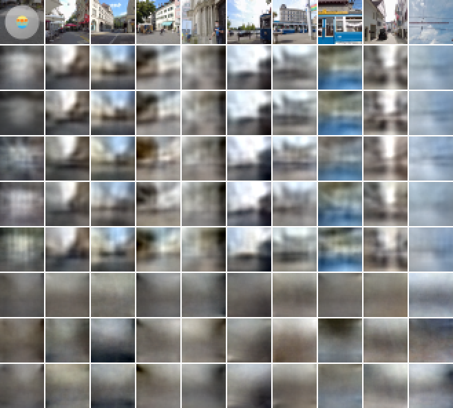

# 基礎（F0〜F3）の回す前に決めたこと・実装・結果

計画は [plans/foundation.md](../../plans/foundation.md)（問い・原理・評価・段の順序）。比べる相手は他の手法（`pca`・`mean8`・VAE の `v16`・`v17`・学習前）だけで、以前の JEPA（V18〜V18d）の結果とは比べない。

## F0: 評価の土台（回す前に決めたこと、2026-11-27）

物差しの符号の dyn の値は、まだ 1 つも読んでいない。例外は、下の「値を見た後の直し」に書いたものだけである。

### 未来と過去: minGRU のダイナミクスモデル（主）

- **入力**: 符号の系列は、重ならない stack（$s = 1$、0.8 秒おき）で作る。各符号を、参照の組で白色化した PCA64 の座標 $w$ にする（dyn/copy と同じ `midpoint.Whitener`）
- **組**: dyn/copy と同じ分け方にする（Zurich 以外の動画を seed 4101 の置換で、記録 1 本・検証 1 本・訓練に分ける）。評価は Zurich で行い、カットをまたぐ中心は除く。ブロックは 128 秒（160 step）で、Zurich では 64 秒ずらしたブロックも並べる
- **モデル**: 状態を持つ minGRU（`exp/video/dyn` と同じ系統）。1 層と 2 層の 2 通りで、幅は 256。刻み $\Delta \in \{0.8, 1.6, 3.2, 6.4, 12.8, 25.6\}$ 秒ごとの線形の頭を、共有の minGRU の上に並べ、直接当てる（巻き戻さない）
- **学習**: AdamW（lr $10^{-3}$、wd $10^{-2}$）、長さ 64 の窓（はじめの 8 step は損失に入れない burn-in）、検証の動画の損失で早期終了（patience 10 エポック）、seed は 6001・6002・6003
- **層の数の選び方**: 主に出すのは、検証の組の損失が小さい方（seed の平均、同点なら少ない方）である。Zurich では選ばない。両方を記録に残す
- **過去**: 時間を反転した系列で、同じものを別に学ぶ
- **比と主の数**: 比は、copy の誤差で割った $R_{\mathrm{copy}}$ と、平均の予測の誤差で割った $R_{\mathrm{clim}}$ の 2 つ。主の数は、0.8〜25.6 秒の $\log R$ の平均（`dynpred.mean_log`）と、その seed のばらつき
- **判定の言葉**: dyn/copy と同じ。2 つの分母の区間が同じ向きに良いときだけ「良い」と書く（`judge_dyn.words`）。区間の $\sigma_{ab}$ には、次の 2 つのうち大きい方を使う。`rot`（`pca` の白色化した符号に乱数の直交行列を掛けたもの）対 `pca` の seed の揺れと、対の seed の揺れである
- **下限**: 線形の 2 時点（dyn/copy の `fit_linear`）を両方向に並べる

### 今とガード

- **今（stack の中の補完）**: 格子を空間の軸で半分に切り、一方の半分の符号から他方を ridge で当てる（左右・上下の 4 つの向き）。時間の軸で切った前半 → 後半と後半 → 前半は、stack の中の未来・過去として並べる（記述）。分母は、copy（両半分の平均を引いたもの）と平均の 2 つ
- **time_r2**: トークンの分散のうち、時間に沿った平均で説明できる割合。閾値は $\max$(学習前の符号, 画素の tubelet) + 0.05
- **内容**: 符号から観測（stack の最後のフレームを 32×32 に平均したもの）を ridge で読み出す $E^{\mathrm{lin}}$ と、その変化の版 $E^{d,\mathrm{lin}}$ を使う。$\alpha$ は検証の組で選び、MLP は使わない
- **非劣性**: 計画の「$E^{\mathrm{lin}}$(学習した符号) $\le 1.10 \times \max(E^{\mathrm{lin}}(\texttt{pca}), E^{\mathrm{lin}}(\text{学習前}))$」は、誤差 $U = 1 - E$ についての式として読む。つまり $U \le 1.10 \max(U_{\texttt{pca}}, U_{\text{学習前}})$ である。$E$ は高いほど良い量なので、そのまま上からの抑えとして読むと、ガードにならない
- **閾値の確定**: time_r2 の閾値と非劣性の基準値は、学習した符号の値を見る前に、学習前と物差しの値から数を確定し、ここに書く（学習前の JEPA の符号が出たとき）

## 実装（2026-11-27）

| ファイル | 中身 |
| -- | -- |
| `exp/lib/mingru.py` | `MinGRUStack`（minGRU のあとに残差の minGRU を重ね、0 の状態から系列を読む。`exp/video/dyn` の `DynamicsStack` を頂上で読むものと同じ） |
| `exp/lib/gru_dyn.py` | 系列の組（`seq_set`、反転は `SeqSet.reversed`）、予測器 `GRUPredictor`、学習 `fit_gru`、ブロックの和 `gru_sums`、窓の神託 `best_window` |
| `exp/lib/synth_series.py` | 線形ガウスの状態空間モデル（`lgssm`・`lgssm_cov`・`lgssm_gamma`）と、カルマンフィルタの最良の誤差 `kalman_errors` |
| `exp/vision/fnd_dyn.py` | 実データの系列の符号化、minGRU と 2 時点の線形の行、合成の確かめ、CLI |
| `exp/vision/fnd_guard.py` | tubelet、`time_r2`、半分の視野、線形の内容、CLI。JEPA の checkpoint の口 `jepa_tokens`（トークン）と `jepa_halves`（半分の符号） |
| `exp/vision/results/foundation/judge_fnd.py` | 層の数の選び方、対の区間と判定の言葉、確かめのまとめ |

### 予測器の形

刻みごとに $\hat w_{t+\Delta} = M_\Delta [w_t; w_{t-\Delta}] + c_\Delta + A_\Delta y_t + b_\Delta$ とする。$y_t$ は minGRU の頂上である。$(M_\Delta, c_\Delta)$ は dyn/copy の 2 時点の線形（訓練の組で ridge、検証の組で $\alpha$）から始め、頭 $(A_\Delta, b_\Delta)$ は 0 から始める。全てを学習する。エポック 0 は線形そのものなので、族は下限を含み、早期終了は、検証の組で線形より悪い所では止まらない。1 エポックは訓練の系列を 1 回通すことで、窓を `window - burn` ずつずらして並べる（各時刻を 1 回ずつ採点する）。並べ始めの位置は、エポックごとに seed の生成器で一様に引く。

### CLI と物差しの符号の読み方

符号は `fnd_dyn encode` で、動画の stack から作る。物差しは `--code pca|mean8`（`jepa_eval.PCACode`。seed は V18c の設定の seed + `PCA_SEED`）と `--vae <名前> <ckpt>`（VAE の $\mu$）で指定する。JEPA の符号は `--places <名前> <module:function> <arg>` で渡す。`function(arg, device)` は、u8 の stack `(B, n, 3, S, S)` から符号 `(B, D)`（新しい JEPA では stack ごとの $z \in \mathbb{R}^{4096}$）への関数を返す。設定（stack の形と参照の組）は V18c の run の設定から読み、Zurich のカットは `runs/v18c-tlin` から読む。

```bash
python -m exp.vision.fnd_dyn encode --config <v18c run> --sets runs/v18c-tlin --out runs/fnd-dyn --code pca
python -m exp.vision.fnd_dyn encode ... --vae v16 <ckpt>
python -m exp.vision.fnd_dyn encode ... --places init <module:function> <arg>
python -m exp.vision.fnd_dyn rot --out runs/fnd-dyn                      # σ_rot 用
python -m exp.vision.fnd_dyn gru --out runs/fnd-dyn --code pca --layers 1 --dir future --seed 6001 --device cuda
python -m exp.vision.fnd_dyn lin --out runs/fnd-dyn --code pca
python -m exp.vision.fnd_dyn check --out runs/fnd-dyn/checks --name kalman --layers 1 --device cuda
python -m exp.vision.fnd_guard now --config <v18c run> --sets runs/v18c-tlin --out runs/fnd-dyn --code pca
python -m exp.vision.fnd_guard obs --config <v18c run> --sets runs/v18c-tlin --out runs/fnd-dyn
python -m exp.vision.fnd_guard content --out runs/fnd-dyn --code pca
python -m exp.vision.fnd_guard time-r2 --config <v18c run> --sets runs/v18c-tlin --out runs/fnd-dyn
uv run python -m exp.vision.results.foundation.judge_fnd --dir runs/fnd-dyn
```

### テストのオラクル

- **系列の組**: 中心の余白を数えて照合した。反転は 2 回で元に戻り、反転した組の $t + \Delta$ は元の $t - \Delta$ になる。中心の予測は窓の中の符号だけの関数で、窓の外を変えてもビットで変わらない。分母は手計算と照合した。学習前の予測は、2 時点の線形（`fit_linear` の予測）に一致する
- **窓の神託** `best_window`: 白い雑音では $k$、スカラーの AR(1) では $1 - r^{2\Delta}$ に一致する。窓 2・刻み 1 では `dynpred.best_linear` に、長い窓ではカルマンフィルタの誤差に一致する
- **状態空間モデル**: 共分散は Lyapunov の式を $10^{-12}$ で満たし、標本の積は $\Gamma(\ell)$ にバッチ平均の 5 SE で合う。完全に観測した AR(1) のカルマンの誤差は、$\mathrm{tr}(\Sigma - F^\Delta \Sigma F^{\Delta\top})$ に $10^{-10}$ で一致する
- **合成の確かめ**（`fnd_dyn check`、テストでは小さい版を slow で回す）。下限は $\hat E_\Delta \ge E^*_\Delta - z\,\mathrm{SE}$、上限は $\hat E_\Delta \le E^*_\Delta (1 + p/(nk)) + z\,\mathrm{SE}$ である（$p$ は予測器のパラメータの数、$nk$ は採点した値の数で、正しいモデルの最小二乗の漸近の超過）。$z = 4$
  - (a) `ou`: 多次元の AR(1)。$E^*$ は閉じた式の最良の線形予測
  - (b) `kalman`: 単位分散の AR(1) の状態（$\phi$ は 0.9〜0.99）を乱数の直交行列で混ぜ、分散 1 の雑音を足して観測する。確かめる条件は 3 つある。窓の最良がカルマンの最良と区別できないこと、上下の限界に入ること、2 つの神託の差が許容を超える刻み（1 つ以上）で、2 時点の線形の最良より良いことである。学習しない予測器（2 時点の線形だけ）は落ちる（陰性の対照）
  - (c) `reverse`: 対称な $F$（$\Gamma(\ell) = \Gamma(\ell)^\top$）を部分観測した、時間反転に対称な過程。未来と過去を別に学び、両方が限界に入り、誤差の差が、対にしたブロックの $z$ SE と超過の和に収まる
  - (d) `iid`: 白い雑音。$R_{\mathrm{clim}} \approx 1$、$R_{\mathrm{copy}} \approx 1/2$
- **今とガード**: tubelet の画素と位置を、フレーム番号と列を値にした stack で照合した。半分が保つ画素は、その半分の画素と同じ多重集合になる。`time_r2` は、時間に沿って一定のトークン（時刻ごとのずれも含む）で 1、時間に独立なトークンで $1/T$ になる。AR(1) の場の前半 → 後半は、白色化した座標での Schur 補元の閉じた式に、ブロックの 4 SE で合う。一方の半分に定数を足しても、和は動かない。観測の一部 $u$ を持つ符号では $E^{\mathrm{lin}} = \mathrm{tr}\,\Sigma_u / \mathrm{tr}\,\Sigma_y$ になり、$E^{d,\mathrm{lin}}$ は AR(1) の閉じた式に合う
- **判定**: 検証の損失が最小の層の数を選び、同点なら少ない方を選ぶ。分子が半分の符号は、両方の分母で $\psi = \log \tfrac12$ になり、「a の予測が b より良いと区別できた」になる。分母を逆向きに動かすと、「分母で向きが割れた」になる

## 値を見た後の直し（2026-11-27）

`pca` の試しの run（検証の組の損失だけを読んだ。Zurich の値は判定に使わない）と、合成の確かめの試しを見た後に入れた直しである。どれも、族が神託の最良を含むか、早期終了の刻みが過学習より細かいか、という理論で根拠づけた。

1. **2 時点の線形を足した。** minGRU の頂上は、入力の、ゲートつきの移動平均である。線形の頭だけでは、0.8 秒で `pca` の 1 時点の線形より悪いままだった（検証の組の損失は 0.808、2 時点の線形は 0.791）。2 時点の線形から始め、頭を 0 から始めれば、族は下限を含む
2. **`kalman` の過程を、減衰する回転から、混ぜた AR(1) の状態にした。** minGRU の状態は、入力の、正の実数の減衰の指数の和である（ゲートが一定なら $s_t = (1-u) s_{t-1} + u \tilde s_t$）。回転のカルマンフィルタの減衰は振動するので、この族の外にある。そのため 0.8 秒で、神託より 4 % 上に残った。AR(1) の状態を直交行列で混ぜて雑音を足した過程では、各状態のフィルタは減衰 $\phi_i (1 - K_i) \in (0, 1)$ の移動平均で、minGRU の単位そのものである。だから最良が族に入り、神託との差は学習の差として読める。$\phi$ の範囲（0.9〜0.99）は、2 時点の線形と最良の差が許容（$p/(nk)$ と $z$ SE）より十分に大きくなるように、神託の値だけで選んだ（0.8 秒で 8 %）
3. **2 時点の線形も学習するようにした。** 線形を固定すると、最良が $w_{t-\Delta}$ に 2 時点の線形と違う重みを置く場合に、族の外に出る。minGRU の状態は指数の和なので、遅れ $w_{t-\Delta}$ を作れない。そこで、2 時点の線形から始めて、一緒に学ぶ
4. **1 エポックを、訓練の系列を 1 回通すことにした。** 途中で一度、1 エポックを「全ての窓の始点を 1 回ずつ」にした（窓は 64、burn-in は 8 なので、各時刻を 56 回採点する。つまり 56 回通すことになる）。その前の形（ずらし幅 `window - burn`、位相は 0 に固定）では、線形が固定だったこともあり、合成の確かめが学ぶ前に止まったためである。しかし 56 回通す形では、早期終了の刻みが過学習より粗くなった。検証の損失は最初の確かめ（1 エポック目）で最小になり、2 層の minGRU は `kalman` の上限を超えた（0.8 秒で神託より 2.6 % 上、上限は 2.45 %）。1 回通す形（位相はエポックごとに乱数）に戻すと、`kalman` は 1 層で 22 エポック目、2 層で 11 エポック目に最小になり、上限の内に入った
## 結果

### F0 の合成の確かめ（2026-11-27、snapshot `9c6917743105`）

決めた設定（$k = 64$、幅 256、窓 64、AdamW lr $10^{-3}$・wd $10^{-2}$、patience 10、seed 6001）で、1 層と 2 層の両方を回した。系列は訓練 200000・検証 20000・試し 100000 step、SE は 500 step のブロックのバッチ平均、$z = 4$。**8 つ全てが通った。** テストの小さい版（$k = 3$、幅 16）の slow の 5 本も通った。

| 確かめ | 層 | 最良のエポック | 誤差 / 神託 − 1（0.8〜25.6 秒） | 上限 / 神託 − 1 | ほか |
| -- | -- | -- | -- | -- | -- |
| `ou` | 1 | 0 | 0.001〜0.0006 | 0.016 | $R_{\mathrm{clim}}$ 0.84 → 1.00 |
| `ou` | 2 | 0 | 0.001〜0.0006 | 0.027 | |
| `kalman` | 1 | 22 | 0.009〜0.008 | 0.016〜0.019 | 2 時点の線形の最良（91.1）より良い（85.0）。0.8〜12.8 秒の 5 刻みで差が許容を超え、その全てで良い |
| `kalman` | 2 | 11 | 0.015〜0.009 | 0.027〜0.029 | 同上 |
| `reverse` | 1 | 3（未来）・3（過去） | 0.003〜0.002 | 0.017 | 未来と過去の差は 0.03 以下（許容 2.0〜2.5） |
| `reverse` | 2 | 3・3 | 0.003〜0.002 | 0.027 | 差は 0.04 以下（許容 3.5〜4.1） |
| `iid` | 1 | 0 | 0.0005 | 0.016 | $R_{\mathrm{clim}} = 1.00$、$R_{\mathrm{copy}} = 0.50$ |
| `iid` | 2 | 0 | 0.0005 | 0.027 | 同上 |

下限（神託 − $z$ SE）は全ての行で −0.002〜−0.004 で、どの誤差もその上にある。窓 64 の最良とカルマンフィルタの最良の差は、`kalman` で $10^{-8}$ 未満だった。`ou`・`iid` は、最良が線形そのもの（エポック 0）で、学習しても検証の組で良くならなかった。理論どおりである。

### 記述: `pca` の検証の組での minGRU

上の直しの後、`pca` の未来では、1 層・2 層とも検証の組の損失がエポック 0（2 時点の線形、0.7911）で最小になり、学習で良くならなかった（10 エポック後に 0.7935・0.7937）。だから今の学習の規則では、`pca` の minGRU の値は 2 時点の線形と同じになる。符号の比べは同じ規則で行うので、判定の形は変わらない。Zurich の値はまだ読んでいない。

### F0 の合成の確かめ: fleet の CPU、seed 3 つ（2026-11-27、snapshot `6dc8bf908fca`）

上の確かめを、決めた設定のまま fleet の CPU（1 プロセスに 1 コア）で回し直した。seed は 6001・6002・6003 の 3 つに広げた。4 種 × 1・2 層 × 3 seed の 24 単位が**全て通った**。評価のコードは `cfffd1a` と同じである（snapshot との差は、並行して書かれた学習側のファイルだけ）。値は 3 つの seed の範囲で示す。

| 確かめ | 層 | 最良のエポック | 誤差 / 神託 − 1（0.8〜25.6 秒） | 上限 / 神託 − 1 | ほか |
| -- | -- | -- | -- | -- | -- |
| `ou` | 1 | 0・0・0 | 0.0006〜0.0013 | 0.017 | $R_{\mathrm{clim}}$ 0.84 → 1.00 |
| `ou` | 2 | 0・0・0 | 0.0006〜0.0013 | 0.027 | |
| `kalman` | 1 | 22・21・22 | 0.0075〜0.0092 | 0.019 | 2 時点の線形の神託との差が許容を超える 5 刻みの全てで、それより良い。窓 64 の最良とカルマンの最良の差は $3.9 \times 10^{-9}$ |
| `kalman` | 2 | 11・10・11 | 0.0088〜0.0154 | 0.029 | 同上 |
| `reverse` | 1 | 3〜4（未来・過去） | 0.0018〜0.0030 | 0.017 | 未来と過去の差は許容の 1.7 % 以下 |
| `reverse` | 2 | 3〜4（未来・過去） | 0.0019〜0.0032 | 0.027 | 未来と過去の差は許容の 0.9 % 以下 |
| `iid` | 1 | 0・0・0 | 0.0004〜0.0005 | 0.016 | $R_{\mathrm{clim}} = 1.00$、$R_{\mathrm{copy}} = 0.50$ |
| `iid` | 2 | 0・0・0 | 0.0004〜0.0005 | 0.027 | 同上 |

下限（神託 − $z$ SE）は −0.0022〜−0.0045 で、どの誤差もその上にある。GPU で回した上の表（seed 6001）と、最良のエポックも誤差も同じ範囲に入った。

### F0 の物差しの値（2026-11-27、snapshot `6dc8bf908fca`）

物差しは `pca`・`mean8`・VAE の `v16`・`v17` と、$\sigma_{\mathrm{rot}}$ 用の `rot` である。学習前の JEPA の符号 `init` は、あとから足した（下の「学習前の JEPA の符号」）。値を見た後の直しは入れていない。

**minGRU は全ての物差しで 2 時点の線形と同じになった。** 5 つの符号 × 2 方向 × 2 層 × 3 seed の 60 本の全てで、検証の組の損失はエポック 0（2 時点の線形）で最小だった。損失は 1 エポック目で約 0.2 % 上がり、その後 10 エポックのあいだ下がらなかった（例: `pca` の未来の 1 層で 0.7911 → 0.7928 → 0.7935）。そのため seed のばらつきは 0、$\sigma_{\mathrm{rot}}$ も 0 になり、区間はブロックの揺れだけで決まる。1 層と 2 層の検証の損失は同じなので、規則（同点なら少ない方）で 1 層を選んだ。ただし `v17` の過去では丸めの誤差で 2 層の損失がわずかに小さく、2 層が選ばれた。値は 1 層と全ての桁で同じである。線形の 2 時点（下限、`lin`）の値も、下の表と全ての桁で同じだった。

**診断（判定ではない）: 長い履歴の線形は検証の組で 2 時点の線形を超えなかった。** 各刻み $\Delta$ に、$w_t, \dots, w_{t-p+1}$ と $w_{t-\Delta}$ からの ridge を当てた。$\alpha$ は検証の組で選んだので、長い窓に有利な比べ方である。`pca` の未来では検証の組の誤差（座標あたり、刻みの平均）は $p = 1$ で 0.7905、4 で 0.7909、8 で 0.7938、16 で 0.7993、32 で 0.8095 だった。$p = 4$ の刻みごとの差は −0.14〜+0.24 % で、$p \ge 8$ では全ての刻みで悪くなった。`pca` の過去と `v17` の両方向も同じ形だった。したがって、物差しのデータでは 2 時点より長い線形の履歴に、検証の組で測れる改善は無い。minGRU がエポック 0 で止まるのは、学習の失敗ではなく、このデータの性質と読む。合成の `kalman` では同じ学習が 2 時点の線形の神託を超えた（上の表）。履歴に予測の情報がある符号なら、この評価はそれを拾える。

#### 未来と過去（主）

主の範囲 0.8〜25.6 秒の $\overline{\log R}$（copy / clim）。主の層の 3 seed の平均である（ばらつきは 0）。`rot` は `pca` と全ての桁で同じだった。

| 符号 | 未来 | 過去 | $R$(0.8 秒) 未来 | $R$(25.6 秒) 未来 |
| -- | -- | -- | -- | -- |
| `pca` | −0.510 / −0.273 | −0.514 / −0.272 | 0.690 / 0.375 | 0.533 / 0.956 |
| `mean8` | −0.488 / −0.270 | −0.492 / −0.268 | 0.774 / 0.361 | 0.531 / 0.959 |
| `v16` | −0.480 / −0.251 | −0.482 / −0.251 | 0.785 / 0.425 | 0.535 / 0.961 |
| `v17` | −0.537 / −0.233 | −0.538 / −0.232 | 0.647 / 0.479 | 0.530 / 0.954 |
| `init` | −0.498 / −0.255 | −0.502 / −0.253 | 0.738 / 0.420 | 0.533 / 0.954 |

`pca` に対する対の比（$z = 2$、区間は $\pm 2\,\mathrm{SE}$。a は行の符号、b は `pca`）:

| 対 | 方向 | $\psi_{\mathrm{copy}}$ [区間] | $\psi_{\mathrm{clim}}$ [区間] | 言葉 |
| -- | -- | -- | -- | -- |
| `mean8` 対 `pca` | 未来 | +0.022 [0.014, 0.030] | +0.004 [−0.000, 0.008] | 区別できない |
| | 過去 | +0.022 [0.015, 0.029] | +0.004 [−0.000, 0.008] | 区別できない |
| `v16` 対 `pca` | 未来 | +0.030 [0.022, 0.039] | +0.022 [0.015, 0.030] | b が良いと区別できた |
| | 過去 | +0.031 [0.022, 0.041] | +0.021 [0.013, 0.029] | b が良いと区別できた |
| `v17` 対 `pca` | 未来 | −0.027 [−0.032, −0.021] | +0.041 [0.033, 0.049] | 分母で向きが割れた |
| | 過去 | −0.025 [−0.029, −0.020] | +0.041 [0.032, 0.049] | 分母で向きが割れた |
| `rot` 対 `pca` | 両方 | 0.000 | 0.000 | 区別できない |
| `init` 対 `pca` | 未来 | +0.012 [0.004, 0.020] | +0.018 [0.009, 0.027] | b が良いと区別できた |
| | 過去 | +0.012 [0.005, 0.019] | +0.019 [0.010, 0.028] | b が良いと区別できた |

64 秒ずらしたブロック（記述）でも言葉は同じだった。例外は `mean8` の過去で、clim の区間が [0.0002, 0.0077] となり、0 を含まなかった。

**既存の dyn/copy との矛盾は無い。** dyn/copy の線形（own）の値は `pca` −0.506 / −0.242、`mean8` −0.482 / −0.238、`v16` −0.477 / −0.228、`v17` −0.534 / −0.209 である（[results/dyn/README.md](../dyn/README.md)）。

- 順序: copy では `v17` < `pca` < `mean8` < `v16`、clim では `pca` < `mean8` < `v16` < `v17` で、両方の評価で同じである。`pca` に対する $\psi$ の符号も全ての対で一致した
- 言葉が変わった対が 2 つある。`mean8` は dyn/copy で「b が良いと区別できた」（clim の区間 [0.001, 0.008]）、ここでは「区別できない」（[−0.000, 0.008]）。`v16` は dyn/copy の MLP で「区別できない」（+0.022 / +0.007）、ここでは「b が良いと区別できた」（+0.030 / +0.022）。どちらも clim の区間の端が 0 の近くにある対で、向きは変わっていない
- 水準: F0 の clim は全ての符号で dyn/copy より 0.023〜0.032 低い（copy は 0.003〜0.006 低い）。系列の作り（重ならない stack、余白 63 step でカットの近くを除くこと）の違いによる見込みだが、確かめていない。比べは同じ系列の上で行うので、判定には効かない

#### 今（半分の視野、`pca` と `init`）

Zurich での比 $R$（copy / clim）。区間は判定の規則に無いので、点の値だけを示す。

| 切り口 | 向き | `pca` $R_{\mathrm{copy}}$ / $R_{\mathrm{clim}}$ | `init` $R_{\mathrm{copy}}$ / $R_{\mathrm{clim}}$ |
| -- | -- | -- | -- |
| 今（空間） | 左 → 右 | 0.489 / 0.856 | 0.487 / 0.857 |
| | 右 → 左 | 0.500 / 0.861 | 0.501 / 0.859 |
| | 上 → 下 | 0.423 / 0.903 | 0.428 / 0.888 |
| | 下 → 上 | 0.536 / 0.877 | 0.512 / 0.872 |
| stack の中の未来 | 前半 → 後半 | 0.788 / 0.283 | 0.813 / 0.319 |
| stack の中の過去 | 後半 → 前半 | 0.788 / 0.283 | 0.757 / 0.315 |

`init` の半分の符号は、エンコーダにその半分の位置のトークンだけを見せ、そのトークン $t = R h$ を並べたもの（`fnd_guard.jepa_halves`）である。`pca` の前半と後半は同じ PCA を共有するので、未来と過去は同じ値になる。`init` は前半と後半で位置の埋め込みが違うので、両者は一致しない。

`mean8`・`v16`・`v17` は該当なし。`v16`・`v17` は画像全体から符号を作る VAE で、格子の半分だけを入れる口が無い。`mean8` は stack の平均画像なので、時間の半分は定義できない。空間の半分は定義できるが、今の CLI（`--code pca` だけ）に無いので出していない。

#### 学習前の JEPA の符号

`init` は、学習の run `fnd-T0-lr1e-4-lam0.5-s0` の step 0 における $z \in \mathbb{R}^{4096}$ である（`fnd_dyn encode --places init exp.vision.fnd_jepa:z_fn <ckpt>`）。minGRU の 12 本（2 方向 × 2 層 × 3 seed）も、他の物差しと同じくエポック 0（2 時点の線形）で最小になった。検証の損失は 1 層と 2 層で同じなので、規則に従って 1 層を選んだ。`init` は未来と過去のどちらでも、2 つの分母がそろって `pca` より悪い（上の表）。64 秒ずらしたブロックでも結論は同じだった。

#### ガード

- time_r2（参照の組の 5998 stack）: 画素の tubelet では 0.8169、`init` のトークン（全ての位置を見せたターゲット側、`fnd_guard.jepa_tokens`）では 0.7704 だった。物差し（`pca` などの stack ごとの符号）にはトークンが無いので、該当なし
- 内容（ridge の読み出し。$E^{\mathrm{lin}}$ / 誤差 $U = 1 - E^{\mathrm{lin}}$ / $E^{d,\mathrm{lin}}$）: `pca` 0.776 / 0.224 / 0.289、`mean8` 0.764 / 0.236 / 0.214、`v16` 0.723 / 0.277 / 0.159、`v17` 0.743 / 0.257 / 0.257、`init` 0.741 / 0.259 / 0.221
- 崩壊（K1〜K3）: 物差しは学習しないので、該当なし

**確定したガードの数（2026-11-27 23:10、学習した符号の値を見る前）**:

- **time_r2 の閾値は 0.867**（$\max(0.7704, 0.8169) + 0.05 = 0.8669$）。学習した符号の time_r2 がこの値を超えたら、「時間に沿って一定のトークン」への崩壊とする
- **$E^{\mathrm{lin}}$ の非劣性の基準は $U \le 0.2854$**（$1.10 \times \max(0.2244, 0.2595)$。$E^{\mathrm{lin}} \ge 0.7146$ と同じ）
- 学習前は `fnd-T0-lr1e-4-lam0.5-s0` の step 0（`ckpt/00000.0.pt`）とする。腕によらず、seed 0 のエンコーダの初期値は同じである。seed 1 の長い run では学習前の初期値が異なるが、基準はこの 1 つに固定する
- 崩壊（K1〜K3）: 物差しは学習しないので、該当なし

#### 評価のジョブの作り方

NAS の `/nas/geson/mujou-exp/runs/fnd-f0-eval/scripts/` にある。`job.sh` は `SNAP` に書いた snapshot を固定して、コンテナ `mujou-exp-dev-1` の中で 1 つの命令を走らせる。`worker.sh` は NAS のキュー（`q*/queue/`）から rename で job を取り、1 つずつ回す。worker は `docker exec -d` でホストごとに起動した。

- `mkq1.sh`: 合成の確かめ 24 本（CPU）と、符号化・観測・半分の視野・time_r2（4060）
- `mkq2.sh`: minGRU 60 本（4060・5070 Ti、空いていた 4090 2 枚）と、線形と内容 9 本（CPU）
- 新しい符号を足すときは、`fnd_dyn encode --places` で符号を作り、`mkq2.sh` の符号の並びに足して投げる
- `init` の minGRU・線形・内容は、学習側の評価 worker（`/nas/geson/mujou-exp/runs/fnd-train/scripts/evworker.sh` と `evalcode.sh`、snapshot `631715b6187e`）が評価し、結果を `/nas/geson/mujou-exp/runs/fnd-train-eval/` に出した。評価のコードは `cfffd1a` と同じである
- `init` の time_r2 と半分の視野は `mkinit.sh`（`sjob.sh` で snapshot `60f2d2725985` を固定、mini-00 の 5070 Ti）で評価した。出力は `fnd-f0-eval/guard/time_r2_init.json` と `now/init.json` にある。JEPA の checkpoint は `fnd_guard time-r2 --places NAME exp.vision.fnd_guard:jepa_tokens <ckpt>` と `fnd_guard now --places NAME exp.vision.fnd_guard:jepa_halves <ckpt>` で加えられる
- 診断用の `diag_window.py` も同じ場所にあり、出力は `logs/diag_window.log` にある

## F1〜F3: 学習の記録（2026-11-27〜28）

学習の側の実装・試し・$s$ の上端は [train.md](train.md) に書いた。

### 回す前に決めたこと

- **短い run**: 腕（T0・S1・Sσ）ごとに lr $\{10^{-5}, 10^{-4}\}$ × λ $\{0.5, 0.8, 0.95\}$、6000 step、seed 0（計 18 本）
- **長い run の設定の選び方**（`judge_train.py`）: 崩壊も発散もしていない設定のうち、step 6000 の検証の動画の補完の損失 `val_pred` が最小のもの。Zurich と minGRU の評価の組は使わない
  - 崩壊は、検証の動画の stack の上で K1〜K3 と time_r2 の線を越えること。発散は、6000 step に届かないか、数が有限でないこと
  - 線は、学習前の符号（step 0）と画素の物差しから、学習した値を見る前に確定した（`lines.json`）。K1 は `sigreg_heldin` ≥ 26.71、K2 は rank < 13.79、K3 は `token_r2` ≥ 0.5376、time_r2 は 0.8719 を超えること
- **長い run の step 数は 45000**（全ての腕・seed で同じ。2026-11-27 23:20、どの長い run も始まる前で、学習した符号の評価の値を見る前に決めた）
  - 速さ（4090 に 1 本、checkpoint なし、val と保存を含む）: T0 は 0.495 秒/step（短い run 4 本の実測）、S1 は 0.563 秒/step（短い run 2 本の実測）。Sσ は試しの 0.546 秒/step を、S1 にそろえて 0.565 秒/step と置いた
  - 4090 は 1 本で使用率が 100% になり、同居させても合計の速さは上がらない（fleet-manager の `fnd-ops/placement.md`）。4060（3.4〜3.7 秒/step）と 5070 Ti（1.0〜1.14 秒/step）では、長い run 1 本に 12 時間以上かかる
  - 長い run 6 本は分けられないので、4090 4 枚のうち 2 枚が 2 本ずつ持つ。最後に終わるのは、T0 の長い run の後に Sσ の長い run を回す列で、23:54 + N × (0.495 + 0.565) 秒になる
  - 60000 step では 17:35 になり、14:00 を過ぎる。14:00 までに終わるのは N ≤ 47900 である。並行の評価が 4090 に乗ったり NAS が遅れたりすることに備えて約 6% の余裕をとり、N = 45000 とした（見込みの終わりは 13:09）
  - checkpoint は step 0・2000・6000・10000・20000・30000・40000・45000 にあり、30000 も残る

### 置き方

- 4090: 短い run（T0 の 6 本、S1 の 6 本）と長い run 6 本を、1 枚に 1 本ずつ置く
- 4060: Sσ の短い run 4 本（`--checkpoint-blocks`）。終わった後は評価に使う
- 5070 Ti（mini-00）: Sσ の短い run 2 本（`--checkpoint-blocks`）。長い run は置かない（4090 を待つより遅く終わるため）
- `--checkpoint-blocks` は勾配の計算の順序を変えるだけで、数式は同じである
- 腕の短い run 6 本が終わると、`autolong2.sh` がその腕を判定し、長い run 2 本（seed 0・1）を 4090 のキューに積む

### 短い run の結果（step 6000、検証の動画）

18 本の全てが 6000 step を終えた（rc=0）。崩壊（K1〜K3、time_r2）と発散は 1 本も無かった。`judge_train.py` の出力は `fnd-train/judge-{T0,S1,Ss}.json` と `logs/judge-*.md` にある。表の `val_pred` は検証の動画の補完の損失（選択に使う数）、`val_rel` は隠したトークンの誤差の和を、同じ的のトークンの位置ごとの平均からのずれの和で割ったもの（予測器の $R_{\mathrm{clim}}$。分母はその run 自身の的なので、run どうしでは尺度が揃わない）、`short`・`long` は短距離と長距離のマスクに分けた `val_rel` である。

| 腕 | lr | λ | `val_pred` | `val_rel` | short | long | `sigreg_heldin` | rank | `token_r2` | time_r2 | 選択 |
| -- | -- | -- | -- | -- | -- | -- | -- | -- | -- | -- | -- |
| T0 | 1e-4 | 0.5 | 0.7092 | 0.8556 | 0.7967 | 0.9042 | 1.349 | 211.0 | 0.010 | 0.750 | ○ |
| T0 | 1e-4 | 0.8 | 0.8320 | 0.8919 | 0.8434 | 0.9320 | 1.284 | 239.8 | -0.004 | 0.734 | |
| T0 | 1e-4 | 0.95 | 0.8698 | 0.9046 | 0.8608 | 0.9408 | 1.269 | 247.8 | -0.008 | 0.724 | |
| T0 | 1e-5 | 0.5 | 0.8599 | 0.9448 | 0.9202 | 0.9656 | 1.429 | 190.1 | 0.011 | 0.772 | |
| T0 | 1e-5 | 0.8 | 0.9194 | 0.9554 | 0.9350 | 0.9725 | 1.400 | 190.4 | 0.002 | 0.764 | |
| T0 | 1e-5 | 0.95 | 0.9355 | 0.9579 | 0.9385 | 0.9742 | 1.398 | 189.9 | 0.001 | 0.762 | |
| S1 | 1e-4 | 0.5 | 0.4845 | 0.6113 | 0.5516 | 0.6576 | 1.351 | 197.8 | 0.009 | 0.766 | ○ |
| S1 | 1e-4 | 0.8 | 0.5837 | 0.6573 | 0.6043 | 0.6987 | 1.291 | 234.6 | -0.004 | 0.739 | |
| S1 | 1e-4 | 0.95 | 0.6199 | 0.6755 | 0.6258 | 0.7144 | 1.270 | 246.8 | -0.008 | 0.725 | |
| S1 | 1e-5 | 0.5 | 0.6933 | 0.7853 | 0.7554 | 0.8091 | 1.443 | 187.2 | 0.014 | 0.781 | |
| S1 | 1e-5 | 0.8 | 0.7602 | 0.8056 | 0.7785 | 0.8273 | 1.403 | 190.3 | 0.003 | 0.766 | |
| S1 | 1e-5 | 0.95 | 0.7775 | 0.8098 | 0.7832 | 0.8312 | 1.399 | 189.9 | 0.001 | 0.762 | |
| Sσ | 1e-4 | 0.5 | 0.5716 | 0.7511 | 0.6802 | 0.8016 | 1.486 | 177.2 | 0.014 | 0.762 | ○ |
| Sσ | 1e-4 | 0.8 | 0.6928 | 0.7739 | 0.7090 | 0.8215 | 1.388 | 176.2 | 0.000 | 0.747 | |
| Sσ | 1e-4 | 0.95 | 0.7239 | 0.7812 | 0.7177 | 0.8280 | 1.370 | 174.3 | -0.003 | 0.743 | |
| Sσ | 1e-5 | 0.5 | 0.7498 | 0.9164 | 0.9008 | 0.9276 | 2.902 | 165.7 | 0.030 | 0.786 | |
| Sσ | 1e-5 | 0.8 | 0.8274 | 0.9388 | 0.9246 | 0.9492 | 3.429 | 188.6 | 0.019 | 0.763 | |
| Sσ | 1e-5 | 0.95 | 0.8505 | 0.9453 | 0.9321 | 0.9549 | 3.660 | 193.9 | 0.015 | 0.756 | |

- 3 つの腕とも、lr $10^{-4}$・λ 0.5 を選んだ。どの腕でも、lr が大きく λ が小さいほど `val_pred` が小さい。選んだのは掃引の端なので、範囲の外にもっと良い設定がある可能性は残る。規則どおり、掃引は広げずに進めた
- λ が大きいほど `val_pred` が大きいのは、損失が $(1-\lambda)\,\mathrm{pred} + \lambda\,\mathrm{SIGReg}$ の形で補完の重みが減るためで、損失の定義から予想どおりである
- 腕ごとに検証のマスクと間隔の族が違うので、`val_pred` は腕どうしでは比べない

### 長い run（45000 step、seed 0・1）

| run | 始め | 終わり | 秒/step | step | `val_pred` | `val_rel` | `sigreg_heldin` | rank | `token_r2` | time_r2 |
| -- | -- | -- | -- | -- | -- | -- | -- | -- | -- | -- |
| T0 s0 | 23:53 | 06:05 | 0.495 | 6000 | 0.6375 | 0.8820 | 1.490 | 221.0 | 0.010 | 0.672 |
| | | | | 30000 | 0.4462 | 0.9604 | 1.220 | 264.2 | 0.032 | 0.381 |
| | | | | 45000 | 0.3928 | 0.9482 | 1.227 | 249.1 | 0.166 | 0.368 |
| T0 s1 | 23:54 | 06:08 | 0.498 | 6000 | 0.6365 | 0.8813 | 1.510 | 217.4 | 0.018 | 0.681 |
| | | | | 30000 | 0.3641 | 0.9587 | 1.289 | 251.1 | 0.123 | 0.412 |
| | | | | 45000 | 0.3690 | 0.9509 | 1.228 | 251.4 | 0.114 | 0.376 |
| S1 s0 | 01:38 | 08:32 | 0.552 | 6000 | 0.4358 | 0.6070 | 1.528 | 203.0 | 0.013 | 0.728 |
| | | | | 30000 | 0.2407 | 0.5953 | 1.274 | 300.7 | 0.044 | 0.433 |
| | | | | 45000 | 0.2107 | 0.5607 | 1.233 | 293.5 | 0.070 | 0.398 |
| S1 s1 | 01:38 | 08:30 | 0.549 | 6000 | 0.4213 | 0.5936 | 1.496 | 201.0 | 0.014 | 0.735 |
| | | | | 30000 | 0.2485 | 0.6497 | 1.232 | 311.1 | 0.034 | 0.497 |
| | | | | 45000 | 0.2299 | 0.6221 | 1.229 | 302.2 | 0.044 | 0.482 |
| Sσ s0 | 06:05 | 13:02 | 0.556 | 6000 | 0.4730 | 0.7556 | 1.986 | 162.1 | 0.018 | 0.706 |
| | | | | 30000 | 0.2974 | 0.7801 | 2.220 | 216.4 | 0.094 | 0.529 |
| | | | | 45000 | 0.2690 | 0.7376 | 2.182 | 212.6 | 0.108 | 0.520 |
| Sσ s1 | 06:08 | 13:07 | 0.559 | 6000 | 0.4810 | 0.7507 | 2.905 | 161.1 | 0.019 | 0.725 |
| | | | | 30000 | 0.3053 | 0.7985 | 1.969 | 208.1 | 0.105 | 0.552 |
| | | | | 45000 | 0.2856 | 0.7731 | 1.904 | 205.2 | 0.107 | 0.555 |

- 崩壊（検証の動画の K1〜K3、time_r2 の線）と発散は、6 本とも無かった（checkpoint の全ての step の val で確かめた）
- 長い run の step 6000 の値が短い run と違うのは、学習率の cosine の減衰が全体の step 数（45000）に合わせて遅くなるためである（`iid.lr_at`）
- 秒/step は始めから終わりまでの時間を 45000 で割ったもの（val と保存を含む）。6 本の最後は 13:07 に終わり、23:20 に見込んだ 13:09 とほぼ同じだった
- 時刻は 2026-11-27〜28 の JST。T0 は std-00・01、S1 は std-03・02、Sσ は T0 の後の std-00・01 の 4090 で回した
- 2026-11-28 08:30 ごろに Mac が異常終了したが、run と worker は std と mini-00 のコンテナで動いていたので影響は無い

### 先に出した評価（判定はまだしない）

評価の段が使う。出力は `/nas/geson/mujou-exp/runs/fnd-train-eval/` にあり、符号の名前は短い run が `<腕>-lr<lr>-lam<λ>`（step 6000）、長い run が `L-<腕>-lr1e-4-lam0.5-s<seed>-<step>`（step 30000 と 45000）である。

- minGRU（未来・過去、1 層・2 層、seed 3 つ）・線形の 2 時点・内容: `evworker2.sh`（`evalcode.sh`、snapshot `631715b6187e`）が、checkpoint ができるたびに 4060・5070 Ti の空いたものから順に当てた。出力は `codes/`・`gru/`・`lin/`・`content/`
- time_r2（参照の組）と今（半分の視野）: `gworker.sh`（snapshot `60f2d2725985`。`init` に当てたものと同じ）が、空いた std-02・03 の 4090 で当てた。出力は `guard/time_r2_<名前>.json` と `now/<名前>.json`。`now/config.json` は `fnd-f0-eval/now` のものを写した（同じ設定）
- `init` の結果は F0 のとおり `fnd-train-eval`（minGRU・線形・内容）と `fnd-f0-eval`（time_r2・今）にある
- 2026-11-28 13:12 に、学習した 30 個の符号（短い run 18 個、長い run 12 個）の全てで、上の評価がそろった（minGRU は各 12 本、失敗は無し）。その後、学習と評価の worker は `STOP` で止めた

## 評価の段: 学習した符号の判定（2026-11-28）

### 回す前に決めたこと

学習した符号の minGRU・今・内容・time_r2 の値を読む前に決めた（2026-11-28 13:40）。学習の段の README にある検証の動画の数（`val_pred`・K1〜K3・time_r2）は読んでいる。

- **対象の符号**:
  - 長い run の step 0・6000・30000・45000（各 seed）
  - 短い run の step 6000（18 本）
  - 物差し（`pca`・`mean8`・`v16`・`v17`）
  - step 0 のエンコーダは、腕によらず seed だけで決まる（3 つの腕の長い run と短い run の checkpoint を読み、seed 0・1 のどちらでも全ての重みがビットで一致した）。そのため step 0 の符号は、seed 0 の `init` と seed 1 の `init-s1` の 2 つである
- **評価の規則**: F0 と同じスクリプトと snapshot を使う（minGRU・線形・内容は `631715b6187e`、time_r2 と今は `60f2d2725985`）。評価のコードは、物差しに当てた `6dc8bf908fca` と同じである（ファイルの md5 で照合した）
- **判定**（`judge_eval.py`）: 計画 4 節の「良い」をそのまま使う
  - 未来と過去の両方で、物差し $b$ に対する言葉が「a が良いと区別できた」であること。言葉は、学習した符号の主の層（検証の組で選ぶ）での対で決める。物差しは 1 層と 2 層で同じ値である
  - K1〜K3 と時間の線で、崩壊していないこと。値は学習の run の `val.jsonl` の、その step の行を `lines.json` の線と比べる
  - time_r2（参照の組）が 0.867 以下であること
  - $U \le 0.2854$ であること
- **腕の判定**: 腕ごとに、長い run の最後（step 45000）を seed ごとに判定する。2 つの seed がそろって良いときだけ、その腕を「良い」とする。片方だけ良いときは「seed で割れた」と書く。短い run と、長い run の step 0・6000・30000 は記述として並べる
- **ずるの形**: 次の 3 つを、符号ごとに確かめる
  - 遅いだけ: `pca` に対して $\psi_{\mathrm{copy}} > 0$ かつ $\psi_{\mathrm{clim}} < 0$ で、区間が両方とも 0 を含まない
  - 時間に一定: time_r2 が 0.867 を超える
  - 内容を捨てた: $U > 0.2854$
- **予測器自身による同定**（`fnd_self.py`、記述）: エンコーダに格子の半分だけを見せ、学習した予測器で他方の半分のトークンを補完する。補完の相手は、全てを見たときのトークン $t$ である。切り口は、今の半分の視野と同じ 6 つにする。
  - 分母は 2 つ。copy は、見た半分のうち切り口の軸で最も近い位置のトークンである（未来なら最後に見た時刻、今なら切り口の隣の列）。平均は、参照の組のトークンの位置ごとの平均である
  - Sσ には $s = 1$（$\ell = 0$）を渡す
  - 分母がその符号自身のトークンなので、符号どうしの比べは記述にとどめる
- **復元の定性評価**（`recon_fnd.py`）: 学習した JEPA には復元の口がない。そこで全ての符号に、内容のガードと同じ ridge の読み出し（白色化した PCA64 の座標から、32×32 の最後のフレームへ）を当てる。Zurich の stack を等間隔に 10 個選び、像を並べる

### 結果（2026-11-28）

#### 判定: どの腕も `pca` と VAE を超えなかった

3 つの腕の 2 つの seed（長い run の step 45000）は、どれも「良い」に当たらなかった。`pca`・`v16`・`v17`・`mean8` のどれに対しても同じである（`judge_eval.py` の腕の判定は全て「not」）。落ちた理由は 2 つある。

1. **未来と過去で、2 つの分母の向きが割れた。** 学習した符号は、copy に対しては `pca` より予測しやすい（$\psi_{\mathrm{copy}} < 0$）。一方、平均に対しては、はっきり予測しにくい（$\psi_{\mathrm{clim}} > 0$）。したがって、言葉は「分母で向きが割れた」である（S1 の seed 0 だけは copy の区間が 0 を含むため、「区別できない」）
2. **内容のガードに落ちた。** $U = 1 - E^{\mathrm{lin}}$ は 0.75〜0.91 で、基準の 0.2854 を大きく超えた

崩壊（K1〜K3・時間の線）と time_r2 は、学習した全ての符号で通った。

主の範囲 0.8〜25.6 秒の $\overline{\log R}$ を示す（copy / clim）。主の層は全て 1 層である（検証の損失で選んだ）。seed によるばらつきは 0 であった。$\psi$ は `pca` に対する対の比であり、区間は $\pm 2\,\mathrm{SE}$ である。

| 符号 | 未来 | 過去 | 未来の $\psi$ copy / clim [区間] | 過去の $\psi$ copy / clim [区間] | 言葉（対 `pca`・`v16`・`v17`） |
| -- | -- | -- | -- | -- | -- |
| `pca` | −0.510 / −0.273 | −0.514 / −0.272 | | | |
| `v16` | −0.480 / −0.251 | −0.482 / −0.251 | | | |
| `v17` | −0.537 / −0.233 | −0.538 / −0.232 | | | |
| T0 s0 | −0.627 / −0.017 | −0.632 / −0.016 | −0.118 [−0.143, −0.092] / +0.257 [0.209, 0.304] | −0.118 [−0.148, −0.089] / +0.256 [0.208, 0.304] | 割れた・割れた・割れた |
| T0 s1 | −0.621 / −0.022 | −0.623 / −0.021 | −0.111 [−0.142, −0.080] / +0.252 [0.210, 0.293] | −0.109 [−0.148, −0.071] / +0.251 [0.208, 0.293] | 割れた・割れた・割れた |
| S1 s0 | −0.534 / −0.082 | −0.540 / −0.080 | −0.024 [−0.053, 0.005] / +0.192 [0.161, 0.223] | −0.026 [−0.063, 0.011] / +0.192 [0.159, 0.224] | 区別できない・割れた・区別できない |
| S1 s1 | −0.564 / −0.068 | −0.569 / −0.067 | −0.054 [−0.079, −0.030] / +0.206 [0.166, 0.246] | −0.055 [−0.082, −0.028] / +0.205 [0.164, 0.246] | 割れた・割れた・割れた |
| Sσ s0 | −0.555 / −0.091 | −0.560 / −0.089 | −0.045 [−0.072, −0.017] / +0.183 [0.147, 0.218] | −0.046 [−0.079, −0.013] / +0.184 [0.147, 0.220] | 割れた・割れた・区別できない |
| Sσ s1 | −0.558 / −0.088 | −0.565 / −0.087 | −0.049 [−0.073, −0.024] / +0.185 [0.150, 0.220] | −0.051 [−0.082, −0.021] / +0.185 [0.149, 0.222] | 割れた・割れた・区別できない |

言葉は、未来と過去で同じだった。

- **clim の値は 0 に近い。** $\overline{\log R_{\mathrm{clim}}}$ が −0.017〜−0.091 であるのは、0.8 秒先でも平均の予測よりわずかにしか良くないということである（`pca` は −0.273）
- **minGRU はここでも 2 時点の線形と同じだった。** 学習した符号の全て（36 個 × 12 本）で、検証の損失はエポック 0 で最小になった。線形の 2 時点の対についての言葉も、minGRU と同じである

#### ガード

| 符号 | K1〜K3・時間の線 | time_r2（線 0.867） | $E^{\mathrm{lin}}$ / $U$（基準 0.2854） / $E^{d,\mathrm{lin}}$ |
| -- | -- | -- | -- |
| `pca` | | | 0.776 / 0.224 / 0.289 |
| `init` | （学習前） | 0.770 | 0.741 / 0.259 / 0.221 |
| `init-s1` | （学習前） | 0.753 | 0.734 / 0.266 / 0.216 |
| T0 s0 / s1 | 通った / 通った | 0.375 / 0.374 | 0.093 / 0.907 / −0.193、0.106 / 0.894 / −0.168 |
| S1 s0 / s1 | 通った / 通った | 0.407 / 0.484 | 0.239 / 0.761 / −0.160、0.181 / 0.819 / −0.158 |
| Sσ s0 / s1 | 通った / 通った | 0.521 / 0.552 | 0.249 / 0.751 / −0.128、0.252 / 0.748 / −0.130 |

`init` と `init-s1` は、K1（`sigreg_heldin` 124 ≥ 26.7）を越えるが、学習前の符号は SIGReg で整えられていないので、これは当然である。学習前は判定の対象ではない。

#### ずるの形

- **遅いだけ（$\psi_{\mathrm{copy}} > 0$、$\psi_{\mathrm{clim}} < 0$）**: 学習したどの符号でも当たらなかった。実際の向きは逆で、学習した全ての符号で $\psi_{\mathrm{copy}} < 0$、$\psi_{\mathrm{clim}} > 0$ だった。これは計画の 2 節にある「雑音を足す」形である。隣の stack との差（copy の誤差）が大きくなるので、copy に対しては良く見え、平均に対しては予測しにくくなる
- **時間に一定**: 当たらなかった。time_r2 は 0.37〜0.55 で、学習前（0.770）や画素の tubelet（0.817）より低い。トークンは、stack 内の時刻ごとに、画素以上に変化している
- **内容を捨てた**: 全ての長い run（step 6000 から）と、短い run 17 本が当たった。例外は Sσ の lr $10^{-5}$・λ 0.5（step 6000）だけで、$U = 0.28499$ が基準 0.28540 の内にわずかに入った。この符号でも、未来と過去の言葉は「分母で向きが割れた」だけで、「良い」わけではない

#### 学習の経過と段の差（記述）

seed 0 の未来の $\overline{\log R}$（copy / clim）と $E^{\mathrm{lin}}$ を step ごとに並べる（step 0 は `init` であり、3 つの腕に共通）。

| 腕 | step 0 | 6000 | 30000 | 45000 |
| -- | -- | -- | -- | -- |
| T0 | −0.498 / −0.255、0.741 | −0.580 / −0.110、0.474 | −0.638 / −0.018、0.105 | −0.627 / −0.017、0.093 |
| S1 | 同上 | −0.565 / −0.136、0.528 | −0.545 / −0.077、0.266 | −0.534 / −0.082、0.239 |
| Sσ | 同上 | −0.585 / −0.128、0.484 | −0.566 / −0.079、0.223 | −0.555 / −0.091、0.249 |

- 学習が進むほど clim は 0 に近づき（平均の予測と変わらなくなる）、$E^{\mathrm{lin}}$ は下がった。step 6000 の時点で既に、全ての腕と seed が「分母で向きが割れた」になっている
- **T0 → S1（時間の補完の効果）**: step 45000 で clim は −0.017 → −0.082（seed 1 は −0.022 → −0.068）、$E^{\mathrm{lin}}$ は 0.093 → 0.239（0.106 → 0.181）になった。時間の補完を足すと、時間の予測しやすさと内容が両方とも残りやすくなる向きである。ただし、どちらも `pca` には遠く及ばない
- **S1 → Sσ（時間の尺度の効果）**: clim は −0.082 → −0.091（seed 1 は −0.068 → −0.088）、$E^{\mathrm{lin}}$ は 0.239 → 0.249（0.181 → 0.252）で、差は小さい
- 短い run（step 6000）の 18 本も、全て「分母で向きが割れた」だった。clim が最も `pca` に近いのは、lr $10^{-5}$・λ 0.5 の Sσ（未来 −0.532 / −0.202）である。学習が少ない符号ほど `init` に近い順に並ぶ

#### 今（半分の視野、記述）

Zurich での $R$（copy / clim）である。

| 符号 | 左 → 右 | 上 → 下 | 前半 → 後半（stack の中の未来） | 後半 → 前半（過去） |
| -- | -- | -- | -- | -- |
| `pca` | 0.489 / 0.856 | 0.423 / 0.903 | 0.788 / 0.283 | 0.788 / 0.283 |
| `init` | 0.487 / 0.857 | 0.428 / 0.888 | 0.813 / 0.319 | 0.757 / 0.315 |
| T0 s0 45000 | 0.556 / 0.984 | 0.589 / 1.000 | 0.533 / 0.923 | 0.530 / 0.932 |
| S1 s0 45000 | 0.493 / 0.969 | 0.475 / 0.999 | 0.490 / 0.774 | 0.469 / 0.788 |
| Sσ s0 45000 | 0.486 / 0.967 | 0.507 / 0.995 | 0.487 / 0.696 | 0.467 / 0.703 |

- 空間の半分から他方の半分を線形に当てる問題では、学習した符号の clim は 0.96〜1.00 だった。平均の予測とほぼ変わらない（`pca` は 0.86〜0.90）
- stack の中の未来と過去の clim は、T0 が 0.92〜0.93、S1 が 0.77〜0.79、Sσ が 0.70 だった。時間の補完を学んだ腕ほど低いが、それでも `pca` の 0.283 より大きい
- seed 1 でも同じ形だった（T0 の前半 → 後半は 0.515 / 0.939、S1 は 0.529 / 0.723、Sσ は 0.558 / 0.691）

#### 予測器自身による同定（記述）

学習した予測器が、自分のトークンの空間で行う補完の $R$（copy / clim）である。値は seed 0 の step 45000 のものである。

| 腕 | 左 → 右 | 上 → 下 | 前半 → 後半 | 後半 → 前半 |
| -- | -- | -- | -- | -- |
| T0 | 0.974 / 0.960 | 0.982 / 0.982 | 0.640 / 0.914 | 0.723 / 0.913 |
| S1 | 0.917 / 0.913 | 0.930 / 0.962 | 0.316 / 0.354 | 0.351 / 0.373 |
| Sσ | 0.896 / 0.896 | 0.929 / 0.947 | 0.471 / 0.414 | 0.526 / 0.462 |

- 時間の補完を学んだ S1 と Sσ の予測器は、自分の空間では、stack 内の未来と過去を平均より大幅に良く当てる（clim 0.35〜0.46）。T0 は時間のマスクで学習していないため、0.91 にとどまる
- 一方、空間の半分の補完は、どの腕でも平均の 0.90〜0.98 にとどまる。copy に対しては、step 6000 の値（たとえば T0 の上 → 下は 0.650 / 0.931）より悪くなった
- 学習前（`init`）の予測器は、乱数の重みから出力するため、clim が 28〜50 である

#### 復元の定性評価



1 行目は観測（Zurich の stack の最後のフレームを 32×32 に平均したもの、等間隔に 10 個）である。2 行目からは、各符号の白色化した PCA64 から ridge で読み出した像で、`pca`・`mean8`・`v16`・`v17`・`init`・T0・S1・Sσ（seed 0、step 45000）の順に並ぶ。物差しと `init` は、場面の明るさと大きな構造（空・建物・青い壁）を再現している。学習した 3 つの腕の像は、ほぼ平均の灰色のぼかしであり、場面を見分けられない。内容の数値（$E^{\mathrm{lin}}$ 0.09〜0.25）と見た目は合っている。seed 1 の像（`fnd-eval/recon/recon-s1.png`）も同じであった。

#### 診断（判定ではない、値を見た後）: 内容は分散の大きい方向に無い

値を確認した後、内容が $z$ に存在しないのか、評価が読む上位 64 の主成分に存在しないだけなのかを切り分けた。参照の組 5998 stack を順に 60 / 20 / 20 に分割し、$z \in \mathbb{R}^{4096}$ の全体と白色化した PCA64 のそれぞれから、ridge で最後のフレームを読み出した（スクリプトは `fnd-eval/scripts/diag_share.py`、出力は `fnd-eval/diag/`）。

| 符号 | 上位 64 の分散の割合 | $E^{\mathrm{lin}}$（$z$ の全体） | $E^{\mathrm{lin}}$（PCA64） |
| -- | -- | -- | -- |
| `init` | 0.62 | 0.790 | 0.658 |
| T0 s0 45000 | 0.48 | 0.590 | 0.052 |
| S1 s0 45000 | 0.46 | 0.582 | 0.188 |
| Sσ s0 45000 | 0.57 | 0.493 | 0.182 |

- SIGReg が $z$ を等方にしたので上位 64 は偶然の方向になった、という見込みは外れた。上位 64 は分散の 46〜57% を持つ
- 学習した $z$ の全体には内容が残っている（0.49〜0.59）が、分散の大きい方向にはほとんど無い。学習した符号では、分散の大きい 64 の方向が、フレームから線形に読めず、時間的にも予測しにくい成分で占められている
- 全体の内容も `init`（0.790）より低い。ただし、4096 次元を 3598 の stack で当てているため、過学習の分だけ低く出ている可能性はある
- この診断で判定は変えない。評価の規則（白色化した PCA64）は、全ての符号に同じく当てたものである

#### 言えること・言えないこと

言えること:

- この基礎（1 つの stack の中の時空間の補完、JEPA + SIGReg、tubelet 8×8、$d = 16$、EMA なし）の 3 つの腕は、成功の最低線を満たさなかった。未来と過去の予測しやすさで `pca` を超えず、`v16`・`v17` も超えない。理由は、学習によって平均に対する予測しやすさが失われ（clim が 0 に近づく）、内容のガードにも落ちたことである
- 落ち方は「遅いだけ」でも「時間に一定」でもない。「雑音を足す」形である（copy に対して良く、平均に対して悪い）
- 時間の補完を目的に加えると（T0 → S1）、時間の予測しやすさ、内容、stack の中の未来の補完が、いずれも良い向きに動いた。時間の尺度を変えた効果（S1 → Sσ）は小さかった
- 予測器自身は、自分の空間では stack の中の未来と過去を当てられる（S1 の clim 0.35〜0.37）。しかし、その予測しやすさは、$z$ の分散の大きい方向にも、stack をまたぐ時間の予測しやすさにも表れていない

言えないこと:

- 掃引の外の設定（lr $> 10^{-4}$、λ $< 0.5$、長い学習）で結果が変わるか。選んだ設定は掃引の端にあり、短い run では学習が少ないほど `init` に近かった
- 評価が PCA64 ではなく $z$ の全体を読んでいたら、判定が変わったか。診断では、全体の内容は残っていた。ただし、評価の規則は F0 で決めたものであり、値を見た後には変えない
- 分散の大きい方向を占める成分が何か（位置や時刻の符号、SIGReg の分布合わせの副産物など）は、確かめていない

## 再現性

- mujou: `5aa37738dd04`
- コードの snapshot: 合成の確かめは `9c6917743105`（作業ツリー、`just fleet push`）。直しの前の版（`6247c7725943`）の出力は `old/` に残した
- 出力: `/nas/geson/mujou-exp/runs/fnd-f0/`（合成の確かめ。job と worker のスクリプトは `scripts/`）。`pca` の試しの run は `/nas/geson/mujou-exp/runs/fnd-f0-smoke/`（判定に使わない）
- F0 の物差しの値と、CPU・seed 3 つの合成の確かめ: snapshot `6dc8bf908fca`（`cfffd1a` の上の作業ツリー。評価のコードは `cfffd1a` と同じ）、出力は `/nas/geson/mujou-exp/runs/fnd-f0-eval/`（`codes/`・`gru/`・`lin/`・`content/`・`now/`・`guard/`・`checks/`、job と worker は `scripts/`）。物差しの符号の設定は V18c の `runs/v18c-long/v18c-lr1e-4-lam0.5-r0.5-s0`、Zurich のカットは `runs/v18c-tlin`、VAE は `v16` が `runs/v16-iid/iid-all-lr3e-4-s0/ckpt/600000.0.pt`、`v17` が `runs/v17-chunk/v0-base-49b81800-s0/ckpt/04800.0.pt`（dyn/copy と同じ）
- 判定のまとめ: `uv run python -m exp.vision.results.foundation.judge_fnd --dir /nas/geson/mujou-exp/runs/fnd-f0-eval`
- F1〜F3 の学習: snapshot `efc1930ed4c1`（`91a629a` の上の作業ツリー。差分は README だけで、学習のコードは `91a629a` と同じ）、mujou `5aa37738dd04`。短い run は seed 0、長い run は seed 0・1。出力は `/nas/geson/mujou-exp/runs/fnd-train/`（run ごとの `config.yaml`・`train.jsonl`・`val.jsonl`・`ckpt/`、判定は `judge-*.json`・`lines.json`、キューと worker は `scripts/`、ログは `logs/`）。計算機の試しは `fnd-train-trial/`、配置の記録は `fnd-ops/`
- 学習した符号の評価: `/nas/geson/mujou-exp/runs/fnd-train-eval/`（minGRU・線形・内容は snapshot `631715b6187e`、time_r2 と今は `60f2d2725985`。どちらも mujou `5aa37738dd04`）。評価の段で足した 7 符号（長い run の step 6000 と `init-s1`）も同じ snapshot と場所で、スクリプトは `/nas/geson/mujou-exp/runs/fnd-eval/scripts/extra.sh`
- 評価の段: 出力は `/nas/geson/mujou-exp/runs/fnd-eval/`（予測器自身による同定 `self/`、復元の像 `recon/`、診断 `diag/`、判定 `judge.json`、job は `scripts/`、ログは `logs/`）。`fnd_self` と `recon_fnd` は snapshot `1a172d177f9a`（`f25d1f0` の上の作業ツリー。コミット `6039a87` とは整形だけが違う）、判定と診断は `6039a874b4de`（`6039a87`）、mujou `5aa37738dd04`
- 判定: `uv run python -m exp.vision.results.foundation.judge_eval --f0 <runs>/fnd-f0-eval --train <runs>/fnd-train-eval --self <runs>/fnd-eval --runs <runs>/fnd-train --json judge.json`
